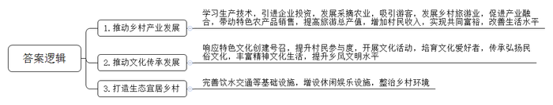
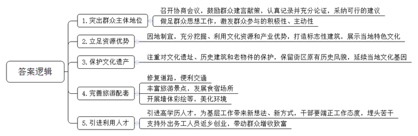
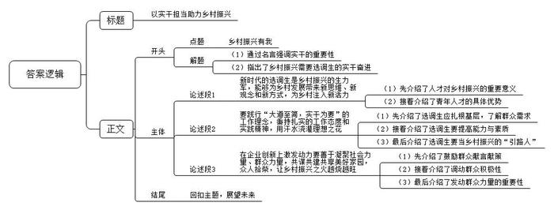

# 2023年湖北省定向、集中选调生考试《申论》题

<!-- gwy:overview:start -->
> **湖北 · 2023 · 申论 · 选调生** ｜ 3 题 · 图片 3 处 · 答案随题折叠

导航：[题目](#题目) · [材料 1](#材料-1)
<!-- gwy:overview:end -->

> 候选采集稿。参考答案及解析来自粉笔页面，不代表官方答案或真实高分答卷；来源使用许可与原卷对应关系仍需人工核实。

## 给定材料

### 材料 1

2023年2月7日，在学习贯彻习近平新时代中国特色社会主义思想和党的二十大精神研讨班开班式上，习近平总书记发表重要讲话强调，要正确理解和大力推进中国式现代化。概括提出并深入阐述中国式现代化理论是党的二十大的一个重大理论创新，是科学社会主义的最新重大成果。中国式现代化是人口规模巨大的现代化，是全体人民共同富裕的现代化，是物质文明和精神文明相协调的现代化，是人与自然和谐共生的现代化，是走和平发展道路的现代化。

党的二十大报告强调“全面推进乡村振兴”“建设宜居宜业和美乡村”。这是以习近平同志为核心的党中央统筹国内国际两个大局、坚持以中国式现代化全面推进中华民族伟大复兴，对正确处理好工农城乡关系作出的重大战略部署，为新时代新征程全面推进乡村振兴、加快农业农村现代化指明前进方向。

全面建设社会主义现代化国家，实现中华民族伟大复兴，最艰巨最繁重的任务依然在农村，最广泛最深刻的基础依然在农村。城乡发展不平衡、乡村发展不充分仍是社会主要矛盾的集中体现。新时代新征程，要以全面建成小康社会为新起点，做好全面推进乡村振兴这篇大文章，补上“三农”短板，夯实“三农”基础，促进农业全面升级、农村全面进步、农民全面发展，建设宜居宜业和美乡村。这是农业农村发展的历史方位，也是“三农”新的历史使命。

农村是我国传统文明的发源地，乡土文化的根不能断，农村不能成为荒芜的农村、留守的农村、记忆中的故园。农村优秀传统文化是新时代提振农村精气神的宝贵精神财富。推进宜居宜业和美乡村建设，必须坚持物质文明和精神文明一起抓，把我国农耕文明优秀遗产和现代文明要素结合起来，赋予新的时代内涵，让我国历史悠久的农耕文明在新时代展现其魅力和风采，进一步改善农民精神风貌，提高乡村社会文明程度。

### 材料 2

四川省北川县石椅村是汶川地震灾后重建村，如今已成为全国文明村。这里山清水秀、云雾缭绕，被誉为“云朵上的山寨”。枇杷、苔子茶等特色农产品发展很好，文化活动蓬勃开展，乡村旅游很兴旺，石椅村年接待游客达20万人次，实现旅游总产值4000余万元，村民人均可支配收入超过4万元。2023年1月18日，习近平总书记通过视频连线向乡亲们、游客们拜年，“新时代的乡村振兴，要把特色农产品和乡村旅游搞好，你们是一个很好的样子，希望大家继续努力，百尺竿头更进一步，在乡村振兴中取得新的更大成绩，一起迈向共同富裕，生活越过越红火。”

### 材料 3

湖北省第十二次党代会认真贯彻落实习近平总书记关于湖北工作的重要讲话和指示批示精神，不折不扣贯彻落实党中央决策部署，立足新发展阶段，完整准确全面贯彻新发展理念，科学谋划湖北未来发展蓝图，提出建设全国构建新发展格局先行区的目标任务。建设全国构建新发展格局先行区，必须大力实施强县工程，全面推进乡村振兴，坚持以人民为中心的发展思想，广泛开展美好环境与幸福生活共同缔造活动，从群众关心的事和让群众满意的事做起，发动群众决策共谋、发展共建、建设共管、效果共评、成果共享、共同建设美好家园。

### 材料 4

刚刚过去的春节假期，湖北省旅游业实现开门红，推出15条“钟情湖北过大年”春节主题旅游线路吸引游客，7天假期全省A级旅游景区接待游客882.91万人次，同比增长41%。其中，64家A级旅游景区和度假区，游客人数和收入均创历史新高。武汉的木兰花乡、紫薇都市田园、凤娃古寨等乡村旅游度假区游客人数和收入均创历史新高。宜昌市玉泉风景名胜区接待人次、旅游收入分别达到2019年同期129.35%、256%。神农架林区中和滑雪场游客接待人数和收入均创历史新高。

### 材料 5

2023年1月22日，大年初一，随着A县江源村龙灯队领头人一声“起”，众人撑起板凳龙灯、敲锣打鼓巡游祈福，龙灯所到之处，锣鼓鞭炮齐鸣，场面热闹壮观，板凳龙灯是一项传统民间文化活动，春节的龙灯巡游由该村乡贤王先生发起。他介绍，乡村振兴，文化先行。2018年为响应“特色文化创建”号召，凝聚更多乡亲投身乡村振兴，并增强节日气氛，特筹办板凳龙灯活动，自当年起，定于每年大年初一舞龙灯，后因疫情暂停3年。今年重启，返乡游子强烈要求继续这项活动。春节前夕，大家自发组织，200余名村民踊跃参加，板凳增加到122节，抬龙队伍中，以村中青壮年为主，老少都参加。王先生一家三代齐上阵，跟着龙头的节奏在阡陌巷道间穿梭。今年20岁的陈先生说，“节日气氛迎面扑来，开心！”

大年初六，B县沿河镇，当地的土家族民间艺人曹先生身着民族服饰，在吊脚楼前跳起欢快的民俗舞蹈采莲船，围拢过来的老乡和游客也喜笑颜开。随后上演的B县堂戏，将现场气氛推向高潮。一张方桌，两把椅子，花旦顾盼生姿、小生脚踏方步、丑角诙谐幽默，唱腔风格独特，上演百味人生。B县堂戏是省非物质文化遗产代表性项目，在神农溪流域有数百年的历史，被誉为“跳动的一朵艺术浪花”。今年春节假期，三峡和神农溪游人如织，这朵“浪花”积聚起更多人气。

近年来，B县积极保护和传承非物质文化遗产，目前已有43项列入各级非遗名录，有218名非遗传承人、15个非遗传承基地、268支民间艺术团队，通过非遗进校园、举办培训班、展览展演等形式，培养近万名民间文艺爱好者。以文促旅，以旅彰文，通过开展丰富多彩的民俗活动，不仅传承和弘扬了民俗文化，而且丰富了村民精神文化生活，提升了乡风文明水平。

### 材料 6

朝阳山村地处山区，以前环境脏乱差，交通不便利，村里想办产业，没资源没经验没点子，慢慢地人心散了，村民们都出门打工了，村里日渐凋敝。

某单位驻村工作队到村后，下大力气解决村里的急难愁盼问题。为了让群众喝上放心水，工作队积极申请省农村饮水安全项目，让清水流到了各家各户。为了方便村民安全出行，工作队积极帮扶下，村里新建、拓宽了多座桥梁；在各个路口竖起一根根太阳能路灯……根据村里的资源禀赋，工作队和村两委商量后，决定大力发展蔬菜水果采摘产业，推进文旅融合。请来专家培训技术，引进企业投资，帮脱贫户申请贷款建大棚。如今，120个蔬果大棚已经落成见效，越来越多的游客不请自来，曾经的“后进村”蜕变为产业发展样板村。

C县南部山区有一条旅游环线，沿线各村或发展采摘，或挖红色文化，乡村旅游如火如荼。K村是脱贫村，处在该环线上，村内有一座珠山，小河环绕，风景别致。传说，真武大帝寻觅修炼地时，挥剑斩断赛武当峰的山尖，落在K村，便是珠山。

为了推进文旅融合发展，驻村工作队和村里认为，我们村生态好、景色美，可以依托珠山发展乡村旅游，把绿水青山变成金山银山。于是召开村民代表会，大家你一言我一语，纷纷出主意：山顶建个亭子；山脚立块大石，刻上珠山传说；山上有棵松树，据说有三四百年树龄，也要保护好……

K村招了一家文创公司拿设计方案，工程建设预算40万元，大家又犯了难，怎么办？再开村民代表会，大家依旧踊跃。有的说，家里有石板，可以拿出来做步道；有的做过石匠、木匠，愿意帮工；还有创业当老板的当场投资。

珠山改造动工，全村人几乎个个上阵。一个月后，工程完工，只花了30万元便打造成一个乡村旅游的景点。

随后，村里又平整出一片草坪，供游客搭帐篷、露营；围着河湾，村里还修了600米的彩虹步道；村内广场新增灯光篮球场、健身器材和儿童游乐设施。

原先冷冷清清的珠山成了网红打卡地。每到节假日，村里的停车场满满当当。游客多了，村民的土特产变得紧俏起来，水果、蔬菜、土特产都供不应求，村里又开了3家农家乐，还有村民开起民宿。村民从乡村旅游中得到实实在在的红利，收入大幅增加，获得感不断提升。脱贫攻坚成果进一步巩固拓展。

### 材料 7

D村扎实开展美好环境与幸福生活共同缔造活动，为突出群众主体地位，抓准突破口，村里召开院坝会商议，村民们你一言我一语，村干部认真记录村民建议，纷纷建言献策。回乡创业的小张说：“我乡种茶历史悠久，是有名的产茶大乡，几代人都靠种茶发家致富，能不能建一个标志性的建筑把茶文化展示出来，还可以吸引游客进来。”在小山村建茶文化博物馆，D村是有基础的，1934年一支红军曾在该村休整，召开了一次重要会议。全乡茶园五万多亩，该村就有6300多亩，是省级示范基地核心所在地。村里的码头是万里茶道的重要遗址，驿亭、关隘等历史建筑保存完好，各种制茶设备完整地保留了下来。经过多次讨论和论证，村里决定建设茶文化博物馆。

在博物馆道路的进口处，原来是一块魔芋地。起初，村民老何是寸土不让，通过村干部上门，做工作、算细账、描远景，老人终于想通了，扛起锄头将地里魔芋“提前丰收”。老何还主动让出老宅，建博物馆主体。“环境变好了，得到好处的是村民自己，我宁可不要一分钱补偿！”在共同缔造中，D村充分发挥群众主体地位，走出一条“党支部牵头、驻村单位积极支持、村民主动参与”的路子。现如今，两栋古色古香的主体建筑拔地而起，进出道路平整加固，村民房屋墙壁上彩绘着采茶、制茶的劳作画面。只待室内装潢和布展，这个建在小山沟的茶博物馆便呱呱坠地。“与十字路会议旧址和老街、古码头形成的‘一会一馆一街一码头’，还可以发展民宿，走文旅融合之路，让村民腰包更鼓……”村党支部书记信心十足地说。

### 材料 8

春节刚过，Z村的地头里，选调生小吴正跟乡亲们一块种土豆。“初五后，小吴不时来帮工。干活不惜力，像个庄稼人！”王大爷竖起大拇指。

对小吴来说，Z村让他成长。去年硕士毕业后，录用通知书他拿到手软，设计院、施工企业、工程咨询单位……但他最终选择回省，成为一名选调生，后被单位派到Z村驻村。“到基层和人民中去建功立业，让青春之花绽放在祖国最需要的地方，我觉得更有意义。”小吴憨厚地说。

刚来时，能否快速适应新环境？他心里也没底，老村委办公楼有间小房子，配有一张书桌，一张床。小吴新添了一个帆布衣柜后，正式入住。小吴琢磨，干工作，得了解村情。不到半年，全村130家脱贫户，他挨个跑遍。“路偶尔会记混，问地里劳作的大爷、路边晒太阳的大娘，就找到了。”村民习惯讲方言，为方便沟通，说惯普通话的他，硬是在短时间内学会六七成。村民渐渐发现地头总能看见这个小伙子，有干劲、热心肠，闲时唠家常做记录，忙时出把力搭把手。“他是大家眼中的好后生。”村党支部书记说。

该村附近有个绿色农产品产业园。小吴打算今年组织支部党员到产业园考察学习，给村里争取一些家门口增收的机会。“我希望今年风调雨顺，更多的企业来我们村招工，乡亲们生活越过越好。”小吴充满信心，“新的一年，我打算跟大伙儿多交流，一起谋划Z村发展，把Z村建设得更美好！”

当前，选调生岗位越来越受到高校毕业生青睐，到基层工作的热情高涨，W大学王教授认为，高学历人才的下沉，为基层工作带来了新想法、新方式，为乡村振兴带来契机。乡村工作不仅要有态度，还要埋头苦干，为推进中国式现代化献光发热。

## 题目

### 第 1 题

**请根据给定资料1\-6，概述文旅融合在乡村振兴中发挥了哪些作用？（20分）**

关联材料：材料 1、材料 2、材料 3、材料 4、材料 5、材料 6

作答要求：

要求：

（1）观点全面、准确；

（2）条理清晰、语言简练；

（3）不超过200字。

第 1 题 · 答案与解析

**参考答案（粉笔题库参考内容）**

1.推动乡村产业发展。学习生产技术，引进企业投资，发展采摘农业，吸引游客，发展乡村旅游业，促进产业融合，带动特色农产品销售，提高旅游总产值，增加村民收入，实现共同富裕，改善生活水平。

2.推动文化传承发展。响应特色文化创建号召，提升村民参与度，开展文化活动，培育文化爱好者，传承弘扬民俗文化，丰富精神文化生活，提升乡风文明水平。

3.打造生态宜居乡村。完善饮水交通等基础设施，增设休闲娱乐设施，整治乡村环境。

**解析**

**参考答案说明**：本参考答案围绕“推动乡村产业发展”“推动文化传承发展”“打造生态宜居乡村”这三个方面的作用分条撰写，各条具体要点之间在内容上相互并列，没有交叉。

### 第 2 题

**请根据给定资料7\-8简述采取哪些措施可以更好地推进文旅融合发展。（30分）**

关联材料：材料 7、材料 8

作答要求：

要求：切实可行，有针对性；条理清晰，语言简练；字数不超过300字。

第 2 题 · 答案与解析

**参考答案（粉笔题库参考内容）**

1.突出群众主体地位。召开协商会议，鼓励群众建言献策，认真记录并充分论证，采纳可行的建议；做足群众思想工作，激发群众参与的积极性、主动性。

2.立足资源优势。因地制宜，充分挖掘、利用文化资源和产业优势，打造标志性建筑，展示当地特色文化。

3.保护文化遗产。注重对文化遗址、历史建筑和老物件的保护，保留街区原有历史风貌，延续当地文化基因。

4.完善旅游配套。修复道路，便利交通；丰富旅游景点，发展食宿场所；开展墙体彩绘等，美化环境。

5.引进利用人才。引进高学历人才，为基层工作带来新想法、新方式，干部要端正工作态度，埋头苦干；支持外出务工人员返乡创业，带动群众增收致富。

**解析**

**参考答案说明**：本参考答案围绕“突出群众主体地位”“立足资源优势”“保护文化遗产”“完善旅游配套”“引进利用人才”这五个方面的措施分条撰写，各条具体要点之间在内容上相互并列，没有交叉。

### 第 3 题

**习总书记在2023年春节拜年会上强调，“大道至简、实干为要”“为者常成、行者常至”。历史不会辜负实干者，新时代选调生是乡村振兴的生力军。请参考给定资料，围绕“乡村振兴有我”这一主题，自拟题目，写一篇文章。（50分）**

关联材料：材料 1、材料 2、材料 3、材料 4、材料 5、材料 6、材料 7、材料 8

作答要求：

要求：

（1）观点明确，内容充实；

（2）结构严谨，见解深刻；

（3）语言流畅，1000字左右。

第 3 题 · 答案与解析

**参考答案（粉笔题库参考内容）**

**以实干担当助力乡村振兴**

“牡丹花大空入目，麦花虽微结成实”。任何事业的成功都不是凭空而来，而是实干取得的。当前，我国正处于全面推进乡村振兴的重要时刻，作为新时代的选调生，我们生逢其时、重任在肩，只有踏踏实实地做事才能交出一份群众满意的答卷，为乡村振兴事业注入青春的活力与智慧，为推进中国式现代化献光发热！

**新时代的选调生是乡村振兴的生力军，能够为乡村发展带来新思维、新观念和新方式，为乡村注入新活力。**习总书记曾在不同场合多次强调，乡村振兴，人才是关键。这是因为乡村地区面临着人口流失、资源匮乏、经济和文化发展滞后等问题，而这些问题的解决需要有专业知识和技能的人才来推动。选调生等青年人才普遍接受过良好的素质教育，有紧跟时代的思维和较为开阔的视野，这些青年人才扎根基层，能够充分发挥自己的特长，促农村发展，让农民受益，让青春无悔……

“长安何处在，只在马蹄下。”助力乡村振兴不是一句空喊的口号，而是需要我们做到一往无前的实干、久久为功的力行。

**要践行“大道至简，实干为要”的工作理念，秉持扎实的工作态度和实践精神，用汗水浇灌理想之花。**“喊破嗓子不如甩开膀子”，乡村工作千头万绪，新时代的选调生不仅要发扬“铁脚板”精神，走村入户，第一时间了解群众诉求，努力为群众排忧解难；还要学用相长，避免纸上谈兵，全面提升自身的能力和素质。要多说说当地方言，多帮老乡干干农活，练就一身服务乡村的过硬本领。同时，新时代的选调生是站在时代潮头的人，是时代的弄潮儿，更应该做好群众的“引路人”，要因地制宜发展特色产业，充分挖掘文旅资源，实现文旅融合，让群众在家门口创收，真正实现脱贫致富，提升群众的获得感和幸福感。

**要善于凝聚社会力量、群众力量，共谋共建共享美好家园，众人拾柴，让乡村振兴之火越烧越旺。**一方面，在乡村工作中不能搞“一言堂”，应该让群众畅所欲言。譬如组织议事会，让群众参与讨论村务，并将村民的一言一语记录下来，这些都可能成为乡村建设的发展良策。另一方面，要以充分保障群众利益为基础，宣传好发展建设的蓝图，调动群众的积极性，形成乡村“我要振兴、我来振兴”的良好局面，让群众成为乡村振兴工作的建设者、缔造者、受益者。“积力之所举，则无不胜也；众智之所为，则无不成也”，广泛发动群众，群策群力，定能加快乡村振兴的步伐。

理想“有我”，以梦为马，增强扎根乡村使命感，奋斗“有我”，保持担当之态，以实干振兴乡村，相信新时代的选调生一定能将理想与实干有机结合，在乡村广阔的大地上，谱写一首新时代的青春之歌！

**文章分析：**

**以实干担当助力乡村振兴**

【**标题的优点**：标题中含有主题词，清晰地突出了文章主题。】

（1）“牡丹花大空入目，麦花虽微结成实”。<u><u>任何事业的成功都不是凭空而来</u></u>，而<u><u>是实干取得的</u></u>。（2）当前，<u><u>我国正处于全面推进乡村振兴的重要时刻</u></u>，作为新时代的选调生，<u><u>我们生逢其时、重任在肩</u></u>，<u><u>只有踏踏实实地做事才能交出一份群众满意的答卷</u></u>，<u><u>为乡村振兴事业注入青春的活力与智慧</u></u>，<u><u>为推进中国式现代化献光发热</u></u>！

【**开头的优点：**★内容方面。范文的开头是紧扣题目给定的“乡村振兴有我”这一主题展开的。一方面，通过名言强调实干的重要性；另一方面，指出了乡村振兴需要选调生的实干奋进。★文字表达方面。“只有……才……”的句式，增强了表述的逻辑性；“为……为……”的排比句式，也增强了语言的节奏感与气势。】

**新时代的选调生是乡村振兴的生力军，能够为乡村发展带来新思维、新观念和新方式，为乡村注入新活力。**（1）习总书记曾在不同场合多次强调，<u><u>乡村振兴</u></u>，<u><u>人才是关键</u></u>。这是因为乡村地区面临着人口流失、资源匮乏、经济和文化发展滞后等问题，而<u><u>这些问题的解决需要有专业知识和技能的人才来推动</u></u>。（2）<u><u>选调生等青年人才普遍接受过良好的素质教育</u></u>，<u><u>有紧跟时代的思维和较为开阔的视野</u></u>，<u><u>这些青年人才扎根基层</u></u>，能够<u><u>充分发挥自己的特长</u></u>，<u><u>促农村发展</u></u>，<u><u>让农民受益</u></u>，<u><u>让青春无悔</u></u>……

【**论述段1的优点：**★观点句：范文的观点句是紧扣“乡村振兴有我”这一文章主题提出的。形式上，它在段首处直接写出，位置突出，容易发现。内容上，关键词突出，内容要点明确，可以明显看出主要论述“选调生的新思维、新观念和新方式”。★论述内容：（1）先介绍了人才对乡村振兴的重要意义；（2）接着介绍了青年人才的具体优势。注意：以上两个方面的内容都是紧扣“新时代的选调生是乡村振兴的生力军，能够为乡村发展带来新思维、新观念和新方式，为乡村注入新活力”这个观点句进行分析论述的，论述的针对性强，内容层次丰富。在论述方法上主要采用了讲道理的方式，论述清晰透彻。】

“长安何处在，只在马蹄下。”助力乡村振兴不是一句空喊的口号，而是需要我们做到一往无前的实干、久久为功的力行。

【**过渡段的优点：**通过名言金句强调实干的重要性，起到了承上启下的过渡作用。】

**要践行“大道至简，实干为要”的工作理念，秉持扎实的工作态度和实践精神，用汗水浇灌理想之花。**（1）“喊破嗓子不如甩开膀子”，乡村工作千头万绪，<u><u><u>新时代的选调生不仅要发扬</u></u></u><u><u><u>“铁脚板”精神</u></u></u>，<u><u>走村入户</u></u>，<u><u>第一时间了解群众诉求</u></u>，<u><u>努力为群众排忧解难</u></u>；（2）还要<u><u>学用相长</u></u>，<u><u>避免纸上谈兵</u></u>，<u><u>全面提升自身的能力和素质</u></u>。要<u><u>多说说当地方言</u></u>，<u><u>多帮老乡干干农活</u></u>，<u><u>练就一身服务乡村的过硬本领</u></u>。（3）同时，新时代的选调生是站在时代潮头的人，是时代的弄潮儿，更应该<u><u><u>做好群众的</u></u></u><u><u><u>“引路人”</u></u></u>，要<u><u>因地制宜发展特色产业</u></u>，<u><u>充分挖掘文旅资源</u></u>，<u><u>实现文旅融合</u></u>，<u><u>让群众在家门口创收</u></u>，<u><u>真正实现脱贫致富</u></u>，<u><u>提升群众的获得感和幸福感</u></u>。

【**论述段2的优点：**★观点句：范文的观点句是紧扣“乡村振兴有我”这一文章主题提出的。形式上，它在段首处直接写出，位置突出，容易发现。内容上，关键词突出，内容要点明确，可以明显看出主要论述“选调生的实干态度与实践精神”。★论述内容：（1）先介绍了选调生应扎根基层，了解群众需求；（2）接着介绍了选调生要提高能力与素质；（3）最后介绍了选调生要当乡村振兴的“引路人”。注意：以上三个方面的内容都是紧扣“要践行‘大道至简，实干为要’的工作理念，秉持扎实的工作态度和实践精神，用汗水浇灌理想之花”这个观点句进行分析论述的，论述的针对性强，内容层次丰富。在论述方法上主要采用了讲道理的方式，论述清晰透彻。】

**要善于凝聚社会力量、群众力量，共谋共建共享美好家园，众人拾柴，让乡村振兴之火越烧越旺。**（1）一方面，<u><u><u>在乡村工作中不能搞</u></u></u><u><u><u>“一言堂”</u></u></u>，<u><u>应该让群众畅所欲言</u></u>。譬如<u><u>组织议事会</u></u>，<u><u>让群众参与讨论村务</u></u>，并<u><u>将村民的一言一语记录下来</u></u>，这些都可能成为乡村建设的发展良策。（2）另一方面，<u><u>要以充分保障群众利益为基础</u></u>，<u><u>宣传好发展建设的蓝图</u></u>，<u><u>调动群众的积极性</u></u>，形成乡村“我要振兴、我来振兴”的良好局面，<u><u>让群众成为乡村振兴工作的建设者、缔造者、受益者</u></u>。（3）“积力之所举，则无不胜也；众智之所为，则无不成也”，<u><u>广泛发动群众</u></u>，<u><u>群策群力</u></u>，<u><u>定能加快乡村振兴的步伐</u></u>。

【**论述段3的优点：**★观点句：范文的观点句是紧扣“乡村振兴有我”这一文章主题提出的。形式上，它在段首处直接写出，位置突出，容易发现。内容上，关键词突出，内容要点明确，可以明显看出主要论述“凝聚社会力量、群众力量”。★论述内容：（1）先介绍了鼓励群众献言献策；（2）接着介绍了调动群众积极性；（3）最后介绍了发动群众力量的重要性。注意：以上三个方面的内容都是紧扣“要善于凝聚社会力量、群众力量，共谋共建共享美好家园，众人拾柴，让乡村振兴之火越烧越旺”这个观点句进行分析论述的，论述的针对性强，内容层次丰富。在论述方法上采用了讲道理、摆事实相结合的方式，论述有理有据。】

【**论述段之间的关系：**★内容的内在逻辑：主体部分先介绍了选调生所具有的优势，即“能够为乡村发展带来新思维、新观念和新方式”，接着为选调生助力乡村振兴提出了两个方面的措施，即“秉持扎实的工作态度和实践精神”“凝聚社会力量、群众力量”，三段内容论述严谨，层层递进。】

理想“有我”，以梦为马，增强扎根乡村使命感，奋斗“有我”，保持担当之态，以实干振兴乡村，相信新时代的选调生一定能将理想与实干有机结合，在乡村广阔的大地上，谱写一首新时代的青春之歌！

【**结尾的优点：**范文的结尾回扣了“乡村振兴有我”这个主题，并且进行了总结升华。】

**解析状态：unknown（来源未提供）**

