# 2023 湖北省公务员录用考试 行测（统考）

> 行测 · 125 题 · 湖北 2023

## 第 1 题　qid 5509970 · 时事政治

中国共产党第二十次全国代表大会于2022年10月16日至22日在北京举行，习近平总书记代表第十九届中央委员会向大会作报告。下列有关报告内容表述正确的有：
①务必不忘初心、牢记使命，务必谦虚谨慎、艰苦奋斗，务必敢于斗争、善于斗争
②坚持和发展马克思主义，必须同中国具体实际相结合；坚持和发展马克思主义，必须同中华优秀传统文化相结合
③必须坚持人民至上、必须坚持自信自立、必须坚持守正创新、必须坚持问题导向、必须坚持系统观念、必须坚持胸怀天下
④坚持和加强党的全面领导、坚持中国特色社会主义道路、坚持以人民为中心的发展思想、坚持深化改革开放、坚持发扬斗争精神
⑤高质量发展是全面建设社会主义现代化国家的首要任务

- **A**. 2项
- **B**. 3项
- **C**. 4项
- **D**. 5项

## 第 2 题　qid 5510100 · 时事政治

党的二十大报告指出：要采取更多惠民生、暖民心举措，着力解决好人民群众急难愁盼问题，健全基本公共服务体系，提高公共服务水平，增强均衡性和可及性，扎实推进共同富裕。下列有关内容表述正确的是：
①实施渐进式延迟法定退休年龄
②健全社保基金保值增值和安全监管体系
③加大税收、社会保障、转移支付等的调节力度
④健全终身职业技能培训制度，推动解决周期性就业矛盾
⑤深化以市场化为导向的公立医院改革，规范民营医院发展
⑥坚持房子是用来住的、不是用来炒的定位，加快建立多主体供给、多渠道保障、租购并举的住房制度

- **A**. ①②③④
- **B**. ①②③⑥
- **C**. ②③⑤⑥
- **D**. ①④⑤⑥

## 第 3 题　qid 5509975 · 时事政治

党的二十大报告提到，十八大以来“我们深入贯彻以人民为中心的发展思想，在幼有所育、学有所教、劳有所得、病有所医、老有所养、住有所居、弱有所扶上持续用力，人民生活全方位改善”。下列有关内容表述正确的是：
①及时调整生育政策
②人均预期寿命增长到八十八点二岁
③城镇新增就业年均一千三百万人以上
④互联网上网人数达十三亿三千万人
⑤居民人均可支配收入从一万六千五百元增加到三万五千一百元
⑥基本养老保险覆盖十亿四千万人，基本医疗保险参保率稳定在百分之九十五

- **A**. ①②③④
- **B**. ①③④⑤
- **C**. ②④⑤⑥
- **D**. ①③⑤⑥

## 第 4 题　qid 5509976 · 时事政治

党的二十大报告提出“加快发展数字经济，促进数字经济和实体经济深度融合，打造具有国际竞争力的数字产业集群”。下列有关我国数字经济发展说法不正确的是：

- **A**. 我国5G网络规模已在全球居首位
- **B**. 目前中国算力规模约占全球的27%，排名第二
- **C**. 2021年我国数字经济规模占GDP总量的比重接近20%
- **D**. 全国一体化大数据中心体系初步建立，“东数西算”工程已于2022年全面启动

## 第 5 题　qid 5510029 · 新思想

习近平总书记常以回信的形式问候、勉励广大干部群众和专家学者。下列习近平总书记回信原文和出处的对应关系正确的是：

- **A**. “你们长年在山崖间清洁环境，日复一日呵护着千年迎客松，用心用情守护美丽的黄山，充分体现了敬业奉献精神”——给“中国好人”李培生、胡晓春的回信
- **B**. “希望同志们大力弘扬爱国奉献、开拓创新、艰苦奋斗的优良传统，积极践行绿色发展理念”——给外文出版社的外国专家的回信
- **C**. “你们通过课堂学习和支教实践，增长了学识，开阔了眼界”——给陆军步兵学院2022届全体学员的回信
- **D**. “建设航天强国要靠一代代人接续奋斗”——给中国航空工业集团沈飞“罗阳青年突击队”队员们的回信

## 第 6 题　qid 5509980 · 新思想

党内法规体系建设是一个久久为功、持续推进的历史过程。习近平总书记在庆祝中国共产党成立100周年大会上宣布，我们党已经“形成比较完善的党内法规体系”，下列关于中国共产党党内法规体系的说法错误的是：

- **A**. 党章是所有党内法规的源头，是制定一切党内法规的基础和依据
- **B**. 党内法规使用党章、准则、条例、规定、办法、规则、细则7类名称
- **C**. 党内法规草案形成后，应当广泛征求意见。征求意见可以采取书面、座谈会、论证会等形式，但不宜采取网上征询的方式
- **D**. 党内法规体系以“1+4”为基本框架，即在党章之下分为党的组织法规、党的领导法规、党的自身建设法规、党的监督保障法规四大板块

## 第 7 题　qid 5509968 · 科技常识

下列有关中国航天事业发展的说法正确的是：

- **A**. 天舟五号货运飞船是我国进入空间站建造阶段的首发航天器
- **B**. 神舟十五号航天员乘组的任务主要是完成中国空间站在轨组装建造工作
- **C**. 梦天实验舱是中国空间站首个实验舱段，已于2022年7月与天和核心舱完成对接
- **D**. 神舟十五号载人飞船由长征二号F运载火箭送入预定轨道，长征二号F运载火箭执行了从神舟一号至今的所有载人飞船和目标飞行器发射任务

## 第 8 题　qid 5510087 · 人文常识

为了避讳，古代君王的名字在说话或行文中不能直接说出或写出，而以改字、缺字等办法处理。下列说法不符合这一避讳原则的是：

- **A**. 秦代将金陵这一地名改为秣陵
- **B**. 汉代将彻侯这一爵位更名为通侯
- **C**. 唐代佛经中将“观世音菩萨”译为“观音菩萨”
- **D**. 清代将《千字文》首句“天地玄黄”改为“天地元黄”

## 第 9 题　qid 5510082 · 人文常识

中国书法艺术是中华民族的文化瑰宝，下列说法正确的是：

- **A**. 王献之书写的《兰亭集序》被誉为“天下第一行书”
- **B**. 《九成宫醴泉铭》是由魏征撰文、柳宗元书丹而成
- **C**. 黄庭坚是南宋著名书法家，擅长行书和草书
- **D**. 《颜氏家庙碑》由颜真卿为其父颜惟贞所立

## 第 10 题　qid 5510053 · 人文常识

下列诗句内容与传统节日对应错误的是：

- **A**. “金吾不禁夜，玉漏莫相催”——寒食节
- **B**. “彩缕碧筠粽，香粳白玉团”——端午节
- **C**. “此生此夜不长好，明月明年何处看”——中秋节
- **D**. “桂花香馅裹胡桃，江米如珠井水淘”——元宵节

## 第 11 题　qid 5510050 · 人文常识

下列关于先秦诸子百家叙述不正确的是：

- **A**. 孙武是兵家思想代表人物
- **B**. 老子提出了“内圣外王”的治国思想
- **C**. 韩非子是法家的代表人物，是荀子的学生
- **D**. 墨家学派有严密的组织、严格的纪律，其创始人为墨翟

## 第 12 题　qid 5510042 · 人文常识

探索建立长期护理保险制度，是党和政府为应对人口老龄化、健全社会保障体系作出的一项重要部署。下列关于我国长期护理保险制度的说法正确的是：

- **A**. 长期护理保险属于养老保险范畴
- **B**. 长期护理保险的参保对象是已退休的老年人
- **C**. 根据护理等级、服务提供方式等不同实行差别化待遇保障政策
- **D**. 因突发疾病住院产生的护理费用属于长期护理保险的支付范围

## 第 13 题　qid 5510086 · 人文常识

下列所描述的现象不会出现的是：

- **A**. 喝可乐或其他碳酸饮料时，表面的泡沫或是聚成一团，或是贴着杯壁，很少有零星的小泡泡独自游荡
- **B**. 不小心洒落到桌子上的茶或者咖啡，干燥后会留下一个污渍，其边缘部分颜色比中间深
- **C**. 让小汤匙的凸面轻轻触碰水龙头流出的小水流，水流会被吸引，沿着汤匙的凸面往下流
- **D**. 让两枚图钉漂在水面上，它们靠近时会相互排斥无法碰在一起

## 第 14 题　qid 5510038 · 科技常识

微生物发酵是指在适宜的条件下将原料经过特定的代谢途径转化为人类所需产物的过程。下列不涉及微生物发酵的是：

- **A**. 豆腐
- **B**. 食醋
- **C**. 乳酪
- **D**. 白酒

## 第 15 题　qid 5510030 · 地理国情

成语“沧海桑田”“斗转星移”“日月如梭”所反映的地理现象分别是：

- **A**. 地壳运动、地球自转运动、地球公转运动
- **B**. 地壳运动、地球公转运动、地球自转运动
- **C**. 地球自转运动、地壳运动、地球公转运动
- **D**. 地球自转运动、地球公转运动、地壳运动

## 第 16 题　qid 5510111 · 科技常识

中国航天事业与中国传统文化交相辉映，也映衬中国航天不断迈向深空的探索道路，“玉兔号”“夸父一号”“祝融号”所探测的天体，按距离地球由近及远排列正确的是：

- **A**. “玉兔号”“祝融号”“夸父一号”
- **B**. “祝融号”“玉兔号”“夸父一号”
- **C**. “玉兔号”“夸父一号”“祝融号”
- **D**. “夸父一号”“祝融号”“玉兔号”

## 第 17 题　qid 5510033 · 人文常识

下列所描述的现象不会出现的是：

- **A**. 到大柱子后面可以躲避寒风，柱子越大背后风速越小
- **B**. 慢慢倒酒水时，酒水会在酒瓶口的边缘附壁流下来
- **C**. 让小汤匙的凸面轻轻接触水龙头流出的小水流，水流会被吸引，沿着汤匙的凸面往下流
- **D**. 拿一个鸡蛋放在水龙头的细小水流下，鸡蛋上半部的水流并没有沿着切向垂直向下流，而是继续沿鸡蛋表面汇聚到蛋壳的最低点才往下流

## 第 18 题　qid 5510083 · 人文常识

在其他条件相同的情况下，下列不能提高温室栽培西瓜甜度的措施是：

- **A**. 加装LED灯补充光照
- **B**. 对温室玻璃表面定期清洁
- **C**. 在温室中圈养一定数量的家禽
- **D**. 维持温室内适合西瓜生长的温度不变

## 第 19 题　qid 5510048 · 人文常识

甲的牛不慎走失，乙在路边发现，遂牵回家去饲养，并请邻居帮忙寻找失主，一周后，甲听说乙曾捡到一头牛，登门辨认后，确认是自家走失的牛并要求其归还，乙同意返还，但是要求甲支付报酬2000元和饲养牛所用的青草、杂粮等费用200元，共计2200元。甲拒绝支付，两人发生争议。下列说法正确的是：

- **A**. 甲无需支付任何费用
- **B**. 甲应当支付2200元
- **C**. 甲应当支付2000元
- **D**. 甲应当支付200元

## 第 20 题　qid 5510044 · 法律常识

老张和老伴李某育有两儿一女，小儿子早逝。老张不幸去世后，没有留下遗嘱，下列关于遗产继承的说法错误的是：

- **A**. 遗产分割时，应当先将老张和李某共有的财产分出一半，归李某所有，其余的属于老张的遗产
- **B**. 大儿子在外地工作，长期对老张不闻不问，应当不分或少分遗产
- **C**. 女儿因工伤丧失了劳动能力，她的配偶患病长期服药，两个孩子都还在读中学，女儿与其他继承人均等继承遗产份额
- **D**. 小儿子的妻子陈某念及公婆二人无人照顾、行动不便，平日里悉心照料二老的生活，陈某作为第一顺序继承人

## 第 21 题　qid 5509954 · 逻辑填空

无论题材如何变化，这位词作者的作品里都流淌着浓厚的传统文化神韵。《国旗之下》也不例外：“北上漠河，早见一番冰雪。南下三沙，海鸥追逐，浪花飞泻。东抵抚远，遥望日出东海。西陲乌恰，背倚天山，大漠横绝。”四六言错落有致，几句话就把祖国的东西南北“四至”的特点        出来，读起来荡气回肠。
填入划横线部分最恰当的一项是：

- **A**. 勾勒
- **B**. 擘画
- **C**. 叙述
- **D**. 描绘

## 第 22 题　qid 5510114 · 逻辑填空

翻转课堂是互联网技术迅速发展后兴起的一场全球教育        。翻转课堂并不等同于教师录制线下的课堂教学课程、然后把课程从线下搬到线上进行学习，而是通过转变教学方式，以学生为中心设计线上与线下相融合的混合式学习。
填入画横线部分最恰当的一项是：

- **A**. 革命
- **B**. 改革
- **C**. 变革
- **D**. 革新

## 第 23 题　qid 5509952 · 逻辑填空

编译工作是寂寞的。一盏灯、一杯茶、一支笔、一沓纸、一摞书、一个悠长的夜晚，这是编译人员在岗位上            的写照。他们不在意外界的喧哗，只坚守内心的宁静。
填入划横线部分最恰当的一项是：

- **A**. 兢兢业业
- **B**. 克勤克俭
- **C**. 勤学苦练
- **D**. 夜以继日

## 第 24 题　qid 5510070 · 逻辑填空

从众效应扼杀了个人的独立意见和判断力，        了人们的思维，使人变得墨守成规，没有主见。如果你想出类拔萃、事业有成，那就要        从众心理，不人云亦云，遇事冷静，有自己的独立判断。
依次填入画横线处最恰当的一项是：

- **A**. 限制 放弃
- **B**. 束缚 摒弃
- **C**. 制约 丢弃
- **D**. 约束 抛弃

## 第 25 题　qid 5510032 · 逻辑填空

在进行植树任务时，无人机植树系统首先会对地势展开        ，利用地形数据，画出需要再造树林的高分辨率3D地图，同时画出播种路线图，        播种的最优路线。接着，无人机会在播种范围内飞行并进行“精密的植树活动”，利用空气压力把顶部发芽的种子射进土壤里。
依次填入划横线部分最恰当的一项是：

- **A**. 勘验 确定
- **B**. 勘探 拟定
- **C**. 勘测 设计
- **D**. 勘察 设定

## 第 26 题　qid 5510065 · 逻辑填空

早在远古时代，人们就对晴朗夜空中那条神秘的白色亮带——银河充满好奇，并为其        了多个富有诗意的名字以及各种美丽的传说。如今，生活在不夜城里的人们已很难亲眼目睹银河的美景。尽管如此，人们        银河全貌的努力却从未停止。幸运的是，天文学家正借助不断升级的观测技术和设备，将银河系的全貌愈加清晰地展现在我们面前。
依次填入划横线部分最恰当的一项是：

- **A**. 授予 观察
- **B**. 赋予 窥探
- **C**. 设计 窥伺
- **D**. 遐想 考察

## 第 27 题　qid 5510043 · 逻辑填空

由中国歌剧舞剧院推出的舞蹈剧《英雄儿女》以宏伟壮阔的叙事风格、史诗般的影像        、沉浸式的体验，带领观众走进抗美援朝那段激情燃烧的岁月。该剧汇集多种舞蹈形态，舞美运用高科技手段，为观众营造身临其境之感，并以油画的美术风格力图        那个时代的真实色彩。
依次填入划横线部分最恰当的一项是：

- **A**. 艺术 描摹
- **B**. 质感 还原
- **C**. 效果 表现
- **D**. 元素 展示

## 第 28 题　qid 5510056 · 逻辑填空

越来越多的年轻人，不再扎堆前往热门旅游城市，而是选择“反向旅游”：通过选择冷门目的地、打卡非旅游城市、“宅”式度假的方式，让自己的假期更加舒适。“反向旅游”对一些热门旅游目的地的        ，能够        其提升景区的服务水平和运营能力，而不是躺在自然资源上坐地收钱。
依次填入画横线处最恰当的一项是：

- **A**. 引流 迫使
- **B**. 疏导 推动
- **C**. 分流 倒逼
- **D**. 引导 反推

## 第 29 题　qid 5510049 · 逻辑填空

国家文化公园的建设将展示最具有独特性、生命力、影响力和传播力的文化        ，人们在游览体验中感受文化、领悟文化，进而增强文化自信心和提升文化认同感，在心意相通里让文脉        流淌。在这一过程中国家文化公园实现了文化资源保护、利用和传承的统一。
依次填入划横线部分最恰当的一项是：

- **A**. 风景 永远
- **B**. 地标 持续
- **C**. 景物 长远
- **D**. 景观 永续

## 第 30 题　qid 5510071 · 逻辑填空

塞尚对后来的画家产生过巨大影响，他的艺术展示了某种可能性，即从事物现象的复杂性转换到构图的几何简洁性。        ，让马蒂斯模仿塞尚的“构筑性的笔触”是不可能的，他们属于两个不同的体系，        是色彩表现的方式迥异。塞尚是在忠实地表现自然，马蒂斯更像是在随心所欲地诠释自然。
依次填入画横线处最恰当的一项是：

- **A**. 因此 但
- **B**. 然而 尤其
- **C**. 但是 只
- **D**. 可是 特别

## 第 31 题　qid 5510055 · 逻辑填空

彩礼在古代称为聘礼或聘财，古代法律对聘财的认定标准相当        ，对聘财的形式及数量并无严格的限定。如唐律中“聘财不拘重轻，但同媒约言明纳送礼仪者方是。”立法者的意图非常明确，聘礼不以钱物多少为限，只要双方具有以此作为聘礼的共同认识，即为法律所        。
依次填入画横线处最恰当的一项是：

- **A**. 宽松 认可
- **B**. 明确 认同
- **C**. 模糊 承认
- **D**. 宽泛 许可

## 第 32 题　qid 5509955 · 逻辑填空

中国元素与现代奥运的激情碰撞、科技赋能下的            、独具东方美学色彩的审美意象······2022年北京冬奥会、冬残奥会虽然已落下帷幕，但“两个奥运”中形象鲜活的中国元素与创意无限的艺术        将永远镌刻在奥林匹克的历史中。
依次填入划横线部分最恰当的一项是：

- **A**. 别出心裁 反响
- **B**. 匠心独运 呈现
- **C**. 推陈出新 构思
- **D**. 标新立异 表达

## 第 33 题　qid 5509958 · 逻辑填空

如果我们放宽视野，不难发现以同一性为基础的韵律原则在汉语文学之中是            的。宽泛意义上的“偶语”几乎是充盈整个汉语文章体式的“韵律结构”，不仅让语言具有内在的对称感与        感，而且也是文章气势的来源。
依次填入画横线处最恰当的一项是：

- **A**. 蔚为大观 融洽
- **B**. 信手拈来 愉悦
- **C**. 更仆难尽 和谐
- **D**. 无所不在 平衡

## 第 34 题　qid 5510075 · 逻辑填空

天地英雄气，千秋尚凛然。清明节既是礼祭祖先、            的日子，也是寄托哀思、祭奠英烈的时刻。社会各界以多种形式表达对英烈深切的缅怀之情和崇高敬意，追思他们的英勇事迹，感受他们的高尚精神，在新征程中        奋进力量。
依次填入划横线部分最恰当的一项是：

- **A**. 睹物思人 聚齐
- **B**. 鉴往知来 汇聚
- **C**. 抚今追昔 聚合
- **D**. 慎终追远 凝聚

## 第 35 题　qid 5510066 · 逻辑填空

统一市场是发达市场经济的重要标志，是大国经济实现高质量发展的制度基础。进入新发展阶段，作为世界最大的发展中国家，中国加快建设全国统一大市场，是构建高水平社会主义市场经济体制的        选择，也是构建新发展格局、实现高质量发展的基础        和内在        。
依次填入横线处最恰当的一组是：

- **A**. 必定 支持 需求
- **B**. 必然 支撑 要求
- **C**. 必须 支架 需要
- **D**. 必由 支柱 请求

## 第 36 题　qid 5509965 · 逻辑填空

老字号拥有品牌优势，在做精做强、发展壮大方面具有独特优势。老字号所        的独特产品、精湛技艺和经营理念，具有            的品牌价值、经济价值和文化价值，它们         着优秀的中华民族文化，是新时期弘扬商业文明的核心内涵和宝贵财富。
依次填入划横线部分最恰当的一项是：

- **A**. 秉持  名利双收  凝聚
- **B**. 传承  不可估量  承载
- **C**. 恪守  管中窥豹  发扬
- **D**. 弘扬  守正创新  锤炼

## 第 37 题　qid 5509960 · 逻辑填空

21世纪诗坛尽管            ，众声喧哗，但在重量级诗人的输送上逊色于上世纪八九十年代。十足才子气背后大手笔缺位，群星闪烁而无月，多元并举背面是欠缺规范，许多诗人理想        ，有理论锐气，但创作上尚未提供与理论        的文本。
依次填入画横线处最恰当的一项是：

- **A**. 林林总总  高远  匹配
- **B**. 光怪陆离  高蹈  配合
- **C**. 多姿多彩  远大  搭配
- **D**. 泥沙俱下  崇高  契合

## 第 38 题　qid 5510090 · 片段阅读

近年来，AI（人工智能）开始应用于香水制作行业。与需要几十年时间训练嗅觉的调香师不同，AI调香不依靠嗅觉制作香水，而是利用先进的机器学习算法，分析和学习现有香水的原料与配方，将其成分对比分析，输出一个新配方。它还能结合历史销售数据和行业趋势等信息，获取香水在不同性别、年龄和销售地区的受欢迎程度，预测人类的喜好，进而创造出针对目标人群的新香水配方。
这段文字重在说明：

- **A**. AI调香可大大缩短香水的研发周期
- **B**. AI调香研发的新型产品优于调香师
- **C**. AI调香可以获得受用户欢迎的最佳解
- **D**. AI调香在香水制作行业中应用前景广阔

## 第 39 题　qid 5509946 · 片段阅读

目前，新型消费也并非一种已经发展成熟或已定型的消费形态，随着数字技术的加快发展，将来可能还会出现更多新的消费业态和消费模式。“数字化”是新型消费最基本的属性。新型消费对人们的消费理念、消费模式和消费场景等多方面产生了新的影响。可以说，新型消费绝不是一次普通的消费升级，而是新时代的一场消费革命。
这段话主要讲述了：

- **A**. 新型消费的影响
- **B**. 新型消费的内涵
- **C**. 新型消费的体系
- **D**. 新型消费的视角

## 第 40 题　qid 5509950 · 片段阅读

“抵触”和“不一致”是“法律冲突”的两种情形。从语义上说，“抵触”或“不一致”，都是指两个规范在内容上的“非同一性”；而且它们有程度上的差别，可以说“抵触”是极端的“不一致”，“不一致”是轻微的“抵触”。但是，《立法法》将“纵向”法与法之间的法律冲突称为“抵触”，把“横向”法与法之间的冲突称为“不一致”。这样，在《立法法》的意义上，“抵触”与“不一致”不是一种法律冲突程度上的区别，而是一种法律冲突情景上和性质上的区别：下位法与上位法冲突称“抵触”，同位法之间的冲突称为“不一致”。
下列与这段文字的意思相符的一项是：

- **A**. 下位法与上位法相互矛盾而且冲突程度严重的，才属于“抵触”
- **B**. “抵触”和“不一致”是“法律冲突”的不同情形，纵横交错
- **C**. 同位法之间，其规定的内容上出现“不同一”，属于“不一致”
- **D**. “抵触”与“不一致”在法律冲突程度、情景和性质上有区别

## 第 41 题　qid 5510067 · 片段阅读

我们往往喜欢弄清楚某件事“到底是黑还是白”，这种思维方式称为“非黑即白的思维方式”。但是，“非A即B”的思维方式从逻辑学来看是错误的。当陷入非黑即白的思维方式时，我们所看到的只有极端的选择，所以容易做出错误判断，甚至上当受骗。例如，“不买这个壶会招来不幸哦”，卖壶的骗子巧妙利用语言，让人陷入“买这个壶会招来好运，不买这个壶会招来不幸”的非黑即白的思维方式中。实际上，还有“不买壶会招来好运”“买了壶会招来不幸”的情况。因此，当你被迫做出“A或B”的选择时，不妨停下来思考一下所有的4个选择。
这段文字意在强调：

- **A**. 世界充满了非黑即白的思维方式
- **B**. 要避免陷入非黑即白的思维误区
- **C**. “非A即B”从逻辑上讲是错误的
- **D**. “非A即B”易让人做出错误判断

## 第 42 题　qid 5509948 · 片段阅读

当前，在发展格局的重要影响下，要实现我国零售业的高质量发展，就要发展线上和线下共同融合的多元立体零售模式，同时要重视新零售供应链生态圈的建设。电商平台企业除了整合上下游供应链合作伙伴、金融、服务及行业资源，朝着“有边界又无边界”的商业生态圈发展，还需要通过线上线下双渠道的协同联动实现持续发展的商业生态布局；商业企业要打破地域的空间限制，改变单一的店铺销售模式，积极借助数字化改造及建设的工具为“新零售”赋能，最终构建“多元要素协同”的“新零售”供应链生态圈。
这段文字重在说明：

- **A**. “新零售”供应链的特征及潜能
- **B**. “新零售”供应链生态圈多维服务
- **C**. “新零售”供应链生态圈的协同逻辑
- **D**. “新零售”供应链生态圈的创新与竞争

## 第 43 题　qid 5510059 · 片段阅读

黄河文化源远流长、博大精深，具有根源性、灵魂性、包容性、忠诚性、原创性、可持续性特征。全面认识和把握这些特征，有利于我们坚定文化自信，保护生态环境。在保护、传承、弘扬和创新黄河文化方面要谋划开展丰富多彩的活动，系统打造代表黄河文化六大特征的典型地标，以传统艺术和现代艺术相结合的形式讲好“黄河故事”，延续历史文脉，以具体行动激励全社会坚定文化自信，为实现中华民族伟大复兴的中国梦凝聚精神力量，谱写新时代建设社会主义现代化国家更加出彩的绚丽篇章。
这段文字主要强调的是：

- **A**. 黄河文化源远流长、博大精深
- **B**. 黄河文化具有可持续性的特征
- **C**. 讲好“黄河故事”延续历史文脉
- **D**. 黄河文化的保护、传承、弘扬和创新

## 第 44 题　qid 5509959 · 片段阅读

氨氧化古菌是一种广泛分布的海洋微生物，它们通过将氨氧化成亚硝酸盐来获得能量。这一过程需要氧气的参与，但它们却常分布在无氧环境中。最新研究发现，氨氧化古菌能在黑暗的缺氧环境中自行生成氧气。研究人员将其移至缺氧海水中，随着氨氧化反应的进行，氧气逐渐被耗尽，但几分钟后氧气浓度又升高。在排除其他可能后，研究人员判定是氨氧化古菌自行产生了氧气，虽然不多，但足以维持自身运行。不过，研究人员尚不完全清楚其产氧机制。
与这段文字的意思相符的一项是：

- **A**. 缺氧状态下亚硝酸盐会分解氧气，促进氨氧化古菌的氧循环
- **B**. 氨氧化古菌虽分布广泛，但无法在氧气稀薄区域获取能量
- **C**. 生活在暗黑地带的海洋微生物，无需光也可进行光合作用
- **D**. 海洋世界里还存在着研究人员没弄明白的微生物产氧方式

## 第 45 题　qid 5509962 · 片段阅读

在20世纪90年代，地面蜂窝移动通信（GSM和CMDA）和低轨道卫星通信（铱星系统）在全球是竞争关系。虽然地面移动通信从2G到3G、4G和5G得到了快速发展及广泛应用，但只覆盖约20%的陆地面积和6%的地球表面积。由于人类活动空间日益拓展，行业及军事应用愈发广泛，人们对具有覆盖范围广、受地理条件限制小等特性的卫星通信的需求越来越强烈。因此，卫星通信与地面移动通信在5G/6G走向互补关系，共同构建覆盖全球的星地融合通信网络是大势所趋。
这段文字旨在说明：

- **A**. 低轨道卫星通信与地面蜂窝移动通信由竞争转为互补
- **B**. 地面蜂窝移动通信与低轨道卫星通信相比覆盖范围小
- **C**. 低轨道卫星通信与地面蜂窝移动通信是全球竞争关系
- **D**. 卫星通信与地面移动通信共同构建全球星地融合网络

## 第 46 题　qid 5509961 · 片段阅读

淮扬菜被称为“士大夫菜”，同时也是国宴的标准菜系，但这与淮扬菜深受国民喜爱，成为国民菜并不矛盾，淮扬菜历经2000多年，绵延不绝的基础就在民间。淮扬菜有许多大众耳熟能详的菜品，可能很多人吃过，但却不知道吃的就是淮扬菜。淮扬地区，至今仍有斗菜的习俗，春节期间，主妇都要做出拿手好菜来宴请宾客，亲朋好友间还会进行厨艺比拼，这让淮扬菜不断涌现出新菜品。淮扬菜就是在这样的氛围中，一代代传承创新。
这段文字重在强调：

- **A**. 淮扬地区斗菜习俗历史悠久
- **B**. 淮扬菜符合当代人的养生理念
- **C**. 淮扬菜是国宴菜，更是国民菜
- **D**. 民间传承为淮扬菜绵延不绝提供基础

## 第 47 题　qid 5509947 · 片段阅读

原始体育的萌芽与日复一日地生产劳动分不开，跳绳运动也不例外。古时，跳绳所用的绳被称为“绳索”，它是由古人编结而成的，人们在编绳索的过程中，通常会有一些跨越的动作，这些下意识的行为吸引了活泼好动的孩子，他们就用短的绳子在旁边反复模仿，并逐渐摸索出一些简单的跨越绳子的方法，当成一种游戏来玩，于是跳绳这一活动就产生了。对于跳绳的明确起源众说纷纭。最早出现的史料是汉代画像石上的跳绳图，证明当时已有了跳绳活动。南朝《荆楚岁时记》中有“飞百索”的记载，正是后来的跳绳游戏。
这段文字重在说明：

- **A**. 跳绳运动文化的内涵
- **B**. 跳绳运动的悠久历史
- **C**. 原始体育起源于“模仿”
- **D**. 原始体育起源于生产劳动

## 第 48 题　qid 5509949 · 片段阅读

“手撕钢”是一种超薄不锈精密带钢，不仅有精美的表面、平整的板型，而且有良好的微观组织和性能。生产“手撕钢”，是把一卷原始钢带放进轧机里，轧辊像擀面杖一样把钢带从厚擀薄。其生产有一个重要环节是光亮退火，这是“手撕钢”变软的关键。研发团队历经711次试验，攻克452个工艺难题，终于研制出宽600毫米、厚0.015毫米的国产不锈精密带钢，创造了新的世界纪录。国产“手撕钢”的横空出世，打破了国外技术封锁和产品垄断，从航空航天、高端电子、新能源等重点领域，到当下流行的折叠屏手机，都有它的身影。
最适合做这段文字标题的一项是：

- **A**. 以无厚者入于有间
- **B**. 精诚所至金石为开
- **C**. 百炼钢化为绕指柔
- **D**. 以尽精微而致广大

## 第 49 题　qid 5509943 · 片段阅读

基础教育是受政治、经济、文化、舆论乃至学界深度影响的领域。学业负担有其自身发生的逻辑链条，义务教育阶段的学业负担问题，既是一个客观存在，在某种程度上也是一个被社会舆论“建构”出来的主观存在。不同家庭、学校和学生所感受的学业负担与政策意图治理的学业负担可能大相径庭。学业负担问题的治理也受到教育内外部多重因素的掣肘，具有极高的挑战性。推动基础教育领域的公私合作而非对立，发挥双方的优势，对包括缓解学业负担问题在内的诸多问题均有意义。
对这段文字理解不准确的一项是：

- **A**. 学业负担问题涉及到主客观综合因素
- **B**. 学业负担有其自身发生的历史与现实逻辑
- **C**. 学业负担问题受到社会各个层面的深度影响
- **D**. 缓解学业负担问题有助于推动基础教育发展

## 第 50 题　qid 5509963 · 片段阅读

“教资考试热”的出现体现了教师这个职业的地位逐渐提升，近年来我国出台了一系列提高教师地位、改善教师待遇的文件，教师的收入和社会地位不断提升。教师职业具有延续性、内生性发展的特点，年龄大的教师具有更丰富的教学经验，可以不断地进行自我提升、延续发展。专家提醒广大报考者，选择教师职业也要理性，教师对个人的付出和努力要求很高，选择教师职业意味着要有奉献精神。因此，每个人在选择从事教师这个职业之前，要对自己人生的定位和未来发展有一个整体判断，而不是盲目地追逐。
对这段文字理解不正确的一项是：

- **A**. 教师职业前景光明
- **B**. 并不是所有人都适合教师这个行业
- **C**. 教资考试需要降温
- **D**. 选择教师职业需要做好奉献的准备

## 第 51 题　qid 5509942 · 语句表达

雪域高原，复兴号疾驰在拉林铁路上，藏东南腹地的人们交通出行更加便利；伶仃洋上，港珠澳大桥如飞虹凌波，联通香港、广东珠海、澳门三地，粤港澳大湾区发展跑出加速度；在洋山港，无人驾驶的搬运车来回穿梭，自动化码头大大提高了作业效率，海运效能显著提升······                    ，成为我国交通运输事业取得历史性成就、发生历史性变革的一个生动写照。
填入划横线部分最恰当的一项是：

- **A**. 放眼神州大地，交通网络内畅外联，涌动着发展的活力
- **B**. 交通运输业也在全球抗疫、贸易复苏等方面发挥了积极作用
- **C**. 我国坚持交通先行，迎来由交通大国向交通强国的历史性跨越
- **D**. 建成立体交通网，连通城乡，连接四面八方，便利人民群众出行

## 第 52 题　qid 5510064 · 片段阅读

运动不足已经成为21世纪最大的公共卫生问题。“运动医学之父”赫罗迪科斯（Herodicus）认为健康受损主要是因为饮食和身体活动之间的不平衡，因此建议严格控制饮食、持续参加身体活动和进行有规律的训练，通过这样的方式维持良好的健康。2007年，美国运动医学学会对赫罗迪科斯运动和医学相结合的理念进行了回顾总结，并和美国医学会一起将“运动是良医”这一思想作为一种学术理念和健康促进项目正式提出。2012年，中国在“运动是良医”理念的基础上进一步提出了“体医融合”概念，强调预防第一，预防和治疗同等重要。
最适合做这段文字标题的是：

- **A**. 体医融合
- **B**. 运动是良医
- **C**. “运动医学之父”赫罗迪科斯
- **D**. 运动不足已成为最大公共卫生问题

## 第 53 题　qid 5509964 · 片段阅读

化石能源制氢和工业副产制氢工艺成熟、成本较低，短期仍将是主要氢源。但化石能源储量有限，且制氢过程仍存在碳排放问题，工业副产制氢的产量有限且供应辐射路程短。从清洁低碳角度看，大规模电气化是我国多个领域实现降碳的有力抓手，如电动汽车替代燃油汽车、电采暖取代传统锅炉采暖等。然而，仍有部分行业难以通过直接电气化实现降碳，最为困难的行业包括钢铁、化工、航运航空等。氢能具有能源燃料和工业原料双重属性，可在这些难以深度脱碳的领域发挥重要作用。
这段文字重在强调：

- **A**. 化石能源制氢和工业副产制氢是主要氢源
- **B**. 电动汽车、电采暖等通过直接电气化实现降碳
- **C**. 氢能在部分难以深度脱碳的领域有重要的运用前景
- **D**. 大规模电气化是我国多个领域实现降碳的有力抓手

## 第 54 题　qid 5509945 · 语句表达

①我们通常看到的悬索桥的基本特征是：加劲梁悬吊在钢缆上，钢缆两端用锚碇固定
②地锚因地制宜放置在不同的空间里，有的直接安置在地面或者深藏在地下，有的固结于沉井的基础之内或利用桥头地形锚固定在山崖岩层中
③悬索桥通常还会建造两个高塔，目的是为钢缆提供中间支承，使塔、墩固结，融为一体
④悬索桥上部结构包括钢缆、塔、加劲梁及吊杆，下部结构包括支承塔的桥墩、锚固钢缆的锚碇及锚台
⑤锚碇用大体积混凝土做成，有地锚和自锚两种
⑥自锚通常是将钢缆锚固定在加劲梁表面
将以上6个句子重新排列，语序正确的是：

- **A**. ①⑤②④⑥③
- **B**. ③①④⑤②⑥
- **C**. ④①⑤②⑥③
- **D**. ①⑤⑥④②③

## 第 55 题　qid 5510069 · 语句表达

①他们的研究和尝试有望引领化学走入自动化时代，加速药物研发进程，使药品的生产更加安全可靠。
②有科学家向这一任务发起了挑战，不少科学家都在想方设法让化学合成变得更自动化。
③目前还没有可涵盖所有合成有机化学的数字自动化标准和通用的化学操作编程语言。
④自动化在化学领域并非新鲜事，但这些自动化合成仅囿于单一类型的化学反应或流程。
⑤化学家的工作长期以来都通过人工方式完成，是一个非常手工的、由人力驱动的过程。
⑥比如，克罗宁团队利用研制出的“化学计算机”，自动制备出3种高品质药用化合物。
将以上6个句子重新排列，语序正确的是：

- **A**. ③⑤②④⑥①
- **B**. ⑤④③②⑥①
- **C**. ①⑤③④②⑥
- **D**. ⑤③④②①⑥

## 第 56 题　qid 5510000 · 数学运算

某公司自主研发生产的A、B、C三种型号氢燃料电池，解决了该公司今年生产轿车所需电池数量的10%（按一辆车配一块电池计算）。其中A型号氢燃料电池的产量是B型号的2倍，C型号的产量比A、B两种型号的产量之和还多400块。预计该公司今年的轿车总产量是42.4万辆，那么B型号氢燃料电池的产量是：

- **A**. 3500块
- **B**. 7000块
- **C**. 14000块
- **D**. 21400块

## 第 57 题　qid 5509979 · 数学运算

某智慧公共停车场的收费标准如下：停车不超过15分钟，不收费；超过15分钟但不超过60分钟，按1小时计，收费5元；超过1小时后，超过的部分按每30分钟4元收费（不足30分钟，按30分钟计）。若李先生支付停车费17元，则他停车的时长可能为：

- **A**. 2小时
- **B**. 2小时15分钟
- **C**. 2小时45分钟
- **D**. 3小时

## 第 58 题　qid 5510002 · 数学运算

某小区物业准备了230盒口罩免费派发给10栋楼，要求任意两栋楼派发的口罩数量都不相同，但最多相差不超过1倍。假设口罩不拆盒发放，那么派发口罩数量最少的那栋楼最少可派发口罩：

- **A**. 18盒
- **B**. 15盒
- **C**. 14盒
- **D**. 12盒

## 第 59 题　qid 5510004 · 数学运算

某空军基地举行飞行训练，有8架歼击机、3架预警直升机、2架反潜直升机参与训练，每架飞机编号不同。训练时，需派出3架歼击机、2架预警直升机、1架反潜直升机进行起降飞行。若每次只能起飞1架飞机，其中3架歼击机必须相邻起飞，2架预警直升机不能相邻起飞，那么不同的起飞方式有多少种？

- **A**. 504
- **B**. 4032
- **C**. 8064
- **D**. 24192

## 第 60 题　qid 5509971 · 数学运算

世界非物质文化遗产高峰论坛召开记者会，共有10家国内媒体和4家国外媒体参加。组委会从中选出3家媒体回答他们的问题，要求这3家媒体中既有国内媒体又有国外媒体，且国内外媒体交叉提问，则不同的提问方式有：

- **A**. 240种
- **B**. 360种
- **C**. 480种
- **D**. 1440种

## 第 61 题　qid 5509974 · 数学运算

小林因病入院需挂瓶输液，上午9点开始输液，输液袋上标有“容量300毫升，每毫升15滴”等药液信息。输液开始时，药液滴速为75滴/分钟。输液5分钟后小林感觉身体不适，护士帮忙调整了药液滴速（调整时间不计），又继续输液10分钟，药液还剩235毫升，那么输液结束的时间是：

- **A**. 10点26分
- **B**. 10点18分
- **C**. 10点14分
- **D**. 10点10分

## 第 62 题　qid 5510178 · 数学运算

A、B两村在一条笔直公路的同侧，到公路的垂直距离分别是3公里和7公里，两村相距8.5公里，现需在公路边建一个物资集散中心，为节约物资配送成本，集散中心到两个村的直线路程之和应尽可能小，若货车的速度约为60公里/小时，那么货车从集散中心出发，到两村送货后返回中心，路途所花费的最少时间为：

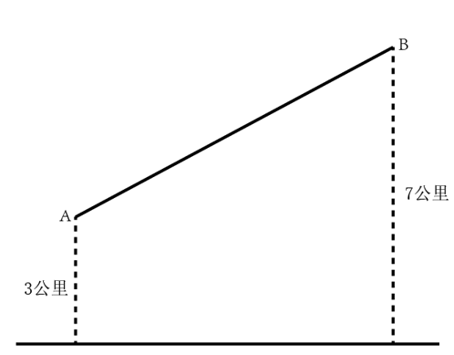

- **A**. 18分钟
- **B**. 21分钟
- **C**. 24分钟
- **D**. 27分钟

## 第 63 题　qid 5509977 · 数学运算

某产业展洽会主办方融合“七巧板”元素设计了七大展示区域（如下图所示），甲、乙、丙三家参展公司从7块展区中分别选择面积各不相同的一个区域进行布展，则共有多少种选择方案？

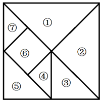

- **A**. 48
- **B**. 72
- **C**. 96
- **D**. 192

## 第 64 题　qid 5509988 · 数学运算

厦门鼓浪屿海滨覆鼎岩上屹立着一尊郑成功雕像。为了测量石像的高度，某测量小组选取的测量点A与覆鼎岩底部D在同一水平线上，如下图所示。已知覆鼎岩高CD为24米，在A处测得石像头顶部B的仰角为，石像底部C的仰角为（参考数据：，，），则石像BC的高度约为：

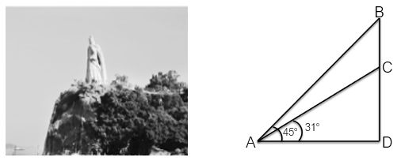

- **A**. 20米
- **B**. 18米
- **C**. 16米
- **D**. 14米

## 第 65 题　qid 5510001 · 数学运算

某学习平台收到的征文，将通过两轮评审决定能否采用。先由两位编辑进行初审，若两位编辑评审都通过，则予以采用；若两位编辑都未予通过，则不予采用；若仅有一位编辑初审通过，则再由主编进行复审，若复审通过，则予以采用，否则不予采用。设稿件能通过各初审编辑评审的概率均为0.4，复审的稿件能通过的概率为0.2，各编辑独立评审，则每篇征文被采用的概率为：

- **A**. 0.32
- **B**. 0.256
- **C**. 0.24
- **D**. 0.208

## 第 66 题　qid 5509973 · 数学运算

浮雕银杯是我国古代常见的一种盛酒容器，有大银杯和小银杯之分。已知5个大银杯加1个小银杯，可以盛酒3斛（斛，是古代的一种容量单位），5个小银杯加1个大银杯，可以盛酒2斛，则1斛酒至多可以倒满小银杯的数量为：

- **A**. 2个
- **B**. 3个
- **C**. 4个
- **D**. 5个

## 第 67 题　qid 5509982 · 数学运算

某餐馆承诺25分钟内上齐一桌菜，若超时则未上的菜品免单。每张餐桌上都有一个装满后正好25分钟漏完的圆锥形沙漏（如下图所示）。某位顾客在等待的过程中发现沙漏内上方沙子的高度为原先的一半，此时还差一道菜未上，则再过多久还未上菜，这位顾客将享受免单服务？

- **A**. 不到3分钟
- **B**. 3-4分钟之间
- **C**. 4-5分钟之间
- **D**. 超过6分钟

## 第 68 题　qid 5509990 · 数学运算

某品牌圆形扫地机器人升级设计方案，是在原有扫地机器人的前端伸出8cm可转动的边刷进行清扫（如下图所示），目的是将无法触及的边边角角都彻底清扫干净，那么，为保证这一效果，该型号扫地机器人圆形机身的最大直径是：（答案取整数位）

- **A**. 30cm
- **B**. 36cm
- **C**. 38cm
- **D**. 40cm

## 第 69 题　qid 5510073 · 数学运算

某村拟建造一个容积为144立方米，深度为4米的长方体无盖蓄水池。经测算，蓄水池底部造价为260元/平方米，侧面造价为180元/平方米。那么该水池的最低总造价为：

- **A**. 11440元
- **B**. 25920元
- **C**. 26640元
- **D**. 31680元

## 第 70 题　qid 5510179 · 数学运算

下图所示是一种帐篷屋顶的示意图，底面是一个长4米宽3米的长方形，屋顶高1米，上棱长2米且平行于底面，那么该帐篷屋顶的体积是：

- **A**. 5立方米
- **B**. 11立方米
- **C**. 12立方米
- **D**. 24立方米

## 第 71 题　qid 5510023 · 图形推理

把下面的六个图形分为两类，使每一类图形都有各自的共同特征或规律，分类正确的一项是：

- **A**. ①②③，④⑤⑥
- **B**. ①③⑥，②④⑤
- **C**. ①③④，②⑤⑥
- **D**. ①④⑤，②③⑥

## 第 72 题　qid 5510176 · 图形推理

把下面的六个图形分为两类，使每一类图形都有各自的共同特征或规律，分类正确的一项是：

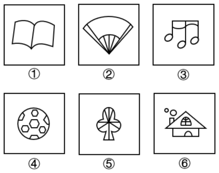

- **A**. ①②③，④⑤⑥
- **B**. ①②⑤，③④⑥
- **C**. ①③④，②⑤⑥
- **D**. ①④⑤，②③⑥

## 第 73 题　qid 5510021 · 图形推理

把下面的六个图形分为两类，使每一类图形都有各自的共同特征或规律，分类正确的一项是：

- **A**. ①②④，③⑤⑥
- **B**. ①③⑥，②④⑤
- **C**. ①④⑤，②③⑥
- **D**. ①⑤⑥，②③④

## 第 74 题　qid 5510018 · 图形推理

下方为某一立体图形的侧视图、正视图和顶视图，请从下列选项中选出与之符合的一项：

- **A**. A
- **B**. B
- **C**. C
- **D**. D

## 第 75 题　qid 5510027 · 图形推理

从所给四个选项中，选择最合适的一个填入问号处，使之呈现一定的规律性：

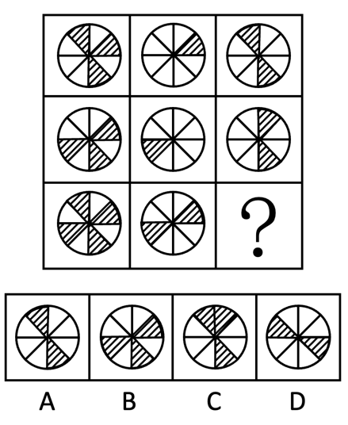

- **A**. A
- **B**. B
- **C**. C
- **D**. D

## 第 76 题　qid 5510031 · 定义判断

生态恢复岸线是指通过人工直接或间接实施保护修复工程或在常年潮汐、冲淤等自然力作用下，将原来的人工岸线最大限度地恢复海岸自然形态、地貌单元，恢复和改善海岸生态功能的岸线。生态恢复岸线具有独特的地理、形态和动态特征，是海陆分界的地理要素，具有重要的生态功能和资源价值。
根据上述定义，下列属于生态恢复岸线的是：

- **A**. 将自然海岸形态改变成人工海岸形态的堤坝
- **B**. 某港口城市全力打造的生态美、人气旺的黄金旅游岸线
- **C**. 某海滨城市修复建设的具有自然岸滩形态特征和生态功能的海堤
- **D**. 保持自然生态属性特征，没有因人类活动而改变形态和属性的海岸线

## 第 77 题　qid 5510017 · 定义判断

代表性启发，是指在使用启发法时，首先会考虑借鉴要判断的事件本身或同类事件以往的经验，即以往出现的结果；可得性启发，是指在使用启发法进行判断时，人们往往会依赖最先想到的经验和信息，并认定这些容易知觉到或回想起的事件更常出现，以此作为判断的依据。
根据上述定义，下列属于可得性启发的是：

- **A**. 人们偏向于高估连续事件发生的概率，这往往会导致对某一计划的成功过分乐观
- **B**. 我们知道高质量产品一般价格不菲，因此，如果某个产品很贵，我们会认为它的质量很好
- **C**. 很多人会根据服装来判断他人社会地位的高低，看到身着高档服装的人，就认为他们更成功、社会地位更高
- **D**. 人们在判断交通工具的安全性时，都认为乘坐飞机更危险，因为首先想到的是关于飞机失事的报道，而通常想不起火车意外事故的报道

## 第 78 题　qid 5510016 · 定义判断

不真正连带责任，是指各债务人之间基于不同的发生原因，对同一债权人负有以同一给付为标的的数个债务责任。如果一个债务人履行了全部债务，那么全体债务归于消灭。
根据上述定义，下列说法正确的是：

- **A**. 小张在医院治疗期间进行了输血，但由于血液质量不合格，导致小张病情加重，后小张起诉至法院。医院和血液提供机构属于不真正连带责任
- **B**. 小赵委托小孙作为自己的代理人采购钢材10吨，小孙为获私利与销售方小李串通，故意抬高钢材销售价格。小孙与小李属于不真正连带责任
- **C**. 某有限公司股东小刘和小宋各持有50%的股份，后因经营不善欠债100万元，债权人现向小刘主张全部债权。小刘和小宋属于不真正连带责任
- **D**. 小王在路上行走突遇对面来车，小王急忙躲闪，撞伤了同在行走的周大爷，周大爷因此起诉。小王和司机属于不真正连带责任

## 第 79 题　qid 5510013 · 定义判断

生物修复就是利用生物的生命代谢活动减少被污染的环境中的有毒有害物的浓度或使其无害化，从而使被污染了的环境能够部分地或完全地恢复到原初状态的过程。
根据上述定义，下列不属于生物修复的是：

- **A**. 在被重金属污染的土壤中种植能吸附重金属的蜈蚣草，通过收割蜈蚣草带走土壤里的部分重金属
- **B**. 用玉米等粮食作物做成的降解塑料袋替代传统塑料袋，解决丢弃传统塑料对环境造成的污染问题
- **C**. 利用硝化细菌、芽孢杆菌等微生物菌降解河道有机污染物，治理被污水和垃圾污染的城市河流
- **D**. 在人工水产养殖场中投放一些藻类，利用菌藻共生关系，对池塘里的污物进行处理和净化

## 第 80 题　qid 5510135 · 定义判断

大气中水汽直接在地面或地物表面及低空的凝结物，称为隐匿性降水。由空中降落到地面上的水汽凝结物，称为直接性降水。
根据上述定义，下列属于隐匿性降水的是：

- **A**. 夜深烟火灭，霰雪落纷纷——白居易《秦中吟》
- **B**. 广寒宫中珠径雨，狂风倾下九天来——邓肃《雹》
- **C**. 神农架景区温度大幅下降至零下3度，迎来了入秋后的雾凇奇观
- **D**. 雨凇边降边冻，粘附在裸露物的外表而不流失，形成越来越厚的冰层

## 第 81 题　qid 5510052 · 定义判断

环境吸收能力是指自然环境对人类在生产生活过程中产生的废弃物具有自动容纳、吸收和消化的能力。理论上，由于环境吸收能力的存在，地球自身的力量是可以将环境恢复到原有或相近的活力水平，资源环境退化并不是不可逆的。
根据上述定义，下列属于环境吸收能力的是：

- **A**. 某地开展农村人居环境整治行动，加强固体废弃物和垃圾处置
- **B**. 某县通过环境治理，提升了当地环境资源所能容纳的人口和经济规模
- **C**. 某市为高载能产业寻求发展空间，测算出该城市大气允许承载污染物的最大数量
- **D**. PM2.5能够被大自然转化为对生态系统造成危害较小的物质，甚至能进一步被分解达到无害的状态

## 第 82 题　qid 5510062 · 定义判断

被害人盲点症是指被害人出于某种迫切的需要和急切的欲望，以致注意力狭窄、判断力减弱甚至轻度丧失理智，对自己所处的危险或面临的风险视而不见的一种状态。
根据上述定义，下列不属于被害人盲点症的是：

- **A**. 王某为强身健体高价购买大量伪劣保健品
- **B**. 林某在公交车上因争抢座位不慎滑倒受伤
- **C**. 为谋高额回报黄某兼职网络刷单导致经济受损
- **D**. 幻想通过理财一夜暴富的刘某给了骗子可乘之机

## 第 83 题　qid 5510020 · 定义判断

法律规范包含多种类型。授权性规范，是规定法律主体可以为一定行为或不为一定行为的法律规范。义务性规范，是规定法律主体必须为一定行为的法律规范。禁止性规范，是规定禁止法律主体为一定行为的法律规范。
根据上述定义，下列属于禁止性规范的是：

- **A**. 自然人决定、变更姓名，或者法人、非法人组织决定、变更、转让名称的，应当依法向有关机关办理登记手续，但是法律另有规定的除外
- **B**. 对亲子关系有异议且有正当理由的，父或者母可以向人民法院提起诉讼，请求确认或者否认亲子关系
- **C**. 任何组织或者个人不得以丑化、污损或者利用信息技术手段伪造等方式侵害他人肖像权
- **D**. 因正当防卫造成损害的，不承担民事责任

## 第 84 题　qid 5510010 · 定义判断

商业效用原则是商事实践中发展出来的一项交易惯例，市场主体提供的商品、服务以及其他标的物应当能够发挥基本的功能作用，如果欠缺必要的使用条件或者辅助设施导致其交易目的落空的，应当予以补足。最佳效用原则是指通过配置组合，使得资源能够最大程度地发挥效能，提高利用效率。
根据上述定义，下列选项最能体现商业效用原则的是：

- **A**. 开发商销售商品房赠送车位
- **B**. 商家促销“买桌子送椅子”
- **C**. 出售的地下酒窖附带出入通道
- **D**. 购买家电享受“三包服务”

## 第 85 题　qid 5510061 · 定义判断

借词就是音义都借自外语的词，它不仅引入了新的外来概念，而且还引入了外语的音义结合关系。意译词指只引入新的外来概念，但用本族语的构词材料和构词规则构成新词来表达它。仿译词是意译词的一类，它的特点是构词所用的本族语的构词材料和构词规则分别与所源出的外语词具有一一对应的关系。
根据上述定义，下列属于仿译词的一组词是：

- **A**. 蜜月、足球
- **B**. 激光、天使
- **C**. 雷达、可口可乐
- **D**. 黑板、高尔夫球

## 第 86 题　qid 5510015 · 类比推理

葡萄：葡萄酒

- **A**. 黄金：黄金档
- **B**. 香蕉：香蕉水
- **C**. 杜鹃：杜鹃花
- **D**. 枇杷：枇杷膏

## 第 87 题　qid 5510022 · 类比推理

天荒地老：海枯石烂

- **A**. 同心同德：反目成仇
- **B**. 披荆斩棘：斩钉截铁
- **C**. 孜孜矻矻：夙夜不懈
- **D**. 望而却步：望风披靡

## 第 88 题　qid 5510008 · 类比推理

全真阅读：沉浸式

- **A**. 企业销售：盈利性
- **B**. 乡村教育：均衡化
- **C**. 人工智能：数字化
- **D**. 线上课程：直播性

## 第 89 题　qid 5510019 · 类比推理

龋齿：嗜食甜品

- **A**. 海鲜：食物过敏
- **B**. 缺钙：骨质疏松
- **C**. 运动：增强体质
- **D**. 塌方：地下渗水

## 第 90 题　qid 5510012 · 类比推理

针灸：疏通经脉

- **A**. 慢跑：增强体质
- **B**. 涅槃：化茧成蝶
- **C**. 缺铁：供血不足
- **D**. 促销：商品展示

## 第 91 题　qid 5510057 · 类比推理

游艇：钢材：船舶

- **A**. 古玺：玉石：隶书
- **B**. 旗袍：丝绸：服饰
- **C**. 版画：油画：绘画
- **D**. 砧板：厨具：木材

## 第 92 题　qid 5510028 · 类比推理

书柜：书籍：书页

- **A**. 花坛：花卉：花蕊
- **B**. 舞池：舞蹈：舞伴
- **C**. 面粉：面条：面片
- **D**. 鞋盒：鞋子：鞋油

## 第 93 题　qid 5510060 · 类比推理

历史朝代：东汉：北宋

- **A**. 热带气旋：台风：飓风
- **B**. 敬辞称谓：家父：令尊
- **C**. 十二时辰：丑时：午时
- **D**. 交通工具：火车：马车

## 第 94 题　qid 5510141 · 类比推理

细胞核：细胞质：细胞

- **A**. 绝缘体：半导体：导电
- **B**. 碳中和：碳达峰：环保
- **C**. 真皮：表皮：皮肤
- **D**. 牙冠：牙齿：牙龈

## 第 95 题　qid 5510144 · 类比推理

佶屈聱牙 对于 （    ） 相当于 （    ） 对于 教诲

- **A**. 文句；春风化雨
- **B**. 书写；和光同尘
- **C**. 表达；无微不至
- **D**. 描述；刚柔相济

## 第 96 题　qid 5510045 · 逻辑判断

人参的生长与地理环境关系密切。一种观点认为，人参在针叶林里分布很少，而在阔叶林里分布更多、长得更好，这是因为针叶林的土壤成分相对单一，且能够透下更多光线，这对于属于半阴性植物的人参生长不利，而阔叶林的遮阳效果更好。并且，阔叶林地表的厚厚落叶，可以在冬季给人参提供保暖，有利于其存活。
以下哪项如果为真，最能削弱上述观点？

- **A**. 人参在蒙古栎下长不好，是因为蒙古栎的落叶太厚，参苗长不出来
- **B**. 茫茫山区，不同类型的林地，多多少少存在不利于人参生长的因素
- **C**. 山坡的坡度太平，容易积水，导致人参烂根；坡度太陡，则人参吸收不到足够水分
- **D**. 人参在糠椴、紫椴树下生长较好，这两种树的叶子密，遮阴挡雨，风一吹动，又洒光

## 第 97 题　qid 5510006 · 逻辑判断

牛蛙这一水产品种在过去无人问津，现今却成为人们餐桌上的美食。打工族在夜晚加班后，吃上一盘“泡椒牛蛙”或“干锅牛蛙”，顿时神清气爽，干劲十足。但随着牛蛙美食的普及，食品安全问题引发了社会关注。有报道称：牛蛙体内含有幼虫裂头蚴、广州管圆线虫等能够在人体寄生的寄生虫，食入带有这些寄生虫的牛蛙，会严重影响人体健康。
以下哪项如果为真，最能削弱上述结论？

- **A**. 经过高温烹饪，牛蛙身上的寄生虫会被全部杀死
- **B**. 淡水虾蟹中含有肺吸虫，人感染肺吸虫会咳血、呼吸困难
- **C**. 实验室对生态养殖的牛蛙进行解剖，未发现任何裂头蚴寄生虫
- **D**. 牛蛙身上还存在只能在牛蛙本体内寄生而不会传染给人类的寄生虫

## 第 98 题　qid 5510051 · 逻辑判断

某研究机构提取了1200多名女性研究对象最靠近头皮的3厘米头发，这代表过去3个月新长出的头发。研究人员随后对这些女性进行了一项包含10个问题的调查，以了解她们的压力程度。结果表明，压力水平排在前五名的女性头发中含有的皮质醇水平比排在后五名的女性高出24.3%。研究发现，压力水平会反映在头发中储存的皮质醇的含量上。
以下哪项如果为真，最能削弱上述论证？

- **A**. 长期的压力会对身体产生负面影响，头发则可以显示出人们的压力水平
- **B**. 皮质醇被称为“压力荷尔蒙”，在身体处于“战斗或逃避”模式时释放
- **C**. 压力通过释放荷尔蒙改变头发色素沉着，使其变灰或变白，甚至导致脱落
- **D**. 皮质醇是大自然在人体的内置警报系统，但压力不是它产生的唯一原因

## 第 99 题　qid 5510026 · 逻辑判断

一项新研究正在给金星云层中存在生命的可能性泼冷水。科学家研究报告显示，这颗灼热行星的云层中没有足够的水蒸气来维持众所周知的生命形式。因此，国际天文学界认为金星不可能有生命。
以下哪项如果为真，最能支持上述观点？

- **A**. 研究人员认定，金星的云层中有足够的水，其大气温度也适合维持生命
- **B**. 研究发现金星云层的水含量仅相当于维持类地生命所需水含量的百分之一
- **C**. 在地球上，磷化氢是一种与生命有关的气体，而金星大气中含有大量的磷化氢
- **D**. 最新的金星生态系统仿真模拟显示，金星的液态水可能维持大约30亿年，只是在7亿5千万年前金星才变得不适合居住

## 第 100 题　qid 5510011 · 逻辑判断

由于剖宫产分娩是无菌分娩，分娩时胎儿不会接触到妈妈产道中的有益菌群，使得剖宫产宝宝的肠道菌群定植迟缓，影响免疫系统的发育，过敏风险也随之升高。要降低剖宫产宝宝的过敏风险，家长们需要把好饮食关。专家指出，母乳喂养可降低剖宫产宝宝过敏风险。母乳中含有双歧杆菌等益生菌，可帮助宝宝建立健康肠道菌群，训练免疫系统，降低过敏风险。
以下哪项如果为真，最能支持上述观点？

- **A**. 剖宫产宝宝肠道健康菌群的建立，比自然分娩宝宝晚约6个月
- **B**. 研究显示，母乳喂养期间母亲进食易过敏食物，会增加宝宝过敏风险
- **C**. 母乳致敏性低，是因为宝宝的免疫系统能将其中的蛋白质识别为“自己的”
- **D**. 把高致敏性的普通牛奶蛋白变成低致敏性的小分子蛋白质，可以降低宝宝过敏的风险

## 第 101 题　qid 5510041 · 逻辑判断

油脂是由甘油和脂肪酸结合在一起形成的链状分子，可可脂和黄油都是由无数油脂分子聚集在一起形成的，但是它们熔化方式不一样。黄油是随温度上升一点点从固体变为液体，可可脂却是达到熔点时瞬间熔化。科学分析发现，黄油是由100种以上各种各样的油脂混合在一起形成的，而可可脂则只由3种油脂构成。
由此可以推出：

- **A**. 黄油和可可脂熔化所需的温度不一样，可可脂所需温度更高
- **B**. 黄油和可可脂熔化所需要的温度不固定，依环境变化而变化
- **C**. 黄油经常用于烹饪，因为其油脂熔化方式对人体健康更有好处
- **D**. 黄油中的各种油脂性质差异较大，而可可脂中的不同油脂熔点相近

## 第 102 题　qid 5510007 · 逻辑判断

心脏是被神经系统控制的，调控心脏的神经是交感神经和迷走神经。安静状态下，迷走神经对心脏的调控比较强，心跳每分钟75次左右；运动或情绪激动的时候，交感神经对心脏的调控比较强，心跳会加快，收缩力也会加强。在血管壁、胃肠道、生殖系统等处都分布着各种内脏平滑肌，平滑肌运动同样受到神经支配。比如，胃肠道平滑肌接受交感神经和迷走神经的双重支配。交感神经兴奋使胃肠道运动减弱，而迷走神经兴奋则使胃肠道运动加强。
由此可以推出：

- **A**. 交感神经或迷走神经对心脏和胃肠的调控不同则产生不同的效应
- **B**. 调控内脏器官的神经是交感神经和迷走神经，它们不受意识支配
- **C**. 要保护我们的内脏器官，必须合理地使用大脑，维持良好的情绪
- **D**. 冠心病、胃溃疡之类的疾病也与神经系统的“功能失常”有关系

## 第 103 题　qid 5510009 · 逻辑判断

北极放大效应是指冰雪和气温之间容易形成正反馈，即气温升高则冰雪消融增多，没有冰雪覆盖的裸地能吸收更多的太阳辐射，加热大气，进一步加剧冰雪消融。观测显示，位于北极格陵兰岛的大多数冰川都呈现出消退趋势，这是世界上流失速度最快的冰川之一。因此，格陵兰岛的冰川消融受到放大效应影响。
要得到上述结论，需要补充的前提是：

- **A**. 近30年，格陵兰岛冰川融化已导致全球海平面上升了11毫米，如果全部融化，全球海平面预计会上升7米
- **B**. 格陵兰岛冰川消退会导致大大小小冰川入海，形成冰山，进而导致海啸，摧毁近岸上因纽特人的家园
- **C**. 格陵兰岛的冰川融化后显现出大量陆地，陆地比海洋吸收热量更快
- **D**. 同样是极地，南极地区的冰川消退并不明显

## 第 104 题　qid 5510005 · 类比推理

某次体操比赛之前，有甲、乙、丙、丁四人预测红队、黄队、绿队、蓝队的出场顺序，四人的预测如下：
甲说：只有黄队第二个出场，红队才第一个出场。
乙说：如果红队第三个出场，那么蓝队第四个出场。
丙说：蓝队不是第四个出场。
丁说：黄队第二个出场。
比赛结束后，发现四人中只有一人预测为真，那么绿队是第几个出场？

- **A**. 第一个
- **B**. 第二个
- **C**. 第三个
- **D**. 第四个

## 第 105 题　qid 5510147 · 类比推理

某医院刘佳、郑毅、郭斌、丁晓、吴芳、施文6位医生拟报名参加“一心向党，健康为民”进社区义诊活动，已知下列情况为真：
（1）要么刘佳参加，要么郑毅参加；
（2）只有吴芳参加，刘佳才参加；
（3）如果郭斌和吴芳都参加，那么施文也会参加；
（4）或者丁晓不参加，或者郭斌参加；
（5）施文、丁晓至少有1人参加。
现施文确定无法参加，那么6位医生中最后参加义诊活动的是：

- **A**. 刘佳、郭斌、丁晓
- **B**. 郑毅、郭斌、丁晓
- **C**. 郑毅、丁晓、吴芳
- **D**. 刘佳、丁晓、吴芳

## 材料 1

        2021年中国雨季特征为华南前汛期于4月26日开始，7月2日结束，雨季长度为67天，总雨量494.6毫米。与正常年份相比，开始偏晚20天，结束偏早4天，雨季长度偏短24天，雨量偏少31%。

        西南雨季于6月4日开始，10月4日结束，雨季长度为122天，总雨量634.5毫米。与正常年份相比，开始偏晚9天，结束偏早10天，雨季长度偏短19天，雨量偏少15%。

        华北雨季于7月12日开始，9月9日结束，雨季长度为59天，总雨量276.4毫米。与正常年份相比，开始偏早6天，结束偏晚22天，雨季长度偏长28天，为1961年以来第二长；雨量偏多103%，为1961年以来第三多。

        东北雨季于6月5日开始，8月29日结束，雨季长度为85天，总雨量364.3毫米。与正常年份相比，开始偏早17天，结束偏晚4天，雨季长度偏长21天，雨量偏多23%。

        华西秋雨于8月23日开始，雨季长度为77天，总雨量379.9毫米。与正常年份相比，开始偏早8天，结束偏晚7天，雨季长度偏长15天，雨量偏多87%，为1961年以来最多。

        梅雨于6月9日开始，7月11日出梅，梅雨期32天，梅雨量267.2毫米；与正常年份相比，入梅时间偏晚1天，出梅时间偏早7天，梅雨期偏短8天，梅雨量偏少22%，与2020年梅雨量780.9毫米相比差距明显。江南入梅时间偏晚1天，出梅偏晚3天，雨量偏少15%；长江中下游入梅偏早4天，出梅偏早2天，雨量偏少8%；江淮区入梅时间偏早8天，出梅时间偏早4天，梅雨量偏少14%。

### 第 106 题　qid 5509984 · 综合

2021年雨季开始时间最迟的两个地区在雨季开始时间上相差了：

- **A**. 34天
- **B**. 35天
- **C**. 41天
- **D**. 42天

### 第 107 题　qid 5510133 · 综合

华西秋雨正常年份结束的时间是：

- **A**. 11月8日
- **B**. 11月6日
- **C**. 11月1日
- **D**. 10月30日

### 第 108 题　qid 5509985 · 平均数

下列地区中2021年雨季期平均每天降雨量最大的地区是：

- **A**. 西南
- **B**. 华北
- **C**. 东北
- **D**. 华西

### 第 109 题　qid 5509986 · 增长

华西2021年雨季降水量与正常年份雨季降水量相比增加了约：

- **A**. 153.4毫米
- **B**. 176.7毫米
- **C**. 203.2毫米
- **D**. 232.5毫米

### 第 110 题　qid 5509987 · 综合

能够从上述资料推出的是：

- **A**. 2021年10月7日属于西南雨季期内
- **B**. 2020年梅雨量高出正常年份的227.9%
- **C**. 2020年华西雨季总雨量超过379.9毫米
- **D**. 东北正常年份雨季长度为华北正常年份雨季长度的2倍多

## 材料 2

        2021年，全国城市供水总量673.34亿立方米，同比增长6.96%；城市供水管道长度105.99万公里，同比增长5.26%；人均日生活用水量185.03升；供水普及率99.38%，比上年增加0.39个百分点。天津、河北、上海、江苏、浙江和广东6个省（市）城市供水普及率达到100%；福建、山东、湖北、广西、安徽、辽宁、宁夏、新疆、内蒙古、山西、甘肃、河南、黑龙江、江西、云南和湖南16个省（区）超过99%（含）；西藏、青海、北京、四川、贵州和陕西6个省（区、市）超过98%；重庆、吉林、海南3个省（市）和新疆建设兵团超过95%。

### 第 111 题　qid 5509972 · 增长

2021年全国城市供水管道长度比2020年增长约：

- **A**. 5万公里
- **B**. 5.3万公里
- **C**. 5.6万公里
- **D**. 6万公里

### 第 112 题　qid 5509989 · 增长

下列折线图中，最能准确反映2013~2021年全国城市人均日生活用水量同比增长率变化情况的是：

- **A**. 

- **B**. 
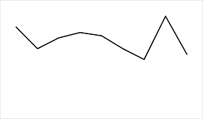

- **C**. 

- **D**. 

### 第 113 题　qid 5509991 · 平均数

图2所列的全国部分省（区、市）中，2021年城市人均日生活用水量超过全国平均值的有：

- **A**. 5个
- **B**. 6个
- **C**. 7个
- **D**. 8个

### 第 114 题　qid 5509992 · 平均数

图2中，城市人均日生活用水量最高的省份是用水量中位数省份的约：

- **A**. 1.78倍
- **B**. 1.88倍
- **C**. 1.95倍
- **D**. 2.03倍

### 第 115 题　qid 5509996 · 综合

能够从上述资料推出的是：

- **A**. 2012～2021年，全国城市供水普及率逐年增长
- **B**. 2021年，浙江和广东的供水普及率低于新疆建设兵团
- **C**. 2012～2021年，全国城市人均日生活用水量平均值不超过176升
- **D**. 图2中，用水量排名前三名的省（区、市）城市人均日生活用水量之和是排名后三位的约2.13倍

## 材料 3

### 第 116 题　qid 5509993 · 增长

2021年，全国羊肉产量同比增长率约为：

- **A**. 2.4%
- **B**. 3.4%
- **C**. 4.4%
- **D**. 5.4%

### 第 117 题　qid 5509994 · 平均数

2012～2021年，最接近全国羊肉年平均产量的是：

- **A**. 2015年
- **B**. 2016年
- **C**. 2017年
- **D**. 2018年

### 第 118 题　qid 5510138 · 增长

表1所列的主要畜禽产品中，相较于2012年，2021年零售价格增长幅度超过50%的是：

- **A**. 猪肉、牛肉、羊肉
- **B**. 猪肉、羊肉、鸡肉
- **C**. 牛肉、羊肉、鸡肉
- **D**. 羊肉、鸡肉、鸡蛋

### 第 119 题　qid 5509998 · 增长

假设羊肉每年以零售价格全部售罄，那么，2021年羊肉销售收入同比增长约：

- **A**. 5.2%
- **B**. 10.4%
- **C**. 17.6%
- **D**. 22.7%

### 第 120 题　qid 5509999 · 综合

不能从上述资料推出的是：

- **A**. 2012～2021年，全国羊肉产量逐年增长
- **B**. 2020年，牛肉批发价格不足零售价格的90%
- **C**. 2020年，鸡肉零售价格与批发价格之比大于牛肉
- **D**. 2012～2021年，鸡蛋批发价格同比增速最快的年份是2018年

## 材料 4

        2012~2021的10年间，辽宁、天津、河北、山东、江苏、上海、浙江、福建、广东、广西、海南11个沿海省市的核电、火电、钢铁、石化等行业的海水冷却用水量稳步增长（图1），其中浙江、福建、广东3省海水冷却用水量相对较高（表1）。截至2021年底，11个沿海省市共建有海水冷却工程22个，2021年全国11个沿海省市海水冷却工程年总循环量为169.5亿吨。

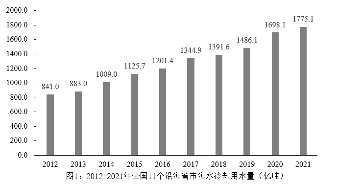

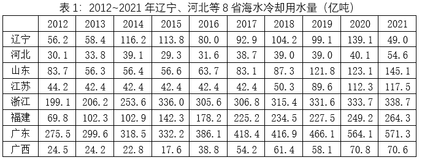

### 第 121 题　qid 5510158 · 综合

图1中相较于2012年，11个沿海省市海水冷却用水量实现翻一番的年份首次出现在：

- **A**. 2018年
- **B**. 2019年
- **C**. 2020年
- **D**. 2021年

### 第 122 题　qid 5510116 · 增长

图1中2012～2021年期间海水冷却用水量年增量高于2012～2021年期间全国海水冷却用水量年平均增长量的年份共有几个？

- **A**. 2
- **B**. 3
- **C**. 4
- **D**. 5

### 第 123 题　qid 5510163 · 综合

表1中，2021年除浙江、福建、广东外的5个沿海省市海水冷却用水量占全国11个沿海省市的：

- **A**. 24.6%
- **B**. 33.8%
- **C**. 47.6%
- **D**. 66.2%

### 第 124 题　qid 5510164 · 综合

2021年海水冷却用水量低于海水冷却工程年总循环量的沿海省市共有几个：

- **A**. 5个
- **B**. 6个
- **C**. 7个
- **D**. 8个

### 第 125 题　qid 5510165 · 综合

可以从上述资料推出的是：

- **A**. 2021年全国11个沿海省份海水冷却用水量前4名依次为：广东、浙江、福建、江苏
- **B**. 2012~2021年浙江、广东年海水冷却用水量之和均超过全国同期的60%
- **C**. 2012~2021年表1的8个省市中福建的海水冷却用水量年平均增速最快
- **D**. 2012~2021年间，广东的海水冷却用水量均为辽宁同期的3倍以上

## 答案与解析

第 1 题

**答案**：D

**官方解析**

本题考查政治常识。
①项正确，党的二十大报告指出：“中国共产党已走过百年奋斗历程。我们党立志于中华民族千秋伟业，致力于人类和平与发展崇高事业，责任无比重大，使命无上光荣。全党同志务必不忘初心、牢记使命，务必谦虚谨慎、艰苦奋斗，务必敢于斗争、善于斗争，坚定历史自信，增强历史主动，谱写新时代中国特色社会主义更加绚丽的华章。”
②项正确，党的二十大报告指出：“坚持和发展马克思主义，必须同中国具体实际相结合。我们坚持以马克思主义为指导，是要运用其科学的世界观和方法论解决中国的问题，而不是要背诵和重复其具体结论和词句，更不能把马克思主义当成一成不变的教条······坚持和发展马克思主义，必须同中华优秀传统文化相结合。只有植根本国、本民族历史文化沃土，马克思主义真理之树才能根深叶茂。”
③项正确，党的二十大报告指出：“必须坚持人民至上、必须坚持自信自立、必须坚持守正创新、必须坚持问题导向、必须坚持系统观念、必须坚持胸怀天下。”
④项正确，党的二十大报告指出：“坚持和加强党的全面领导、坚持中国特色社会主义道路、坚持以人民为中心的发展思想、坚持深化改革开放、坚持发扬斗争精神。”
⑤项正确，党的二十大报告指出：“高质量发展是全面建设社会主义现代化国家的首要任务。发展是党执政兴国的第一要务。没有坚实的物质技术基础，就不可能全面建成社会主义现代化强国。”
综上所述，表述正确的有①②③④⑤，共5项。
故正确答案为D。

---

第 2 题

**答案**：B

**官方解析**

本题考查政治常识。
①正确，党的二十大报告指出：“健全社会保障体系。社会保障体系是人民生活的安全网和社会运行的稳定器。健全覆盖全民、统筹城乡、公平统一、安全规范、可持续的多层次社会保障体系。完善基本养老保险全国统筹制度，发展多层次、多支柱养老保险体系。实施渐进式延迟法定退休年龄。”
②正确，党的二十大报告指出：“扩大社会保险覆盖面，健全基本养老、基本医疗保险筹资和待遇调整机制，推动基本医疗保险、失业保险、工伤保险省级统筹。促进多层次医疗保障有序衔接，完善大病保险和医疗救助制度，落实异地就医结算，建立长期护理保险制度，积极发展商业医疗保险。加快完善全国统一的社会保险公共服务平台。健全社保基金保值增值和安全监管体系。”
③正确，党的二十大报告指出：“完善分配制度。坚持多劳多得，鼓励勤劳致富，促进机会公平，增加低收入者收入，扩大中等收入群体。完善按要素分配政策制度，探索多种渠道增加中低收入群众要素收入，多渠道增加城乡居民财产性收入。加大税收、社会保障、转移支付等的调节力度。”
④错误，党的二十大报告指出：“健全终身职业技能培训制度，推动解决结构性就业矛盾。完善促进创业带动就业的保障制度，支持和规范发展新就业形态。健全劳动法律法规，完善劳动关系协商协调机制，完善劳动者权益保障制度，加强灵活就业和新就业形态劳动者权益保障。”
⑤错误，党的二十大报告指出：“深化以公益性为导向的公立医院改革，规范民营医院发展。发展壮大医疗卫生队伍，把工作重点放在农村和社区。重视心理健康和精神卫生。促进中医药传承创新发展。”
⑥正确，党的二十大报告指出：“健全社会保障体系。坚持房子是用来住的、不是用来炒的定位，加快建立多主体供给、多渠道保障、租购并举的住房制度。”
综上，①②③⑥正确。
故正确答案为B。

---

第 3 题

**答案**：D

**官方解析**

本题考查政治常识。
①③⑤⑥正确，②④错误，党的二十大报告中“一、过去五年的工作和新时代十年的伟大变革”部分指出：“人均预期寿命增长到七十八点二岁。居民人均可支配收入从一万六千五百元增加到三万五千一百元。城镇新增就业年均一千三百万人以上。建成世界上规模最大的教育体系、社会保障体系、医疗卫生体系，教育普及水平实现历史性跨越，基本养老保险覆盖十亿四千万人，基本医疗保险参保率稳定在百分之九十五。及时调整生育政策。改造棚户区住房四千二百多万套，改造农村危房二千四百多万户，城乡居民住房条件明显改善。互联网上网人数达十亿三千万人。人民群众获得感、幸福感、安全感更加充实、更有保障、更可持续，共同富裕取得新成效。”“人均预期寿命增长到七十八点二岁”而不是八十八点二岁；“互联网上网人数达十亿三千万人”而不是十三亿三千万人。
故正确答案为D。

---

第 4 题

**答案**：C

**官方解析**

本题考查政治常识。
A项正确，2022年8月20日，据工业和信息化部统计显示，截至今年7月底，我国累计建成开通5G基站196.8万个，5G移动电话用户达到4.75亿户，已建成全球规模最大的5G网络。
B项正确，2022年11月16日，在2022中国国际数字经济博览会上，中国电子信息产业发展研究院发布的《2022中国数字经济发展研究报告》显示，目前中国算力规模约占全球的27%，排名全球第二。
C项错误，2022年7月，中国信息通信研究院发布了《中国数字经济发展报告（2022年）》。《报告》显示，2021年我国数字经济规模达到45.5万亿元，占GDP比重达到39.8%。
D项正确，2022年2月18日，国家启动“东数西算”大型项目协调东西部算力资源，共规划设立8个枢纽10个国家数据中心，标志着全国一体化大数据中心体系完成总体布局设计，“东数西算”工程正式全面启动。
本题为选非题，故正确答案为C。

---

第 5 题

**答案**：A

**官方解析**

本题考查政治常识。
A项正确，2022年8月13日，习主席给安徽黄山风景区工作人员李培生、胡晓春回信，对他们继续发挥“中国好人”榜样作用提出殷切期望。习主席在回信中说，你们长年在山崖间清洁环境，日复一日呵护着千年迎客松，用心用情守护美丽的黄山，充分体现了敬业奉献精神。
B项错误，2022年10月4日，习近平给山东省地矿局第六地质大队全体地质工作者的回信中指出，矿产资源是经济社会发展的重要物质基础，矿产资源勘查开发事关国计民生和国家安全。希望同志们大力弘扬爱国奉献、开拓创新、艰苦奋斗的优良传统，积极践行绿色发展理念，加大勘查力度，加强科技攻关，在新一轮找矿突破战略行动中发挥更大作用，为保障国家能源资源安全、为全面建设社会主义现代化国家作出新贡献，奋力书写“英雄地质队”新篇章。
C项错误，2022年9月9日，习近平给北京师范大学“优师计划”师范生的回信中指出，入学一年来，你们通过课堂学习和支教实践，增长了学识，开阔了眼界，坚定了到基层教书育人的信念，我感到很欣慰。值此北京师范大学建校120周年之际，谨向全校师生员工、广大校友致以热烈的祝贺和诚挚的问候！
D项错误，2022年5月3日，五四青年节到来之际，中共中央总书记、国家主席、中央军委主席习近平5月2日给中国航天科技集团空间站建造青年团队回信，向航天战线全体青年致以节日的祝贺，并向他们提出殷切期望。习近平强调，建设航天强国要靠一代代人接续奋斗。希望广大航天青年弘扬“两弹一星”精神、载人航天精神，勇于创新突破，在逐梦太空的征途上发出青春的夺目光彩，为我国航天科技实现高水平自立自强再立新功。
故正确答案为A。

---

第 6 题

**答案**：C

**官方解析**

本题考查政治常识。
A项正确，《中国共产党党内法规体系》指出：“党内法规体系的框架构成，党章是最根本的党内法规。党的一切制度是从党章开始的，党章是所有党内法规的源头，是制定一切党内法规的基础和依据。”
B项正确，《中国共产党党内法规体系》指出：“党内法规使用党章、准则、条例、规定、办法、规则、细则7类名称，现行有效党内法规中，党章1部，准则3部，条例43部，规定850部，办法2034部，规则75部，细则609部。”
C项错误，《中国共产党党内法规制定条例》中指出：“党内法规草案形成后，应当广泛征求意见。征求意见范围根据党内法规草案的具体内容确定，必要时在全党范围内征求意见。征求意见时应当注意听取党代表大会代表和有关专家学者的意见。与群众切身利益密切相关的党内法规草案，应当充分听取群众意见。征求意见可以采取书面形式，也可以采取座谈会、论证会、网上征询等形式。”
D项正确，《中共中央关于加强党内法规制度建设的意见》规定，党内法规体系以“1+4”为基本框架，即在党章之下分为党的组织法规、党的领导法规、党的自身建设法规、党的监督保障法规四大板块。
本题为选非题，故正确答案为C。

---

第 7 题

**答案**：D

**官方解析**

本题考查科技常识。
A项错误，天舟四号货运飞船是我国进入空间站建造阶段的首发航天器，本次任务也是我国空间站建造阶段的首次发射任务，标志着我国空间站建造工程正式掀开大幕。
B项错误，神舟十五号飞行任务是中国载人航天工程2022年的第六次飞行任务，也是中国空间站建造阶段最后一次飞行任务，航天员乘组将在轨工作生活6个月，任务主要目的为：验证空间站支持乘组轮换能力，实现航天员乘组首次在轨轮换；开展空间站舱内外设备及空间应用任务相关设施设备安装与调试，进行空间科学实验与技术试验；进行空间站日常维护维修；验证空间站三舱组合体常态化运行模式。神舟十四号载人飞行任务是中国空间站建造阶段第二次飞行任务，也是该阶段首次载人飞行任务，航天员乘组在轨工作生活6个月，任务主要目的为：配合问天实验舱、梦天实验舱与核心舱的交会对接和转位，完成中国空间站在轨组装建造；完成空间站舱内外设备及空间应用任务相关设施设备的安装和调试；开展空间科学实验与技术试验；进行日常维护维修等相关工作。
C项错误，问天实验舱是中国空间站的首个实验舱段，2022年7月24日搭载问天实验舱的长征五号B遥三运载火箭，在中国文昌航天发射场点火升空，发射取得成功。7月25日，问天实验舱成功对接于天和核心舱前向端口，神舟十四号航天员乘组成功开启舱门顺利进入问天实验舱。
D项正确，2022年11月29日，搭载神舟十五号载人飞船的长征二号F遥十五运载火箭在酒泉卫星发射中心点火发射，约10分钟后，神舟十五号载人飞船与火箭成功分离，进入预定轨道，发射取得圆满成功。长征二号F运载火箭，是我国目前唯一一型载人火箭，执行了从神舟一号至今的所有载人飞船和目标飞行器发射任务，成功率100%，素有“神箭”美誉。
故正确答案为D。

---

第 8 题

**答案**：A

**官方解析**

本题考查人文常识。
A项错误，公元前210年，秦始皇东巡，曾在秣陵关西南丹阳（今江宁区丹阳）经过，回途又从江乘渡江北返。随行术士认为金陵山势险峻，有天子之气，秦始皇便把王气泄散，将金陵改为秣陵。“秣”是草料的意思，意即这里不该称金陵，只能贬为牧马场。故将金陵这一地名改为秣陵与避讳无关。
B项正确，汉代将彻侯这一爵位更名为通侯。通侯是爵位名。又称彻侯、列侯。秦制爵分二十级，彻侯为第二十级。汉代为避汉武帝刘彻之讳，改称通侯。
C项正确，唐代佛经中将“观世音菩萨”译为“观音菩萨”，是为了避唐太宗李世民的讳。
D项正确，清代将《千字文》首句“天地玄黄”改为“天地元黄”，是为了避清代康熙帝玄烨之讳。
本题为选非题，故正确答案为A。

---

第 9 题

**答案**：D

**官方解析**

本题考查人文常识。
A项错误，东晋书法家王羲之书写的《兰亭集序》被誉为“天下第一行书”。王献之是王羲之第七子，与其父王羲之并称为“二王”，代表作为《中秋帖》。
B项错误，《九成宫醴泉铭》是唐贞观六年由魏征撰文、书法家欧阳询书丹而成的楷书书法作品。作品叙述了“九成宫”的来历和其建筑的雄伟壮观，歌颂了唐太宗的武功文治和节俭精神，介绍了宫城内发现醴泉的经过，并刊引典籍说明醴泉的出现是由于“天子令德”所致，最后提出“居高思坠，持满戒盈”的谏诤之言。
C项错误，黄庭坚，北宋著名文学家、书法家，擅长行书、草书，楷书也自成一家，和北宋书法家苏轼、米芾和蔡襄齐名，世称为“宋四家”。
D项正确，《颜氏家庙碑》由颜真卿为其父颜惟贞刻立，碑文记述了颜氏家族及其仕宦经历、后裔仕途、治学经世的情况。
故正确答案为D。

---

第 10 题

**答案**：A

**官方解析**

本题考查人文常识。
A项错误，出自唐代苏味道的《正月十五夜》，唐朝时期，京城每天晚上都要戒严，对私自夜行者处以重罚，而正月十五这天是例外的，因此诗句描写的是正月十五元宵节。
B项正确，出自唐代元稹的《表夏十首》，“彩缕碧筠粽，香粳白玉团”是描写粽子的佳句，端午节有吃粽子的习俗，因此诗句描写的是五月初五端午节。
C项正确，出自北宋苏轼的《阳关曲》，写的是苏轼与其胞弟苏辙久别重逢，共赏中秋月的赏心乐事，中秋节有赏月的习俗，因此诗句描写的是八月十五中秋节。
D项正确，出自清代符曾的《上元竹枝词》，诗中后两句为“见说马家滴粉好，试灯风里卖元宵。”本诗描绘的是元宵节当天，卖元宵的商贩在一片灯光溢彩中叫卖汤圆的热闹场景，元宵节有吃元宵的习俗，因此诗句描写的是正月十五元宵节。
本题为选非题，故正确答案为A。

---

第 11 题

**答案**：B

**官方解析**

本题考查人文常识。
A项正确，孙武是中国春秋时期著名的军事家、政治家，尊称兵圣或孙子，又称“兵家至圣”，被誉为“百世兵家之师”、“东方兵学的鼻祖”。兵家，诸子百家之一，是指中国先秦、汉初研究军事理论，代表人物有孙武、孙膑、白起等。
B项错误，“内圣外王”出自先秦·庄周《庄子·天下》：“是故内圣外王之道，暗而不明，郁而不发，天下之人，各为其所欲焉，以自为方。”“内圣外王”是指内具有圣人的才德，对外施行王道。
C项正确，韩非，又称韩非子，中国古代思想家、哲学家和散文家，法家学派代表人物。韩非子作为荀子的学生，对荀子的性恶论进行了继承，并且做了进一步的极端发挥。
D项正确，墨家约产生于战国时期。创始人为墨翟（墨子）。墨家是一个纪律严密的学术团体，其首领称“钜子”，其成员到各国为官必须推行墨家主张，所得俸禄亦须向团体奉献。墨家学派有前后期之分：前期思想主要涉及社会政治、伦理及认识论问题，关注现世战乱；后期墨家在逻辑学方面有重要贡献，开始向科学研究领域靠拢。
本题为选非题，故正确答案为B。

---

第 12 题

**答案**：C

**官方解析**

本题考查政治常识。
A项错误，根据国家医保局、财政部《关于扩大长期护理保险制度试点的指导意见》（以下简称《意见》）长期护理保险被称为“第六险”，重点解决重度失能人员长期护理保障问题，不属于传统五险（养老保险、医疗保险、工伤保险，失业保险，生育保险）的范畴。
B项错误，《意见》指出试点阶段的长期护理保险的参保对象，从职工基本医疗保险参保人群起步，重点解决重度失能人员基本护理保障需求，优先保障符合条件的失能老年人、重度残疾人。有条件的地方可随试点探索深入，综合考虑经济发展水平、资金筹集能力和保障需要等因素，逐步扩大参保对象范围，调整保障范围。
C项正确，《意见》指出长期护理保险基金主要用于支付符合规定的机构和人员提供基本护理服务所发生的费用。根据护理等级、服务提供方式等不同实行差别化待遇保障政策，鼓励使用居家和社区护理服务。
D项错误，《意见》指出长期护理险针对年老、疾病或伤残导致生活不能自理，需要在家中或疗养院治病医疗由专人陪护所产生的费用进行支付的保险。不包括疾病住院产生的护理费，参保人员住院治疗期间发生的费用，按照其本人所参加的本市职工医保或城乡居民医保的相关规定执行，长期护理保险基金不予支付。
故正确答案为C。

---

第 13 题

**答案**：D

**官方解析**

本题考查科技常识。
A项正确，D项错误，“谷物圈效应”是指当能够产生液面变形的两个物体靠近时，由于系统的重力势能和表面能倾向于最低，物体之间就会互相吸引或排斥。当两枚图钉放到水面上时，表面张力使它们不会沉入水底，只会在水面形成两个凹坑；当图钉靠近，凹坑会合并，两枚图钉会碰到一起。对密度比水小的物体来说，情况正好相反。当泡沫漂浮在水面上，浮力会使它们趋于液面最高点。由于毛细力让泡沫周围和杯壁附近的液面凸起，凸起靠近时也会合并，泡沫就会聚在一起或是贴近杯壁。
B项正确，洒落到桌子上的茶或者咖啡，在桌面与液滴之间的交界处，水的蒸发速率要比在液滴与空气之间的交界处的蒸发速率快。液滴中间的水分子就会携带溶质和颗粒来到液滴与桌面的边缘进行补充。最终，在水蒸发掉之后，溶质小颗粒们不断在边缘积累，其边缘部分颜色比中间深。这种现象也被称为“咖啡环效应”。
C项正确，康达效应是指流体有偏离原本流动方向，改为随着凸出的物体表面流动的倾向。当流体与它流过的物体表面之间存在表面摩擦时，只要曲率不大，流体就会顺着该物体表面流动。小水流会被汤匙凸面吸引，正是康达效应的典型表现。
本题为选非题，故正确答案为D。

---

第 14 题

**答案**：A

**官方解析**

本题考查科技常识。
A项错误，豆腐是黄豆加工后形成富含蛋白质胶体类似于豆浆，然后加入盐卤或者石膏，使蛋白质凝集变成类似固体的形态，不涉及微生物发酵。 
B项正确，食醋是以粮食等淀粉质为原料，经微生物制曲、糖化、酒精发酵、醋酸发酵等阶段酿制而成，其主要成分除醋酸外，还含有各种氨基酸、有机酸、糖类、维生素、醇和酯等营养成分，涉及微生物发酵。
C项正确，奶酪，又名干酪，是一种发酵的牛奶制品，其性质与常见的酸牛奶有相似之处，都是通过发酵过程来制作的，也都含有可以保健的乳酸菌，但是奶酪的浓度比酸奶更高，近似固体食物，营养价值也因此更加丰富，涉及微生物发酵。 
D项正确，酒是世界上微生物发酵产量最大的产品，中国传统白酒发酵的实质是，以谷物为主要原料，利用酵母菌等微生物，使之在生成主要代谢产物乙醇的同时，还形成丰富的香味物质，涉及微生物发酵。 
本题为选非题，故正确答案为A。

---

第 15 题

**答案**：B

**官方解析**

本题考查地理国情。
“沧海桑田”意思是大海变成农田，农田变成大海。反映了地壳运动 、海陆变迁的地理现象。地壳运动是由于地球内部原因引起的组成地球物质的机械运动。它可以引起岩石圈的演变，促使大陆、洋底的增生和消亡，并形成海沟和山脉，同时还导致发生地震、火山爆发等。
“斗转星移”意思是星斗变动位置，指季节或时间的变化。北斗七星围绕北极星自东向西转的规律，我国古代的星象学家把它形象地叫做“斗转星移”，而通过“斗转星移”的规律，人们能够判断季节和节气时间。季节的变化跟地球公转运动有关。
“日月如梭”意思是太阳和月亮像穿梭一样地来去，形容时间过得很快，反映了日月交替的现象，而地球的自转运动产生的现象有昼夜交替、太阳的东升西落。
因此，B项正确，A、C、D三项错误。
故正确答案为B。

---

第 16 题

**答案**：A

**官方解析**

本题考查科技常识。
“玉兔号”是中国首辆月球车，和着陆器共同组成嫦娥三号探测器。2013年12月15日，“玉兔号”巡视器顺利驶抵月球表面。
“夸父一号”是由中国太阳物理学家自主提出的综合性太阳探测专用卫星。北京时间2022年10月9日，中国在酒泉卫星发射中心使用长征二号丁运载火箭，成功将“夸父一号”发射升空。
“祝融号”是天问一号任务火星车。 2020年7月23日，在中国文昌航天发射场由长征五号遥四运载火箭发射升空。
A项正确， B、C、D三项错误，“玉兔号”所探测的天体是月球，月球与地球近地点的距离是36.3万千米；“夸父一号”所探测的天体是太阳，地球距太阳约有1.5亿公里；“祝融号”所探测的天体是火星，地球与火星最近的距离约为5500万公里。所探测天体距离地球由近及远的顺序为月球、火星、太阳，故正确顺序为“玉兔号”“祝融号”“夸父一号”。
故正确答案为A。

---

第 17 题

**答案**：A

**官方解析**

本题考查科技常识。
康达效应亦称附壁作用或柯恩达效应。流体（水流或气流）由偏离原本流动方向，改为随着凸出的物体表面流动的倾向。当流体与它流过的物体表面之间存在表面摩擦时（也可以说是流体粘性），只要曲率不大，流体就会顺着该物体表面流动。
A项错误，到大柱子后面不可以躲避寒风，因为柱子越大背后风速越大。
B项正确，倒酒会沿着杯壁流下是受到液体表面张力和康达效应共同作用的结果。当慢慢倒酒水的时候，酒水会在容器表面停留更长时间，水分子与杯壁的粘附力比与水分子的内聚力更大，压力差也将出现在一侧，酒水将沿着容器的一侧流下。
C项正确，康达效应也称边界吸附效应。当流体经过具有一定弯度的凸面的时候，有向凸面吸附的趋向。将汤匙的背面接触水流，水流会被吸引，沿着汤匙的凸面往下流，这是附壁作用的结果。附壁作用令水流一直在汤匙上的凸面流动。
D项正确，康达效应讲的是流体（水流或气流）有离开本来的流动方向，随着凸出的物体表面流动的倾向。鸡蛋放在水龙头下水沿着鸡蛋表面流动体现的是康达效应。
本题为选非题，故正确答案为A。

---

第 18 题

**答案**：D

**官方解析**

本题考查科技常识。
西瓜的甜度取决于西瓜光合作用所产生的糖分的积累。
A项正确，加装LED灯补充光照，可以延长光合作用时间，进而增加糖分积累，提高西瓜甜度。
B项正确，对温室玻璃表面定期清洁，有利于增加温室透光性，增强温室光照强度，提高光合作用强度，进而增加糖分积累，提高西瓜甜度。
C项正确，在温室中圈养一定数量的家禽，一方面家禽呼吸过程产生二氧化碳，增加温室内二氧化碳浓度，提高光合作用效率，另一方面家禽粪便腐熟后可以增加土壤肥力，有利于西瓜生长，进而增加糖分积累，提高西瓜甜度。
D项错误，西瓜生长环境温差越大越有利于减少呼吸作用对于糖分的消耗，便于糖分的积累，有利于提高西瓜甜度。所以维持温室内适合西瓜生长的温度不变，不利于提高西瓜甜度。
本题为选非题，故正确答案为D。

---

第 19 题

**答案**：D

**官方解析**

本题考查法律常识。
A、B、C三项错误，D项正确，根据《中华人民共和国民法典》第九百七十九条第一款规定：“管理人没有法定的或者约定的义务，为避免他人利益受损失而管理他人事务的，可以请求受益人偿还因管理事务而支出的必要费用；管理人因管理事务受到损失的，可以请求受益人给予适当补偿。”题中，乙在路边发现牛并请邻居帮忙寻找失主，其饲养牛的行为构成无因管理。饲养牛所用的青草、杂粮等费用200元属于必要费用，甲作为受益人应当支付。2000元报酬无法律依据，甲无需支付。
故正确答案为D。

---

第 20 题

**答案**：C

**官方解析**

本题考查法律常识。
A项正确，根据《中华人民共和国民法典》第一千一百五十三条规定：“夫妻共同所有的财产，除有约定的外，遗产分割时，应当先将共同所有的财产的一半分出为配偶所有，其余的为被继承人的遗产。”故老张死后在遗产分割时，应当先将他和李某共有的财产分出一半，归李某所有，其余的属于老张的遗产。
B项正确，根据《中华人民共和国民法典》第一千一百三十条第四款规定：“有扶养能力和有扶养条件的继承人，不尽扶养义务的，分配遗产时，应当不分或者少分。”故大儿子长期对老张不闻不问，应当不分或少分遗产。
C项错误，根据《中华人民共和国民法典》第一千一百三十条第二款规定：“对生活有特殊困难又缺乏劳动能力的继承人，分配遗产时，应当予以照顾。”故女儿丧失了劳动能力，其配偶和两个孩子都需要大量的医疗费和学费，在分割遗产时，应当予以照顾，多得遗产。
D项正确，根据《中华人民共和国民法典》第一千一百二十九条规定：“丧偶儿媳对公婆，丧偶女婿对岳父母，尽了主要赡养义务的，作为第一顺序继承人。”故小儿子早逝，其妻子平日里悉心照料二老的生活，尽了主要赡养义务的，能作为第一顺序继承人继承遗产。
本题为选非题，故正确答案为C。

---

第 21 题

**答案**：A

**官方解析**

横线处搭配“特点”，且要与前文“几句话”对应，体现出简单描述之意。A项“勾勒”指用线条勾画出轮廓，与文意相符，当选。B项“擘画”指计划，布置，C项“叙述”指写出或说出事情的前后经过，一般比较详细，D项“描绘”指用线条、颜色或语言文字表现事物的情景，均与文意不符，排除。
故正确答案为A。
【文段出处】兵团日报《将传统文化神韵融入作品》

---

第 22 题

**答案**：C

**官方解析**

横线处搭配“一场”，且根据后文“翻转课堂并不等同于······而是通过转变教学方式······”可知，横线处应体现出翻转课堂正在转变全球教育。A项“革命”指根本改革，程度过重，排除；D项“革新”指革除旧的，创造新的，一般搭配“聚焦”“优化”等，与“一场”搭配不当，排除。
对比B、C两项，两词语义接近，但根据后文翻转课堂“而是通过转变教学方式，以学生为中心设计线上与线下相融合的混合式学习”可知，翻转课堂转变了教学方式，C项“变革”比B项“改革”与文段对应更加恰当，C项当选。
故正确答案为C。
【文段出处】光明网《今天的学习方式，将给未来教育带来哪些启发》

---

第 23 题

**答案**：A

**官方解析**

根据“编译工作是寂寞的”“他们不在意外界的喧哗，只坚守内心的宁静”可知，横线处所填成语要体现出编译人员在岗位上耐得住寂寞、踏踏实实坚守在工作岗位上之意。A项“兢兢业业”形容做事谨慎、勤恳、踏实，符合文意，当选。
B项“克勤克俭”指的是既能勤劳，又能节俭，文段未体现出“节俭”之意，排除；
C项“勤学苦练”指的是认真学习，刻苦训练，文段描述的是工作状态，而非学习、训练的状态，不符合文段语境，排除；
D项“夜以继日”指的是用晚上的时间接上白天，形容昼夜不停，置于文段中形容编译人员在岗位上的工作状态程度过重，排除。
故正确答案为A。
【文段出处】人民日报《老中青三代编译人，坚守马列经典编译阵地——他们让真理穿越时空》

---

第 24 题

**答案**：B

**官方解析**

第一空，根据“从众效应扼杀了个人的独立意见和判断力”与“人变得墨守成规，没有主见”可知，横线处应体现出从众效应管束了人们的思维之意，A项“限制”指规定范围，不许超过，B项“束缚”指使受到约束限制；使停留在狭窄的范围里，C项“制约”指甲事物本身的存在和变化以乙事物的存在和变化为条件，则甲事物为乙事物所制约，D项“约束”指限制使不越出范围，均符合文意，保留。
第二空，搭配“从众心理”，且根据“从众效应扼杀了个人的独立意见和判断力”与“不人云亦云，遇事冷静，有自己的独立判断”可知，横线处应体现出要从思想上舍弃从众心理之意。B项“摒弃”指舍弃，搭配恰当且符合文意，当选。A项“放弃”指丢掉原有的权力、主张、意见等，通常不与“从众心理”搭配使用，排除；C项“丢弃”指扔掉；抛弃，多搭配具体事物，“从众心理”为抽象事物，搭配不当，排除；D项“抛弃”指扔掉不要，与B项相比，“摒弃”常搭配消极感情色彩的词语，且“摒弃”更加书面化，更符合文段的语体风格，故排除D项。
故正确答案为B。
【文段出处】《看看你是否丢失了自己——从众效应》

---

第 25 题

**答案**：D

**官方解析**

第一空，搭配“无人机植树系统”，且根据“利用地形数据，画出需要再造树林的高分辨率3D地图”可知，横线处所填词语应体现无人机植树系统在进行植树任务时会对地势进行考察，D项“勘察”指实地考察或调查，勘查，置于此处可体现无人机植树系统对地形的考察，符合文意，保留。A项“勘验”指司法人员对案件或民事纠纷的现场、物证等进行实地勘查和检验，多指司法人员对现场、物证的勘查，与“无人机植树系统”搭配不当，排除；B项“勘探”指查明矿藏分布情况，测定矿体的位置、形状、大小、成矿规律、岩石性质、地质构造等情况，文段指对地形的考察，而非查明矿藏，与文意不符，排除；C项“勘测”指勘察和测量，多指施工前工人到实地进行调查测量，与“无人机植树系统”搭配不当，排除。
第二空，代入验证，D项“设定”指设置确定，拟定，与“接着，无人机会在播种范围内飞行”对应恰当，符合文意，当选。
故正确答案为D。
【文段出处】《厉害了无人机植树系统！一天能种几万颗树》

---

第 26 题

**答案**：B

**官方解析**

本题可从第二空入手。横线处搭配“银河全貌”。A项“观察”指仔细观看（事物或现象），B项“窥探”指暗中察看，也指观察探索，二者均与“银河全貌”搭配恰当，保留。C项“窥伺”指暗中观望动静，等待时机（多含贬义），与“银河全貌”搭配不当，且与文段感情色彩不符，排除。D项“考察”指实地观察调查，与“银河全貌”搭配不当，排除。
第一空，根据“多个富有诗意的名字以及各种美丽的传说”可知，横线处所填词语需同时搭配“名字”和“传说”。B项“赋予”指交给（重大任务、使命、意义等），与“名字”“传说”搭配恰当，且符合文意，当选。A项“授予”指给予（勋章、奖状、学位、荣誉等），多用于正式的场合，强调正式给予，与“传说”搭配不当，排除。
故正确答案为B。
【文段出处】中国知网《绘制银河》

---

第 27 题

**答案**：B

**官方解析**

本题可从第二空入手，搭配“那个时代的真实色彩”，且根据“为观众营造身临其境之感”可知，该剧为观众带来的感受是仿佛回到了当时的场景，故横线处所填词语应体现彷佛回到那个时代之意，B项“还原”指事物恢复原状，符合文意且与“那个时代的真实色彩”搭配恰当，保留。A项“描摹”指用语言文字表现人或事物的形象、情状、特性等，或指照着底样写和画，C项“表现”指表示出来、显现出来，D项“展示”指清楚地摆出来、明显地表现，两项侧重于显示出来，均无法与前文中“为观众营造身临其境之感”对应，排除。
第一空，代入验证，搭配“史诗般的影像”，B项“质感”指艺术品所表现的物体特质的真实感，符合文意且搭配恰当，当选。
故正确答案为B。
【文段出处】《一批抗美援朝战争题材文艺作品涌现：重现、致敬、缅怀，为了“最可爱的人”》

---

第 28 题

**答案**：C

**官方解析**

第一空，根据前文“不再扎堆前往热门旅游城市”和“选择冷门目的地、打卡非旅游城市”可知，横线处所填词语应体现不去热门旅游目的地之意。B项“疏导”指使淤塞的水流或阻塞的道路畅通，C项“分流”指分开流动，分散流动，均符合文意，保留。A项“引流”指传送的行为（如通过管子引水），D项“引导”指带领，使跟随，填入文段体现人变多了，均与文意相悖，排除。
第二空，根据前后文可知，“反向旅游”反向推动热门旅游目的地提升服务水平和运营能力。C项“倒逼”指逆向逼迫，反向推动，符合文意，当选。B项“推动”指使劲地推向前或摇动，为正向推动，与文意不符，排除。
故正确答案为C。
【文段出处】新华网《“反向旅游”兴起 年轻人的口味为啥变了》

---

第 29 题

**答案**：D

**官方解析**

第一空，根据横线前内容可知，横线处所填词语搭配“文化”且形容“国家文化公园的建设”，D项“景观”意为自然界的景色，也泛指可供观赏的景物，与“文化”搭配恰当，且“文化景观”为常用搭配，保留。A项“风景”意为一定区域内由山水、花草、树木、建筑物等形成的可供人观赏的景象，C项“景物”意为可供观赏的事物，均与“文化”搭配不当，排除；B项“地标”意为用来标示界线位置的目标物或地面上的显著标志，无法与文中“国家文化公园的建设”构成对应，排除。
第二空，代入验证，由横线后“国家文化公园实现了文化资源保护、利用和传承的统一”可知，横线处所填词语体现文脉一直传承之意，D项“永续”意为长久持续，永远继续，符合文意，当选。
故正确答案为D。
【文段出处】道客巴巴《国家文化公园建设中的现实误区及改进途径》

---

第 30 题

**答案**：B

**官方解析**

第一空，根据横线前“塞尚对后来的画家产生过巨大影响”和横线后“让马蒂斯模仿塞尚的‘构筑性的笔触’是不可能的”可知，横线前后语义相反，横线处应体现转折关系，且程度较重，B项“然而”、C项“但是”均可体现转折关系，且程度较重，保留。D项“可是”虽然也可以体现出转折关系，但程度较轻，与文段“不可能”无法形成对应，排除；A项“因此”为因果关系关联词，与文意不符，排除。
第二空，根据“他们属于两个不同的体系”、“色彩表现的方式迥异”可知，横线前后形成语义上的递进，B项“尤其”可体现出程度上的加重，当选。C项“只”无法体现出前后程度上的加重，排除。
故正确答案为B。
【文段出处】《艺术家的朋友圈——马蒂斯的成长》

---

第 31 题

**答案**：A

**官方解析**

第一空，根据“对聘财的形式及数量并无严格的限定”可知，横线处要体现认定标准不严格、不具体之意，A项“宽松”指宽绰、不拥挤、宽畅、宽裕，符合文意，保留。B项“明确”指清晰明白，C项“模糊”指不清楚、不分明，其相反面为清晰，D项“宽泛”指（内容意义等）涉及的面宽，侧重于广泛，均未体现不严格之意，与文意不符，排除。
第二空，代入验证，搭配“法律”，A项“认可”指承认、许可，搭配恰当，当选。
故正确答案为A。
【文段出处】《中国古代彩礼漫谈》

---

第 32 题

**答案**：B

**官方解析**

第一空，根据顿号可知，横线所填成语与“独具······审美意象”构成并列，体现出中国奥运会不同于其他奥运会之意，A项“别出心裁”指独出巧思，不同流俗，B项“匠心独运”形容独特精巧的艺术构思，D项“标新立异”原指为表明自己新颖的义理，提出与众不同的见解，后来也指故意提出新奇的见解，表示自己与众不同，均符合文意，保留。C项“推陈出新”指去掉旧事物的糟粕，取其精华，并使它向新的方向发展（多指继承文化遗产），文段并未体现“去掉旧事物的糟粕”之意，排除。
第二空，横线处搭配“艺术”，B项“呈现”指显现，展示出，侧重能明显看见，D项“表达”指把思想感情表示出来，均与“艺术”搭配恰当，根据前文“独具东方美学色彩的审美意象······已落下帷幕”可知，文段强调艺术元素在奥运会中被人们看到，故“呈现”更加符合文意，B项当选，D项排除。且文段围绕“艺术、审美”的话题展开，B项“匠心独运”形容独特精巧的艺术构思，比D项“标新立异”更加契合文段艺术语境。A项“反响”指事物所引起的意见、态度或行动，一般搭配“引起”“强烈”等，与“艺术”搭配不当，排除。
故正确答案为B。
【文段出处】《款款奥运情 浓浓中国味》

---

第 33 题

**答案**：D

**官方解析**

第一空，根据“几乎是充盈整个汉语文章体式”可知，以同一性为基础的韵律原则在汉语文学中的应用是非常多、非常普遍的，因此横线处所填成语应体现普遍、数量多之意。A项“蔚为大观”意为丰富多彩，成为盛大的景象，C项“更仆难尽”形容人或事物很多，D项“无所不在”意为到处都存在，到处都有，均与文意相符，保留。B项“信手拈来”多形容写文章时词汇或材料丰富，不费思索，就能写出来，强调很容易写出来，并未体现普遍之意，排除。
第二空，根据“与”可知，横线处所填词语与“对称感”构成并列关系，体现“偶语”这种“韵律结构”给人带来的与“对称感”相近的直观感受。D项“平衡”意为对立的各方面在数量或质量上相等或相抵，置于此处能够与“对称感”构成并列关系，且与文意相符，当选。A项“融洽”意为彼此感情好，没有抵触，C项“和谐”意为和睦协调，均无法与“对称感”构成并列关系，且无法直接体现“偶语”给人带来的感受，排除。
故正确答案为D。
【文段出处】书籍《“韵”之离散：关于当代中国诗歌韵律的一种观察》

---

第 34 题

**答案**：D

**官方解析**

第一空，顿号引导并列关系，横线处所填成语应与“礼祭祖先”语义相近，体现对祖先的追思、祭奠，D项“慎终追远”指慎重地办理父母丧事，虔诚地祭祀远代祖先，也指谨慎从事，追念前贤，符合文意，保留。A项“睹物思人”指看到死者的遗物或别人留下的东西，就想起这个人，C项“抚今追昔”指接触到当前的情况而回想起过去，文段并未体现清明节需要看先人遗物或回想过去，均与文意不符，排除；B项“鉴往知来”指审察以往，就可推知未来，与文意不符，排除。
第二空，代入验证，搭配“力量”，D项“凝聚”指聚集，积聚，搭配恰当，当选。
故正确答案为D。
【文段出处】《缅怀英烈祭忠魂 抚今追昔思奋进——陕西多种形式开展清明祭英烈活动纪实》

---

第 35 题

**答案**：B

**官方解析**

第一空，根据“统一市场是发达市场经济的重要标志，是大国经济实现高质量发展的制度基础”可知，横线处应体现中国加快建设全国统一大市场对市场经济体制的重要性，B项“必然”指一定会这样，表示事理上确定不移，符合文意且“必然选择”为常用词搭配，保留。A项“必定”表示肯定的推断，文段为客观陈述，不涉及推断，与文意无关，排除；C项“必须”表示事理上和情理上必要，与“选择”搭配不当，排除；D项“必由”表示必须要经由的，如必由之路，与“选择”搭配不当，排除。
第二空，代入验证，B项“基础支撑”搭配恰当，且符合文意，保留；
第三空，代入验证，B项“内在要求”搭配恰当，且符合文意，当选。
故正确答案为B。
【文段出处】中国证券网《王微：加快建设全国统一大市场 推动高水平市场经济体制建设迈出新步伐》

---

第 36 题

**答案**：B

**官方解析**

第一空，搭配“产品”“技艺”“理念”，B项“传承”指传递和继承，与“产品”“技艺”“理念”均搭配恰当，保留。A项“秉持”指执持、持有、具有，常与“理念”“原则”“精神”搭配，与“产品”“技艺”均搭配不当，排除；C项“恪守”指谨慎而恭顺地遵守，常与“规则”“政策”搭配，与“产品”“技艺”搭配不当，排除；D项“弘扬”指大力宣传，常与“精神”“文化”搭配，与“产品”均搭配不当，排除。
第二空，代入验证，搭配“品牌价值、经济价值和文化价值”，且根据“具有独特优势”可知，横线处表示老字号的各种价值巨大，B项“不可估量”指难以估计，体现了价值的巨大，符合文意，保留。
第三空，代入验证，根据“是新时期弘扬商业文明的核心内涵和宝贵财富”可知，横线处表示老字号包含着丰富的中华文化内涵之意，B项“承载”指承受负载，符合文意，当选。
故正确答案为B。
【文段出处】海外网《老字号“名利双收”不是没可能》

---

第 37 题

**答案**：A

**官方解析**

第一空，横线处与“众声喧哗”构成并列，语义相近，表达“多”的意思，A项“林林总总”形容多得成群，C项“多姿多彩”形容颜色形态多样，两项均符合文意，保留。B项“光怪陆离”形容奇形怪状，五颜六色，也形容事物离奇多变，文段并未体现“奇形怪状”之意，与文意不符，排除；D项“泥沙俱下”比喻好的和坏的混杂在一起，无法体现出“多”的意思，与文意不符，排除。
第二空，搭配“理想”，A项“高远”指高而深远，C项“远大”指一个人的志向、见解、前程等高远而伟大，均与“理想”搭配得当，保留。
第三空，横线处应体现文本与理论的关系，A项“匹配”与“文本”“理论”搭配恰当，当选。C项“搭配”无法形容文本理论的关系，与“文本”“理论”搭配不当，排除。
故正确答案为A。
【文段出处】中国作家网《21世纪新诗整装再出发》

---

第 38 题

**答案**：D

**官方解析**

文段开篇介绍背景，引出AI开始用于香水制作的话题。随后通过与传统调香师对比，指出AI可以通过算法分析对比现有的香水成分，输出新配方；同时，AI还能结合各类信息，预测人类对香水的喜好，进而创造出针对目标人群的新配方。故文段为并列文段，需要全面概括，文段重在强调AI调香用于香水制作行业的多种好处，对应D项。
A项，“缩短香水的研发周期”文段并未提及，无中生有，排除；
B项，“研发的新型产品优于调香师”文段并未提及，无中生有，排除；
C项，“受用户欢迎的最佳解”仅对应文段第二方面，表述片面，排除。
故正确答案为D。
【文段出处】科技日报《从AI香水到AI美妆 算法能否求出“审美最优解”？》

---

第 39 题

**答案**：B

**官方解析**

文段首先引出“新型消费”这一话题，指出新型消费并非发展成熟或已定型，接着介绍了新型消费的基本属性，随后指出新型消费对人民的消费产生了新的影响，尾句通过“可以说”得出结论，即新型消费是新时代的一场消费革命。故文段重点介绍新型消费是什么，对应B项。
A项“影响”对应结论前，非重点，排除；
C项“体系”、D项“视角”，文段均未提及，无中生有，排除。
故正确答案为B。
【文段出处】《新型消费与数字化生活：消费革命的视角》

---

第 40 题

**答案**：C

**官方解析**

A项，根据“下位法与上位法冲突称‘抵触’”可知，文段并未提及冲突程度严重，无中生有，排除；
B项，根据“‘抵触’与‘不一致’不是一种法律冲突程度上的区别，而是一种法律冲突情景上和性质上的区别”可知，文段明确指出二者性质上存在不同，并未存在“交错”，表述错误，排除；
C项，根据“从语义上说，‘抵触’或‘不一致’，都是指两个规范在内容上的‘非同一性’”“同位法之间的冲突称为‘不一致’”可知，表述正确，当选；
D项，根据“‘抵触’与‘不一致’不是一种法律冲突程度上的区别，而是一种法律冲突情景上和性质上的区别”可知，“抵触”与“不一致”并非是法律冲突程度上的区别，表述错误，排除。
故正确答案为C。
【文段出处】《政法学苑 | 如何认识“法律冲突”》

---

第 41 题

**答案**：B

**官方解析**

文段首先论述人们往往有一种“非黑即白的思维方式”，接着通过转折词提出这种思维方式从逻辑学来看是错误的，容易让我们做出错误判断，甚至上当受骗，然后列举了卖壶的例子论证，并用“实际上”引出跳出“非A即B”的思维方式还有另外两种情况。最后通过“因此”提出文段重点，建议我们要被迫做出“A或B”的选择时应停下来思考一下所有的4个选择，即应避免陷入非黑即白的思维误区，对应B项。
A项，“世界充满了非黑即白的思维方式”对应首句，非重点，排除；
C项, “从逻辑上讲是错误的”对应结论前的内容，非重点，排除；
D项，“易让人做出错误判断”对应结论前的内容，非重点，排除。
故正确答案为B。
【文段出处】科学世界2021年第3期《非黑即白的误区“非A即B”在逻辑上是错误的》

---

第 42 题

**答案**：C

**官方解析**

文段开篇指出要实现零售业的高质量发展就要发展多元立体零售模式，同时要建设好新零售供应链生态圈，随后提出电商平台企业要整合各类资源，还要通过线上线下的协同联动实现持续发展的商业生态布局，然后通过分号表并列，指出商业企业应打破空间限制、改变销售模式，为“新零售”赋能，构建“多元要素协同”的“新零售”供应链生态圈。故文段重在介绍“新零售”供应链生态圈要“多元要素协同”，主题词为“‘新零售’供应链生态圈”和“协同”，对应C项。
A项“特征及潜能”、B项“多维服务”和D项“创新与竞争”均偏离文段核心话题，排除。
故正确答案为C。

---

第 43 题

**答案**：D

**官方解析**

文段开篇指出黄河文化具有的多种特征，紧接着论述全面认识和把握黄河文化特征对坚定文化自信，保护生态环境的好处，之后通过对策标志词“要”具体论述保护、传承、弘扬和创新黄河文化方面的做法，并指出这些对策实施后可带来的意义，故文段重点强调在保护、传承、弘扬和创新黄河文化方面的对策，对应D项。
A项，“源远流长、博大精深”对应文段首句话题引入部分的内容，非重点，排除；
B项，“具有可持续性的特征”对应文段首句话题引入部分的内容，非重点，且为黄河文化众多特征中的一部分，表述片面，排除；
C项，“讲好‘黄河故事’”仅能对应文段多个对策中的一部分，表述片面，排除。
故正确答案为D。
【文段出处】《张占仓：黄河文化的主要特征与时代价值》

---

第 44 题

**答案**：D

**官方解析**

A项，文段仅提及“氨氧化古菌能在黑暗的缺氧环境中自行生成氧气”，“缺氧状态下亚硝酸盐会分解氧气”文段未提及，无中生有，排除；
B项，根据“它们通过将氨氧化成亚硝酸盐来获得能量。这一过程需要氧气的参与”“研究人员将其移至缺氧海水中······研究人员判定是氨氧化古菌自行产生了氧气”可知，在氧气稀薄区域，氨氧化古菌可以自行产生氧气，将氨氧化成亚硝酸盐来获得能量，“无法在氧气稀薄区域获取能量”与文意相悖，排除；
C项，“光合作用”文段未提及，无中生有，排除；
D项，根据“氨氧化古菌是一种广泛分布的海洋微生物”及“研究人员尚不完全清楚其产氧机制”可知，“海洋世界里还存在着研究人员没弄明白的微生物产氧方式”表述正确，当选。
故正确答案为D。

---

第 45 题

**答案**：A

**官方解析**

文段开头引出“地面蜂窝移动通信”和“低轨道卫星通信”的话题，并指出两者在全球是竞争关系。随后通过转折标志词“但”强调“地面移动通信”的覆盖范围小，由于人类活动空间日益拓展，人们对于卫星通信的需求越来越强烈。尾句通过“因此”得出结论，强调卫星通信与地面移动通信在5G/6G走向互补关系，并共同构建星地融合通信网络。故文段综合论述了低轨道卫星通信与地面蜂窝移动通信从以前的竞争到走向互补的过程，对应A项。
B项，“地面蜂窝移动通信覆盖范围小”对应结论之前的内容，非重点，排除；
C项，对应文段开篇引入话题部分，非重点，排除。
D项，根据“卫星通信与地面移动通信在5G/6G走向互补关系”可知，两者是从以前的竞争关系转向互补，故话题应为“低轨道卫星通信与地面蜂窝移动通信”，“卫星通信与地面移动通信”概念扩大。且“大势所趋”为将来时，而“共同构建全球星地融合网络”时态不明确，排除。
故正确答案为A。
【文段出处】新浪财经《星地融合是6G移动通信关键技术方向》

---

第 46 题

**答案**：D

**官方解析**

文段开篇提出淮扬菜的话题，接着通过转折词“但”强调淮扬菜历经2000多年，绵延不绝的基础就在民间，后文介绍淮扬菜有许多大众耳熟能详的菜品，很多人都吃过，然后论述淮扬地区的斗菜习俗让淮扬菜不断涌现出新菜品，在这样的氛围中淮扬菜代代传承创新。故文段转折之后是重点，强调民间传承是淮扬菜绵延不绝的基础，对应D项。
A项，“斗菜习俗”对应文段解释说明部分，非重点，排除；
B项，“养生理念”文段并未提及，无中生有，排除；
C项，未体现淮扬菜绵延不绝之意，偏离文段重点，排除。
故正确答案为D。
【文段出处】《淮扬菜 是国宴菜，更是国民菜》

---

第 47 题

**答案**：B

**官方解析**

文段开篇引出“跳绳”这一话题，接着介绍了跳绳所用的绳是如何制作的，以及孩子们模仿并逐步发展从而产生跳绳这一活动的过程，然后具体介绍了跳绳的起源，尾句指出《荆楚岁时记》中记载的“飞百索”正是后来的跳绳游戏。故文段主题词为“跳绳”，通过介绍跳绳活动的产生过程以及起源来说明跳绳运动具有悠久的历史，对应B项。
A项，“文化的内涵”文段未提及，无中生有，排除；
C、D两项，均缺少文段主题词“跳绳”，偏离文段核心话题，排除。
故正确答案为B。
【文段出处】《跳绳真的是“最完美的健康运动”吗？》

---

第 48 题

**答案**：C

**官方解析**

文段开篇引出“手撕钢”的话题，接着介绍“手撕钢”的生产方式，并指出光亮退火环节是“手撕钢”变软的关键，然后详细介绍了我国研发团队研制出国产“手撕钢”，创造了新纪录，打破了国外技术封锁和产品垄断，在各个领域都有广泛的应用前景。故文段围绕“手撕钢”的炼制展开且提到了其“软”的特点，对应C项。
A项，“以无厚者入于有间”指用没有厚度的刀刃切入有缝隙的骨节，文段未提及，无中生有，排除；
B项，“精诚所至金石为开”比喻只要专心诚意去做，什么疑难问题都能解决，未提及文段核心话题“手撕钢”变软，偏离文段核心话题，排除；
D项，“以尽精微而致广大”指君子要达到宽广博大的境界，同时还要达到细致入微、鞭辟入里的境界，与文意无关，排除。
故正确答案为C。
【文段出处】《可以“撕”的钢铁！从百炼钢到绕指柔》

---

第 49 题

**答案**：D

**官方解析**

A项，根据“学业负担有其自身发生的逻辑链条，义务教育阶段的学业负担问题，既是一个客观存在，在某种程度上也是一个被社会舆论‘建构’出来的主观存在”可知，学业负担问题涉及主客观综合因素，表述正确，排除；
B项，根据“学业负担有其自身发生的逻辑链条，义务教育阶段的学业负担问题，既是一个客观存在，在某种程度上也是一个被社会舆论‘建构’出来的主观存在”可知，表述正确，排除；
C项，根据“学业负担问题的治理也受到教育内外部多重因素的掣肘，具有极高的挑战性”可知，学业负担问题受到社会各个层面的深度影响，表述正确，排除；
D项，根据“推动基础教育领域的公私合作而非对立，发挥双方的优势，对包括缓解学业负担问题在内的诸多问题均有意义”可知，推动基础教育对于缓解学业负担问题有意义，因果倒置，当选。
本题为选非题，故正确答案为D。
【文段出处】《观点争鸣 | 限制资本能解决“减负难”问题吗?——兼评&lt;教育中的资本扩张：危害与治理&gt;》

---

第 50 题

**答案**：C

**官方解析**

A项，根据“近年来我国出台了一系列提高教师地位、改善教师待遇的文件，教师的收入和社会地位不断提升”可知，教师的收入和地位不断提升，故“前景光明”表述正确，符合文意，排除；
B项，根据“每个人在选择从事教师这个职业之前，要对自己人生的定位和未来发展有一个整体判断，而不是盲目地追逐”可知，选择教师职业需要对自己的人生定位和未来发展有整体判断，不是所有人都适合教师行业，表述正确，符合文意，排除；
C项，文段并未提及“教资考试需要降温”，无中生有，与文意不符，当选；
D项，根据“选择教师职业意味着要有奉献精神”可知，选择教师职业要有奉献精神，表述正确，符合文意，排除。
本题为选非题，故正确答案为C。
【文段出处】新华网《教资考试为何持续升温？》

---

第 51 题

**答案**：A

**官方解析**

横线出现在文段尾句，且为尾句的分句，故需依据横线前内容以及横线所在尾句内容进行分析。文段开篇通过并列分句列举了雪域高原、伶仃洋、洋山港的例子，其中雪域高原的例子强调交通的畅达使得人们出行更加便利，伶仃洋和洋山港的例子则强调交通的发展，联通了大陆与域外，且“跑出加速度”“提高了作业效率，海运效能显著提升”进一步突出了交通对于各项发展的带动作用，横线后尾句内容论述这些案例成为我国交通运输事业取得历史性成就、发生历史性变革的生动写照，故横线处所填语句，重在对上文进行概括，强调我国交通事业的发展，不仅使得国内与国外畅通联动，更为发展提供了助力，对应A项。
B项，文段并未提及“全球抗疫”“贸易复苏”，无中生有，排除；
C项，文段中并未提及“交通先行”，无中生有，且未能突出我国交通的便利以及对发展的积极影响，偏离前文中心，排除；
D项，“便利人民群众出行”仅能对应文段中“雪域高原”这一部分内容，表述片面，排除。
故正确答案为A。
【文段出处】人民日报《建设交通强国，发挥现代化开路先锋作用——强国之路正扬帆⑦》

---

第 52 题

**答案**：A

**官方解析**

文段开篇提出问题，运动不足成为21世纪最大的公共卫生问题。随后引用“运动医学之父”的观点，即要严格控制饮食、持续参加身体活动和进行有规律的训练来维持良好健康。随后指出美国运动医学学会总结了这一理念，提出“运动是良医”。尾句强调中国在此基础上进一步提出了“体医融合”概念，强调预防和治疗同等重要。故文段重在论述中国提出的“体医融合”概念，对应A项。
B项，“运动是良医”对应结论前的内容，非重点，文段重在强调中国在此基础上更进一步提出的“体医融合”概念，偏离核心话题，排除。
C项，“赫罗迪科斯”对应结论前的内容，非重点，排除。
D项，对应开篇问题表述，非重点，排除。
故正确答案为A。

---

第 53 题

**答案**：C

**官方解析**

文段开篇引出制氢的两种主要方式，即化石能源制氢和工业副产制氢，并且介绍了二者的优、劣势。接着通过转折词“然而”提出问题，即电气化是实现降碳的抓手，但在部分困难行业降碳乏力。最后指出“氢能”因具有能源燃料和工业原料双重属性，可在这些深度脱碳的领域发挥重要作用。故文段意在强调“氢能”在难以深度脱碳的领域的重要作用，对应C项。
A项，为开篇引出话题部分内容，非重点，排除；
B、D两项，谈论的核心是“电气化降碳”，文段的主题词为“氢能”，主题词错误，且出现在转折词“然而”前，非重点，排除。
故正确答案为C。
【文段出处】光明日报《氢能，现代能源体系新密码》

---

第 54 题

**答案**：C

**官方解析**

对比选项，确定首句，首句分别为①、③、④三句，①句介绍悬索桥的基本特征，④句介绍悬索桥的上、下部结构，均可作为首句，保留A、C、D三项。③句出现“还”，为关联词后半部分，不适合作为首句，排除B项。
对比选项，A、C、D三项中④、⑤两句的位置不同，④句通过介绍悬索桥的结构引出“锚碇”的话题，⑤句具体介绍“锚碇”的分类，按照行文逻辑，应先引出“锚碇”，再进行解释说明，故④句应在⑤句之前，排除A、D两项。
故正确答案为C。
【文段出处】科普中国《悬索桥的设计奥妙》

---

第 55 题

**答案**：B

**官方解析**

对比选项，确定首句。①句出现指代词“他们”，指代不明，不适合作首句，排除C项。③句指出化学自动化当前存在的问题，⑤句指出化学家的工作长期以来都通过人工方式完成，均适合作首句，保留A、B、D三项。
继续观察发现，②句出现指代词“这一任务”，并指出科学家向其发起挑战，可知前文应论述某一任务当前无法完成，③句指出化学自动化当前存在的问题，④句指出自动化合成仅囿于单一类型的化学反应或流程，均可放在②句之前进行捆绑，⑤句论述化学家的工作是人工方式完成的，并未体现某一任务当前无法完成需要挑战，故⑤②两句无法构成捆绑，排除A项。
对比B、D两项，①句和⑥句顺序不同，①句以指代词“他们”开头，指出他们的研究和尝试有望引领化学进入自动化时代，即论述研究的意义，⑥句指出克罗宁团队利用研制出的“化学计算机”，根据逻辑顺序可知，应先介绍研究，再论述研究的意义，故⑥句应在①句之前，排除D项，对应B项。
故正确答案为B。
【文段出处】科技日报《摆脱瓶瓶罐罐？古老化学走进自动化时代》

---

第 56 题

**答案**：B

**官方解析**

根据题意，该公司今年自主研发生产的A、B、C三种型号氢燃料电池的产量和为42.4×10000×10%=42400块。已知C型号的产量比A、B两种型号的产量之和还多400块，则A、B两种型号的产量之和为块，A型号氢燃料电池的产量是B型号的2倍，则B型号氢燃料电池的产量为块。

故正确答案为B。

---

第 57 题

**答案**：B

**官方解析**

根据题干“停车不超过15分钟，不收费；超过15分钟但不超过60分钟，按1小时计，收费5元”，李先生支付停车费17元，则停车时长一定超过1小时。扣除前1小时的收费5元，超出1小时部分付款为17-5=12元。根据题干“超过1小时后，超过的部分按每30分钟4元收费（不足30分钟，按30分钟计）”，12元最多可支付12÷4=3个30分钟=1.5小时，则2小时＜李先生的停车时长小时。

故正确答案为B。

---

第 58 题

**答案**：C

**官方解析**

设派发口罩数量最少的那栋楼最少派发口罩x盒。要让派发口罩数量最少的楼栋派发口罩最少，则其他楼栋口罩派发尽量多，且派发口罩最多的楼栋不超过最少的1倍，即派发口罩最多的楼栋最多派发口罩2x盒。由于任意两栋楼派发口罩数量都不相同，则可列表如下：

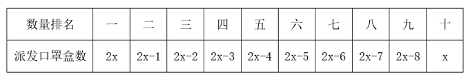

根据口罩一共有230盒可列式：2x+2x-1+2x-2+2x-3+2x-4+2x-5+2x-6+2x-7+2x-8+x=230，化简可得：19x-36=230，解得x=14。那么派发口罩数量最少的那栋楼最少可派发口罩14盒。

故正确答案为C。

---

第 59 题

**答案**：D

**官方解析**

先从8架歼击机中选出3架、3架预警直升机中选出2架、2架反潜直升机中选出1架，共有种方法；再根据要求安排起飞顺序，3架歼击机必须相邻起飞可用捆绑法、2架预警直升机不能相邻起飞可用插空法，即先将3架歼击机捆绑后与1架反潜直升机进行排列有种方法，再将2架预警直升机插空有种方法。故满足要求的不同的起飞方式有种。

故正确答案为D。

---

第 60 题

**答案**：C

**官方解析**

选出3家媒体中既有国内媒体又有国外媒体，分为两种情况：

情况一：2家国内媒体、1家国外媒体。先从10家国内媒体中选出2家，有种情况，再从4家国外媒体中选出1家，有种情况，由于国内外媒体交叉提问，则国外媒体处于中间位置，2家国内媒体位于头尾位置，有种情况，则有种情况；

情况二：1家国内媒体、2家国外媒体。先从10家国内媒体中选出1家，有种情况，再从4家国外媒体中选出2家，有种情况，由于国内外媒体交叉提问，则国内媒体处于中间位置，2家国外媒体位于头尾位置，有种情况，则有种情况。

综上，不同的提问方式共有360+120=480种。

故正确答案为C。

---

第 61 题

**答案**：C

**官方解析**

根据题意，输液5分钟后剩余的药液为毫升，则调整后药液的滴速为滴/分钟，剩余的235毫升药液还需输液的时间为分钟，则输液的总时间为分钟分钟，即1小时14分钟，上午9点开始输液，则输液结束的时间是10点14分。

故正确答案为C。

---

第 62 题

**答案**：B

**官方解析**

如图所示：过公路作A点的对称点为，交公路于点M；过B点作公路的垂线，垂点为N；过的垂线，垂点为；过A点作BN的垂线，垂点为D，则四边形ADNM和 为矩形。连接，交MN于点O，根据两点之间线段最短，可知将物资集散中心修建在O点时，到两村的直线路程之和最小。

已知AM=3公里，BN=7公里，则BD=BN-DN=BN-AM=7-3=4公里。在直角中，已知AB=8.5公里，根据勾股定理可得公里，则公里。在直角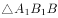中，公里，根据勾股定理可得公里。

货车从集散中心出发，到两村送货后返回中心所走最短路程公里，则所需时间约为。

故正确答案为B。

---

第 63 题

**答案**：B

**官方解析**

根据七巧板特性，结合所给图形可知，三角形①与三角形②等底同高，两个区域面积相等；三角形③与三角形⑤等底等高，两个区域面积相等；区域⑥为正方形，三角形④与三角形⑦等底等高，两个区域面积相等，且面积是正方形⑥的一半，也是三角形⑤的一半。故面积相等的区域可分为三组：①②、③⑤⑥、④⑦。

从三组中分别选出一个区域，再分配给三家不同的公司，共有种选择方案。

故正确答案为B。

---

第 64 题

**答案**：C

**官方解析**

在直角三角形ACD中，已知，CD=24米，，则米。在直角三角形ABD中，已知，可得AD=BD=40米，则石像BC=BD-CD=40-24=16米。

故正确答案为C。

---

第 65 题

**答案**：B

**官方解析**

根据题意，每篇征文被采用的情况为：①初审两位编辑均通过，概率为：0.4×0.4=0.16；②初审两位编辑仅有一位通过，且主编复审通过，概率为：，分类用加法，故每篇征文被采用的概率为0.16+0.096=0.256。

故正确答案为B。

---

第 66 题

**答案**：B

**官方解析**

设大银杯容量为x，小银杯容量为y，赋值1斛酒的量为1；根据题意可列方程：5x+y=3······①，5y+x=2······②，联立①②解得，。则1斛酒可倒满的小银杯数量，故至多可以倒满小银杯的数量为3个。

故正确答案为B。

---

第 67 题

**答案**：B

**官方解析**

根据几何等比放缩性质，在立体几何中，体积比等于相似比的立方。该顾客在发现“沙漏内上方沙子的高度为原先的一半”时，，即相似比为1：2，则。因所有沙子（8份）漏完需要25分钟，则现在剩余沙子（1份）漏完还需要分钟。即若再过3.125分钟还未上菜，这位顾客将享受免单服务，在B项范围内。

故正确答案为B。

---

第 68 题

**答案**：C

**官方解析**

根据题意，扫地机器人的前端边刷需要清扫到地面边角，如下图所示，设该型号扫地机器人圆形机身的最大半径为rcm，根据三角形勾股定理可得：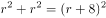，解得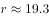，向下取整，即最大半径为19cm，则该型号扫地机器人圆形机身的最大直径为19×2=38cm。

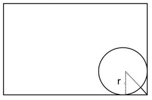

故正确答案为C。

---

第 69 题

**答案**：C

**官方解析**

根据长方体体积=底面积×高，结合水池“容积为144立方米，深度为4米”，可得水池底面长方形面积平方米。底面积一定，要使造价最低，则侧面积要尽量少，假设底面长方形的长和宽分别为a和b，则水池侧面积=2×4a+2×4b=4（2a+2b），若要侧面积最小，则2a+2b最短，即底面周长最短。因为“长方形面积一定，长宽相等也就是正方形时周长最短”，因a×b=36，所以当a=b=6时，a+b最小，此时侧面积=4×（2a+2b）=4×24=96平方米。总造价=底部造价+侧面造价=36×260+96×180=26640元。 

故正确答案为C。

---

第 70 题

**答案**：A

**官方解析**

如图所示，过上棱两个端点M、N分别向底面做垂直截面，交底面ABCD于点E、F、G、H，则该帐篷屋顶可拆分为左、右两个四棱锥（M-AEFD和N-BCHG）和中间一个三棱柱（EFM-GHN）。根据公式：；，则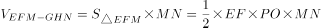

立方米；立方米。则该帐篷屋顶的体积立方米。

故正确答案为A。

---

第 71 题

**答案**：B

**官方解析**

本题为分组分类题目。元素组成不同，优先考虑属性规律。观察发现，图①③⑥均不是轴对称图形，图②④⑤均是轴对称图形，即图①③⑥为一组，图②④⑤为一组。
故正确答案为B。
注：分组分类题目优先考虑两组图形分别具有各自的规律，无法分成具有各自规律的两组时，才考虑将图形分成一组具有该规律，一组不具有该规律。

---

第 72 题

**答案**：C

**官方解析**

元素组成不同，且无属性规律，考虑数量规律。观察发现，图形均由直线和曲线构成，且曲线和直线都有交点，考虑数曲直交点，图①③④的曲直交点数均为6，图②⑤⑥的曲直交点数均为9，故图①③④为一组，图②⑤⑥为一组。
故正确答案为C。

---

第 73 题

**答案**：C

**官方解析**

本题为分组分类题目。元素组成不同，且无明显属性规律，考虑数量规律。题干每幅图形都有多个相同小元素，优先考虑相同元素的个数。图①④⑤中相同元素的个数均为3，图②③⑥中相同元素的个数均为2，即图①④⑤为一组，图②③⑥为一组。
故正确答案为C。

---

第 74 题

**答案**：C

**官方解析**

A项：选项的侧视图、正视图、顶视图如下图所示，与题干不符，排除；

B项：选项的侧视图、顶视图如下图所示，与题干不符，排除；

C项：选项的侧视图、正视图和顶视图，均与题干相符，当选；

D项：选项的侧视图、顶视图如下图所示，与题干不符，排除。

故正确答案为C。

---

第 75 题

**答案**：C

**官方解析**

解法一：
图形元素组成相似，优先考虑样式规律。观察发现，题干图形出现阴影、白色两种图案，考虑黑白运算。九宫格优先横向看，但是发现第一行阴影+白=阴影，第二行阴影+白=白，相同运算方式，但结果不同，考虑竖向看。观察发现，第一列：白+白=白、阴影+阴影=阴影、阴影+白=阴影、白+阴影=阴影；第二列验证此规律成立；第三列应用此规律，只有C项符合。
解法二：
图形元素组成相似，优先考虑样式规律。观察发现，九宫格横向看无规律，考虑竖向看，第一个图形与第二个图形进行叠加运算可得第三个图形，只有C项符合。
故正确答案为C。

---

第 76 题

**答案**：C

**官方解析**

第一步：找出定义关键词。
“通过人工直接或间接实施保护修复工程或在常年潮汐、冲淤等自然力作用下”、“将原来的人工岸线最大限度地恢复海岸自然形态、地貌单元”、“恢复和改善海岸生态功能的岸线”。
第二步：逐一分析选项。
A项：该项是将自然海岸形态改变成人工海岸形态的堤坝，而不是恢复和改善海岸的生态功能，不符合“将原来的人工岸线最大限度地恢复海岸自然形态、地貌单元”、“恢复和改善海岸生态功能的岸线”，不符合定义，排除；
B项：某港口城市打造的生态美、人气旺的黄金旅游岸线，不明确是否恢复和改善了海岸的生态功能，不符合“将原来的人工岸线最大限度地恢复海岸自然形态、地貌单元”、“恢复和改善海岸生态功能的岸线”，不符合定义，排除；
C项：某海滨城市修复建设，符合“通过人工直接或间接实施保护修复工程或在常年潮汐、冲淤等自然力作用下”，修复建设具有自然岸滩形态特征和生态功能的海堤，符合“将原来的人工岸线最大限度地恢复海岸自然形态、地貌单元”、“恢复和改善海岸生态功能的岸线”，符合定义，当选；
D项：保持自然生态属性特征，没有因人类活动而改变形态和属性的海岸线，本身就是自然形态，不存在恢复和改善的过程，不符合“将原来的人工岸线最大限度地恢复海岸自然形态、地貌单元”、“恢复和改善海岸生态功能的岸线”，不符合定义，排除。
故正确答案为C。

---

第 77 题

**答案**：D

**官方解析**

第一步：找出定义关键词。
代表性启发：“首先借鉴要判断的事件本身或同类事件以往的出现的结果”；
可得性启发：“把最先想到的经验和信息作为判断的依据”。
第二步：逐一分析选项。
A项：高估连续事件发生的概率，即以往连续发生的预测还会发生，借鉴的是同类事件以往出现的结果，不符合“把最先想到的经验和信息作为判断的依据”，不符合“可得性启发”定义，符合“代表性启发”定义，排除；
B项：高质量产品一般贵，因此，如果某个产品很贵，我们会认为它的质量很好，借鉴的是同类事件以往出现的结果，不符合“把最先想到的经验和信息作为判断的依据”，不符合“可得性启发”定义，符合“代表性启发”定义，排除；
C项：会根据服装来判断他人社会地位的高低，看到身着高档服装的人，就认为他们更成功、社会地位更高，借鉴的是同类事件以往出现的结果，不符合“把最先想到的经验和信息作为判断的依据”，不符合“可得性启发”定义，符合“代表性启发”定义，排除；
D项：认为乘坐飞机更危险，因为首先想到的是关于飞机失事的报道，“首先想到”说明是根据最先想到的信息去判断的，符合“把最先想到的经验和信息作为判断的依据”，符合“可得性启发”定义，当选。
故正确答案为D。

---

第 78 题

**答案**：A

**官方解析**

第一步：找出定义关键词。

“各债务人之间基于不同的发生原因”、“对同一债权人负有以同一给付为标的的数个债务责任”、“如果一个债务人履行了全部债务，那么全体债务归于消灭”。

第二步：逐一分析选项。

A项：该项中小张在医院治疗期间由于血液质量不高病情加重起诉至法院，小张是债权人，医院和血液提供机构是债务人，其中血液提供机构没有履行好检验或安全保存的义务，医院也没有履行好再核实的义务，符合“各债务人之间基于不同的发生原因”，医院和血液提供机构在该起医疗事故中都负有责任，符合“对同一债权人负有以同一给付为标的的数个债务责任”，若医院或血液提供机构中的一方承担了责任，则另一方无需再承担，符合“如果一个债务人履行了全部债务，那么全体债务归于消灭”，符合定义，当选；

B项：该项中代理人小孙为获私利与销售方小李串通，故意抬高钢材销售价格后卖给小赵，小孙和小李是基于相同的发生原因，都是想要获得私利，不符合“各债务人之间基于不同的发生原因”，不符合定义，排除；

C项：该项中小刘和小宋各持有公司50%的股份，后因经营不善欠债，小刘和小宋作为债务人，是基于相同的发生原因，都是因为经营不善，不符合“各债务人之间基于不同的发生原因”，不符合定义，排除；

D项：该项中的交通事故里，对面来车的司机因为没有正确驾驶负有责任，但小王是否需要担责是不明确的（如果小王是正常行走，那么小王的行为属于紧急避险，则无需担责；如果小王存在违反交通法规的情况，则需要担责），故小王不一定是该起交通事故的债务人，不符合“各债务人之间基于不同的发生原因”、“对同一债权人负有以同一给付为标的的数个债务责任”，不符合定义，排除。

故正确答案为A。

注：下图是关于本定义的适用情形，其中（三）对应本题A项。

---

第 79 题

**答案**：B

**官方解析**

第一步：找出定义关键词。
“利用生物的生命代谢活动”、“减少被污染的环境中的有毒有害物的浓度”、“使被污染了的环境能够部分地或完全地恢复到原初状态”。
第二步：逐一分析选项。
A项：利用蜈蚣草吸收土壤中的重金属，符合“利用生物的生命代谢活动”、“减少被污染的环境中的有毒有害物的浓度”，符合定义，排除；
B项：使用玉米等粮食作物做成的降解塑料袋来减少环境污染，玉米等粮食是降解塑料袋的原材料，不涉及生物的生命代谢活动，不符合“利用生物的生命代谢活动”、“减少被污染的环境中的有毒有害物的浓度”，不符合定义，当选；
C项：利用微生物菌降解河道有机污染物，符合“利用生物的生命代谢活动”、“减少被污染的环境中的有毒有害物的浓度”，符合定义，排除；
D项：利用菌藻共生关系，处理和净化池塘里的污物，符合“利用生物的生命代谢活动”、“减少被污染的环境中的有毒有害物的浓度”，符合定义，排除。
本题为选非题，故正确答案为B。

---

第 80 题

**答案**：C

**官方解析**

第一步：找出定义关键词。
隐匿性降水：“大气中水汽”、“直接在地面或地物表面及低空的凝结物”；
直接性降水：“由空中降落到地面上的水汽凝结物”。
第二步：逐一分析选项。
A项：夜深烟火灭，霰雪落纷纷，意思是夜深人静，烟火无痕，雨雪夹杂，纷纷飘零，雨雪属于空气中的凝结物，不符合“直接在地面或地物表面及低空的凝结物”，不符合“隐匿性降水”定义，符合“直接性降水”定义，排除；
B项：广寒宫中珠径雨，狂风倾下九天来，意思是广寒宫下的雨雹好似珍珠那么大，狂风从九天倾巢而出，描写的是雨，属于空气中的凝结物，不符合“直接在地面或地物表面及低空的凝结物”，不符合“隐匿性降水”定义，符合“直接性降水”定义，排除；
C项：雾凇是由冰晶在温度低于冰点以下的物体上形成的白色不透明粒状结构沉积物，是低温时空气中水汽直接冻结在物体上形成的，符合“直接在地面或地物表面及低空的凝结物”，符合“隐匿性降水”定义，当选；
D项：雨凇是由于降雨附着于物体表面不断聚集形成的白色沉积物，与降雨有关，不符合“直接在地面或地物表面及低空的凝结物”，不符合“隐匿性降水”定义，排除。
故正确答案为C。

---

第 81 题

**答案**：D

**官方解析**

第一步：找出定义关键词。
“自然环境对人类产生的废弃物具有自动容纳、吸收和消化的能力”。
第二步：逐一分析选项。
A项：某地开展整治行动加强固体废弃物和垃圾处置，没有体现出自然环境自动容纳、吸收和消化人类产生的废弃物，不符合“自然环境对人类产生的废弃物具有自动容纳、吸收和消化的能力”，不符合定义，排除；
B项：某县通过环境治理提升环境资源能容纳的人口和经济规模，没有体现出自然环境自动容纳、吸收和消化人类产生的废弃物，不符合“自然环境对人类产生的废弃物具有自动容纳、吸收和消化的能力”，不符合定义，排除；
C项：某市测算出该城市大气承载污染物的最大数量，没有体现出自然环境自动容纳、吸收和消化人类产生的废弃物，不符合“自然环境对人类产生的废弃物具有自动容纳、吸收和消化的能力”，不符合定义，排除；
D项：PM2.5被大自然转化成对生态系统造成危害较小的物质，甚至达到无害的状态，是自然环境消化了人类产生的废弃物，符合“自然环境对人类产生的废弃物具有自动容纳、吸收和消化的能力”，符合定义，当选。
故正确答案为D。

---

第 82 题

**答案**：B

**官方解析**

第一步：找出定义关键词。
“被害人出于某种迫切的需要和急切的欲望”、“注意力狭窄、判断力减弱甚至轻度丧失理智”、“对自己所处的危险或面临的风险视而不见”。
第二步：逐一分析选项。
A项：王某为强身健体，符合“被害人出于某种迫切的需要和急切的欲望”，高价购买大量伪劣保健品，符合“注意力狭窄、判断力减弱甚至轻度丧失理智”、“对自己所处的危险或面临的风险视而不见”，符合定义，排除； 
B项：林某不慎滑倒是林某自己不小心所致，没有人要害他，不符合“被害人”，不符合定义，当选；
C项：黄某为谋高额回报，符合“被害人出于某种迫切的需要和急切的欲望”，黄某网络刷单导致经济受损，符合“注意力狭窄、判断力减弱甚至轻度丧失理智”、“对自己所处的危险或面临的风险视而不见”，符合定义，排除；
D项：刘某幻想通过理财一夜暴富，符合“被害人出于某种迫切的需要和急切的欲望”，刘某给了骗子可乘之机，符合“注意力狭窄、判断力减弱甚至轻度丧失理智”、“对自己所处的危险或面临的风险视而不见”，符合定义，排除；
本题为选非题，故正确答案为B。

---

第 83 题

**答案**：C

**官方解析**

第一步：找出定义关键词。
授权性规范：“法律主体可以为一定行为或不为一定行为”；
义务性规范：“法律主体必须为一定行为”；
禁止性规范：“禁止法律主体为一定行为”。
第二步：逐一分析选项。
A项：自然人决定、变更姓名，或者法人、非法人组织决定、变更、转让名称的，应当依法向有关机关办理登记手续，“应当”不符合“禁止法律主体为一定行为”，符合“义务性规范”定义，不符合“禁止性规范”定义，排除；
B项：对亲子关系有异议且有正当理由的，父或者母可以向人民法院提起诉讼，“可以诉讼”不符合“禁止法律主体为一定行为”，符合“授权性规范”定义，不符合“禁止性规范”定义，排除；
C项：任何组织或者个人不得以丑化、污损或者利用信息技术手段伪造等方式侵害他人肖像权，“不得”说明是“禁止法律主体为一定行为”，符合“禁止性规范”定义，当选；
D项：因正当防卫造成损害的，不承担民事责任，“不承担”说明是可以不用承担，不符合“禁止法律主体为一定行为”，符合“授权性规范”定义，不符合“禁止性规范”定义，排除。
故正确答案为C。

---

第 84 题

**答案**：C

**官方解析**

第一步：找出定义关键词。
商业效用原则：“发挥基本的功能作用”、“欠缺必要的使用条件或者辅助设施导致其交易目的落空的，应当予以补足”；
最佳效用原则：“通过配置组合”、“使资源能够最大程度地发挥效能，提高利用效率”。
第二步：逐一分析选项。
A项：商品房的基本功能作用是居住，赠送的车位并不是发挥居住功能的必要使用条件或辅助设施，不符合“必要的使用条件或者辅助设施”，不符合定义，排除；
B项：买的桌子可以发挥它的基本功能作用，椅子不是桌子发挥功能作用的必要使用条件，不符合“必要的使用条件或者辅助设施”，不符合定义，排除；
C项：地下酒窖想要发挥作用就要去到地下，如果缺失出入通道就会导致交易落空，符合“必要的使用条件或者辅助设施”，符合定义，当选；
D项：购买的家电可以发挥基本的功能作用，“三包服务”不是家电发挥功能作用的必要使用条件，不符合“必要的使用条件或者辅助设施”，不符合定义，排除。
故正确答案为C。

---

第 85 题

**答案**：A

**官方解析**

第一步：找出定义关键词。
借词：“音义都借自外语的词”、“引入新的外来概念”、“引入外语的音义结合关系”；
意译词：“引入新的外来概念”、“用本族语的构词材料和构词规则构成新词来表达”；
仿译词：“构词所用的本族语的构词材料和构词规则分别与所源出的外语词具有一一对应的关系”。
第二步：逐一分析选项。
A项：蜜月源自英文单词honeymoon，其中honey本意为蜂蜜，moon为月，足球的英文单词是football，其中foot本意为脚、足，ball为球，均符合“构词所用的本族语的构词材料和构词规则分别与所源出的外语词具有一一对应的关系”，符合仿译词定义，当选；
B项：激光的英文单词是laser，天使的英文单词是angel，均不符合“构词所用的本族语的构词材料和构词规则分别与所源出的外语词具有一一对应的关系”，不符合仿译词定义，排除；
C项：雷达的英文单词是radar，可口可乐的英文单词是coca-cola，均不符合“构词所用的本族语的构词材料和构词规则分别与所源出的外语词具有一一对应的关系”，不符合仿译词定义，排除；
D项：黑板的英文单词是blackboard，其中black本意是黑色，board为板、木板，符合“构词所用的本族语的构词材料和构词规则分别与所源出的外语词具有一一对应的关系”，符合仿译词定义，但高尔夫球的英文单词是golf，不符合“构词所用的本族语的构词材料和构词规则分别与所源出的外语词具有一一对应的关系”，不符合仿译词定义，排除。
故正确答案为A。

---

第 86 题

**答案**：D

**官方解析**

第一步：判断题干词语间逻辑关系。
葡萄是制作葡萄酒的原材料，二者构成原材料的对应关系。
第二步：判断选项词语间逻辑关系。
A项：黄金档是指电视开机观众数最广泛的时段的通称，后者是根据前者的内在特性进行类比而命名的，二者不构成原材料的对应关系，与题干逻辑关系不一致，排除；
B项：香蕉水，又名天那水、梨油，因有乙酸戊酯或乙酸异戊酯的香蕉味，故得名香蕉水，后者是根据其味道类似前者而命名的，二者不构成原材料的对应关系，与题干逻辑关系不一致，排除；
C项：杜鹃既可以指杜鹃花，也可以指杜鹃鸟，杜鹃与杜鹃花不是原材料的对应关系，与题干逻辑关系不一致，排除；
D项：枇杷是制作枇杷膏的原材料，二者构成原材料的对应关系，与题干逻辑关系一致，当选。
故正确答案为D。

---

第 87 题

**答案**：C

**官方解析**

第一步：判断题干词语间逻辑关系。
“天荒地老”意思是天荒秽，地衰老，指经历的时间极久远。“海枯石烂”意思是海水干涸、石头腐烂，形容历时久远。二者均形容历时久远，二者为近义关系。
第二步：判断选项词语间逻辑关系。
A项：“同心同德”指思想行动一致。“反目成仇”指翻脸而变成仇敌。二者无明显逻辑关系，与题干逻辑关系不一致，排除；
B项：“披荆斩棘”指拨开荆丛，砍掉荆棘，比喻开创事业或在前进道路上清除障碍，艰苦奋斗。“斩钉截铁”指砍断钉子切断铁，形容说话或行动坚决果断，毫不犹豫。二者无明显逻辑关系，与题干逻辑关系不一致，排除；
C项：“孜孜矻矻”形容勤勉不懈怠的样子。“夙夜不懈”指日夜谨慎工作，勤奋不懈。二者均指勤勉不懈怠，二者为近义关系，与题干逻辑关系一致，当选；
D项：“望而却步”指看到了危险或力不能及的事而往后退缩。“望风披靡”比喻军队毫无斗志，老远看到对方的气势很盛，没有交锋就溃散了。二者无明显逻辑关系，与题干逻辑关系不一致，排除。
故正确答案为C。

---

第 88 题

**答案**：C

**官方解析**

第一步：判断题干词语间逻辑关系。
全真阅读具有沉浸式的属性，二者为必然属性对应关系。
第二步：判断选项词语间逻辑关系。
A项：企业销售可能具有盈利性的属性，但不是必然属性，与题干逻辑关系不一致，排除；
B项：乡村教育可能具有均衡化的属性，但不是必然属性，与题干逻辑关系不一致，排除；
C项：人工智能具有数字化的属性，二者为必然属性对应关系，与题干逻辑关系一致，当选；
D项：线上课程可能具有直播性的属性，但不是必然属性，与题干逻辑关系不一致，排除。
故正确答案为C。

---

第 89 题

**答案**：D

**官方解析**

第一步：判断题干词语间逻辑关系。
嗜食甜品导致龋齿，二者为因果对应关系。
第二步：判断选项词语间逻辑关系。
A项：海鲜导致食物过敏，二者为因果对应关系，但顺序与题干相反，与题干逻辑关系不一致，排除；
B项：缺钙导致骨质疏松，二者为因果对应关系，但顺序与题干相反，与题干逻辑关系不一致，排除；
C项：运动可以增强体质，二者为功能对应关系，与题干逻辑关系不一致，排除；
D项：地下渗水导致塌方，二者为因果对应关系，与题干逻辑关系一致，当选。
故正确答案为D。

---

第 90 题

**答案**：A

**官方解析**

第一步：判断题干词语间逻辑关系。
针灸可以疏通经脉，二者是功能对应关系。
第二步：判断选项词语间逻辑关系。
A项：慢跑可以增强体质，二者是功能对应关系，与题干逻辑关系一致，当选；
B项：涅槃原指超脱生死的境界，现用作死（多指佛或僧人）的代称，化茧成蝶原意指蝴蝶幼虫变化为成虫的过程，寓意人经历成长，蜕去丑陋的无用的，变得智慧、美丽，二者之间没有明显的逻辑关系，与题干逻辑关系不一致，排除；
C项：缺铁会导致供血不足，二者是因果对应关系，与题干逻辑关系不一致，排除；
D项：通过商品展示的方式进行促销，二者是方式目的对应关系，与题干逻辑关系不一致，排除。
故正确答案为A。

---

第 91 题

**答案**：B

**官方解析**

第一步：判断题干词语间逻辑关系。
游艇是船舶的一种，二者为种属关系，钢材是游艇的原材料，二者为原材料对应关系。
第二步：判断选项词语间逻辑关系。
A项：玉石是古玺的原材料，二者为原材料对应关系，隶书为雕刻古玺时所用的一种文字，二者并非种属关系，与题干逻辑关系不一致，排除；
B项：旗袍是服饰的一种，二者为种属关系，丝绸是旗袍的原材料，二者为对应关系，与题干逻辑关系一致，当选；
C项：版画和油画是两种不同的绘画形式，二者为并列关系，均与绘画构成种属关系，与题干逻辑关系不一致，排除；
D项：砧板为厨具的一种，二者为种属关系，木材是砧板的原材料，二者为对应关系，但词语顺序与题干不同，与题干逻辑关系不一致，排除。
故正确答案为B。

---

第 92 题

**答案**：A

**官方解析**

第一步：判断题干词语间逻辑关系。
书籍在书柜内，二者为位置的对应关系，书页是书籍的组成部分，二者为组成关系。
第二步：判断选项词语间逻辑关系。
A项：花卉在花坛内，二者为位置的对应关系，花蕊是花卉的组成部分，二者为组成关系，与题干逻辑关系一致，当选；
B项：在舞池内舞蹈，二者为位置的对应关系，舞伴表演舞蹈，二者为主宾关系，与题干逻辑关系不一致，排除；
C项：面粉是制作面条的原材料，二者为原材料的对应关系，面条和面片是不同的面食，二者为并列关系，与题干逻辑关系不一致，排除；
D项：鞋子在鞋盒内，二者为位置的对应关系，鞋油是擦拭鞋子的工具，二者为工具的对应关系，与题干逻辑关系不一致，排除。
故正确答案为A。

---

第 93 题

**答案**：C

**官方解析**

第一步：判断题干词语间逻辑关系。
东汉和北宋都是中国历史朝代之一，二者是并列关系，都与历史朝代构成组成关系，且东汉在前，北宋在后。
第二步：判断选项词语间逻辑关系。
A项：台风发生在太平洋西部和南海，飓风发生大西洋西部，台风和飓风都是“一种”热带气旋，与热带气旋构成种属关系，台风与飓风也没有时间的先后，与题干逻辑关系不一致，排除；
B项：家父是对人谦称自己的父亲的称呼，不是敬辞称谓，令尊是称对方父亲的敬词，是“一种”敬辞称谓，与敬辞称谓构成种属关系，家父与令尊也没有时间的先后，与题干逻辑关系不一致，排除；
C项：十二时辰即：子、丑、寅、卯、辰、巳、午、未、申、酉、戌、亥，丑时和午时是并列关系，都与十二时辰构成组成关系，且丑时在前，午时在后，与题干逻辑关系一致，当选；
D项：火车和马车都是“一种”交通工具，与交通工具构成种属关系，通常马车更早产生，火车是工业时代产物，与题干逻辑关系不一致，排除。
故正确答案为C。

---

第 94 题

**答案**：C

**官方解析**

第一步：判断题干词语间逻辑关系。
细胞核和细胞质都是细胞的组成部分，第一词与第二词为并列关系，均与第三词为组成关系。
第二步：判断选项词语间逻辑关系。
A项：绝缘体与半导体为并列关系，绝缘体不容易导电，半导体可以导电，二者与导电不是组成关系，与题干逻辑关系不一致，排除；
B项：碳中和与碳达峰都是我国针对碳排放提出的目标，二者为并列关系，实现碳中和、碳达峰目标有利于环保，二者与环保不是组成关系，与题干逻辑关系不一致，排除；
C项：真皮和表皮都是皮肤的组成部分，第一词与第二词为并列关系，均与第三词为组成关系，与题干逻辑关系一致，当选；
D项：牙冠是牙齿的组成部分，二者为组成关系，与题干逻辑关系不一致，排除。
故正确答案为C。

---

第 95 题

**答案**：A

**官方解析**

逐一代入选项。
A项：“佶屈聱牙”形容“文句”艰涩，读起来不顺口，二者为对应关系；“春风化雨”比喻师长潜移默化的谆谆“教诲”，二者为对应关系，前后逻辑关系一致，当选；
B项：“佶屈聱牙”与“书写”无明显逻辑关系；“和光同尘”比喻随俗而处，不露锋芒，多指随波逐流，与“教诲”无明显逻辑关系，前后逻辑关系不一致，排除；
C项：“佶屈聱牙”与“表达”无明显逻辑关系；“无微不至”形容关心、照顾得非常细致、周到，与“教诲”无明显逻辑关系，前后逻辑关系不一致，排除；
D项：“佶屈聱牙”与“描述”无明显逻辑关系；“刚柔相济”是指既有刚强的一面，也有柔和的一面，二者互相补充、配合，与“教诲”无明显逻辑关系，前后逻辑关系不一致，排除。
故正确答案为A。

---

第 96 题

**答案**：A

**官方解析**

第一步：找出论点和论据。
论点：人参在针叶林里分布很少，而在阔叶林里分布更多、长得更好。
论据：针叶林的土壤成分相对单一，且能够透下更多光线，这对于属于半阴性植物的人参生长不利，而阔叶林的遮阳效果更好。并且，阔叶林地表的厚厚落叶，可以在冬季给人参提供保暖，有利于其存活。
本题论点论据讨论的都是人参在阔叶林里比在针叶林里分布更多、长得更好，论点与论据话题一致，削弱优先考虑削弱论点，其次考虑削弱论据。
第二步：逐一分析选项。
A项：该项说的是人参在蒙古栎下长不好，是因为蒙古栎的落叶太厚导致参苗长不出来，说明阔叶林地表的厚厚落叶不利于人参存活，举反例削弱论据，可以削弱，当选；
B项：该项说的是不同类型的林地都存在不利于人参生长的因素，而题干讨论的是林地的树种对于人参生长的影响，话题不一致，无法削弱，排除；
C项：该项说的是山坡的坡度对于人参生长的影响，而题干讨论的是林地的树种对于人参生长的影响，话题不一致，无法削弱，排除；
D项：该项说的是人参在糠椴、紫椴树下生长较好，而这两种树的叶子密，遮阴挡雨，说明糠椴、紫椴树应为阔叶树（二者确实是阔叶树），即人参在阔叶林里长得更好，为加强项，无法削弱，排除。
故正确答案为A。

---

第 97 题

**答案**：A

**官方解析**

第一步：找出论点和论据。
论点：牛蛙体内含有幼虫裂头蚴、广州管圆线虫等能够在人体寄生的寄生虫，食入带有这些寄生虫的牛蛙，会严重影响人体健康。
论据：无。
本题只有论点没有论据，削弱优先考虑削弱论点。
第二步：逐一分析选项。
A项：该项指出经过高温烹饪，牛蛙身上的寄生虫会被全部杀死，说明带有寄生虫的牛蛙经过高温烹饪后食用并不会影响人体健康，削弱论点，可以削弱，保留；
B项：该项指出淡水虾蟹中的肺吸虫会对人体造成影响，与论点讨论的牛蛙体内的寄生虫是否会对人体造成影响无关，话题不一致，无法削弱，排除；
C项：该项指出生态养殖的牛蛙体内没有发现裂头蚴寄生虫，说明生态养殖的牛蛙不会影响身体健康，削弱论点，可以削弱，保留；
D项：该项指出牛蛙体内存在不会传染给人类的寄生虫，与论点讨论的牛蛙体内能在人体寄生的寄生虫是否会影响人体健康无关，无法削弱，排除。
对比A、C两项，A项说的是牛蛙身上所有的寄生虫会被高温杀死，而C项只提到了裂头蚴寄生虫这一种寄生虫，综合对比，A项是整体性削弱，C项是部分削弱，A项的削弱力度大于C项，因此优选A项。
故正确答案为A。

---

第 98 题

**答案**：D

**官方解析**

第一步：找出论点和论据。
论点：压力水平会反映在头发中储存的皮质醇的含量上。
论据：压力水平排在前五名的女性头发中含有的皮质醇水平比排在后五名的女性高出24.3%。
本题的论点论据都是在说皮质醇和压力之间的关系，话题是一致的，故削弱优先考虑削弱论点。
第二步：逐一分析选项。
A项：头发可以显示出人们的压力水平，表明头发与压力之间有联系，但不明确是否是头发中的“皮质醇”，无法削弱，排除；
B项：皮质醇被称为“压力荷尔蒙”，在身体处于“战斗或逃避”模式时释放，表明皮质醇的产生与压力确实有关，可以加强，无法削弱，排除；
C项：表明压力对头发的危害，但没提到“皮质醇”，无法削弱，排除；
D项：表明压力不是皮质醇产生的唯一原因，否定了压力和皮质醇之间的必然关系，削弱论点，当选。
故正确答案为D。

---

第 99 题

**答案**：B

**官方解析**

第一步：找出论点和论据。
论点：国际天文学界认为金星不可能有生命。
论据：科学家研究报告显示，这颗灼热行星的云层中没有足够的水蒸气来维持众所周知的生命形式。
论点讨论的是金星不可能有生命，论据讨论的是金星没有足够的水蒸气来维持生命，二者都在讨论金星是否存在生命，话题一致，加强优先考虑补充论据。
第二步：逐一分析选项。
A项：该项讨论的是金星的云层中有足够的水，其大气温度也适合维持生命，说明金星可能有生命，削弱项，无法加强，排除；
B项：该项讨论的是金星云层的水含量仅相当于维持类地生命所需水含量的百分之一，说明没有足够的水分来维持生命，补充论据，可以加强，当选；
C项：该项讨论的是金星大气中含有大量的磷化氢，而磷化氢是与生命有关的气体，说明金星可能有生命，削弱项，无法加强，排除；
D项：该项讨论的是金星适合不适合居住的问题，而题干讨论的是金星存不存在生命，话题不一致，无法加强，排除。
故正确答案为B。

---

第 100 题

**答案**：C

**官方解析**

第一步：找出论点和论据。
论点：母乳喂养可降低剖宫产宝宝过敏风险。
论据：母乳中含有双歧杆菌等益生菌，可帮助宝宝建立健康肠道菌群，训练免疫系统，降低过敏风险。
论据讨论的是“母乳中含有的双歧杆菌等益生菌可帮助宝宝降低过敏风险”，论点说的是“母乳喂养可降低剖宫产宝宝过敏风险”，论据和论点话题一致，加强优先考虑补充论据。
第二步：逐一分析选项。
A项：该项是在说剖宫产宝宝肠道健康菌群的建立，比自然分娩宝宝晚约6个月，并未提及母乳喂养，话题不一致，无法加强，排除；
B项：该项是在说母乳喂养期间母亲进食易过敏食物会增加宝宝过敏风险，但并不清楚母亲如果正常饮食期间母乳喂养会不会降低宝宝过敏风险，为无关项，无法加强，排除；
C项：母乳致敏性低，是因为宝宝的免疫系统能将其中的蛋白质识别为“自己的”，解释了为什么母乳喂养可以降低宝宝的过敏反应，补充论据，当选；
D项：把高致敏性的普通牛奶蛋白变成低致敏性的小分子蛋白质，可以降低宝宝过敏的风险，是在指出其他可以降低宝宝过敏风险的办法，但并没提及母乳喂养会不会降低宝宝过敏风险，为无关项，无法加强，排除。
故正确答案为C。

---

第 101 题

**答案**：D

**官方解析**

日常结论题，根据题干信息逐一分析选项。
A项：选项指出可可脂熔化所需的温度比黄油更高，而题干中只是表述了“黄油是随温度上升一点点从固体变为液体，可可脂却是达到熔点时瞬间熔化”，并未涉及二者熔化所需温度之间的比较，无中生有，无法推出，排除；
B项：选项指出黄油和可可脂熔化所需要的温度依环境变化而变化，而题干中只是表述了“黄油是随温度上升一点点从固体变为液体，可可脂却是达到熔点时瞬间熔化”，并未提及二者熔化所需的温度会依环境变化而变化，无中生有，无法推出，排除；
C项：选项指出黄油因为其油脂熔化方式对人体健康更有好处，所以经常用于烹饪，而题干中并未提及相关内容，无中生有，无法推出，排除；
D项：根据题干中“黄油是随温度上升一点点从固体变为液体，可可脂却是达到熔点时瞬间熔化”且“黄油是由100种以上各种各样的油脂混合在一起形成的，而可可脂则只由3种油脂构成”可推知，可可脂中的各种油脂少且熔点相近，而黄油中的各种油脂多且熔点不相近，因此黄油中的各种油脂性质差异较大，可以推出，当选。
故正确答案为D。

---

第 102 题

**答案**：A

**官方解析**

日常结论题，根据题干信息逐一分析选项。
A项：题干第二句话指出在安静和运动或情绪激动状态下，迷走神经和交感神经对心脏的调控力度不同，且产生了不同的效应，第四句话和第五句话指出交感神经和迷走神经对胃肠道不同的调控力度及产生的不同效应，可以推出，当选；
B项：题干第一句话指出交感神经和迷走神经是调控心脏的神经，而选项说的是调控内脏器官的神经，且题干未提及神经是否受意识的支配，无中生有，无法推出，排除；
C项：题干未提及“保护内脏器官”与“合理使用大脑”的关系，无中生有，无法推出，排除；
D项：题干未提及“冠心病、胃溃疡”与“神经系统功能失常”的关系，无中生有，无法推出，排除。
故正确答案为A。

---

第 103 题

**答案**：C

**官方解析**

第一步：找出论点和论据。
论点：格陵兰岛的冰川消融受到放大效应影响。
论据：北极放大效应是指冰雪和气温之间容易形成正反馈，即气温升高则冰雪消融增多，没有冰雪覆盖的裸地能吸收更多的太阳辐射，加热大气，进一步加剧冰雪消融。观测显示，位于北极格陵兰岛的大多数冰川都呈现出消退趋势，这是世界上流失速度最快的冰川之一。
本题论据讨论的放大效应是指“一方面气温升高则冰雪消融增多；另一方面没有冰雪覆盖的裸地能吸收更多的太阳辐射，进一步加剧冰雪消融”，论据现已知北极格陵兰岛的冰川呈现出消退趋势，只涉及了“放大效应”中第一方面的内容，要想推出论点“格陵兰岛的冰川消融受到放大效应影响”，需补上另一方面，即“格陵兰岛出现了裸地，且吸收了更多的太阳辐射”。
第二步：逐一分析选项。
A项：该项指出格陵兰岛冰川消融导致了全球海平面上升，但是不明确格陵兰岛的冰川消融是否是受到了放大效应影响，为不明确项，无法加强，排除；
B项：该项指出格陵兰岛冰川消退会导致海啸，而论点讨论的是格陵兰岛的冰川消融是否是受到了放大效应的影响，话题不一致，无法加强，排除；
C项：该项指出格陵兰岛的冰川融化后显现出大量陆地，陆地比海洋吸收热量更快，补上了“格陵兰岛确实受到放大效应影响”中另一方面的内容，可以加强，当选；
D项：该项讨论的是南极地区的冰川消退不明显，而论点讨论的格陵兰岛属于北极地区，话题不一致，无法加强，排除。
故正确答案为C。

---

第 104 题

**答案**：B

**官方解析**

第一步：分析题干条件。

（1）红队第一黄队第二；

（2）红队第三蓝队第四；

（3）蓝队不是第四；

（4）黄队第二。

因为四人中只有一人预测为真，若（2）为假，可得“红队第三”“蓝队不是第四”，若（3）为假，可得“蓝队第四”，互相矛盾，故（2）（3）中必有一真，（1）（4）为假。

第二步：根据题干条件进行推理。

根据（1）（4）为假可知，“红队第一”“黄队不是第二”。若（2）为假，可得“红队第三”“蓝队不是第四”，与“红队第一”矛盾，因此（2）为真（3）为假，进而可得“蓝队第四”，又因为“黄队不是第二”，则“黄队第三”，进而推出“绿队第二”。

故正确答案为B。

---

第 105 题

**答案**：B

**官方解析**

第一步：翻译题干。

（1）要么刘佳，要么郑毅；

（2）刘佳吴芳；

（3）郭斌 且 吴芳施文；

（4）丁晓 或 郭斌；

（5）施文 或 丁晓；

（6）施文。

第二步：根据题干条件进行推理。

从确定信息进行推理，施文无法参加，结合条件（5）和“或关系否一推一”可知丁晓参加，结合条件（4）和“或关系否一推一”可知郭斌参加；已知施文无法参加，结合条件（3）和“否后必否前”可知郭斌 或 吴芳，结合郭斌参加和“或关系否一推一”可知吴芳不参加，排除C、D两项；结合条件（2）和“否后必否前”可知刘佳不参加，排除A项；再结合条件（1）可知，郑毅参加，此时确定参加的医生为丁晓、郭斌和郑毅，对应B项。

故正确答案为B。

---

第 106 题

**答案**：D

**官方解析**

定位文字材料可知：2021年雨季开始时间最迟的两个地区分别为华北（7月12日）、华西（8月23日），故时间上相差了31-12+23=42天（7月共有31天）。
故正确答案为D。

---

第 107 题

**答案**：C

**官方解析**

定位文字材料第五段可得，（2021年）华西秋雨于8月23日开始，雨季长度为77天。与正常年份相比，开始偏早8天，结束偏晚7天。则2021年华西秋雨持续了8月9天、9月30天、10月31天、11月7天，共计77天，于11月8日结束。比正常年份结束偏晚7天，则正常年份结束时间应为11月1日。
故正确答案为C。

---

第 108 题

**答案**：A

**官方解析**

根据题干“下列地区中2021年雨季期平均每天降雨量最大的地区是”，可判定本题为现期平均数问题。定位文字材料第二段至第五段可得：2021年西南雨季长度为122天，总雨量634.5毫米；华北雨季长度为59天，总雨量276.4毫米；东北雨季长度为85天，总雨量364.3毫米；华西雨季长度为77天，总雨量379.9毫米。根据公式：雨季期平均每天降雨量，则各地区平均每天降雨量分别为：

西南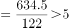毫米/天；

华北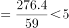毫米/天；

东北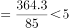毫米/天；

华西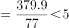毫米/天。

比较可知，2021年雨季期平均每天降雨量最大的是西南地区。

故正确答案为A。

---

第 109 题

**答案**：B

**官方解析**

根据题干“华西2021年······与······相比增加了约”，结合选项带单位，可判定本题为增长量计算问题。定位文字材料第五段可知：2021年，华西秋雨于8月23日开始，总雨量379.9毫米。与正常年份相比，雨量偏多87%。根据公式：增长量，则所求为毫米，与B项最接近。

故正确答案为B。

---

第 110 题

**答案**：D

**官方解析**

A项：定位文字材料第二段，（2021年）西南雨季于6月4日开始，10月4日结束。则2021年10月7日不属于西南雨季期内，错误；

B项：定位文字材料第六段，（2021年）梅雨量267.2毫米；与正常年份相比······梅雨量偏少22%，与2020年梅雨量780.9毫米相比差距明显。根据公式：基期量，可得正常年份梅雨量毫米，2020年梅雨量高出正常年份，错误；

C项：材料中没有给出2021年华西雨季总雨量与2020年相比的相关数据，故无法推出，错误；

D项：定位文字材料第三段、第四段，（2021年）华北雨季长度为59天······与正常年份相比······雨季长度偏长28天；（2021年）东北雨季长度为85天······与正常年份相比······雨季长度偏长21天。则题干所求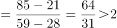倍，正确。

故正确答案为D。

---

第 111 题

**答案**：B

**官方解析**

根据题干“2021年······比2020年增长约”，结合选项带单位，可判定本题为增长量计算问题。定位文字材料可得：2021年，城市供水管道长度105.99万公里，同比增长5.26%。根据公式：增长量，则2021年全国城市供水管道长度比2020年增长万公里。

故正确答案为B。

---

第 112 题

**答案**：A

**官方解析**

根据题干“······同比增长率变化情况的是”，可判定本题为一般增长率问题。定位图1可得2013-2021年全国城市人均日生活用水量的数据。根据公式：增长率，可得2013年全国城市人均日生活用水量同比增长率；2014年同比增长率，通过分子大、分母小可知，2013年的同比增长率＞2014年的同比年增长率，排除C项。2020年人均日生活用水量＜2019年人均日生活用水量，则2020年的同比增长率＜0，其余年份同比增长率均大于0，故2020年同比增长率应为最小，排除B项。2016年的同比增长率，2021年的同比增长率，故2021年的同比增长率＞2016年的同比增长率，排除D项。

故正确答案为A。

注：排除C项后，2016-2020年的同比增长量变化不大，2021年的增长量5.63（185.03-179.40）最大，是其他年份的数倍，且基期量差别不大，所以2016-2021年这几年里2021年对应的增长率也最大，故正确答案为A。

---

第 113 题

**答案**：B

**官方解析**

定位文字材料可得：2021年，全国人均日生活用水量185.03升。定位图2可得2021年全国部分省（区、市）城市人均日生活用水量。则超过全国平均值（185.03升）的有浙江（212升）、安徽（190升）、福建（231升）、广东（251升）、海南（315升）、西藏（256升）6个省（区、市）。
故正确答案为B。

---

第 114 题

**答案**：B

**官方解析**

根据题干“图2中······是······”，结合选项求倍数，可判定本题为现期倍数问题。定位图2可知，城市人均日生活用水量最高的省份是海南，用水量为315升；城市人均日生活用水量中位数省份，即排名第8的省份为宁夏，用水量为168升。故城市人均日生活用水量最高的省份是用水量中位数省份的倍数为倍，与B项最接近。

故正确答案为B。

---

第 115 题

**答案**：D

**官方解析**

A项：定位文字材料可得2020年、2021年全国城市供水普及率，但未给出其余年份的全国城市供水普及率，无法推出，错误；

B项：定位文字材料可得，2021年浙江和广东城市供水普及率达到100%，新疆建设兵团超过95%。比较可知2021年浙江和广东的供水普及率高于新疆建设兵团，错误；

C项：定位图1可得2012-2021年全国城市人均日生活用水量。则所求平均值升＞176升，错误；

D项：定位图2可得用水量排名前三名的省（区、市）城市人均日生活用水量分别为海南315升、西藏256升、广东251升；用水量排名后三位分别为天津123升、吉林125升、山西138升。则所求倍数倍，正确。

故正确答案为D。

---

第 116 题

**答案**：C

**官方解析**

根据题干“2021年，全国羊肉产量同比增长率约为”，可判定本题为一般增长率问题。定位图1可知2020年、2021年全国羊肉产量分别为492.3万吨、514.1万吨。根据公式：增长率，则2021年全国羊肉产量同比增长率为。

故正确答案为C。

---

第 117 题

**答案**：B

**官方解析**

根据题干“2012-2021年······年平均产量······”，可判定本题为现期平均数问题。定位统计图可知2012-2021年全国羊肉产量。利用“削峰填谷”，以450为基准，分别作差为：-45.5、-40.1、-22.4、-10.1、10.3、21.1、25.1、37.5、42.3、64.1，，则羊肉年平均产量为450+8.23=458.23万吨，2016年羊肉产量460.3万吨最接近该数据。

故正确答案为B。

---

第 118 题

**答案**：A

**官方解析**

根据题干“······增长幅度超过50%······”，可判定本题为一般增长率问题。定位表1可得2012年和2021年全国主要畜禽产品零售价格。根据公式：增长率，可得猪肉零售价格增长率，牛肉零售价格增长率，羊肉零售价格增长率，鸡肉零售价格增长率，鸡蛋零售价格增长率，故相较于2012年，2021年零售价格增长幅度超过50%的有猪肉、牛肉、羊肉。

故正确答案为A。

---

第 119 题

**答案**：B

**官方解析**

方法一：根据题干“2021年······同比增长约”，结合选项为百分数，可判定本题为一般增长率问题。定位图表可得：2021年、2020年羊肉产量分别为514.1万吨、492.3万吨，2021年、2020年羊肉零售价格分别为81.40元/公斤、77.01元/公斤。因题目假设羊肉每年以零售价格全部售罄，故羊肉销售收入=产量×零售价格，则2021年羊肉销售收入=514.1万吨×81.40元/公斤51亿公斤×81元/公斤=4131亿元；2020年羊肉销售收入=492.3万吨×77.01元/公斤49亿公斤×77元/公斤=3773亿元。根据公式：增长率，则2021年羊肉销售收入同比增长，与B项最接近。

方法二：根据题干“2021年······同比增长约”，结合选项为百分数，且题目假设羊肉每年以零售价格全部售罄，故羊肉零售价格，可判定本题为平均数的增长率问题。定位图表可得：2021年、2020年羊肉产量分别为514.1万吨、492.3万吨，2021年、2020年羊肉零售价格分别为81.40元/公斤、77.01元/公斤。根据公式：增长率，则2021年羊肉产量同比增长率为（b）（也可根据第一小题答案直接使用），2021年羊肉零售价格同比增长率为（r）。根据平均数的增长率公式：r，设2021年羊肉销售收入同比增长率为a，代入公式得：，则a。

故正确答案为B。

---

第 120 题

**答案**：D

**官方解析**

A项：定位统计图可知，2012～2021年，全国羊肉产量一年比一年变大，即逐年增长，正确；

B项：定位统计表可知，2020年牛肉批发价格为73.03元/公斤，零售价格为86.81元/公斤，元/公斤，2020年牛肉批发价格73.03元/公斤＜78.1元/公斤，即2020年，牛肉批发价格不足零售价格的90%，正确；

C项：定位统计表可知，2020年鸡肉零售价格为26.66元/公斤，批发价格为16.82元/公斤；牛肉零售价格为86.81元/公斤，批发价格为73.03元/公斤；2020年，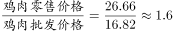，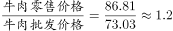，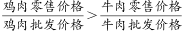，正确；

D项：定位统计表可知，可得2012～2021年鸡蛋批发价格。根据公式：增长率，2018年鸡蛋批发价格同比增速为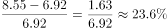；而2021年鸡蛋批发价格同比增速为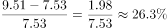，即2012～2021年，鸡蛋批发价格同比增速最快的年份并不是2018年，错误。

本题为选非题，故正确答案为D。

---

第 121 题

**答案**：C

**官方解析**

根据题干“图1中相较于2012年······实现翻一番的年份首次出现在”，根据“翻一番即变为原来的2倍”，可判定本题为现期倍数问题。定位图1可得，2012年全国11个沿海省市海水冷却用水量为841.0亿吨。在2012年基础上翻一番后用水量为841.0×2=1682亿吨，结合图1可知，相较于2012年，2020年海水冷却用水量首次实现翻一番（1698.1亿吨&gt;1682亿吨）。
故正确答案为C。

---

第 122 题

**答案**：C

**官方解析**

根据题干“······2012～2021年期间全国海水冷却用水量年平均增长量······”，可判定本题为年均增长量问题。定位图形材料可得2012～2021年全国11个沿海省市海水冷却用水量。根据公式：年均增长量，可得2012～2021年期间全国海水冷却用水量年平均增长量亿吨；根据公式：增长量=现期量-基期量，可得2013～2021年海水冷却用水量年增量分别为：

2013年=883.0-841.0&lt;100亿吨&lt;103.8亿吨；

2014年=1009.0-883.0&gt;120亿吨&gt;103.8亿吨；

2015年=1125.7-1009.0&gt;110亿吨&gt;103.8亿吨；

2016年=1201.4-1125.7&lt;100亿吨&lt;103.8亿吨；

2017年=1344.9-1201.4&gt;140亿吨&gt;103.8亿吨；

2018年=1391.6-1344.9&lt;100亿吨&lt;103.8亿吨；

2019年=1486.1-1391.6&lt;100亿吨&lt;103.8亿吨；

2020年=1698.1-1486.1&gt;200亿吨&gt;103.8亿吨；

2021年=1775.1-1698.1&lt;100亿吨&lt;103.8亿吨。

综上，年增量高于2012～2021年期间全国海水冷却用水量年平均增长量的年份有2014年、2015年、2017年、2020年，共4个年份。

故正确答案为C。

---

第 123 题

**答案**：A

**官方解析**

根据题干“表1中，2021年······占······的”，结合选项为百分数，可判定本题为现期比重问题。定位图1可得：2021年全国11个沿海省市的海水冷却用水量为1775.1亿吨；定位表1可得：2021年除浙江、福建、广东外的5个沿海省市海水冷却用水量分别为49.0亿吨、54.6亿吨、145.1亿吨、117.5亿吨、70.6亿吨。根据公式：比重，题目所求，与A项最接近。

故正确答案为A。

---

第 124 题

**答案**：D

**官方解析**

定位文字材料可得，2021年全国11个沿海省市海水冷却工程年总循环量为169.5亿吨。结合表格比较可得，8个沿海省中，海水冷却用水量低于海水冷却工程年总循环量的省份共有5个，分别为辽宁（49.0亿吨）、河北（54.6亿吨）、山东（145.1亿吨）、江苏（117.5亿吨）、广西（70.6亿吨）。

除表中8省外，剩余3个沿海省市海水冷却用水量之和亿吨。因3个省市的海水冷却用水量之和（163.1亿吨）低于海水冷却工程年总循环量（169.5亿吨），则每个省市的海水冷却用水量均应低于海水冷却工程年总循环量。

故满足要求的沿海省市共5+3=8个。

故正确答案为D。

---

第 125 题

**答案**：C

**官方解析**

A项：定位表1，2021年辽宁、河北等8省海水冷却用水量前4名依次为：广东（571.3亿吨）、浙江（338.7亿吨）、福建（264.3亿吨）、山东（145.1亿吨），江苏省在此表中排名为第5，故一定无法排到全国11个沿海省份海水冷却用水量的前4名，错误；

B项：定位图1可知2012～2021年全国11个沿海省市的海水冷却用水量，定位表1可知2012～2021年浙江、广东年海水冷却用水量。2012年浙江、广东年海水冷却用水量之和占全国11个沿海省市的海水冷却用水量的比重为，并非均超过全国同期的60%，错误；

C项：定位表1可知2012年、2021年辽宁、河北等8省海水冷却用水量。根据年均增长率公式：（n为年份差），当年份差相同时，直接比较即可。表1的8个省份分别为：辽宁，；河北，；山东，；江苏，；浙江，；福建，；广东，；广西，，比较可知8个省份中福建的海水冷却用水量年平均增速最快，正确；

D项：定位表1可知2012～2021年间，广东、辽宁的海水冷却用水量。2014年广东的海水冷却用水量为辽宁同期的倍倍，并非均为3倍以上，错误。

故正确答案为C。

---

