# 2023年湖北省选调生招录考试综合知识和行政职业能力测验试卷（网友回忆版）

<!-- gwy:overview:start -->
> **湖北 · 2023 · 行测 · 选调生** ｜ 100 题 · 图片 100 处 · 答案随题折叠

| 题型模块 | 题量 | 题号 |
| --- | ---: | ---: |
| 综合知识 | 40 | 1–40 |
| 常识判断 | 8 | 41–48 |
| 言语理解与表达 | 12 | 49–60 |
| 数量关系 | 10 | 61–70 |
| 判断推理 | 20 | 71–90 |
| 资料分析 | 10 | 91–100 |
| **合计** | **100** | |

导航：[题型与作答说明](#题型与作答说明) · [题目](#题目) · [材料 1](#材料-1)
<!-- gwy:overview:end -->

> 候选采集稿。参考答案及解析来自粉笔页面，不代表官方答案或真实高分答卷；来源使用许可与原卷对应关系仍需人工核实。

## 题型与作答说明

综合知识

（40题）

根据题目要求，在四个选项中选出一个最恰当的答案。

常识判断

（8题）

根据题目要求，在四个选项中选出一个最恰当的答案。

言语理解与表达

（12题）

本部分包括表达与理解两方面的内容。请根据题目要求，在四个选项中选出一个最恰当的答案。

数量关系

（10题）

在这部分试题中，每道题呈现一段表述数字关系的文字，要求你迅速、准确地计算出答案。

判断推理

（20题）

本部分包括图形推理、定义判断、类比推理与逻辑判断四种类型的试题，在四个选项中选出一个最恰当的答案。

资料分析

（10题）

所给出的图、表、文字或综合性资料均有若干个问题要你回答。你应根据资料提供的信息进行分析、比较、计算和判断处理。

## 题目

### 第 1 题

概括提出并深入阐述中国式现代化是党的二十大的一个重大理论创新点，中国式现代化是人口规模巨大的现代化，全体人民共同富裕的现代化，                    。

①中国特色社会主义的现代化

②物质文明和精神文明相协调的现代化

③人与自然和谐共生的现代化

④走向和平发展道路的现代化

A. ③④

B. ①③④

C. ②③④

D. ①②③④

第 1 题 · 答案与解析

**参考答案（粉笔题库参考内容）**

C

**解析**

本题考查政治常识。

①错误，②③④正确，党的二十大报告中指出，中国式现代化，是中国共产党领导的社会主义现代化，既有各国现代化的共同特征，更有基于自己国情的中国特色。中国式现代化是人口规模巨大的现代化，是全体人民共同富裕的现代化，是物质文明和精神文明相协调的现代化，是人与自然和谐共生的现代化，是走和平发展道路的现代化。

故正确答案为C。

### 第 2 题

马克思主义是我们“立党立国、兴党兴国”的根本指导思想，推进马克思主义                是一个追求真理、揭示真理、笃行真理的过程。

A. 理论创新

B. 中国化时代化

C. 同中国具体实际相结合

D. 同中华优秀传统文化相结合

第 2 题 · 答案与解析

**参考答案（粉笔题库参考内容）**

B

**解析**

本题考查政治常识。

B项正确，A、C、D三项错误，党的二十大报告中“二、开辟马克思主义中国化时代化新境界”部分指出：“推进马克思主义中国化时代化是一个追求真理、揭示真理、笃行真理的过程。十八大以来，国内外形势新变化和实践新要求，迫切需要我们从理论和实践的结合上深入回答关系党和国家事业发展、党治国理政的一系列重大时代课题······”

故正确答案为B。

### 第 3 题

党的二十大报告强调，加快实施创新驱动发展战略。坚持面向世界科技前沿、面向经济主战场、面向国家重大需求、面向人民生命健康，加快实现高水平科技自立自强。以            需求为导向，集聚力量进行原创性引领性科技攻关，坚决打赢            技术攻坚战。

A. 国家战略 关键核心

B. 社会建设 基础科学

C. 生态文明 应用科学

D. 经济发展 前沿引领

第 3 题 · 答案与解析

**参考答案（粉笔题库参考内容）**

A

**解析**

本题考查政治常识。

A项正确，B、C、D三项错误，党的二十大报告中“五、实施科教兴国战略，强化现代化建设人才支撑”部分指出：“（三）加快实施创新驱动发展战略。坚持面向世界科技前沿、面向经济主战场、面向国家重大需求、面向人民生命健康，加快实现高水平科技自立自强。以国家战略需求为导向，集聚力量进行原创性引领性科技攻关，坚决打赢关键核心技术攻坚战。”

故正确答案为A。

### 第 4 题

如何跳出历史周期率？党始终在思索、一直在探索。毛泽东同志在延安的窑洞里给出了第一个答案，这就是“让人民来监督政府”；党的二十大报告指出，经过不懈努力，党找到了            这一跳出治乱兴衰历史周期率的第二个答案。

A. 自我净化

B. 自我革新

C. 自我革命

D. 自我完善

第 4 题 · 答案与解析

**参考答案（粉笔题库参考内容）**

C

**解析**

本题考查政治常识。

A、B、D三项错误，C项正确，习近平总书记在党的二十大报告中指出：“经过不懈努力，党找到了自我革命这一跳出治乱兴衰历史周期率的第二个答案。”这一重大论断，充分体现了以习近平同志为核心的党中央对建设什么样的长期执政的马克思主义政党、怎样建设长期执政的马克思主义政党的高度重视与深刻思考。

故正确答案为C。

### 第 5 题

2022年12月15日至16日，中央经济工作会议在北京举行。会议指出，着力扩大国内需求，要把                    摆在优先位置。

A. 稳增长和保就业

B. 恢复和扩大消费

C. 加强国内国际双循环

D. 支持民营企业发展壮大

第 5 题 · 答案与解析

**参考答案（粉笔题库参考内容）**

B

**解析**

本题考查政治常识。

2022年12月15日至16日，中央经济工作会议在北京举行，分析当前经济形势，部署2023年经济工作。

A项错误，会议强调，做好明年经济工作，要以习近平新时代中国特色社会主义思想为指导······突出做好稳增长、稳就业、稳物价工作，有效防范化解重大风险，推动经济运行整体好转，实现质的有效提升和量的合理增长，为全面建设社会主义现代化国家开好局起好步。

B项正确，会议指出，明年经济工作千头万绪，要从战略全局出发，从改善社会心理预期、提振发展信心入手，纲举目张做好工作。一是着力扩大国内需求。要把恢复和扩大消费摆在优先位置。增强消费能力，改善消费条件，创新消费场景······

C项错误，会议强调，明年经济发展面临的困难挑战很多，要坚持系统观念、守正创新······要更好统筹国内循环和国际循环，围绕构建新发展格局，增强国内大循环内生动力和可靠性，提升国际循环质量和水平。要更好统筹当前和长远，既要做好当前工作，又要为今后发展做好衔接。

D项错误，会议在明年经济工作的“三是切实落实‘两个毫不动摇’”部分指出：······要从制度和法律上把对国企民企平等对待的要求落下来，从政策和舆论上鼓励支持民营经济和民营企业发展壮大。依法保护民营企业产权和企业家权益······

故正确答案为B。

### 第 6 题

湖北省第十二次党代会提出，着力推进全国构建新发展格局先行区建设，坚持创新驱动发展，加快建设现代产业体系。科技创新策源功能显著增强，产业基础再造和产业链提升稳步推进，产业体系核心竞争力明显提高，加快建设全国科技创新高地、            高地、数字经济发展高地、            基地和现代服务业基地。

A. 制造强国 现代农业

B. 荆楚文化 光纤通信

C. 全民教育 高新技术

D. 科技强农 粮食安全

第 6 题 · 答案与解析

**参考答案（粉笔题库参考内容）**

A

**解析**

本题考查政治常识。

A项正确，B、C、D三项错误，湖北省第十二次党代会报告在“三、完整准确全面贯彻新发展理念”的“今后五年工作的总体要求”部分指出：······今后五年，要围绕建设全国构建新发展格局先行区，统筹衔接“十四五”规划的目标，努力实现以下目标：一是创新发展迈上新台阶。科技创新策源功能显著增强，产业基础再造和产业链提升稳步推进，产业体系核心竞争力明显提高，加快建设全国科技创新高地、制造强国高地、数字经济发展高地、现代农业基地和现代服务业基地。二是四化同步取得新进展。

故正确答案为A。

### 第 7 题

2023湖北省政府报告指出，深入实施强县工程。推动百强进位、百强冲刺、百强储备，大力发展            、            、特色经济。加快推进以县城为重要载体的城镇化，打造展现荆楚风貌、彰显地域特色的美丽城镇。

A. 块状经济、网状经济

B. 区域经济、多点经济

C. 区块经济、片状经济

D. 县域经济、飞地经济

第 7 题 · 答案与解析

**参考答案（粉笔题库参考内容）**

A

**解析**

本题考查政治常识。

A项正确，B、C、D三项错误，2023湖北省政府报告的“三、2023年工作建议”中指出：“（六）牢牢把握多极支撑这个关键环节，着力推进区域协调发展······深入实施强县工程。推动百强进位、百强冲刺、百强储备，支持每个县（市、区）重点打造1—2个特色优势产业集群，大力发展块状经济、网状经济、特色经济。加快推进以县城为重要载体的城镇化，打造展现荆楚风貌、彰显地域特色的美丽城镇······”

故正确答案为A。

### 第 8 题

中国共产党人深刻认识到，只有把马克思主义基本原理同中国具体实际相结合、同中华优秀传统文化相结合，坚持运用辩证唯物主义和历史唯物主义，才能正确回答时代和实践提出的重大问题，才能始终保持马克思主义的蓬勃生机和旺盛活力。以上论述的马克思主义哲学基础是：

A. 辩证唯物主义关于认识运动基本规律的理论

B. 唯物辩证法关于事物发展根本规律的理论

C. 矛盾的同一性和斗争性辩证关系的原理

D. 矛盾的普遍性和特殊性辩证关系的原理

第 8 题 · 答案与解析

**参考答案（粉笔题库参考内容）**

D

**解析**

本题考查政治常识。

A项错误，辩证唯物主义中认识运动的基本规律是指“实践、认识、再实践、再认识，循环往复以至无穷，每一循环都进入高一级的程度，这是人类认识发展的道路和规律”。与题干表述无关。

B项错误，唯物辩证法中事物发展根本规律是对立统一规律。对立统一规律又称矛盾规律，揭示了事物发展的源泉和动力。它揭示了无论在什么领域，任何事物以及事物内部以及事物之间都包含着矛盾。而矛盾双方的统一与斗争，推动着事物的运动、变化和发展。与题干表述无关。

C项错误，矛盾的同一性是指矛盾双方相互依存、相互贯通的性质和趋势；矛盾的斗争性是指矛盾双方相互排斥、相互分离的性质和趋势。矛盾的同一性和斗争性相互联结、相辅相成。没有斗争性就没有同一性，没有同一性也没有斗争性，斗争性寓于同一性之中，同一性通过斗争性来体现。与题干表述无关。

D项正确，矛盾的普遍性和特殊性辩证关系的原理指出：“矛盾的普遍性即矛盾的共性，矛盾的特殊性即矛盾的个性。矛盾的共性是无条件的、绝对的，矛盾的个性是有条件的、相对的。矛盾的普遍性和特殊性的关系，也就是共性与个性、一般与个别的关系，它们是辩证统一的。”“马克思主义基本原理”即为普遍性，“中国具体实际”和“中华优秀传统文化”为特殊性，两者相结合“才能正确回答时代和实践提出的重大问题，才能始终保持马克思主义的蓬勃生机和旺盛活力”体现了矛盾的普遍性和特殊性辩证关系的原理。

故正确答案为D。

### 第 9 题

坚持以马克思主义为指导，是要运用其科学的世界观和方法论解决中国的问题，而不是要背诵和重复其具体结论和词句，更不能把马克思主义当成一成不变的教条。我们必须着眼解决新时代改革开放和社会主义现代化建设的实际问题，作出符合中国实际和时代要求的正确回答，得出符合客观规律的科学认识，形成与时俱进的理论成果，更好指导中国实践。根据辩证唯物主义认识论，以上论述的哲学依据是：

①认识世界的目的是改造世界

②从认识到实践就是认识运动的基本规律

③认识服务于实践，对实践具有能动作用

④认识的真理性只有在实践中才能得到检验和发展

A. ②③

B. ②④

C. ①③④

D. ①②③④

第 9 题 · 答案与解析

**参考答案（粉笔题库参考内容）**

C

**解析**

本题考查政治常识。

①正确，唯物主义认识论的“实践与认识的辩证关系”中指出，实践是认识的目的和归宿，人们认识世界的目的在于改造世界。人们通过实践，达到对客观世界的正确认识，然后用这种认识指导实践，实现对客观世界的改造，以满足人们的需要。“坚持以马克思为指导，是要运用其科学的世界观和方法论解决中国的问题”体现了认识世界的目的是改造世界。

②错误，唯物主义认识论中指出，认识运动的规律为实践、认识、再实践、再认识，循环往复以至无穷，每一循环都进入高一级的程度，这是人类认识发展的道路和规律。故“从认识到实践就是认识运动的基本规律”说法错误，认识运动并不会到实践就停止，而是循环往复以至无穷，每一循环都进入高一级的程度。

③正确，唯物主义认识论中指出，意识具有能动作用，正确的意识对客观事物的发展具有促进作用，错误的意识对事物的发展起阻碍作用。“我们必须着眼解决新时代改革开放和社会主义现代化建设的实际问题，做出符合中国实际和时代要求的正确回答，得出符合客观规律的科学认识，形成与时俱进的理论成果，更好指导中国实践”体现了认识服务于实践，对实践具有能动作用。

④正确，唯物主义认识论中指出，实践是检验认识真理性的唯一标准。人们从实践中获得的对客观世界的认识，是否与客观对象相符合、相一致，是否正确地反映了客观事物的本质及其规律，必须通过实践的检验才能得到证明，唯有实践才是检验认识真理性的标准。

综上，①③④正确。

故正确答案为C。

### 第 10 题

2023年我国经济工作千头万绪，需要从战略全局出发，抓主要矛盾，从改善社会心理预期、提振发展信心入手，抓住重大关键环节，纲举目张做好工作。在辩证唯物主义方法论的意义上，以上遵循的哲理是：

A. 在观察和处理复杂事物时，需重视矛盾的主要方面

B. 抓住并解决好主要矛盾，可以促进其他矛盾的解决

C. 在实际工作中，要抓住事物基本矛盾，把握事物本质

D. 在实际工作中，必须坚持“重点论”避免“两点论”

第 10 题 · 答案与解析

**参考答案（粉笔题库参考内容）**

B

**解析**

本题考查政治常识。

A项错误，矛盾双方的力量是不平衡的，矛盾的主要方面居于支配地位、起着主导作用，矛盾的次要方面处于被支配地位。矛盾的主次方面原理侧重于如何认识事物，而不是解决问题。

B项正确，在复杂事物的矛盾系统中，对事物的发展过程起着决定作用的矛盾就是主要矛盾，其他处于从属地位的是次要矛盾。主要矛盾在矛盾体系中起主导作用，它制约着次要矛盾。主次矛盾原理侧重于如何解决问题。“抓住重大关键环节”体现了要抓主要矛盾。

C项错误，基本矛盾是规定事物发展全过程的本质，并规定和影响这个过程其他矛盾的存在和发展的矛盾。而题干中侧重强调的是矛盾发展的不平衡性，即抓主要矛盾的重要性，并未体现把握事物本质。

D项错误，矛盾的不平衡性原理，要求我们坚持唯物辩证法的两点论和重点论的统一。“从战略全局出发”体现主次兼顾的两点论；“抓住重大关键环节”体现了抓主要矛盾的重点论。只坚持“重点论”、避免“两点论”是错误的做法。

故正确答案为B。

### 第 11 题

敢于斗争、敢于胜利，是中共党人鲜明的政治品格。党的百年奋斗史，就是一部伟大斗争史，我们党一路走来就是在斗争中求得生存、获得发展、赢得胜利。全党同志要发扬斗争精神，提高斗争本领，坚决战胜前进道路上的各种困难，依靠顽强斗争，打开事业发展新天地。根据唯物辩证法，以上论述表明：

A. 矛盾是事物发展的源泉和动力

B. 只有斗争性才能推动事物发展

C. 对立统一规律是辩证法的核心

D. 矛盾的斗争性推动事物的发展

第 11 题 · 答案与解析

**参考答案（粉笔题库参考内容）**

A

**解析**

本题考查政治常识。

A项正确，对立统一规律又称矛盾规律，揭示了事物发展的源泉和动力。党在百年奋斗历程中面临诸多困难与挑战，在和这些困难与挑战进行斗争的过程中，党的能力在不断提高，事业在不断取得新的成果。体现了矛盾双方相辅相成，共同推动事物向前发展。

B、D两项错误，矛盾是指事物内部或事物之间的对立统一关系，具有两个基本属性，即同一性和斗争性。矛盾的同一性和斗争性相互联结、相辅相成。斗争性寓于同一性之中，同一性通过斗争性来体现。二者不能独立存在，它们共同推动事物的发展。

C项错误，对立统一规律揭示了事物发展的源泉和动力，是辩证法的实质和核心。但题干中强调党的事业的成功是通过共产党人战胜困难的过程取得的，体现矛盾推动事物向前发展，但并没有体现对立统一规律在辩证法中的重要性。

故正确答案为A。

### 第 12 题

治国有常，利民为本。发展社会保障事业，既要避免像一些拉美国家那样盲目进行“福利赶超”落入“中等收入陷阱”，又要避免像一些北欧国家那样实行“泛福利化”导致社会活力不足。什么时候都不能忘记一个道理，经济发展和社会保障是水涨船高的关系，水浅行小舟，水深走大船，违背规律就会搁浅或翻船。以上论述体现的辩证唯物主义哲学观点有：

①物质运动是有规律的，规律是不以人的意识为转移的

②承认和尊重客观规律，是正确发挥主观能动性的前提

③无视或违背客观规律，必然要遭受到客观规律的惩罚

④规律是物质运动固有的必然的稳定的重复出现的秩序

A. ②④

B. ①②③

C. ①③④

D. ①②③④

第 12 题 · 答案与解析

**参考答案（粉笔题库参考内容）**

D

**解析**

本题考查政治常识。

①正确，物质运动是有规律的，规律是不以人的意识为转移的是规律客观性的表现。“经济发展和社会保障是水涨船高的关系”是客观性的规律。

②③正确，尊重客观规律和发挥主观能动性是辩证统一的，尊重客观规律是正确发挥主观能动性的前提。只有尊重客观规律，才能正确地发挥人的主观能动性，有效地改造世界。违背客观规律，必然受到客观规律的惩罚。题干中一些拉美国家和北欧国家违背了客观规律，导致落入“中等收入陷阱”或社会活力不足，即“违背规律就会搁浅或翻船”。而“什么时候都不能忘记一个道理”体现了要尊重客观规律，在这一前提下发展社会保障事业。

④正确，规律是事物运动过程中固有的本质的、必然的、稳定的联系，只要具备必要的条件，合乎规律的现象就必然重复出现，题干的例子及结论均体现了这一点。也因此，我们要尊重客观规律。

综上所述，①②③④均正确。

故正确答案为D。

### 第 13 题

中国要实现更大发展需要走更高水平的自力更生之路。“东方红一号”没有一个外国元器件；从对核能一无所知，到凭借自己的力量成功爆炸原子弹氢弹，再到和平利用核能进入世界前列；党的十八大以来，涌现出的嫦娥落月、北斗组网、航母起航、港珠澳大桥通车等成就，都表明自力更生是新中国实现从赶上时代到引领时代伟大跨越的经验总结。从哲学角度看，强调自力更生是因为：

A. 内因是一事物区别于其他事物的标志

B. 外因必须通过内因促进事物突变

C. 外因是事物发展变化的决定条件

D. 内因是事物发展变化的根据和动力

第 13 题 · 答案与解析

**参考答案（粉笔题库参考内容）**

D

**解析**

本题考查政治常识。

A项错误，内因即内部矛盾，是事物存在的基础，是一事物区别于其他事物的内在本质。特征，是指这一事物区别于其他事物的标志。选项本身说法不准确。

B项错误，事物发展是内外因共同作用的结果，外因是事物变化发展的条件，必须通过内因起作用。题干中没有体现外因，不符合题意。

C项错误，外因即外部矛盾，是事物变化发展的第二位的原因，是事物变化发展的条件。选项本身说法错误。

D项正确，事物的内部矛盾，即内因，是事物发展的根据，它是第一位的，它决定着事物发展的基本趋向。强调自力更生就是强调重视内因。

故正确答案为D。

### 第 14 题

某影像杂志社编辑在广大革命老区从事摄影创作多年。他说，老区人民在脱贫攻坚奔小康的伟大实践中所展现出的艰苦奋斗、开拓进取、奋发向上的精神风貌，时时刻刻感动和吸引着我，给我提供了不竭的工作动力、喷涌的艺术灵感和丰沛的创作资源。以上事例体现的马克思主义哲学道理是：

①实践出真知

②生有涯知无涯

③实践是认识的来源

④认识服务实践指导实践

A. ①③

B. ①④

C. ①②③

D. ②③④

第 14 题 · 答案与解析

**参考答案（粉笔题库参考内容）**

A

**解析**

本题考查政治常识。

①正确，实践出真知的意思是任何事情只有通过自己亲自尝试，才能真正的认识、理解、掌握。老区人民通过伟大的实践，才对脱贫攻坚有了更深刻的认识和理解，展现出了艰苦奋斗、开拓进取、奋发向上的精神风貌。

②错误，生有涯知无涯现在的意思是生命是有限的，而知识无穷，应加倍努力学习。体现的哲学道理是认识的无限性，题干没有体现。

③正确，实践是认识的来源，不论是亲身参与实践活动而获得的直接经验，还是通过知识的学习和传递而获得的间接经验，都是实践的产物。老区人民通过直接经验获得认识，而影像杂志社编辑则通过老区人民的亲身经历获得了认识，即间接经验。

④错误，实践是认识的目的，认识活动的目的并不在于认识活动本身，而在于更好地改造客体，更有效地指导和服务实践。老区人民的精神给影像杂志社编辑提供了不竭的工作动力、喷涌的艺术灵感和丰沛的创作资源，而工作动力、艺术灵感和创作资源都是认识，没有体现认识服务实践指导实践。

故①③正确，对应A项。

故正确答案为A。

### 第 15 题

魏开国君主魏文侯和部下约好了去打猎，临近出发时，天下起了雨，魏文侯起身要去赴约，近臣劝说，天已下雨，您就别去吧。文侯答，我和部下约好的事，不能爽约。《战国策》点评道：“魏于是乎始强”。守信的魏文侯，后来也成为战国时期的第一位霸主，此事及《战国策》点评体现的哲理是：

A. 魏文侯信守承诺是他成为战国第一位霸主的原因

B. 世界上的事物和现象无不处在一定的因果联系中

C. 因果联系是事物本身固有的，不随人的意志转移

D. 承认因果联系客观普遍性的哲学是唯物主义决定论

第 15 题 · 答案与解析

**参考答案（粉笔题库参考内容）**

B

**解析**

本题考查政治常识。

A项错误，选项表述过于绝对，魏文侯成为战国时期的第一位霸主与魏文侯守信有一定关系，但是不属于哲学原理。

B项正确，事物的因果联系具有普遍性。世界上的一切事物和现象无不处在一定的因果联系之中。任何事物或现象都是由一定的原因引起的，它们也都会引起一定的结果。题干提到魏文侯按照诺言履行约定，《战国策》点评“魏于是乎始强”，可以看出魏国强大与魏文侯守信有一定因果关系。

C项错误，事物的联系具有客观性。联系是事物本身所固有的，不以人的意志为转移。人们既不能否定事物的联系，也不能把主观联系强加给事物。但是题干没有体现。

D项错误，承认因果联系的客观普遍性和因果规律必然性的哲学，是唯物主义决定论。坚持唯物主义决定论原则，是科学地认识世界和有目的地改造世界的前提。但是题干没有体现。

故正确答案为B。

### 第 16 题

没有            就没有整个现代化强国；没有农业农村现代化，社会主义现代化就是不全面的。

A. 现代农业

B. 农业发展

C. 农业强国

D. 科技强农

第 16 题 · 答案与解析

**参考答案（粉笔题库参考内容）**

C

**解析**

本题考查政治常识。

A、B、D三项错误，C项正确，在2022年12月召开的中央农村工作会议上，习近平总书记强调，全面推进乡村振兴、加快建设农业强国，是党中央着眼全面建成社会主义现代化强国作出的战略部署。强国必先强农，农强方能国强。没有农业强国就没有整个现代化强国；没有农业农村现代化，社会主义现代化就是不全面的。要铆足干劲，抓好以乡村振兴为重心的“三农”各项工作，大力推进农业农村现代化，为加快建设农业强国而努力奋斗。

故正确答案为C。

### 第 17 题

抓好以乡村振兴为重心的“三农”各项工作；要坚持把            作为“三农”工作的中心任务。要抓住耕地和种子两个要害，坚决守住18亿亩耕地红线，逐步把永久基本农田全部建成高标准农田，把种业振兴行动切实抓出成效，把当家品种牢牢攥在自己手里。

A. 种业振兴

B. 增加农民收入

C. 建设高标准农田

D. 守住18亿亩耕地红线

第 17 题 · 答案与解析

**参考答案（粉笔题库参考内容）**

B

**解析**

本题考查政治常识。

A、C、D三项错误，B项正确，2022年12月23日至24日，中央农村工作会议在北京举行。中共中央总书记、国家主席、中央军委主席习近平出席会议并发表重要讲话。习近平指出，要坚持把增加农民收入作为“三农”工作的中心任务，千方百计拓宽农民增收致富渠道。

故正确答案为B。

### 第 18 题

湖北省第十二次党代会提出，以构建“纵向到底、横向到边、共建共治共享”的城乡社会治理体系为目标，广泛开展美好环境与幸福生活            活动，发动群众决策共谋、发展共建、建设共管、效果共评、成果共享。

A. 协同治理

B. 共同发展

C. 协同创造

D. 共同缔造

第 18 题 · 答案与解析

**参考答案（粉笔题库参考内容）**

D

**解析**

本题考查政治常识。

A、B、C三项错误，D项正确，湖北省第十二次党代会报告提出，以构建“纵向到底、横向到边、共建共治共享”的城乡社会治理体系为目标，广泛开展美好环境与幸福生活共同缔造活动，发动群众决策共谋、发展共建、建设共管、效果共评、成果共享。开展美好环境与幸福生活共同缔造活动，要落实落地并取得预期成果，必须始终坚持群众的主体地位，充分发挥群众的积极性、主动性和创造性。

故正确答案为D。

### 第 19 题

湖北提出建设全国现代农业基地。发挥农业大省优势，着力构建现代农业产业体系、            、经营体系。提高种业发展水平，建设“武汉·中国种都”。

A. 培育体系

B. 物流体系

C. 金融体系

D. 生产体系

第 19 题 · 答案与解析

**参考答案（粉笔题库参考内容）**

D

**解析**

本题考查政治常识。

D项正确，A、B、C三项错误，中国共产党湖北省第十二次代表大会报告提出，建设全国现代农业基地。发挥农业大省优势，着力构建现代农业产业体系、生产体系、经营体系。提高种业发展水平，建设“武汉·中国种都”。

故正确答案为D。

### 第 20 题

产业振兴是乡村振兴的重中之重，要落实产业帮扶政策，做好“          ”文章，依托农业农村特色资源，向开发农业多种功能、挖掘乡村多元价值要效益，向一二三产业融合发展要效益，强龙头、补链条、兴业态、          ，推动乡村产业全链条升级，增强市场竞争力和可持续发展能力。

A. 土特产 树品牌

B. 供应链 谋发展

C. 多元化 拓渠道

D. 传帮带 亮名片

第 20 题 · 答案与解析

**参考答案（粉笔题库参考内容）**

A

**解析**

本题考查政治常识。

A项正确，B、C、D三项错误，2022年12月，习近平总书记在中央农村工作会议上指出，产业振兴是乡村振兴的重中之重，要落实产业帮扶政策，做好“土特产”文章，依托农业农村特色资源，向开发农业多种功能、挖掘乡村多元价值要效益，向一二三产业融合发展要效益，强龙头、补链条、兴业态、树品牌，推动乡村产业全链条升级，增强市场竞争力和可持续发展能力。

故正确答案为A。

### 第 21 题

湖北省第十二次党代会强调，引导新型农业经营主体与农户深入合作，建立紧密型的“            +合作社+农户”合作模式，让农民深度融入产业链价值链，更多分享产业增值收益。

A. 政府部门

B. 国有企业

C. 民营企业

D. 龙头企业

第 21 题 · 答案与解析

**参考答案（粉笔题库参考内容）**

D

**解析**

本题考查政治常识。

D项正确，A、B、C三项错误，湖北省第十二次党代会报告指出：“引导新型农业经营主体与农户深入合作，建立紧密型的‘龙头企业+合作社+农户’合作模式，让农民深度融入产业链价值链，更多分享产业增值收益。搭建‘三农’服务平台，发挥供销社、农村金融机构等作用，健全农产品流通、农资供应、农技服务等惠农便农服务体系，支持各类农业社会化服务组织开展订单农业、加工物流、产品营销等服务，完善从田间地头到市民餐桌的农产品供应链体系，实现‘农民保收、城市保供’。”

故正确答案为D。

### 第 22 题

中央农办、农业农村部最近强调，2023年粮食产量的重点目标任务是“两稳两扩两提”，“两稳”是：

A. 稳增长、稳预期

B. 稳投资、稳供给

C. 稳市场、稳消费

D. 稳面积、稳产量

第 22 题 · 答案与解析

**参考答案（粉笔题库参考内容）**

D

**解析**

本题考查政治常识。

D项正确，A、B、C三项错误，2023年1月，中央农办、农业农村部强调，2023年我国粮食生产目标任务重点是“两稳两扩两提”，即稳面积、稳产量，扩大豆、扩油料，提单产、提自给率。

故正确答案为D。

### 第 23 题

每天凌晨，一辆辆货车从Y县出发，满载着新鲜蔬菜驶往各地，近年来，Y县通过健全蔬菜技术体系、加强科技培育种苗、大力推广良种良法等措施发展蔬菜产业。2022年，Y县商品蔬菜种植面积达16万亩，总产量35万吨，年产值超20亿元。Y县乡村振兴局负责人说，我们将继续强化科技支撑，促进特色蔬菜产业提质增效，让更多农民增收致富。Y县实践践行了习近平总书记的下述哪项嘱托？

A. 坚持城乡融合发展，畅通城乡要素流动

B. 发展乡村特色产业，拓宽农民增收致富渠道

C. 树立大食物观，发展设施农业，构建多元化食物供给体系

D. 发展新型农业经营主体和社会化服务，发展农业适度规模经营

第 23 题 · 答案与解析

**参考答案（粉笔题库参考内容）**

B

**解析**

本题考查政治常识。

B项正确，A、C、D三项错误，题干提到Y县通过健全蔬菜技术体系、加强科技培育种苗、大力推广良种良法等措施发展蔬菜产业，实现了年产值超20亿元，让更多农民增收致富。体现的是产业的创新发展带来的成果，即B项的“发展乡村特色产业，拓宽农民增收致富渠道”。A项强调缩小城乡差距；C项强调多途径开发食物来源；D项强调新的生产模式，均与题干中表述的“产业”无关。

故正确答案为B。

### 第 24 题

2023年1月1日起施行的《中华人民共和国农产品质量安全法》规定，农产品生产企业、农民专业合作社、农业社会化服务组织应当建立农产品生产记录，如实记载下列事项：

①使用农业投入品的名称、来源、用法、用量和使用、停用的日期

②动物疫病、农作物病虫害的发生和防治情况

③生产、运输和销售农产品的情况和日期

④收获、屠宰或者捕捞的日期

A. ①②③

B. ①③④

C. ①②④

D. ②③④

第 24 题 · 答案与解析

**参考答案（粉笔题库参考内容）**

C

**解析**

本题考查法律常识。

①②④正确，③错误，根据《中华人民共和国农产品质量安全法》第二十七条规定：“农产品生产企业、农民专业合作社、农业社会化服务组织应当建立农产品生产记录，如实记载下列事项：（一）使用农业投入品的名称、来源、用法、用量和使用、停用的日期；（二）动物疫病、农作物病虫害的发生和防治情况；（三）收获、屠宰或者捕捞的日期。农产品生产记录应当至少保存二年。禁止伪造、变造农产品生产记录。国家鼓励其他农产品生产者建立农产品生产记录。”

故正确答案为C。

### 第 25 题

中华人民共和国公民在法律面前一律平等。关于平等权，错误的是：

A. 关于选举权，年龄不可作为区别对待的理由

B. 我国宪法明文规定，禁止对任何民族的歧视和压迫

C. 犯罪嫌疑人的合法权利应当平等地受到法律保护

D. 妇女享有同男子平等的权利，但对其特殊情况可予以特殊保护

第 25 题 · 答案与解析

**参考答案（粉笔题库参考内容）**

A

**解析**

本题考查法律常识。

A项错误，根据《中华人民共和国宪法》第三十四条规定：“中华人民共和国年满十八周岁的公民，不分民族、种族、性别、职业、家庭出身、宗教信仰、教育程度、财产状况、居住期限，都有选举权和被选举权；但是依照法律被剥夺政治权利的人除外。”因此，就年龄角度来说，只有年满十八周岁的公民才具有选举权，所以年龄是区别对待的理由。

B项正确，根据《中华人民共和国宪法》第四条第一款规定：“中华人民共和国各民族一律平等。国家保障各少数民族的合法的权利和利益，维护和发展各民族的平等团结互助和谐关系。禁止对任何民族的歧视和压迫，禁止破坏民族团结和制造民族分裂的行为。”

C项正确，根据《中华人民共和国宪法》第三十三条第一、二款规定：“凡具有中华人民共和国国籍的人都是中华人民共和国公民。中华人民共和国公民在法律面前一律平等。”犯罪嫌疑人在适用法律时一律平等，权利也平等地受到保护。

D项正确，根据《中华人民共和国宪法》第四十八条规定：“中华人民共和国妇女在政治的、经济的、文化的、社会的和家庭的生活等各方面享有同男子平等的权利。国家保护妇女的权利和利益，实行男女同工同酬，培养和选拔妇女干部。”同时，《中华人民共和国妇女权益保障法》、《中华人民共和国劳动法》等法律在特殊情况下给妇女以特殊保护，不违反平等权的精神。

本题为选非题，故正确答案为A。

### 第 26 题

中华传统文化崇尚以和为贵，“无讼、息讼”是传统法律文化的基本价值取向。下列表述中，未能体现“无讼、息讼”观念的是：

A. 世人惟不平则鸣，圣人以无讼为贵

B. 财物轻，怨何生，言语忍，忿自泯

C. 听讼，吾犹人也，必也使无讼乎

D. 礼义生于富足，盗贼出于贫穷

第 26 题 · 答案与解析

**参考答案（粉笔题库参考内容）**

D

**解析**

本题考查法律常识。

“无讼、息讼”观念提倡努力减少纷争，并尽可能用不通过官方正式诉讼的方式解决纷争。

A项正确，“世人惟不平则鸣，圣人以无讼为贵”出自《幼学琼林·卷四·讼狱》，意思是：百姓遇到不公平的事情就会发声，圣人以世间没有诉讼为最宝贵的事情，主要体现了“无讼”的观念。

B项正确，“财物轻，怨何生，言语忍，忿自泯”出自《弟子规》，意思是：兄弟之间少计较财物，怨恨就不会产生。言语能包容忍让，冲突、怨恨就会消失无踪，主要体现了“息讼”的观念。

C项正确，“听讼，吾犹人也，必也使无讼乎”出自《论语》，意思是：审理诉讼案件，我同别人也是一样的。重要的是必须使诉讼的案件根本不发生，主要体现了“无讼”的观念。

D项错误，“礼义生于富足，盗贼出于贫穷”出自《潜夫论·爱日》，意思是：富足时会产生礼义，贫穷时会产生盗贼。体现了经济基础决定上层建筑，物质富裕程度会决定人的文明程度，与“无讼、息讼”观念无关。

本题为选非题，故正确答案为D。

### 第 27 题

王某购得一套二手房，入住时得知该房发生过火灾伤亡事故，便诉至法院。法官根据民俗习惯认为，卖家隐瞒令人忌讳的信息，违反了诚实信用原则，遂判决撤销合同。关于此案，说法正确的是：

A. 民俗习惯不能作为裁判依据

B. 只有在民事案件中才可适用诚实信用原则

C. 诚实信用原则可以作为相关法律规则的基础

D. 在判决中诚实信用原则以全有或全无的方式加以适用

第 27 题 · 答案与解析

**参考答案（粉笔题库参考内容）**

C

**解析**

本题考查法律常识。

A项错误，民俗习惯作为法的非正式渊源虽然不具有法律效力，但具有法律说服力，可以作为裁判依据。

B项错误，诚实信用原则虽然是民法的基本原则，但其有丰富的内涵和外延。例如行政法律制度中的信赖利益保护原则也体现了诚信，所以不仅仅是在民事案件中才可适用诚实信用原则。

C项正确，法律原则是指为法律规则提供某种基础或本源的综合性的、指导性的原理或价值准则的一种法律规范。诚实信用原则作为一种法律原则可以作为相关法律规则的基础。

D项错误，在判决中法律规则以全有或全无的方式加以适用，而法律原则是贯穿于法律活动的始终的。

故正确答案为C。

### 第 28 题

根据《中华人民共和国预备役人员法》的规定，以下不属于该法所称预备役人员的是：

A. 预备役军官

B. 预备役军士

C. 预备役民兵

D. 预备役兵

第 28 题 · 答案与解析

**参考答案（粉笔题库参考内容）**

C

**解析**

本题考查法律常识。

A、B、D三项正确，C项错误，根据《中华人民共和国预备役人员法》第二条第二款规定：“预备役人员分为预备役军官和预备役士兵。预备役士兵分为预备役军士和预备役兵。”

本题为选非题，故正确答案为C。

### 第 29 题

甲公司租用乙公司写字楼，乙公司委托丙清洁公司清洁写字楼外墙，丙公司指派员工小刘负责清洁。因操作不当，小刘的清洁工具从高处掉落砸坏甲公司李某的汽车。李某的损失应当由（ ）负责。

A. 甲公司

B. 乙公司

C. 丙公司

D. 小刘

第 29 题 · 答案与解析

**参考答案（粉笔题库参考内容）**

C

**解析**

本题考查法律常识。

A、B、D三项错误，C项正确，根据《中华人民共和国民法典》第一千一百九十一条第一款规定：“用人单位的工作人员因执行工作任务造成他人损害的，由用人单位承担侵权责任。用人单位承担侵权责任后，可以向有故意或者重大过失的工作人员追偿。”

故正确答案为C。

### 第 30 题

小李在甲汽车销售公司买了乙公司生产的汽车，某日，小李驾驶该汽车在高速路上正常行驶时，汽车安全气囊突然弹开，车辆失控致小李受伤。小李（ ）。

A. 只能向甲公司请求赔偿

B. 只能向乙公司请求赔偿

C. 只能要求甲公司和乙公司按份赔偿

D. 可向甲公司请求赔偿，也可向乙公司请求赔偿

第 30 题 · 答案与解析

**参考答案（粉笔题库参考内容）**

D

**解析**

本题考查法律常识。

A、B、C三项错误，D项正确，根据《中华人民共和国民法典》第一千二百零三条第一款规定：“因产品存在缺陷造成他人损害的，被侵权人可以向产品的生产者请求赔偿，也可以向产品的销售者请求赔偿。”

故正确答案为D。

### 第 31 题

日常生活中，经常可见一些商铺打出“假一罚十”等标语。以下标语合法的是：

A. 商品离柜概不负责

B. 解释权归商家所有

C. 贵重商品，售出后概不退换

D. 定作商品，不适用无理由退货

第 31 题 · 答案与解析

**参考答案（粉笔题库参考内容）**

D

**解析**

本题考查法律常识。

A、C两项错误，根据《中华人民共和国消费者权益保护法》第二十四条第一款规定：“经营者提供的商品或者服务不符合质量要求的，消费者可以依照国家规定、当事人约定退货，或者要求经营者履行更换、修理等义务。没有国家规定和当事人约定的，消费者可以自收到商品之日起七日内退货；七日后符合法定解除合同条件的，消费者可以及时退货，不符合法定解除合同条件的，可以要求经营者履行更换、修理等义务。”故商品离柜或贵重商品售出后，出现不符合质量要求的问题，消费者可以依照国家规定、当事人约定退货，或者要求经营者履行更换、修理等义务。

B项错误，根据《中华人民共和国消费者权益保护法》第二十六条第二款和第三款规定：“经营者不得以格式条款、通知、声明、店堂告示等方式，作出排除或者限制消费者权利、减轻或者免除经营者责任、加重消费者责任等对消费者不公平、不合理的规定，不得利用格式条款并借助技术手段强制交易。格式条款、通知、声明、店堂告示等含有前款所列内容的，其内容无效。”

D项正确，根据《中华人民共和国消费者权益保护法》第二十五条规定：“经营者采用网络、电视、电话、邮购等方式销售商品，消费者有权自收到商品之日起七日内退货，且无需说明理由，但下列商品除外：（一）消费者定作的；······”

故正确答案为D。

### 第 32 题

某外国公民大卫在中国境内因贩卖毒品被判处10年有期徒刑，附加驱逐出境。根据我国法律规定，下列说法正确的是：

A. 大卫应当被立即驱逐出境

B. 大卫应当首先被执行有期徒刑

C. 大卫只需接受中国法院判决的刑罚处罚

D. 大卫只有被判处主刑才可以附加适用驱逐出境

第 32 题 · 答案与解析

**参考答案（粉笔题库参考内容）**

B

**解析**

本题考查法律常识。

A项错误，B项正确，根据《最高人民法院、最高人民检察院、公安部、外交部、司法部、财政部关于强制外国人出境的执行办法的规定》：“执行和监视强制外国人出境的工作，由公安机关依据有关法律文书或者公文进行······（二）被判处徒刑的外国人，其主刑执行期满后应执行驱逐出境附加刑的，应在主刑刑期届满的1个月前，由原羁押监狱的主管部门将该犯的原判决书、执行通知书副本或者复印本送交所在地省级公安机关，由省级公安机关指定的公安机关执行······”

C项错误，根据《中华人民共和国刑法》第六条第一款规定：“凡在中华人民共和国领域内犯罪的，除法律有特别规定的以外，都适用本法。”由此可知，外国公民在我国领域内犯罪，原则由我国管辖，但我国管辖之后，外国人国籍国是否保有继续追究的权利由该国刑事法律予以具体规定。

D项错误，根据《中华人民共和国刑法》第三十五条规定：“对于犯罪的外国人，可以独立适用或者附加适用驱逐出境。”

故正确答案为B。

### 第 33 题

共享单车给民众出行带来便利的同时，也被一些不法分子盯上，甲将共享单车二维码换成自己支付宝收款码，非法获利5000元。甲的行为构成：

A. 侵占罪

B. 贪污罪

C. 盗窃罪

D. 诈骗罪

第 33 题 · 答案与解析

**参考答案（粉笔题库参考内容）**

C

**解析**

本题考查法律常识。

A项错误，侵占罪是指以非法占有为目的，将代为保管的他人财物、遗忘物或者埋藏物非法占为己有，数额较大，拒不交还的行为。本题中，甲将共享单车二维码换成自己支付宝收款码，非法获利5000元，并不属于将代为保管的他人财物、遗忘物或者埋藏物非法占为己有，不构成侵占罪。

B项错误，贪污罪是指国家工作人员利用职务上的便利，侵吞、窃取、骗取或者以其他手段非法占有公共财物的行为。本题中，甲不属于国家工作人员，不可能构成贪污罪。

C项正确，盗窃罪是指以非法占有为目的，秘密窃取公私财物数额较大，或者多次盗窃、入户盗窃、携带凶器盗窃、扒窃公私财物的行为。本题中，甲将共享单车二维码换成自己支付宝收款码，非法获利5000元，属于以非法占有为目的，利用调换二维码的方式秘密窃取他人财物，符合盗窃罪的特征，故应构成盗窃罪。

D项错误，诈骗罪是以非法占有为目的，用虚构事实或者隐瞒真相的方式，骗取数额较大的公私财物的行为。诈骗罪需要被害人产生错误认知，并基于错误认知处分财产。本题中，甲将共享单车二维码换成自己支付宝收款码，非法获利5000元，导致使用共享单车的人将钱转到甲的账户中，而未能转入共享单车所属公司，不存在被害人即共享单车所属公司产生错误认知、并处分财产的过程，故不构成诈骗罪。

故正确答案为C。

### 第 34 题

根据我国劳动合同法的相关规定，以下说法正确的是：

A. 甲与公司签订劳动合同一周后正式上班，劳动关系自签订合同之日起建立

B. 乙在签订劳动合同时，用工单位为防止其反悔，向其收取500元担保押金

C. 丙所在公司与另一公司合并，由合并的新公司继续履行以前的劳动合同

D. 在某公司任职的丁，在外兼职翻译，兼职单位应与其订立书面劳动合同

第 34 题 · 答案与解析

**参考答案（粉笔题库参考内容）**

C

**解析**

本题考查法律常识。

A项错误，根据《中华人民共和国劳动合同法》第十条第三款规定：“用人单位与劳动者在用工前订立劳动合同的，劳动关系自用工之日起建立。”

B项错误，根据《中华人民共和国劳动合同法》第九条规定：“用人单位招用劳动者，不得扣押劳动者的居民身份证和其他证件，不得要求劳动者提供担保或者以其他名义向劳动者收取财物。”乙在签订劳动合同时，用工单位不得收取担保押金。

C项正确，根据《中华人民共和国劳动合同法》第三十四条规定：“用人单位发生合并或者分立等情况，原劳动合同继续有效，劳动合同由承继其权利和义务的用人单位继续履行。”丙所在公司与另一公司合并，由合并的新公司继续履行以前的劳动合同。

D项错误，根据《中华人民共和国劳动合同法》第六十九条第一款规定：“非全日制用工双方当事人可以订立口头协议。”在某公司任职的丁，在外兼职翻译，兼职单位不一定要与其订立书面劳动合同，也可以订立口头协议。

故正确答案为C。

### 第 35 题

张某、郑某等人相约踢球。郑某在防守过程中与张某发生碰撞，张某受伤倒地，医院诊断为韧带撕裂。张某起诉郑某，索要10万元的损害赔偿。根据相关法律规定，以下说法正确的是：

A. 郑某没有故意或重大过失，损害应由张某自行承担

B. 张某、郑某及其他参与踢球者应共同承担赔偿责任

C. 张某的索赔对象应是活动组织者和场地出租者

D. 郑某是直接侵害人，故张某起诉郑某合情合法

第 35 题 · 答案与解析

**参考答案（粉笔题库参考内容）**

A

**解析**

本题考查法律常识。

A项正确，B、D两项错误，根据《中华人民共和国民法典》第一千一百七十六条第一款规定：“自愿参加具有一定风险的文体活动，因其他参加者的行为受到损害的，受害人不得请求其他参加者承担侵权责任；但是，其他参加者对损害的发生有故意或者重大过失的除外。”球类运动具有群体性、对抗性及人身危险性，出现人身伤害事件属于正常现象，应在意料之中。张某作为完全民事行为能力主体，在参加足球比赛时应当预测到存在的风险，并自愿承担比赛过程中的风险。根据题干，郑某在与其发生碰撞的过程中并不存在违反体育规则的行为，因此应当认定二者之间的碰撞属于合理冲撞。郑某对于损害结果的发生不存在故意或者重大过失，不构成侵权，不应承担赔偿责任，损害应由张某自行承担。

C项错误，根据《中华人民共和国民法典》第一千一百九十八条规定：“宾馆、商场、银行、车站、机场、体育场馆、娱乐场所等经营场所、公共场所的经营者、管理者或者群众性活动的组织者，未尽到安全保障义务，造成他人损害的，应当承担侵权责任。”题干中，并未体现活动组织者和场地出租者未尽到安全保障义务，因此活动组织者和场地出租者均无需承担侵权责任。

故正确答案为A。

### 第 36 题

某服装厂雇佣一名15岁的童工，当地执法部门不能采取的处罚措施是：

A. 责令服装厂改正，并处以罚款若干万元

B. 收缴服装厂在非法用工期间的经济所得

C. 责令服装厂与童工解除劳动合同并遣返童工

D. 责令服装厂承担遣返费用，并给予经济补偿

第 36 题 · 答案与解析

**参考答案（粉笔题库参考内容）**

B

**解析**

本题考查法律常识。

A项正确，根据《禁止使用童工规定》第六条规定：“用人单位使用童工的，由劳动保障行政部门按照每使用一名童工每月处5000元罚款的标准给予处罚······”根据题干，某服装厂雇佣了一名童工，根据非法雇佣童工月数的不同，当地执法部门的罚款额可能到若干万元。

B项错误，根据《行政处罚法》第二十八条第二款规定：“当事人有违法所得，除依法应当退赔的外，应当予以没收。违法所得是指实施违法行为所取得的款项。法律、行政法规、部门规章对违法所得的计算另有规定的，从其规定。”可以没收的是违法所得，而不是所有的经济所得，故该地执法部门收缴服装厂在非法用工期间的经济所得没有法律依据。

C、D两项正确，根据《禁止使用童工规定》第六条规定：“······劳动保障行政部门并应当责令用人单位限期将童工送回原居住地交其父母或者其他监护人，所需交通和食宿费用全部由用人单位承担。”故该服装厂与童工解除劳动合同并遣返童工，应当支付遣返费用。同时根据《劳动合同法》第四十六条第一项规定：“有下列情形之一的，用人单位应当向劳动者支付经济补偿：（一）劳动者依照本法第三十八条规定解除劳动合同的。”又根据《劳动合同法》第三十八条第一款第六项规定：“用人单位有下列情形之一的，劳动者可以解除劳动合同：（六）法律、行政法规规定劳动者可以解除劳动合同的其他情形。”因此该服装厂应给予经济补偿。

本题为选非题，故正确答案为B。

### 第 37 题

杨某乘坐章某的出租车回家时，遇上一个6岁小孩突然横穿马路，章某及时刹车避免车祸，但导致杨某头部撞伤，产生600元医疗费。下面说法错误的是：

A. 6岁的小孩应当承担侵权责任

B. 章某的刹车行为属于紧急避险

C. 杨某和章某之间存在合作关系

D. 杨某可以要求章某赔偿医疗费

第 37 题 · 答案与解析

**参考答案（粉笔题库参考内容）**

A

**解析**

本题考查法律常识。

A项错误，根据《民法典》第一百八十二条第一款规定：“因紧急避险造成损害的，由引起险情发生的人承担民事责任。”又根据《民法典》第一千一百八十八条第一款规定：“无民事行为能力人、限制民事行为能力人造成他人损害的，由监护人承担侵权责任。监护人尽到监护职责的，可以减轻其侵权责任。”可见应由6岁小孩的监护人承担侵权责任。

B项正确，紧急避险，是指在不得已的情况下损害另一法益以保护较大法益免受正在发生的危险的行为。章某的行为符合紧急避险的构成要件。

C项正确，根据《民法典》第八百一十四条规定：“客运合同自承运人向旅客出具客票时成立，但是当事人另有约定或者另有交易习惯的除外。”因此，杨某和章某之间存在合作关系。

D项正确，根据《民法典》第八百二十三条第一款规定：“承运人应当对运输过程中旅客的伤亡承担赔偿责任；但是，伤亡是旅客自身健康原因造成的或者承运人证明伤亡是旅客故意、重大过失造成的除外。”由于杨某和章某之间成立客运合同关系，杨某可以根据客运合同要求章某赔偿医疗费，章某赔偿医疗费后可向6岁小孩的监护人主张侵权损害赔偿责任。

本题为选非题，故正确答案为A。

### 第 38 题

张某因公出差，将9周岁儿子小明委托邻居李婶照看。李婶带小明到广场散步，看到有人跳广场舞，便加入其中。失去看管的小明玩耍中将旁边小孩思思打伤。对于思思的伤害赔偿，说法正确的是：

A. 张某单独承担责任

B. 李婶单独承担责任

C. 张某、李婶承担连带责任

D. 张某与思思监护人承担连带责任

第 38 题 · 答案与解析

**参考答案（粉笔题库参考内容）**

C

**解析**

本题考查法律常识。

A、B、D三项错误，C项正确，根据《民法典》第一千一百八十九条规定：“无民事行为能力人、限制民事行为能力人造成他人损害，监护人将监护职责委托给他人的，监护人应当承担侵权责任；受托人有过错的，承担相应的责任。”题中，张某将儿子小明委托给李婶照看，二者属于监护人与受托人的关系，李婶跳广场舞使小明脱离看管，导致小明将他人打伤，张某作为监护人应当承担责任；李婶作为受托人，存在过错，应承担相应责任。

故正确答案为C。

（备注：该题存在瑕疵，按照《民法典》规定，委托监护的情况下，监护人应当承担责任，受托人按照其过错承担相应的责任，并非连带责任，而是按份责任。建议掌握相应考点即可。）

### 第 39 题

根据国家的城乡社区建设规划，我国在“十四五”时期必须强化问题导向，补齐城乡社区            、风险防控、医疗卫生、社会心理服务等方面短板弱项。

A. 公共设施

B. 公共服务

C. 居民参与

D. 应急管理

第 39 题 · 答案与解析

**参考答案（粉笔题库参考内容）**

D

**解析**

本题考查政治常识。

D项正确，A、B、C三项错误，《“十四五”城乡社区服务体系建设规划》指出：“必须强化问题导向，补齐社区应急管理、风险防控、医疗卫生、社会心理服务等方面短板弱项。”

故正确答案为D。

### 第 40 题

根据国家“十四五”时期推进农业农村现代化的规划，我国要建立健全以基层党组织为领导、                和村务监督组织为基础、集体经济组织和农民合作组织为纽带、其他经济社会组织为补充的村级组织体系。

A. 村民代表大会

B. 乡村自治组织

C. 村民自治组织

D. 村党支部委员会

第 40 题 · 答案与解析

**参考答案（粉笔题库参考内容）**

C

**解析**

本题考查政治常识。

C项正确，A、B、D三项错误，《“十四五”推进农业农村现代化规划》指出：“建立健全以基层党组织为领导、村民自治组织和村务监督组织为基础、集体经济组织和农民合作组织为纽带、其他经济社会组织为补充的村级组织体系。”

故正确答案为C。

### 第 41 题

据国家统计局信息，2022年我国CPI比上年上涨2.0%。对此，下列说法正确的是：

A. 2022年全国居民消费价格温和上涨

B. 2022年全国生产价格指数上涨2.0%

C. 2022年全国非农就业率上升了2.0%

D. 2022年全国居民货币购买力小幅上涨

第 41 题 · 答案与解析

**参考答案（粉笔题库参考内容）**

A

**解析**

本题考查经济常识。

A项正确，D项错误，CPI指居民消费价格指数（Consumer Price Index），它是度量一组代表性消费品及服务项目价格水平变动程度的相对数，用来反映城乡居民所消费商品及服务价格水平变动情况的宏观经济指标。2022年我国CPI比上年上涨2.0%属于温和上涨。CPI上涨意味着物价上涨，说明货币贬值，即货币的购买力小幅下降。

B项错误，生产价格指数（PPI）是衡量工业企业产品出厂价格变动趋势和变动程度的指数，是反映某一时期生产领域价格变动情况的重要经济指标，也是制定有关经济政策和国民经济核算的重要依据。与题干无关。

C项错误，非农就业率为就业报告中的一个项目，该项目主要统计从事农业生产以外的职位变化情形。与题干无关。

故正确答案为A。

### 第 42 题

保持社会总需求与总供给的平衡，是国民经济持续快速健康发展的需要。社会总需求过大导致的后果不包括：

A. 通货紧缩

B. 投资膨胀

C. 利率上升

D. 经济过热

第 42 题 · 答案与解析

**参考答案（粉笔题库参考内容）**

A

**解析**

本题考查经济常识。

A项错误，通货紧缩是指一般物价水平持续下降的一种货币现象。其实质是社会总需求小于社会总供给。

B项正确，投资膨胀是指投资规模超过了国家财力、社会积累水平和其它投资来源的可供程度的一种现象。其实质是社会总需求大于社会总供给。

C项正确，利率指一定时期内利息额与本金额的比率。中央银行通过调整基准利率，来影响各商业银行利率的浮动，当社会总需求大于社会总供给的时候，为了保证国家经济的平稳运行，央行会上调基准利率，降低市场热度。其实质是社会总需求大于社会总供给。

D项正确，经济过热是指市场供给发展速度与市场需求发展速度不成比例，即经济建设的规模超越客观可能性而产生的经济现象。一般表现为建设规模过大，物资供应紧张，物价上涨，通货膨胀等。其实质是社会总需求大于社会总供给。

本题为选非题，故正确答案为A。

### 第 43 题

欧阳修《浣溪沙》词曰：“白发戴花君莫笑，六幺催拍盏频传。人生何处似尊前！”词中“六幺”是指什么？

A. 词牌名

B. 舞蹈名

C. 歌姬名

D. 曲调名

第 43 题 · 答案与解析

**参考答案（粉笔题库参考内容）**

D

**解析**

本题考查人文常识。

“白发戴花君莫笑，六幺催拍盏频传。人生何处似尊前”的意思是：莫要笑话满头白发的老翁还头插鲜花，我随着委婉动听的《六幺》琵琶曲调，频频交杯换盏。人生万事，何似对酒当歌？

A项错误，词牌名是词的一种制式曲调的名称，亦即唐宋时代经常用以填词的大致固定的一部分乐曲的原名，有固定的格式与声律，决定着词的节奏与音律。

B项错误，D项正确，琵琶曲《六幺》是一支唐朝时流行的大曲。《六幺》又名《绿腰》《录要》《乐世》，此曲节奏变化较为丰富，在中国古代文学艺术中有较高的地位。由此乐曲发展出了相应的舞蹈艺术，而题干的词句中涉及的是乐曲《六幺》。

C项错误，歌姬是古代宫廷、官府或私家蓄养的歌女，也作歌伎、歌妓。

故正确答案为D。

### 第 44 题

王安石《桂枝香·金陵怀古》词言：“归帆去棹残阳里，背西风、酒旗斜矗。彩舟云淡，星河鹭起，画图难足。”词中“星河”的实指和喻指分别是：

A. 银河 长江

B. 天河 钱塘江

C. 河江 富春江

D. 星汉 新安江

第 44 题 · 答案与解析

**参考答案（粉笔题库参考内容）**

A

**解析**

本题考查人文常识。

A项正确，B、C、D三项错误，“归帆去棹残阳里，背西风、酒旗斜矗。彩舟云淡，星河鹭起，画图难足”的意思是：帆船在夕阳中往来穿梭，西风起处，斜插的酒旗在小街飘扬。画船如同在淡云中浮游，白鹭好像在银河里飞舞，丹青妙笔也难描画这壮美风光。星河鹭起：白鹭从水中沙洲上飞起。因长江中有白鹭洲，所以实指银河的“星河”在这里喻指长江。

故正确答案为A。

### 第 45 题

下列表述错误的是：

A. 毛主席《沁园春·雪》中“一代天骄”是指铁木真

B. 岳飞的《满江红》词中“怒发冲冠”出自《左传》

C. 成语“作法自毙”涉及的历史人物是战国时期的商鞅

D. “蕊寒香冷蝶难来”“秋丛绕舍似陶家”都写的是菊花

第 45 题 · 答案与解析

**参考答案（粉笔题库参考内容）**

B

**解析**

本题考查人文常识。

A项正确，毛主席《沁园春·雪》中该句为“一代天骄，成吉思汗，只识弯弓射大雕。”成吉思汗即孛儿只斤·铁木真，大蒙古国可汗，世界史上杰出的军事家、政治家。

B项错误，“怒发冲冠”最早出自于《庄子·盗跖》：“盗跖闻之大怒，目如明星，发上指冠。”而后西汉司马迁的《史记·廉颇蔺相如列传》中有相似用法：“相如因持璧却立倚柱，怒发上冲冠。”后人根据以上文献总结出成语“怒发冲冠”。

C项正确，“作法自毙”最早出自于西汉司马迁的《史记·商君列传》，指的是商鞅立法反而使自己受害。

D项正确，“蕊寒香冷蝶难来”出自唐代黄巢的《题菊花》，意思是花蕊花香充满寒意，再难有蝴蝶飞来采蜜。“秋丛绕舍似陶家”出自唐代元稹的《菊花》，意思是一丛一丛的秋菊环绕着房屋好似到了陶渊明的家。两句描写的都是菊花。

本题为选非题，故正确答案为B。

### 第 46 题

《世说新语》曰：“时人目王右军：‘飘如游云，矫若惊龙。’”这里的“飘如游云，矫若惊龙”指的是：

A. 绘画

B. 舞蹈

C. 武义

D. 书法

第 46 题 · 答案与解析

**参考答案（粉笔题库参考内容）**

D

**解析**

本题考查人文常识。

D项正确，A、B、C三项错误，王右军即东晋著名书法家王羲之，因其官至右军将军，人称“王右军”。这里是说当时的人评价王羲之的书法笔势：“像浮云一样飘逸，像惊龙一样矫捷。”

故正确答案为D。

### 第 47 题

下列历史名人，按其出现的时间先后顺序，正确的是：

①司马迁②司马相如③司马懿④司马光

A. ①④③②

B. ②①③④

C. ③④①②

D. ④①②③

第 47 题 · 答案与解析

**参考答案（粉笔题库参考内容）**

B

**解析**

本题考查人文常识。

①司马迁，（前145年或前135年-不可考），西汉史学家、文学家、思想家，被后世尊称为史迁、太史公、历史之父，创作了中国第一部纪传体通史《史记》。

②司马相如（公元前179年-公元前118年），西汉大辞赋家，被誉为“赋圣”“辞宗”。代表作为《子虚赋》《上林赋》等。

③司马懿（179年-251年），三国时期曹魏政治家、军事谋略家、权臣，西晋王朝的奠基人之一。其孙司马炎称帝后，追尊司马懿为宣皇帝，庙号高祖。

④司马光（1019年-1086年），北宋政治家、史学家、文学家，主持编纂了编年体通史《资治通鉴》。

故按照时间先后排序为②①③④。

故正确答案为B。

### 第 48 题

中国天宫空间站由核心舱、实验舱和载人飞船、货运飞船组成，其中两个实验舱分别被命名为：

A. “天和”和“天舟”

B. “羲和”和“夸父”

C. “问天”和“梦天”

D. “句芒”和“力箭”

第 48 题 · 答案与解析

**参考答案（粉笔题库参考内容）**

C

**解析**

本题考查科技常识。

A项错误，天和核心舱是中国空间站发射入轨的首个舱段，2021年4月29日，天和核心舱由长征五号B遥二运载火箭搭载发射，在中国文昌航天发射场点火升空。天舟系列货运飞船主要用于对中国空间站在轨运行期间，提供补给支持。2022年11月12日，搭载天舟五号货运飞船的长征七号遥六运载火箭，在中国文昌航天发射场点火发射。

B项错误，2021年10月14日，中国在太原卫星发射中心采用长征二号丁运载火箭，成功发射首颗太阳探测科学技术试验卫星羲和号。羲和号名称取义“效法羲和驭天马，志在长空牧群星”。夸父一号，先进天基太阳天文台是由中国太阳物理学家自主提出的综合性太阳探测专用卫星 。2022年10月9日中国在酒泉卫星发射中心使用长征二号丁运载火箭成功发射夸父一号。

C项正确，问天实验舱是中国空间站的第二个舱段，也是首个科学实验舱，2022年7月24日，搭载问天实验舱的长征五号B遥三运载火箭，在中国文昌航天发射场点火发射。梦天实验舱是中国空间站第三个舱段，也是第二个科学实验舱，2022年10月31日，梦天实验舱搭乘长征五号B遥四运载火箭，在中国文昌航天发射场点火发射。

D项错误，句芒号是由中国航天科技集团五院遥感卫星总体部抓总研制的陆地生态系统碳监测卫星。2022年8月4日，中国首颗陆地生态系统碳监测卫星句芒号在太原卫星发射中心采用长征四号乙运载火箭成功发射。力箭一号是中国国内最大的固体运载火箭，2022年7月27日，力箭一号运载火箭在中国酒泉卫星发射中心成功首飞。

故正确答案为C。

### 第 49 题

“不忘初心、牢记使命”中国共产党历史展览上的“飞夺泸定桥”单元，通过将雕塑、绘画、装置、历史实物等相结合的形式，        飞夺泸定桥战役的历史场景。参观者抬头望去，数根铁索        展厅，红军战士在摇摇欲坠的铁索桥上艰难前进，大渡河湍急的水声通过立体环绕音响设备在展厅中        。

依次填入画横线处的词语，最恰当的一项是：

A. 还原 贯穿 回荡

B. 再现 横穿 播放

C. 还原 横挂 回响

D. 重现 贯穿 萦绕

第 49 题 · 答案与解析

**参考答案（粉笔题库参考内容）**

A

**解析**

本题可从第三空入手，根据“大渡河湍急的水声”“立体环绕音响设备”可知，横线处词语应体现立体环绕音响设备可以把大渡河湍急的水声真实地展现出来，B项“播放”意思是通过广播或电视放送音响或影像，仅能体现出“放送”的动作，无法体现湍急的水声在展厅中环绕的状态，排除；D项“萦绕”意思是盘旋往复，往复缠绕，侧重微弱的声音在耳边缠绕，与文段语境不符，排除。对比A、C两项，A项“回荡”指连续的回声而引起的震响，多用于场面比较宏大的语境，比如“天空常有钟声远近回荡”“历史的呼啸在矿洞中回荡”，与“飞夺泸定桥战役”宏大的历史场景对应恰当，保留。C项“回响”指回声，反响，声音回旋激荡，相较于A项，“回响”多用于平常化、普通化的语境，比如“回响在回忆深处”“回响在我们的耳际”，与“飞夺泸定桥战役”的宏大历史场景对应不如A项恰当，排除。

第一空，代入验证，A项“还原”指事物恢复到原来的状况或形状，可体现出历史展览通过多种形式展现了当时飞夺泸定桥战役的历史场景，符合文意，保留。

第二空，代入验证，A项“贯穿”指通达、穿过，可体现出数根铁索悬挂在展厅中的状态，符合文意，当选。

故正确答案为A。

【文段出处】《具身设计，让展览更有温度》

### 第 50 题

你能追赶上领先者，这自然是坚忍之后的欢歌。可就在你的笑容绽放后，你却惊讶地发现，你保持着的微笑竟然也会遭遇尴尬，因为你无意中回头时发现，你身后也有追赶的人。他们一如昨天初出茅庐的你，他们            ，而且来势更猛。你终于悟出，荣膺金杯的勇士并不能天天举着金杯生活，        追赶才是明智的选择。

依次填入画横线处的词语，最恰当的一项是：

A. 紧追不舍 继续

B. 来者不善 放弃

C. 后来居上 习惯

D. 如箭在弦 奋力

第 50 题 · 答案与解析

**参考答案（粉笔题库参考内容）**

A

**解析**

第一空，根据“你身后也有追赶的人”可知，“他们”指代前文身后追赶自己的人，且根据横线后“来势更猛”可知，横线处应体现出身后追赶自己的人正在全力追赶自己的状态，A项“紧追不舍”形容紧紧追随其后，努力缩小差距，符合文意，保留。B项“来者不善”指来的人不怀好意，文段并未提及身后追赶自己的人怀有恶意，与文意不符，排除；C项“后来居上”指后来的胜过原来的，后辈胜过前辈，文段论述的是身后的人正全力追赶自己的状态，而非已经超过的结果，与文意不符，排除；D项“如箭在弦”比喻形势所迫，不得不采取行动，与文意不符，排除。

第二空，代入验证，根据横线前“不能天天举着金杯生活”可知，横线处应体现出不应停止追赶之意，A项“继续”指（活动）连下去，接着做，不间断，符合文意，当选。

故正确答案为A。

【文段出处】《追赶（求精）》

### 第 51 题

一本小说要有烟火气。俗世烟火，是书中人物喜怒哀乐的        ，有了烟火气，故事才能与读者产生共鸣，但仅有烟火气，文字又不免流于琐碎。一本好的小说，还得有高于烟火气的东西。烟火之上，总得有那么一些人和事超脱于俗世。烟火气是小说的基础，高于烟火气的，则是小说的精髓，二者            。

依次填入画横线处的词语，最恰当的一项是：

A. 底色 互为表里

B. 源泉 缺一不可

C. 蓝本 此消彼长

D. 摹本 各美其美

第 51 题 · 答案与解析

**参考答案（粉笔题库参考内容）**

B

**解析**

第一空，根据文意可知，横线处意在表达“俗世烟火”是“书中人物喜怒哀乐”创作的来源或依据，B项“源泉”比喻事物的根源，C项“蓝本”意为著作所根据的底本，均与文意相符，保留。A项“底色”指打底的颜色，也可用于比喻，如“奋斗是青春的底色”，D项“摹本”意为临摹或翻刻的书画本，均不能体现“俗世烟火”是“书中人物喜怒哀乐”创作的来源或依据，排除。

第二空，根据“烟火气是小说的基础，高于烟火气的，则是小说的精髓”可知，横线处意在表达“烟火气”和“高于烟火气”对“小说”来讲都很重要，B项“缺一不可”意为少一样也不行，符合文意，当选。C项“此消彼长”指这个下降，那个上升，体现不出重要，排除。

故正确答案为B。

【文段出处】学习强国《每日一读 | 烟火气》

### 第 52 题

人类在记忆、情绪、决策等方面给予负面信息更大权重的现象，被称为负性偏向。而这或与人类进化有关，相比正面信息，负面信息可能更加            。远古人类遭遇的危险远比当代人类多得多，而那些没有负性偏向、对风险缺乏感知的祖先，或许早就带着他们“正性偏向”基因在            的进化之路上消失了。

依次填入画横线处的词语，最恰当的一项是：

A. 刻骨铭心 风餐露宿

B. 惊心动魄 长年累月

C. 无所遁形 生死难料

D. 生死攸关 危机四伏

第 52 题 · 答案与解析

**参考答案（粉笔题库参考内容）**

D

**解析**

第一空，根据后文“远古人类遭遇的危险远比当代人类多得多”及“进化之路上消失了”可知，横线处应体现出负面信息是人类进化路上赖以生存的重要部分，D项“生死攸关”指生死存亡的关键时刻，符合文意，保留。A项“刻骨铭心”形容感念很深，永远不忘，B项“惊心动魄”形容使人十分惊骇，紧张到极点，C项“无所遁形”指没有地方可以隐藏形迹、身影，赤裸裸地展现在人们面前，均无法体现负面信息对人类生存的重要作用，排除。

第二空，代入验证，D项“危机四伏”形容到处隐藏着危险的祸根，置于此处可以与“远古人类遭遇的危险远比当代人类多得多”对应，表达进化之路充满风险之意，符合文意，当选。

故正确答案为D。

【文段出处】科技日报《警惕！只是看灾难报道，内心也可能会受伤》

### 第 53 题

一个超级工程，就是一件            的工业艺术品，凝结着工程师们非凡的想象力。超级工程纪录片将其中的科技术语转化为日常语言，以            的表达诠释复杂问题，打破专业隔阂，赋予硬核科技以浪漫诗意。

依次填入画横线处的词语，最恰当的一项是：

A. 别出心裁 言简意赅

B. 气势恢宏 有条不紊

C. 独一无二 精益求精

D. 精美绝伦 通俗易懂

第 53 题 · 答案与解析

**参考答案（粉笔题库参考内容）**

D

**解析**

第一空，根据“凝结着工程师们非凡的想象力”可知，横线处要体现超级工程十分出色和突出之意。A项“别出心裁”意为与众不同的新观念或办法，用来形容诗文、美术、建筑等的构思设想独具一格，与众不同，D项“精美绝伦”指精致美妙得没有东西可以比得上，均符合文意，保留。B项“气势恢宏”意为气势磅礴，场面大气，C项“独一无二”指没有相同的或没有可以相比的，形容十分稀少，均与文意不符，排除。

第二空，根据横线前“将其中的科技术语转化为日常语言”可知，纪录片的表达较为日常化，普通观众也能看懂，D项“通俗易懂”意为广大人民群众都能懂得，与文意相符，当选。A项“言简意赅”形容说话、写文章简明扼要，与文意不符，排除。

故正确答案为D。

【文段出处】人民网《纪录片赋予硬核科技以浪漫诗意》

### 第 54 题

对流层厚度不超过20千米，相比整个日地空间乃至宇宙空间的尺度，可谓            。而对流层外也会发生各种天气现象。人们很早就发现太阳并非            ，而是源源不断地往外喷发物质和能量，时而平缓、时而猛烈。黑子、耀斑、日冕物质抛射等太阳活动            ，所引发的太阳风暴不断搅动着日地、太阳系空间和行星周围的环境，空间天气变化深刻影响人类的地面和太空活动。

依次填入画横线处的词语，最恰当的一项是：

A. 九牛一毛 纹丝不动 不绝如缕

B. 绝无仅有 亘古不变 转瞬即逝

C. 难能可贵 浑然一体 丰富多彩

D. 薄如蝉翼 一成不变 此起彼伏

第 54 题 · 答案与解析

**参考答案（粉笔题库参考内容）**

D

**解析**

第一空，根据“可谓”可知，“对流层厚度不超过20千米，相比整个日地空间乃至宇宙空间的尺度”是对横线处词语的解释，故横线处词语应体现对流层厚度相比整个日地空间乃至宇宙空间的尺度来说很薄、微不足道之意，A项“九牛一毛”形容极大数量中的微不足道的数量，D项“薄如蝉翼”形容一样东西或事物很单薄、很脆弱，不堪一击，均符合文意，保留。B项“绝无仅有”指只有一个，再没有别的，形容非常少有，文段并未体现这种厚度少有，与文意不符，排除；C项“难能可贵”指做到了难做之事，十分可贵，与文意无关，排除。

第二空，“并非······而是”构成反义并列，根据“源源不断地往外喷发物质和能量，时而平缓、时而猛烈”可知，横线处词语应体现太阳一直存在活动，而非不发生变化之意，D项“一成不变”指一经形成，不再改变，符合文意，保留。A项“纹丝不动”指一点儿也不动，形容动作没有丝毫改变，侧重强调动作不改变，与文意不符，排除。

第三空，代入验证，根据“所引发的太阳风暴不断搅动着日地、太阳系空间和行星周围的环境”可知，横线处词语应体现太阳活动一直存在之意，D项“此起彼伏”指这里起来，那里落下，形容接连不断，符合文意，当选。

故正确答案为D。

【文段出处】人民日报《子午工程——“太空天气预报”的作用（开卷知新）》

### 第 55 题

清明节即将来临，将下列关于清明节的叙述重新排列，语序恰当的一项是：

①创设清明这个节日的人，无疑是智者

②这一切，都在一种“大同”之中实现了

③水因山而不浊，山因水而不枯；日因月而不烈，月因日而不晦

④一个汉字“同”，道尽天地间的秘密，也道尽了中国文化的秘密

⑤何谓“清明”？“山水”同在为“清”，“日月”同在为“明”

⑥无水之山少了情韵，无山之水少了风骨；无日之月少了热烈，无月之日少了温柔

A. ⑥⑤③②①④

B. ①⑤④⑥③②

C. ④①⑤③⑥②

D. ⑤⑥②③①④

第 55 题 · 答案与解析

**参考答案（粉笔题库参考内容）**

B

**解析**

对比选项，确定首句，①句引出“创设清明”的话题，⑤句介绍“清明”的含义，分析可知，⑤句是对①句的解释说明，故⑤句不适合作首句，排除D项；④句围绕“同”字展开，⑥句论述“山”与“水”、“日”与“月”的关系，观察发现，④句和⑥句均是对⑤句话题的展开论述，故④、⑥两句不适合作首句，排除A、C两项。

代入B项验证，①句引出“清明”这一话题，⑤句具体介绍“清明”的含义，④句、⑥句和③句均承接⑤句的话题展开论述，②句通过指代词“这”总结前文，符合逻辑顺序，当选。

故正确答案为B。

【文段出处】《清明不仅是节日》

### 第 56 题

。车让人、人守规，才能形成良性循环。大力倡导车辆礼让行人，并不意味着放松对行人的要求。车与人抢道要治，人与车抢道也要管。不遵守交通信号灯指示、过马路玩手机等行为，不仅干扰交通秩序、影响通行效率，也给行人自身安全带来隐患。提升交通文明，需要涵养规则意识，也需要加强引导和监管。比如，有的地方除了在路口设置交通管理员，启用具有人脸识别功能的自动抓拍系统，还通过媒体和网络平台对不文明交通行为进行曝光，收到良好效果，使“车让人、人守规”成为各方共识。

填入画横线处的语句，最恰当的一项是：

A. 礼让一小步，文明一大步

B. 一条斑马线，也是一道治理考题

C. 尊重是双向的，文明亦需要共建共护

D. 文明出行始于足下，习惯养成久久为功

第 56 题 · 答案与解析

**参考答案（粉笔题库参考内容）**

C

**解析**

横线出现在文段开头，需结合后文内容进行分析。后文首先阐述“车让人、人守规”才能形成良性循环，即车辆礼让行人的同时，也需要行人遵守交通规则，接着引出人与车抢道的问题，并说明如何解决。文段末尾通过举例分析再次强调了“使‘车让人、人守规’成为共识”。故后文重在强调车辆和行人间应该互相尊重，C项“尊重是双向的，文明亦需要共建共护”对应后文，当选。

A项，强调“礼让”，即“车让人”，表述片面，排除；

B项，强调斑马线的治理，偏离文段核心话题，体现不出文段强调的车辆礼让行人的同时也需要行人遵守交通规则，排除；

D项，“习惯养成”文段未提及，无中生有，排除。

故正确答案为C。

【文段出处】人民日报《斑马线也是文明线》

### 第 57 题

乡村民宿有别于传统酒店、宾馆，也不同于一般的农家乐。除了硬件设施、基本服务，乡村民宿本身所体现的文化特质、所蕴含的风土气息，是游客较为看重的。栋栋矗立在乡间的建筑，不只是调适身体、放飞心灵的休闲驿站，更是观察自然变化、感受乡村文化的重要窗口。福建厦门的红砖古厝，安徽黄山的粉墙黛瓦······那些保留地方传统肌理又考虑现代生活需要的乡村民宿，顺应自然山水格局，彰显乡村古朴之美，因此也更容易吸引游客前来打卡。

对于乡村民宿发展的特点，上述语段未提及的是：

A. 科学规划

B. 精心设计

C. 合理建造

D. 规范管理

第 57 题 · 答案与解析

**参考答案（粉笔题库参考内容）**

D

**解析**

A项，根据“乡村民宿有别于传统酒店、宾馆，也不同于一般的农家乐······是游客较为看重的”可知，乡村民宿与普通的酒店不同，有着自己的明确规划，具有一定的科学合理性，故文段提及了乡村民宿是“科学规划”的，排除；

B项，根据“那些保留地方传统肌理又考虑现代生活需要的乡村民宿，顺应自然山水格局，彰显乡村古朴之美”可知，文段提及了乡村民宿是“精心设计”的，排除；

C项，根据“顺应自然山水格局，彰显乡村古朴之美”可知，乡村民宿是顺应山水的格局来建造的，具有合理性，故文段提及了乡村民宿是“合理建造”的，排除；

D项，文段并未提及乡村民宿发展相关的“规范管理”，当选。

本题为选非题，故正确答案为D。

【文段出处】《打造特色民宿 助力乡村振兴》

### 第 58 题

就业是最大的民生。维护好新就业形态劳动者劳动保障权益，事关更充分更高质量就业，事关公平正义，事关社会的和谐稳定。全国目前有236家网约车平台企业，取得许可的网约车驾驶员超过351万人，外卖送餐员规模达到770万人······新就业形态已成为吸纳就业的重要“蓄水池”。新就业形态的劳动者通过辛勤劳动，为满足群众多样化需求作出了积极贡献，也是推动数字经济蓬勃发展的重要力量。千方百计维护好新就业形态劳动者劳动保障权益，为他们创造更好的职业环境、发展环境，解决好他们的后顾之忧，才能不断增强新就业形态劳动者的获得感、幸福感、安全感，增强职业吸引力。

根据上述文字推测，紧接下来作者最有可能讨论的是：

A. 新就业形态的兴起使得劳动者劳动权益保障问题凸显

B. 维护新就业形态劳动者劳动保障权益是一个系统工程

C. 保障新就业形态劳动者权益才能使平台经济行稳致远

D. 新就业形态的发展受制于思想认识和监管政策的滞后

第 58 题 · 答案与解析

**参考答案（粉笔题库参考内容）**

B

**解析**

根据提问方式可知，本题为接语选择题。文段开篇引出就业是最大的民生的话题，接着指出维护好新就业形态劳动者劳动保障权益的重要性，并通过列举具体数据指出新就业形态已成为吸纳就业的重要“蓄水池”，然后论述新就业形态的劳动者的重要性，最后，尾句强调要千方百计维护好新就业形态劳动者劳动保障权益。故后文应继续围绕“维护新就业形态劳动者劳动保障权益”这一话题展开论述，介绍其相关做法，对应B项。

A、D两项，均为问题表述，与文段最后谈论的核心话题无法衔接，应置于该文段之前，排除；

C项，为意义表述，按照行文逻辑，应先介绍对策的具体做法，再论述其意义，排除。

故正确答案为B。

【文段出处】《让新就业形态劳动者工作更安心》

### 第 59 题

近年来，许多优秀影视作品受到观众普遍欢迎。脱贫攻坚题材电视剧《山海情》之所以热播，除了动人的故事情节和细腻的情感刻画之外，还因为它鲜明地体现出中国人自强不息的奋斗精神和同舟共济的互助理念。这样的精神理念超越了西海固这块土地，引起观众强烈的情感共鸣和价值认同。电影《长津湖》热映，其深层原因也在于它将爱国主义、集体主义和英雄主义有机融为一体，有力呼应着人们的爱国情怀，呼应着铭记历史、致敬英雄的深厚情感。

这段文字意在强调：

A. 文艺作品普遍反映着时代的风貌

B. 思想和价值观是文艺创作的灵魂

C. 影视剧的成功在于贴近群众生活

D. 要大力激发文艺作品的创新活力

第 59 题 · 答案与解析

**参考答案（粉笔题库参考内容）**

B

**解析**

文段开篇引出近年来许多优秀影视作品受到观众欢迎这一背景，接着指出《山海情》热播的原因是其体现出中国人自强不息的奋斗精神和同舟共济的互助理念，之后通过并列标志词“也”介绍《长津湖》热映的原因是其将爱国主义、集体主义和英雄主义有机融为一体，呼应了人们的爱国情怀和铭记历史、致敬英雄的情感。故文段为并列结构，通过两部影视作品的热映表明了文艺创作的成功在于其传递的精神理念和价值观，对应B项。

A、D两项，“反映着时代的风貌”“要大力激发文艺作品的创新活力”文段均未提及，无中生有，排除；

C项，文段强调影视剧的成功在于其体现出的“思想和价值观”，而非“贴近群众生活”，排除。

故正确答案为B。

【文段出处】人民日报《让中华文化绽放时代风采》

### 第 60 题

质检报告是产品质量的“体检证”、消费行为的“安全证”、市场经济的“信用证”。一些商家为提升销量伪造质检报告，一些电商平台不对质检报告真实性加以甄别，一些认证机构推出虚假认证服务，这些问题的存在并不意味着我们不需要质检报告。恰恰相反，随着人们对产品品质的要求更高，加上网购普及和虚拟交易的流行，科学严谨的质检报告成为消费者作出购买决策的重要参考，正因此，全社会都应更加重视质检报告，依法建立健全监管机制，确保整个行业规范运行在法治轨道上。

最适合作为上述语段标题的是：

A. 质检造假，拿什么支撑群众的安全感

B. 激浊扬清，提高质检行业信誉度

C. 真伪难辨的“质检报告”

D. 让“质检报告”经得起质检

第 60 题 · 答案与解析

**参考答案（粉笔题库参考内容）**

D

**解析**

文段开篇指出质检报告的重要性，随后指出一些商家、电商平台、认证机构关于质检报告存在的问题，然后进一步分析科学严谨的质检报告的重要性，最后通过结论词“正因此”提出对策，强调全社会都应更加重视质检报告，依法建立健全监管机制，故文段重在表明要重视质检报告，对应D项。

A项“质检造假”、C项“真伪难辨”均为问题表述，非重点，排除；

B项，缺少文段主题词“质检报告”，排除。

故正确答案为D。

【文段出处】《让“质检报告”经得起质检》

### 第 61 题

已知大明小丽俩夫妻有一个儿子，大明和儿子的年龄之积加上小丽的年龄等于85，小丽和儿子年龄之积加上大明的年龄等于86。问大明和小丽年龄之积加上儿子的年龄为多少？

A. 704

B. 814

C. 870

D. 872

第 61 题 · 答案与解析

**参考答案（粉笔题库参考内容）**

B

**解析**

设大明的年龄为x岁，小丽的年龄为y岁，儿子的年龄为z岁。根据题意可列等式：xz+y=85······① yz+x=86······②，②-①，整理可得：，由于年龄均是正整数，则z-1=1，即z=2，将z的值代入①、②，解得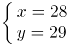。则大明和小丽年龄之积加上儿子的年龄为xy+z=28×29+2=814。

故正确答案为B。

### 第 62 题

单位小陈每天都在手机APP上学习英语。有一天，他的学习天数已有200多天，是3的倍数，且第二天的天数是5的倍数，第三天的天数是7的倍数。问第几天的天数将是13的倍数？

A. 9

B. 10

C. 11

D. 12

第 62 题 · 答案与解析

**参考答案（粉笔题库参考内容）**

B

**解析**

第一天小陈的学习天数已有200多天，且第二天的天数是5的倍数，则第一天小陈的学习天数应为或。第一天的天数是3的倍数，或应为3的倍数，此时学习天数可能为204、234、264、294或219、249、279。由于第三天的天数是7的倍数，上述数字中，只有264+2=266，是7的倍数，符合题干条件，故第一天小陈的学习天数为264天。在选项所给的天数中，第10天时，天数264+9=273为13的倍数。

故正确答案为B。

### 第 63 题

某公司组织员工到景区旅游，先乘坐大巴1小时，再步行2小时；返回时的路线跟来时不同，需先步行1小时，再乘坐大巴2小时。已知来回途中员工步行速度相同，大巴车速相同，返回的路程是去程的1.5倍。若员工来回均步行，需要多少小时？

A. 15

B. 10

C. 9

D. 8

第 63 题 · 答案与解析

**参考答案（粉笔题库参考内容）**

A

**解析**

设步行速度为，大巴车速为，根据“返回的路程是去程的1.5倍”，可列等式：，整理可得。赋值步行速度（）为1，大巴车速（）为4，则去时的路程为4×1+1×2=6，返回的路程为6×1.5=9。若员工来回均步行，需要小时。

故正确答案为A。

### 第 64 题

某市职工篮球赛甲、乙两队决赛，采取7场4胜制（先赢4场者胜，每场没有平局）。若两队水平相当，现在已经比了3场，甲赢了2场，乙赢了1场。问甲获得最后胜利的概率有多少？

A. 2/3

B. 3/4

C. 

D. 

第 64 题 · 答案与解析

**参考答案（粉笔题库参考内容）**

D

**解析**

根据“两队水平相当”可知，在每一场比赛中，甲赢的概率为1/2，乙赢的概率也为1/2。比赛是7场4胜制，在前3场中甲已经赢了2场，则甲获得最后胜利还需在后4场中赢2场，可分为以下三种情况：

①篮球赛一共比了5场，甲第4场与第5场都赢，概率为；

②篮球赛一共比了6场，甲在第4场或第5场中赢1场，且第6场赢，概率为；

③篮球赛一共比了7场，甲在第4场、第5场或第6场中赢1场，且第7场赢，概率为。

分类相加，则甲获得最后胜利的概率为。

故正确答案为D。

### 第 65 题

汽修厂有两个车间（每个车间不能同时维修2辆车），现有并排的5台车等待进入车间维修，它们的修复时间分别为18、30、17、25、20分钟，且每台车等待一分钟会造成该汽修厂服务体验值下降0.1（维修时间也计入等待时间）。问修理完这5台车服务体验值最少下降多少？

A. 16.2

B. 16.3

C. 18.2

D. 18.3

第 65 题 · 答案与解析

**参考答案（粉笔题库参考内容）**

C

**解析**

修复时间一定，要想体验值下降得最少，需使等待时间之和尽可能少，则修复时间少的车要分配给两个车间先维修。5台车的修复时间从少到多分别为17、18、20、25、30分钟，因此一车间维修顺序为：17、20、30，二车间维修顺序为18、25，则等待的总时间为17+（17+20）+（17+20+30）+18+（18+25）=（17×3+20×2+30）+（18×2+25）=182分钟，故体验值下降0.1×182=18.2。

故正确答案为C。

### 第 66 题

公司组织员工团建，有6项趣味活动，每个人最多参加三项不同的活动。如果每项活动需12个人参加且至少有8个人只参加本项活动，那么本次团建至少有多少人参加？

A. 56

B. 60

C. 64

D. 72

第 66 题 · 答案与解析

**参考答案（粉笔题库参考内容）**

A

**解析**

有6项趣味活动，每项活动需12个人参加，共有6×12=72人次。由于每项活动至少有8个人只参加本项活动，所以至少有6×8=48人只参加一项趣味活动，为48人次，剩余人数完成72-48=24人次的活动。本题求团建人数最少值，由于人次数=人数×参加项数，剩余人都参加三项活动，剩余人数最少，最少有人，则本次团建至少有48+8=56人参加。

故正确答案为A。

### 第 67 题

一家超市按20%的利润率定价出售一批酸奶，还剩下10箱时，因临近保质期按定价的五折卖出，最终实际获利只有预计获利的88%。问这批酸奶共有多少箱？

A. 200

B. 240

C. 250

D. 270

第 67 题 · 答案与解析

**参考答案（粉笔题库参考内容）**

C

**解析**

方法一：赋值酸奶进价为10元，则售价为10×（1+20%）=12元，五折后为12×0.5=6元。设这批酸奶共有x箱，根据公式：总利润=总售价-总进价，可列式：12×(x-10)+6×10-10x=88%×(12x-10x)，解得x=250，即这批酸奶共有250箱。

方法二：实际获利只有预计获利的88%，即实际获利比预计获利少1-88%=12%，原因就在于最后10箱按定价的五折卖出。赋值酸奶进价为10元，则售价为10×（1+20%）=12元，五折后为12×0.5=6元。设这批酸奶共有x箱，则(12-6)×10=12%×(12-10)x，解得x=250，即这批酸奶共有250箱。

故正确答案为C。

### 第 68 题

某窗口单位抽调经办人员成立审核组，计划在规定时间内完成一批档案的审核。假如每名经办人员效率相同，如果审核组增加2名经办人员，则可提前12.5%的时间完成；如果审核组减少2名经办人员，则要推迟10天完成。若审核组只增加1名经办人员，能提前多少天完成？

A. 3

B. 4

C. 5

D. 6

第 68 题 · 答案与解析

**参考答案（粉笔题库参考内容）**

B

**解析**

赋值每名经办人员的效率为1，设审核组原有经办人员x名，计划完成时间为t天。根据题意可得：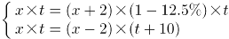，解得：x=14，t=60。则若审核组只增加1名经办人员，需要天完成，因此，能提前60-56=4天完成。

故正确答案为B。

### 第 69 题

甲、乙两种商品，单价分别为每件60、100元。某公司计划购买甲、乙商品作为奖品发给50名员工，每人一件。要求预算不超过3600元，并且获得乙商品的员工人数不低于获得甲商品的25%。问一共有多少种购买方案？

A. 6

B. 8

C. 10

D. 12

第 69 题 · 答案与解析

**参考答案（粉笔题库参考内容）**

A

**解析**

设需要购买甲商品x件，则需要购买乙商品（50-x）件。根据题意可得：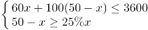，解得：。则满足要求的购买方案如下表所示：

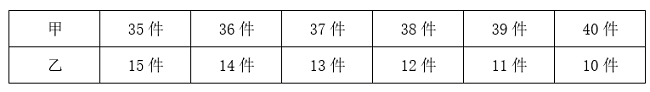

综上，一共有6种购买方案。

故正确答案为A。

### 第 70 题

100本书叠放起来，先从上往下数一遍，数到6的倍数在该书上做一个标识，一直数完。再从下往上数一遍，每数到7的倍数在该书上做一个标识，一直数完。问没被标识的书一共有多少本？

A. 70

B. 71

C. 72

D. 73

第 70 题 · 答案与解析

**参考答案（粉笔题库参考内容）**

C

**解析**

将这100本书先按从上往下的顺序从1-100进行编号，则满足编号是6的倍数的为：6、12、18、24、30、36、42、48、54、60、66、72、78、84、90、96，共16本；再按从下往上的顺序从1-100进行编号，则满足编号是7的倍数的为：7、14、21、28、35、42、49、56、63、70、77、84、91、98，共14本。若同一本书第一次编号为x，则第二次编号为100+1-x=101-x，即两次编号之和为101的是同一本书。观察上述数据发现：24+77=101，66+35=101，共两组数据，即两次均被标识的书共2本。根据两集合容斥原理公式：，可得：16+14-2=100-都不，解得：都不=72。因此，没被标识的书一共有72本。

故正确答案为C。

### 第 71 题

把下面的六个图形分成两类，使每一类图形都有各自的规律和特性，分类正确的一项是：

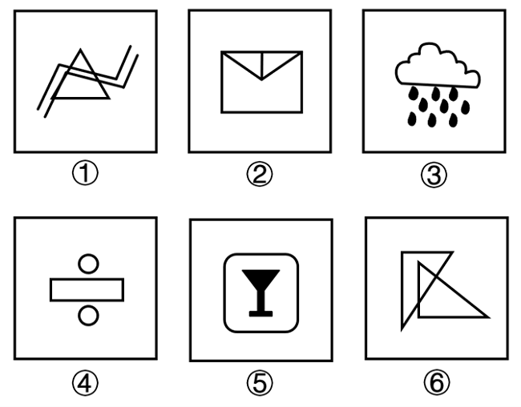

A. ①②⑤；③④⑥

B. ①②⑥；③④⑤

C. ①③④；②⑤⑥

D. ①⑤⑥；②③④

第 71 题 · 答案与解析

**参考答案（粉笔题库参考内容）**

B

**解析**

解法一：本题为分组分类题目。元素组成不同，出现明显生活化粗线条图形，考虑部分数。观察发现，图①②⑥均由一部分组成，图③④⑤均由多部分组成。

故正确答案为B。

解法二：元素组成不同，图④明显出现单一圆弧，考虑曲直性。观察发现，图①②⑥均为全直线图形，图③④⑤均为既有直线又有曲线图形。

故正确答案为B。

注：因为出现生活化粗线条图形，部分数的考频较高，粗线条图形很少讨论曲直性，故小粉笔本题更倾向于解法一。

### 第 72 题

一正方体沿某棱角展开的平面图形如下所示：

请根据其平面图形各面上的图案，判断这个正方体可能是：

A. 

B. 

C. 

D. 

第 72 题 · 答案与解析

**参考答案（粉笔题库参考内容）**

C

**解析**

本题为空间重构题。对展开图进行编号，如下图所示：

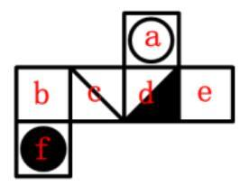

A项：选项由面a、面d和面f构成，题干展开图中面a与面f为相对面，不能同时出现，选项与题干展开图不一致，排除；

B项：选项由面a、面d和面f构成，题干展开图中面a与面f为相对面，不能同时出现，选项与题干展开图不一致，排除；

C项：选项由面a、面c和面d构成，选项与题干展开图一致，当选；

D项：选项由面a、面c和面d构成，选项中三个面的公共点（如下图红点所示）引出一条直线，题干展开图中三个面的公共点没有引出直线，选项与题干展开图不一致，排除。

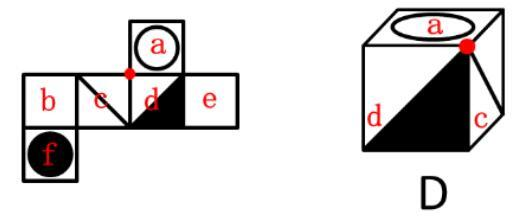

故正确答案为C。

### 第 73 题

在众多生态因子中，有一种或少数几种因子是限制生物生存和繁殖的关键性因子，当这些因子的质或量低于或高于生物生存所能忍受的临界限度时，生物生长发育和繁殖就会受到限制，甚至引起死亡，这种接近或超过生物耐性上下限的生态因子被称作限制因子。

根据上述定义，下列不属于限制因子的是：

A. 土壤水分对于在干旱和半干旱地区生长的植物

B. 低温对于在中高纬度地区的农作物种子发芽

C. 病虫害对于适宜在南方水田里生长的水稻

D. 土壤盐度对于在盐碱地里生长的树

第 73 题 · 答案与解析

**参考答案（粉笔题库参考内容）**

C

**解析**

第一步：找出定义关键词。

“有一种或少数几种因子是限制生物生存和繁殖的关键性因子”、“当这些因子的质或量低于或高于生物生存所能忍受的临界限度时”、“生物生长发育和繁殖就会受到限制，甚至引起死亡”。

第二步：逐一分析选项。

A项：该项中干旱和半干旱地区的土壤平均含水量低，当土壤水分低于植物生存所能忍受的临界限度就会影响植物的生长，甚至引起植物死亡，说明土壤水分是关键性因子，符合“有一种或少数几种因子是限制生物生存和繁殖的关键性因子”、“当这些因子的质或量低于或高于生物生存所能忍受的临界限度时”、“生物生长发育和繁殖就会受到限制，甚至引起死亡”，符合定义，排除；

B项：该项中中高纬度地区冬季气温较低，当低温低到种子发芽所需要的温度临界时，可能会影响种子发芽，说明低温是关键性因子，符合“有一种或少数几种因子是限制生物生存和繁殖的关键性因子”、“当这些因子的质或量低于或高于生物生存所能忍受的临界限度时”、“生物生长发育和繁殖就会受到限制，甚至引起死亡”，符合定义，排除；

C项：该项中水稻适宜在南方水田里生长，水稻的关键性因素应该是水田土壤、水分等，虽然病虫害可能会影响水稻生长，但与其他选项比较，更可能不是关键性因子，当选；

D项：该项中当盐碱地的土壤盐度超过树木生存所能忍受的临界限度时，会影响树木的生长，甚至引起其死亡，说明盐碱地的土壤盐度是关键性因子，符合“有一种或少数几种因子是限制生物生存和繁殖的关键性因子”、“当这些因子的质或量低于或高于生物生存所能忍受的临界限度时”、“生物生长发育和繁殖就会受到限制，甚至引起死亡”，符合定义，排除。

本题为选非题，故正确答案为C。

### 第 74 题

众筹农业是通过大众筹资开展的一种农业经营形式。能够生产优质农产品的发起人通过大众筹资让农产品消费者参与进来，消费者为了寻找优质农产品，与众筹发起人达成农产品供需协议，等农作物成熟后，将农产品交付给消费者。

根据上述定义，下列属于众筹农业的是：

A. 大旺向农庄提供一笔资金，农庄按大旺的要求种植优质葡萄，成熟后交付大旺

B. 农庄的草莓成熟了，晓峰带家人到农庄采摘了30斤草莓，按价付款后带走草莓

C. 大牛花钱到农村租了一块地，请农民按要求种绿色蔬菜，蔬菜成熟后直接交付给他

D. 农庄向20个市民募集资金种植优质枣，这20人按出资情况可获得枣树的相应收成

第 74 题 · 答案与解析

**参考答案（粉笔题库参考内容）**

D

**解析**

第一步：找出定义关键词。

“大众筹资”、“让农产品消费者参与进来”、“等农作物成熟后，将农产品交付给消费者”。

第二步：逐一分析选项。

A项：大旺自己向农庄提供一笔资金，属于个人出资，不符合“大众筹资”，不符合定义，排除；

B项：晓峰自己带家人采摘草莓后按价付款，不符合“大众筹资”，不符合定义，排除；

C项：大牛自己花钱租地请农民种植蔬菜，不符合“大众筹资”，不符合定义，排除；

D项：农庄向20个市民募集资金，符合“大众筹资”，这20个市民可以获得相应收成，符合“让农产品消费者参与进来”、“等农作物成熟后，将农产品交付给消费者”，符合定义，当选。

故正确答案为D。

### 第 75 题

设施农业是采用人工技术手段，改变自然光温条件，创造优化动植物生长的环境因子，使之能够全天候生长的农业设施工程。

根据上述定义，下列不属于设施农业的是：

A. 温棚花卉种植

B. 菇房花菇种植

C. 深山放养土鸡

D. 网箱养殖鳝鱼

第 75 题 · 答案与解析

**参考答案（粉笔题库参考内容）**

C

**解析**

第一步：找出定义关键词。

“采用人工技术手段”、“改变自然光温条件”、“创造优化动植物生长的环境因子”。

第二步：逐一分析选项。

A项：“温棚”能对大棚进行加温或保温，是用来培植农作物的设备，能在不适宜植物生长的季节进行种植，符合“采用人工技术手段”、“改变自然光温条件”、“创造优化动植物生长的环境因子”，符合定义，排除；

B项：“菇房”是人工栽培食用菌（食用菇、耳类等大型真菌）可人工控制温度、湿度、通风、光线环境的出菇厂房，符合“采用人工技术手段”、“改变自然光温条件”、“创造优化动植物生长的环境因子”，符合定义，排除；

C项：深山放养土鸡，并没有“采用人工技术手段”，也没有“改变自然光温条件”，不符合定义，当选；

D项：“网箱养鱼”是将由网片制成的箱笼，放置于一定水域，进行养鱼的一种生产方式，符合“采用人工技术手段”、“改变自然光温条件”，符合定义，排除。

本题为选非题，故正确答案为C。

### 第 76 题

社会生活中存在着确定性现象和不确定性现象。确定性现象是在一定条件下必然会发生或必然不会发生的现象。不确定性现象又称为随机现象，是在一定条件下可能发生也可能不发生的现象。

根据定义，以下为随机现象的是：

A. 在一个标准大气压条件下，纯净水加热到时会沸腾

B. 2022年卡塔尔世界杯决赛中，阿根廷队击败法国队夺得冠军

C. 2022年下半年全球经济下行，2023年全球经济发展面临挑战

D. 5G+工业互联网形成远程设备操控、无人智能巡检等应用实践

第 76 题 · 答案与解析

**参考答案（粉笔题库参考内容）**

B

**解析**

第一步：找出定义关键词。

确定性现象：“在一定条件下必然会发生或必然不会发生”；

不确定性现象（随机现象）：“在一定条件下可能发生也可能不发生”。

第二步：逐一进行分析。

A项：在一个标准大气压条件下，纯净水加热到时会沸腾，是必然会发生的现象，不符合“在一定条件下可能发生也可能不发生”，不符合“随机现象”定义，排除；

B项：2022年卡塔尔世界杯决赛中，阿根廷队和法国队的对战结果是不确定的，有随机性，阿根廷队击败法国队夺得冠军有可能会发生，也有可能不会发生，符合“在一定条件下可能发生也可能不发生”，符合“随机现象”定义，当选；

C项：2022年下半年全球经济下行，在此情形下会对2023年全球经济发展带来影响，无论面临的困难是大还是小，对于2023年全球经济发展来说都是挑战，不符合“在一定条件下可能发生也可能不发生”，不符合“随机现象”定义，排除；

D项：5G+工业互联网是指利用以5G为代表的新一代信息通信技术，构建与工业经济深度融合的新型基础设施、应用模式和工业生态，5G+工业互联网一定会形成相关的应用实践，不符合“在一定条件下可能发生也可能不发生”，不符合“随机现象”定义，排除。

故正确答案为B。

### 第 77 题

戏曲虚拟是指用艺术的虚来表现生活的实的过程，是戏曲表现生活的基本手法。戏曲虚拟利用舞台的假定性，灵活处理时间与空间。

根据上述定义，下列不属于戏曲虚拟的是：

A. 戏台上以划桨表示水中行船

B. 戏台上以空翻表示武艺高强

C. 戏台上以摸索代表夜晚看不见

D. 戏台上演员挥动马鞭代表骑马

第 77 题 · 答案与解析

**参考答案（粉笔题库参考内容）**

B

**解析**

第一步：找出定义关键词。

“用艺术的虚来表现生活的实”。

第二步：逐一分析选项。

A项：利用戏台上划桨的动作让观众联想到生活中的水中行船，符合“用艺术的虚来表现生活的实”，符合定义，排除；

B项：戏台上的空翻本身就是经过训练才能较好完成的动作，能直接让观众觉得角色武艺高强，不符合“用艺术的虚来表现生活的实”，不符合定义，当选；

C项：利用戏台上摸索的动作让观众联想到夜晚看不见，符合“用艺术的虚来表现生活的实”，符合定义，排除；

D项：利用戏台上挥动马鞭的动作让观众联想到生活中的骑马，符合“用艺术的虚来表现生活的实”，符合定义，排除。

本题为选非题，故正确答案为B。

### 第 78 题

精准扶贫：乡村振兴：共同富裕

A. 和平安宁：经济繁荣：公平正义

B. 发展教育：提高素质：建设国家

C. 诚实守信：责任担当：爱岗敬业

D. 闲庭信步：快马加鞭：风驰电掣

第 78 题 · 答案与解析

**参考答案（粉笔题库参考内容）**

B

**解析**

第一步：判断题干词语间逻辑关系。

精准扶贫是为了实现乡村振兴，乡村振兴是为了实现共同富裕，三者为方式目的的对应关系。

第二步：判断选项词语间逻辑关系。

A项：和平安宁有利于经济繁荣，经济繁荣不是为了公平正义，三者不是方式目的的对应关系，与题干逻辑关系不一致，排除；

B项：发展教育是为了提高素质，提高素质是为了建设国家，三者为方式目的的对应关系，与题干逻辑关系一致，当选；

C项：诚实守信、责任担当、爱岗敬业都是道德品质，三者为并列关系，与题干逻辑关系不一致，排除；

D项：闲庭信步形容很清闲的样子，有时也形容信心十足；快马加鞭比喻快上加快，加速前进；风驰电掣形容速度非常快。后两者为近义关系，与题干逻辑关系不一致，排除。

故正确答案为B。

### 第 79 题

中华文明：世界文明：文明

A. 荆楚艺术：中国艺术：艺术

B. 四书五经：古代经典：经典

C. 四大名著：现代名著：名著

D. 插花剪纸：民间艺人：艺人

第 79 题 · 答案与解析

**参考答案（粉笔题库参考内容）**

A

**解析**

第一步：判断题干词语间逻辑关系。

中华文明是世界文明的一个组成部分，二者为组成关系；世界文明是文明的一种，二者为种属关系。

第二步：判断选项词语间逻辑关系。

A项：荆楚是指古域包括现今湖北全域及其周围，现指湖北省。荆楚艺术是中国艺术的一个组成部分，二者为组成关系；中国艺术是艺术的一种，二者为种属关系，与题干逻辑关系一致，当选；

B项：四书五经是我国古代经典，二者为种属关系，与题干逻辑关系不一致，排除；

C项：四大名著一般指《三国演义》《水浒传》《西游记》《红楼梦》四部中国古典长篇小说，和现代名著不是组成关系，与题干逻辑关系不一致，排除；

D项：民间艺人制作插花和剪纸作品，二者为人物和艺术成品的对应关系，与题干逻辑关系不一致，排除。

故正确答案为A。

### 第 80 题

贴窗花：挂灯笼：迎新年

A. 燃烟花：年夜饭：辞旧岁

B. 种小麦：插稻秧：盼丰收

C. 耕稻田：除杂草：割麦子

D. 吹和风：下细雨：万物生

第 80 题 · 答案与解析

**参考答案（粉笔题库参考内容）**

B

**解析**

第一步：判断题干词语间逻辑关系。

贴窗花和挂灯笼都是为了迎新年，前两词与第三词均为方式目的的对应关系。

第二步：判断选项词语间逻辑关系。

A项：年夜饭意味着告别旧岁，迎来新岁；也代表家庭的团圆，希望新的一年里吉祥如意、幸福圆满。燃烟花和年夜饭都是为了辞旧岁，前两词与第三词均为方式目的的对应关系，与题干逻辑关系一致，保留；

B项：种小麦和插稻秧都是为了盼丰收，前两词与第三词均为方式目的的对应关系，与题干逻辑关系一致，保留；

C项：耕稻田、除杂草和割麦子都是农事活动，三者为并列关系，与题干逻辑关系不一致，排除；

D项：吹和风和下细雨都可以导致万物生，前两词与第三词均为因果的对应关系，与题干逻辑关系不一致，排除。

比较A、B两项，题干“贴窗花”、“挂灯笼”和“迎新年”都是动宾结构，B项“种小麦”、“插稻秧”和“盼丰收”也都是动宾结构，而A项“年夜饭”不是动宾结构，B项与题干逻辑关系更为一致，当选。

故正确答案为B。

### 第 81 题

倚山：傍水：农家院：袅袅炊烟

A. 竹深：树密：小山村：唧唧虫鸣

B. 空山：微风：不见人：声声人语

C. 穿林：绕坡：山间路：隐隐磬声

D. 清晨：初日：照广场：翩翩舞影

第 81 题 · 答案与解析

**参考答案（粉笔题库参考内容）**

C

**解析**

第一步：判断题干词语间逻辑关系。

倚山和傍水为并列关系，倚山和傍水均可以用来修饰农家院，前两个词与第三个词均构成偏正关系，农家院里传来袅袅炊烟，二者为地点与具体景象的对应关系。

第二步：判断选项词语间逻辑关系。

A项：竹深和树密为并列关系，竹深和树密均可以用来修饰小山村，前两个词与第三个词均构成偏正关系，小山村里传来唧唧虫鸣，二者为地点与具体景象的对应关系，与题干逻辑关系一致，保留；

B项：空山和微风为并列关系，但空山和微风均不能用来修饰不见人，与题干逻辑关系不一致，排除；

C项：穿林和绕坡为并列关系，穿林和绕坡均可以用来修饰山间路，前两个词与第三个词均构成偏正关系，山间路上传来隐隐磬声，二者为地点与具体景象的对应关系，与题干逻辑关系一致，保留；

D项：清晨指日出前后的一段时间，初日指刚升起的太阳，二者不是并列关系，与题干逻辑关系不一致，排除。

对比A、C两项，题干中“倚山”和“傍水”均为动宾结构，A项的“竹深”和“树密”均不是动宾结构，C项的“穿林”和“绕坡”均为动宾结构，故C项与题干逻辑关系更一致，当选。

故正确答案为C。

### 第 82 题

乱云飞渡仍从容：非凡定力

A. 孤帆远影碧空尽：伤情别离

B. 乌衣巷口夕阳斜：人近黄昏

C. 千磨万击还坚劲：顽强意志

D. 弄潮儿向涛头立：砥柱中流

第 82 题 · 答案与解析

**参考答案（粉笔题库参考内容）**

C

**解析**

第一步：判断题干词语间逻辑关系。

“乱云飞渡仍从容”意思是任凭翻腾的云雾从身边穿过，仍然泰然自若，诗句中体现出了“非凡定力”，二者为对应关系。

第二步：判断选项词语间逻辑关系。

A项：“孤帆远影碧空尽”意思是友人的孤船帆影渐渐地远去，消失在碧空的尽头，诗句中体现出了对友人的“伤情别离”，二者为对应关系，与题干逻辑关系一致，保留；

B项：“乌衣巷口夕阳斜”意思是乌衣巷口唯有夕阳斜挂，通过荒凉的景象，暗含了诗人对盛衰兴败的深沉感慨，诗句并未体现出“人近黄昏”，与题干逻辑关系不一致，排除；

C项：“千磨万击还坚劲”意思是经过无数的磨难和打击，身骨依然坚劲，诗句中体现出了“顽强意志”，二者为对应关系，与题干逻辑关系一致，保留；

D项：“弄潮儿向涛头立”意思是踏潮献技的人站在波涛上表演，通过对弄潮情景的描写，表现出弄潮健儿与大自然奋力搏斗的大无畏精神，诗句并未体现出“砥柱中流”，与题干逻辑关系不一致，排除。

对比A、C两项，A项的“伤情别离”表达的是人物情感，题干的“非凡定力”与C项的“顽强意志”表达的都是人物的品质，故C项与题干逻辑关系更一致，当选。

故正确答案为C。

### 第 83 题

一项包含20名受试者的研究中，所有受试者第一晚都在几乎全黑的房间入睡。第二晚，一半受试者在明亮的房间入睡，一半受试者仍然在几乎全黑的房间入睡。在受试者睡眠期间，研究人员对他们的脑电波和心率进行了记录，同时还开展了其它测试项目。结果显示，在光照环境下入睡的受试者整晚心率都偏高。研究人员由此认为，睡眠时的光照会对人的心血管产生不利影响。

以下哪项为真，最能支持研究人员的观点？

A. 研究发现开灯睡觉有17%的几率导致体重增加

B. 较强的光照会对睡眠者的心率产生不利影响

C. 睡眠时的光照会使睡眠者的神经系统兴奋

D. 研究中所有的受试者在受试前都心率正常

第 83 题 · 答案与解析

**参考答案（粉笔题库参考内容）**

D

**解析**

第一步：找出论点和论据。

论点：睡眠时的光照会对人的心血管产生不利影响。

论据：一项包含20名受试者的研究中，所有受试者第一晚都在几乎全黑的房间入睡。第二晚，一半受试者在明亮的房间入睡，一半受试者仍然在几乎全黑的房间入睡。在受试者睡眠期间，研究人员对他们的脑电波和心率进行了记录，同时还开展了其它测试项目。结果显示，在光照环境下入睡的受试者整晚心率都偏高。

本题论点和论据均在讨论睡眠时的光照对人的心血管的影响，二者话题一致，且论据为对比实验，加强可考虑补充实验前的实验对象起点一致。

第二步：逐一分析选项。

A项：该项指出开灯睡觉有几率导致体重增加，但论点讨论的是睡眠时的光照对心血管的影响，话题不一致，无法加强，排除；

B项：该项指出睡眠时较强的光照对人的心率产生不利影响，说明睡眠时的光照会对人的心血管产生不利影响，属于补充论据，可以加强，保留；

C项：该项指出睡眠时的光照会使睡眠者的神经系统兴奋，但论点讨论的是睡眠时的光照对心血管的影响，话题不一致，无法加强，排除；

D项：该项指出研究中所有的受试者在受试前都心率正常，即补充实验前的实验对象起点一致，属于必要条件，可以加强，保留。

对比B、D两项，B项为补充论据，D项为必要条件，必要条件的加强力度大于补充论据，D项当选。

故正确答案为D。

### 第 84 题

研究人员招募了619人参与实验，其中200人完全放弃智能手机一周；226人将他们每天使用智能手机的时间减少一小时；193人保持原来的智能手机使用习惯而不做任何改变。在干预实验一个月和四个月后对所有参与者进行回访，以了解他们的生活习惯和幸福感。研究人员发现，完全放弃智能手机，或将其每天使用时间减少一小时都对参与者的生活方式和幸福感产生了积极影响。研究人员认为，减少而非完全放弃智能手机的日常使用，对一个人的幸福感会产生更为积极的影响。

补充以下哪项前提，研究人员的观点才能成立？

A. 完全放弃智能手机的使用会影响人们的工作效率和生活质量

B. 完全放弃智能手机使用的积极影响在现代社会很难长期持续

C. 减少使用比完全放弃使用智能手机的积极影响更持久稳定

D. 减少智能手机的使用是综合平衡多方利弊后的理性选择

第 84 题 · 答案与解析

**参考答案（粉笔题库参考内容）**

C

**解析**

第一步：找出论点和论据。

论点：减少而非完全放弃智能手机的日常使用，对一个人的幸福感会产生更为积极的影响。

论据：完全放弃智能手机，或将其每天使用时间减少一小时都对参与者的生活方式和幸福感产生了积极影响。

本题论点和论据均在讨论“完全放弃使用或减少使用智能手机”与“幸福感”之间的关系，论点论据话题一致，加强优先考虑补充论据。

第二步：逐一分析选项。

A项：该项指出完全放弃使用智能手机会带来的影响，但不明确减少使用智能手机时间是否同样也会带来影响，即无法得知论点讨论的减少使用和完全放弃使用智能手机谁对幸福感会产生更为积极的影响，为不明确项，无法加强，排除；

B项：该项指出完全放弃使用智能手机的积极影响很难持续，但不明确减少使用智能手机时间的积极影响是否同样很难持续，即无法得知论点讨论的减少使用和完全放弃使用智能手机谁对幸福感会产生更为积极的影响，为不明确项，无法加强，排除；

C项：该项指出减少使用智能手机比完全放弃使用智能手机的“积极影响更持久稳定”，可以加强论点减少而非完全放弃智能手机的使用对一个人的“幸福感会产生更为积极的影响”，补充论据加强，当选；

D项：该项指出减少使用智能手机时间的原因，未提及它是否会对幸福感产生积极的影响，与论点讨论的减少使用和完全放弃使用智能手机谁对幸福感会产生更为积极的影响无关，话题不一致，无法加强，排除。

故正确答案为C。

### 第 85 题

研究人员研究了糖皮质激素在小鼠自身免疫性疾病中的作用。他们在正常小鼠和缺乏糖皮质激素受体的小鼠中诱导了脱发，两周后，研究人员看到了小鼠们之间的明显差异。正常小鼠的毛发重新长出，但没有糖皮质激素受体的小鼠几乎不能重新长出毛发。研究人员认为，小鼠的毛囊干细胞无法被激活，毛发因而不能重新长出。

以下哪项如果为真，最能支持研究人员的观点？

A. 正常的小鼠体内有糖皮质激素受体

B. 糖皮质激素有助于激活毛囊干细胞

C. 要长头发必须要有糖皮质激素

D. 要长头发必须激活毛囊干细胞

第 85 题 · 答案与解析

**参考答案（粉笔题库参考内容）**

B

**解析**

第一步：找出论点和论据。

论点：小鼠的毛囊干细胞无法被激活，毛发因而不能重新长出。

论据：研究人员在正常小鼠和缺乏糖皮质激素受体的小鼠中诱导了脱发，两周后，正常小鼠的毛发重新长出，但没有糖皮质激素受体的小鼠几乎不能重新长出毛发。

本题论点讨论的是“毛囊干细胞”与“重新长出毛发”之间的关系，论据讨论的是“糖皮质激素受体”与“重新长出毛发”之间的关系，论点论据话题不一致，加强优先考虑搭桥，即建立“糖皮质激素受体”与“毛囊干细胞”之间的联系。

第二步：逐一分析选项。

A项：该项指出正常的小鼠体内有糖皮质激素受体，而论点讨论的是毛囊干细胞未被激活会导致毛发不能重新长出，话题不一致，无法加强，排除；

B项：该项指出糖皮质激素有助于激活毛囊干细胞，建立了“糖皮质激素”与“毛囊干细胞”之间的联系，为搭桥项，可以加强，当选；

C项：该项指出要长头发必须要有糖皮质激素，属于重复论据，而论点讨论的是毛囊干细胞未被激活会导致毛发不能重新长出，无法加强，排除；

D项：该项指出要长头发必须激活毛囊干细胞，属于重复论点，有一定的加强力度，但力度没有搭桥项力度大，排除。

故正确答案为B。

### 第 86 题

远古巨型食草动物灭绝是否影响了植物的进化历程？为了回答这个问题，一个德国研究团队分析了远古巨型食草动物化石和棕榈树，他们发现即使在恐龙这样的巨型食草动物灭绝之后，大果实棕榈树也很普遍，这说明体型较小的食草动物也可能吃较大果实，并通过它们的排泄物传播种子。研究人员认为，这个研究结果可以反驳之前关于植物和食草动物关系的科学假设。

之前的科学假设最有可能是：

A. 在巨型食草动物灭绝之后，大果实棕榈树显著减少

B. 体型较小的食草动物只会吃小果实棕榈树的小果实

C. 大果实棕榈树完全依赖巨型食草动物进行种子传播

D. 小果实棕榈树在巨型食草动物灭绝之后迅速繁衍

第 86 题 · 答案与解析

**参考答案（粉笔题库参考内容）**

C

**解析**

第一步：找出论点和论据。

论据：即使在恐龙这样的巨型食草动物灭绝之后，大果实棕榈树也很普遍，这说明体型较小的食草动物也可能吃较大果实，并通过它们的排泄物传播种子。

本题问的是之前的科学假设最有可能是哪项，而文段最后说这个研究结果可以反驳之前关于植物和食草动物关系的科学假设，故可以把整个题干研究结果当成论据，将其反驳，找出能够成为之前的科学假设的选项即可。

第二步：逐一分析选项。

A项：说明巨型食草动物灭绝之后，大果实棕榈树显著减少，题干研究结果发现巨型食草动物灭绝之后，大果实棕榈树也很普遍，大果实棕榈树也很普遍说明并没有显著减少，题干研究结果可以反驳A项内容，故A项可能是之前的科学假设，保留；

B项：说明小型食草动物只会吃小果实棕榈树的小果实，题干研究结果说明体型较小的食草动物也可能吃较大果实，题干研究结果可以反驳B项内容，故B项可能是之前的科学假设，保留；

C项：说明大果实棕榈树完全依赖巨型食草动物进行种子传播，这表明如果没有大型食草动物进行种子传播，大果实棕榈树会无法传播种子，最后可能导致数量减少，题干研究结果一方面说明大果实棕榈树也很普遍，这说明并没有显著减少，另一方面说明体型较小的食草动物叶也可能吃较大果实，并用它们的排泄物传播种子，这说明大果实棕榈树并不是完全依赖巨型食草动物进行种子传播，题干研究结果可以反驳C项内容，故C项可能是之前的科学假设，保留；

D项：说明小果实棕榈树和巨型食草动物的关系，但题干研究结果讨论的是大果实棕榈树，主体不一致，题干研究结果无法反驳D项内容，故D项不是之前的科学假设，排除。

对比A、B、C三项，研究结果包含两部分，一是大果实棕榈树数量没有少，二是大果实棕榈树通过小型食草动物传播种子，A项只被一反驳，B项只被二反驳，C项被研究结果的两个部分均反驳，因此C项更合适，当选。

故正确答案为C。

### 第 87 题

近日发布的《全球科技创新中心发展指数2022》显示，无论是综合排名，还是在创新要素全球集聚力、科学研究全球引领力、技术创新全球策源力、产业变革全球驱动力和创新环境全球支撑力5个维度的单项排名上，全球科技创新中心均集中分布在欧洲、北美和亚太区域。综合排名前100的全球科技创新中心有34个在欧洲、30个在北美、29个在亚太。

根据以上信息最能推出的结论是：

A. 全球科技创新中心分布呈现欧洲、北美和亚太三足鼎立格局

B. 中国科创中心强势崛起使亚太成为全球科技创新中心的一极

C. 高新科技发展依赖于欧洲、北美和亚太的全球科技创新中心

D. 美国排名前100的科创中心最多，领跑全球科技创新中心建设

第 87 题 · 答案与解析

**参考答案（粉笔题库参考内容）**

A

**解析**

日常结论题，根据题干信息逐一分析选项。

A项：根据题干可知“全球科技创新中心均集中分布在欧洲、北美和亚太区域”，可以推出全球科技创新中心分布呈现欧洲、北美和亚太三足鼎立格局，当选；

B项：题干中没有涉及到“中国科创中心”，无法推出中国科创中心是否使亚太成为全球科技创新中心的一极，无中生有，排除；

C项：题干中没有涉及到“高新科技发展”，无法推出高新科技发展是否依赖于欧洲、北美和亚太的全球科技创新中心，无中生有，排除；

D项：题干中没有涉及到“美国排名前100的科创中心”，无法推出其是否最多，也无法得知是否领跑全球科技创新中心建设，无中生有，排除。

故正确答案为A。

### 第 88 题

受2022年三季度实际GDP出人意料上行的影响，欧元区2022经济表现好于预期。区内19个国家全年平均增长率达3.3%。但四季度经济发展呈现下行趋势，进入2023年，经济活动仍在惯性减速。欧洲央行据此发表声明指出，2023年，欧元区将面临经济衰退的风险。

欧洲央行的观点若要增强说服力，可以补充的前提是：

①两位数的高通货膨胀率没有减弱迹象，犹如定时炸弹，随时会引爆经济危机

②制造业PMI已连续6个月低于50这一荣枯线，表明生产经营活动在持续收缩

③经济衰退预期和各种风险交织，降低了企业和消费者信心，使市场需求萎缩

④整个世界经济可能走弱，使欧元区面临外部需求不足，国际收支失离的困境

A. ①②③

B. ①②④

C. ①③④

D. ②③④

第 88 题 · 答案与解析

**参考答案（粉笔题库参考内容）**

C

**解析**

第一步：找出论点和论据。

论点：2023年，欧元区将面临经济衰退的风险。

论据：但欧元2022年四季度经济发展呈现下行趋势，进入2023年，经济活动仍在惯性减速。

论据讨论的是欧元区2022年四季度经济下行，2023年经济活动减速，论点讨论的是欧元区2023年将面临经济衰退的风险，二者话题一致，问法为“前提”，优先考虑必要条件，其次也可以考虑补充论据。

第二步：逐一分析选项。

① ：两位数的高通货膨胀率没有减弱迹象，随时会引爆经济危机，高通胀率、经济危机都会抑制经济活动，解释了为什么欧元区将面临经济衰退的风险，补充论据，可以加强；

② ：制造业PMI表明生产经营活动在持续收缩，生产经营活动收缩可能会影响经济发展，解释了为什么欧元区将面临经济衰退的风险，补充论据，可以加强；

③ ：经济衰退预期和各种风险交织使市场需求萎缩，市场需求萎缩会影响经济发展，解释了为什么欧元区将面临经济衰退的风险，补充论据，可以加强；

④ ：整个世界经济可能走弱，使欧元区面临外部需求不足，国际收支失离的困境，而这会抑制经济活动，解释了为什么欧元区将面临经济衰退的风险，补充论据，可以加强。

对比上述四项，其中①③④是在宏观上解释欧元区为什么将要面临经济衰退的风险，其中的①和④都有原文的对应，对应如下所示：

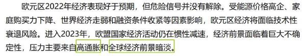

②是在具体地说制造业的情况，且结合原文来看，②和③出现在同一个小标题的对应下，②主要是证明③的具体数据示例。

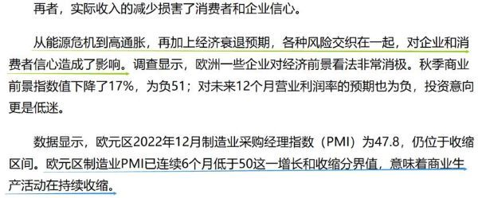

综上，①③④可以加强。

故正确答案为C。

### 第 89 题

每吨电子垃圾中含有200-350g金。最近，国内团队研制出一种被命名为JNM的新吸附材料。JNM可对CPU废弃物浸出液中的金离子进行5次循环吸附，并保持较高吸附率：在高浓度干扰离子作用下，JNM能对金离子保持高选择性吸附，从150个CPU废弃物中，JNM能回收0.61g金。所以，JNM是目前回收复杂废液中微量金的最高效新材料。

上述结论若要增强说服力，还需要补充的前提是：

A. JNM对金的吸附量能伴随着金离子初始浓度增高而增大

B. JNM对金的最大吸附量超过了国内外已知的所有吸附材料

C. JNM能高效回收生活污水、工业废水和海水中的微量金

D. JNM在1000ppm时，对金的最大吸附量达到954mg/g

第 89 题 · 答案与解析

**参考答案（粉笔题库参考内容）**

B

**解析**

第一步：找出论点和论据。

论点：JNM是目前回收复杂废液中微量金的最高效新材料。

论据：JNM可对CPU废弃物浸出液中的金离子进行5次循环吸附，并保持较高吸附率：在高浓度干扰离子作用下，JNM能对金离子保持高选择性吸附，从150个CPU废弃物中，JNM能回收0.61g金。

本题的论点论据均在讨论JNM可以高效的回收微量金，论点论据话题一致，且提问方式为“前提”，加强优先考虑补充必要条件，其次也可以考虑补充论据。

第二步：逐一分析选项。

A项：该项讨论的是JNM对金的吸附量与金离子初始浓度之间的关系，而论点讨论的是JNM是否是回收复杂废液中微量金的最高效新材料，话题不一致，无法加强，排除；

B项：该项讨论的是JNM对金的最大吸附量超过了国内外已知的所有吸附材料，如果该项不成立，即JNM对金的最大吸附量没有超过国内外已知的所有吸附材料，就不能得出“JNM是最高效新材料”这个论点，因此该项是论点成立的必要条件，当选；

C项：该项讨论的是JNM能高效回收生活污水、工业废水和海水中的微量金，而论点讨论的是JNM是否是回收复杂废液中微量金的最高效新材料，无法加强，排除；

D项：该项讨论的是JNM在1000ppm时，对金的最大吸附量达到954mg/g，但不明确这个吸附量是否比其他的吸附材料都高，为不明确项，无法加强，排除。

故正确答案为B。

### 第 90 题

一个研究团队25年来，持续跟踪研究了1.1万名成年人，以他们血液中钠离子浓度作为体内水分是否充足的指标，浓度较高代表水分摄取量不足。尽管受试者血液中钠浓度都在135～146毫摩尔/升的正常值内，但高于144毫摩尔/升的人与低于144毫摩尔/升的人相比，衰老风险高50%，早亡风险高20%。团队发表的结论是，水分摄取不足的成年人老得更快、寿命更短。

以下各项如果为真，最能削弱以上结论的是：

A. 水分摄取与成人过快衰老和过早死亡之间的关联属于“高度揣测”

B. 上述研究还缺乏摄取充足水分能推迟衰老、延长寿命的科学证据

C. 没有直接证据证明，人体血液中钠离子浓度高代表水分摄取不足

D. 有规律的运动和维持营养均衡，才是减缓衰老、延长寿命的途径

第 90 题 · 答案与解析

**参考答案（粉笔题库参考内容）**

A

**解析**

第一步：找出论点和论据。

论点：水分摄取不足的成年人老得更快、寿命更短。

论据：一个研究团队25年来，持续跟踪研究了1.1万名成年人，以他们血液中钠离子浓度作为体内水分是否充足的指标，浓度较高代表水分摄取量不足。尽管受试者血液中钠浓度都在135～146毫摩尔/升的正常值内，但高于144毫摩尔/升的人与低于144毫摩尔/升的人相比，衰老风险高50%，早亡风险高20%。

本题论点和论据都是在对水分摄取不足与衰老之间进行讨论，论点与论据话题一致，削弱优先考虑削弱论点。

第二步：逐一分析选项。

A项：该项指出水分摄取与过快衰老、过早死亡之间的关联属于“高度揣测”，说明水分摄取与衰老、死亡之间并不一定存在关系，否定论点，可以削弱，保留；

B项：该项指出该研究还缺少关于摄取充足水分能否推迟衰老、延长寿命的讨论，讨论的是水分摄取充足时的情况，而论点讨论的是水分摄取不足的情况，二者话题不一致，无法削弱，排除；

C项：该项指出血液中钠离子浓度高是否代表水分摄取不足是没有直接证据的，说明钠离子浓度高与水分摄取不足之间并不一定存在关系，削弱论据，可以削弱，保留；

D项：该项指出运动和营养均衡才是减缓衰老、延长寿命的途径，讨论的是延缓衰老的方法，而论点讨论的是导致衰老的原因，二者话题不一致，无法削弱，排除。

对比A、C两项，本题的论证逻辑是钠离子浓度高水分摄取不足衰老，C项削弱的是前两者的关系，在削弱论据，但本题论点着重讨论的是水分摄取不足与衰老之间的关系，A项则是直接针对后两者进行的削弱，在削弱论点，A项削弱力度更大，当选。

故正确答案为A。

## 材料 1

2021年12月，我国原煤产量3.8亿吨，同比增长7.2%；原油产量1647万吨，同比增长1.7%；天然气产量192亿立方米，同比增长2.3%；发电量7234亿千瓦时，同比下降2.1%。

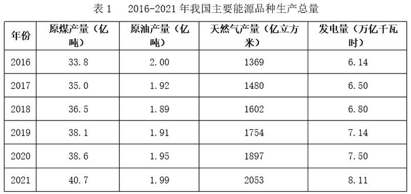

### 第 91 题

2021年12月，我国日均原煤产量是日均原油产量的多少倍？

A. 18

B. 21

C. 23

D. 25

第 91 题 · 答案与解析

**参考答案（粉笔题库参考内容）**

C

**解析**

根据题干“2021年12月······是······的多少倍”，可判定本题为现期倍数问题。定位文字材料可得：2021年12月，我国原煤产量3.8亿吨；原油产量1647万吨。则2021年12月，我国日均原煤产量是日均原油产量的倍。

故正确答案为C。

### 第 92 题

2020年12月，我国原煤产量约占当年原煤总产量的：

A. 9%

B. 11%

C. 12%

D. 13%

第 92 题 · 答案与解析

**参考答案（粉笔题库参考内容）**

A

**解析**

根据题干“2020年12月······约占······”，结合材料时间为2021年12月，可判定本题为基期比重问题。定位文字材料可得：2021年12月，我国原煤产量3.8亿吨，同比增长7.2%；定位表1可得：2020年，我国原煤产量38.6亿吨。根据公式：基期量，则2020年12月我国原煤产量亿吨；根据公式：比重，则所求比重，与A项最接近。

故正确答案为A。

### 第 93 题

将我国主要能源按2021年产量的同比增速从高到低排列，正确的是：

A. 电>天然气>原煤>原油

B. 天然气>电>原煤>原油

C. 电>原油>天然气>原煤

D. 天然气>原油>电>原煤

第 93 题 · 答案与解析

**参考答案（粉笔题库参考内容）**

B

**解析**

根据题干“······同比增速从高到低······”，可判定本题为一般增长率问题。定位表1可得：2020年与2021年原煤产量、原油产量、天然气产量、发电量。根据公式：增长率，则2021年四种主要能源产量的同比增速分别为：

原煤：；

原油：；

天然气：；

发电量：。

则从高到低排列正确的是：天然气＞电＞原煤＞原油，B项符合。

故正确答案为B。

### 第 94 题

2016～2021年，我国一次能源生产总量中，非化石能源产量年均增长约多少亿吨标准煤？

A. 0.50

B. 0.60

C. 0.63

D. 0.71

第 94 题 · 答案与解析

**参考答案（粉笔题库参考内容）**

B

**解析**

根据题干“2016～2021年······年均增长约多少亿吨标准煤”，可判定本题为年均增长量问题。定位表2可得：2016年，我国一次能源生产总量34.6亿吨标准煤，非化石能源占比16.7%；2021年分别为43.3亿吨标准煤，20.3%。根据公式：年均增长量，则题干所求亿吨标准煤，与B项最接近。

故正确答案为B。

### 第 95 题

根据所给资料，下列说法错误的是：

A. 2018-2021年我国年均一次能源产量超40亿吨标准煤

B. 2021年，我国发电量增速比上年提高约3个百分点

C. 2021年我国非化石能源产量约为原煤产量的三成

D. 2021年12月，我国发电量低于当年月均发电量

第 95 题 · 答案与解析

**参考答案（粉笔题库参考内容）**

D

**解析**

A项：定位表2可得，2018-2021年我国一次能源产量分别为37.7亿吨标准煤、39.7亿吨标准煤、40.8亿吨标准煤、43.3亿吨标准煤。则2018-2021年我国年均一次能源产量为亿吨标准煤，正确；

B项：定位表1可得，2019-2021年我国发电量分别为7.14万亿千瓦时、7.50万亿千瓦时、8.11万亿千瓦时。根据公式：增长率，则所求为，提高约3个百分点，正确；

C项：定位表2可得，2021年我国一次能源生产总量中，原煤占比67.0%，非化石能源占比20.3%。则所求，故2021年我国非化石能源产量约为原煤产量的三成，正确；

D项：定位文字材料和表1可得：2021年12月，我国发电量为7234亿千瓦时；2021年，我国发电量为8.11万亿千瓦时。则2021年我国月均发电量为，即2021年12月我国发电量高于当年月均发电量，错误。

本题为选非题，故正确答案为D。

## 材料 2

2021年末，全国共有公共图书馆3215个，比上年末增加3个；从业人员59301人，增加1321人；其中具有高级职称人员7413人，占12.5%；具有中级职称人员18979人，占32.0%。

全年公共图书馆实际持证读者10313.93万人，比上年增长0.6%；总流通人次74613.69万，增长37.8%；书刊文献外借58730.15万册次，增长39.5%；外借人次23809.24万，增长36.3%。全年共为读者举办各种活动202568次，比上年增长34.4%；参加人次11892.49万，增长28.2%。

2021年末，全国共有群众文化机构43531个，比上年末减少156个。其中乡镇综合文化站32524个，减少301个。年末全国群众文化机构从业人员190007人，比上年末增加4931人。其中具有高级职称的人员7531人，占4.0%；具有中级职称人员17947人，占9.4%。

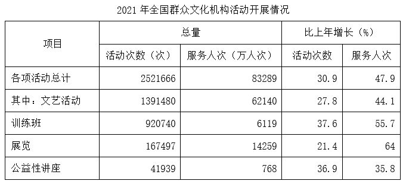

### 第 96 题

2021年末，全国公共图书馆具有中、高级职称的从业人数比全国群众文化机构具有中、高级职称的从业人数：

A. 多852人

B. 多914人

C. 少852人

D. 少914人

第 96 题 · 答案与解析

**参考答案（粉笔题库参考内容）**

B

**解析**

定位文字材料第一段可得：2021年末，全国共有公共图书馆从业人员59301人，其中具有高级职称人员7413人，具有中级职称人员18979人；定位文字材料第三段可得：2021年末，全国群众文化机构从业人员190007人，其中具有高级职称人员7531人，具有中级职称人员17947人。则所求为7413+18979-7531-17947=914人，即多914人。

故正确答案为B。

### 第 97 题

2021年，全国公共图书馆平均每名实际持证读者外借书刊文献多少次？平均每次外借多少册？

A. 2.3；2.5

B. 2.3；2.6

C. 2.4；2.5

D. 2.4；2.6

第 97 题 · 答案与解析

**参考答案（粉笔题库参考内容）**

A

**解析**

根据题干“2021年······平均每名实际持证读者外借书刊文献多少次？平均每次外借多少册”，可判定本题为现期平均数问题。定位文字材料第二段可得：2021年公共图书馆实际持证读者10313.93万人；书刊文献外借58730.15万册次；外借人次23809.24万。根据公式：平均数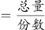，则2021年平均每名实际持证读者外借书刊文献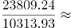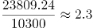次，平均每次外借书刊文献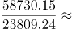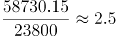册。

故正确答案为A。

### 第 98 题

2020年，全国公共图书馆为读者举办各种活动约多少万次？平均每次有多少人参加？

A. 15；少于600

B. 15；多于600

C. 16；少于600

D. 16；多于600

第 98 题 · 答案与解析

**参考答案（粉笔题库参考内容）**

B

**解析**

根据题干“2020年，全国公共图书馆为读者举办各种活动约多少万次？平均每次有多少人参加”，结合材料时间为2021年，可判定本题为基期计算和基期平均数问题。定位文字材料第二段可得：2021年全国公共图书馆共为读者举办各种活动202568次（B），比上年增长34.4%（b）；参加人次11892.49万（A），增长28.2%（a）。根据公式：基期量，可得2020年全国公共图书馆为读者举办各种活动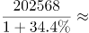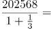次=15.2万次；根据公式：基期平均数，可得平均每次参加的人数为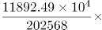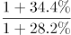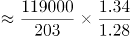人>600人。

故正确答案为B。

### 第 99 题

2021年，平均每座公共图书馆的从业人数，与平均每个群众文化机构的从业人数之比在以下哪个范围内：

A. 3.0-3.5

B. 3.5-4.0

C. 4.0-4.5

D. 4.5-5.0

第 99 题 · 答案与解析

**参考答案（粉笔题库参考内容）**

C

**解析**

根据题干“2021年······与······之比在以下哪个范围内”，可判定本题为比值计算问题。定位文字材料第一段可得，2021年末，全国共有公共图书馆3215个，从业人员59301人；定位文字材料第三段可得，2021年末，全国共有群众文化机构43531个，全国群众文化机构从业人员190007人。根据公式：平均数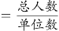，则2021年平均每座公共图书馆的从业人数与平均每个群众文化机构的从业人数之比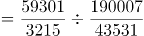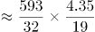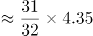，在C项范围内。

故正确答案为C。

### 第 100 题

关于全国群众文化机构相关情况，不能从上述资料中推出的是：

A. 2020年，训练班服务人次总量超过3500万

B. 2020年，开展公益性讲座活动次数超过3万

C. 2021年，四项活动中平均每次活动服务人数最多的是训练班

D. 2021年，乡镇综合文化站占全国群众文化机构的比例比2020年低

第 100 题 · 答案与解析

**参考答案（粉笔题库参考内容）**

C

**解析**

A项：定位统计表可得，2021年训练班服务人次6119万人次，同比增长55.7%。根据公式：基期量，则2020年训练班服务人次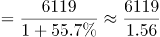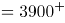万人次，超过3500万，正确；

B项：定位统计表可得，2021年开展公益性讲座41939次，同比增长36.9%。根据公式：基期量，则2020年开展公益性讲座活动次数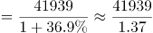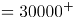次，超过3万，正确；

C项：定位统计表可得2021年四项活动开展的次数及服务人次，根据公式：平均数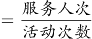，则四项活动平均每次活动服务人数分别为，文艺活动：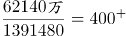人次；训练班：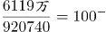人次；展览：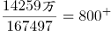人次；公益性讲座：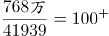人次。平均每次活动服务人数最多的是展览，并非训练班，错误；

D项：定位文字材料第三段可得，2021年末，全国共有群众文化机构43531个，比上年末减少156个。其中乡镇综合文化站32524个，减少301个。根据公式：增长率，则2021年乡镇综合文化站增长率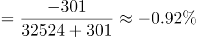（a），全国群众文化机构增长率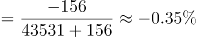（b）。根据两期比重比较结论：当部分增长率（a）＜整体增长率（b）时，比重下降。因-0.92%（a）＜-0.35%（b），故2021年，乡镇综合文化站占全国群众文化机构的比例比2020年低，正确。

此题为选非题，故正确答案为C。

