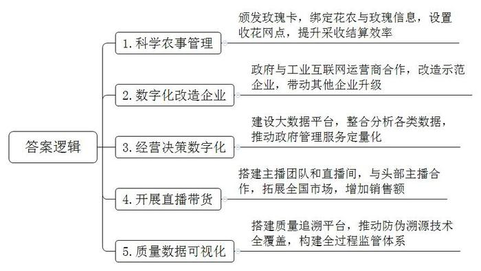
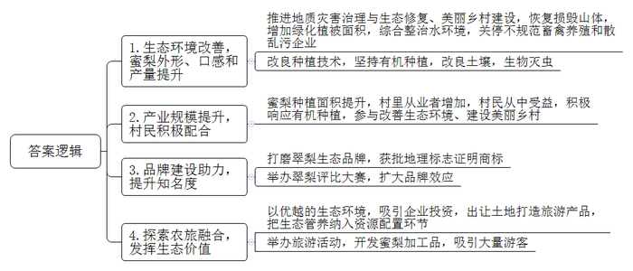
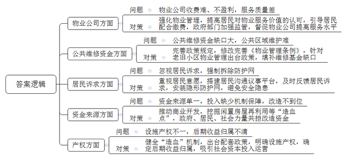
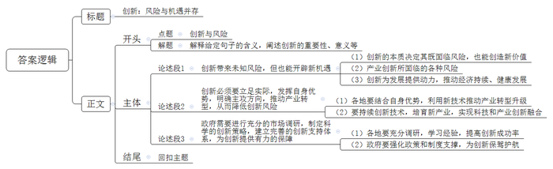

# 2024年公务员多省联考《申论》题（湖北省市卷）

> 候选采集稿。参考答案及解析来自粉笔页面，不代表官方答案或真实高分答卷；来源使用许可与原卷对应关系仍需人工核实。

## 给定材料

### 材料 material-d6386ada251d55d9

“有了‘玫瑰卡’，我们方便多了——看地里玫瑰长势情况，查天气适不适合采摘，了解企业收花价格，一部手机就搞定了。钱也能通过扫码直接打到我账上，我还领到了60元的红包。”赵大叔是家住A县S村的玫瑰花农，每天凌晨三点，赵大叔就要来到田间，戴着头灯采下一朵朵玫瑰，在花瓣犹带晨露时，装箱送往收花点，图的是在花冠最新鲜的时候卖上好价钱。收花站工作人员验货称重后，用手机扫描赵大叔“玫瑰卡”上的二维码，赵大叔立刻就收到了货款，同时玫瑰的数量、重量、收购价格也会传输到工厂显示屏和玫瑰产业大数据平台上。他表示以后就在家专心种花，不再外出打工了。目前，A县已为1.3万户花农颁发了“玫瑰卡”，绑定花农与玫瑰的信息，设立了30余个收花网点，实现对28000余亩鲜花基地的科学农事管理。从每斤4元到每斤8至9元，玫瑰的收花价格翻了一番，采收结算效率也提高了90%。

“数字经济要一直做下去。”A县特色产业发展中心刘主任说，前几年，A县的玫瑰加工企业有40余家，涉及医药、食品、美妆、化工等领域。然而，产业发展中心在走访中发现许多企业依赖人工，信息化水平有限。于是，A县政府与工业互联网运营商H公司合作，以当地最大的玫瑰加工企业N集团为示范企业进行数字化改造，并出台一系列政策举措，带动其他企业升级。“玫瑰卡”就是H公司的创新应用。

“新鲜的玫瑰花当天就要烘干处理，所以，烘干车间的数字化改造很重要。以前，工人都是凭经验来控制玫瑰花的烘干温度，根据花的不同状态进行调整。”刘主任介绍，“现在，有了新的供应模型，每个烘房都安了传感器，温度会自动进行调整，且每一次的数据都会上传‘云端’。”此外，智能摆盘、智能称重、食链一体机、产品赋码等应用场景随处可见，还有振动筛工艺标准化、订单协同、仓储物流管理等数字化系统，促成对生产车间的全面智能化改造。改造后，玫瑰花烘干良品率提升了3%，协同加工效率提升了30%，每条单产线节省人工成本超过了10万元。

“以前，A县玫瑰从种植、采收，到烘干、深加工，然后再到销售，实际上各个环节是脱节的。”刘主任说。目前，县里已建成玫瑰产业大数据平台，通过整合与分析产业数据、互联网数据、消费者评价数据，政府管理和服务从定向化走向定量化，帮助企业实现了经营决策数字化，极大地提升了玫瑰品牌管理能力，促进了监管方式创新，保障了消费安全。

随着数字化重塑，许多企业也纷纷走上了发展电商的道路。“我们在多个平台注册账号，并在知名电商平台邀请达人‘种草’。在去年开展的两场网络直播带货中，我们的50多万盒玫瑰特色产品被抢购一空！”N集团陈总经理说，“在政府政策的推动下，我们以直播带货的方式将玫瑰花茶、鲜花饼等相关产品销往全国，成为集团的一张张金名片。”目前，企业拥有主播团队和专业直播间，还与头部主播有长期合作，每年电商销售额达到5000余万元，占总销售额的近50%。

玫瑰产品如何才能让消费者信赖？通过赋予玫瑰产品码等方式，实现种植、生产质量数据可视化是一个好方法。A县推动“防伪溯源”技术全覆盖，通过信息化手段，以“质量码”形式，构建玫瑰质量全过程监管体系。“我们致力于实现玫瑰产品‘一物一码’，消费者扫一下，即可追溯产地、加工车间等源头信息，做到有码可查、有码可循。”刘主任表示。截至目前，A县已累计完成100余万次的产品赋码，产品质量追溯平台覆盖全县玫瑰种植主体13000余家，产品130多类。

“以前，我们的玫瑰制品较为单一，以玫瑰干花和手工揉制的玫瑰花酱为主，产业难以壮大。这几年，我们‘背虚向实’，靠着大数据这朵‘云’，大力发展玫瑰产业，各地客商云集A县，各种玫瑰食品、茶饮、化妆品走向了全国。我们这朵玫瑰终于插上翅膀，冲上‘云端’了。”刘主任高兴地说道。

### 材料 material-031892b97ceb3e36

一大早，59岁的范大伯就把自家果园的梨运回家。家里，他的妻子正在分拣包装，屋里包装用的纸盒足有几百个。在M县焦洋镇永林新村，梨农家多是如此繁忙。范大伯家距离远峰山不到200米。蓝天白云下，湖阔山美、碧树叠翠，村里的梨树就在这样的环境下茁壮生长。

上世纪九十年代，永林新村开始对远峰山的矿石进行挖掘开采。曾在矿山做机修工的范大伯记得，每次大风过后，庄稼都裹着一层灰，河里的鱼虾也不见了。2007年，矿山停止开采，留下裸露的山体。第二年，焦洋镇开始引进蜜梨，推广种植，果实品质却不尽如人意。山体裸露、水土流失影响水源质量；在3月、4月授粉关键期，风裹挟着粉尘袭来，蜜梨坐果率大受影响；有时，果园还会遭受山体滑坡带来的意外损失……多重因素下，产出的梨子颜色偏黄、色泽暗淡，平均每个重六七两，口感一般，鲜有人问津。

2014年，M县统筹推进地质灾害治理与生态修复、美丽乡村建设。远峰山修复工程启动，通过锚索格构梁加固、植生袋覆绿、坡脚栽植树木、播撒草种等方式，被损毁的5万多平方米山体得以恢复，绿化植被面积增加近8万平方米。生活污水接管等一系列水环境综合整治举措相继落实，村里不规范畜禽养殖和散乱污企业被陆续关停。经过五年的整治，永林新村水质达到Ⅱ类水标准，全村绿化面积达85%以上。

生态好了，梨子变漂亮了，但口感的进一步提升还得依赖于种植技术的改良。村里这几年坚持有机种植，以菜饼、豆粕等为肥料改良土壤，用生物方式灭虫。范大伯在果树下养殖的7只鸡、4只鸭、2只鹅，可以吃草吃虫、提供新鲜禽蛋，粪肥还能增加土壤有机质。他算了一笔账：两亩梨树今年产梨共8000多斤，按每斤6元的售价，年销售5万余元、纯利润4万元左右。

现在，这里的梨子颜色翠绿、色泽鲜亮，每个1斤左右，水分充足，平均甜度12度以上。“生态变好了，梨子从喝脏水到喝清水、从吹灰尘风到晒阳光浴，自然一年比一年漂亮、好吃。”范大伯说。据统计，截至目前，永林新村蜜梨种植面积已经增加到600多亩，村里直接从事梨果产供销的人超过70%，从事与之相关产业的人超过90%，仅梨果经纪人就有35名。村里的产业规模上来了，村民们得到实惠，沟通起来也更方便。“以往，我们跟村民讲生态优先、绿色发展，青山绿水是无价之宝，村民们不理解，说生态好有什么用，又不能当饭吃。现在，我们一跟村民说要使用有机肥，改善生态环境、建设美丽乡村，大家就都积极响应起来。关系融洽了，对乡村治理、乡风文明也有好处，村里要做点什么事情方便多了。”永林新村党总支范书记说。

“我们从蜜梨品种中打磨出了‘焦洋翠梨’生态品牌，主打好山好水出好梨的概念，现在连原产地的蜜梨也用上了这个品牌。”M县市场监督管理局知识产权保护科周科长说。2021年8月，这个品牌获批地理标志证明商标。2022年9月，为扩大品牌效应，M县举办了首届翠梨评比大赛，范大伯家的梨子一举夺冠。获奖的梨子中，有的超过2斤，有的甜度达到13.8度。

2002年，永林新村人均年收入不到8000元，村集体收入仅几万元；2021年，村民人均年收入超过3.8万元，村集体收入达到600万元；2022年全村出梨200余万斤、产值1200多万元。在永林新村的带动下，全镇梨果产业年产值已超过1亿元，梨果业已发展为镇里乃至县里的重要特色产业之一。

2022年4月，全省首宗附带“生态管养”土地在范家塘村出让，拍下该宗土地的九农文旅公司冯经理表示，这片生态管养地块将保留当前的田园水系和生态植被，能为后期打造主题田野乐园节约上百万元费用。“这次交易的最大亮点，就是把生态管养纳入资源配置环节，赋予地块生态产品价值，实现‘生态有价’。”范书记介绍，“很多公司来投资，就是看中了这里优越的生态环境，以及梨子的品牌影响力和市场潜力。”

梨子成为永林新村招商引资的招牌，每年也吸引着数万游客前来。2023年4月梨花盛开的时候，焦洋镇在永林新村举办了为期3天的梨花节，前来欣赏梨花的游客如潮水般涌动。大家一边徜徉在花海中，一边品尝着村里的特色美食，喜笑颜开，用手机留下了一个个美好的瞬间。

范书记说：“这两年，随着游客的到来，村里还进一步细分产品类型，加工制作了梨子酒、梨膏糖等伴手礼，以满足游客的不同需求。”在他看来，永林新村从“卖石头”，到“卖梨子”，再到“卖生态”，真正把弯路走直、窄路走宽了。

### 材料 material-fc453fa89536d0ac

兴旺区是K市最早向城市化过渡的地区之一，辖区内老旧小区很多，老旧小区改造一直是区里的重点项目。违章现象整治、道路修复铺装、水电管网改造……改造后的小区居住环境明显提升，但仍面临一系列问题亟待解决。

东瑞园小区是兴旺区首批完成改造升级的小区之一，但家住该小区的王阿姨却被管道漏水问题困扰了数月。“这是共用管道，应该由物业来维修，可是我跟物业反映了两个月，至今还没有安排人来修。”王阿姨说，“每次他们都说知道了，但就是没见人来修过。”对于物业公司的不作为，同一小区的住户老赵表示自己已经司空见惯了。据他介绍，虽然小区门口设有升降杆，但平时并不启用。一些外来车辆进入小区，挤占了小区的车位，使得小区内部车辆经常“无处落脚”。还有一些业主为了自己停车方便，使用各种方法占车位，有用电动车、自行车或三轮车占位的，还有安装地锁的。他多次向物业反映这些问题，但一直没有得到妥善解决。

“这个小区以前是没有物业的，去年小区改造后我们才进驻，但这个物业费收取却非常费力。有些业主认为物业就是看个门、扫扫地，还有些业主认为只要不收费用，怎么管理都无所谓。”东瑞园小区物业公司张经理无奈地说，“老旧小区本来就因为基础设施不完善容易出问题，平时需要维修花钱的地方有很多，即使全额收齐物业费也不一定能保持运转，更别提盈利了，这样‘入不敷出’，也制约了我们提高服务品质的积极性。”

“大部分老旧住宅小区未归集房屋维修基金，这样就没有后期公共部分维护保养的钱了。按照规定，维修基金降至总量的30%就应该续筹，但许多业主认为，买房时已交了钱，后续不愿再交。一些房屋经多次转手后，新业主也不愿意交费。”社区工作人员小刘说，“《物业管理条例》只对新开发楼盘进行规定，没有涉及既有住宅和改造后的老旧小区。我们希望市里可以针对老旧小区物业管理出台一些政策，填补公共维修资金缺口。”

迎泽公寓小区有20多年了，去年底刚刚完成改造，但大部分居民对拆除防护网一事意见很大。“我不同意拆防护网，太不安全了。”住户陈女士说，“有的住户担心拆了防护网之后孩子不安全，就把窗户钉死了；有的住户防护网上面还有雨棚，拆了后雨就飘到屋里；而我当时装的防护网质量比较好，花了七八千元，好好的拆掉很可惜。当时我们业主代表到居委会，讲了防护网拆除后的安全隐患。提出如果一定要拆，要统一替换成隐形防护网。但是最终没有让我们如愿，拆是拆了，却没有再装。”陈女士指着楼上的几户窗户说：“你看，楼上几户有小孩的，又都重新装上了，这外观不是又破坏了吗？”

兴旺区旧改资金主要靠政府财政投入，一年能争取到的专项资金约1.2亿元，但需要改造的老旧小区项目超过140个，平均到每个小区只有80万元，每栋楼不足10万元，旧改项目的利润对施工单位来说是“聊胜于无”。由于资金来源单一、投入缺少机制保障，不少地方只能将资金主要用于老旧小区水电气热、楼梯楼体等满足居民基本生活和安全的基础类改造，物业管理、绿化停车、托老托幼等完善类、提升类改造则难以兼顾，整体居住品质并未得到根本改善。

“不少老旧小区地处城市核心地段、文化底蕴厚重，具备商业开发价值，可挖掘闲置房屋再利用、有偿服务等‘造血点’，建立政府与居民、社会力量合理共担改造资金的机制。”兴旺区住建局干部小王介绍，“去年我们把建融家园这个老旧小区改造成高品质长租户公寓后，很快被抢租一空；正街社区挖掘街区历史底蕴，打造‘超级1号街’怀旧主题文创园，促进了文旅产业发展。”小王还介绍，“停车场、临街门面和住房是旧改的重要‘造血点’，但常常存在产权不一的问题，导致后期收益归属不清，还需要出台相应的配套政策，健全‘造血’机制，吸引社会资本投入运营。”

### 材料 material-b1fd02f93f413768

以中国式现代化全面推进强国建设、民族复兴伟业，是新时代新征程党和国家的中心任务，是新时代最大的政治。

党的十八大以来，习近平总书记围绕中国式现代化发表了一系列重要论述，为我们以中国式现代化全面推进强国建设、民族复兴伟业提供了根本遵循。

中国式现代化是我们强国建设、民族复兴的康庄大道。党的二十大报告明确指出了以中国式现代化全面推进中华民族伟大复兴的重大论断和重大使命。面对当今世界变乱交织、百年变局加速演进，我国发展战略机遇和风险挑战并存、不确定难预料因素增多的发展环境，必须牢牢把握高质量发展这个首要任务，以高质量发展推进中国式现代化。让我们紧密团结在以习近平总书记为核心的党中央周围，奋力谱写中国式现代化湖北实践。

## 题目

### 第 1 题

**根据****“给定资料**2**”，请你概括A县是如何通过数字化手段推动玫瑰产业高质量发展的。（15分）**

关联材料：material-d6386ada251d55d9

作答要求：

要求：全面、准确。字数不超过200字。

### 第 2 题

**根据****“给定资料**3**”，请你分析永林新村为什么能实现从“卖石头”到“卖梨子”再到“卖生态”的转变。（20分）**

关联材料：material-031892b97ceb3e36

作答要求：

要求：全面、准确、有条理。字数不超过300字。

### 第 3 题

**根据****“给定资料**4**”，梳理兴旺区老旧小区改造后存在的问题，并提出解决建议。（25分）**

关联材料：material-fc453fa89536d0ac

作答要求：

要求：

（1）问题梳理全面、准确、有条理；

（2）所提建议与问题相对应，具体明确，切实可行；

（3）字数不超过400字。

### 第 4 题

**“给定资料**5**”中提到“创新是有风险的，但它又是规避风险的最好方式”****，****请深入思考这句话，联系实际，自选角度，自拟题目，写一篇文章。****（****40分****）**

关联材料：material-b1fd02f93f413768

作答要求：

要求：

（1）观点明确，见解深刻；

（2）思路清晰，语言流畅；

（3）总字数800-1000字。

## 答案与解析

第 1 题

**参考答案（粉笔题库参考内容）**

1.科学农事管理。颁发玫瑰卡，绑定花农与玫瑰信息，设置收花网点，提升采收结算效率。

2.数字化改造企业。政府与工业互联网运营商合作，改造示范企业，带动其他企业升级。

3.经营决策数字化。建设大数据平台，整合分析各类数据，推动政府管理服务定量化。

4.开展直播带货。搭建主播团队和直播间，与头部主播合作，拓展全国市场，增加销售额。

5.质量数据可视化。搭建质量追溯平台，推动防伪溯源技术全覆盖，构建全过程监管体系。

**解析**

**参考答案说明：**本参考答案从“科学农事管理”“数字化改造企业”“经营决策数字化”“开展直播带货”“质量数据可视化”这五个方面展开，各条答案要点之间在内容上相互并列，没有交叉。

**考点**：考点概括措施类

**来源**：来源2024年公务员多省联考《申论》题（湖北省市卷）

粉笔申论页面对本题只提供「解析视频」入口，该入口是会员推广位，页面无视频地址与文字解析。

第 2 题

**参考答案（粉笔题库参考内容）**

1.生态环境改善，蜜梨外形、口感和产量提升。推进地质灾害治理与生态修复、美丽乡村建设，恢复损毁山体，增加绿化植被面积，综合整治水环境，关停不规范畜禽养殖和散乱污企业；改良种植技术，坚持有机种植，改良土壤，生物灭虫。

2.产业规模提升，村民积极配合。蜜梨种植面积提升，村里从业者增加，村民从中受益，积极响应有机种植，参与改善生态环境、建设美丽乡村。

3.品牌建设助力，提升知名度。打磨翠梨生态品牌，获批地理标志证明商标；举办翠梨评比大赛，扩大品牌效应。

4.探索农旅融合，发挥生态价值。以优越的生态环境，吸引企业投资，出让土地打造旅游产品，把生态管养纳入资源配置环节；举办旅游活动，开发蜜梨加工品，吸引大量游客。

**解析**

**参考答案说明：**本参考答案从“生态环境改善，蜜梨外形、口感和产量提升”“产业规模提升，村民积极配合”“品牌建设助力，提升知名度”和“探索农旅融合，发挥生态价值”这四个方面进行了分条撰写，各条答案要点之间在内容上相互并列，没有交叉。

**考点**：考点原因类

**来源**：来源2024年公务员多省联考《申论》题（湖北省市卷）

粉笔申论页面对本题只提供「解析视频」入口，该入口是会员推广位，页面无视频地址与文字解析。

第 3 题

**参考答案（粉笔题库参考内容）**

1.问题：物业公司收费难、不盈利，服务质量差。对策：强化物业管理，提高居民对物业服务价值的认可，引导居民配合缴费，政府部门加强监管，督促物业公司提高服务水平。

2.问题：公共维修资金缺口大，公共区域维护难。对策：完善政策规定，修改完善《物业管理条例》，针对老旧小区物业管理出台政策，填补维修基金缺口。

3.问题：忽视居民诉求，强制拆除防护网。对策：重视居民意愿，搭建居民沟通议事平台，及时反馈居民诉求，安装隐形防护网，避免安全隐患。

4.问题：资金来源单一，投入缺少机制保障，改造不到位。对策：推动商业开发，挖掘闲置房屋再利用等“造血点”，政府、居民、社会力量共担改造资金。

5.问题：设施产权不一，后期收益归属不清。对策：健全“造血”机制，出台配套政策，明确设施产权，确定后期收益归属，吸引社会资本投入运营。

**解析**

**参考答案说明：**本参考答案分别围绕“物业公司”“公共维修资金”“居民诉求”“资金来源”“产权”五个方面的问题及对应的对策展开，进行了分条撰写；各条具体要点之间在内容上相互并列，没有交叉。

**考点**：考点提出对策类

**来源**：来源2024年公务员多省联考《申论》题（湖北省市卷）

粉笔申论页面对本题只提供「解析视频」入口，该入口是会员推广位，页面无视频地址与文字解析。

第 4 题

**参考答案（粉笔题库参考内容）**

**创新：风险与机遇并存**

“创新是有风险的，但它又是规避风险的最好方式。”这句话深刻揭示了创新在现代社会发展中的核心地位。创新不仅是推动社会进步的重要动力，也是企业和个人在激烈竞争中脱颖而出的关键。然而，创新并非坦途，它伴随着风险与挑战，但正是这种不确定性，促使我们不断探索、不断突破，最终实现更大的安全与发展。

**创新带来未知风险，但也能开辟新机遇**。创新的本质是对未知的探索和尝试，往往会面临技术尚未成熟、市场需求不确定等多重风险，但创新可以实现新的市场需求，创造新的价值，从而开辟出一片蓝海。一方面，产业创新必然伴随着大量资金、劳动力等资源要素的投入，一旦失败则会带来较大的经济损失，而新质生产力的出现也可能会对传统行业及人群产生较大冲击，造成“创造性毁灭”。另一方面，创新又是发展的第一动力，有助于摆脱传统的经济增长方式，克服发展瓶颈，寻求新的增长点，推动经济持续、健康发展，降低发展风险。

因此，发展中要尽力平衡好创新和风险的辩证关系，贯彻落实“坚持稳中求进、以进促稳、先立后破”的科学发展论。

**创新必须要立足实际，发挥自身优势，明确主攻方向，推动产业转型，从而降低创新风险**。各地优势资源禀赋不同，优势产业各异，要在稳住传统产业“基本盘”的基础上，用新技术改造提升传统产业，推动特色产业和主导产业的转型发展，推进现代化产业体系建设。同时，要持续打好技术攻坚战，进一步挖掘壮大新兴产业、培育未来产业，比如新能源、新材料、人工智能、大数据等领域，在新赛道上继续奋勇争先，实现科技创新和产业创新深度融合。

另外，**政府需要进行充分的市场调研，制定科学的创新策略，建立完善的创新支持体系，为创新提供有力的保障**。各地要充分调研研究，学习借鉴先进经验，以市场为导向推动创新，确保符合当今消费潮流，提高创新成功率。另外，政府应聚焦重点领域和关键环节，强化人才、资金、技术等政策支撑，推动资源要素集聚，加快完善知识产权保护、市场准入等相关制度机制，持续优化营商环境，打通堵点卡点，为产业创新发展保驾护航。

机遇与风险并存，困难与希望同在。创新是有风险的，但也是规避风险的最好方式，要平衡好创新和风险的关系，蹄疾步稳推动创新发展。

**解析**

**文章分析**

**创新：风险与机遇并存**

【**标题的优点：**首先，范文的标题突出了“创新与风险”这一主题。其次，形式上，文字简洁明快，不拖沓。】

（1）“创新是有风险的，但它又是规避风险的最好方式。”这句话深刻揭示了创新在现代社会发展中的核心地位。创新不仅是推动社会进步的重要动力，也是企业和个人在激烈竞争中脱颖而出的关键。（2）然而，创新并非坦途，它伴随着风险与挑战，但正是这种不确定性，促使我们不断探索、不断突破，最终实现更大的安全与发展。

【**开头的优点：**★内容方面。范文的开头是紧扣“创新与风险”这一主题展开的。首先，开头点出主题，做到了主题明确。其次，对“创新与风险”这一主题进行了分析阐述：（1）强调了创新的重要性；（2）引出核心观点，阐明创新既伴随风险，又能助力实现更大的安全与发展。★文字表达方面。使用了“不仅是……也是……”等连接词，使语言表达更有气势。】

**创新带来未知风险，但也能开辟新机遇**。（1）创新的本质是对未知的探索和尝试，往往会面临技术尚未成熟、市场需求不确定等多重风险，但创新可以实现新的市场需求，创造新的价值，从而开辟出一片蓝海。（2）一方面，产业创新必然伴随着大量资金、劳动力等资源要素的投入，一旦失败则会带来较大的经济损失，而新质生产力的出现也可能会对传统行业及人群产生较大冲击，造成“创造性毁灭”。（3）另一方面，创新又是发展的第一动力，有助于摆脱传统的经济增长方式，克服发展瓶颈，寻求新的增长点，推动经济持续、健康发展，降低发展风险。

【**论述段****1的优点：**★观点句：范文的观点句是紧扣“创新与风险”这一文章主题提出的。形式上，它在段首处直接写出，位置突出，容易发现。内容上，关键词突出，内容要点明确，可以明显看出是从“创新和风险的辩证关系”的角度展开论述。★论述内容：（1）先介绍创新的本质决定其既面临风险，也能创造新价值；（2）接着介绍产业创新所面临的各种风险；（3）最后，指出创新为发展提供动力，推动经济持续、健康发展。注意：以上三个方面的内容都是紧扣“创新带来未知风险，但也能开辟新机遇”这个观点句进行分析论述的，论述的针对性强，内容层次丰富。在论述方法上主要采用了讲道理的方式，论述清晰透彻。】

因此，发展中要尽力平衡好创新和风险的辩证关系，贯彻落实“坚持稳中求进、以进促稳、先立后破”的科学发展论。

【**过渡段****的优点：**本段承上启下，既总结性指出要平衡创新和风险的关系，还引出下文对降低创新风险和保障持续创新的论述。】

**创新必须要立足实际，发挥自身优势，明确主攻方向，推动产业转型，从而降低创新风险**。（1）各地优势资源禀赋不同，优势产业各异，要在稳住传统产业“基本盘”的基础上，用新技术改造提升传统产业，推动特色产业和主导产业的转型发展，推进现代化产业体系建设。（2）同时，要持续打好技术攻坚战，进一步挖掘壮大新兴产业、培育未来产业，比如新能源、新材料、人工智能、大数据等领域，在新赛道上继续奋勇争先，实现科技创新和产业创新深度融合。

【**论述段****2的优点：**★观点句：范文的观点句是紧扣“创新与风险”这一文章主题提出的。形式上，它在段首处直接写出，位置突出，容易发现。内容上，关键词突出，内容要点明确，可以明显看出是从“降低创新风险”的角度展开论述。★论述内容：（1）先介绍各地要结合自身优势，利用新技术推动产业转型升级；（2）接着指出要持续创新技术，培育新产业，实现科技和产业创新融合。注意：以上两个方面的内容都是紧扣“创新必须要立足实际，发挥自身优势，明确主攻方向，推动产业转型，从而降低创新风险”这个观点句进行分析论述的，论述的针对性强，内容层次丰富。在论述方法上采用了举例子、讲道理相结合的方式，论证充实有力。】

另外，**政府需要进行充分的市场调研，制定科学的创新策略，建立完善的创新支持体系，为创新提供有力的保障**。（1）各地要充分调研研究，学习借鉴先进经验，以市场为导向推动创新，确保符合当今消费潮流，提高创新成功率。（2）另外，政府应聚焦重点领域和关键环节，强化人才、资金、技术等政策支撑，推动资源要素集聚，加快完善知识产权保护、市场准入等相关制度机制，持续优化营商环境，打通堵点卡点，为产业创新发展保驾护航。

【**论述段****3的优点：**★观点句：范文的观点句是紧扣“创新与风险”这一文章主题提出的。形式上，它在段首处直接写出，位置突出，容易发现。内容上，关键词突出，内容要点明确，可以明显看出是从“政府为创新提供保障”的角度展开论述。★论述内容：（1）先指出各地要充分调研，学习经验，提高创新成功率；（2）接着强调了政府要强化政策和制度支撑，为创新保驾护航。注意：以上两个方面的内容都是紧扣“政府需要进行充分的市场调研，制定科学的创新策略，建立完善的创新支持体系，为创新提供有力的保障”这个观点句进行分析论述的，论述的针对性强，内容层次丰富。在论述方法上主要采用了讲道理的方式，论述清晰有力。】

【**论述段之间的关系：**★内容的内在逻辑：范文的三个论述段整体上呈现递进的逻辑，论述段1先整体上阐明“创新和风险的辩证关系”；论述段2和论述段3接着论述了如何降低创新风险和如何保障持续创新。★段与段的外在衔接：论述段1后面的过渡句起到了承接论述段1，引出论述段2和论述段3的作用。】

机遇与风险并存，困难与希望同在。创新是有风险的，但也是规避风险的最好方式，要平衡好创新和风险的关系，蹄疾步稳推动创新发展。

【**结尾的优点：**范文的结尾回扣了“创新与风险”这个主题，并且进行了总结升华。】

**考点**：考点文章写作题

**来源**：来源2024年公务员多省联考《申论》题（湖北省市卷）

粉笔申论页面对本题只提供「解析视频」入口，该入口是会员推广位，页面无视频地址与文字解析。

