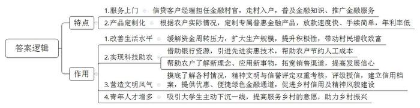
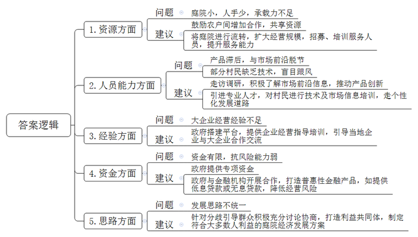
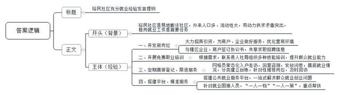
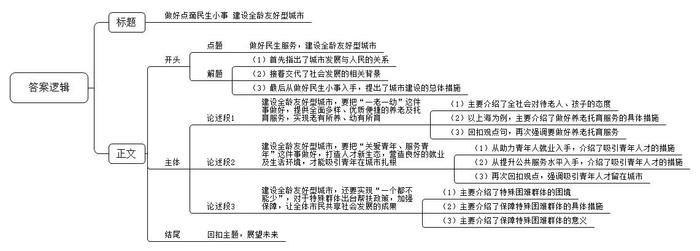

# 2024年公务员多省联考《申论》题（湖北县乡卷）

<!-- gwy:overview:start -->
> **湖北 · 2024 · 申论 · 县乡卷** ｜ 4 题 · 图片 4 处 · 答案随题折叠

导航：[题目](#题目) · [材料 1](#材料-1)
<!-- gwy:overview:end -->

> 候选采集稿。参考答案及解析来自粉笔页面，不代表官方答案或真实高分答卷；来源使用许可与原卷对应关系仍需人工核实。

## 给定材料

### 材料 1

啥是“背包银行”？“说的是银行的客户经理背上包包就进村了，挨家挨户去普及金融知识、推广金融服务。”A市某国有银行支行刘行长说。

2019年以来，为发展普惠金融，助推乡村振兴，A市每年都选派100名优秀的信贷客户经理到100个特色产业村担任金融村官。他们背上背包、走出柜台，走进村组农户和田间地头，向这片乡村热土浇灌金融活水。

蟹苗养殖培育是刘家村的主导产业，每年三四月份，正是养殖户采购蟹苗、饲料，扩大生产经营的时节，不少养殖户都面临较大的资金周转压力。金融村官小梅根据前期调研，向上级部门申请了蟹苗养殖信用户专属金融产品“蟹苗贷”。“我们一直把服务‘三农’作为普惠金融的重点，不仅放款速度快、手续简单，年利率也低，比市面上大多数金融贷款要低1.5至4个点。按照借10万元来算，一年能省至少1500元。”小梅说。有了金融支持，刘家村蟹苗养殖规模大幅度提高，村民的养殖意愿越发强烈。“去年养殖收入增加了快一倍，好多村民都买了小车，今年引入了新的蟹苗品种，规模进一步扩大，村民们日子越来越好啦！”小梅的声音难掩喜悦。

“虽然我是残疾人，但我致富的决心可不比其他人差！”村民老陈原是青山村建档立卡贫困户。在得知老陈打算养猪却苦于没有启动资金后，金融村官小刘积极对接，了解到他有丰富的养殖技术和经验，且有约600平方米的场地可以用来办养猪场后，小刘为其制定了无抵押的信贷支持计划，发放了扶贫小额贷款，老陈想扩大养殖规模，小刘继续为其争取资金支持，又发放了贷款5万元供其购买猪仔，目前养殖规模已增加到了300头。有了信贷资金支持，勤劳肯干的老陈成了村里的致富能手。

“打药用上无人机，原本几天的工作现在两小时就能完成了。高科技的东西就是不一样，多亏了我们的金融村官小李啊！”老钟指着不远处正在喷洒农药的无人机，开心地说。老钟是茗香茶厂的老板，随着茶园的扩大，传统的人工喷药方式费时费力，如何改造升级？一天，小李到家闲聊，老钟把他的困扰告诉了小李。虽然这件事情和金融服务无关，但小李总觉得可以为老钟做点什么。他上网查阅相关资料，了解到植保无人机可将农药喷洒到茎叶背面和根部，能节约农药并有利于减少农药残留和环境污染。在帮助老钟明确了升级方向后，小李又借助省行资源帮助他成功引入了先进实惠的无人机施药技术。“现在，我们这个无人机每启动一次，就可以节约人工成本1万元左右。”老钟对这项新技术赞不绝口，“我们对很多新鲜事物不了解，是小李把城里一些新的东西、新的理念带给了我们。最近他又教会了我直播带货，现在我的茶都卖到国外去了……”老钟对未来的发展充满了信心。

“背包银行不仅为农村送去了普惠金融服务，对农村的信用建设、精神文明建设也起到了很大的促进作用。”刘行长说。随着金融村官对各村情况的摸底了解，A市对上万户农村家庭进行了评级、授信，初步建立了农户信用档案。半数以上农村家庭被认定为“信用户”，可以享受到更优惠、更便捷的绿色金融通道。在评估“信用户”的时候，A市采用精神文明与信誉评定双重考核标准，把邻里和谐、孝道等道德元素纳入考核，在推进乡村信用建设的同时，也提升了农村的精神风貌。

“在背包银行模式之初，我们担心年轻人不愿意舍弃城里的舒适生活奔赴偏远的农村，也担心这些大多来自城市的大学生无法下沉一线、真心地服务农民。三年过去了，事实证明我们的担心是多余的。”刘行长说，去年以来，越来越多的年轻人主动报名要加入背包队伍，投身到乡村振兴的时代热潮。“我们看到这么多年轻人愿意走向农村、服务乡村，既有喜悦也有欣慰，准备在A市更多的村庄开启普惠金融背包之旅。”

### 材料 2

2020年，B市开始试点推进庭院经济，经过几年努力，庭院经济初显蓬勃之势，为评估庭院经济发展情况，进一步助力乡村振兴，B市农业农村局在学习贯彻习近平新时代中国特色社会主义思想主题教育期间，深入B市乡村开展调研工作，以下是调研组成员小江的部分调研笔记内容。

●陈村。村民老陈因地制宜，把自家庭院重新装修，在家里开起农家乐。老陈说：“我们这里是山区，风景好，而且山里的菜新鲜、地道、有特色。隔三岔五就有游客来山上游玩，顺便品尝我们的农家菜，都夸我们家的菜好，经常有客人提前打电话来，点名要吃我们家的炖鸡。现在政府鼓励发展庭院经济，我这房前屋后都种了菜，加工出来就能变现钱，庭院经济有赚头！有点可惜的是，家里的地方还是太小了，客人一多就没地方坐，种的菜也不够招待，有时候单凭家里的几口人也忙不过来。”

●郭家村。村党支部书记老郭：“我们村算是找准了庭院经济的发展方向，就是在自己庭院加工软体沙发。现在我们村的软体沙发加工业已初具规模，村民们逐渐走上了一条致富的道路。这都是因为我们有小章啊！他懂技术，也懂市场。”

小章：“我以前在沿海一家沙发公司上班，回家过年时，正遇上郭书记在宣传庭院经济，我在外很多年，也想回家发展，就抱着试一试的想法，利用自家庭院干起软体沙发的加工。现在，我们通过网络把小庭院和大市场联系起来，在多家电商平台开设网店，也和直播带货的主播合作，每天有一百多份订单。”

老郭：“我们村在自家庭院加工软体沙发的农户超过20家，不仅收益可观，还带动了近200名村民的就业。周边村子的很多人纷纷前来取经学习，也准备从事沙发加工。”

小章：“其实我们的市场是受限的，因为沙发的工艺技术、设计理念和款式风格一直在变化，而我们与市场前沿有些脱节，产品始终稍微滞后，很多人没有技术，也不懂市场，一窝蜂来学做沙发，这未必是件好事。”

●赵村。这是一个有着300多年铁编加工历史的村庄，村里80%的人都有铁编手艺，但一直以来，铁编生产都是家庭作坊、自产自销，这导致村子的铁编产业一直走不出“庭院”。村党支部书记老赵带着铁编加工户代表到沿海发达地区考察学习，回来后，赵村成立了金属制品产业合作社，合作社有人专门负责采购原材料和推广产品，铁编加工户只需要按统一标准在自家庭院加工制作。

老赵：“我们之前太局限于传统小农经济的思想，要面向市场！市场需要什么，我们就生产什么。小作坊创造大产业，去年一年，我们村铁编销售额突破了两亿元，现在随着规模不断扩大，合作社的事情越来越多，资金往来也越来越复杂，我们没有经营大企业的经验，觉得还是很有压力。”

●方海村。村民小方通过网络直播销售花卉，这些花卉都是她在自家庭院里种的，品种虽然比较少，但都是市面上比较少见的。小方：“我最喜欢的工作就是每天在自家小院直播推销花卉，我的客户主要是一些对新奇植物抱有好奇心的城市白领，她们一般不太在乎价格，主要看颜值。我还想扩大一些规模，但这些花卉成本很高，我的资金有限，经不起风险，后面再找机会吧。”除了直播花卉的品种、价格、种植注意事项外，小方还喜欢与她的观众分享绿植美化居室和庭院的心得：“庭院经济很有看头！院子闲着也是闲着，种上花卉，看着舒心，住着养心。”

●张店村。村党支部夏书记联系五户不在村里居住的村民召开协商会，与他们协商将院子流转给村里发展民宿。

夏书记：“院子流转给村里发展民宿。我们把‘小’而‘微’的庭院打造出各自的特色，通过设计形成一个大旅馆，这样大家不仅获得租金和分红，还可以在民宿就业。”

村民老韩：“之前隔壁石条村老江家办过民宿。开始红火过一阵子，后来因为激烈的同质化竞争，老江只能通过压低报价来吸引客户。可是报价降低了，服务品质也跟着降低了，无法吸引客户，最终陷入了恶性循环。”

村民老张：“我觉得我们村现在这样子就很好。干干净净，又安静，顺其自然就行了。有的地方办民宿，一下子迎来很多客人，吵吵嚷嚷，还带来很多垃圾。”

由于大家意见不一，协商会最后没有达成结果。“庭院经济有奔头。我们周围很多村都搞得红红火火，我们村没有搞不好的道理。”夏书记会后说，“浪头会不断起伏，但浪潮永远向前。只要我们沿着党和国家指引的方向不懈努力，就一定能把村里的庭院经济搞起来。”

### 材料 3

在裕民社区“爱上锅巴饭”的后厨，老曹忙活着给客人制作餐点。门店里络绎不绝的客人，让老曹没有休息时间。一年前还在外漂泊的他，如今已经是小店的老板；梅姐是裕民信合花园物业公司的一名员工，曾经在家待业的她如今通过应聘完成了从“家庭主妇”到“职场女性”的转变。

这样的“变形记”每天都在裕民社区上演。

“我们裕民社区是在县城‘南扩北升’基础上建起来的‘年轻’社区，属于易地搬迁社区，去年我们社区被评为第五批国家级充分就业社区，这实属不易啊。我们社区外来人口多，人口流动性大。劳动力供大于求的矛盾在我们这个社区表现得尤为突出。”社区党支部张书记说，“我和这些搬迁群众一样，都是这个小区的新人。这里就业岗位不多，做好原住居民及搬迁群众稳岗就业工作，就是我到任后要破解的首要难题。”

就业岗位不多，那就想办法开发新的岗位。为了实现就业岗位“开源”，裕民社区在优化营商环境上发力，社区规划全员出动拉项目、谈项目、筹资金，社区市场监督协管员成了服务“店小二”，负责协助个体工商户、小微企业在社区内申请创业补贴，办理相关证照。“短短两年，我们社区就促成一个大型超市、一批商户的开业和发展，为居民提供了收银员、理货员等600余个工作岗位，我们还引进1个公园、1个景观廊桥项目的建设和4个楼盘的开发，这能为社区居民提供建筑类岗位300余个。”社区建设办主任说。此外，裕民社区居民还与辖区企业、商户签订《促进充分就业合作协议书》，双方共享求职招聘信息，鼓励企业、个体工商户为本社区群众优先就业、就近就业创造积极条件。

农村搬迁劳动力绝大多数没有一技之长，文化素质参差不齐，转移就业难度大，促进搬迁劳动力充分就业，社区的出路在哪里？

家住裕民社区的叶女士原本是一名普通的家庭主妇，待业在家的她日常喜欢刷短视频。令她没有想到的是，一年前参加的电商中高级培训班改变了她的生活，让她的日常爱好变成了谋生手段，从此打开了直播带货的大门。

裕民社区加大失业人员的就业砝码，通过开展职业培训，让原本就业“单选题”变为了择业“多选题”。根据失业人员的培训需求，社区主动联系县人社局组织开展技能培训。“去年，我们组织220名搬迁群众参加月嫂、电商直播等培训，90%的群众都通过培训开创了自己就业的新路……”张书记信心满满地说，“这些培训都是免费的，大家积极性都很高，我们就是要让搬迁群众头脑灵起来，信心强起来，思想活起来！”

夏大姐是裕民社区第四网格的网格长，定期做好片区劳动力的摸排登记和后期跟进服务是她的重要工作之一。无论春夏秋冬，夏大姐得空就去入户走访。平日里群众咨询电话不断，定期她还要发放调查问卷，对社区的家庭劳动力状况、就业情况、搬迁群众的技能水平和培训意愿等情况做摸排，并将摸底情况分门别类建立台账，平日里她都会随身携带自制的“劳动力小册子”，随时翻看补充，还经常“点对点”推荐合适岗位，就业后一个月内还会回访，夏大姐说：“看似简单的工作，其实需要耗费大量的心血。”

“政策咨询、岗位推荐、技能培训、创业扶持、托底安置”，裕民社区办公室的任务栏上赫然写着这些大字……在裕民社区的公共就业服务平台，居民只需要“走进一扇门”，便可办好就业创业相关的事情。此外，针对就业困难人员，裕民社区实施“一人一档”“一人一策”，重点解决帮扶问题。去年，58岁的老周找到夏大姐，想要找份工作，但他既无年龄优势又无技术长处，这样一个几乎“不可能完成的任务”，却在夏大姐及社区工作人员的共同努力下圆满完成，最终老周在社区里的一家公司当上了保安。“安置一人，稳定一家，和谐一片”，这是夏大姐在工作中的深切感受。

“目前，我们社区4028名劳动力的就业率达到了97%，失业人员再就业率达到了98%，认定就业困难人员的就业率达到了100%。”张书记兴奋地介绍说，“在创建充分就业社区的过程中，老百姓找到了好工作，日子更有奔头；企业解决了用工需求，发展更有底气；社区收获了群众的肯定和沉甸甸的荣誉，大家做好工作也更有劲了。”

如今的裕民社区已经实现了充分就业目标，但张书记却不敢有丝毫懈怠。他说：“就业是最大的民生，接下来，我们要密切跟踪就业形势发展变化，关注现有就业人员的稳岗问题，扎扎实实做好当前和下一阶段稳就业工作，更好地服务社区居民。”

### 材料 4

发展是我们党执政兴国的第一要务。要坚持以人民为中心的发展思想，完整、准确、全面贯彻新发展理念，因地制宜、分类施策、循序渐进、久久为功，集中力量抓好办成一批群众可感可及的实事，不断取得实质性进展、阶段性成果，满足人民日益增长的美好生活需要。

湖北省全面贯彻党的二十大精神，深入贯彻习近平总书记关于湖北工作的重要讲话和指示批示精神，准确把握时与势、危与机、利与弊，下好先手棋、打好主动仗、着力推动高质量发展。各级党员干部深入田间地头、街道、车间、工地，与群众一起面对问题、理清思路、寻找对策，吸纳群众的智慧，总结群众的经验，用好共建共治共享的理念，调动一切积极因素，心往一处想，劲往一处使，共创美好生活。

## 题目

### 第 1 题

**根据****“资料**2**”，请你概括A市“背包银行”模式的特点及其在推动乡村建设的过程中起到哪些作用。（20分）**

关联材料：材料 1

作答要求：

要求：全面，准确，有条理；字数不超过300字。

第 1 题 · 答案与解析

**参考答案（粉笔题库参考内容）**

特点：1.服务上门。信贷客户经理担任金融村官，走村入户，普及金融知识、推广金融服务。2.产品定制化。根据农户实际情况，定制专属普惠金融产品，放款速度快、手续简单，年利率低。

作用：1.改善生活水平。缓解资金周转压力，扩大生产规模，提升积极性，带动村民增收致富。2.实现科技助农。借助银行资源，引进先进实惠技术，帮助农户节约人工成本；帮助农户了解新理念、应用新事物，拓宽销售渠道，提高发展信心。3.营造文明风气。摸底了解各村情况，精神文明与信誉评定双重考核，评级授信，建立信用档案，提供优惠、便捷绿色金融通道，促进乡村信用及精神风貌建设。4.青年人才增多。吸引大学生主动下沉一线，提高服务乡村的意愿，助力乡村振兴。

**解析**

**参考答案说明**：在内容上，一方面分别从“背包银行”具有“服务上门”“产品定制化”这两方面特点展开，另一方面指出“背包银行”在推动乡村振兴过程中起到的“改善生活水平”“实现科技助农”“营造文明风气”“青年人才增多”这四个方面的作用。在形式上，分条撰写，每条要点之间内容上没有交叉。

**考点**：多要素组合类

**来源**：2024年公务员多省联考《申论》题（湖北县乡卷）

粉笔申论页面对本题只提供「解析视频」入口，该入口是会员推广位，页面无视频地址与文字解析。

### 第 2 题

**请根据****“资料**3**”，对B市在发展庭院经济时遇到的问题进行整理，并提出解决的建议。（20分）**

关联材料：材料 2

作答要求：

要求：

（1）问题梳理全面、准确、有条理；

（2）所提建议与问题相对应，具体明确，切实可行；

（3）字数不超过350字。

第 2 题 · 答案与解析

**参考答案（粉笔题库参考内容）**

1.问题：庭院小，人手少，承载力不足。建议：鼓励农户间增加合作，共享资源；将庭院进行流转，扩大经营规模，招募、培训服务人员，提升服务能力。

2.问题：产品滞后，与市场前沿脱节；部分村民缺乏技术，盲目跟风。建议：走访调研，积极了解市场前沿信息，推动产品创新；引进专业人才，对村民进行技术及市场信息培训，走个性化发展道路。

3.问题：大企业经营经验不足。建议：政府搭建平台，提供企业经营指导培训，引导当地企业与大企业合作交流。

4.问题：资金有限，抗风险能力弱。建议：政府提供专项资金；政府与金融机构开展合作，打造普惠性金融产品，如提供低息贷款或无息贷款，降低经营风险。

5.问题：发展思路不统一。建议：针对分歧引导群众积极充分讨论协商，打造利益共同体，制定符合大多数人利益的庭院经济发展方案。

**解析**

**参考答案说明：**本参考答案从“资源”“人员能力”“经验”“资金”“思路”五个方面介绍了问题，并针对每一方面的问题给出了相应的建议。此外，形式方面，本答案做到了分类分条撰写，各条要点之间在内容上是并列关系，没有交叉。

**考点**：提出对策类

**来源**：2024年公务员多省联考《申论》题（湖北县乡卷）

粉笔申论页面对本题只提供「解析视频」入口，该入口是会员推广位，页面无视频地址与文字解析。

### 第 3 题

**县里准备召开****“社区充分就业经验交流座谈会”，裕民社区将在座谈会上发言****，****请根据****“资料**4**”，为裕民社区拟写一份发言提纲。（20分）**

关联材料：材料 3

作答要求：

要求：

（1）紧扣资料、内容全面；

（2）逻辑清晰、语言准确；

（3）字数不超过300字。

第 3 题 · 答案与解析

**参考答案（粉笔题库参考内容）**

裕民社区充分就业经验发言提纲

背景：裕民社区是易地搬迁社区，外来人口多、流动性大，劳动力供求矛盾突出，稳岗就业工作是首要任务。

经验：一、开发新岗位。大力招商引资，为商户、企业做好服务，优化营商环境；与辖区企业、商户签订协议书，共享求职招聘信息。二、开展免费职业培训。根据需求，联系县人社局组织多种技能培训，提升群众就业能力。三、定期摸排登记、跟进服务。网格员常态化入户走访，回复咨询，发放问卷，摸底就业情况，分类建立台账，针对性推荐岗位，及时回访。四、搭建平台、精准服务。搭建公共就业服务平台，一站式解决群众就业创业问题；针对就业困难人员，“一人一档”“一人一策”，重点帮扶。

**解析**

**参考答案说明**：（1）格式方面，本参考答案写到了“标题”“正文”两个部分。（2）正文部分，一方面从内容上来看，围绕“社区充分就业”这一主题，本参考答案的开头先写到了裕民社区开展就业工作的背景；主体部分从“开发新岗位”“开展免费职业培训”“定期摸排登记、跟进服务”“搭建平台、精准服务”这四个方面给出了具体的经验。另一方面，形式上，本参考答案做到了分段、分条撰写，整体上条理较为清晰。

**考点**：总结类

**来源**：2024年公务员多省联考《申论》题（湖北县乡卷）

### 第 4 题

**“资料**5**”中提到“我们就是要把每件小事都做好，让阳光照亮城市的每一个角落”。请深入思考这句话，联系实际，自选角度，自拟题目，写一篇文章。（40分）**

关联材料：材料 4

作答要求：

要求：

（1）观点明确、见解深刻；

（2）思路清晰、语言流畅；

（3）总字数800-1000字。

第 4 题 · 答案与解析

**参考答案（粉笔题库参考内容）**

**做好点滴民生小事** **建设全龄友好型城市**

“人民城市人民建，人民城市为人民”，城市发展的目标是让生活在其中的居民过得幸福。当下，随着人口快速老龄化、生育政策的逐步放开，**城市应践行****“人民城市”的理念，建设全龄友好型城市，建立健全覆盖全生命周期的服务体系，做好点滴民生小事，**从而温暖每一个人，让各年龄群体过上更美好的生活。

**建设全龄友好型城市，要把****“一老一幼”这件事做好，提供****全面多样****、****优质****便捷的养老及托育服务，实现老有所养、幼有所育。**老吾老以及人之老，幼吾幼以及人之幼。让老年人晚年生活幸福，让孩子们快乐成长，是全社会的共同愿望。对此，上海走在前列，不仅整合社区卫生服务站、食堂等资源，改建社区养老设施，打造长者照护之家，还依托社区公共空间，开设“宝宝屋”，引入专业机构运营，让老年人和孩子们都得到了关爱。所以，在民生工作中，应回应养老和育儿之需，倾斜更多资源、提升服务水平，统筹解决好“一老一幼”问题。

**建设全龄友好型城市，要把****“关爱青年、服务青年”这件事做好，****打造****人才****新****生态，****营造良好的就业及生活环境，****才能吸引青年在城市扎根。**一方面，应优化产业体系，譬如大力发展新能源、医药、芯片、智慧农业、旅游业等产业，创造大量的就业岗位，让青年找到满意的工作，同时扶持青年创业者，譬如发放创业担保贷款、优化审批流程等，营造良好的创新创业环境。另一方面，还要提升公共服务水平，在住房、医疗、交通等方面出台保障政策，提供良好的生活环境，减少后顾之忧。总之，要让青年工作舒心、生活安心，才能让青年人才留在城市。

**建设全龄友好型城市，还要实现****“一个都不能少”，对于特殊群体出台帮扶政策，加强保障，让全体市民共享社会发展的成果。**特殊困难群体如残障人士、困境儿童、低收入群体等是民生保障的“短板”，为他们“兜底”尤为重要。因此，应出台基本生活保障、住房、就业等综合帮扶政策，给予社会救助，使他们的基本生活得到保障。除此之外，也可以完善特殊群体信息平台和数据库建设，进行动态管理，主动、及时地提供救助，如此才能让社会发展的成果惠及更多群众，推动共同富裕这一目标的实现。

民，乃城之本。全龄友好型城市建设应“以民为本”，进而将一件件民生小事办实、办好，才能让人民生活得更幸福，才能打造宜居、韧性、智慧的城市，才能实现高质量发展！

**解析**

**文章分析**

**做好点滴民生小事 建设全龄友好型城市**

【**标题的优点**：标题中含有主题词，清晰地突出了文章主题。此外，对称式结构颇有特色，增加了标题的亮点。】

（1）“人民城市人民建，人民城市为人民”，城市发展的目标是让生活在其中的居民过得幸福。（2）当下，随着人口快速老龄化、生育政策的逐步放开，（3）城市应践行“人民城市”的理念，建设全龄友好型城市，建立健全覆盖全生命周期的服务体系，做好点滴民生小事，从而温暖每一个人，让各年龄群体过上更美好的生活。

【**开头的优点**：★内容方面。范文的开头是紧扣“做好民生服务，建设全龄友好型城市”这一主题展开的。（1）首先指出了城市发展与人民的关系。（2）接着交代了社会发展的相关背景。（3）最后从做好民生小事入手，提出了城市建设的总体措施。★文字表达方面。使用了“从而”等连接词，增强了语言表达的逻辑性。】

**建设全龄友好型城市，要把****“一老一幼”这件事做好，提供全面多样、优质便捷的养老及托育服务，实现老有所养、幼有所育。**（1）老吾老以及人之老，幼吾幼以及人之幼。让老年人晚年生活幸福，让孩子们快乐成长，是全社会的共同愿望。（2）对此，上海走在前列，不仅整合社区卫生服务站、食堂等资源，改建社区养老设施，打造长者照护之家，还依托社区公共空间，开设“宝宝屋”，引入专业机构运营让老年人和孩子们都得到了关爱。（3）所以，在民生工作中，应回应养老和育儿之需，倾斜更多资源、提升服务水平，统筹解决好“一老一幼”问题。

【**论述段****1的优点**：★观点句：范文的观点句是紧扣“做好民生服务，建设全龄友好型城市”这一主题提出的。形式上，它在段首处直接写出，位置突出，容易发现。内容上，关键词突出，内容要点明确，可以明显看出主要论述“做好养老托育服务”。★论述内容：（1）主要介绍了全社会对待老人、孩子的态度；（2）以上海市为例，主要介绍了做好养老托育服务的具体措施；（3）回扣观点句，再次强调要做好养老托育服务。注意：以上三个方面的内容都是紧扣“建设全龄友好型城市，要把‘一老一幼’这件事做好，提供全面多样、优质便捷的养老及托育服务，实现老有所养、幼有所育”这个观点句进行分析论述的，论述的针对性强，内容层次丰富。在论述方法上以道理论证为主，做到了层层剖析，鞭辟入里。】

**建设全龄友好型城市，要把****“关爱青年、服务青年”这件事做好，打造人才新生态，营造良好的就业及生活环境，才能吸引青年在城市扎根。**（1）一方面，应优化产业体系，譬如大力发展新能源、医药、芯片、智慧农业、旅游业等产业，创造大量的就业岗位，让青年找到满意的工作，同时扶持青年创业者，譬如发放创业担保贷款、优化审批流程等，营造良好的创新创业环境。（2）另一方面，还要提升公共服务水平，在住房、医疗、交通等方面出台保障政策，提供良好的生活环境，减少后顾之忧。（3）总之，要让青年工作舒心、生活安心，才能让青年人才留在城市。

【**论述段****2的优点**：★观点句：范文的观点句是紧扣“做好民生服务，建设全龄友好型城市”这一主题提出的。形式上，它在段首处直接写出，位置突出，容易发现。内容上，关键词突出，内容要点明确，可以明显看出主要论述“吸引青年人才”。★论述内容：（1）从助力青年人就业入手，介绍了吸引青年人才的措施；（2）从提升公共服务水平入手，介绍了吸引青年人才的措施；（3）再次回扣观点，强调吸引青年人才留在城市。注意：以上三个方面的内容都是紧扣“建设全龄友好型城市，要把‘关爱青年、服务青年’这件事做好，打造人才新生态，营造良好的就业及生活环境，才能吸引青年在城市扎根”这个观点句进行分析论述的，论述的针对性强，内容层次丰富。在论述方法上主要采用了讲道理、举例子相结合的方式。】

**建设全龄友好型城市，还要实现****“一个都不能少”，对于特殊群体出台帮扶政策，加强保障，让全体市民共享社会发展的成果。**（1）特殊困难群体如残障人士、困境儿童、低收入群体等是民生保障的“短板”，为他们“兜底”尤为重要。（2）因此，应出台基本生活保障、住房、就业等综合帮扶政策，给予社会救助，使他们的基本生活得到保障。除此之外，也可以完善特殊群体信息平台和数据库建设，进行动态管理，主动、及时地提供救助，（3）如此才能让社会发展的成果惠及更多群众，推动共同富裕这一目标的实现。

【**论述段****3的优点**：★观点句：范文的观点句是紧扣“做好民生服务，建设全龄友好型城市”这一主题提出的。形式上，它在段首处直接写出，位置突出，容易发现。内容上，关键词突出，内容要点明确，可以明显看出主要论述“保障特殊群体”。★论述内容：（1）主要介绍了特殊困难群体的困境；（2）主要介绍了保障特殊困难群体的具体措施；（3）主要介绍了保障特殊困难群体的意义。注意：以上三个方面的内容都是紧扣“建设全龄友好型城市，还要实现‘一个都不能少’，对于特殊群体出台帮扶政策，加强保障，让全体市民共享社会发展的成果”这个观点句进行分析论述的，论述的针对性强，内容层次丰富。在论述方法上以道理论证为主，做到了条分缕析，鞭辟入里。】

【**论述段之间的关系**：★内在逻辑上：文章先论述“做好养老托育服务”，再论述“吸引青年人才”，最后论述“保障特殊群体”，三个论述段呈现出并列逻辑，彼此不交叉、不重复。】

民，乃城之本。全龄友好型城市建设应“以民为本”，进而将一件件民生小事办实、办好，才能让人民生活得更幸福，才能打造宜居、韧性、智慧的城市，才能实现高质量发展！

【**结尾的优点：**范文的结尾回扣了“做好民生服务，建设全龄友好型城市”这个主题，并且进行了展望，发出了号召。】

**考点**：文章写作题

**来源**：2024年公务员多省联考《申论》题（湖北县乡卷）

粉笔申论页面对本题只提供「解析视频」入口，该入口是会员推广位，页面无视频地址与文字解析。

