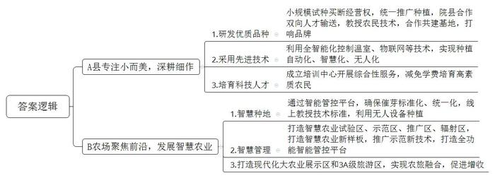
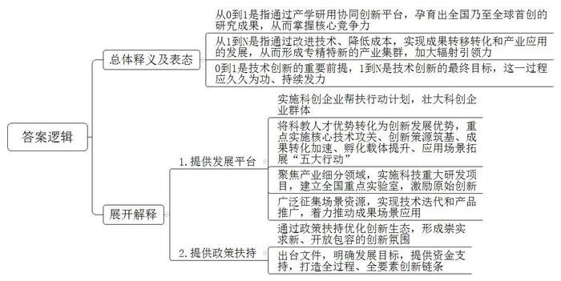
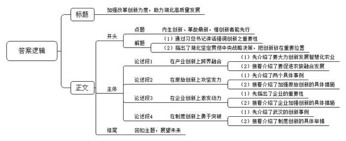

# 2024年湖北省定向、集中选调生考试《申论》题

<!-- gwy:overview:start -->
> **湖北 · 2024 · 申论 · 选调生** ｜ 3 题 · 图片 3 处 · 答案随题折叠

导航：[题目](#题目) · [材料 1](#材料-1)
<!-- gwy:overview:end -->

> 候选采集稿。参考答案及解析来自粉笔页面，不代表官方答案或真实高分答卷；来源使用许可与原卷对应关系仍需人工核实。

## 给定材料

### 材料 1

惟创新者进，惟创新者强，惟创新者胜。党的十八大以来，以习近平同志为核心的党中央坚持创新在我国现代化建设全局中的核心地位，大力推进理论创新、实践创新、制度创新、文化创新以及其他各方面创新。

党的二十大报告鲜明指出，要加快构建新发展格局，着力推动高质量发展。强调教育、科技、人才是全面建设社会主义现代化国家的基础性、战略性支撑，必须坚持科技是第一生产力、人才是第一资源、创新是第一动力，深入实施科教兴国战略、人才强国战略、创新驱动发展战略，开辟发展新领域、新赛道，不断塑造发展新动能、新优势。

湖北省第十二次党代会提出，努力建设全国构建新发展格局先行区，这是湖北深入贯彻党的二十大精神的必然要求，是湖北立足大局，将国家所需、湖北所能、群众所盼、未来所向的机会结合起来的考量。努力建设全国构建新发展格局先行区，要把创新摆在更加突出的位置，锚定科技强省目标，在原始创新上攻坚发力，在企业创新上激发动力，在产业创新上跨界融合，在制度创新上勇于突破，着力提升创新体系整体效能，塑造更多依靠创新驱动、更多发挥先发优势的引领型发展。

### 材料 2

“秋番茄”“小皇冠西瓜”“施泉葡萄”，在A县的农田里，优质品种、先进技术、科技人才不断成长，从这里飞向全国的农业品牌不胜枚举。A县不搞“大而全”，专注“小而美”，深耕细作，走出一条现代都市农业高质量发展的新路子。

2023年4月，A县成功创建首批全国农业科技现代化先行县，拿如今畅销的小皇冠西瓜来说，市农科院历经10多年成功研发皮薄肉脆的黄瓤小型瓜品种——小皇冠西瓜。然而，新品种却在瓜农和市场中遇冷。A县通过小规模试种后，率先认可小皇冠西瓜的市场价值，买断种子经营权，按照“统一品牌、包装、宣传、技术、经营”的模式，在全县推广种植小皇冠西瓜，迅速打开了市场。为了帮助瓜农掌握种植技术，农业专家走进田间地头，基层农技人员到市农科院学习先进农业技术，“院县合作”实现双向人才输送，双方还共同建立番茄研发中心、食用菌产业研究院和40个乡村振兴科技支撑基地，推动新品种、新技术、新模式惠及长三角，农科院研发基地成功试种“金蜜1号”哈密瓜，在浙江、江苏等地试种葡萄新品种，打响施泉葡萄品牌。

位于A县的某智联植物工厂，全智能化控制温室里，一株株绿油油的生菜、芝麻菜在精准配比的营养液里茁壮成长；无人驾驶自动巡检小车在苗床间巡逻拍照，运用企业自主研发的人工智能图像识别技术，记录蔬果的生长状态；人工智能物联网自动远程分析操控大棚内的温度、光照、通风等，并判断是否可采收，实现了种植自动化、智慧化、无人化，年产蔬菜达到300多吨。

近年来，A县持续开展高素质农民培育工作，累计培育高素质农民4462名，获得证书认定3908名，农业人员持证率达到91.6%。农忙时节，小梅用自己掌握的新技能配置农药、调试无人机、遥控无人机植保作业。每天从清晨5点执飞到傍晚，小梅和同事两人配合可以洒药近400亩地，而传统方式一人一天最多10亩。A县持续推动新技术应用和人才培养，在A县农业部门的支持下，成立的无人机应用培训中心开展技术培训和作业实训等综合性服务，无人机学员人均享受学费减免3000元，目前已培训无人机持证飞手5000余名。

### 材料 3

春风拂面，生机盎然。B农场总控面积1208平方公里，耕地122万亩，是全国优质粳稻种植面积最大的现代化农场之一。B农场聚焦农业前沿，大力发展科技农业、绿色农业、质量农业、品牌农业，提高农业综合效益和竞争力，奏响了“智慧农业”的奋进曲。

在B农场大型智能浸种催芽车间里，机器开始浸种，为105万亩稻田提供优质芽种。智能化育秧工厂里，全自动流水线播种一次性实现浇水、播种和覆土作业。2023年，B农场有4358.02吨水稻芽种的浸种催芽生产任务，通过智能化的管控平台，实现种子温度、喷淋速度、供水间隔时间电脑智能控制，确保催芽作业标准化、统一化，一个星期就能完成整个作业过程。“种田还得靠科技，现在摆盘、育秧的这些技术标准，农技人员都网上教学，种地也都用上了无人设备，所以现在咱们老百姓不仅仅是会种地，而且是真‘慧’种地。”农场的科技示范户小张高兴地说。

目前，B农场的大型水稻种植地块“万亩大地号”已进行全生产环节无人作业。B农场通过打造智慧农业试验区、示范区、推广区、辐射区，不断提升农业智能化水平，让这里的智慧农业成为一个新样板。B农场利用80亩农机科技园试验区，开展水稻全程智能化科研课题研究；利用1000亩无人农场示范区，开展智能装备应用示范；利用15000亩耕地，推广应用智能叶龄诊断、智能控制灌溉、无人作业等技术；推广应用卫星导航辅助直行插秧、割晒机械监测、卫星平地等实用性新技术面积达40%以上；对现有10余套平台、系统进行整合，打造一个功能全面的水稻生产智能管控平台，实现农业管理智能化。

现在的B农场，各种农作物长势喜人、生机勃勃，不仅是国家现代化大农业的展示区，还是国家3A级旅游区，越来越多的游客来这里打卡游玩，旅游收入成为农场增收的新增长点。

### 材料 4

20世纪90年代，华中科技大学因科技成果转化应运而生的高科技公司——华工科技产业股份有限公司成立，并于2000年在深圳证券交易所上市。华工激光作为华工科技的核心子公司，脱胎于华中科技大学激光加工国家工程研究中心，是国家重点高新技术企业、激光行业国际标准制定参与单位、国家标准制定的牵头组织和承担单位，承担了激光领域大部分国家重点项目和重大科技攻关项目。

华工激光作为中国高校科研成果转化的先行者，通过产学研用协同创新平台，孕育出了一批全国乃至全球首创的研究成果——我国首个半导体激光器芯片、首台高性能光纤激光器、首套工业级紫外激光器、首套激光三维远程焊接系统、首套激光拼焊设备、首条汽车白车身激光自动化焊接产线、首套全自动激光切管机、首条新能源汽车全铝车身自动化焊接产线等。

激光是制造业的“一把刀”，随着技术成熟、成本下降，能够为传统制造业带来革命性的变化，也是中国智能制造中最强的助攻。华工激光自主研制的晶圆激光切割机装备，突破了一系列关键核心技术，1小时可加工10片6英寸以上晶圆，成品率达99%，随着成果转移转化和激光应用的发展形成了专精特新的千亿元产业集群，展现了从“0”到“1”的核心竞争力和“1”到“N”的辐射引领力。

### 材料 5

2024年1月，湖北省召开科技工作会议，会议指出，2023年湖北创新驱动发展区域综合科技创新水平排名全国第7位，为近五年来最高位次，创新驱动成为现代化湖北建设的鲜明底色和强力引擎，湖北科技在全国创新版图中的地位和影响力显著提升。

2023年，湖北获批6家国家创新型产业集群，新增数量为全国第1，总量居全国第3。全省科创企业群体加速壮大，通过启动实施科创企业全生命周期培育计划、开展服务高新技术企业“春晓行动”、科技企业孵化“沃壤行动”等，2023年全省培育科创“新物种”企业1054家，光庭信息、天源环保等7家科创“新物种”企业成功上市。新获批9家国家级科技企业孵化器，总数达到84家，位列全国第5。新备案认定新型研发机构77家，总数达477家，数量继续位居全国前列。

2024年是武汉具有全国影响力的科技创新中心获批建设第3年，武汉将围绕加快把科教人才优势转化为创新发展优势，重点实施核心技术攻关、创新策源筑基、成果转化加速、孵化载体提升、应用场景拓展“五大行动”。武汉聚焦光通信、集成电路、激光等33个产业细分领域，实施10大科技重大专项，实施单北斗定位技术等100个重点研发项目。新建和优化重组一批全国重点实验室，力争到今年末总数达到34家。设立武汉市自然科学基金，激励原始创新。武汉还将在基层治理、社会民生、产业升级等方面广泛征集场景资源，为创新成果提供应用机会，帮助企业实现技术迭代和产品推广。着力推动高端医工装备、人工智能等100项成果场景应用。

### 材料 6

湖北省武汉市东湖高新区，上世纪70年代，这里还是一片荒野之地，因距离主城区较远，一度被称作武汉地图外两厘米的地方。然而数十年间，我国第一家科技企业孵化器、第一个光通信国际标准、第一款商用存储芯片、第一个400G硅光模块、全球首款128层三维闪存芯片、全球首个超高通量“火眼”实验室相继在此诞生。如今，这里已成为全球最大的光纤光缆研制基地和我国最大的激光产业基地之一，它也有了一个更为响亮的名字——“中国光谷”。

从一域的“荒地”到发展的“高地”，光谷崛起的密码是什么？答案就是“创新”。创新是光谷最亮眼的底色。内生创新、革故鼎新，惟创新者能先行。光谷从未停止过争先的脚步。更为关键的是，这里出台了一系列支持创业者遭遇“失败”后渡过难关的政策举措，打造了一种热带雨林式的创新生态，形成了一种崇实求新、开放包容的创新氛围。

2023年9月，湖北省政府印发的《加快“世界光谷”建设行动计划》提出：到2035年，具有全球影响力的“世界光谷”建成，引领武汉具有全国影响力的科技创新中心全面建成，光谷成为世界创新版图重要的一极，全球光电子信息产业地标和宜居、绿色、智慧、人文的世界知名科技新城。2024年2月，《东湖高新区关于加快世界光谷建设的政策措施》发布，该政策措施围绕建设原始创新策源地、新兴产业引领地、活力生态涵育地三个重要目标，按照“源头创新-技术攻关-成果转化-新兴产业-科技金融”等全过程、全要素创新链条，从11个方面提出30项具体支持政策，包括设立2亿元科创供应链专项资助基金；建设高端研发机构、科创学院、未来技术学院，最高支持1亿元；对培育和引进的科技领军企业或创新创业人才，最高奖励1000万元等。

## 题目

### 第 1 题

**请根据给定资料2、3，分别概括A县和B农场推进现代农业高质量发展的主要举措。（24分）**

关联材料：材料 2、材料 3

作答要求：

要求：

（1）分条列举，语言简练；

（2）内容全面、准确；

（3）字数不超过300字。

第 1 题 · 答案与解析

**参考答案（粉笔题库参考内容）**

A县专注小而美，深耕细作。1.研发优质品种。小规模试种买断经营权，统一推广种植，院县合作双向人才输送，教授农民技术，合作共建基地，打响品牌。2.采用先进技术。利用全智能化控制温室、物联网等技术，实现种植自动化、智慧化、无人化。3.培育科技人才。成立培训中心开展综合性服务，减免学费培育高素质农民。

B农场聚焦前沿，发展智慧农业。1.智慧种地。通过智能管控平台，确保催芽标准化、统一化，线上教授技术标准，利用无人设备种植。2.智慧管理。打造智慧农业试验区、示范区、推广区、辐射区，打造智慧农业新样板，推广示范新技术，打造全功能智能管控平台。3.打造现代化大农业展示区和3A级旅游区，实现农旅融合，促进增收。

**解析**

**参考答案说明：**本参考答案分为“A县”与“B农场”两个部分。其中，A县专注小而美，深耕细作，具体从“研发优质品种”“采用先进技术”“培育科技人才”三个方面展开；B农场聚焦前沿，发展智慧农业，具体从“智慧种地”“智慧管理”“农旅融合”三个方面展开。各条答案要点之间在内容上相互并列，没有交叉。

### 第 2 题

**根据给定资料4、5、6，围绕技术创新阐释从“0”到“1”和“1”到“N”的内涵。（26分）**

关联材料：材料 4、材料 5、材料 6

作答要求：

要求：

（1）观点准确，分析深刻；

（2）条理清晰，语言简练；

（3）不超过400字。

第 2 题 · 答案与解析

**参考答案（粉笔题库参考内容）**

一、从0到1是指通过产学研用协同创新平台，孕育出全国乃至全球首创的研究成果，从而掌握核心竞争力。

二、从1到N是指通过改进技术、降低成本，实现成果转移转化和产业应用的发展，从而形成专精特新的产业集群，加大辐射引领力。

三、0到1是技术创新的重要前提，1到N是技术创新的最终目标，这一过程应久久为功、持续发力。

四、具体需要：1.提供发展平台。实施科创企业帮扶行动计划，壮大科创企业群体；将科教人才优势转化为创新发展优势，重点实施核心技术攻关、创新策源筑基、成果转化加速、孵化载体提升、应用场景拓展“五大行动”；聚焦产业细分领域，实施科技重大研发项目，建立全国重点实验室，激励原始创新；广泛征集场景资源，实现技术迭代和产品推广，着力推动成果场景应用。2.提供政策扶持。通过政策扶持优化创新生态，形成崇实求新、开放包容的创新氛围；出台文件，明确发展目标，提供资金支持，打造全过程、全要素创新链条。

**解析**

**参考答案说明：**（1）思路方面，本参考答案按照词句解释题“总体释义+展开解释+总结”的一般答题思路展开。（2）内容方面，本参考答案首先对从“0”到“1”和“1”到“N”的内涵作出了解释，并进行了表态，符合题目要求的“观点准确”；然后分别从“提供发展平台”与“提供政策扶持”两个方面进行展开解释。（3）词句表达方面，本参考答案加上了“是指”“具体需要”等连接词来承接上下文，使上下衔接更顺畅。

### 第 3 题

**结合给定资料和湖北实际，围绕“内生创新、革故鼎新，惟创新者能先行”这一主题自拟题目，写一篇策论文。（50分）**

关联材料：材料 1、材料 2、材料 3、材料 4、材料 5、材料 6

作答要求：

要求：

（1）观点明确、内容充实，结构严谨，语言流畅；

（2）见解深刻，对策有据；

（3）字数800字。

第 3 题 · 答案与解析

**参考答案（粉笔题库参考内容）**

**加强改革创新力度，助力湖北高质量发展**

习近平总书记强调：“惟创新者进，惟创新者强，惟创新者胜。”从党的十八大坚持创新在现代化建设全局中的核心地位，到二十大指出要加快构建新发展格局，湖北深刻领会党中央战略意图，将国家所需、湖北所能、群众所盼、未来所向结合起来，把创新摆在更加突出的位置。

**在产业创新上跨界融合。**从资源要素看，湖北是农业大省，要加快农业创新智能化，利用卫星导航、人工智能图像识别等技术，实现农业自动化、智慧化、无人化；其次探索农旅融合互促化，推动乡村文旅同生态农业、加工贸易、休闲服务等深度融合，打造生态农业观光园等旅游新业态，提升附加值。

**在原始创新上攻坚发力。**华工激光自主研制的晶圆激光切割机装备，展现了从“0”到“1”的突破；中建材玻璃工业研发攻关，实现了世界超薄电子触控玻璃的量产……要强化高校、科研院所的研发产出力量，打造产学研用协同创新平台，新建优化重组全国重点实验室，设立基金，积极推进高校科研成果转化，激励原始创新。

**在企业创新上激发动力。**企业作为创新的主体，活跃在经济主战场最前沿。一方面要加速科创企业群体壮大，打造创新型产业集群，做好科创企业全生命周期培育计划；另一方面要加强以企业为主导的产学研融通创新，在创新策源筑基、孵化载体提升等方面发力，帮助企业实现技术迭代和产品推广。

**在制度创新上勇于突破。**从一域“荒地”到发展“高地”，武汉的“中国光谷”，靠的是崇实求新、开放包容的创新氛围，依的是一系列支持创业者渡过难关的政策举措；还要在项目重要节点或者实现新突破时，重奖科技人才，只有利益共享、风险共担，才能支撑大家勇攀高峰。

先行一步，走在前面，奋力攀高，是为“先行”。汇聚奋斗者的足迹，凝聚追梦者的心气，脚踏实地、久久为功，一定能让湖北脚下这片创新发展的土地变得热气腾腾！

**文章分析**

**加强改革创新力度，助力湖北高质量发展**

【**标题的优点：**标题中含有主题词，使文章主题更突出、清晰。】

（1）习近平总书记强调：“<u><u>惟创新者进</u></u>，<u><u>惟创新者强</u></u>，<u><u>惟创新者胜</u></u>。”（2）从党的十八大坚持创新在现代化建设全局中的核心地位，到二十大指出要加快构建新发展格局，<u><u>湖北深刻领会党中央战略意图</u></u>，<u><u>将国家所需、湖北所能、群众所盼、未来所向结合起来</u></u>，<u><u>把创新摆在更加突出的位置</u></u>。

【**开头的优点：**★内容方面。范文的开头是紧扣题目给定的“内生创新、革故鼎新，惟创新者能先行”这一主题展开的。一方面，通过习总书记讲话强调创新之重要性；另一方面，指出了湖北坚定贯彻中央战略决策，把创新放在重要位置。★文字表达方面。使用了排比的修辞方法，增强了表述的气势与节奏感。】

**在产业创新上跨界融合。**（1）<u><u>从</u></u><u><u>资源要素看</u></u>，湖北是农业大省，要<u><u>加快农业创新智能化</u></u>，<u><u>利用卫星导航、人工智能图像识别等技术</u></u>，<u><u>实现农业自动化、智慧化、无人化</u></u>；（2）其次<u><u>探索农旅融合互促化</u></u>，<u><u>推动乡村文旅同生态农业、加工贸易、休闲服务等深度融合</u></u>，<u><u>打造生态农业观光园等旅游新业态</u></u>，<u><u>提升附加值</u></u>。

【**论述段1的优点：**★观点句：范文的观点句是紧扣“内生创新、革故鼎新，惟创新者能先行”这一文章主题提出的。形式上，它在段首处直接写出，位置突出，容易发现。内容上，关键词突出，内容要点明确，可以明显看出主要论述“产业跨界融合”。★论述内容：（1）先介绍了要大力创新发展智慧化农业；（2）接着介绍了要促进农旅融合发展。注意：以上两个方面的内容都是紧扣“在产业创新上跨界融合”这个观点句进行分析论述的，论述的针对性强，内容层次丰富。在论述方法上主要采用了讲道理的方式，论述清晰透彻。】

**在原始创新上攻坚发力。**（1）<u><u>华工激光自主研制的晶圆激光切割机装备</u></u>，展现了从“0”到“1”的突破；<u><u>中建材玻璃工业研发攻关</u></u>，实现了世界超薄电子触控玻璃的量产……（2）<u><u>要强化高校、科研院所的研发产出力量</u></u>，<u><u>打造产学研用协同创新平台</u></u>，<u><u>新建优化重组全国重点实验室</u></u>，<u><u>设立基金</u></u>，<u><u>积极推进高校科研成果转化</u></u>，<u><u>激励原始创新</u></u>。

【**论述段2的优点：**★观点句：范文的观点句是紧扣“内生创新、革故鼎新，惟创新者能先行”这一文章主题提出的。形式上，它在段首处直接写出，位置突出，容易发现。内容上，关键词突出，内容要点明确，可以明显看出主要论述“原始创新”。★论述内容：（1）先介绍了两个具体事例；（2）接着介绍了加强原始创新的具体措施。注意：以上两个方面的内容都是紧扣“在原始创新上攻坚发力”这个观点句进行分析论述的，论述的针对性强，内容层次丰富。在论述方法上主要采用了举例子、讲道理的相结合方式，论述有理有据。】

**在企业创新上激发动力。**（1）<u><u>企</u></u><u><u>业作为创新的主体</u></u>，<u><u>活跃在经济主战场最前沿</u></u>。（2）一方面<u><u>要加速科创企业群体壮大</u></u>，<u><u>打造创新型产业集群</u></u>，<u><u>做好科创企业全生命周期培育计划</u></u>；另一方面<u><u>要加强以企业为主导的产学研融通创新</u></u>，<u><u>在创新策源筑基、孵化载体提升等方面发力</u></u>，<u><u>帮助企业实现技术迭代和产品推广</u></u>。

【**论述段3的优点：**★观点句：范文的观点句是紧扣“内生创新、革故鼎新，惟创新者能先行”这一文章主题提出的。形式上，它在段首处直接写出，位置突出，容易发现。内容上，关键词突出，内容要点明确，可以明显看出主要论述“企业创新”。★论述内容：（1）先指出了企业的重要性；（2）接着介绍了企业加强创新的具体措施。注意：以上两个方面的内容都是紧扣“在企业创新上激发动力”这个观点句进行分析论述的，论述的针对性强，内容层次丰富。在论述方法上主要采用了讲道理的方式，论述清晰透彻。】

**在制度创新上勇于突破。**（1）从一域“荒地”到发展“高地”，<u><u><u>武汉的</u></u></u><u><u><u>“中国光谷”</u></u></u>，<u><u>靠的是崇实求新、开放包容的创新氛围</u></u>，<u><u>依的是一系列支持创业者渡过难关的政策举措</u></u>；（2）还<u><u>要在项目重要节点或者实现新突破时</u></u>，<u><u>重奖科技人才</u></u>，<u><u>只有利益共享、风险共担</u></u>，<u><u>才能支撑大家勇攀高峰</u></u>。

【**论述段4的优点：**★观点句：范文的观点句是紧扣“内生创新、革故鼎新，惟创新者能先行”这一文章主题提出的。形式上，它在段首处直接写出，位置突出，容易发现。内容上，关键词突出，内容要点明确，可以明显看出主要论述“制度创新”。★论述内容：（1）先介绍了武汉的创新事例；（2）接着介绍了制度创新的具体举措。注意：以上两个方面的内容都是紧扣“在制度创新上勇于突破”这个观点句进行分析论述的，论述的针对性强，内容层次丰富。在论述方法上主要采用了举例子、讲道理的相结合方式，论述有理有据。】

【**论述段之间的关系：**★内容的内在逻辑：范文的论述段之间是并列关系，先介绍了“在产业创新上跨界融合”，再介绍了“在原始创新上攻坚发力”，接着介绍了“在企业创新上激发动力”，最后介绍了“在制度创新上勇于突破”。】

先行一步，走在前面，奋力攀高，是为“先行”。汇聚奋斗者的足迹，凝聚追梦者的心气，脚踏实地、久久为功，一定能让湖北脚下这片创新发展的土地变得热气腾腾！

【**结尾的优点：**范文的结尾回扣了“内生创新、革故鼎新，惟创新者能先行”这个主题，并且进行了总结升华。】

**解析状态：unknown（来源未提供）**

