# 2024年湖北省选调生招录考试综合知识和行政职业能力测验试卷（网友回忆版）

<!-- gwy:overview:start -->
> **湖北 · 2024 · 行测 · 选调生** ｜ 100 题 · 图片 17 处 · 答案随题折叠

| 题型模块 | 题量 | 题号 |
| --- | ---: | ---: |
| 综合知识 | 32 | 1–32 |
| 常识判断 | 8 | 33–40 |
| 言语理解与表达 | 12 | 41–52 |
| 数量关系 | 10 | 53–62 |
| 判断推理 | 23 | 63–85 |
| 资料分析 | 15 | 86–100 |
| **合计** | **100** | |

导航：[题型与作答说明](#题型与作答说明) · [题目](#题目) · [材料 1](#材料-1)
<!-- gwy:overview:end -->

> 候选采集稿。参考答案及解析来自粉笔页面，不代表官方答案或真实高分答卷；来源使用许可与原卷对应关系仍需人工核实。

## 题型与作答说明

综合知识

（32题）

根据题目要求，在四个选项中选出一个最恰当的答案。

常识判断

（8题）

根据题目要求，在四个选项中选出一个最恰当的答案。

言语理解与表达

（12题）

本部分包括表达与理解两方面的内容。请根据题目要求，在四个选项中选出一个最恰当的答案。

数量关系

（10题）

在这部分试题中，每道题呈现一段表述数字关系的文字，要求你迅速、准确地计算出答案。

判断推理

（23题）

本部分包括图形推理、定义判断、类比推理与逻辑判断四种类型的试题，在四个选项中选出一个最恰当的答案。

资料分析

（15题）

所给出的图、表、文字或综合性资料均有若干个问题要你回答。你应根据资料提供的信息进行分析、比较、计算和判断处理。

## 题目

### 第 1 题

2023年12月，习近平总书记在中共中央政治局专题民主生活会上指出，团结奋斗是党领导人民创造历史伟业的必由之路。团结奋斗要靠目标凝心聚力，新征程上我们就要靠（ ）进一步凝心聚力、团结奋斗。

A. 推进强国建设

B. 经济结构转型

C. 中国式现代化

D. 以人民为中心

第 1 题 · 答案与解析

**参考答案（粉笔题库参考内容）**

C

**解析**

本题考查政治常识。

C项正确，A、B、D三项错误，2023年12月21日至22日，中共中央政治局召开学习贯彻习近平新时代中国特色社会主义思想主题教育专题民主生活会，习近平总书记主持会议并发表重要讲话。习近平总书记指出：“团结奋斗是党领导人民创造历史伟业的必由之路。团结奋斗要靠目标凝心聚力，新征程上我们就要靠中国式现代化进一步凝心聚力、团结奋斗。中国式现代化是全体人民的共同事业，也是一项充满风险挑战、需要付出艰辛努力的宏伟事业，必须坚持全体人民共同参与、共同建设、共同享有，紧紧依靠全体人民和衷共济、共襄大业······”

故正确答案为C。

**考点**：重要会议讲话、其他建设

**来源**：2024年湖北省选调生招录考试综合知识和行政职业能力测验试卷（网友回忆版）第1题

### 第 2 题

2023年中央经济工作会议强调，2024年经济工作要坚持稳中求进、以进促稳、（ ），多出有利于稳预期、稳增长、稳就业的政策，在转方式、调结构、提质量、增效益上积极进取，不断巩固稳中向好的基础。

A. 先立后破

B. 创新发展

C. 转换动能

D. 提质增效

第 2 题 · 答案与解析

**参考答案（粉笔题库参考内容）**

A

**解析**

本题考查政治常识。

A项正确，B、C、D三项错误，2023年12月11日至12日，2023年中央经济工作会议在北京举行。会议要求，明年要坚持稳中求进、以进促稳、先立后破，多出有利于稳预期、稳增长、稳就业的政策，在转方式、调结构、提质量、增效益上积极进取，不断巩固稳中向好的基础。要强化宏观政策逆周期和跨周期调节，继续实施积极的财政政策和稳健的货币政策，加强政策工具创新和协调配合。

故正确答案为A。

**考点**：经济建设、重要会议讲话

**来源**：2024年湖北省选调生招录考试综合知识和行政职业能力测验试卷（网友回忆版）第2题

### 第 3 题

2024年1月8日，习近平总书记在中国共产党第二十届中央纪律检查委员会第三次全体会议上指出，要深化改革阻断腐败滋生蔓延。腐败的本质是（ ）。要抓住定政策、作决策、审批监管等关键权力，聚焦重点领域深化体制机制改革，加快新兴领域治理机制建设，完善权力配置和运行制约机制，进一步堵塞制度漏洞，规范自由裁量权，减少设租寻租机会。

A. 缺乏监督

B. 权力滥用

C. 权力寻租

D. 监管缺失

第 3 题 · 答案与解析

**参考答案（粉笔题库参考内容）**

B

**解析**

本题考查政治常识。

B项正确，A、C、D三项错误，2024年1月8日，习近平总书记在中国共产党第二十届中央纪律检查委员会第三次全体会议上指出：“要深化改革阻断腐败滋生蔓延。腐败的本质是权力滥用。要抓住定政策、作决策、审批监管等关键权力，聚焦重点领域深化体制机制改革，加快新兴领域治理机制建设，完善权力配置和运行制约机制，进一步堵塞制度漏洞，规范自由裁量权，减少设租寻租机会。”

故正确答案为B。

**考点**：重要会议讲话、其他建设

**来源**：2024年湖北省选调生招录考试综合知识和行政职业能力测验试卷（网友回忆版）第3题

### 第 4 题

2024年1月19日，“（ ）奖”首次评选表彰之际，习近平总书记强调，面向未来，要进一步加大工程技术人才自主培养力度，不断提高工程师的社会地位，为他们成才建功创造条件，营造见贤思齐、埋头苦干、攻坚克难、创新争先的浓厚氛围，加快建设规模宏大的卓越工程师队伍。

A. 大国工匠

B. 能工巧匠

C. 国家工程师

D. 卓越工程师

第 4 题 · 答案与解析

**参考答案（粉笔题库参考内容）**

C

**解析**

本题考查政治常识。

C项正确，A、B、D三项错误，2024年1月19日，在“国家工程师奖”首次评选表彰之际，中共中央总书记、国家主席、中央军委主席习近平作出重要指示，向受表彰的“国家卓越工程师”和“国家卓越工程师团队”致以热烈祝贺。习近平总书记强调，面向未来，要进一步加大工程技术人才自主培养力度，不断提高工程师的社会地位，为他们成才建功创造条件，营造见贤思齐、埋头苦干、攻坚克难、创新争先的浓厚氛围，加快建设规模宏大的卓越工程师队伍。

故正确答案为C。

**考点**：重要会议讲话、其他建设

**来源**：2024年湖北省选调生招录考试综合知识和行政职业能力测验试卷（网友回忆版）第4题

### 第 5 题

2024年1月31日，习近平总书记在主持中共中央政治局就扎实推进高质量发展进行第十一次集体学习时强调，必须牢记高质量发展是新时代的硬道理，全面贯彻新发展理念，把加快建设现代化经济体系、推进高水平科技自立自强、加快构建新发展格局、统筹推进深层次改革和高水平开放、统筹高质量发展和高水平安全等战略任务落实到位，完善推动高质量发展的（ ）体系，为推动高质量发展打牢基础。

A. 考核评价

B. 调查研究

C. 贯彻执行

D. 决策规划

第 5 题 · 答案与解析

**参考答案（粉笔题库参考内容）**

A

**解析**

本题考查政治常识。

A项正确，B、C、D三项错误，2024年1月31日，习近平总书记在主持中共中央政治局就扎实推进高质量发展进行第十一次集体学习时强调，必须牢记高质量发展是新时代的硬道理，全面贯彻新发展理念，把加快建设现代化经济体系、推进高水平科技自立自强、加快构建新发展格局、统筹推进深层次改革和高水平开放、统筹高质量发展和高水平安全等战略任务落实到位，完善推动高质量发展的考核评价体系，为推动高质量发展打牢基础。

故正确答案为A。

**考点**：经济建设、重要会议讲话

**来源**：2024年湖北省选调生招录考试综合知识和行政职业能力测验试卷（网友回忆版）第5题

### 第 6 题

2024年2月19日，习近平总书记在主持召开中央全面深化改革委员会第四次会议时强调，促进经济社会发展（ ）转型是解决资源环境生态问题的基础之策，要坚持全面转型、协同转型、创新转型、安全转型，以“双碳”工作为引领，协同推进降碳、减污、扩绿、增长，把绿色发展理念贯穿于经济社会发展全过程各方面。

A. 全面绿色

B. 绿色低碳

C. 节能降耗

D. 低碳环保

第 6 题 · 答案与解析

**参考答案（粉笔题库参考内容）**

A

**解析**

本题考查政治常识。

A项正确，B、C、D三项错误，2024年2月19日，习近平总书记在主持召开中央全面深化改革委员会第四次会议时强调，要建立健全同宏观政策、区域发展更加高效衔接的土地管理制度，提高土地要素配置精准性和利用效率，推动形成主体功能约束有效、国土开发协调有序的空间发展格局，增强土地要素对优势地区高质量发展保障能力。促进经济社会发展全面绿色转型是解决资源环境生态问题的基础之策，要坚持全面转型、协同转型、创新转型、安全转型，以“双碳”工作为引领，协同推进降碳、减污、扩绿、增长，把绿色发展理念贯穿于经济社会发展全过程各方面。

故正确答案为A。

**考点**：经济建设、重要会议讲话

**来源**：2024年湖北省选调生招录考试综合知识和行政职业能力测验试卷（网友回忆版）第6题

### 第 7 题

习近平总书记在党的二十大报告中明确提出“六个必须坚持”，即必须坚持人民至上、必须坚持自信自立、必须坚持守正创新、必须坚持问题导向、必须坚持系统观念、必须坚持胸怀天下。“六个必须坚持”深刻彰显了习近平新时代中国特色社会主义思想的（ ），以及贯穿其中的立场观点方法，为中国共产党团结带领中国人民认识世界和改造世界提供了强大思想武器。

A. 时代性和科学性

B. 世界观和方法论

C. 世界观和价值观

D. 认识论和方法论

第 7 题 · 答案与解析

**参考答案（粉笔题库参考内容）**

B

**解析**

本题考查政治常识。

习近平总书记在党的二十大报告中明确提出“六个必须坚持”，即必须坚持人民至上、必须坚持自信自立、必须坚持守正创新、必须坚持问题导向、必须坚持系统观念、必须坚持胸怀天下。“六个必须坚持”是一个逻辑严密、有机统一的整体，深刻彰显了习近平新时代中国特色社会主义思想的世界观、方法论和贯穿其中的立场观点方法，为中国共产党团结带领中国人民认识世界和改造世界提供了强大思想武器。

故正确答案为B。

**考点**：新思想总论

**来源**：2024年湖北省选调生招录考试综合知识和行政职业能力测验试卷（网友回忆版）第7题

### 第 8 题

在一篇序言中，习近平总书记曾写道：“几年下来，我几乎跑遍了浙江的山山水水，也跑深了与浙江广大干部群众的真切感情，并在实践中逐渐跑透了浙江的省情市情县情。”上述字里行间蕴含的哲理是（ ）。

A. 实践是认识的来源

B. 实践是认识的目的

C. 实践具有直接现实性

D. 实践是检验真理的唯一标准

第 8 题 · 答案与解析

**参考答案（粉笔题库参考内容）**

A

**解析**

本题考查政治常识。

A项正确，习近平总书记对浙江省情市情县情的熟悉是从“几乎跑遍了浙江的山山水水”中得到的，这来自于他的直接经验，体现了实践是认识的来源。

B项错误，实践是认识的目的体现了人们认识世界的目的在于改造世界。人们通过实践，达到对客观世界的正确认识，然后用这种认识指导实践，实现对客观世界的改造，以满足人们的需要。与题意无关。

C项错误，实践的直接现实性是指实践是改造世界的客观物质活动，实践能够引起客观世界的某种变化，可以把人脑中观念的存在变成现实的存在，给人们提供现实的成果。与题意无关。

D项错误，人们从实践中获得的对客观世界的认识，是否与客观对象相符合、相一致，是否正确地反映了客观事物的本质及其规律，必须通过实践的检验才能得到证明，唯有实践才是检验认识真理性的标准。与题意无关。

故正确答案为A。

**考点**：认识论

**来源**：2024年湖北省选调生招录考试综合知识和行政职业能力测验试卷（网友回忆版）第8题

### 第 9 题

习近平总书记指出，新时代中国特色社会主义思想内容涵盖改革发展稳定、内政外交国防、治党治国治军等方方面面，构成一个完整的科学体系。党的二十大报告明确指出，“十个明确”“十四个坚持”“十三个方面成就”概括了这一思想的主要内容。我们既要全面系统地学习掌握这些主要内容，又要整体把握这一思想的科学体系，做到融会贯通。对各领域提出的新理念、新思想、新战略，对各方面工作提出的具体要求，都要放在整个科学体系中来认识和把握，避免碎片化、片面性，不能只见树木、不见森林。就哲学方法论而言，以上论述要求我们运用（ ），学习贯彻习近平新时代中国特色社会主义思想。

A. 历史唯物主义这一伟大认识工具

B. 既见树木又见森林的融会贯通法

C. 联系、发展、全面和系统的方法

D. 理论联系实际的马克思主义学风

第 9 题 · 答案与解析

**参考答案（粉笔题库参考内容）**

C

**解析**

本题考查政治常识。

A项错误，历史唯物主义是马克思主义哲学中关于人类社会发展一般规律的理论，是科学的社会历史观和认识、改造社会的科学方法论。与题意无关。

B项错误，“既见树木又见森林”指既要看到局部的事物，又要看到整体的情况。这是题干表述内容的其中一个方面，且其表述方式不符合“哲学原理”的要求。

C项正确，联系、发展、全面和系统的方法符合马克思主义哲学中辩证法的要求，强调要用联系、发展的观点看问题，并需要获得对事物全面、透彻的理解。

D项错误，理论联系实际的马克思主义学风，是马克思主义“活的灵魂”，是中国共产党的三大优良作风之一，是我们党长期革命和建设实践中确立的思想路线。与题意无关。

故正确答案为C。

**考点**：唯物辩证法

**来源**：2024年湖北省选调生招录考试综合知识和行政职业能力测验试卷（网友回忆版）第9题

### 第 10 题

历史唯物主义关于物质生产劳动的原理指出，物质生产劳动是人类生活的第一个基本条件，是人和人类社会存在和发展的基础，也是人和人类社会发展的最根本动力。任何一个民族，如果停止劳动，不用说一年，就是几个星期，也要灭亡。以下表述体现了上述原理的是（ ）。

①劳动，是马克思主义的重要理论范畴和基本观点

②人世间的美好梦想，只有通过劳动才能实现

③发展中的各种难题，只有通过劳动才能破解

④生命里的一切辉煌，只有通过劳动才能铸就

A. ①②③

B. ①②④

C. ①③④

D. ②③④

第 10 题 · 答案与解析

**参考答案（粉笔题库参考内容）**

D

**解析**

本题考查政治常识。

①错误，马克思主义的基本观点是实践的观点。实践是人类能动地改造世界的客观物质活动。实践活动的基本特点包括：客观物质性、主观能动性和社会历史性。

②③④正确，马克思主义劳动观的核心观点是劳动创造了人和人类社会。马克思认为，劳动不仅是人类满足生存需求的过程，也是人类发展的基础。因而，无论是人世间的美好梦想还是发展中的各种难题、生命里的一切辉煌，都需要通过劳动来实现和解决。

故正确答案为D。

**考点**：唯物史观

**来源**：2024年湖北省选调生招录考试综合知识和行政职业能力测验试卷（网友回忆版）第10题

### 第 11 题

人们在生活实践中，不仅存在主观符合客观的问题，而且存在按照主体的需要认识世界和改造世界的问题。这属于（ ）。

A. 真理和价值的关系问题

B. 价值和判断的关系问题

C. 社会实践与社会意识的关系问题

D. 主观认识对客观世界的能动性问题

第 11 题 · 答案与解析

**参考答案（粉笔题库参考内容）**

A

**解析**

本题考查马克思主义。

A项正确，题干中“主观符合客观”体现的是真理问题，真理强调认识与客观对象的一致性；“按照主体的需要认识世界和改造世界”体现的是价值问题，价值关注客体对主体需求的满足程度。二者共同构成了真理和价值的关系问题。

B项错误，“价值和判断的关系问题”表述片面，未涵盖“主观符合客观”的真理层面。

C项错误，“社会实践与社会意识的关系问题”侧重社会领域的实践与意识互动，与题干核心不符。

D项错误，“主观认识对客观世界的能动性问题”仅强调主观能动性，未体现真理与价值的辩证关系。

故正确答案为A。

**考点**：唯物论

**来源**：2024年湖北省选调生招录考试综合知识和行政职业能力测验试卷（网友回忆版）第11题

### 第 12 题

2023年12月，习近平总书记对“三农”工作作出重要指示，要提升乡村（ ）水平、乡村建设水平、乡村治理水平，强化农民增收举措，推进乡村全面振兴不断取得实质性进展、阶段性成果。

A. 产业发展

B. 生态文明

C. 经济发展

D. 组织振兴

第 12 题 · 答案与解析

**参考答案（粉笔题库参考内容）**

A

**解析**

本题考查政治常识。

A项正确，B、C、D三项错误，中央农村工作会议于2023年12月19日至20日在北京召开。中共中央总书记、国家主席、中央军委主席习近平对“三农”工作作出重要指示。习近平总书记指出：“2023年，我们克服较为严重的自然灾害等多重不利影响，粮食产量再创历史新高，农民收入较快增长，农村社会和谐稳定。推进中国式现代化，必须坚持不懈夯实农业基础，推进乡村全面振兴。······要确保不发生规模性返贫，抓好防止返贫监测，落实帮扶措施，增强内生动力，持续巩固拓展脱贫攻坚成果。要提升乡村产业发展水平、乡村建设水平、乡村治理水平，强化农民增收举措，推进乡村全面振兴不断取得实质性进展、阶段性成果。”

故正确答案为A。

**考点**：经济建设、重要会议讲话

**来源**：2024年湖北省选调生招录考试综合知识和行政职业能力测验试卷（网友回忆版）第12题

### 第 13 题

2024年中央一号文件《中共中央 国务院关于学习运用“千村示范、万村整治”工程经验有力有效推进乡村全面振兴的意见》提出，要学习运用“千万工程”蕴含的发展理念、（ ）和推进机制，把推进乡村全面振兴作为新时代新征程“三农”工作的总抓手，坚持以人民为中心的发展思想，完整、准确、全面贯彻新发展理念，因地制宜、分类施策，循序渐进、久久为功，集中力量抓好办成一批群众可感可及的实事，不断取得实质性进展、阶段性成果。

A. 创新精神

B. 工作方法

C. 实践经验

D. 为民情怀

第 13 题 · 答案与解析

**参考答案（粉笔题库参考内容）**

B

**解析**

本题考查政治常识。

B项正确，A、C、D三项错误，《中共中央 国务院关于学习运用“千村示范、万村整治”工程经验有力有效推进乡村全面振兴的意见》指出，推进中国式现代化，必须坚持不懈夯实农业基础，推进乡村全面振兴。习近平总书记在浙江工作时亲自谋划推动“千村示范、万村整治”工程（以下简称“千万工程”），从农村环境整治入手，由点及面、迭代升级，20年持续努力造就了万千美丽乡村，造福了万千农民群众，创造了推进乡村全面振兴的成功经验和实践范例。要学习运用“千万工程”蕴含的发展理念、工作方法和推进机制，把推进乡村全面振兴作为新时代新征程“三农”工作的总抓手······

故正确答案为B。

**考点**：经济建设、重要文件

**来源**：2024年湖北省选调生招录考试综合知识和行政职业能力测验试卷（网友回忆版）第13题

### 第 14 题

2024年，“三农”工作将聚焦“两确保、三提升、两强化”，抓好落实。“两确保”，即确保国家粮食安全、确保（ ）。

A. 农民增收

B. 农产品价格稳定

C. 守住耕地保护红线

D. 不发生规模性返贫

第 14 题 · 答案与解析

**参考答案（粉笔题库参考内容）**

D

**解析**

本题考查政治常识。

A、B、C三项错误，D项正确，“两确保”，就是确保国家粮食安全、确保不发生规模性返贫；“三提升”，就是提升乡村产业发展水平、提升乡村建设水平、提升乡村治理水平；“两强化”，就是强化科技和改革双轮驱动、强化农民增收举措。

故正确答案为D。

**考点**：经济建设、重要文件

**来源**：2024年湖北省选调生招录考试综合知识和行政职业能力测验试卷（网友回忆版）第14题

### 第 15 题

根据《乡村振兴责任制实施办法》，乡镇党委和政府应当把乡村振兴作为中心任务，发挥基层基础作用，健全统一指挥和统筹协调机制，“（ ）”加强精准指导服务，组织编制村庄规划，抓好乡村振兴资金项目落地、重点任务落实。

A. 一镇一策

B. 分类施策

C. 综合施策

D. 一村一策

第 15 题 · 答案与解析

**参考答案（粉笔题库参考内容）**

D

**解析**

本题考查政治常识。

D项正确，A、B、C三项错误，《乡村振兴责任制实施办法》第十二条指出：“乡镇党委和政府应当把乡村振兴作为中心任务，发挥基层基础作用，健全统一指挥和统筹协调机制，‘一村一策’加强精准指导服务，组织编制村庄规划，抓好乡村振兴资金项目落地、重点任务落实。”

故正确答案为D。

**考点**：经济建设

**来源**：2024年湖北省选调生招录考试综合知识和行政职业能力测验试卷（网友回忆版）第15题

### 第 16 题

习近平总书记强调，粮食安全是战略问题。我国是人口众多的大国，无论社会现代化程度有多高，解决好吃饭问题，始终是（ ）的头等大事。

A. 稳定大局

B. 治国理政

C. 经济发展

D. 社会进步

第 16 题 · 答案与解析

**参考答案（粉笔题库参考内容）**

B

**解析**

本题考查政治常识。

B项正确，A、C、D三项错误，2013年12月23日至24日，中央农村工作会议在北京举行。关于确保我国粮食安全，会议指出，我国是个人口众多的大国，解决好吃饭问题，始终是治国理政的头等大事。要坚持以我为主，立足国内、确保产能、适度进口、科技支撑的国家粮食安全战略。中国人的饭碗任何时候都要牢牢端在自己手上。

故正确答案为B。

**考点**：经济建设

**来源**：2024年湖北省选调生招录考试综合知识和行政职业能力测验试卷（网友回忆版）第16题

### 第 17 题

习近平总书记强调，要像保护大熊猫那样保护耕地，严防死守十八亿亩耕地红线。要实行最严格的耕地保护制度，采取更有力的措施，严格保护耕地特别是基本农田，加强用途管制，规范占补平衡，强化土地流转用途监管，推进撂荒地利用，坚决遏制耕地“（ ）”、基本农田“非粮化”。

A. 非耕化

B. 非田化

C. 非农化

D. 非种化

第 17 题 · 答案与解析

**参考答案（粉笔题库参考内容）**

C

**解析**

本题考查政治常识。

C项正确，A、B、D三项错误，2022年3月6日，习近平总书记在看望参加全国政协十三届五次会议的农业界、社会福利和社会保障界委员时的讲话中指出，农田就是农田，只能用来发展种植业特别是粮食生产，要落实最严格的耕地保护制度，加强用途管制，规范占补平衡，强化土地流转用途监管，推进撂荒地利用，坚决遏制耕地“非农化”、基本农田“非粮化”。

故正确答案为C。

**考点**：经济建设

**来源**：2024年湖北省选调生招录考试综合知识和行政职业能力测验试卷（网友回忆版）第17题

### 第 18 题

2024年中央一号文件要求，严格落实耕地保护制度。健全耕地数量、质量、（ ）“三位一体”保护制度体系，落实新一轮国土空间规划明确的耕地和永久基本农田保护任务。

A. 生态

B. 环保

C. 节能

D. 绿色

第 18 题 · 答案与解析

**参考答案（粉笔题库参考内容）**

A

**解析**

本题考查政治常识。

A项正确，B、C、D三项错误，2024年中央一号文件“一、确保国家粮食安全”中指出：“（二）严格落实耕地保护制度。健全耕地数量、质量、生态‘三位一体’保护制度体系，落实新一轮国土空间规划明确的耕地和永久基本农田保护任务。改革完善耕地占补平衡制度，坚持‘以补定占’，将省域内稳定利用耕地净增加量作为下年度非农建设允许占用耕地规模上限······”

故正确答案为A。

**考点**：经济建设、重要文件

**来源**：2024年湖北省选调生招录考试综合知识和行政职业能力测验试卷（网友回忆版）第18题

### 第 19 题

2024年中央一号文件提出，优化县域产业结构和空间布局，构建以县城为枢纽、以（ ）为节点的县域经济体系，扩大县域就业容量。

A. 乡镇

B. 乡域

C. 小城镇

D. 中心村

第 19 题 · 答案与解析

**参考答案（粉笔题库参考内容）**

C

**解析**

本题考查政治常识。

A、B、D三项错误，C项正确，2024年中央一号文件《中共中央 国务院关于学习运用“千村示范、万村整治”工程经验有力有效推进乡村全面振兴的意见》在“四、提升乡村建设水平”部分指出：“（二十）促进县域城乡融合发展。统筹新型城镇化和乡村全面振兴，提升县城综合承载能力和治理能力，促进县乡村功能衔接互补、资源要素优化配置。优化县域产业结构和空间布局，构建以县城为枢纽、以小城镇为节点的县域经济体系，扩大县域就业容量。统筹县域城乡基础设施规划建设管护，推进城乡学校共同体、紧密型县域医共体建设。实施新一轮农业转移人口市民化行动，鼓励有条件的县（市、区）将城镇常住人口全部纳入住房保障政策范围。”

故正确答案为C。

**考点**：经济建设、重要文件

**来源**：2024年湖北省选调生招录考试综合知识和行政职业能力测验试卷（网友回忆版）第19题

### 第 20 题

2024年1月，湖北省政府工作报告指出，要强化粮食和重要农产品稳产保供。守牢耕地保护红线和粮食安全防线，新建高标准农田150万亩以上，实施新一轮粮食（ ）提升行动，支持公安、沙洋等县市创建国家（ ）大县，让荆楚粮仓更加盈实。

A. 产量 百强粮食

B. 增产 重点产粮

C. 产能 超级产粮

D. 安全 粮食生产

第 20 题 · 答案与解析

**参考答案（粉笔题库参考内容）**

C

**解析**

本题考查政治常识。

A、B、D三项错误，C项正确，2024年湖北省政府工作报告“二、2024年工作思路和重点任务”部分指出：“（六）聚焦推进乡村全面振兴，加快农业农村现代化。坚持农业农村优先发展，学习运用‘千村示范、万村整治’工程经验，促进农业更高效、农村更美丽、农民更富裕。强化粮食和重要农产品稳产保供。守牢耕地保护红线和粮食安全防线，新建高标准农田150万亩以上，实施新一轮粮食产能提升行动，支持公安、沙洋等县市创建国家超级产粮大县，增强生猪、油料、淡水产品等基础生产能力，让荆楚粮仓更加盈实、鱼米之乡更加丰饶。”

故正确答案为C。

**考点**：经济建设、重要文件

**来源**：2024年湖北省选调生招录考试综合知识和行政职业能力测验试卷（网友回忆版）第20题

### 第 21 题

根据2024年3月1日施行的《中华人民共和国刑法修正案（十二）》，以下情形可按照行贿罪减轻或者免除处罚的是（ ）。

A. 将违法所得用于行贿的

B. 多次行贿或者向多人行贿的

C. 为谋取职务、职级晋升、调整行贿的

D. 犯罪较轻，对侦破重大案件起关键作用的

第 21 题 · 答案与解析

**参考答案（粉笔题库参考内容）**

D

**解析**

本题考查法律常识。

A、B、C三项错误，根据《中华人民共和国刑法》第三百九十条第二款规定：“有下列情形之一的，从重处罚：（一）多次行贿或者向多人行贿的······（四）为谋取职务、职级晋升、调整行贿的······（七）将违法所得用于行贿的。”

D项正确，根据《中华人民共和国刑法》第三百九十条第三款规定：“行贿人在被追诉前主动交待行贿行为的，可以从轻或者减轻处罚。其中，犯罪较轻的，对调查突破、侦破重大案件起关键作用的，或者有重大立功表现的，可以减轻或者免除处罚。”

故正确答案为D。

**考点**：刑法

**来源**：2024年湖北省选调生招录考试综合知识和行政职业能力测验试卷（网友回忆版）第21题

### 第 22 题

根据2024年6月1日施行的《中华人民共和国粮食安全保障法》，以下属于杂粮的是（ ）。

A. 大麦

B. 小麦

C. 玉米

D. 大豆

第 22 题 · 答案与解析

**参考答案（粉笔题库参考内容）**

A

**解析**

本题考查法律常识。

A项正确，B、C、D三项错误，根据《中华人民共和国粮食安全保障法》第七十三条第一款规定：“本法所称粮食，是指小麦、稻谷、玉米、大豆、杂粮及其成品粮。杂粮包括谷子、高粱、大麦、荞麦、燕麦、青稞、绿豆、马铃薯、甘薯等。”因此，小麦、玉米、大豆属于粮食范畴；大麦属于杂粮范畴。

故正确答案为A。

**考点**：刑法

**来源**：2024年湖北省选调生招录考试综合知识和行政职业能力测验试卷（网友回忆版）第22题

### 第 23 题

陈某酒后驾驶两轮电动车，与李某驾驶的无牌电动车发生剐蹭。经鉴定，陈某血液中酒精含量构成醉酒状态。道路交通事故认定书认定，陈某负事故的主要责任，李某负事故的次要责任。就此，陈某的行为构成：

A. 交通肇事罪，应当承担刑事责任

B. 危险驾驶罪，可以承担刑事责任

C. 交通违法行为，应承担行政责任

D. 不道德不理性行为，应给予批评

第 23 题 · 答案与解析

**参考答案（粉笔题库参考内容）**

C

**解析**

本题考查法律常识。

A项错误，根据《中华人民共和国刑法》第一百三十三条规定：“违反交通运输管理法规，因而发生重大事故，致人重伤、死亡或者使公私财产遭受重大损失的，处三年以下有期徒刑或者拘役；交通运输肇事后逃逸或者有其他特别恶劣情节的，处三年以上七年以下有期徒刑；因逃逸致人死亡的，处七年以上有期徒刑。”题干中，陈某酒后驾驶两轮电动车，仅与李某驾驶的无牌电动车发生剐蹭，而交通肇事罪需要满足发生重大事故，致人重伤、死亡或者使公私财产遭受重大损失这一条件，故陈某不构成交通肇事罪。

B项错误，根据《中华人民共和国刑法》第一百三十三条之一第一款第二项规定：“在道路上驾驶机动车，有下列情形之一的，处拘役，并处罚金：（二）醉酒驾驶机动车的。”题干中，陈某虽然醉酒驾驶，但是两轮电动车并不属于机动车的范畴，故陈某不构成危险驾驶罪。

C项正确，D项错误，根据《道路交通安全法实施条例》第七十二条第三项规定：“在道路上驾驶自行车、三轮车、电动自行车、残疾人机动轮椅车应当遵守下列规定：（三）不得醉酒驾驶。”因此，陈某醉酒驾驶电动车属于道路交通违法行为，而不仅仅是不道德不理性行为。

故正确答案为C。

**考点**：刑法

**来源**：2024年湖北省选调生招录考试综合知识和行政职业能力测验试卷（网友回忆版）第23题

### 第 24 题

某小区篮球场里，一场比赛正在激烈进行中。一老人突然从篮球场中穿过，正在运球的小屈躲闪不及，将老人撞伤，老人将小屈和物业管理公司诉至法庭。谁该为此承担责任，以下说法正确的是：

A. 直接侵害人小屈未尽到注意义务，应承担赔偿责任

B. 老人突然横穿球场属于自甘冒险的行为，自负责任

C. 物业管理公司尽到合理提醒义务，仍然要承担责任

D. 若小屈是未成年人，应由其法定代理人承担赔偿责任

第 24 题 · 答案与解析

**参考答案（粉笔题库参考内容）**

B

**解析**

本题考查法律常识。

A项错误，B项正确，根据《中华人民共和国民法典》第一百八十二条第一款规定：“因紧急避险造成损害的，由引起险情发生的人承担民事责任。”第一千一百七十六条第一款规定：“自愿参加具有一定风险的文体活动，因其他参加者的行为受到损害的，受害人不得请求其他参加者承担侵权责任；但是，其他参加者对损害的发生有故意或者重大过失的除外。”自甘冒险在现代民法意义上，是指受害人事先了解为某项行为可能伴随着风险、损失或事故，但仍自愿为此行为，并同意自行承担可能的后果。题干中，老人作为完全民事行为能力人，能判断从正在进行比赛的篮球场中穿过可能存在的风险，且老人是突然从篮球场中穿过，引起险情，正在运球的小屈躲闪不及，将老人撞伤，此时老人属于自甘冒险，应自负责任。

C项错误，根据《中华人民共和国民法典》第一千二百五十四条第二款规定：“物业服务企业等建筑物管理人应当采取必要的安全保障措施防止前款规定情形的发生；未采取必要的安全保障措施的，应当依法承担未履行安全保障义务的侵权责任。”由此说明，只有物业管理公司未尽到合理提醒义务时，才应依法承担责任。

D项错误，根据《中华人民共和国民法典》第一千一百八十八条第一款规定：“无民事行为能力人、限制民事行为能力人造成他人损害的，由监护人承担侵权责任。监护人尽到监护职责的，可以减轻其侵权责任。”因此，若小屈是未成年人，应由其监护人承担赔偿责任，而不是其法定代理人。

故正确答案为B。

**考点**：民法典

**来源**：2024年湖北省选调生招录考试综合知识和行政职业能力测验试卷（网友回忆版）第24题

### 第 25 题

王某夫妇发现孩子小军把一枚亮闪闪的戒指放在嘴里玩耍，以为是一个玻璃玩具，随手丢掉。几天后声称丢失结婚钻戒的李女士找上门，表明监控显示钻戒被小军捡到，要求王某夫妇归还钻戒。就此，以下说法正确的是：

A. 王某夫妇丢弃钻戒即使是故意也不承担赔偿责任

B. 王某夫妇丢弃价值重大的钻戒构成遗失拾得物品罪

C. 未成年人小军捡到不知道价值的钻戒无任何保管义务

D. 王某夫妇丢弃钻戒行为有重大过失应承担相应赔偿责任

第 25 题 · 答案与解析

**参考答案（粉笔题库参考内容）**

D

**解析**

本题考查法律常识。

A项错误，D项正确，根据《中华人民共和国民法典》第三百一十六条规定：“拾得人在遗失物送交有关部门前，有关部门在遗失物被领取前，应当妥善保管遗失物。因故意或者重大过失致使遗失物毁损、灭失的，应当承担民事责任。”题干中，结婚钻戒是李女士丢失的，属于遗失物，小军属于拾得人，其父母王某夫妇故意丢弃戒指或丢弃戒指存在重大过失，均应承担相应赔偿责任。

B项错误，我国刑法未规定遗失拾得物品罪。

C项错误，根据《中华人民共和国民法典》第三百一十六条规定：“拾得人在遗失物送交有关部门前，有关部门在遗失物被领取前，应当妥善保管遗失物。因故意或者重大过失致使遗失物毁损、灭失的，应当承担民事责任。”因此，无论未成年人小军捡到戒指的时候知不知道钻戒的价值，都负有保管义务。

故正确答案为D。

**考点**：民法典

**来源**：2024年湖北省选调生招录考试综合知识和行政职业能力测验试卷（网友回忆版）第25题

### 第 26 题

王大妈把自家暂时不用的车位免费给邻居崔某使用，后因儿子急需用钱，王大妈把车位卖出。崔某认为该买卖行为侵犯其免费使用权，向王大妈索赔。就此，以下说法正确的是：

A. 王大妈作为车位的合法所有者有权决定车位的去留

B. 崔某一直在使用该车位，具有优先承租权或购买权

C. 车位虽免费使用，王大妈与崔某形成事实租赁关系

D. 崔某在较长时间内免费使用该车位已形成事实占有

第 26 题 · 答案与解析

**参考答案（粉笔题库参考内容）**

A

**解析**

本题考查法律常识。

A项正确，根据《中华人民共和国民法典》第二百四十条规定：“所有权人对自己的不动产或者动产，依法享有占有、使用、收益和处分的权利。”因此，王大妈作为车位的合法所有者有权决定车位的去留。

B项错误，根据《中华人民共和国民法典》第七百零三条规定：“租赁合同是出租人将租赁物交付承租人使用、收益，承租人支付租金的合同。”第七百二十六条第一款规定：“出租人出卖租赁房屋的，应当在出卖之前的合理期限内通知承租人，承租人享有以同等条件优先购买的权利；但是，房屋按份共有人行使优先购买权或者出租人将房屋出卖给近亲属的除外。”第七百三十四条第二款规定：“租赁期限届满，房屋承租人享有以同等条件优先承租的权利。”题中，虽然崔某一直在使用王大妈的车位，但是始终是免费使用，未支付租金，不存在租赁关系，且优先购买权和优先承租权均仅适用房屋租赁，因此，崔某不具有优先购买权或承租权。

C项错误，事实合同关系是指双方当事人并未签订书面的协议，但是已经以实际行动履行了合同义务的交易形式。题中，王大妈与崔某虽未签订书面的协议，但车位是免费使用，崔某未履行支付租金等义务。因此，未构成事实租赁合同关系。

D项错误，法律占有是指占有人基于法律上的权利对物进行的占有，这种占有受到法律的保护，占有人可以依据其权利对抗他人。相反，事实占有则是指占有人实际上对物进行了管领和控制，但不考虑占有人是否有权占有。这种占有基于实际的事实状态，而非法律上的权利。崔某是经过车位主人王大妈的授权而免费使用该车位，对于车位的占有存在法律上的依据，属于法律占有而非事实占有。

故正确答案为A。

**考点**：民法典

**来源**：2024年湖北省选调生招录考试综合知识和行政职业能力测验试卷（网友回忆版）第26题

### 第 27 题

钟大爷通过中介与买家小刘签订房屋买卖合同，小刘先向中介支付了30万元定金，后小刘因故毁约并放弃已支付的定金。手握30万元定金的中介认为，该合同是他介绍的，所以定金应视为中介的劳务费。就此，以下说法正确的是：

A. 定金应当视为小刘支付给中介的劳务费

B. 定金应由钟大爷和中介按比例合理分配

C. 合同未履行，中介不得请求任何的报酬

D. 合同未履行，定金应当全部赔付钟大爷

第 27 题 · 答案与解析

**参考答案（粉笔题库参考内容）**

D

**解析**

本题考查法律常识。

A、B、C三项错误，根据《中华人民共和国民法典》第九百六十三条第一款规定：“中介人促成合同成立的，委托人应当按照约定支付报酬。对中介人的报酬没有约定或者约定不明确，依据本法第五百一十条的规定仍不能确定的，根据中介人的劳务合理确定。因中介人提供订立合同的媒介服务而促成合同成立的，由该合同的当事人平均负担中介人的报酬。”因此，合同未履行，中介可以请求报酬，但是定金并不应该视为小刘支付给中介的劳务费，也不得与钟大爷按比例分配。

D项正确，根据《中华人民共和国民法典》第五百八十七条规定：“债务人履行债务的，定金应当抵作价款或者收回。给付定金的一方不履行债务或者履行债务不符合约定，致使不能实现合同目的的，无权请求返还定金；收受定金的一方不履行债务或者履行债务不符合约定，致使不能实现合同目的的，应当双倍返还定金。”因此，合同未履行，应当将定金全部赔付给钟大爷。

故正确答案为D。

**考点**：民法典

**来源**：2024年湖北省选调生招录考试综合知识和行政职业能力测验试卷（网友回忆版）第27题

### 第 28 题

就读初二的小明在专卖店内支付定金，预订一辆高档自行车。小明妈妈知道后，虽然感觉车子有点贵，但还是帮小明支付了尾款。几天后，小明妈妈后悔，找到店家要求退款。就此，以下说法正确的是：

A. 小明属于无民事行为能力人，购车行为应无效

B. 妈妈虽是小明法定代理人但无权否决购买行为

C. 小明已支付定金，如违约将无权要求返还定金

D. 妈妈支付尾款行为属于对小明购车行为的追认

第 28 题 · 答案与解析

**参考答案（粉笔题库参考内容）**

D

**解析**

本题考查法律常识。

A项错误，根据《中华人民共和国民法典》第二十条规定：“不满八周岁的未成年人为无民事行为能力人，由其法定代理人代理实施民事法律行为。”就读初二的小明属于已满8岁的未成年人，因此不属于无民事行为能力人。

B、C两项错误，D项正确，根据《中华人民共和国民法典》第十九条规定：“八周岁以上的未成年人为限制民事行为能力人，实施民事法律行为由其法定代理人代理或者经其法定代理人同意、追认；但是，可以独立实施纯获利益的民事法律行为或者与其年龄、智力相适应的民事法律行为。”第一百四十五条第一款规定：“限制民事行为能力人实施的纯获利益的民事法律行为或者与其年龄、智力、精神健康状况相适应的民事法律行为有效；实施的其他民事法律行为经法定代理人同意或者追认后有效。”就读初二的小明属于已满8岁的未成年人，是限制民事行为能力人，其支付定金预订一辆高档自行车的行为与其年龄、智力、精神健康状况不相适应，需经法定代理人同意或追认后有效，因此，妈妈是小明的法定代理人，既有权否决购买行为，要求店家返还定金，也有权对小明购车行为进行追认并支付尾款。

故正确答案为D。

**考点**：民法典

**来源**：2024年湖北省选调生招录考试综合知识和行政职业能力测验试卷（网友回忆版）第28题

### 第 29 题

老刘下班回家路上，被一只突然冲过来的恶犬咬伤。逃回家的老刘气愤不已，拿刀找到恶犬并将其砍死。事后，老刘准备找狗主人老张索要医药费，但老张却要老刘赔狗的损失。根据我国法律，以下说法正确的是：

A. 老张应当赔偿老刘的医药费

B. 老刘不用赔偿老张狗的损失

C. 老刘行为属于正当防卫

D. 老刘行为属于紧急避险

第 29 题 · 答案与解析

**参考答案（粉笔题库参考内容）**

A

**解析**

本题考查法律常识。

A项正确，根据《中华人民共和国民法典》第一千二百四十五条规定：“饲养的动物造成他人损害的，动物饲养人或者管理人应当承担侵权责任；但是，能够证明损害是因被侵权人故意或者重大过失造成的，可以不承担或者减轻责任。”因此，老张作为狗主人，应当赔偿老刘的医药费。

B项错误，根据《中华人民共和国民法典》第一千一百六十五条第一款规定：“行为人因过错侵害他人民事权益造成损害的，应当承担侵权责任。”题中，逃回家的老刘气愤不已，拿刀找到恶犬并将其砍死，主观上存在过错，造成老张财产权受损，应承担赔偿责任。

C项错误，根据《中华人民共和国民法典》第一百八十一条规定：“因正当防卫造成损害的，不承担民事责任。正当防卫超过必要的限度，造成不应有的损害的，正当防卫人应当承担适当的民事责任。”正当防卫，指对正在进行不法侵害行为的人，而采取的制止不法侵害的行为，对不法侵害人造成一定限度损害的，属于正当防卫。题中，老刘下班回家路上，被一只突然冲过来的恶犬咬伤，不存在实施不法侵害行为的人，不构成正当防卫的要件。

D项错误，根据《中华人民共和国民法典》第一百八十二条规定：“因紧急避险造成损害的，由引起险情发生的人承担民事责任。危险由自然原因引起的，紧急避险人不承担民事责任，可以给予适当补偿。紧急避险采取措施不当或者超过必要的限度，造成不应有的损害的，紧急避险人应当承担适当的民事责任。”紧急避险是为了使国家、公共利益、本人或者他人的人身、财产和其他权利免受正在发生的危险，不得已采取的紧急避险行为。题中，老刘逃回家后，危险已经解除，拿刀找到恶犬并将其砍死，不属于紧急避险。

故正确答案为A。

**考点**：民法典

**来源**：2024年湖北省选调生招录考试综合知识和行政职业能力测验试卷（网友回忆版）第29题

### 第 30 题

刘某在果园偷摘苹果，果农看到后大声喝止。刘某拔腿就跑，由于跑得慌张，没有看清路，被杆子绊倒摔成骨折。事后，刘某找到果农，以喝止造成自己惊吓受伤为由，索要损失赔偿。就此，以下说法正确的是：

A. 果农是损害侵权人，应承担赔偿责任

B. 果农防卫过当，应承担部分赔偿责任

C. 果农正当防卫，不承担任何赔偿责任

D. 刘某已受伤，不再承担盗窃苹果责任

第 30 题 · 答案与解析

**参考答案（粉笔题库参考内容）**

C

**解析**

本题考查法律常识。

A、B两项错误，C项正确，根据《中华人民共和国民法典》第一百八十一条规定：“因正当防卫造成损害的，不承担民事责任。正当防卫超过必要的限度，造成不应有的损害的，正当防卫人应当承担适当的民事责任。”正当防卫，指对正在进行不法侵害行为的人，而采取的制止不法侵害的行为，对不法侵害人造成一定限度损害的，属于正当防卫。题中，刘某在果园偷摘苹果，果农看到后大声喝止，是对正在进行不法侵害行为的人采取的制止不法侵害的行为，并未超出防卫限度，属于正当防卫，刘某受伤是因为自己的逃跑行为，果农不应承担赔偿责任。

D项错误，根据《中华人民共和国民法典》第一千一百六十五条第一款规定：“行为人因过错侵害他人民事权益造成损害的，应当承担侵权责任。”题中，刘某盗窃他人财物，应承担赔偿责任，并不会因为已受伤，就不承担盗窃苹果责任。

故正确答案为C。

**考点**：民法典

**来源**：2024年湖北省选调生招录考试综合知识和行政职业能力测验试卷（网友回忆版）第30题

### 第 31 题

2024年1月，国务院印发的《关于进一步优化政务服务提升行政效能推动“高效办成一件事”的指导意见》提出，全面加强政务服务渠道建设，推进线下办事“（ ）”，线上办事“（ ）”，企业和群众诉求“（ ）”。

A. 只进一门 一网通办 一线应答

B. 一网通办 一线应答 只进一门

C. 一线应答 只进一门 一网通办

D. 只见一人 只用一线 一次办好

第 31 题 · 答案与解析

**参考答案（粉笔题库参考内容）**

A

**解析**

本题考查政治常识。

A项正确，B、C、D三项错误，《关于进一步优化政务服务提升行政效能推动“高效办成一件事”的指导意见》“二、全面加强政务服务渠道建设”部分指出：“（一）推进线下办事‘只进一门’。完善集约高效的线下政务服务体系，县级以上地方人民政府政务服务中心要合理设置综合服务窗口和专业服务窗口，除特殊情形外，原则上政务服务事项均应纳入政务服务中心集中办理，实现统一受理和一站式办理······（二）推进线上办事‘一网通办’。加强以国家政务服务平台为总枢纽、联通各地区各部门政务服务平台的全国政务服务‘一张网’建设，推动更多高频事项网上办、掌上办、一次办，实现从网上可办向好办易办转变······（三）推进企业和群众诉求‘一线应答’。依托12345政务服务便民热线加强政务服务热线归并，根据需要设置重点领域专席，不断提升12345热线接办效率，高效受理政务服务咨询、投诉、求助、建议和在线办理指导等诉求······”

故正确答案为A。

**考点**：重要文件、社会建设

**来源**：2024年湖北省选调生招录考试综合知识和行政职业能力测验试卷（网友回忆版）第31题

### 第 32 题

行政协调是行政管理的重要职能之一，贯穿于行政管理活动的全过程。以解决行政系统内部纵横向之间的矛盾冲突为中心的行政协调属于（ ）。

A. 适应性的行政协调

B. 结构性的行政协调

C. 动态性的行政协调

D. 沟通性的行政协调

第 32 题 · 答案与解析

**参考答案（粉笔题库参考内容）**

B

**解析**

本题考查管理常识。

A、C、D三项错误，B项正确，以协调所解决的中心问题及其具有的性质为标准，行政协调可划分为四种：以解决与外部环境之间矛盾冲突为中心的适应性行政协调；以解决内部纵横向之间矛盾冲突为中心的结构性行政协调；以解决内部运作过程中各环节之间矛盾冲突为中心的动态性行政协调；以解决内外部、纵横向之间矛盾冲突为中心的沟通性行政协调。

故正确答案为B。

**来源**：2024年湖北省选调生招录考试综合知识和行政职业能力测验试卷（网友回忆版）第32题

### 第 33 题

在计算货币供给量时，经济学家和政府部门通常将流通中的纸币、硬币，活期、定期存款，借贷机构存款统称为（ ）货币。

A. M0

B. M1

C. M2

D. M3

第 33 题 · 答案与解析

**参考答案（粉笔题库参考内容）**

C

**解析**

本题考查经济常识。

A项错误，M0是最基础的货币供应量层次，指的是流通于银行体系之外的现金，也就是居民手中持有的现金以及企业等单位保留的备用现金。这部分货币具有最强的流动性，可以直接用于各种商品和服务的交易支付。

B项错误，M1是指狭义货币，它把货币的范围限定在人们接受的充当交易媒介的资产，包括现金和商业银行体系的支票存款。M1=M0+企业活期存款+机关团体部队存款+农村存款+个人持有的信用卡类存款。

C项正确，M2是指广义货币供应量，和狭义货币相对应，其计算方法是交易货币（M1，即社会流通货币总量加上活期存款）以及企业定期存款与居民储蓄存款。M2=M1+定期存款+储蓄存款+其他存款。

D项错误，M3是一国货币供应总量。它主要包括机关团体、企事业单位和城乡居民所拥有的现金和金融机构的存款等各种金融资产。M3=M2+金融债券+商业票据+CDs。

故正确答案为C。

**考点**：宏观经济与调控政策

**来源**：2024年湖北省选调生招录考试综合知识和行政职业能力测验试卷（网友回忆版）第33题

### 第 34 题

2023年2月1日，我国正式全面实行股票发行（ ）改革。当月17日，中国证监会发布改革相关制度规则，自发布之日起施行。

A. 注册制

B. 核准制

C. 额度制

D. 审批制

第 34 题 · 答案与解析

**参考答案（粉笔题库参考内容）**

A

**解析**

本题考查经济常识。

2023年2月1日，我国全面实行股票发行注册制改革正式启动。当月17日，中国证监会及交易所等发布全面实行股票发行注册制制度规则，自发布之日起施行。这标志着注册制的制度安排基本定型，注册制推广到全市场和各类公开发行股票行为，全面实行股票发行注册制正式实施。

故正确答案为A。

**考点**：宏观经济与调控政策

**来源**：2024年湖北省选调生招录考试综合知识和行政职业能力测验试卷（网友回忆版）第34题

### 第 35 题

2023年7月，我国PPI同比下降4.4%。对此数据理解不恰当的是（ ）。

A. 能衡量2023年7月与2022年7月制造商出厂价的平均变化

B. 我国这一时期的工业经济运行不存在通货膨胀的风险

C. 我国工业企业产品出厂价格较2022年7月下降4.4%

D. 与2022年7月相比，消费环节价格水平下降4.4%

第 35 题 · 答案与解析

**参考答案（粉笔题库参考内容）**

D

**解析**

本题考查经济常识。

PPI是生产者物价指数的简称，反映一定时期内全部工业产品出厂价格总水平的变动趋势和变动幅度的相对数。

A项正确，PPI即生产者物价指数，是一个用来衡量制造商出厂价的平均变化的指数。

B项正确，PPI变动可以反映市场情况，如果PPI比预期数值高时，表明有通货膨胀的风险。如果PPI比预期数值低时，则表明有通货紧缩的风险。因而PPI下降时不存在通货膨胀风险。

C项正确，同比一般情况下是本年第n月与过去某年的第n月比。2023年7月，我国PPI同比下降4.4%，即同2022年7月相比下降了4.4%。

D项错误，CPI是消费者物价指数的英文缩写，是度量一定时期内居民消费商品和服务价格水平总体变动情况的相对数，综合反映居民消费商品和服务价格水平的变动趋势和变动程度。因此，消费环节价格的变动应由CPI反应，而非PPI。

本题为选非题，故正确答案为D。

**考点**：宏观经济与调控政策

**来源**：2024年湖北省选调生招录考试综合知识和行政职业能力测验试卷（网友回忆版）第35题

### 第 36 题

2024年央视春晚歌曲《上春山》的下列歌词中，化用自同一首古诗的是（ ）。

①二月天杨柳醉春烟

②春色闹人不得眠

③山上儿童放纸鸢

④一江春水绿如蓝

⑤踏遍春山不思还

⑥春风得意正少年

A. ②④

B. ①③

C. ④⑤

D. ③⑥

第 36 题 · 答案与解析

**参考答案（粉笔题库参考内容）**

B

**解析**

本题考查人文常识。

①化用自清代高鼎的《村居》：“草长莺飞二月天，拂堤杨柳醉春烟。儿童散学归来早，忙趁东风放纸鸢。”

②化用自宋代王安石的《夜直》：“春色恼人眠不得，月移花影上栏干。”

③化用自清代高鼎的《村居》：“草长莺飞二月天，拂堤杨柳醉春烟。儿童散学归来早，忙趁东风放纸鸢。”

④化用自唐代白居易的《忆江南》：“日出江花红胜火，春来江水绿如蓝。”

⑤化用自宋代葛郯的《念奴娇·阳关西路》：“踏遍春山，归来高卧，笑濯沧浪足。”

⑥化用自唐代孟郊的《登科后》：“春风得意马蹄疾，一日看尽长安花。”

故化用自同一首古诗的是①③。

故正确答案为B。

**考点**：文学常识

**来源**：2024年湖北省选调生招录考试综合知识和行政职业能力测验试卷（网友回忆版）第36题

### 第 37 题

下列影视剧情景设计，不符合历史常识的是（ ）。

A. 汉高祖大宴群臣，席间除酒菜外还设有石榴、葡萄等水果

B. 安史之乱中，痛失侄儿的颜真卿义愤填膺写下《祭侄文稿》

C. 陆游吟诵着岳飞的《满江红》：“怒发冲冠，凭栏处······”

D. 李鸿章出访美国，惊见纽约街头高楼大厦林立，直插云霄

第 37 题 · 答案与解析

**参考答案（粉笔题库参考内容）**

A

**解析**

本题考查人文常识。

A项错误，公元前134年起，汉武帝派张骞两次出使西域，打通了中原通往西域的交通线，西域物产如葡萄、苜蓿、石榴、胡桃、胡豆等作物经河西走廊传入中原。汉武帝是西汉第七位皇帝，而汉高祖即刘邦，是汉朝开国皇帝。故不符合历史常识。

B项正确，《祭侄文稿》是唐代书法家颜真卿于唐乾元元年（758年）创作的行书纸本书法作品，被誉为“天下第二行书”。这篇文稿追叙了常山太守颜杲卿父子一门在安禄山叛乱时，挺身而出，坚决抵抗，以致“父陷子死，巢倾卵覆”、取义成仁之事。

C项正确，《满江红》是南宋抗金将领岳飞的词作。上片抒写作者对中原沦陷的悲愤，下片抒写作者对民族敌人的深仇大恨，对祖国统一的殷切愿望。陆游（1125年—1210年）是南宋时期文学家、史学家、爱国诗人。

D项正确，1896年8月26日，李鸿章出访到了美国。他探访了若干标志性建筑，当中多有高耸入云的摩天大楼。在纽约市中心，李鸿章被引领至一座新落成的摩天大楼跟前。此大楼业已化作城市的一处新地标，高达二十余层，属当时世界最高建筑之一。

本题为选非题，故正确答案为A。

**考点**：中国历史

**来源**：2024年湖北省选调生招录考试综合知识和行政职业能力测验试卷（网友回忆版）第37题

### 第 38 题

2024年1月6日，中国第三代自主超导量子计算机“（ ）”开始上线运行，这是目前我国最先进的可编程、可交付超导量子计算机。

A. 本源悟空

B. 本源司南

C. 银河一号

D. 九章三号

第 38 题 · 答案与解析

**参考答案（粉笔题库参考内容）**

A

**解析**

本题考查政治常识。

A项正确，“本源悟空”是中国第三代自主超导量子计算机，该量子计算机搭载72位自主超导量子芯片“悟空芯”，是目前先进的可编程、可交付超导量子计算机。“本源悟空”于2024年1月6日9时，在本源量子计算科技（合肥）股份有限公司上线运行。

B项错误，“本源司南”是2021年2月8日由合肥本源量子科技公司发布的具有自主知识产权的量子计算机操作系统。

C项错误，“银河一号”是1983年12月22日由国防科技大学计算机研究所在长沙研制成功的中国第一台每秒钟运算一亿次以上的“银河”巨型计算机。

D项错误，“九章三号”是2023年10月11日由中国科学技术大学潘建伟、陆朝阳等组成的研究团队与中国科学院上海微系统与信息技术研究所、国家并行计算机工程技术研究中心合作，宣布成功构建的255个光子的量子计算原型机，刷新了光量子信息的技术水平和量子计算优越性的世界纪录。

故正确答案为A。

**考点**：重要事件、其他建设

**来源**：2024年湖北省选调生招录考试综合知识和行政职业能力测验试卷（网友回忆版）第38题

### 第 39 题

下列对科技常识的表述，错误的是（ ）。

A. 一度电可以供40瓦的灯泡照明25小时

B. 不锈钢不生锈主要因为其中含有锌元素

C. “北斗七星”在天文学上属于大熊星座

D. 人眼近视是因晶状体过于变凸不能复原

第 39 题 · 答案与解析

**参考答案（粉笔题库参考内容）**

B

**解析**

本题考查科技常识。

A项正确，一度电即1kW·h。用1kW·h除以电器的功率，就是这个电器用一度电可以运行的时间。40瓦的电灯泡，即1000W·h/40W=25小时。则一度电可以供40瓦的灯泡照明25小时。

B项错误，不锈钢指的是以不锈、耐蚀性为主要特性，且铬含量至少为10.5%，碳含量最大不超过1.2%的钢。不锈钢之所以能够不生锈，是因为它含有铬元素。

C项正确， “北斗七星”是夜空中的七颗亮星，它们组成的图形像是古代舀酒的斗，其在天文学上属于大熊星座。

D项正确，晶状体位于玻璃体前面，呈双凸透镜状，富有弹性。晶状体过于变凸不能复原，使得外界物体成像于视网膜前，导致人眼近视。

本题为选非题，故正确答案为B。

**考点**：科技理论与成就

**来源**：2024年湖北省选调生招录考试综合知识和行政职业能力测验试卷（网友回忆版）第39题

### 第 40 题

从1970年我国第一颗人造地球卫星上天，五十多年来，我国航天事业取得了巨大的进步。关于航天的知识，以下说法不正确的是（ ）。

A. 通用的航天服主要包括限制层、气密层和散热层

B. 太空中不能直接用敞口杯子饮水而需要用吸管吸饮

C. 失重条件下人体脊椎骨舒展会导致身体略微长高些

D. 失重条件下会发生吞咽困难，吃东西常常难以下咽

第 40 题 · 答案与解析

**参考答案（粉笔题库参考内容）**

D

**解析**

本题考查科技常识。

A项正确，通用航天服主要包括限制层、气密层和散热层。第一层是限制层，主要是用来保护航天服的内层和限制气密层在低压下膨胀。第二层是气密层，主要是为宇航员构筑一个与外体完全隔绝的屏障，保持航天服内一定的压力。第三层是散热层，主要是通过气流在航天服内的流动，带走人体代谢过程中所产生的热量。

B项正确，在失重条件下，水飘浮在空中呈现球形，因此不能直接用敞口杯子饮水而需要用吸管吸饮。

C项正确，人体的脊柱由脊椎骨和椎间盘组成，其中椎间盘高度约占脊柱高度的1/5。在失重条件下，由于人体脊椎骨没有受重力压迫，互相能舒展开，因此会导致身体略微长高些。

D项错误，吞咽食物是靠肌肉，跟重力关系不大。因此，在失重条件下，人在太空中吃东西并不困难，吞咽也没有问题。

本题为选非题，故正确答案为D。

**考点**：科技理论与成就

**来源**：2024年湖北省选调生招录考试综合知识和行政职业能力测验试卷（网友回忆版）第40题

### 第 41 题

涉农高校应构建“宽口径、厚基础、强实践、高素质”的人才培养模式，将乡村经济社会发展和人才需求作为学科专业设置的        点，根据乡村全面振兴和基层治理需求调整学科专业结构，提高学科专业设置与乡村振兴人才需求之间的        度，全面提高人才培养质量。

依次填入画横线部分正确的一项是（ ）。

A. 着力 联结

B. 切入 契合

C. 增长 融合

D. 出发 依存

第 41 题 · 答案与解析

**参考答案（粉笔题库参考内容）**

B

**解析**

第一空，根据横线后“根据乡村全面振兴和基层治理需求调整学科专业结构”可知，横线处所填词语应表达要将乡村经济社会发展和人才需求作为学科专业设置首先着手的地方之意。A项“着力”指用力，致力，B项“切入”指（从某个地方）深入进去，D项“出发”指考虑或处理问题时以某一方面为着眼点，均符合文意，保留。C项“增长”指增加，提高，与文意无关，排除。

第二空，根据横线前“根据乡村全面振兴和基层治理需求调整学科专业结构”可知，横线处所填词语应表达要提高学科专业设置与乡村振兴人才需求之间的匹配程度之意。B项“契合”指符合，“契合度”强调配合的程度，符合文意，当选。A项“联结”指结合在一起，文段强调的是二者之间的匹配程度，与文意不符，排除；D项“依存”指（互相）依附而存在，与文意无关，排除。

故正确答案为B。

【文段出处】《人才振兴是乡村振兴的重要支撑》

**考点**：实词填空、对应关系-前后呼应

**来源**：2024年湖北省选调生招录考试综合知识和行政职业能力测验试卷（网友回忆版）第41题

### 第 42 题

不少人觉得说话和写作是自己的事，完全可以随心所欲。殊不知“活水清渠”不等同于“开闸泄洪”。语言一方面需要变化，另一方面必须稳定，这两者存在微妙的        关系。不变的语言当然是死语言，满足不了日新月异的社会发展需求，        变化的语言却更糟糕，它失去了语言的根本作用——沟通。

依次填入画横线部分正确的一项是（ ）。

A. 瓦补 悄然

B. 对立 频繁

C. 依赖 急速

D. 博弈 肆意

第 42 题 · 答案与解析

**参考答案（粉笔题库参考内容）**

D

**解析**

第一空，根据“语言一方面需要变化，另一方面必须稳定”可知，横线处应体现语言的“变化”与“稳定”之间存在权衡、较量的关系，B项“对立”指两种事物或一种事物中的两个方面之间相互排斥、相互矛盾、相互斗争，D项“博弈”表示在一定规则下，双方或多方为了自身利益进行的竞争或对抗等行为，均符合文意，保留。A项“瓦补”指把坏的部分去掉，用新的补上，文段并未体现去掉坏的部分，与文意不符，排除；C项“依赖”指各个事物或现象互为条件而不可分离，与文意相悖，排除。

第二空，根据“它失去了语言的根本作用——沟通”可知，横线处应体现变化是过度的，D项“肆意”指不顾一切地由着自己的性子（去做），可以体现毫无节制变化的含义，符合文意，当选。B项“频繁”指（次数）多，仅能体现数量上的变化，无法体现出变化的不合理，与文意不符，排除。

故正确答案为D。

【文段出处】《老不死的贼》

**考点**：实词填空、对应关系-前后呼应

**来源**：2024年湖北省选调生招录考试综合知识和行政职业能力测验试卷（网友回忆版）第42题

### 第 43 题

素描本身所具备的功能性与过程性，是其最重要的两个特征。所谓功能性，是指素描纯粹而专注，致力于解开从对象到画面的一系列技术之谜，致力于解决尚未完善的造型难题，包括观察与        之道；所谓过程性，素描是创作者以个性、自由、果敢的表现方式捕捉            的景象和艺术灵感的最便捷方法，是创作的鲜活源泉。功能性求真而过程性求美，有真无美则庸俗，有美无真则欺世，二者统一方是杰作。

依次填入画横线部分正确的一项是（ ）。

A. 模仿 灵光一现

B. 再现 转瞬即逝

C. 临摹 活灵活现

D. 刻画 栩栩如生

第 43 题 · 答案与解析

**参考答案（粉笔题库参考内容）**

B

**解析**

第一空，形容素描的功能性，根据“功能性求真”可知，横线处所填词语应体现真实之意，B项“再现”指将事物用艺术手段如实地表现出来，符合文意，保留；D项“刻画”指用文字描写或用其他艺术手段表现，语义尚可，保留。A项“模仿”指复制或效仿别人的作品或风格，C项“临摹”指按照原作仿制书法和绘画作品的过程，文段强调真实，而非复制和仿制，均与文意不符，排除。

第二空，形容素描创作者捕捉到的景象的特点，B项“转瞬即逝”形容转眼之间就很快消失，符合文意，当选。D项“栩栩如生”形容生动逼真，就像活的一样，可用于形容素描画中景物的特点，而无法形容创作者捕捉到的景象的特点，排除。

故正确答案为B。

【文段出处】光明日报《【学术争鸣】绘事新素：构建中国式素描新体系》

**考点**：对应关系-前后呼应、混搭填空

**来源**：2024年湖北省选调生招录考试综合知识和行政职业能力测验试卷（网友回忆版）第43题

### 第 44 题

与一般的阐释学局限于同一文化传统内注重时间阐释不同，跨文化阐释更加注重和强调不同文化传统之间阐释的          ，注重用对方的语言或对方能够听得懂的语言来阐述、解释自己的思想、理论与文化。跨文化阐释是中华文化对外传播的内在实质，而中华文化的对外传播则是跨文化阐释的重要实现        ，两者紧密相连。因此，对跨文化阐释学的分析界定，可以为中华文化对外传播提供重要的理论支撑。

依次填入画横线部分正确的一项是（ ）。

A. 空间性 形式

B. 地域性 内容

C. 在地性 手段

D. 地方性 方式

第 44 题 · 答案与解析

**参考答案（粉笔题库参考内容）**

A

**解析**

第一空，根据“与一般的阐释学局限于同一文化传统内注重时间阐释不同”及“跨文化阐释更加注重和强调不同文化传统之间······”可知，横线处强调的是不同文化传统之间的跨度，即空间上的差异，A项“空间性”，符合文意，保留。B项“地域性”、C项“在地性”、D项“地方性”均侧重强调某一地区文化传统的特性，无法体现不同文化传统之间的跨度，与文意不符，排除。

第二空，代入验证。A项“形式”指事物的形状、结构等，置于此处可体现中华文化的对外传播是跨文化阐释的一种实现形式，符合文意，当选。

故正确答案为A。

【文段出处】《中华文化跨媒介域外传播的新启示》

**考点**：实词填空、对应关系-前后呼应

**来源**：2024年湖北省选调生招录考试综合知识和行政职业能力测验试卷（网友回忆版）第44题

### 第 45 题

在古城中，一座座院落和古色古香的房屋散落在缓坡上，有主有次、错落有致，形成有层次有深度的建筑空间，呈现出一种陕北传统文化所追求的整体美和        美。米脂密洞古城的建筑设计巧妙而丰富，在这里，没有相同的街道，没有一样的巷子。每个巷子里有三五十个大门，每个大门的        不一样，大门里面的窑洞布局和构造也不一样。对一位摄影师来说，用照片来表现窑洞古城，仿佛在演奏一部音乐作品，影像的节奏感和          特别强烈。

依次填入画横线部分正确的一项是（ ）。

A. 系统 格局 韵律感

B. 深邃 造型 律动感

C. 个体 样式 动态感

D. 差异 形态 节律感

第 45 题 · 答案与解析

**参考答案（粉笔题库参考内容）**

B

**解析**

第一空，根据“有主有次、错落有致，形成有层次有深度的建筑空间”以及横线前“和”可知，横线处所填词语与“整体”构成近义并列，应体现错落有致、有层次有深度之意，A项“系统”指同类事物按一定的关系联合起来，成为一个有组织的整体，B项“深邃”指精深远大，D项“差异”指存在区别、不同，均符合文意，保留。C项“个体”指单个事物，与“整体”矛盾，且与文意不符，排除。

第二空，搭配“大门”，B项“造型”指塑造物体特有形象，也指创造出的物体形象，与“大门”搭配恰当，保留。A项“格局”指结构和格式，D项“形态”指事物的形式与状态，均与“大门”搭配不当，排除。

第三空，代入验证，横线处所填词语与“节奏感”语义相近，B项“律动感”指有节奏变化的感觉，符合文意，当选。

故正确答案为B。

【文段出处】光明日报《窑洞古城今与昔》

**考点**：词的辨析-搭配对象、实词填空、对应关系-前后呼应、关联关系-并列关系

**来源**：2024年湖北省选调生招录考试综合知识和行政职业能力测验试卷（网友回忆版）第45题

### 第 46 题

文艺是世界语言，中国文艺是世界        中国、理解中国、亲近中国的        通道。随着跨文化交流与传播的日益频繁，鲜活、新颖的网络文艺日益展现出新兴文艺形态的优势和新锐力量，以独特的“网生”气质、        的市场活力，闯出一条守正创新的大道，让中华文化深层韵味触及更多人的内心。

依次填入画横线部分正确的一项是（ ）。

A. 感知 心灵 旺盛

B. 认识 文明 强大

C. 感动 艺术 繁荣

D. 了解 网络 兴盛

第 46 题 · 答案与解析

**参考答案（粉笔题库参考内容）**

A

**解析**

第一空，搭配“世界”和“中国”，且根据文意可知，横线处应体现世界通过中国文艺能够知晓和明白中国之意，A项“感知”指感觉与认知，B项“认识”意为通过实践了解、掌握客观事物，D项“了解”指知道得很清楚，均符合文意且搭配恰当，保留。C项“感动”指感触，触动感情，引起同情、支持或向慕，与文意不符，排除。

第二空，形容“通道”，且根据后文“让中华文化深层韵味触及更多人的内心”可知，通过中国文艺这条通道可以触及更多人的内心，A项“心灵”指内心、精神、思想等，符合文意，保留。B项“文明”指人类在认识世界和改造世界的过程中所逐步形成的思想观念以及不断进化的人类本性的具体体现，与文意不符，排除；D项“网络”仅能体现线上传播，表意片面，排除。

第三空，代入验证，搭配“市场活力”，A项“旺盛”指情绪强烈、高涨或繁茂，生命力强，与“市场活力”搭配恰当，当选。

故正确答案为A。

【文段出处】《网络文艺为文明互鉴贡献新锐力量》

**考点**：词的辨析-搭配对象、实词填空、对应关系-前后呼应

**来源**：2024年湖北省选调生招录考试综合知识和行政职业能力测验试卷（网友回忆版）第46题

### 第 47 题

朝九晚五完成工作任务，最后光荣退休颐养天年，是时下一些人盼望的活法。可这样的你，是作为社会的人过了机械麻木的一生，还是作为个体的自己度过有意义的一生呢？哪怕单站在社会的角度看，鲁迅若安心当医生，中国现代文坛就少了位开山巨匠。他们个体不彰且不谈，这难道不是社会的损失和退步吗？没有目标的船，注定在大海中失去自己的定位。人既来世上走一遭，何不看清自己是艘怎样的船，然后为自己点亮一座远方的大灯塔，让它长明不灭呢？如果嫌大灯塔太远，我们可以在途中点亮一座座小灯塔，依次顺着航行，不知不觉就到达了当初设置的目的地。就算半路上大灯塔被海风吹灭，我们也沿着小灯塔走了很远很远，可以骄傲地告诉自己：不虚此行，不虚此生。

最适合作为上述语段标题的是（ ）。

A. 莫虚此行，莫负此生

B. 人生苦短，有志竟成

C. 点亮灯塔，追光而行

D. 有可为矣，笃志笃行

第 47 题 · 答案与解析

**参考答案（粉笔题库参考内容）**

C

**解析**

文段先指出时下一些人希望朝九晚五、光荣退休，随后提出问题：这样的人生是否有意义。随后举鲁迅的例子，指出满于现状可能会导致个体的不彰甚至社会的损失和退步。接下来给出对策，可以为自己点亮一座远方的大灯塔，如果大灯塔太远，可以在途中点亮一座座小灯塔，依次顺着航行，这样便可不虚此行，不虚此生。通过分析可知，文中“大灯塔”代表长远目标，“小灯塔”代表短期目标，故文段重在强调人生要有目标，并向着目标前进，才能不枉此生，对应C项。

A项，表述不明确，排除；

B项，“有志竟成”偏离文段中心，没有体现目标的重要性，排除；

D项，“有可为矣”意思是要有所作为，“笃志笃行”指一个人有坚定的信念并不懈努力，文段强调要用“目标”指引人生方向，并非强调信念和坚持实践的重要性，排除。

故正确答案为C。

【文段出处】《走自己的路》

**考点**：标题填入题

**来源**：2024年湖北省选调生招录考试综合知识和行政职业能力测验试卷（网友回忆版）第47题

### 第 48 题

“梗”是青年人之间交流互动并实现身份认同、构建文化共同体的重要媒介。在这个共同的文化系统中，青年人默认彼此之间是意会这句话的，“玩梗”与“接梗”相互借力，创造出更大的文化影响力和文化共鸣。如“宫廷玉液酒”“要啥自行车”“小锤40大锤80”等诞生于央视春节联欢晚会的名“梗”，成为一代人的共同文化记忆。青年人可以在社交媒体上讨论和分享自己对某个“梗”的理解和喜好，丰富创意表达，进而将有共同旨趣的青年群体连接起来，促进彼此间的交流和联系。这种共享和互动还可以扩大“梗”的影响力，使其跨越时间、地域和文化的界限，实现不同群体间文化的融合。

这段文字意在强调（ ）。

A. “梗”是青年人交流互动的重要媒介

B. “梗”发挥的文化与社会功能

C. “梗”是一代人的共同文化记忆

D. “梗”有助于不同群体间的融合

第 48 题 · 答案与解析

**参考答案（粉笔题库参考内容）**

B

**解析**

文段开篇引出“梗”是青年人实现身份认同、构建文化共同体的媒介，接着指出在这个共同的文化系统中“玩梗”与“接梗”可创造出更大的文化影响力以及文化共鸣，并举例进行解释说明，紧接着又指出青年人通过对“梗”的讨论与分享促进彼此之间的交流与联系，并强调这种共享和互动还可促进不同群体间文化的融合，故文段重在强调“梗”所发挥的功能，对应B项。

A项，“交流互动”仅为“梗”的一部分功能，表述片面，排除；

C项，“一代人的共同文化记忆”对应文段例子的内容，非重点，排除；

D项，“不同群体间的融合”对应“还”之后的内容，表述片面，排除。

故正确答案为B。

【文段出处】光明日报《参与性和互动性激发网络文艺活力》

**考点**：关联词-并列

**来源**：2024年湖北省选调生招录考试综合知识和行政职业能力测验试卷（网友回忆版）第48题

### 第 49 题

以敦煌壁画为代表的中国石窟壁画，是中国美术史乃至世界艺术史上的一颗璀璨明珠，其主要用色即为矿物色。在敦煌莫高窟北魏时期壁画中，我们可以看到丝绸之路沿线文明对其主题、纹饰、色彩等方面的诸多影响，以及古代东西方文明交流的历史印记。而唐代岩彩壁画中的形体塑造方式，同样显现出东西方审美理念的相互融合。                    ，不仅成就了岩彩画自身的多元魅力，也使其成为文化交流的桥梁。

填入画横线部分最恰当的一句是（ ）。

A. 这一兼容并包的艺术特质

B. 丝绸之路的文明交流史

C. 东西方壁画理念的融合

D. 敦煌壁画的独特色彩运用

第 49 题 · 答案与解析

**参考答案（粉笔题库参考内容）**

A

**解析**

横线出现在结尾，且为尾句的分句，故需依据横线前内容以及横线所在尾句内容进行分析。文段先介绍以敦煌壁画为代表的中国石窟壁画具有很高的艺术价值，主要用色为矿物色，然后通过并列结构介绍，敦煌莫高窟北魏时期壁画和唐代岩彩壁画具有东西方文明交流、审美理念融合的特点，故横线处应围绕“交流”“融合”展开论述，介绍这样的特点使得岩彩画具有多元魅力，也使其成为文化交流的桥梁，对应A项。

B、D两项，“丝绸之路”“敦煌壁画”均仅对应“敦煌莫高窟北魏时期壁画”部分内容，表述片面，排除；

C项，“理念的融合”仅对应“唐代岩彩壁画”部分内容，表述片面，排除。

故正确答案为A。

【文段出处】《汲古出新 展石色风华》

**考点**：横线在结尾

**来源**：2024年湖北省选调生招录考试综合知识和行政职业能力测验试卷（网友回忆版）第49题

### 第 50 题

当我们将文人画奉为中国传统艺术之经典、沉浸在笔墨趣味的窠臼之时，我们是否遗忘了宋代山水画家们基于对宇宙自然的敬畏，以“致广大，尽精微”的艺术虔诚，努力描绘出的“无我之境”？范宽所画山水的稳厚气阔尽显北方山势之雄浑；郭熙将山水分为“平远、高远、深远”，强调山水四季之不同气韵皆源自对自然的深刻体会；李唐早晚期创作风格从苍劲转为温润是因其由北方迁至南方所见地貌差异而致。张彦远在公元9世纪即提出“外师造化，中得心源”的艺术主张，强调艺术创作首先来源于对大自然的师法，但更需要艺术家通过自我转化提炼后加以呈现。

这段文字意在说明（ ）。

A. 山水画应重视对自然的体会

B. 艺术创作源于对自然的师法

C. 山水画应是对大自然的描摹

D. 大自然决定了山水画的创作

第 50 题 · 答案与解析

**参考答案（粉笔题库参考内容）**

A

**解析**

文段开篇以疑问的形式引发思考，即当我们沉浸在文人画的笔墨趣味之时，我们是否遗忘了宋代山水画家们基于对宇宙自然的敬畏所描绘出的“无我之境”。接着，通过范宽、郭熙、李唐的例子，展示了他们如何基于对自然的观察和体会来进行山水画创作。最后，通过张彦远的艺术主张“外师造化，中得心源”，强调了艺术创作既来源于对自然的师法，也包含艺术家的自我转化和提炼。故文段为并列结构，强调了山水画创作中，对自然的体会和观察的重要性，对应A项。

B项，“艺术创作源于对自然的师法”只是张彦远艺术主张的一部分，表述片面，排除；

C项，“应是对大自然的描摹”表述不准确，文段并非强调单纯的描摹，而是对自然的体会以及在此基础上的创作，排除；

D项，“决定了山水画的创作”表述过于绝对，文段只是强调自然对山水画创作很重要，并非起决定作用，排除。

故正确答案为A。

【文段出处】光明网《让素描重获生命力》

**考点**：关联词-并列

**来源**：2024年湖北省选调生招录考试综合知识和行政职业能力测验试卷（网友回忆版）第50题

### 第 51 题

21世纪全球数字化趋势显著，伴随人类的深度数字化与数字的日益智能化，数字异化现象也随之出现，并成为一个亟待解决的时代问题。近年来，算法偏见、数据歧视、数字鸿沟、数字霸权等数字异化问题逐渐成为社会关注的热点。事实上，在数字技术对人类社会的日常生活方式与思维方式、国家治理方式等全范围重塑的当下，数据作为一种新型的生产要素，其对人类社会形态与文明的构建使得现有的伦理秩序遭遇到严峻挑战，基于数据的数字化转型以无所不在的方式从物质和精神两个维度渗透在人类社会的方方面面。而上述两个维度的融合必将使技术与人类福祉之间的摩擦更为尖锐，进而使对这种摩擦的应对与破解也越发迫切。

根据这段文字，下列说法不合适的是（ ）。

A. 伴随数字化，人类的伦理秩序将遭受冲击

B. 数字化对某些群体的排斥属于数字异化

C. 数字化的物质维度和精神维度将会融合

D. 数字化的全方位渗透有损于人类福祉

第 51 题 · 答案与解析

**参考答案（粉笔题库参考内容）**

D

**解析**

A项，根据“数据作为一种新型的生产要素，其对人类社会形态与文明的构建使得现有的伦理秩序遭遇到严峻挑战”可知，人类的伦理秩序会因数字化而遭受冲击，表述正确，排除；

B项，根据“近年来，算法偏见、数据歧视、数字鸿沟、数字霸权等数字异化问题逐渐成为社会关注的热点”可知，数字化对某些群体的排斥，如数据歧视、数字鸿沟、数字霸权等属于数字异化，表述正确，排除；

C项，根据“基于数据的数字化转型以无所不在的方式从物质和精神两个维度渗透在人类社会的方方面面。而上述两个维度的融合必将使技术与人类福祉之间的摩擦更为尖锐”可知，数字化的物质维度和精神维度将会融合，表述正确，排除；

D项，根据“上述两个维度的融合必将使技术与人类福祉之间的摩擦更为尖锐，进而使对这种摩擦的应对与破解也越发迫切”可知，技术的发展与人类对福祉的追求之间出现了一些不协调的地方，但这并不意味着数字化的全方位渗透就一定会对人类福祉造成损害，过度推断，当选。

本题为选非题，故正确答案为D。

【文段出处】人民网《通向美好生活的数字福祉》

**考点**：细节判断题

**来源**：2024年湖北省选调生招录考试综合知识和行政职业能力测验试卷（网友回忆版）第51题

### 第 52 题

①研究显示，目前全球几乎所有冰川均在退缩

②世界气象组织的数据显示，南极海冰面积已创下有卫星观测记录以来6月的历史新低，比平均水平低17%

③与1992-1999年期间相比，2010-2019年期间的冰盖消失速度增加了4倍

④随着全球气候变暖趋势加剧，地球冰冻圈也正在加速变化

⑤鉴于全球海冰面积减少、冰川消融带来的一系列连锁反应，世界气象大会日前决定将冰冻圈变化问题列为优先事项，呼吁加强对冰冻圈的监测与研究

将以上5个句子重新排列，语序最恰当的一项是（ ）。

A. ④②①③⑤

B. ④①②③⑤

C. ①②③④⑤

D. ②④①③⑤

第 52 题 · 答案与解析

**参考答案（粉笔题库参考内容）**

A

**解析**

观察选项，对比首句。①句介绍研究显示目前全球几乎所有冰川都在退缩，②句通过数据论证南极海冰面积创历史新低，④句通过“随着”引出地球冰冻圈在加速变化的背景，按照正常的逻辑顺序，应先引出大背景，再论述相关的研究和数据，故④句更适合作为首句，排除C、D两项。

继续观察选项，对比④句后接①句还是②句，①句介绍研究显示目前全球几乎所有冰川都在退缩，②句通过数据论述南极海冰面积创历史新低，均可接在④句之后，不好判断。

继续观察，寻找解题线索。⑤句指出“鉴于全球海冰面积减少、冰川消融带来的一系列连锁反应”，按照正常的逻辑顺序，应先论述“海冰面积”，再论述“冰川消融”，故②句应在①句之前，排除B项。

故正确答案为A。

【文段出处】人民日报《警惕地球冰冻圈加速变化（科技大观）》

**考点**：确定首句-首句特征、确定顺序

**来源**：2024年湖北省选调生招录考试综合知识和行政职业能力测验试卷（网友回忆版）第52题

### 第 53 题

甲、乙两个单位的岗位分为管理岗和普通岗。已知甲公司的普通岗人数是管理岗的17倍，乙公司的普通岗人数是管理岗的22倍。若两个公司共有300人，那么甲公司的管理岗人数比乙公司：

A. 多3人

B. 少3人

C. 多5人

D. 少5人

第 53 题 · 答案与解析

**参考答案（粉笔题库参考内容）**

A

**解析**

设甲公司管理岗有x人，普通岗有17x人；乙公司管理岗有y人，普通岗有22y人。根据题意可列方程：17x+x+22y+y=300，即18x+23y=300，由于18和300均为6的整数倍，则23y一定为6的整数倍，即y为6的整数倍。当y=6时，x=9；当y=12时，x不是整数；当y≥18时，x为负数，则只有x=9，y=6满足条件。故甲公司的管理岗人数比乙公司多9-6=3人。

故正确答案为A。

**考点**：普通不定方程

**来源**：2024年湖北省选调生招录考试综合知识和行政职业能力测验试卷（网友回忆版）第53题

### 第 54 题

一件工作，甲单独完成需要36天，乙单独完成需要54天，丙单独完成需要72天。现在甲、乙合作2天后，甲因有事离开，丙加入进来，乙、丙合作a天后，乙因有事离开，甲加入进来，最后丙、甲合作a+4天后正好完成该工作。请问完成该工作共花费了多少天？

A. 22

B. 24

C. 26

D. 28

第 54 题 · 答案与解析

**参考答案（粉笔题库参考内容）**

C

**解析**

根据题意，赋值工作总量为36、54、72的最小公倍数216，则甲的工作效率为216/36=6，乙的工作效率为216/54 = 4，丙的工作效率为216/72=3。根据题意可列方程：（6+4）×2+（4+3）×a+（6+3）×（a+4）=216，解得a=10，则完成该工作共花费了2+10+10+4=26天。

故正确答案为C。

**考点**：给完工时间型

**来源**：2024年湖北省选调生招录考试综合知识和行政职业能力测验试卷（网友回忆版）第54题

### 第 55 题

某森林有三棵树A、B、C，其树龄成等比数列（树龄都为整数且A<B<C），已知它们的树龄之和为129，且公比为整数。请问多少年后C的树龄是B的树龄的2倍?

A. 72

B. 80

C. 98

D. 100

第 55 题 · 答案与解析

**参考答案（粉笔题库参考内容）**

A

**解析**

设A的树龄为a岁，等比数列的公比为n。则B的树龄为na岁，C的树龄为n^2a岁。根据“三棵树A、B、C的树龄之和为129”，可列式：a+na+n²a=129，即a×(1+n+n^2) = 129，由于树龄、公比均为整数，则将129因式分解为：129=1×129=3×43。若a=1或129，则n不为整数；若a=43，则n=1，不满足A<B<C。故a只能取3，即1+n+n^2=43，解得n=6，则三棵树A、B、C的树龄分别为3岁、18岁、108岁。设x年后C的树龄是B的树龄的2倍，可列式：108+x=2×（18+x），解得x=72，则72年后C的树龄是B的树龄的2倍。

故正确答案为A。

**考点**：年龄问题、数列问题

**来源**：2024年湖北省选调生招录考试综合知识和行政职业能力测验试卷（网友回忆版）第55题

### 第 56 题

某联谊会组织4名男生和4名女生相亲，安排他们围坐一8座圆桌，每个座位编号不同。要求每两个女生之间恰好有一个男生，请问有多少种不同坐法？

A. 768

B. 1152

C. 1200

D. 1440

第 56 题 · 答案与解析

**参考答案（粉笔题库参考内容）**

B

**解析**

根据“每两个女生之间恰好有一个男生”，则女生的座位编号为1、3、5、7或者2、4、6、8，则女生的情况数为2 × A_4^4 = 2 × 24 = 48种；再考虑男生，4名男生选择剩余的4个座位，则男生的情况数为A4^4 = 24种。分步用乘法，则一共有48×24=1152种不同坐法。

故正确答案为B。

**考点**：基础排列组合

**来源**：2024年湖北省选调生招录考试综合知识和行政职业能力测验试卷（网友回忆版）第56题

### 第 57 题

某篮球联赛总决赛采取5场3胜制，即首先获得3场比赛胜利的球队获得冠军。已知甲、乙两队参加总决赛，假设每场比赛甲队赢得比赛的事件是相互独立的，且概率为40%，请问甲队获得冠军的概率在以下哪个范围内？

A. 20%~25%

B. 25%~30%

C. 30%~35%

D. 35%~40%

第 57 题 · 答案与解析

**参考答案（粉笔题库参考内容）**

C

**解析**

根据题意，甲队赢得比赛的概率为40%，则没赢的概率为1-40%=60%，若想甲队获得冠军，则存在以下3种情况：

①3场比赛后甲队获得冠军，即前3场均为甲队赢，概率为：40%×40%×40%=0.064；

②4场比赛后甲队获得冠军，即甲队在前3场中赢2场且第4场赢，概率为：C_3^2 × 40% × 40% × 60% × 40%= 0.1152；

③5场比赛后甲队获得冠军，即甲队在前4场中赢2场且第5场赢，概率为：C4^2 × 40% × 40% × 60% × 60% × 40%= 0.13824。

综上，甲队获得冠军的概率为0.064+0.1152+0.13824= 0.31744 ≈ 31.7%，在C项范围内。

故正确答案为C。

**考点**：给概率求概率

**来源**：2024年湖北省选调生招录考试综合知识和行政职业能力测验试卷（网友回忆版）第57题

### 第 58 题

某小区有一块长方形空地。如下图所示，小区将该空地划为五块。已知2DE=3EC。为美化小区，现将阴影部分种植上草坪。请问阴影部分面积与原长方形空地面积之比为多少?

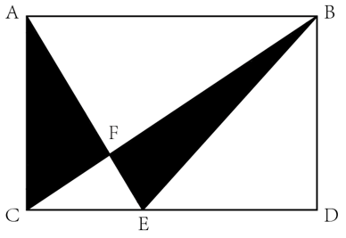

A. 2：5

B. 2：7

C. 1：4

D. 1：7

第 58 题 · 答案与解析

**参考答案（粉笔题库参考内容）**

B

**解析**

如图所示，过点F作垂线分别交AB、CD于点M、N，则MN=AC=BD且MN // AC // BD。已知2DE=3EC，即CE/DE = 2/3，赋值CE=2，DE=3，则AB=CD=CE+DE=5。根据题意可知，AB // CD，则∠CEF = ∠BAF、∠ECF = ∠ABF。又有∠CFE=∠AFB，则△CFE∽△BFA，则FN/FM=EC/AB=2/5，设FN=2x，FM=5x，则AC=BD=MN=FN+FM=7x。根据三角形面积公式：S=1/2ah，可得阴影部分面积= S△AFC + S△BFE = S△AEC − S△EFC + S△BCE − S△EFC= S△AEC + S△BCE - 2S△EFC= 1/2×CE×AC + 1/2×CE×BD − 2×1/2×CE×FN= 1/2 × CE × (AC + BD) − CE × FN= 1/2 × 2 × (7x + 7x) − 2 × 2x = 10x。根据长方形面积公式：S=ab，可知原长方形空地面积=AB×AC=5×7x=35x，则所求面积之比=10x：35x=2：7。

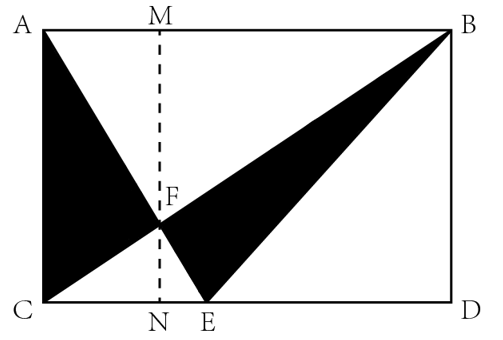

故正确答案为B。

**考点**：几何结论类-三角形相关、几何公式类-平面图形、几何结论类-相似图形

**来源**：2024年湖北省选调生招录考试综合知识和行政职业能力测验试卷（网友回忆版）第58题

### 第 59 题

甲、乙两车每天同时从A、B两地出发相向而行，已知甲车的速度为60千米/小时，乙车的速度为80千米/小时，两车每天都准时在途中相遇，有一天甲车因故提前半小时出发，乙车由于车况速度降为70千米/小时，最后两车依然在相同的时间相遇。问A、B两地的距离为多少千米?

A. 350

B. 390

C. 420

D. 455

第 59 题 · 答案与解析

**参考答案（粉笔题库参考内容）**

C

**解析**

设两车相遇所需时间为t小时，根据题意可得：（60+80）t=60×0.5+（60+70）t，解得：t=3。则A、B两地相距（60+80）×3=420千米。

故正确答案为C。

**考点**：相遇追及

**来源**：2024年湖北省选调生招录考试综合知识和行政职业能力测验试卷（网友回忆版）第59题

### 第 60 题

某大型超市购进了若干斤蔬菜进行售卖，第一天卖掉了库存的1/2，第二天卖掉了剩下库存的2/3······第n天卖掉了剩下库存的n/(n+1)，直到卖到少于进货量的1/1000后停止售卖，请问能售卖几天？

A. 7

B. 6

C. 5

D. 4

第 60 题 · 答案与解析

**参考答案（粉笔题库参考内容）**

B

**解析**

方法一：设该大型超市购进了x斤蔬菜进行售卖。已知卖到少于进货量的1/1000后停止售卖，即当天卖出量＜(1/1000)x后停止售卖。每天的卖出量与余货量可列表如下：

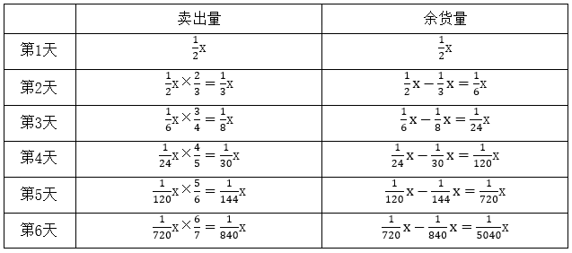

通过上表可知，第6天余货量(1/5040)x ＜ (1/1000)x，则停止售卖，即能售卖6天。

方法二：根据第n天卖掉了剩下库存的n/(n+1)，可知第n天库存剩余量为前一天剩余量的(1 − n/(n+1)) = 1/(n+1)，则可推导出余货量的公式为：第n天余货量=(1/2×1/3×1/4×……×1/(n+1))x。根据选项数字为4至7，则依次代入：第4天余货量为(1/2 × 1/3 × 1/4 × 1/5)x = 1/120 x，第5天余货量为(1/2 × 1/3 × 1/4 × 1/5 × 1/6)x = 1/720 x，第6天余货量为(1/720)x×(1/7)=(1/5040)x＜(1/1000)x，则停止售卖，即能售卖6天。

故正确答案为B。

备注：本题表述存在歧义，“直到卖到少于进货量的1/1000后停止售卖”若理解为“卖到当天售卖的量少于1/1000则停止售卖”，则第七天的售卖量=(1/5040)x×7/8＜(1/1000)x，停止售卖，即能售卖7天，则答案为A选项。

**考点**：和差倍比问题

**来源**：2024年湖北省选调生招录考试综合知识和行政职业能力测验试卷（网友回忆版）第60题

### 第 61 题

小明购买一本书，发现该书的总页数p是一平方数，且p-2和p+2都是质数，已知该书在100-400页之间，小明打算每个星期读书不超过75页，请问至少需要多少个星期才能把书读完?

A. 5

B. 4

C. 3

D. 2

第 61 题 · 答案与解析

**参考答案（粉笔题库参考内容）**

C

**解析**

因p-2和p+2都是质数，故p只能是奇数。则满足在100-400之间、是奇数的平方数分别为11^2、13^2、15^2、17^2、19^2。依次验证如下：

若p=11^2=121，p+2=123=3×41，不是质数，排除；

若p = 13^2 = 169，p+2=171=3×57，不是质数，排除；

若p=15^2=225，p+2=227，p-2=223，都是质数，满足题干所有条件即为答案，其他情况无需继续验证。则该书的总页数p为225页，至少需要225/75 = 3个星期才能把书读完。

故正确答案为C。

**考点**：和差倍比问题

**来源**：2024年湖北省选调生招录考试综合知识和行政职业能力测验试卷（网友回忆版）第61题

### 第 62 题

某单位成立突击队，上午9点开展铲雪清障活动。突击队分为甲、乙两队，他们同时从同一地点背向而行各自进行工作。最初，乙队清理的速度比甲队慢25%，中途乙曾用10分钟去换工具，而后工作效率比原来提高了一倍。10点整，突击队完成了铲雪清障任务，且两队清理的长度相同。请问乙队什么时间去换的工具？

A. 9：10

B. 9：20

C. 9：30

D. 9：40

第 62 题 · 答案与解析

**参考答案（粉笔题库参考内容）**

B

**解析**

根据“最初，乙队清理的速度比甲队慢25%”，可知乙队初始效率是甲队的1-25% = 1-1/4 = 3/4，赋值乙队初始效率为3，甲队效率为4，则乙队换新工具后的效率为3×2=6。从9点至10点为60分钟，其中乙队实际清理时间为60-10=50分钟，设乙队用旧工具清理的时间为t，根据“两队清理的长度相同”，可列式：4×60=3t+6（50-t），解得t=20，即乙队在9：20去换的工具。

故正确答案为B。

**考点**：给效率比例型

**来源**：2024年湖北省选调生招录考试综合知识和行政职业能力测验试卷（网友回忆版）第62题

### 第 63 题

下图一正方体纸盒切除一角，其展开图能对应的是：

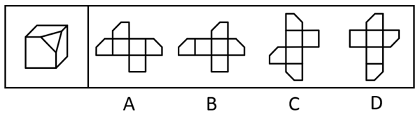

A. A

B. B

C. C

D. D

第 63 题 · 答案与解析

**参考答案（粉笔题库参考内容）**

A

**解析**

题干立体图形为切除一角的正方体纸盒，如下图所示，被切割的三个面的短边应两两相邻。

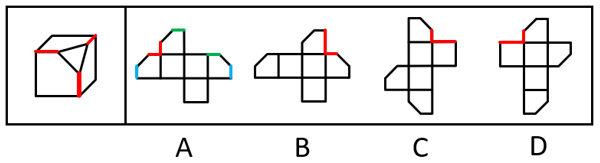

A项：被切割的三个面的短边两两相邻，选项与题干一致，当选；

B项：选项最右侧面的一条短边与另一条长边相邻，选项与题干不一致，排除；

C项：选项最上方面的一条短边与另一条长边相邻，选项与题干不一致，排除；

D项：选项最上方面的一条短边与另一条长边相邻，选项与题干不一致，排除。

故正确答案为A。

**考点**：空间类-空间重构-六面体

**来源**：2024年湖北省选调生招录考试综合知识和行政职业能力测验试卷（网友回忆版）第63题

### 第 64 题

为下方立体模型绘制前视图、左视图和俯视图，正确的一项是：

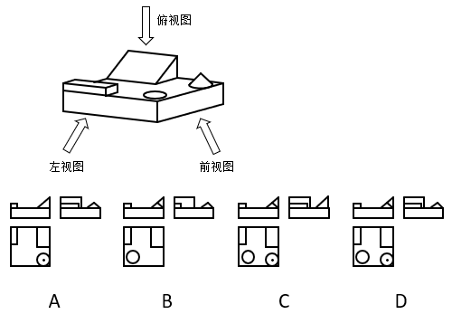

A. A

B. B

C. C

D. D

第 64 题 · 答案与解析

**参考答案（粉笔题库参考内容）**

D

**解析**

本题考查三视图，该立体图形的前视图、左视图和俯视图如下图所示，逐一分析选项。

A项：对应该立体图形的前视图缺少一条斜线，俯视图缺少一个圆形，排除；

B项：对应该立体图形的左视图小长方形比例有误，俯视图缺少一个圆形及其中心点，排除；

C项：对应该立体图形的左视图三角形形状有误，排除；

D项：对应该立体图形前视图、左视图和俯视图均正确，当选。

故正确答案为D。

**考点**：空间类-三视图

**来源**：2024年湖北省选调生招录考试综合知识和行政职业能力测验试卷（网友回忆版）第64题

### 第 65 题

把下面的六个图形分成两类，使每一类图形都有各自的规律和特性，分类正确的一项是：

A. ①②④，③⑤⑥

B. ①②③，④⑤⑥

C. ①③④，②⑤⑥

D. ①③⑥，②④⑤

第 65 题 · 答案与解析

**参考答案（粉笔题库参考内容）**

A

**解析**

本题为分组分类题目。元素组成不同，且无明显属性规律，考虑数量规律。题干图形封闭区域明显，优先考虑数面，面数量依次为3、6、6、5、4、4，单独看无规律；继续观察发现，题干图形均由直线构成，考虑数直线，直线数量依次为6、9、7、8、5、5，单独看无规律，考虑二者做运算。图①②④中，直线数-面数量=3，图③⑤⑥中，直线数-面数量=1。即图①②④为一组，图③⑤⑥为一组。

故正确答案为A。

**考点**：数量规律-复合

**来源**：2024年湖北省选调生招录考试综合知识和行政职业能力测验试卷（网友回忆版）第65题

### 第 66 题

从所给的四个选项中，选择最合适的一个填入问号处，使之呈现一定的规律性。

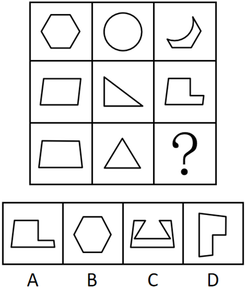

A. A

B. B

C. C

D. D

第 66 题 · 答案与解析

**参考答案（粉笔题库参考内容）**

C

**解析**

元素组成相似，优先考虑样式规律。九宫格优先看横行，第一行中，图二覆盖住部分图一，只观察图一剩余部分的轮廓可以得到图三；经验证，第二行符合此规律；第三行应用此规律，只有C项符合。

故正确答案为C。

**考点**：样式规律-加减同异

**来源**：2024年湖北省选调生招录考试综合知识和行政职业能力测验试卷（网友回忆版）第66题

### 第 67 题

从所给的四个选项中，选择最合适的一个填入问号处，使之呈现一定的规律性。

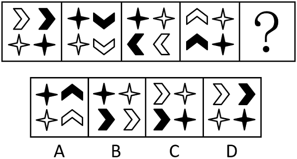

A. A

B. B

C. C

D. D

第 67 题 · 答案与解析

**参考答案（粉笔题库参考内容）**

D

**解析**

元素组成相同，优先考虑位置规律。观察发现，每幅图形的内部元素顺时针平移一步，同时自身顺时针旋转90°，自身颜色黑白交替可以得到下一幅图形，？处应用此规律，只有D项符合。

故正确答案为D。

**考点**：位置规律-旋转

**来源**：2024年湖北省选调生招录考试综合知识和行政职业能力测验试卷（网友回忆版）第67题

### 第 68 题

第四堵墙是指在镜框式舞台上，通过人们的想象位于舞台台口的一道实际上并不存在的“墙”。通过第四堵墙，将演员与观众相对隔开，让演员潜心于舞台表演和角色的塑造。

根据上述定义，下列情形体现了第四堵墙理念的是：

A. 演员在表演时眼盯着观众，并试图用眼神与观众进行交流

B. 导演让演员在台上不要看观众的反应，该怎么演就怎么演

C. 戏剧舞台上为了演出需要时不时降下幕布

D. 相声演员在表演时经常有意跟观众搭话

第 68 题 · 答案与解析

**参考答案（粉笔题库参考内容）**

B

**解析**

第一步：找出定义关键词。

“位于舞台台口的一道实际上并不存在的‘墙’”、“将演员与观众相对隔开”、“让演员潜心于舞台表演和角色的塑造”。

第二步：逐一分析选项。

A项：演员在表演时眼盯着观众，并试图用眼神与观众进行交流，不符合“将演员与观众相对隔开”、“让演员潜心于舞台表演和角色的塑造”，不符合定义，排除；

B项：导演让演员在台上不要看观众的反应，该怎么演就怎么演，符合“位于舞台台口的一道实际上并不存在的‘墙’”、“将演员与观众相对隔开”、“让演员潜心于舞台表演和角色的塑造”，符合定义，当选；

C项：演出时降下的幕布是实际存在的“墙”，不符合“位于舞台台口的一道实际上并不存在的‘墙’”，不符合定义，排除；

D项：相声演员在表演时经常有意跟观众搭话，不符合“将演员与观众相对隔开”、“让演员潜心于舞台表演和角色的塑造”，不符合定义，排除。

故正确答案为B。

**考点**：方式目的

**来源**：2024年湖北省选调生招录考试综合知识和行政职业能力测验试卷（网友回忆版）第68题

### 第 69 题

经济学认为，商品的效用是指消费者消费物品和服务时所感受到的快乐和满足的程度。在消费行为中，消费者是主体，商品是否有用，有多大用，即效用的大小，是以消费者自己的判断和评价为转移的。

根据上述定义，下列情形体现了商品的效用的是：

A. 拉斐尔的一件人物像素描，长37.5厘米，宽27.8厘米，估价1000万英镑，最终以2970万英镑拍卖成功

B. 老黄通过竞拍花1000万买下一幅名家名画。他认为，竞拍成功能体现他的财富、眼光、风雅，至于画作如何他不在意

C. 对某商品，小张说很有价值，愿花90元购买；小李认为价值一般，最多愿花45元购买；小刘则认为没有价值，一钱不值

D. 有人喜欢用小米手机，有人喜欢用华为手机，有人喜欢用其他品牌手机，各人因喜好、使用习惯和购买力决定用什么手机

第 69 题 · 答案与解析

**参考答案（粉笔题库参考内容）**

C

**解析**

第一步：找出定义关键词。

“商品效用的大小以消费者自己的判断和评价为转移”。

第二步：逐一分析选项。

A项：该项指出拉斐尔的一件人物像最终以2970万英镑拍卖成功，没有体现出消费者对于该人物像的判断和评价，不符合“商品效用的大小以消费者自己的判断和评价为转移”，没有体现出商品的效用，排除；

B项：该项指出老黄成功竞拍一幅名画，可以体现他的财富、眼光等，但他不在意画作本身，没有体现出老黄对于该名画的判断和评价，不符合“商品效用的大小以消费者自己的判断和评价为转移”，没有体现出商品的效用，排除；

C项：该项指出三个人对于某商品有不同的判断和评价，符合“商品效用的大小以消费者自己的判断和评价为转移”，体现了商品的效用，当选；

D项：该项指出各人因喜好、使用习惯和购买力决定用什么手机，没有体现人们对于手机的评价，不符合“商品效用的大小以消费者自己的判断和评价为转移”，没有体现出商品的效用，排除。

故正确答案为C。

**考点**：单定义-其他句式

**来源**：2024年湖北省选调生招录考试综合知识和行政职业能力测验试卷（网友回忆版）第69题

### 第 70 题

心理停顿是指由人物内心的观念活动或情感需求而造成的语言停顿。心理停顿是为表示复杂而强烈的情感而作的停顿，停顿的部位和时间以体现人物复杂的内心活动为标准。

根据上述定义，下列情形属于心理停顿的是：

A. 在说到母亲的不幸去世时，小雨哽咽着暂停叙说

B. 老师看到有学生在讲话，故意暂停了自己的朗读

C. 小青读书读到激烈的战争场面时不由得屏气收声

D. 突然一声巨响让正在讲话的小山吓得停了下来

第 70 题 · 答案与解析

**参考答案（粉笔题库参考内容）**

A

**解析**

第一步：找出定义关键词。

“由人物内心的观念活动或情感需求而造成的语言停顿”。

第二步：逐一分析选项。

A项：小雨在叙说中因说到母亲不幸去世而哽咽，说明小雨出于自身的情感，对母亲的去世而感到悲痛，符合“由人物内心的观念活动或情感需求而造成的语言停顿”，符合定义，当选；

B项：老师因看到学生讲话而故意暂停朗读，其中学生的讲话不属于老师内心的观念活动或情感需求，不符合“由人物内心的观念活动或情感需求而造成的语言停顿”，不符合定义，排除；

C项：小青在读书时因读到激烈的战争场面而屏气收声，其中激烈的战争场面不属于小青内心的观念活动或情感需求，不符合“由人物内心的观念活动或情感需求而造成的语言停顿”，不符合定义，排除；

D项：小山因巨响而停止讲话，其中巨响不属于小山内心的观念活动或情感需求，不符合“由人物内心的观念活动或情感需求而造成的语言停顿”，不符合定义，排除。

故正确答案为A。

**考点**：原因结果

**来源**：2024年湖北省选调生招录考试综合知识和行政职业能力测验试卷（网友回忆版）第70题

### 第 71 题

整合营销传播是将各种传播方式有机结合起来的一种系统的传播活动。整合营销传播强调以消费者为中心，从消费者的需求和角度出发。

根据上述定义，下列情形属于整合营销传播的是：

A. 公司运用线上和线下相结合的方式销售一种网红产品

B. 公司根据老年消费者的实际情况采取了线下产品宣传

C. 公司同时使用报纸、电视、网络等多种方式对产品进行宣传

D. 公司根据目标消费者的属性综合运用网络和新媒体投放广告

第 71 题 · 答案与解析

**参考答案（粉笔题库参考内容）**

D

**解析**

第一步：找出定义关键词。

“将各种传播方式有机结合起来”、“以消费者为中心”、“从消费者的需求和角度出发”。

第二步：逐一分析选项。

A项：公司运用线上和线下相结合的方式销售产品，未体现“以消费者为中心”、“从消费者的需求和角度出发”，不符合定义，排除；

B项：公司根据老年消费者的实际情况采取线下产品宣传，其中只涉及线下的宣传方式，不符合“将各种传播方式有机结合起来”，不符合定义，排除；

C项：公司使用多种媒介来宣传产品，未体现“以消费者为中心”、“从消费者的需求和角度出发”，不符合定义，排除；

D项：公司综合运用网络和新媒体投放广告，符合“将各种传播方式有机结合起来”，且根据目标消费者的属性投放广告，符合“以消费者为中心”、“从消费者的需求和角度出发”，符合定义，当选。

故正确答案为D。

**考点**：方式目的

**来源**：2024年湖北省选调生招录考试综合知识和行政职业能力测验试卷（网友回忆版）第71题

### 第 72 题

循环信贷是指在协定的有效期内，只要企业的借款总额未超过最高限额，银行就必须满足企业任何时候提出的借款要求的一种信贷。企业享用循环信贷，要对贷款限额的未使用部分支付给银行一笔费用。

根据上述定义，下列情形属于循环信贷的是：

A. 某企业按协定，2023年向银行贷款400万元，当年还清，后拖欠100万元未还，银行要求支付额外利息

B. 某企业按协定，2023年向银行贷款300万元，先贷200万，余下100万可需要时再贷，但需支付银行利息

C. 某企业按协定，2023年向银行贷款400万元，后追加贷款100万元，银行要求追加的100万需额外支付利息

D. 某企业按协定，2023年向银行贷款500万元，后因故减贷100万元，银行要求减贷的100万也需支付部分利息

第 72 题 · 答案与解析

**参考答案（粉笔题库参考内容）**

B

**解析**

第一步：找出定义关键词。

“在协定的有效期内”、“企业借款总额未超过最高限额”、“银行必须满足企业任何时候提出的借款要求”、“企业要对贷款限额的未使用部分支付给银行一笔费用”。

第二步：逐一分析选项。

A项：企业拖欠未还的100万元，不符合“贷款限额的未使用部分”，银行要求企业支付的额外利息，不符合“企业要对贷款限额的未使用部分支付给银行一笔费用”，不符合定义，排除；

B项：企业按协定向银行贷款300万元，说明贷款最高限额为300万元，先贷200万，符合“企业借款总额未超过最高限额”，余下100万可需要时再贷，符合“银行必须满足企业任何时候提出的借款要求”，且这100万需要额外给银行支付利息，符合“企业要对贷款限额的未使用部分支付给银行一笔费用”，符合定义，当选；

C项：企业按协定向银行贷款400万元，说明贷款最高限额为400万元，后面追加的100万元，不符合“贷款限额的未使用部分”，银行针对这100万元索要的额外利息，不符合“企业要对贷款限额的未使用部分支付给银行一笔费用”，不符合定义，排除；

D项：企业按协定向银行贷款500万元，后减贷100万元，说明减贷的100万元已不是企业的借款要求，不符合“企业任何时候提出的借款要求”、“贷款限额的未使用部分”，银行要求减贷的100万需支付利息，不符合“企业要对贷款限额的未使用部分支付给银行一笔费用”，不符合定义，排除。

故正确答案为B。

**考点**：单定义-其他句式

**来源**：2024年湖北省选调生招录考试综合知识和行政职业能力测验试卷（网友回忆版）第72题

### 第 73 题

药片：药盒：药箱

A. 冰棒：保鲜盒：冰箱

B. 文具：文具盒：书包

C. 衣服：挂衣架：衣柜

D. 信息：计算机：网络

第 73 题 · 答案与解析

**参考答案（粉笔题库参考内容）**

B

**解析**

第一步：判断题干词语间逻辑关系。

“药片”放在“药盒”里，“药盒”放在“药箱”里，三者依次为物品与容器的对应关系。

第二步：判断选项词语间逻辑关系。

A项：“冰棒”放在“冰箱”里，但是一般不放在“保鲜盒”里，二者不是物品与容器的对应关系，与题干逻辑关系不一致，排除；

B项：“文具”放在“文具盒”里，“文具盒”放在“书包”里，三者依次为物品与容器的对应关系，与题干逻辑关系一致，当选；

C项：“挂衣架”放在“衣柜”里，但是“衣服”挂在“挂衣架”上，而不是放在“挂衣架”里，二者不是物品与容器的对应关系，与题干逻辑关系不一致，排除；

D项：“信息”储存在“计算机”里，信息是抽象名词，二者为内容与载体的对应关系，与题干逻辑关系不一致，排除。

故正确答案为B。

**考点**：逻辑关系-对应关系

**来源**：2024年湖北省选调生招录考试综合知识和行政职业能力测验试卷（网友回忆版）第73题

### 第 74 题

藤椅：瓷杯：石板桌

A. 枕头：棉被：木板床

B. 梨树：桃花：满园春

C. 竹篱：木桶：土坯房

D. 鸟语：花香：杉树林

第 74 题 · 答案与解析

**参考答案（粉笔题库参考内容）**

C

**解析**

第一步：判断题干词语间逻辑关系。

“藤椅”是用藤条编织的椅子，“瓷杯”是用陶瓷制成的杯子，“石板桌”是用石板制成的桌子，三者都是日常生活中的实物，且均是根据制作的原材料进行命名的，命名方式相同。

第二步：判断选项词语间逻辑关系。

A项：“枕头”、“棉被”、“木板床”都是日常生活中的实物，但其中“枕头”是根据其功能进行命名的，不是根据制作的原材料进行命名的，三者命名方式不相同，与题干逻辑关系不一致，排除；

B项：“梨树”和“桃花”都是日常生活中的实物，但“满园春”是一个描述景象的词汇，不是具体的实物，与题干逻辑关系不一致，排除；

C项：“竹篱”是用竹子编成的篱笆，“木桶”是用木材制成的桶，“土坯房”是用土坯建造的房屋，三者都是日常生活中的实物，且均是根据制作的原材料进行命名的，命名方式相同，与题干逻辑关系一致，当选；

D项：“鸟语”和“花香”是并列关系，且二者都是描述性的词汇，不是具体的实物，也不是根据制作的原材料进行命名的，与题干逻辑关系不一致，排除。

故正确答案为C。

**考点**：逻辑关系-对应关系

**来源**：2024年湖北省选调生招录考试综合知识和行政职业能力测验试卷（网友回忆版）第74题

### 第 75 题

挑战：对战：休战

A. 买瓜：洗瓜：吃瓜

B. 倒酒：喝酒：品酒

C. 充电：充值：通话

D. 拍照：收藏：欣赏

第 75 题 · 答案与解析

**参考答案（粉笔题库参考内容）**

A

**解析**

第一步：判断题干词语间逻辑关系。

先“挑战”，再“对战”，最后“休战”，三者为时间先后顺序的对应关系。

第二步：判断选项词语间逻辑关系。

A项：先“买瓜”，再“洗瓜”，最后“吃瓜”，三者为时间先后顺序的对应关系，与题干逻辑关系一致，当选；

B项：先“倒酒”，再“喝酒”，但“品酒”一般是指对于各种酒类的观赏品尝，“倒酒”和“喝酒”是“品酒”过程中的步骤，与题干逻辑关系不一致，排除；

C项：“充电”、“充值”、“通话”三者没有明显的时间先后顺序，与题干逻辑关系不一致，排除；

D项：“拍照”、“收藏”、“欣赏”三者没有明显的时间先后顺序，与题干逻辑关系不一致，排除。

故正确答案为A。

**考点**：逻辑关系-对应关系

**来源**：2024年湖北省选调生招录考试综合知识和行政职业能力测验试卷（网友回忆版）第75题

### 第 76 题

主播：网红：作家

A. 游戏：竞赛：通关

B. 骑手：外卖：快递

C. 手机：电话：电脑

D. 数据：资料：文献

第 76 题 · 答案与解析

**参考答案（粉笔题库参考内容）**

D

**解析**

第一步：判断题干词语间逻辑关系。

“主播”、“网红”、“作家”是人的三种不同身份，且用“四个有的”造句造得通，三者两两之间互为交叉关系。

第二步：判断选项词语间逻辑关系。

A项：“竞赛”指互相比赛，争取优胜，有的游戏是竞赛模式，二者为对应关系；“游戏通关”是主谓宾结构，与题干逻辑关系不一致，排除；

B项：“骑手”可以送“外卖”，也可以送“快递”，“骑手”与“外卖”和“快递”均为职业与工作对象的对应关系，与题干逻辑关系不一致，排除；

C项：“手机”是“电话”的一种，二者为种属关系，与题干逻辑关系不一致，排除；

D项：“数据”指进行各种统计、计算、科学研究或技术设计等所依据的数值；“资料”有两层含义，①指生产、生活中必需的东西；②指用作参考或依据的材料。当理解为用作参考或依据的材料时，“数据”与“资料”为交叉关系，“资料”与“文献”也为交叉关系，与题干逻辑关系一致，当选。

故正确答案为D。

注：题干两两之间互为交叉关系，并没有与题干逻辑关系完全一致的选项。综合来看，D项“数据”和“文献”虽不是交叉关系，但也是与题干匹配度最高的选项，结合对比择优的思维只能优选D项，建议考生无需将此题作为备考重点。

**考点**：逻辑关系-交叉关系

**来源**：2024年湖北省选调生招录考试综合知识和行政职业能力测验试卷（网友回忆版）第76题

### 第 77 题

面团：蒸笼：馒头

A. 棉纱：织机：棉布

B. 钢铁：工厂：汽车

C. 歌曲：电台：节目

D. 苹果：榨机：果汁

第 77 题 · 答案与解析

**参考答案（粉笔题库参考内容）**

A

**解析**

第一步：判断题干词语间逻辑关系。

“面团”是用“蒸笼”制作成“馒头”，三者为原材料、工具和成品的对应关系，且“面团”是制作“馒头”的必然原材料。

第二步：判断选项词语间逻辑关系。

A项：“棉纱”是用“织机”制作成“棉布”，三者为原材料、工具和成品的对应关系，且“棉纱”是制作“棉布”的必然原材料，与题干逻辑关系一致，当选；

B项：“钢铁”是制作“汽车”的原材料，但“工厂”不是工具，与题干逻辑关系不一致，排除；

C项：在“电台”播放“歌曲”“节目”，三者并非原材料、工具和成品的对应关系，与题干逻辑关系不一致，排除；

D项：“苹果”是用“榨机”制作成“果汁”，三者为原材料、工具和成品的对应关系，但“苹果”不是制作“果汁”的必然原材料，与题干逻辑关系不一致，排除。

故正确答案为A。

**考点**：逻辑关系-对应关系

**来源**：2024年湖北省选调生招录考试综合知识和行政职业能力测验试卷（网友回忆版）第77题

### 第 78 题

PBAT属于热塑性材料，是己二酸丁二醇酯和对苯二甲酸丁二醇酯的共聚物，具有良好的延展性、热稳定性和可塑性，被广泛应用于农用地膜、纺织业及食品包装等领域。但PBAT在大量使用中，也带来严重的白色污染。研究人员称，角质酶T可在两天内将PBAT分解成大碎片、小颗粒直至完全消失。

以下各项如果为真，最能支持研究人员说法的是：

A. 角质酶T可以快速地分解塑料薄膜和包装物，防范和消除白色污染助力绿色发展

B. 角质酶T作用PBAT的过程会产生4种碎片或颗粒，它们都在48小时里降解消失

C. 角质酶T对PBAT的降解还将有助于PBAT塑料制成品水解后产物的回收循环利用

D. 角质酶T是国内研究团队通过长时间、大规模筛选，才找到的适合降解PBAT的酶

第 78 题 · 答案与解析

**参考答案（粉笔题库参考内容）**

B

**解析**

第一步：找出论点和论据。

论点：角质酶T可在两天内将PBAT分解成大碎片、小颗粒直至完全消失。

论据：无。

本题只有论点没有论据，加强优先考虑补充论据，即解释原因或举例子。

第二步：逐一分析选项。

A项：指出角质酶T可以快速地分解塑料薄膜和包装物，但PBAT属于热塑性材料，无法确定角质酶T对PBAT的分解情况，为不明确项，无法加强，排除；

B项：指出角质酶T确实能在两天（48小时）内将PBAT完全降解，补充论据，可以加强，当选；

C项：指出角质酶T降解PBAT的其他好处，并未直接说明角质酶T能在多长时间内将PBAT完全分解，话题不一致，无法加强，排除；

D项：指出角质酶T的发现过程，以及其适合降解PBAT，但没有提及降解的速度，话题不一致，无法加强，排除。

故正确答案为B。

**考点**：补充论据

**来源**：2024年湖北省选调生招录考试综合知识和行政职业能力测验试卷（网友回忆版）第78题

### 第 79 题

为了研究某古人类遗址的燃料资源利用策略，研究人员对该遗址早期窑址和晚期房址中出土的炭化木材遗存进行了种属鉴定。所有树种被分为针叶树、阔叶树和灌木三大类，其中针叶树因其更软的质地和更优的燃烧表现被认为是更理想的选择。遗址早期窑址中的炭屑覆盖了这三个大类，且优先利用针叶树作为燃料；晚期房址中出土的炭屑中针叶树的含量极少。问题在于，晚期高强度的冶金活动应该带来了更大的燃料消费，这就使得放弃利用针叶树种变得不合逻辑。研究人员认为，遗址中的燃料资源利用策略，从早期以针叶树木质燃料优先，转变为晚期以煤炭矿石燃料为主。

以下哪项如果为真，最能支持研究人员的观点？

A. 晚期地层出土煤灰的密度数倍于木材炭屑

B. 遗址晚期煤炭作为燃料资源释放能量更高

C. 晚期遗址目前暴露出普遍的煤炭自燃现象

D. 针叶林资源在遗址晚期变得越来越稀少

第 79 题 · 答案与解析

**参考答案（粉笔题库参考内容）**

A

**解析**

第一步：找出论点和论据。

论点：遗址中的燃料资源利用策略，从早期以针叶树木质燃料优先，转变为晚期以煤炭矿石燃料为主。

论据：遗址早期窑址中的炭屑覆盖了这三个大类，且优先利用针叶树作为燃料；晚期房址中出土的炭屑中针叶树的含量极少。

本题的论据说的是“遗址早期优先利用针叶树”和“晚期房址针叶树的含量极少”，论点说的是“从早期以针叶树木质燃料优先，转变为晚期以煤炭矿石燃料为主”，论据有利于论点的成立，二者关系紧密，可以理解为话题一致，加强优先考虑补充论据。

第二步：逐一分析选项。

A项：指出晚期地层出土煤灰的密度远大于木材炭屑，“土煤灰密度远大于木材炭屑”意味着晚期更多地使用了煤炭作为燃料，而不是以针叶树木质为主，补充论据，可以加强，当选；

B项：指出煤炭作为燃料资源存在的优势，但无法推出晚期确实使用了煤炭，无法加强，排除；

C项：指出现在的晚期遗址暴露出普遍的煤炭自燃现象，只能证明该遗址存在煤炭，无法推出晚期以煤炭矿石燃料为主，无法加强，排除；

D项：指出针叶林资源减少导致针叶树作为燃料使用减少了，但无法推出晚期以煤炭矿石燃料为主，无法加强，排除。

故正确答案为A。

**考点**：补充论据

**来源**：2024年湖北省选调生招录考试综合知识和行政职业能力测验试卷（网友回忆版）第79题

### 第 80 题

研究人员观察一群霓虹脂鲤对捕捞行为的反应，它们在水箱里会通过狭窄开口撤离。霓虹脂鲤通过较大开口的速度快于较小开口，但倾向以恒定的速率撤出各种大小的开口——但每组最后几条鱼是例外，它们会通过得更慢。虽然它们在通过各种大小的开口前都会先聚集在周围，但并未观察到逃离的鱼之间发生物理接触。研究人员认为霓虹脂鲤在通过狭窄开口之前会等待或排队，以维系其偏好的社交距离。

以下哪项如果为真，最能削弱研究人员的观点？

A. 霓虹脂鲤会根据环境调整自己的游动速度

B. 霓虹脂鲤的等待或排队行为只是生物本能

C. 霓虹脂鲤的个体行为跟群体行为完全不同

D. 霓虹脂鲤在避险时会表现出独特的行为

第 80 题 · 答案与解析

**参考答案（粉笔题库参考内容）**

B

**解析**

第一步：找出论点和论据。

论点：霓虹脂鲤在通过狭窄开口之前会等待或排队，以维系其偏好的社交距离。

论据：虽然霓虹脂鲤在通过各种大小的开口前都会先聚集在周围，但并未观察到逃离的鱼之间发生物理接触。

本题论据讨论的是霓虹脂鲤在通过开口前会聚集，但逃离的鱼之间并未发生物理接触，论点是基于此得出的霓虹脂鲤的等待或排队行为是为了维系其偏好的社交距离，论据与论点关系紧密，可以理解为话题一致，削弱优先考虑削弱论点。

第二步：逐一分析选项。

A项：该项指出霓虹脂鲤会根据环境调整自己的“游动速度”，但论点讨论的是霓虹脂鲤的等待或排队行为是为了维系其偏好的社交距离，话题不一致，无法削弱，排除；

B项：该项指出霓虹脂鲤的等待或排队行为“只是生物本能”，说明霓虹脂鲤的等待或排队行为并不是为了维系其偏好的社交距离，削弱论点，可以削弱，当选；

C项：该项指出霓虹脂鲤的“个体行为”跟群体行为完全不同，但论点讨论的是霓虹脂鲤的等待或排队行为，话题不一致，无法削弱，排除；

D项：该项指出霓虹脂鲤在避险时会表现出独特的行为，但并未说明“独特的行为”是什么，也并未说明这种行为是否是为了维系其偏好的社交距离，为不明确项，无法削弱，排除。

故正确答案为B。

**考点**：削弱论点

**来源**：2024年湖北省选调生招录考试综合知识和行政职业能力测验试卷（网友回忆版）第80题

### 第 81 题

研究人员召集51名年轻、健康的参与者在实验室内进行轻度体育活动，室内的温度每5分钟上升一次。研究人员利用参与者吞下的胶囊内的传感器，监测每个人内部器官的温度。研究小组还测量了参与者的心率。随着室内温度的升高，参与者的心率增加，并且在实验结束时仍在上升，这表明心血管紧张。心血管紧张总是在参与者的内部器官温度开始上升前20分钟左右开始。研究人员认为，在温度升高时，心血管紧张会导致内部器官温度上升。

以下哪项如果为真，最能反驳研究人员的观点?

A. 心血管紧张必然会引起内部器官温度的上升

B. 心血管紧张和内部器官温度上升的关系有待检验

C. 心血管紧张和内部器官温度上升的机制并不相同

D. 温度升高先后导致心血管紧张和内部器官温度上升

第 81 题 · 答案与解析

**参考答案（粉笔题库参考内容）**

D

**解析**

第一步：找出论点和论据。

论点：在温度升高时，心血管紧张会导致内部器官温度上升。

论据：随着室内温度的升高，参与者的心率增加，并且在实验结束时仍在上升，这表明心血管紧张。心血管紧张总是在参与者的内部器官温度开始上升前20分钟左右开始。

本题论点论据讨论的均是“温度升高”、“心血管紧张”和“内部器官温度上升”之间的关系，话题一致，削弱优先考虑削弱论点。

第二步：逐一分析选项。

A项：该项指出心血管紧张“必然会引起”内部器官温度的上升，重复论点，无法削弱，排除；

B项：该项指出心血管紧张和内部器官温度上升的关系“有待检验”，不明确心血管紧张是否会导致内部器官温度上升，为不明确项，无法削弱，排除；

C项：该项指出心血管紧张和内部器官温度上升的“机制并不相同”，“机制不相同”不代表二者之间没有因果关系，话题不一致，无法削弱，排除；

D项：该项指出温度升高“先后导致”心血管紧张和内部器官温度上升，说明内部器官温度上升是温度升高导致的，而不是心血管紧张，削弱论点，可以削弱，当选。

故正确答案为D。

**考点**：削弱论点

**来源**：2024年湖北省选调生招录考试综合知识和行政职业能力测验试卷（网友回忆版）第81题

### 第 82 题

中国质量协会公布的2022年数字经济服务质量满意度研究成果显示，2022年城市数字经济服务质量满意度为84.2分，同比提高4.5分，首次突破80分大关。中国质量协会从2019年开始，连续四年开展城市数字经济服务质量满意度研究，在2022年首次开展数字乡村建设满意度研究。本次调研结果中，数字乡村建设服务质量满意度为78.7分。

根据以上叙述，研究人员最可能提出的观点是：

A. 数字经济服务质量，在城市特别是中心城市比在农村高

B. 我国数字经济对经济社会发展的引领支撑作用日益凸显

C. 进一步加强数字乡村建设，提升数字乡村建设服务质量

D. 近年来，我国城乡数字经济建设取得了举世瞩目的发展成就

第 82 题 · 答案与解析

**参考答案（粉笔题库参考内容）**

C

**解析**

第一步：找出论点和论据。

这是一道论证考点下的特殊题型，由于本题问的是“根据以上叙述，研究人员最可能提出的观点”，所以应该把整个题干当成是一个论据，需要根据题干找出能够成为论点的选项。

论据：中国质量协会公布的2022年数字经济服务质量满意度研究成果显示，2022年城市数字经济服务质量满意度为84.2分，同比提高4.5分，首次突破80分大关。中国质量协会从2019年开始，连续四年开展城市数字经济服务质量满意度研究，在2022年首次开展数字乡村建设满意度研究。本次调研结果中，数字乡村建设服务质量满意度为78.7分。

前半段描述的是城市数字经济服务质量满意度有所提高，达84.2分，后半段描述的是首次数字乡村建设服务质量满意度为78.7分。

第二步：逐一分析选项。

A项：该项指出在城市特别是中心城市的数字经济服务质量比在农村高，但题干论据中并未提及“中心城市”，无中生有，不能成为题干论据的观点，排除；

B项：该项指出我国数字经济对经济社会发展的作用，但论据说的是城市和乡村的数字经济服务质量满意度情况，二者话题不一致，不能成为题干论据的观点，排除；

C项：该项指出需要进一步加强数字乡村建设，题干论据中城市的满意度分数高于乡村，表明需要加强数字乡村建设，以提升数字乡村建设服务质量，可以成为题干论据的观点，当选；

D项：该项指出近年来，我国城乡数字经济建设取得了举世瞩目的发展成就，题干论据中只体现了城市数字经济服务质量满意度有所提高，数字乡村建设服务质量满意度只有首次统计，无法判断是否“举世瞩目”，不能成为题干论据的观点，排除。

故正确答案为C。

**来源**：2024年湖北省选调生招录考试综合知识和行政职业能力测验试卷（网友回忆版）第82题

### 第 83 题

锂被誉为绿色能源金属和“白色石油”，广泛应用于储能、化工、医药、冶金、电子工业等领域。随着全球绿色低碳转型和新能源汽车快速发展，锂资源战略地位日益凸显，各国高度关注锂资源供应安全，纷纷将之列入关键矿产目录。自然资源部2023年6月中旬发布的统计数据显示，2022年度我国锂矿探明储量同比增长57%。

根据以上叙述，最能推出的结论是：

A. 我国锂资源丰富，可满足绿色低碳转型和新能源汽车发展的需要

B. 锂矿探明储量增长将利于我国绿色低碳转型和新能源汽车的发展

C. 全球锂资源丰富，但分布不均，中国和美国锂资源储量最为丰富

D. 随着新型提锂技术突破，成本大幅下降，我国锂资源供给有保障

第 83 题 · 答案与解析

**参考答案（粉笔题库参考内容）**

B

**解析**

日常结论题，根据题干信息逐一分析选项。

A项：题干最后一句话只是指出我国锂矿探明储量同比增长57%，但没有提及是否可满足绿色低碳转型和新能源汽车发展的需要，无中生有，无法推出，排除；

B项：根据题干第二句话“随着全球绿色低碳转型和新能源汽车快速发展，锂资源战略地位日益凸显”以及最后一句话“我国锂矿探明储量同比增长57%”，可以推出锂矿探明储量增长将利于我国绿色低碳转型和新能源汽车的发展，可以推出，当选；

C项：题干最后一句话只是指出我国锂矿探明储量同比增长57%，但没有提及中国锂资源储量最为丰富，也没有提及美国的情况，无中生有，无法推出，排除；

D项：题干中没有提及新型提锂技术以及成本的信息，无中生有，无法推出，排除。

故正确答案为B。

**考点**：日常结论

**来源**：2024年湖北省选调生招录考试综合知识和行政职业能力测验试卷（网友回忆版）第83题

### 第 84 题

科学家从海豚哨声数据库中选择了19只雌性海豚，在1984年至2018年间，这些雌性海豚被记录下了有幼崽和没有幼崽时的情况。科学家发现，所有19只雌性海豚与幼崽一起时发出的哨声频率均高于它们独处时。研究人员认为，这些频率较高的哨声就是雌性海豚的“妈妈语”或者“婴儿语”。

以下哪项如果为真，最能支持研究人员的观点?

A. 雌性海豚只有在与幼崽相处时才会发出更高频率的哨声

B. “妈妈语”会增进亲子关系，甚至还能促进幼崽的学习

C. 雄性海豚在跟幼崽相处时不会发出更高频率的哨声

D. 人类母亲跟婴儿交流时也会使用高频率的声音

第 84 题 · 答案与解析

**参考答案（粉笔题库参考内容）**

A

**解析**

第一步：找出论点和论据。

论点：这些频率较高的哨声就是雌性海豚的“妈妈语”或者“婴儿语”。

论据：科学家从海豚哨声数据库中选择了19只雌性海豚，在1984年至2018年间，这些雌性海豚被记录下了有幼崽和没有幼崽时的情况。科学家发现，所有19只雌性海豚与幼崽一起时发出的哨声频率均高于它们独处时。

本题论点和论据都在讨论雌性海豚发出较高频率的哨声与“妈妈语”或“婴儿语”的关系，二者话题一致，加强优先考虑补充论据。

第二步：逐一分析选项。

A项：该项指出雌性海豚只有在与幼崽相处时才会发出更高频率的哨声，证明了雌性海豚较高频率的哨声与幼崽有关，补充论据，可以加强，当选；

B项：该项指出“妈妈语”的好处，但无法证明频率较高的哨声是雌性海豚的“妈妈语”或者“婴儿语”，话题不一致，无法加强，排除；

C项：该项指出雄性海豚跟幼崽相处时不会发出更高频率的哨声，但论点讨论的是雌性海豚，主体不一致，无法加强，排除；

D项：该项指出人类母亲跟婴儿交流的情况，但论点讨论的是雌性海豚，主体不一致，无法加强，排除。

故正确答案为A。

**考点**：补充论据

**来源**：2024年湖北省选调生招录考试综合知识和行政职业能力测验试卷（网友回忆版）第84题

### 第 85 题

科研人员研发出纳米线网络，由肉眼看不见且导电性能优异的微小银线制成，组成的电路模仿了人脑网络物理结构，纳米线就像神经元，它们相互连接的地方类似于突触。在N-Back记忆测试（从一系列猫的图像中记住一张猫的特定照片）中，与人脑得分同为7分；另外的测试证明，其学习能力与人脑在相同测试中的得分也相同。

根据以上叙述，可推出的结论是：

A. 纳米线网络将使人工智能设备完全具备人脑的功能

B. 纳米线网络的持续增强，能将信息整合到内存中去

C. 纳米线网络可提升人工智能设备在不可预测环境中快速决策的性能

D. 纳米线网络为在非生物硬件系统中模拟类脑记忆、学习奠定了基础

第 85 题 · 答案与解析

**参考答案（粉笔题库参考内容）**

D

**解析**

日常结论题，根据题干信息逐一分析选项。

A项：选项指出纳米线网络将使人工智能设备“完全”具备人脑的功能，表述过于绝对，无法推出，排除；

B项：题干中并未提及纳米线网络能否将信息整合到内存中去，无中生有，无法推出，排除；

C项：题干中并未提及纳米线网络在不可预测环境中的性能，无中生有，无法推出，排除；

D项：根据题干可知纳米线网络与人脑存在较多相似的地方，纳米线网络的测试是在非生物硬件系统中进行的，证明纳米线网络可以为在非生物硬件系统中模拟类脑记忆、学习奠定基础，可以推出，当选。

故正确答案为D。

**考点**：日常结论

**来源**：2024年湖北省选调生招录考试综合知识和行政职业能力测验试卷（网友回忆版）第85题

## 材料 1

根据中国汽车工业协会统计，2023年我国新能源汽车保持快速增长，产销量再创历史新高。新能源汽车产销分别完成958.7万辆和949.5万辆，同比分别增长35.8%和37.9%，市场占有率达到31.6%。

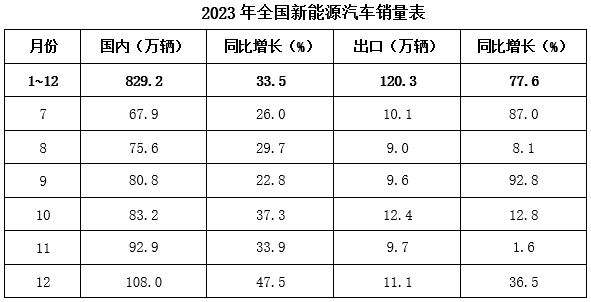

### 第 86 题

2023年上半年新能源汽车国内销量约为多少万辆？

A. 197

B. 321

C. 441

D. 508

第 86 题 · 答案与解析

**参考答案（粉笔题库参考内容）**

B

**解析**

定位表格可知2023年全年及下半年各月新能源汽车的国内销量。则2023年上半年新能源汽车国内销量=2023年1~12月新能源汽车国内销量-2023年下半年新能源汽车国内销量=829.2-(67.9+75.6+80.8+83.2 + 92.9 + 108.0)≈ 830 - (70 + 80 + 80 +80+90+110)\=830-510=320万辆，与B项最接近。

故正确答案为B。

**考点**：综合资料、简单加减计算

**来源**：2024年湖北省选调生招录考试综合知识和行政职业能力测验试卷（网友回忆版）第86题

### 第 87 题

2022年我国新能源汽车国内销量是出口销量的约多少倍？

A. 7

B. 8

C. 9

D. 10

第 87 题 · 答案与解析

**参考答案（粉笔题库参考内容）**

C

**解析**

根据题干“2022年······是······的约多少倍”，结合材料时间为2023年，可判定本题为基期倍数问题。定位表格可得：2023年，我国新能源汽车国内销量为829.2万辆（A），同比增长33.5%（a）；出口销量为120.3万辆（B），同比增长77.6%（b）。根据公式：基期倍数= A/B × (1+b)/(1+a)，则题干所求=829.2/120.3×(1+77.6%)/(1+33.5%)≈ 829/120 × 1.78/1.34≈ 6.9 × 1.3 = 8.97倍，与C项最接近。

故正确答案为C。

**考点**：基期倍数、综合资料

**来源**：2024年湖北省选调生招录考试综合知识和行政职业能力测验试卷（网友回忆版）第87题

### 第 88 题

2023年8~12月，我国新能源汽车国内销量和出口销量环比均增长的月份有几个？

A. 2

B. 3

C. 4

D. 5

第 88 题 · 答案与解析

**参考答案（粉笔题库参考内容）**

B

**解析**

定位表格可知2023年7~12月各月我国新能源汽车的国内销量与出口销量。观察发现，2023年8~12月我国新能源汽车国内销量环比增长的月份有：8月、9月、10月、11月、12月；出口销量环比增长的月份有：9月、10月、12月。因此，2023年8~12月我国新能源汽车国内销量和出口销量环比均增长的月份有：9月、10月、12月，共3个。

故正确答案为B。

**考点**：直接找数、综合资料

**来源**：2024年湖北省选调生招录考试综合知识和行政职业能力测验试卷（网友回忆版）第88题

### 第 89 题

以下哪张曲线图能准确反映2023年8~12月新能源汽车国内销量环比增速变化情况？

A. 

B. 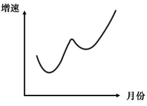

C. 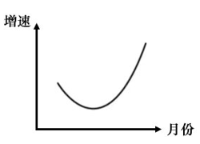

D. 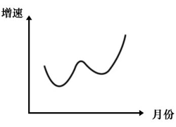

第 89 题 · 答案与解析

**参考答案（粉笔题库参考内容）**

C

**解析**

根据题干“······2023年8~12月······环比增速变化情况”，可判定本题为一般增长率问题。定位表格可知2023年7~12月各月我国新能源汽车的国内销量。根据公式：增长率= (现期量 − 基期量)/基期量，则2023年8~12月各月我国新能源汽车国内销量环比增速分别为：

8月，(75.6−67.9)/67.9≈7.7/68=11%^+；

9月，(80.8 - 75.6)/75.6 ≈ 5.2/76 = 6%^+；

10月，(83.2 − 80.8)/80.8 ≈ 2.4/81 = 2%^+；

11月，= (92.9−83.2)/83.2 ≈ 9.7/83 = 11%^+；

12月，(108.0-92.9)/92.9≈15.1/93=16%^+。

比较可知，2023年8~12月环比增速呈先下降后上升的趋势，排除B、D两项；由于8月环比增速＜12月环比增速，即曲线图的起点应低于终点，排除A项。

故正确答案为C。

**考点**：一般增长率、综合资料

**来源**：2024年湖北省选调生招录考试综合知识和行政职业能力测验试卷（网友回忆版）第89题

### 第 90 题

能够从上述资料中推出的是：

A. 2023年我国新能源汽车产量与销量之差小于2022年

B. 2023年8~12月我国新能源汽车出口销量环比增速逐渐增大

C. 2023年7~12月我国新能源汽车国内销量与出口销量之比逐渐增大

D. 2022年和2023年我国新能源汽车销量（国内销量+出口销量）均超过700万辆

第 90 题 · 答案与解析

**参考答案（粉笔题库参考内容）**

A

**解析**

A项：定位文字材料可得：2023年我国新能源汽车产销分别完成958.7万辆和949.5万辆，同比分别增长35.8%和37.9%。2023年我国新能源汽车产销量之差=958.7-949.5=9.2万辆，根据公式：基期量=现期量/(1+增长率)，则2022年我国新能源汽车产销量之差=958.7/(1+35.8%)−949.5/(1+37.9%)≈ 958.7/1.36 − 949.5/1.38≈ 705 − 688 = 17万辆，故2023年产销量之差<2022年产销量之差，正确；

B项：定位表格可知2023年7~12月各月我国新能源汽车的出口销量。根据公式：增长率= (现期量 − 基期量)/基期量，则2023年10月我国新能源汽车出口销量环比增速= (12.4-9.6)/9.6 ＞ 0，11月环比增速= (9.7−12.4)/12.4 ＜ 0。比较可知，10月环比增速>11月环比增速，则环比增速并非逐渐增大，错误；

C项：定位表格可知2023年7~12月我国新能源汽车国内销量与出口销量。则2023年9月我国新能源汽车国内销量与出口销量之比=80.8/9.6=8+，10月国内销量与出口销量之比=83.2/12.4=6^+。比较可知，9月国内销量与出口销量之比>10月国内销量与出口销量之比，则销量之比并非逐渐增大，错误；

D项：定位文字材料可得：2023年我国新能源汽车销量949.5万辆，同比增长37.9%。根据公式：基期量=现期量/(1+增长率)，则2022年我国新能源汽车销量= 949.5/(1+37.9%)≈ 949.5/1.4 = 600^+万辆<700万辆，错误。

故正确答案为A。

**考点**：综合分析、综合资料

**来源**：2024年湖北省选调生招录考试综合知识和行政职业能力测验试卷（网友回忆版）第90题

## 材料 2

2024年春节假期（2月10~17日），全社会跨区域人员流动量累计达22.93亿人次，其中：铁路客运量9946万人次，公路人员流动量21.67亿人次，水路客运量941万人次，民航客运量1799万人次。

2024年春节假期，全国边检机关共保障1351.7万人次中外人员出入境，日均169万人次，较2023年春节同期增长2.8倍，恢复至2019年春节同期的近九成，其中单日最高客流量出现在2月12日（正月初三），达185.7万人次。珠海拱北、深圳罗湖、深圳福田等口岸春节假期日均客流量分别达26万、18.7万、15.8万人次；上海浦东、广州白云、北京首都机场日均客流量分别达8.8万、3.7万、3.4万人次，较2023年春节假期分别增长4.9倍、6.2倍、7.5倍。

2024年春节假期，全国民航累计运输旅客1799.2万人次，日均运输旅客224.9万人次创历史新高。全国共保障航班13.7万班，日均17117班，较2019年增长4.9%，较2023年增长33.2%。其中国内客运日均14138班，较2019年增长17.7%，较2023年增长23.5%。航班正常率92.7%，较2019年提高9.2个百分点，较2023年下降5.5个百分点。

### 第 91 题

2024年春节假期，公路人员流动量占全社会跨区域人员流动量的比重约为：

A. 86.3%

B. 89.9%

C. 94.5%

D. 97.7%

第 91 题 · 答案与解析

**参考答案（粉笔题库参考内容）**

C

**解析**

根据题干“2024年春节假期······占······的比重约为”，结合材料时间为2024年春节假期，可判定本题为现期比重问题。定位材料第一段可知：2024年春节假期（2月10~17日），全社会跨区域人员流动量累计达22.93亿人次，其中：公路人员流动量21.67亿人次。根据公式：比重=部分/整体，则所求比重=21.67/22.93≈21.67/22.9≈94.6%，与C项最接近。

故正确答案为C。

**考点**：文字资料、现期比重

**来源**：2024年湖北省选调生招录考试综合知识和行政职业能力测验试卷（网友回忆版）第91题

### 第 92 题

2023年春节假期中外人员日均出入境人次占2019年同期的比例最接近以下哪个数值？

A. 1/2

B. 1/3

C. 1/4

D. 1/5

第 92 题 · 答案与解析

**参考答案（粉笔题库参考内容）**

C

**解析**

根据题干“2023年春节假期······占2019年同期的比例最接近以下哪个数值”，可判定本题为比值计算问题。定位材料第二段可知：2024年春节假期······中外人员出入境，日均169万人次，较2023年春节同期增长2.8倍，恢复至2019年春节同期的近九成。根据公式：基期量= 现期量/(1 + r)，则2023年春节假期中外人员日均出入境人次= 169/(1 + 2.8)；2019年春节假期中外人员日均出入境人次接近169/0.9，故所求比例接近169/(1 + 2.8)÷169/0.9= 9/38 ≈ 1/4。

故正确答案为C。

**考点**：比值计算、文字资料

**来源**：2024年湖北省选调生招录考试综合知识和行政职业能力测验试卷（网友回忆版）第92题

### 第 93 题

2023年春节假期，上海浦东、广州白云、北京首都机场日均客流量由高到低排名正确的是：

A. 上海浦东、北京首都、广州白云

B. 上海浦东、广州白云、北京首都

C. 广州白云、上海浦东、北京首都

D. 广州白云、北京首都、上海浦东

第 93 题 · 答案与解析

**参考答案（粉笔题库参考内容）**

B

**解析**

根据题干“2023年春节假期······日均客流量由高到低排名正确的是”，结合材料时间为2024年，可判定本题为基期比较问题。定位材料第二段可得：2024年春节假期，上海浦东、广州白云、北京首都机场日均客流量分别达8.8万、3.7万、3.4万人次，较2023年春节假期分别增长4.9倍、6.2倍、7.5倍。根据公式：基期量=现期量/(1+增长率)，则2023年春节假期上海浦东机场日均客流量为8.8/(1+4.9) = 8.8/5.9 ≈ 1.5万人次，广州白云机场为3.7/(1 + 6.2) = 3.7/7.2 ≈ 0.51万人次，北京首都机场为3.4/(1+7.5)=3.4/8.5=0.4万人次。故2023年春节假期，三大机场日均客流量由高到低排名依次是上海浦东、广州白云、北京首都。

故正确答案为B。

**考点**：文字资料、基期比较

**来源**：2024年湖北省选调生招录考试综合知识和行政职业能力测验试卷（网友回忆版）第93题

### 第 94 题

下列关于民航运输情况说法正确的有几项?

①2024年春节假期，平均每个航班运输旅客超过130人次

②2024年春节假期，国内客运日均航班数比2023年多2千多班

③2023年春节假期，航班正常率比2019年高14.7个百分点

A. 0

B. 1

C. 2

D. 3

第 94 题 · 答案与解析

**参考答案（粉笔题库参考内容）**

D

**解析**

①定位材料第三段可得：2024年春节假期，全国民航累计运输旅客1799.2万人次，共保障航班13.7万班。根据公式：平均数=总数/个数，则平均每个航班运输旅客1799.2万/13.7万≈131人次，超过130人次，正确；

②定位材料第三段可得：2024年春节假期，国内客运日均航班14138班，较2023年增长23.5%。根据公式：增长量= 现期量/(1 + 增长率) × 增长率，则所求增长量=14138/(1+23.5%)×23.5%≈ 14138/(1+1/4.5) × 1/4.5= 14138/5.5 = 2000^+班，正确；

③定位材料第三段可得：2024年春节假期，航班正常率92.7%，较2019年提高9.2个百分点，较2023年下降5.5个百分点。则2023年春节假期航班正常率比2019年高（92.7%+5.5%）-（92.7%-9.2%）=5.5%+9.2%=14.7%，即高14.7个百分点，正确。

综上所述，说法正确的有3项。

故正确答案为D。

**考点**：文字资料、综合资料

**来源**：2024年湖北省选调生招录考试综合知识和行政职业能力测验试卷（网友回忆版）第94题

### 第 95 题

不能从上述资料中推出的是：

A. 2024年春节假期，水路客运量不到铁路的10%

B. 2024年春节假期，深圳罗湖日均客流量超过深圳福田15%以上

C. 2024年，2月12日出入境人次占春节假期出入境人次的比例超过1/7

D. 2024年春节假期，民航国内客运日均班数占民航日均班数比重超过8成

第 95 题 · 答案与解析

**参考答案（粉笔题库参考内容）**

C

**解析**

A项：定位材料第一段可得：2024年春节假期，铁路客运量9946万人次，水路客运量941万人次。水路客运量/铁路客运量 = 941/9946<10%，即水路客运量不到铁路的10%，正确；

B项：定位材料第二段可得：2024年春节假期，深圳罗湖、深圳福田口岸日均客流量分别达18.7万、15.8万人次。则题干所求为(18.7-15.8)/15.8 = 2.9/15.8= 18^+%\>15%，即深圳罗湖日均客流量超过深圳福田15%以上，正确；

C项：定位材料第二段可得：2024年春节假期，全国边检机关共保障1351.7万人次中外人员出入境，其中单日最高客流量出现在2月12日，达185.7万人次。根据公式：比重=部分/整体，则题干所求为185.7/1351.7 ≈ 185.7/1350= 13^+%＜ 14.3% ≈ 1/7，即2月12日出入境人次占春节假期出入境人次的比例未超过1/7，错误；

D项：定位材料第三段可得：2024年春节假期，全国民航日均17117班，其中国内客运日均14138班。根据公式：比重=部分/整体，则题干所求为14138/17117 ≈ 14138/17100= 80^+%，即民航国内客运日均班数占民航日均班数比重超过8成，正确。

本题为选非题，故正确答案为C。

**考点**：文字资料、综合分析

**来源**：2024年湖北省选调生招录考试综合知识和行政职业能力测验试卷（网友回忆版）第95题

## 材料 3

2023年，我国邮政行业业务收入（不含邮储银行直接营业收入）累计完成15293亿元，同比增长13.2%，其中快递业务收入累计完成12074亿元，同比增长14.3%。

2023年，快递业务收入中，同城、异地、国际/港澳台快递及其他快递收入的比重分别为5.9%、49.7%、11.6%和32.8%，比重同比分别上升-1.3、0.8、0.5和0个百分点。东、中、西部地区快递业务量的比重分别为75.2%、16.7%和8.1%，业务收入比重分别为76.2%、14.1%和9.7%。与2022年相比，东部地区快递业务量比重下降1.6个百分点，快递业务收入比重下降1.4个百分点；中部地区快递业务量比重上升1.0个百分点，快递业务收入比重上升0.7个百分点；西部地区快递业务量比重上升0.6个百分点，快递业务收入比重上升0.7个百分点。

2023年，我国快递业务量排名前五的城市分别是金华市、广州市、深圳市、揭阳市和杭州市，业务量分别为136.9亿件、114.5亿件、63.7亿件、40.7亿件和40.1亿件；快递业务收入排名前五的城市分别是上海市、广州市、深圳市、金华市和杭州市，快递业务收入分别为2089.4亿元、892.2亿元、668.4亿元、372.3亿元和366.7亿元。

### 第 96 题

2023年，我国邮政行业业务收入（不含邮储银行直接营业收入）中，快递业务收入占比最接近几成？

A. 九成

B. 八成

C. 七成

D. 六成

第 96 题 · 答案与解析

**参考答案（粉笔题库参考内容）**

B

**解析**

根据题干“2023年······占比······”，结合材料时间为2023年，可判定本题为现期比重问题。定位文字材料第一段可得：2023年，我国邮政行业业务收入（不含邮储银行直接营业收入）累计完成15293亿元，其中快递业务收入累计完成12074亿元。根据公式：比重=部分/整体，则题干所求= 12074/15293 ≈ 12074/15000 ≈ 80%，即2023年我国邮政行业业务收入（不含邮储银行直接营业收入）中，快递业务收入占比最接近八成。

故正确答案为B。

**考点**：现期比重、综合资料

**来源**：2024年湖北省选调生招录考试综合知识和行政职业能力测验试卷（网友回忆版）第96题

### 第 97 题

2023年，我国平均每件同城快递实现业务收入约多少元？

A. 4.6

B. 4.8

C. 5.2

D. 5.6

第 97 题 · 答案与解析

**参考答案（粉笔题库参考内容）**

C

**解析**

根据题干“2023年······平均每件······”，结合材料时间为2023年，可判断本题为现期平均数问题。定位文字材料第一、二段可得：2023年，我国快递业务收入累计完成12074亿元，其中同城快递收入的比重为5.9%。定位表格材料可得：2023年，我国同城快递业务量为136.4亿件。根据公式：部分=整体×比重，则2023年我国同城快递收入= 12074 × 5.9%≈ 12074 × 1/17≈710亿元。根据公式：平均每件同城快递实现业务收入=同城快递收入/同城快递业务量，则2023年我国平均每件同城快递实现业务收入= 710/136.4≈710/136≈5.2元。

故正确答案为C。

**考点**：现期平均数、综合资料

**来源**：2024年湖北省选调生招录考试综合知识和行政职业能力测验试卷（网友回忆版）第97题

### 第 98 题

以下四个城市中，2023年单件快递实现的业务收入最高的城市是：

A. 上海

B. 广州

C. 深圳

D. 杭州

第 98 题 · 答案与解析

**参考答案（粉笔题库参考内容）**

A

**解析**

根据题干“······2023年单件快递实现的业务收入······”，结合材料时间为2023年，可判定本题为现期平均数问题。定位文字材料第三段可得：2023年，我国快递业务量排名前五的城市分别是金华市、广州市、深圳市、揭阳市和杭州市，业务量分别为136.9亿件、114.5亿件、63.7亿件、40.7亿件和40.1亿件；快递业务收入排名前五的城市分别是上海市、广州市、深圳市、金华市和杭州市，快递业务收入分别为2089.4亿元、892.2亿元、668.4亿元、372.3亿元和366.7亿元。根据公式：单件快递实现的业务收入= 快递业务收入/快递业务量，由于上海快递业务量不在全国快递业务量前五名，可得上海快递业务量低于40.1亿件（排名第5的杭州快递业务量），则其单件快递实现的业务收入高于2089.4/40.1 = 50^+元，其余三个城市单件快递实现的业务收入分别为：广州，892.2/114.5=7^+元；深圳，668.4/63.7 = 10^+元；杭州，366.7/40.1 = 9^+元。故上述四个城市中，2023年单件快递实现的业务收入最高的城市是上海。

故正确答案为A。

**考点**：现期平均数、综合资料

**来源**：2024年湖北省选调生招录考试综合知识和行政职业能力测验试卷（网友回忆版）第98题

### 第 99 题

2022年，我国东部地区快递业务量约为多少亿件？

A. 732

B. 849

C. 1086

D. 1103

第 99 题 · 答案与解析

**参考答案（粉笔题库参考内容）**

B

**解析**

根据题干“2022年······约为多少亿件”，结合材料时间为2023年，可判定本题为基期计算问题。定位统计表可知：2023年我国快递业务量为1320.7亿件，同比增速为19.4%。根据公式：基期量=现期量/(1+增长率)，可得2022年我国快递业务量为1320.7/(1+19.4%) ≈ 1320.7/1.19 ≈ 1110亿件。定位文字材料第二段可知：2023年东部地区快递业务量的比重为75.2%，与2022年相比，东部地区快递业务量比重下降1.6个百分点。可得2022年东部地区快递业务量的比重为75.2%+1.6%=76.8%，根据公式：部分=整体×比重，可得2022年我国东部地区快递业务量为1110 × 76.8% ≈ 852亿件，与B项最接近。

故正确答案为B。

**考点**：综合资料、基期计算

**来源**：2024年湖北省选调生招录考试综合知识和行政职业能力测验试卷（网友回忆版）第99题

### 第 100 题

根据所给材料，下列表述错误的是：

A. 我国2023年12月的异地快递业务量约占全年异地快递业务量的10%

B. 我国2023年12月的邮政集团其他寄递业务量大于同年1-11月的月均值

C. 2023年，我国中部地区实现的快递业务量是西部地区的2倍以上

D. 2022~2023年，我国国际/港澳台年均快递业务量超过27亿件

第 100 题 · 答案与解析

**参考答案（粉笔题库参考内容）**

D

**解析**

A项：定位统计表可得：2023年全年累计和12月我国异地快递业务量分别为1153.6亿件和115.3亿件。根据公式：比重=部分/整体，则我国2023年12月的异地快递业务量占全年异地快递业务量的比重=115.3/1153.6≈10%，正确；

B项：定位统计表可得：2023年全年累计和12月邮政集团其他寄递业务量分别为304.1亿件和29.2亿件。则1~11月邮政集团其他寄递业务量=全年邮政集团其他寄递业务量-12月邮政集团其他寄递业务量=304.1-29.2=274.9亿件。根据公式：月均值= 总量/月份数，则2023年1-11月邮政集团其他寄递业务量月均值=274.9/11＜25亿件<29.2亿件，即我国2023年12月的邮政集团其他寄递业务量大于同年1-11月的月均值，正确；

C项：定位文字材料第二段可得：2023年我国中、西部地区快递业务量的比重分别为16.7%和8.1%。根据公式：部分=整体×比重，则2023年我国中部地区实现的快递业务量/2023年我国西部地区实现的快递业务量 =(2023年我国实现的快递业务总量×16.7%)/(2023年我国实现的快递业务总量×8.1%) =16.7/8.1 ＞ 2倍，即2倍以上，正确；

D项：定位统计表可得：2023年国际/港澳台快递业务量30.7亿件，同比增速52.0%。根据公式：基期量= 现期量/(1 + r)，则2022年国际/港澳台快递业务量= 30.7/(1 + 52.0%) = 30.7/1.52 ≈ 20.2亿件。根据公式：年均快递业务量= 总量/年份数，则2022~2023年我国国际/港澳台年均快递业务量= (30.7+20.2)/2 = 25.45亿件<27亿件，错误。

本题为选非题，故正确答案为D。

**考点**：综合分析、综合资料

**来源**：2024年湖北省选调生招录考试综合知识和行政职业能力测验试卷（网友回忆版）第100题

