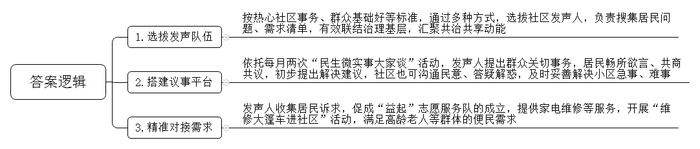
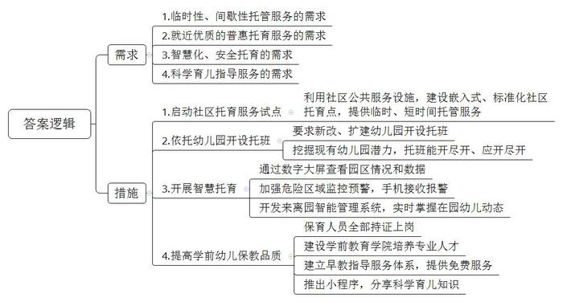
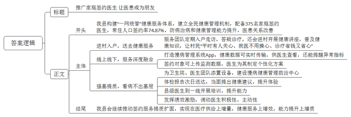
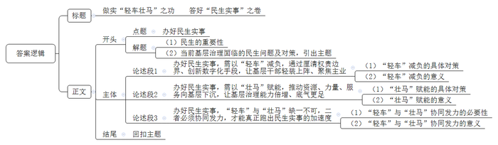

# 2025年公务员多省联考《申论》题（湖北县乡卷）

> 候选采集稿。参考答案及解析来自粉笔页面，不代表官方答案或真实高分答卷；来源使用许可与原卷对应关系仍需人工核实。

## 给定材料

### 材料 material-1df52fe75fc6442d

清晨，向阳街道周广社区里喧闹起来。“民生微实事大家谈”的展板前，街坊们拉着板凳围坐一处，居委会干部、物业公司代表也纷纷到场，热络“开聊”——

“10栋门前的地闲着太可惜了！杂草丛生，影响市容市貌。”一开场，社区发声人杨大姐率先提出了大家都关切的闲置地块问题。

“这次议事的主题是‘建设美丽家园’，对于这个地块的运营，大家有什么好主意吗？”随着本次“民生微实事大家谈”主持人、周广社区邵书记的提问，居民们纷纷建言献策。

“一半种上紫苏、一半种上鲜花，改造成小花园。”“暑假期间，还可以组织亲子活动，让孩子们参与进来，感受劳动的苦与乐。”经过一番热烈讨论，不仅解决办法有了，邻里相亲相爱的氛围也在大伙儿心间荡漾开。当邵书记宣布讨论结果时，现场掌声热烈，叫好声不断。

每月两次的“民生微实事大家谈”活动，既是居民畅所欲言、共商共议的舞台，也是基层党委、政府沟通民意、答疑解惑、服务群众的平台。社区发声人负责提出最近大家关心的社区事务，居民共同讨论，提出初步解决建议。小区所面临的一桩桩急事、难事，大都得到妥善解决。“这样的议事机制非常好！大家坐在一起，像‘拉家常’一样，想说什么就说什么，很多问题能得到及时解决！”杨大姐欣喜地说。

去年，向阳街道社区发声人聘任仪式举行，12名社区发声人正式“持证上岗”。此次选拔是根据热心社区事务、群众基础好、具备良好沟通技巧与社区影响力等标准，通过自愿报名、社区推荐、公开选拔等方式，从每个社区选拔出两名发声人，正式聘任组成一支12人的队伍。杨大姐是这次受聘的社区发声人之一。在周广社区生活了三十多年，杨大姐是个不折不扣的社区“红人”，她一直热心参与社区的公益活动，从电梯加装到调解居民纠纷，都可以看到她的身影。“有了这个新身份，担子更重了，但覆盖面也更广，可以帮助更多群众去发声。”杨大姐说，接下来她要努力提升自己的能力，充当好联系社区和居民的桥梁，为居民解决更多难事、烦心事，增进邻里之间的信任与互助。

“家电坏了找‘益起’。”在万发社区，有一支“益起”志愿服务队伍，专门从事常见的家电维修，服务范围已覆盖全街道，名声也越来越响亮。这支队伍的成立源自万发社区发声人老陈和邻居们的一次闲聊。“我家高压锅坏了，小区附近没有维修点，我都找过很多次了。”周阿姨无奈地说道。她的话打开了大家的话匣子：“我家的电视机也坏了，我一个星期都没看上电视。”“我家空调最近很吵，让人根本没办法睡。”……老陈这才发觉社区周边没有家电维修点。他把成立家电维修志愿服务队的想法告诉了社区书记老方，老方一听，立马表示支持，当天就在社区微信群里发布了招募公告。很快，“益起”志愿服务队就成立了。“社区发声人能从小处着手，收集‘微心愿’，有助于及时打通社区治理的堵点。”向阳街道办事处郭主任表示。

目前，“益起”志愿服务队共有成员25名，核心成员15名。“社区发声人把居民的烦恼告诉我们，起到了很好的沟通作用。”志愿者李先生说，“能为大家解决一些小问题，我也很开心。”随着服务范围的逐渐扩大，越来越多的居民知道了这支队伍。不少高龄老人提出了“便民维修来到家门口”的希望。老陈把他们的希望告诉了志愿服务队，经过多方协商，志愿服务队开展“维修大篷车进社区”活动，将“小修小补”搬到了居民家门口。

社区发声人队伍广泛搜集居民的“问题清单”“需求清单”。去年以来，向阳街道下辖6个社区已收集群众需求115个，确定项目106个，投入资金1612万元，其中社会资本1135万元。伴随社区发声人队伍的助力，“小而美”的变化在向阳街道时时发生。

“社区是社会治理的基本单元，是党和政府办好民生实事的‘最后一公里’。”郭主任表示，“社区发声人的形式能有效联结基层、治理基层，以声聚能，把基层组织与居民‘联’起来，‘聚’成共治共享的不息动能。”

### 材料 material-f6f186834ca92a4e

吃过早饭，69岁的马阿姨带着2岁半的外孙女，从海防村步行不到10分钟，便走到了宁江路街道综合为老服务中心的“宝宝屋”。把孩子托给老师后，她先到对面的社区卫生院配药，又到为老服务中心便民服务室剪了头发，十一点过后，马阿姨到长者食堂打包了午饭，最后回“宝宝屋”接外孙女回家。“这个‘宝宝屋’非常好，地方是街道的，老师是教育局培训过的，我把孩子交给他们非常放心，宝宝也很开心，入园前她能学着与小伙伴相处，而我能够腾出时间做点自己的事情。”马阿姨感慨道。

作为A市的民心工程之一，“幼有善育工程”一直受到市民的关注。“这几年，我们坚持政府主导、家庭为主、多方参与的模式，在全国率先探索并基本形成了以幼儿园托班为主体、普惠性资源为主导的托育服务体系。”市教育局方主任介绍，“‘宝宝屋’开放时间为周一至周五，每年可以为每位孩子免费提供12次托管服务，每次最多可托管半天时间。未来待模式成熟后，‘宝宝屋’将探索在免费的基础上对额外托管服务进行适当公益性收费，满足更多社区居民的托管需求。”去年A市启动了社区托育服务试点，利用党群服务中心、为老服务中心等公共服务设施，建设嵌入式、标准化的社区托育点“宝宝屋”。“宝宝屋”的出现，成为了A市全日托的公共服务“补丁”，为临时有事的年轻家长或带娃间歇想喘口气的祖辈提供了安心、放心的托管服务。

操场上，太宁第四幼儿园正在开展体验课活动，孩子们有序地跟随老师学习，快乐十足。已经两岁半的乐乐，今年9月成为太宁四幼首批托班学生，她再也不用麻烦邻居或亲友临时照看，再也不用“舍近求远”到5公里外的早教机构，而是在自家小区里就能享受到优质托育服务。太宁四幼是小区公建配套的公办幼儿园，教育设施齐全，教具丰富。“这里倡导科学启蒙，活动创设非常丰富，各类主题活动贯穿全年。”乐乐妈妈说，“今年他们增加了两个0~3岁托育班，我立刻给宝宝报了名，老师们尽心尽责，价格仅为私立幼儿园的一半左右，真是优质又实惠。”太宁四幼是A市学龄前儿童善育工程的一个缩影。从2020年起，A市就要求所有新建、改扩建幼儿园开设托班，同时在现有幼儿园中挖掘潜力，在保障小班幼儿入园基础上，托班能开尽开、应开尽开。目前全市开设托班的幼儿园占比达50.6%。

近两年，A市幼儿园也陆续完成了数字化转型。“‘智慧托育’是我们园的特色之一，通过智慧数字大屏，可以看到园区环境、一日流程、营养餐单、日常照护等情况，同时也能直观反映出勤状况、孩子健康及看护数据。”安庆路幼儿园易园长介绍道，“幼儿园有一些危险区域是孩子不能去的，比如说厨房、天台和仓库等。我们加强了监控预警，只要孩子们在这些地方出现，老师的手机就可以接到报警。”A市还开发了“幼儿来离园智能管理”系统，逐步推动全市幼儿园实现100%应用智能考勤，通过市、区相关平台数据的互联互通，实时掌握全市在园幼儿出勤、病事假等方面的情况动态，提高相关保教质量监控和预警能力，为幼儿健康成长护航。

“目前A市接受普惠性学前教育的幼儿占比超过90%，我们坚持为学前幼儿提供高品质的保教服务。”方主任介绍。A市不断推进学前教育教师队伍建设，严格要求保育人员100%持证上岗，几年前投资建设的A市学前教育学院今年将迎来第一批毕业生。同时，A市已建立“1+16+N”婴幼儿早教指导服务体系，“1+16”指市和区分别成立的早教服务中心，“N”指覆盖所有街镇的900多个早教指导站，每年为每个家庭提供不少于6次免费服务。此外，A市还推出了“育之有道”小程序，开设了“育儿周周看”“季度自检指标”“微视频指导方案”“专家讲堂直播”等板块，分享科学育儿知识，广受家长欢迎。

“幼儿托育事关千家万户，只有坚持问题导向，切实解决家庭的后顾之忧，才能实现‘幼有善育、不负所托’。但这项工作单靠主管部门是不够的，接下来，我们将更广泛地发动社会各界力量参与进来，不断完善托育硬件设施，持续提升服务质量，联合推进‘幼有善育工程’建设，打造区域托育服务新标杆。”方主任说。

### 材料 material-293a2bb850abff32

夜晚，穿上白大褂，背上医药箱，骑上摩托车，沿着山路赶往村民家中……这是B县桃源乡卫生院院长、家庭签约医生黄大夫的日常。“白天村民要干农活，所以我们经常晚上上门。山村开车不方便，我专门买了辆摩托车。”她表示，上门看诊，可以让村民特别是老人们“平时有人关心、就医不用操心、诊疗省钱又省心”，自己辛苦点也值得。

从卫生院出发，驱车沿着蜿蜒的山路前行，到长河村需要一个多小时。这样的路，黄大夫每个月都要走上好几回。“这里比较偏远，交通不便，村民们外出看病很麻烦。尤其是子女在外地的老人，等亲属回来再送诊容易错过治疗时机。”她说。在桃源乡卫生院，签约家庭医生的人数为7786人，其中1540名是老人。从2022年开始，黄大夫和家庭签约医生服务团队定期入户走访，至今已为7921人次送去健康服务。每次进村，除了答疑诊疗，他们还开展健康讲座，普及健康知识。

B县外出人口8万余人，农村留守老人多，全县有124个建制村，70多个偏远自然村，群众看病难问题长期存在。近年来，B县统筹优质医疗资源、网格化管理资源，构建“一网统管”健康服务体系，建立“分级统筹、双线并进、网格兜底”的县、乡、村网格三级全民健康管理机制。目前，B县像黄大夫这样的家庭签约医生有375名，全县常住人口家庭医生签约率74.87%、重点人群签约率93.42%，基层防病治病和健康管理能力得到了显著提升。

“今天门诊27人，转入患者14人，血糖监测人数9人……”黄大夫正在查看B县慢病管理系统App显示的实时数据。她介绍，家庭医生为村民测量的血压、血糖数据会实时传输到App，医生不仅能查看当日慢性病分层分级整体情况，例如高血压高危、中危、低危人数等，还能收到患者指标异常的提醒。在App上，签约对象可以上传自我监测数据，对自己进行健康管理，县级专科医生、乡（镇）村全科医生可以为签约对象制定个性化服务方案，实现了线上和线下服务深度融合。

家庭医生上门次数多了，与村民感情越发好了，关系也更亲近了。“有一天，我接到电话说上溪村吴奶奶突然晕倒了，就立即赶过去。当晚下着小雨，山路泥泞，一到村口，车轮就陷进沟里，我只好丢下车，走到吴奶奶家。”等黄大夫诊疗结束，回头找车，发现村民们早已把车抬了出来。“很感动，觉得大家就像一家人一样，不是亲人胜似亲人。”

长河村村民老蔡是个暴脾气，讲话很冲。他说，自己以前基本不看病，迫不得已去医院了，还很容易和医生吵架。“现在，他们就像我的朋友一样定期上门检查，还帮我建立了电子健康档案，每次检查结果，手机上就能看。”身体一有不舒服，老蔡就会通过手机App向家庭医生咨询问诊。“自从有了家庭医生，看病省钱了，配药省心了，就医方便了，我也更加理解医生的不容易了。大家伙儿都对他们竖起了大拇指。”

过去，B县基层卫生院冷清、设施落后、运营困难的局面普遍存在。近年来，B县为基层卫生院添置了彩超、化验等医疗设备，为家庭医生服务团队配备了智能血压仪、血糖仪，并投资770余万元建起了集日常随访、筛查、诊断、管理、转诊等功能于一体的慢病健康管理救治中心。以前给65岁以上老人体检，由于没有及时反馈，老人们感受不到体检的重要性。从2022年开始，家庭签约医生服务团队提供了当天体检、次日送达报告，并当面提出健康评估建议的服务，老人们的体验明显提升，尤其是在了解了自己的身体状况后，联系家庭医生咨询、就医频率慢慢提高。同时，B县总医院积极推动优质医疗资源下沉，县级专科医生经常到一线卫生院巡诊并开展医疗技术培训，群众到基层卫生院的就诊率迅速上升。

老林是一名老村医，他对这几年的变化很有感触。“以前，我们当村医，村民不信任，收入不稳定，还要靠种茶叶和锥栗维持生计。现在，村民小病不往外跑了，我们的收入也增加了、稳定了，我可以安心当医生了。”他感慨地说，村民留在基层看病多了，卫生院不闲置了，上级医院的压力也减轻了。

基层卫生院焕发了新的生机，以桃源乡卫生院为例，2021年还在亏损，推行家庭签约医生制度后，2022年终止亏损，2023年有了结余。2024年1月至8月，门诊人次共增加了1500余人次。“在这样的形势下，我们把优秀的医生留在基层，就更有底气了。”B县发挥绩效激励作用，对家庭医生服务团队进行严格绩效考核，多劳多得、优绩优酬，原则上将不低于70%的签约服务费用于家庭医生服务团队的薪酬分配，充分调动家庭医生的主动性和积极性。“这两年，我们卫生院来了好几个医科大学毕业的年轻人，队伍更加壮大了，有了人才，以后的工作就更好开展了。”黄大夫高兴地说。

繁琐而辛苦，是许多家庭签约医生的真实写照，日复一日的坚持中，凝结着他们的心血与付出。B县正全力推动家庭医生签约服务提质扩面，努力实现在医疗供给上增量，健康服务上增效，能力提升上增质，让群众在家就有“医”靠。

### 材料 material-927eee52eef6f183

《中共中央关于进一步全面深化改革、推进中国式现代化的决定》指出，进一步全面深化改革要坚持以人民为中心，尊重人民主体地位和首创精神，人民有所呼、改革有所应，做到改革为了人民、改革依靠人民、改革成果由人民共享。

习近平总书记在2025年新年贺词中指出：家事国事天下事，让人民过上幸福生活是头等大事。家家户户都盼着孩子能有好的教育，老人能有好的养老服务，年轻人能有更多发展机会。这些朴实的愿望，就是对美好生活的向往。我们要一起努力，不断提升社会建设和治理水平，持续营造和谐包容的氛围，把老百姓身边的大事小情解决好，让大家笑容更多、心里更暖。

2025年2月5日，湖北“新春第一会”——全省加快建成中部地区崛起重要战略支点推进大会举行。省委书记王忠林强调，要强化为民意识，树牢造福人民的政绩观。持续抓好十大类民生项目，用心用情解决好群众急难愁盼问题，更好统筹发展和安全，不断增强群众获得感、幸福感、安全感。

## 题目

### 第 1 题

**根据****“给定资料**2**”，谈谈向阳街道是如何“以声聚能”，开展社区为民服务和基层治理的。（15分）**

关联材料：material-1df52fe75fc6442d

作答要求：

要求：全面、准确，有条理。不超过250字。

### 第 2 题

**根据****“给定资料**3**”，请谈谈A市“幼有善育工程”满足了幼儿托育的哪些需求，采取了哪些措施。（20分）**

关联材料：material-f6f186834ca92a4e

作答要求：

要求：

（1）提炼准确，归纳合理；

（2）层次分明，分条表述；

（3）不超过300字。

### 第 3 题

**假如你是****B县卫健局的工作人员，请根据“给定资料**4**”，以“让医患成朋友”为主题写一篇宣传稿，介绍B县家庭****签约****医生制度的实施情况。（25分）**

关联材料：material-293a2bb850abff32

作答要求：

要求：

（1）紧扣资料，内容全面；

（2）逻辑清晰，语言准确；

（3）不超过400字。

### 第 4 题

**请你对资料中的****“轻车”“壮马”进行深入系统思考，围绕办好民生实事，联系实际，自选角度，自拟题目，写一篇策论文。（40分）**

关联材料：material-927eee52eef6f183

作答要求：

要求：

（1）观点明确，见解深刻；

（2）参考全部给定资料，但不拘泥于给定资料；

（3）思路清晰，语言流畅；

（4）字数1000字左右。

## 答案与解析

第 1 题

**参考答案（粉笔题库参考内容）**

1.选拔发声队伍。按热心社区事务、群众基础好等标准，通过多种方式，选拔社区发声人，负责搜集居民问题、需求清单，有效联结治理基层，汇聚共治共享动能。

2.搭建议事平台。依托每月两次“民生微实事大家谈”活动，发声人提出群众关切事务，居民畅所欲言、共商共议，初步提出解决建议，社区也可沟通民意、答疑解惑，及时妥善解决小区急事、难事。

3.精准对接需求。发声人收集居民诉求，促成“益起”志愿服务队的成立，提供家电维修等服务，开展“维修大篷车进社区”活动，满足高龄老人等群体的便民需求。

**解析**

**参考答案说明**：本参考答案围绕“选拔发声队伍”“搭建议事平台”“精准对接需求”这三个方面的做法分条撰写，各条具体要点之间在内容上相互并列，没有交叉。

**考点**：考点概括措施类

**来源**：来源2025年公务员多省联考《申论》题（湖北县乡卷）

粉笔申论页面对本题只提供「解析视频」入口，该入口是会员推广位，页面无视频地址与文字解析。

第 2 题

**参考答案（粉笔题库参考内容）**

需求：1.临时性、间歇性托管服务的需求。2.就近优质的普惠托育服务的需求。3.智慧化、安全托育的需求。4.科学育儿指导服务的需求。

措施：1.启动社区托育服务试点。利用社区公共服务设施，建设嵌入式、标准化社区托育点，提供临时、短时间托管服务。2.依托幼儿园开设托班。要求新改、扩建幼儿园开设托班；挖掘现有幼儿园潜力，托班能开尽开、应开尽开。3.开展智慧托育。通过数字大屏查看园区情况和数据；加强危险区域监控预警，手机接收报警；开发来离园智能管理系统，实时掌握在园幼儿动态。4.提高学前幼儿保教品质。保育人员全部持证上岗；建设学前教育学院培养专业人才；建立早教指导服务体系，提供免费服务；推出小程序，分享科学育儿知识。

**解析**

**参考答案说明**：本参考答案围绕“需求”与“措施”两个方面展开。其中，“需求”从四点呈现；“措施”从“启动社区托育服务试点”“依托幼儿园开设托班”“开展智慧托育”“提高学前幼儿保教品质”四个方面展开。各条答案要点之间在内容上相互并列，没有交叉。

**考点**：考点多要素组合类

**来源**：来源2025年公务员多省联考《申论》题（湖北县乡卷）

粉笔申论页面对本题只提供「解析视频」入口，该入口是会员推广位，页面无视频地址与文字解析。

第 3 题

**参考答案（粉笔题库参考内容）**

推广家庭签约医生 让医患成为朋友

我县构建“一网统管”健康服务体系，建立全民健康管理机制，配备375名家庭签约医生，常住人口签约率74.87%，防病治病和健康管理能力提升，医患关系改善。

进村入户，送去健康服务。服务团队定期入户走访，答疑诊疗，还会进村开展健康讲座，普及健康知识，让村民“平时有人关心、就医不用操心、诊疗省钱又省心”。

线上线下，服务深度融合。打造慢病管理系统App，健康数据可实时传输，供医生查看，还能提醒异常指标；签约对象可上传监测数据，医生为其制定个性化方案。

强基提质，看病不出基层。为卫生院、医生团队添置设备，建设慢病健康管理救治中心；体检报告次日送达，当面提出健康建议，提升体验；县级医生到一线开展培训，提升能力；发挥绩效激励，调动医生积极性、主动性。

我县会继续推动签约服务提质扩面，实现在医疗供给上增量，健康服务上增效，能力提升上增质。

**解析**

**参考答案说明**：（1）格式方面，本题没有明确的宣传对象和使用场景，无需撰写称谓和落款。本参考答案写到了“标题”“正文”两个部分。（2）正文部分，一方面从内容上来看，围绕“让医患成朋友”这一主题，本参考答案的开头先写到了“家庭签约医生制度的基本情况、背景等”；主体部分从“进村入户，送去健康服务”“线上线下，服务深度融合”“强基提质，看病不出基层”三个方面给出了具体做法和效果；结尾部分进行总结、展望。另一方面，形式上，本参考答案做到了分段、分条撰写，整体上条理较为清晰。

**考点**：考点宣传类

**来源**：来源2025年公务员多省联考《申论》题（湖北县乡卷）

粉笔申论页面对本题只提供「解析视频」入口，该入口是会员推广位，页面无视频地址与文字解析。

第 4 题

**参考答案（粉笔题库参考内容）**

**做实****“轻车壮马”之功** **答好****“民生实事”之卷**

民生无小事，枝叶总关情。办好民生实事，是检验基层治理能力的“试金石”。当前，面对群众日益多元的诉求，基层干部时常陷入“权责不匹配、资源不充足”的困境：既要应对繁杂事务，又难解群众燃眉之急。破解这一难题，必须运用“轻车”“壮马”的辩证思维，既为基层减负松绑，让其轻装上阵办好民生实事；又为基层赋能增效，使其筋骨强健满足群众期盼。

**办好民生实事，需以****“轻车”减负，通过厘清权责边界、创新数字化手段，让基层干部轻装上阵、聚焦主业。**一方面要制定科学的责任清单与协助事项目录，严格规范属地管理，杜绝责任转嫁和层层加码。同时，建设一体化数据平台，打破信息壁垒，实现“一次采集、多方利用”，并推广智能办公工具，提升工作效率。另一方面建立减负实效监测与反馈机制，完善以问题解决和群众满意为导向的考核体系，同时健全容错激励制度，为敢于担当、踏实做事者撑腰鼓劲。如此，才能真正确保基层“轻装上阵”，将全部心力投入到为民解忧纾困的实践中，真正把工作做到群众心坎上。

**办好民生实事，需以****“壮马”赋能，推动资源、力量、服务向基层下沉，让基层治理能力倍增、底气更足。**资金保障上，要优化财政事权划分，加大转移支付力度，设立民生专项资金，确保基层在解决群众急难愁盼问题时资金充足、保障有力。队伍建设上，要推动编制资源倾斜，建立部门派驻机制，促进专业力量下沉，加强业务培训，提升基层干部服务本领。服务延伸上，要下放高频事项，建设便民站点，推动教育、医疗、养老等资源覆盖基层，实现群众需求就近回应、民生实事就近办理。唯有多措并举，才能真正让基层成为有能力、有资源、有手段的治理主体，进而扎实有效地服务好群众。

**办好民生实事，****“轻车”与“壮马”缺一不可，二者必须协同发力，才能真正跑出民生实事的加速度。**倘若仅有“轻车”减负，基层虽卸下形式主义重担，却可能因资源不足、手段有限而陷入“有心无力”的困境，导致服务难以落地。反之，若只重“壮马”赋能，不断下沉资源与事权，却忽视为基层优化机制、厘清权责，则可能因流程冗杂、权责不清而导致资源“虚置”，治理效能不升反降。因此，“轻车”与“壮马”必须相辅相成、系统推进，在减负松绑的同时夯实支撑保障，在赋能下沉的同时优化运行机制，方能形成“车轻马壮”的合力，真正释放基层活力，推动民生实事高效落实。

“轻车”减负去虚功，“壮马”赋能强筋骨。卸下包袱、充实资源，基层干部方能办好民生实事，让发展更有厚度、答卷更有温度。

**解析**

**文章分析**

**做实****“轻车壮马”之功 答好“民生实事”之卷**

【**标题的优点：**首先，范文的标题突出了“办好民生实事”这一主题。其次，它在形式上采用对称式结构，使标题更加完整、饱满。】

（1）民生无小事，枝叶总关情。办好民生实事，是检验基层治理能力的“试金石”。（2）当前，面对群众日益多元的诉求，基层干部时常陷入“权责不匹配、资源不充足”的困境：既要应对繁杂事务，又难解群众燃眉之急。破解这一难题，必须运用“轻车”“壮马”的辩证思维，既为基层减负松绑，让其轻装上阵办好民生实事；又为基层赋能增效，使其筋骨强健满足群众期盼。

【**开头的优点：**★内容方面：范文的开头是紧扣“办好民生实事”这一主题展开的。首先，开头点出主题，做到了主题明确。其次，对“办好民生实事”这一主题进行了分析阐述：（1）指出民生的重要性；（2）阐述当前基层治理面临的民生问题及对策，从而引出主题。★文字表达方面：使用了关联词“既……又……”，使语言表达有逻辑性。】

**办好民生实事，需以****“轻车”减负，通过厘清权责边界、创新数字化手段，让基层干部轻装上阵、聚焦主业。**（1）一方面要制定科学的责任清单与协助事项目录，严格规范属地管理，杜绝责任转嫁和层层加码。同时，建设一体化数据平台，打破信息壁垒，实现“一次采集、多方利用”，并推广智能办公工具，提升工作效率。另一方面建立减负实效监测与反馈机制，完善以问题解决和群众满意为导向的考核体系，同时健全容错激励制度，为敢于担当、踏实做事者撑腰鼓劲。（2）如此，才能真正确保基层“轻装上阵”，将全部心力投入到为民解忧纾困的实践中，真正把工作做到群众心坎上。

【**论述段****1的优点：**★观点句：范文的观点句是紧扣“办好民生实事”这一文章主题提出的。形式上，它在段首处直接写出，位置突出，容易发现。内容上，关键词突出，内容要点明确，可以明显看出它是从“轻车”这个角度入手，指出了办好民生实事的对策及意义。★论述内容：（1）指出“轻车”减负的具体对策；（2）阐述“轻车”减负的意义。注意：以上两个方面的内容都是紧扣“办好民生实事，需以‘轻车’减负，通过厘清权责边界、创新数字化手段，让基层干部轻装上阵、聚焦主业”这个观点句进行分析论述的，论述的针对性强，内容层次丰富。最后，在论述方法上主要采用了讲道理的方式，论述清晰透彻。】

**办好民生实事，需以****“壮马”赋能，推动资源、力量、服务向基层下沉，让基层治理能力倍增、底气更足。**（1）资金保障上，要优化财政事权划分，加大转移支付力度，设立民生专项资金，确保基层在解决群众急难愁盼问题时资金充足、保障有力。队伍建设上，要推动编制资源倾斜，建立部门派驻机制，促进专业力量下沉，加强业务培训，提升基层干部服务本领。服务延伸上，要下放高频事项，建设便民站点，推动教育、医疗、养老等资源覆盖基层，实现群众需求就近回应、民生实事就近办理。（2）唯有多措并举，才能真正让基层成为有能力、有资源、有手段的治理主体，进而扎实有效地服务好群众。

【**论述段****2****的优点：**★观点句：范文的观点句是紧扣“办好民生实事”这一文章主题提出的。形式上，它在段首处直接写出，位置突出，容易发现。内容上，关键词突出，内容要点明确，可以明显看出它是从“壮马”这个角度入手，指出了办好民生实事的对策及意义。★论述内容：（1）指出“壮马”赋能的具体对策；（2）阐述“壮马”赋能的意义。注意：以上两个方面的内容都是紧扣“办好民生实事，需以‘壮马’赋能，推动资源、力量、服务向基层下沉，让基层治理能力倍增、底气更足”这个观点句进行分析论述的，论述的针对性强，内容层次丰富。最后，在论述方法上主要采用了讲道理的方式，论述清晰透彻。】

**办好民生实事，****“轻车”与“壮马”缺一不可，二者必须协同发力，才能真正跑出民生实事的加速度。**（1）倘若仅有“轻车”减负，基层虽卸下形式主义重担，却可能因资源不足、手段有限而陷入“有心无力”的困境，导致服务难以落地。反之，若只重“壮马”赋能，不断下沉资源与事权，却忽视为基层优化机制、厘清权责，则可能因流程冗杂、权责不清而导致资源“虚置”，治理效能不升反降。（2）因此，“轻车”与“壮马”必须相辅相成、系统推进，在减负松绑的同时夯实支撑保障，在赋能下沉的同时优化运行机制，方能形成“车轻马壮”的合力，真正释放基层活力，推动民生实事高效落实。

【**论述段****3****的优点：**★观点句：范文的观点句是紧扣“办好民生实事”这一文章主题提出的。形式上，它在段首处直接写出，位置突出，容易发现。内容上，关键词突出，内容要点明确，可以明显看出它是“轻车”与“壮马”的关系入手，指出了办好民生实事的对策及意义。★论述内容：（1）阐述“轻车”与“壮马”协同发力的必要性；（2）指出“轻车”与“壮马”协同发力的意义。注意：以上两个方面的内容都是紧扣“办好民生实事，‘轻车’与‘壮马’缺一不可，二者必须协同发力，才能真正跑出民生实事的加速度”这个观点句进行分析论述的，论述的针对性强，内容层次丰富。最后，在论述方法上主要采用了讲道理的方式，论述清晰透彻。】

【**论述段之间的关系：**★内容的内在逻辑：范文的论述段之间是依照并列的逻辑展开的。论述段1先写了“办好民生实事，需以‘轻车’减负，通过厘清权责边界、创新数字化手段，让基层干部轻装上阵、聚焦主业”，论述段2接着写了“办好民生实事，需以‘壮马’赋能，推动资源、力量、服务向基层下沉，让基层治理能力倍增、底气更足”，论述段3最后写了“办好民生实事，‘轻车’与‘壮马’缺一不可，二者必须协同发力，才能真正跑出民生实事的加速度”。这三个论述段按照“轻车”“壮马”“‘轻车’与‘壮马’的关系”展开，相互并列，逻辑清晰。】

“轻车”减负去虚功，“壮马”赋能强筋骨。卸下包袱、充实资源，基层干部方能办好民生实事，让发展更有厚度、答卷更有温度。

【**结尾的优点：**范文的结尾回扣了“办好民生实事”这个主题，并且进行了总结提升。】

**考点**：考点文章写作题

**来源**：来源2025年公务员多省联考《申论》题（湖北县乡卷）

粉笔申论页面对本题只提供「解析视频」入口，该入口是会员推广位，页面无视频地址与文字解析。

