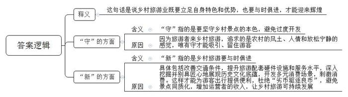
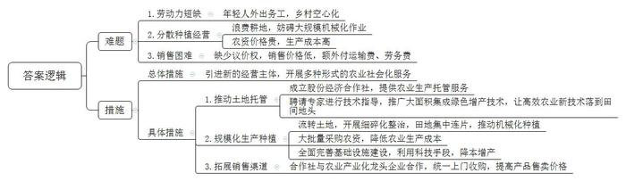
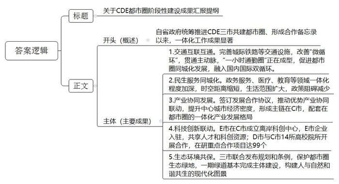
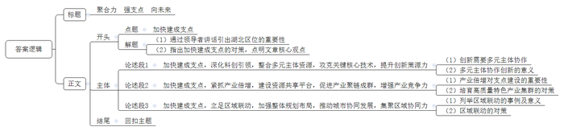

# 2025年公务员多省联考《申论》题（湖北省市卷）

<!-- gwy:overview:start -->
> **湖北 · 2025 · 申论 · 省市卷** ｜ 4 题 · 图片 4 处 · 答案随题折叠

导航：[题目](#题目) · [材料 1](#材料-1)
<!-- gwy:overview:end -->

> 候选采集稿。参考答案及解析来自粉笔页面，不代表官方答案或真实高分答卷；来源使用许可与原卷对应关系仍需人工核实。

## 给定材料

### 材料 1

A省火热的旅游市场中，许多游客愿意把假期交给“小地方”。

小邹是大学生，第一次乡村旅游是爸爸带着去的，从那次起他喜欢上乡村旅行。“虽然我不是来自农村，但农村的风土和人情常让人依恋，现在我也有了乡愁。”不过小邹说去的次数多了也会有踩坑的时候，明明宣传片很美，但实际却不是。乡村旅游的舟车劳顿也令他印象颇深：基本都是坐火车、飞机到一个城市，再一级一级往下转，甚至最后没有直达的公共交通，很不方便。有的地方道路还凹凸不平，拖着行李不好走。

小韩是在读研究生，研究方向为传统民居与乡土村落，他到过A省多个风格不同的景点做实地调研。“有些乡村景点过于时尚，装修得华丽张扬，尤其晚上灯光耀眼，震耳欲聋。”他感觉这样的景点和城市露天市场没有太大差别，旅游资源过度开发，旅游者想在紧张城市生活的疲惫中感受乡村的宁静放松，却发现和城市一样喧闹，当然只会让旅游者来去匆匆。小韩说，随着国家乡村振兴战略的逐步推进，乡村旅游其实大有可为，“发展乡村旅游，既要守，也要新。”

李女士的儿子正在读小学，他一直生活在城市里，李女士就想带他到乡村开拓视野，增长见识。这些年，李女士带儿子去过很多乡村景点，有的饭店环境整洁，主打当地特色食材，不仅品质新鲜，且“土味十足”；但也有饭店打着“当天采摘”的招牌，卖的却是菜场批发的食材；有的旅馆条件好，房间干净卫生，配套齐全，设计也有乡土风情，收费公道；但有的没有私人卫生间和淋浴设施，同一片区旅游配套的硬件设施和服务水平相差这么大，会导致对好的商家不公平，劣币驱逐良币。

70后的旅游爱好者老庄喜欢经常到各地看看。“一个地方有自己的精气神，眼里看得多了，心里就活起来了。”乡村景点的独特风情和历史文化让老庄眼界大开，收获不少。去的地方多了，老庄注意到A省有些地方开发出的古镇景点大同小异，没有独特的历史文化韵味。“乡村古镇的文化底蕴，既需要深入挖掘，还需要别具匠心的表现，这对开发者提出了很大的挑战。”老庄说，乡村景观设计有自身的特性，急需人才。对此，不少基层干部也有同感。旅游业是不冒烟的工厂。不少地方正致力于将乡村的生态、环境优势转化为产业优势，通过发展旅游为乡村增收，基层干部对此充满热情但点子不多，只能在网上学样子。小徐是刚毕业的乡镇干部，领导让他牵头打造一处村级文旅项目。苦于没有文旅项目经验，他只能找旅游攻略，依样画葫芦。小徐说：“反复推敲的方案还是难逃‘百村一面’的窠臼。”

“乡村游‘人从众’的背后，不少运营者收入不尽如人意。”一家乡镇田园旅游综合体负责人高总说，“重要节假日每天接待游客近万名，但人均消费不足10元。”近年来，休闲旅游生态发生大变化，随着智能通讯和汽车的普及，人们休闲度假方式更多样化，如自驾、露营等，乡村有时候只是一个暂留地。高总说，乡村旅游业既要立足自身特色和优势，也要与时俱进，才能迎来辉煌。

### 材料 2

又到了小麦收割的时间。“搁几年前，中午也得下地干活，忙得团团转。”B市大有村村民老刘说，“现在轻松了，从种到收再到销售，全程托管，省心又省力。”老刘每天送完孙子上学，就到村里的股份经济合作社打工。在老刘看来，合作社真是帮他解决了大问题。

老刘是当地种庄稼有名的“老把式”，自家的田地他都坚持自己耕种，后来随着年纪越来越大，儿女也都在外地打工，他逐渐感到有些力不从心了。“年轻人纷纷去城里打拼，村里种地的人越来越少。”叶书记说。

B市推广农业社会化服务的东风吹到了大有村。“为有效破解农业发展的难题，我们引进了新的经营主体，开展多种形式的农业社会化服务。”B市农业农村局曹局长介绍。在村支部的推动下，大有村很快成立了股份经济合作社，向村民提供农业生产托管服务。当年春耕开始前，就有69户村民与合作社签订合同，托管土地1.5万余亩。“不瞒你们，一开始我是反对的。”老刘有些不好意思，“我种了这么多年的地，他们能有我种得好吗？”为了动员老刘，叶书记开出条件：带地入社，还可以在合作社当农机手。老刘依然没松口。到了秋收，老刘发现，自己种的地和合作社的托管地紧挨着，收成却大不相同——托管地玉米每亩多收了50斤，大豆每亩多收了20斤。原来，除了提供托管服务，为农户统一供应农资农具、耕种及病虫害防治等服务外，合作社还聘请了省农业大学教授进行技术指导，大力推广一喷多防、水肥一体、智慧农机等大面积集成绿色增产技术，让高效农业新技术落到了田间地头。“比我们靠老经验好多了！”老刘说。第二年春耕前，不用人劝，老刘早早来到合作社，交钱、签单，把土地全部托管。至此，大有村实现整村托管。

B市农田长期分散种植经营，东一块、西一块，田埂沟渠不但浪费耕地，也妨碍大规模机械化作业。“土地流转给合作社后，合作社开展细碎化整治工作，把一块一块的田地集中连片。”曹局长说，这不仅提高了土地利用率，也为开展大规模机械化工作奠定了基础。在大有村，全村粮食生产由农户单家独户种植变为全村范围内集中连片规模种植。昔日的小田块被连片开阔的大田所替代，田块成方，沟渠成网，一台台无人驾驶的联合收割机在金黄麦田里来回穿梭。合作社共流转土地3000余亩，其中通过整合边角零碎土地，为村集体新增耕地资源约200亩，不仅实现了“小田”变“大田”，每年还可为村集体增收20余万元。

“看，今年的小麦麦粒多饱满！”B市某种植专业合作社社长老沈站在麦田里，把麦穗放在手里搓碎，又轻轻吹净麦皮，一把泛着清香的麦粒呈现在他的掌心。“今年种的是最新品种，通过科学种植，亩产可以达到1400斤，比去年平均亩产量多出了近两百斤！”老沈的语气里透露着欣喜，“过去农户买种子，价格一直谈不下来。但我们是大批量购买，哪怕是新品种，价格也能优惠很多。不光是种子，农药、农具等农资，合作社去谈都能便宜。”在老沈看来，有了规模优势，农业生产的成本远远低于分散种植。就拿浇水来说，小麦返青、拔节、灌浆的三个关键时期，要是都浇足水了，一亩就能多收两三百斤麦子。但浇一亩地一次得花100元左右，很多老百姓会少浇甚至“看天吃饭”。合作社把土地集中连片后，全面铺开改闸改水、水管铺设等基础设施建设，采取数字监控等科技手段，按需及时浇水，实现了每亩种植成本降低13%、粮食增产11%。

“丰收了也不愁不好卖。”老沈说，“以往农民自己去卖小麦，在市场上没有议价权，卖不上价格不说，还要额外付运输费、劳务费，我们合作社与一家农业产业化龙头企业合作，他们统一上门收购，每斤小麦还多卖5分钱。”

借助数字化时代浪潮推动农业社会化服务迈上新台阶，B市正在行动。“我市强化全域数字化服务，积极探索智慧农业建设，整合卫星遥感、北斗导航、多光谱分析、物联网、气象监测等技术，构建集采集、分析、预警、决策于一体的数字化动态监测体系，使社会化服务更加科学和精细。”曹局长表示，农业社会化服务让小农户也能搭上现代农业的快车，为推动乡村全面振兴注入强劲动能。

### 材料 3

家住C市的倪女士每天乘坐城际铁路，到同一都市圈的D市上班，40分钟就能到。随着这些交通设施的完善，CDE都市圈“一小时通勤圈”正在成型。改善“微循环”，促进都市圈同城化发展；贯通主动脉，融入国内国际双循环。

近年来，CDE都市圈的市民发现：公积金、医保、户籍等事项都能在城市服务数字平台和实体大厅“跨域通办”；都市圈内公立医疗机构全面实现就医“一卡通”；C市名校开始向D市、E市延伸……随着都市圈一体化程度不断加深，缩短了时空距离，扩大了生活范围，减少了政策阻碍。省政府确定C、D、E三个城市共同建设都市圈，形成合作备忘录，协调推进一体化工作。

位于E市开发区的一家电子电路公司原在C市，为与E市其他电子材料企业形成产业配套，迁至E市，推动其产业链优化升级，同时E市电子信息产业有效补强了C市光电显示产业链条。

张市长说：“我们签订了发展合作协议，都市圈聚焦光电子信息、生命健康、高端装备等产业，推动优势产业协同联动，提升中心城市C市的经济密度，逐渐形成主链在C市，配套在都市圈的一体化产业发展格局。去年，都市圈GDP同比增长6.3%，占全省GDP的60%。”

C市有众多高校和科研机构。“都市圈的定位决定了我们必须紧紧抓住科学技术这个第一生产力。”张市长说。E市在C市成立离岸科创中心，E市企业纷纷入驻，有利于企业就近利用C市的人才和科创资源。D市积极搭建科创平台，鼓励企业建立研发机构和博士后工作站，加快科技创新和成果转化。目前D市与C市14所高校院所开展合作，在研科技合作重点项目达99个，创历史新高。

“生态环境是高质量发展的核心目标之一，是衡量区域现代化进程的重要标尺。”张市长说。都市圈有一块总面积500多平方公里的生态绿地，它不仅是地理版图上的一抹绿，更是都市圈的“绿肺”。三市联合发布都市圈生态绿地总体规划和保护条例，保护这块绿地不受城市化进程的“蚕食”。目前，一期绿道已基本完成了主体建设，在都市圈，一幅人与自然和谐共生的现代化图景正在铺展开来。

### 材料 4

党的二十大报告指出，坚持系统观念。万事万物是相互联系相互依存的。我国是个发展中大国，仍处于社会主义初级阶段，正在经历广泛而深刻的社会变革，推动改革发展，调整利益关系，往往牵一发而动全身。我们要为前瞻性思考、全局性谋划提供科学思想方法。

2024年11月，习近平总书记考察湖北，赋予我们“在长江经济带高质量发展中奋勇争先，加快建成中部地区崛起的重要战略支点，奋力谱写中国式现代化湖北篇章”的新使命，对湖北工作提出更高定位、更高标准、更高要求。

2025年2月5日，湖北“新春第一会”发出加快建成支点的动员令，重点实施七大战略，整体提升七个能力：

一是大力实施能级跨越战略，整体提升支点的战略支撑力。坚定不移推进总量能级跨越，实施投资扩量提质、消费扩容提能行动，加快构建现代金融体系、现代供应链物流体系、高标准市场体系，增强战略发展实力和战略服务功能。

二是大力实施科创引领战略，整体提升支点的创新策源力。做大做强科技力量矩阵，滚动实施“61020”全链条攻关，加快攻克一批“卡脖子”关键核心技术。以“71020”高校创新体系为牵引，深化教育科技人才一体化改革，加快打造龙头引领、梯次发展的全域科技创新转化体系。

三是大力实施产业倍增战略，整体提升支点的产业竞争力。加快推进传统产业高端化智能化绿色化升级，推动新兴产业、未来产业在重点领域聚势突破、布局抢滩。完善“链长+链主+链创”工作机制，加快促进产业聚链成群。着力培育壮大领军企业、龙头企业，打造企业雁阵梯队。

四是大力实施枢纽提能战略，整体提升支点的开放辐射力。加快建设“轨道上的湖北、水运上的湖北、航线上的湖北”，以建设三个丝绸之路打造新时代“九州通衢”。大力开拓离岸、在岸业务，以离岸在岸一体化推动新时代“九州通商”。突出抓好标志性改革，持续优化营商环境，以高标准制度型开放推进新时代“九州通融”。

五是大力实施美丽湖北战略，整体提升支点的生态承载力。深入推进长江大保护，持续优化调整产业结构、能源结构、运输结构、用地结构，全面推进绿色低碳发展。梯次推进美丽城市、美丽乡村、美丽山川建设，拓宽绿水青山与金山银山的转化通道，打造具有全国影响力的碳市场和碳金融中心。

六是大力实施文化创新战略，整体提升支点的文化影响力。加强长江文化、荆楚文化、红色文化等特色资源保护传承和活化利用。围绕“一幅美丽的画、一本厚重的书、一首激昂的诗、一座丰饶的园、一架通达的桥”，擦亮长江三峡、太极武当、神农秘境等国际文旅名片，持续提高湖北文旅影响力和展示度。

七是大力实施区域联动战略，整体提升支点的区域协同力。紧扣高质量、一体化两个关键，建立健全武汉、襄阳、宜昌“金三角”协同发展机制，带动长江中游城市群联动发展，加强与京津冀、长三角、粤港澳、成渝等区域合作。推动百强县进位、千亿县扩容，大力发展镇域经济，推进乡村全面振兴。

## 题目

### 第 1 题

**根据****“资料**2**”，谈谈为什么说“发展乡村旅游，既要守，也要新”。（15分）**

关联材料：材料 1

作答要求：

要求：

（1）全面，准确，有条理；

（2）字数不超过250字。

第 1 题 · 答案与解析

**参考答案（粉笔题库参考内容）**

这句话是说乡村旅游业既要立足自身特色和优势，也要与时俱进，才能迎来辉煌。

一、“守”指的是要坚守乡村景点的本色，避免过度开发。因为旅游者来乡村旅游，追求的是农村的风土、人情和放松宁静的感觉，唯有守才能吸引、留住游客。

二、“新”指的是乡村旅游要与时俱进，具体包括改善交通条件，提升旅游配套硬件设施和服务水平，深入挖掘并别具匠心地展现历史文化底蕴，开发多元消费场景，刺激消费。这样才能为游客出行提供便利，杜绝“劣币驱逐良币”，避免景点同质化，增加运营者的收入，让乡村旅游可持续发展。

**解析**

**参考答案说明****：**本参考答案先总体解释了“发展乡村旅游，既要守，也要新”，然后再分别罗列“守”和“新”的含义和原因，各条答案要点之间在内容上是并列关系，没有交叉。

**考点**：考点原因类

**来源**：来源2025年公务员多省联考《申论》题（湖北省市卷）

粉笔申论页面对本题只提供「解析视频」入口，该入口是会员推广位，页面无视频地址与文字解析。

### 第 2 题

**根据****“资料**3**”，先归纳B市农业发展中存在的主要难题，然后指出破解的主要措施。（20分）**

关联材料：材料 2

作答要求：

要求：

（1）提炼准确，归纳合理；

（2）层次分明，分条表述；

（3）不超过300字。

第 2 题 · 答案与解析

**参考答案（粉笔题库参考内容）**

难题：

1.劳动力短缺。年轻人外出务工，乡村空心化。

2.分散种植经营。浪费耕地，妨碍大规模机械化作业；农资价格贵，生产成本高。

3.销售困难。缺少议价权，销售价格低，额外付运输费、劳务费。

措施：引进新的经营主体，开展多种形式的农业社会化服务。

1.推动土地托管。成立股份经济合作社，提供农业生产托管服务；聘请专家进行技术指导，推广大面积集成绿色增产技术，让高效农业新技术落到田间地头。

2.规模化生产种植。流转土地，开展细碎化整治，田地集中连片，推动机械化种植；大批量采购农资，降低农业生产成本；全面完善基础设施建设，利用科技手段，降本增产。

3.拓展销售渠道。合作社与农业产业化龙头企业合作，统一上门收购，提高产品售卖价格。

**解析**

**参考答案说明：**本参考答案分为“难题”和“措施”两个部分。其中“难题”部分从“劳动力短缺”“分散种植经营”“销售困难”三个方面展开；“措施”部分呈“总-分”结构，分别从“总体措施”和“推动土地托管”“规模化成产种植”“拓展销售渠道”三个方面的具体措施展开。本参考答案做到了分类分条撰写，各条答案要点之间在内容上相互并列，没有交叉。

**考点**：考点多要素组合类

**来源**：来源2025年公务员多省联考《申论》题（湖北省市卷）

粉笔申论页面对本题只提供「解析视频」入口，该入口是会员推广位，页面无视频地址与文字解析。

### 第 3 题

**省政府即将召开****CDE都市圈阶段性建设成果报告会，请以CDE都市圈办公室工作人员的身份，根据“资料**4**”，起草一份汇报提纲。（25分）**

关联材料：材料 3

作答要求：

要求：

（1）紧扣资料，内容全面；

（2）逻辑清晰，语言准确；

（3）不超过400字。

第 3 题 · 答案与解析

**参考答案（粉笔题库参考内容）**

关于CDE都市圈阶段性建设成果汇报提纲

一、概述：自省政府统筹推进CDE三市共建都市圈、形成合作备忘录以来，一体化工作成果显著。

二、主要成果：1.交通互联互通。完善城际铁路等交通设施，改善“微循环”，贯通主动脉，“一小时通勤圈”正在成型，促进都市圈同城化发展，融入国内国际双循环。2.民生服务同城化。政务服务、医疗、教育等领域一体化程度加深，时空距离缩短，生活范围扩大，政策阻碍减少。3.产业协同发展。签订发展合作协议，推动优势产业协同联动，提升中心城市经济密度，形成主链在C市，配套在都市圈的一体化产业发展格局。4.科技创新联动。E市在C市成立离岸科创中心，E市企业入驻，共享人才和科创资源；D市与C市14所高校院所开展合作，在研重点合作项目达99个。5.生态环境共保。三市联合发布规划和条例，保护都市圈生态绿地，一期绿道基本完成主体建设，构建人与自然和谐共生的现代化图景。

**解析**

**参考答案说明：**（1）格式方面，本参考答案写到了“标题+正文”两个部分。（2）正文部分，从内容上来看，本参考答案的开头部分先介绍了CDE都市圈的整体建设成果；接着，主体从“交通互联互通”“民生服务同城化”“产业协同发展”“科技创新联动”“生态环境共保”五个方面介绍了CDE都市圈的具体建设经验。从形式来看，本参考答案做到了分段、分条撰写，整体上条理较为清晰。

**考点**：考点总结类

**来源**：来源2025年公务员多省联考《申论》题（湖北省市卷）

粉笔申论页面对本题只提供「解析视频」入口，该入口是会员推广位，页面无视频地址与文字解析。

### 第 4 题

**请对****资料****中的画线句子进行深入思考，围绕加快建成支点，自选角度，自拟题目，写一份策论文。（****40分）**

关联材料：材料 4

作答要求：

要求：

（1）观点明确，见解深刻，内容充实；

（2）思路清晰，语言流畅；

（3）参考给定资料，但不拘泥于给定资料；

（4）1000字左右。

第 4 题 · 答案与解析

**参考答案（粉笔题库参考内容）**

**聚合力** **强支点 向未来**

2021年，习近平总书记在分析区域发展格局时强调：“中部地区发展不平衡不充分问题依然突出。”湖北位居中部腹地，发挥承东启西、连南接北的区位优势，成为中部地区崛起的重要战略支点。为此，要从创新驱动、产业集群、区域协作三个维度协同发力，加快建成支点，推动中部地区崛起迈上新台阶。

**加快建成支点，深化科创引领，整合多元主体资源，攻克关键核心技术，提升创新策源力。**“孤举者难起，众行者易趋。”创新不是单打独斗，需要各方勠力同心。政府要完善政策支持，做好精准招商，搭建科创载体，引进高科技人才队伍；企业要积极联合高校，开展产学研合作，助推工艺研发和人才培育；金融机构要强化资金支持，解决创新中的资金难题。通过多方协作、优势互补，让创新要素充分涌流，突破核心技术瓶颈，提升自主创新能力，为支点建设提供强劲动能。

**加快建成支点，紧抓产业倍增，建设资源共享平台，促进产业聚链成群，增强产业竞争力。**伴随规模扩张与质量提升的双轮驱动，产业倍增成为支点建设的核心引擎。因此，要有效整合资源，推动产业链纵向延伸与横向协作，培育高质量特色产业集群。一方面，鼓励龙头企业建立共享工厂，开放厂房、设备、技术等生产要素，降低中小企业的研发风险和成本；另一方面，依托5G和工业互联网等数字技术，建设产业集群共享数据中心，优化生产资源配置，促进企业间协同发展，为支点建设筑牢坚实支撑。

**加快建成支点，立足区域联动，加强整体规划布局，推动城市协同发展，集聚区域协同力。**香港倚重金融、深圳聚焦科创、广州凸显商贸、东莞精进制造，四城依托差异化资源禀赋协同发力，推动粤港澳大湾区向国际一流湾区与世界级城市群跃升。这生动印证，协同发展可加速城市要素流动，充分释放区域发展潜能。这既要科学规划，根据城市特点明确分工定位，避免同质竞争；也要完善机制，建立定期会商制度，及时沟通交流；还要打通堵点，在人才流动、资金融通等方面消除政策障碍。通过务实有效的区域协作，为支点建设汇聚强大合力。

“积力所举无不胜，众智所为无不成。”只有统筹推进科技创新、产业集群和区域协同，才能更好更快建成支点，展现中部崛起新气象，为构建新发展格局贡献中部力量。

**解析**

**文章分析**

**聚合力** **强支点 向未来**

【**标题的优点：**首先，范文的标题突出了“加快建成支点”这一主题。其次，形式上，文字简洁明快，不拖沓。】

（1）2021年，习近平总书记在分析区域发展格局时强调：“中部地区发展不平衡不充分问题依然突出。”湖北位居中部腹地，发挥承东启西、连南接北的区位优势，成为中部地区崛起的重要战略支点。（2）为此，要从创新驱动、产业集群、区域协作三个维度协同发力，加快建成支点，推动中部地区崛起迈上新台阶。

【**开头的优点：**★内容方面：范文的开头是紧扣“加快建成支点”这一主题展开的。首先，开头点出主题，做到了主题明确。其次，对“加快建成支点”这一主题进行了分析阐述：（1）通过领导者讲话引出湖北区位的重要性；（2）指出加快建成支点的对策，点明文章核心观点。★文字表达方面：长短句配合使用，使语言表达有节奏感。】

**加快建成支点，深化科创引领，整合多元主体资源，攻克关键核心技术，提升创新策源力。**（1）“孤举者难起，众行者易趋。”创新不是单打独斗，需要各方勠力同心。政府要完善政策支持，做好精准招商，搭建科创载体，引进高科技人才队伍；企业要积极联合高校，开展产学研合作，助推工艺研发和人才培育；金融机构要强化资金支持，解决创新中的资金难题。（2）通过多方协作、优势互补，让创新要素充分涌流，突破核心技术瓶颈，提升自主创新能力，为支点建设提供强劲动能。

【**论述段****1的优点：**★观点句：范文的观点句是紧扣“加快建成支点”这一文章主题提出的。形式上，它在段首处直接写出，位置突出，容易发现。内容上，关键词突出，内容要点明确，可以明显看出它是从“科创”这个角度入手，指出了加快建成支点的对策。★论述内容：（1）首先指出创新需要多元主体协作；（2）其次指出多元主体协作创新的意义。注意：以上两个方面的内容都是紧扣“加快建成支点，深化科创引领，整合多元主体资源，攻克关键核心技术，提升创新策源力”这个观点句进行分析论述的，论述的针对性强，内容层次丰富。最后，在论述方法上主要采用了讲道理的方式，论证透彻有力。】

**加快建成支点，紧抓产业倍增，建设资源共享平台，促进产业聚链成群，增强产业竞争力。**（1）伴随规模扩张与质量提升的双轮驱动，产业倍增成为支点建设的核心引擎。（2）因此，要有效整合资源，推动产业链纵向延伸与横向协作，培育高质量特色产业集群。一方面，鼓励龙头企业建立共享工厂，开放厂房、设备、技术等生产要素，降低中小企业的研发风险和成本；另一方面，依托5G和工业互联网等数字技术，建设产业集群共享数据中心，优化生产资源配置，促进企业间协同发展，为支点建设筑牢坚实支撑。

【**论述段****2****的优点：**★观点句：范文的观点句是紧扣“加快建成支点”这一文章主题提出的。形式上，它在段首处直接写出，位置突出，容易发现。内容上，关键词突出，内容要点明确，可以明显看出它是从“产业”这个角度入手，指出了加快建成支点的对策。★论述内容：（1）首先指出产业倍增对支点建设的重要性；（2）其次指出培育高质量特色产业集群的对策。注意：以上两个方面的内容都是紧扣“加快建成支点，紧抓产业倍增，建设资源共享平台，促进产业聚链成群，增强产业竞争力”这个观点句进行分析论述的，论述的针对性强，内容层次丰富。最后，在论述方法上主要采用了讲道理的方式，论证深刻有力。】

**加快建成支点，立足区域联动，加强整体规划布局，推动城市协同发展，集聚区域协同力。**（1）香港倚重金融、深圳聚焦科创、广州凸显商贸、东莞精进制造，四城依托差异化资源禀赋协同发力，推动粤港澳大湾区向国际一流湾区与世界级城市群跃升。这生动印证，协同发展可加速城市要素流动，充分释放区域发展潜能。（2）这既要科学规划，根据城市特点明确分工定位，避免同质竞争；也要完善机制，建立定期会商制度，及时沟通交流；还要打通堵点，在人才流动、资金融通等方面消除政策障碍。通过务实有效的区域协作，为支点建设汇聚强大合力。

【**论述段****3****的优点：**★观点句：范文的观点句是紧扣“加快建成支点”这一文章主题提出的。形式上，它在段首处直接写出，位置突出，容易发现。内容上，关键词突出，内容要点明确，可以明显看出它是从“区域”这个角度入手，指出了加快建成支点的对策。★论述内容：（1）首先列举区域联动的事例及意义；（2）其次指出区域联动的对策。注意：以上两个方面的内容都是紧扣“加快建成支点，立足区域联动，加强整体规划布局，推动城市协同发展，集聚区域协同力”这个观点句进行分析论述的，论述的针对性强，内容层次丰富。最后，在论述方法上主要采用了讲道理与举例子结合的方式，做到了丰富多样。】

【**论述段之间的关系：**★内容的内在逻辑：范文的论述段之间是依照并列的逻辑展开的。论述段1先写了“加快建成支点，深化科创引领，整合多元主体资源，攻克关键核心技术，提升创新策源力”，论述段2接着写了“加快建成支点，紧抓产业倍增，建设资源共享平台，促进产业聚链成群，增强产业竞争力”，论述段3最后写了“加快建成支点，立足区域联动，加强整体规划布局，推动城市协同发展，集聚区域协同力”。这三个论述段分别从“科创”“产业”“区域”进行论证，相互并列，逻辑清晰。】

“积力所举无不胜，众智所为无不成。”只有统筹推进科技创新、产业集群和区域协同，才能更好更快建成支点，展现中部崛起新气象，为构建新发展格局贡献中部力量。

【**结尾的优点：**范文的结尾回扣了“加快建成支点”这个主题，并且进行了总结提升。】

**考点**：考点文章写作题

**来源**：来源2025年公务员多省联考《申论》题（湖北省市卷）

粉笔申论页面对本题只提供「解析视频」入口，该入口是会员推广位，页面无视频地址与文字解析。

