# 2008年湖南省公务员录用考试《行测》题

<!-- gwy:overview:start -->
> **湖南 · 2008 · 行测 · 统考** ｜ 120 题 · 图片 17 处 · 答案随题折叠

| 题型模块 | 题量 | 题号 |
| --- | ---: | ---: |
| 言语理解与表达 | 20 | 1–20 |
| 数量关系 | 20 | 21–40 |
| 判断推理 | 30 | 41–70 |
| 常识判断 | 30 | 71–100 |
| 资料分析 | 20 | 101–120 |
| **合计** | **120** | |

导航：[题型与作答说明](#题型与作答说明) · [题目](#题目) · [材料 1](#材料-1)
<!-- gwy:overview:end -->

> 候选采集稿。参考答案及解析来自粉笔页面，不代表官方答案或真实高分答卷；来源使用许可与原卷对应关系仍需人工核实。

## 题型与作答说明

言语理解与表达

（20题）

本部分包括逻辑填空与阅读理解两种类型的题目。

数量关系

（20题）

本部分包括数字推理与数学运算两种类型的题目。

判断推理

（30题）

判断推理部分包括图形推理、定义判断、类比推理与逻辑判断四种类型的题目。

常识判断

（30题）

常识判断部分涵盖政治、经济、法律（涉及宪法、民法、行政法、经济法、刑法、诉讼法等）、管理、人文、科技等方面的内容，每道题围绕常识性问题列出若干备选项，要求从中选出正确答案。正确答案有单项选择和不定项选择，错选、多选、少选均不得分。

资料分析

（20题）

针对下列图、表或文字回答问题。你应根据资料提供的信息进行分析、比较、计算、处理。

## 题目

### 第 1 题

每个政府或国家都应该对那些二氧化碳排放过多的企业征收一种特殊税，或者＿＿这些排放大户购买更加环保的产品。

A. 要求

B. 建议

C. 强制

D. 请求

第 1 题 · 答案与解析

**参考答案（粉笔题库参考内容）**

A

**解析**

根据题干可知，此题考查的是近义实词的语境搭配。空格处缺少的动词的施受对象为“国家或政府”与“排放大户”，应填入正式场合用语。

A项正确，“要求”是指提出具体事项或愿望，希望对方做到或实现，表达出来的感情色彩很客观，符合空格处所缺少的成分。

B项错误，“建议”是向集体、领导等提出的主张，题干中是国家或政府对排放大户提要求，不符合政府身份。

C项错误，“强制”是强迫、迫使，语气太过强硬，题干并没有表示出国家或政府对排放大户的强迫。

D项错误，“请求”重点在“求”，语气不适合。

故正确答案为A。

**考点**：实词填空、词的辨析-词义侧重

**来源**：2008年湖南省公务员录用考试《行测》题第1题

### 第 2 题

丰子恺对待人生世事的冷观态度，在作者1935年写的《车厢社会》里，表现得更为明显。＿＿面对西湖美景，＿＿“只宜远看，不宜身入其中”，＿＿“世事都同风景一样，世事之乐不在实行而在希望”，＿＿“世间苦的根本”就在于“身在其中”。

A. 即使 也 而且 所以

B. 即使 也 因为 所以

C. 假如 却 那么 因为

D. 假如 却 既然 那么

第 2 题 · 答案与解析

**参考答案（粉笔题库参考内容）**

B

**解析**

考查运用关联词的能力。

根据题干意思，带空格的四个句子要表现的是丰子恺对待人生世事的冷观态度。“即使······也······”表示的是一种假设关系，“即使面对西湖美景，也只宜远看不宜身入其中”表达的是对待美景的冷静，契合题干想要表达的思想。而“假如······却······”表达出来的感情是对只远看不身入其中的不认同，是对题干“冷观态度”的否定。所以前两个空格应填“即使······也”，排除C、D两项。

再看第三个空格，“而且”表示递进，空格前后的两个句子并没有递进的关系，反而空格后是对为何面对美景只远观不近身的解释，所以第三个空格应填“因为”，排除A项。

最后把第四个空格处填上“所以”加以验证，因为“乐不在实行而在希望”，所以“身入其中”的“行”就是“不乐”了。第三、四句短语构成因果关系，B项当选。

故正确答案为B。

**来源**：2008年湖南省公务员录用考试《行测》题第2题

### 第 3 题

贝多芬曾多次＿＿地对小卡尔进行批评劝诫，但他的仁慈和宽容没有唤回毫无人性的小卡尔。

A. 殚精竭虑

B. 好心好意

C. 仁至义尽

D. 苦口婆心

第 3 题 · 答案与解析

**参考答案（粉笔题库参考内容）**

D

**解析**

此题考查成语的语境搭配。

A项错误，“殚精竭虑”形容耗尽精力，费尽心思，一般与事业相搭配。

B项错误，“好心好意”指怀着善意，语气程度不够。

C项错误，“仁至义尽”指竭尽仁义之道，指人的善意和帮助已经做到了最大的限度，与文意不符。

D项正确，“苦口婆心”比喻善意而又耐心的劝导，能最好的体现出贝多芬对小卡尔劝诫过程中的“仁慈和宽容”，最符合题意。

故正确答案为D。

**考点**：对应关系-前后呼应、成语填空

**来源**：2008年湖南省公务员录用考试《行测》题第3题

### 第 4 题

我们的研究发现，在工作动机上的个体差异是明显的。比如，对人类做出巨大贡献的两个人，洛克菲勒一生追求财富，圣雄甘地一生粗布缠身，人生目标＿＿。

A. 相差甚远

B. 各有所求

C. 截然不同

D. 南辕北辙

第 4 题 · 答案与解析

**参考答案（粉笔题库参考内容）**

C

**解析**

此题考查近义成语辨析和语境最佳选择。从题干可以看出，洛克菲勒和甘地的人生目标有非常明显的不同，解释了空格处的成语意思。

A项错误，“相差甚远”是说事物之间的差距很大，重点在于通过比较从中评出优劣，而题干并没有此意。

B项错误，“各有所求”是指每个人的追求都不一样，但没有体现不同的程度有多大。

C项正确，“截然不同”形容两件事物毫无共同之处，有非常明显的区别，与前文产生了强烈的呼应，符合文意。

D项错误，“南辕北辙”比喻行动和目的正好相反。

故正确答案为C。

**考点**：成语填空、词的辨析-词义侧重

**来源**：2008年湖南省公务员录用考试《行测》题第4题

### 第 5 题

我国的传统节日不像西方国家以宗教为主，我们是一个讲求礼义忠孝、仁爱康寿的＿＿，传统节日代表着我们天人合一、和谐共生的文化根基和历史印记。

A. 国家

B. 地区

C. 民族

D. 国度

第 5 题 · 答案与解析

**参考答案（粉笔题库参考内容）**

D

**解析**

此题考查近义实词侧重点的辨析与填空。

“国度”是在历史和地域的角度来对国家进行定位，所以横线处填“国度”，最为合适，D项正确。

“国家”是统治阶级实行统治的工具，侧重于阶级性，不符合题意，A项错误；“我们是一个······地区”，搭配有问题，B项错误；“民族”是长期历史形成的社会统一体，侧重于历史范畴，C项错误。

故正确答案为D。

**考点**：实词填空、词的辨析-搭配对象、词的辨析-词义侧重

**来源**：2008年湖南省公务员录用考试《行测》题第5题

### 第 6 题

爱因斯坦与波普尔都认为科学的理论是人类的“＿＿”而不是“＿＿”。或者说，在自然界背后并没有隐藏着“真理”等待我们“发现”，科学理论是人类的创造物。

A. 发明 发现

B. 创造 改造

C. 发现 发明

D. 改造 创造

第 6 题 · 答案与解析

**参考答案（粉笔题库参考内容）**

A

**解析**

此题考查近义实词的辨析和语境搭配。

第一空，根据题干，关键词“或者说”表示第二句话是对第一句话的解释，根据后面的语义“科学理论是人类的创造物”可知第一个空选“创造”的近义词。

第二空，根据“并没有隐藏着‘真理’等待我们‘发现’”，可知第二个空选“发现”的近义词。

故正确答案为A。

**考点**：实词填空、对应关系-解释说明

**来源**：2008年湖南省公务员录用考试《行测》题第6题

### 第 7 题

中国国家质检总局将继续加强对企业的监督管理，要求企业进一步完善其质量安全自控体系，确保出口日本产品质量安全；同时将继续加强与日方＿＿，＿＿其尽快解除对其余三十七家企业产品的检查命令，保证输日食品贸易的进展顺利。

A. 协商 要求

B. 商量 催促

C. 磋商 敦促

D. 洽谈 恳请

第 7 题 · 答案与解析

**参考答案（粉笔题库参考内容）**

C

**解析**

此题考查近义实词的不同侧重点的辨析和语境搭配。

A项错误，国与国之间正常贸易摩擦不能“要求”对方。

B项错误，根据材料，题干涉及国与国之间的交流与贸易，是正式场合，“商量”不能用于正式场合。

C项正确，“磋商”表示双方仔细商量和研究，交换意见。“敦促”表示以诚恳或迫切的态度催促或提醒注意，常用于正式文稿中，所以C项最符合空格处内容。

D项错误，国与国之间地位平等，不能用“恳请”。

故正确答案为C。

**考点**：实词填空、词的辨析-搭配对象

**来源**：2008年湖南省公务员录用考试《行测》题第7题

### 第 8 题

两栖爬行动物通过冬眠或夏蛰以抵御严寒酷暑；昆虫以“蛹”或“卵”的形式进行冬眠；鸟类借助长途迁徙或更替羽翼适应气候的变化。这都是＿＿的事。

A. 妇孺皆知

B. 众所周知

C. 家喻户晓

D. 鲜为人知

第 8 题 · 答案与解析

**参考答案（粉笔题库参考内容）**

B

**解析**

此题考查成语辨析和语境搭配。

题干想要表达的意思是：“为适应气候变化，生物会做出不同反应”这些知识大家都知道。A、B、C三项都表达“大家都知道”这个意思，但是词义偏重点不同，B项“众所周知”侧重于普遍性，用在此处最为合适，当选。A项“妇孺皆知”是说妇女和儿童都知道，侧重知名度高，C项“家喻户晓”指家家户户都知道，侧重流传广，D项“鲜为人知”是说很少有人知道，均不符合文意，排除。

故正确答案为B。

**考点**：对应关系-解释说明、成语填空、词的辨析-词义侧重

**来源**：2008年湖南省公务员录用考试《行测》题第8题

### 第 9 题

在人际交往中，多听少说，善于倾听别人讲话是一种良好的＿＿。

A. 修养

B. 格调

C. 素养

D. 道德

第 9 题 · 答案与解析

**参考答案（粉笔题库参考内容）**

C

**解析**

此题考查近义实词侧重点的不同和语境搭配。

A项错误，为干扰项，“修养”是逐渐养成的待人处世的正确态度，是人的综合素质，“善于倾听别人讲话”侧重于习惯，所以“素养”比“修养”更加有针对性。

B项错误，“格调”指不同作家或不同作品的艺术特点的综合表现，用在此处不合适。

C项正确，“素养”指修习涵养或平时养成的良好习惯，用在此处最为合适。

D项错误，“道德”是以善恶评价为标准的行为规范的总和，用在此处不合适。

故正确答案为C。

**考点**：实词填空、词的辨析-词义侧重

**来源**：2008年湖南省公务员录用考试《行测》题第9题

### 第 10 题

一款游戏能否吸引玩家，能否激发游戏者对游戏的激情，很大程度上＿＿游戏任务。游戏任务系统其实是通过各种任务剧情使游戏者融入到＿＿社会当中。在进行各项任务的同时，玩家已经不知不觉地＿＿起任务当中的某个角色，全身心地感受着虚拟世界当中的喜怒哀乐。

A. 依赖于 现实 挑战

B. 取决于 虚拟 扮演

C. 取决于 现实 扮演

D. 依赖于 虚拟 挑战

第 10 题 · 答案与解析

**参考答案（粉笔题库参考内容）**

B

**解析**

此题考查实词辨析和语境填空。

此题可以先从第二空入手，游戏社会不是真实存在的，所以第二空很明显应该填“虚拟”；因为游戏是虚拟社会，所以只有通过“扮演”，才能达到玩家与游戏角色的统一，而非“挑战”，所以第三空应填“扮演”。

根据文意可知，正是因为游戏任务系统各种任务剧情的设置，才使得玩家不知不觉融入了游戏。所以游戏任务的设置对于是否吸引玩家，是否激发玩家的热情具有决定性的作用，所以第一空应填“取决于”。

故正确答案为B。

**考点**：实词填空、对应关系-前后呼应

**来源**：2008年湖南省公务员录用考试《行测》题第10题

### 第 11 题

面对大众文化扑面而来，我国主流文化大有力不从心，步步退缩的趋势，而面对西方强大的文化热潮，主流文化大有与“狼”共枕之感。主流文化，只有经过与狼“共枕”的温存和与狼“共舞”的较量，才能获得健康的传承基因和生命活力。

此段文字意在说明：

A. 主流文化备受各方的威胁，已经面临绝境

B. 任何事物只有竞争才能生存

C. 面对大众文化与西方文化的竞争，主流文化危在旦夕

D. 主流文化必须要经过与其他文化斗争才能蓬勃发展

第 11 题 · 答案与解析

**参考答案（粉笔题库参考内容）**

D

**解析**

据提问“意在”一词可知此题属于中心理解题，需要考生推断意图。

分析文段的结构，可知构成“分—总”结构，最后一句是关键句，通过“主流文化，只有经过与狼‘共枕’的温存和与狼‘共舞’的较量，才能获得健康的传承基因和生命活力”可以引申得出，主流文化只有通过与其他文化的竞争和融合后，才能够健康、蓬勃发展，对应D项。

A、C两项中“绝境”、“危在旦夕”表达过于绝对；B项表述过于空泛。

故正确答案为D。

**考点**：关联词-对策、分述句特征-引入铺垫

**来源**：2008年湖南省公务员录用考试《行测》题第11题

### 第 12 题

如果科学追求真理但又不可能得到真理，难免导致不可知论或怀疑论的悲观论调，况且我们一旦得到真理，也就等于宣布科学的终结；但如果科学追求好的理论，我们对科学的看法就非常乐观；现在我们手中有迄今为止最好的理论，但将来还可能有更好的理论来代替它。

根据这段文字我们可得出结论是：

A. 科学研究不能定位于寻找真理

B. 改掉对真理的说法是为了让人们对科学的追求保持乐观

C. 这个世界上是不存在绝对真理的

D. 人们总是给自己很多借口来拒绝寻找真理

第 12 题 · 答案与解析

**参考答案（粉笔题库参考内容）**

A

**解析**

此题难度很高，为中心理解题。文段开篇第一句强调“科学如果追求真理，可能带来不好的结果”，接下来“况且”引导并列，后文通过“但”转折，强调“科学如果不追求真理而是追求理论的话会很乐观”，又一个分号依然引导并列，后文依然强调“科学理论没有最好，只有更好”。所以文段通过“况且”和“；”引导三方面并列，共同强调“科学不应该只去追求真理”，对应A项。

B项“乐观”对应“况且”后，表述片面，排除；C项“不存在绝对真理”对应最后一个分句，表述片面，排除；D项“拒绝寻找真理”无中生有，排除。

通过材料中三个并列的分句得出以下几个信息：“科学追求真理”是一个错误的说法；科学追求的应是“好的理论”；“科学追求好的理论”这个说法让我们对科学的看法变得乐观；理论没有最好，只有更好。

故正确答案为A。

**考点**：关联词-并列

**来源**：2008年湖南省公务员录用考试《行测》题第12题

### 第 13 题

雨天，车身被蒙上一层土，这层土像细砂纸般包在车身上，一旦有摩擦，就如同用砂纸来磨车漆；此外，雨中含有各种有害物质，被泥沙吸住后，酸雨就很容易腐蚀车漆。

此段文字的主旨是（    ）。

A. 雨中的灰尘对车身会造成磨损

B. 雨水对车漆带来危害的原因

C. 酸雨是腐蚀车身的主要原因

D. 保护车就一定不要让车淋雨

第 13 题 · 答案与解析

**参考答案（粉笔题库参考内容）**

B

**解析**

本题属于中心理解题。文段是分-分结构，由“此外”引导，第一个分句介绍雨中的灰尘对车漆的影响；第二个分句介绍酸雨对车漆的影响。结合选项，B项对文段概括最全面，当选。

A项，只概括了文段第一个分句的内容，不全面，排除。

C项，只概括了文段第二个分句的内容，不全面，排除。

D项，原文未涉及相关内容，属于无中生有，排除。

故正确答案为B。

**考点**：关联词-并列

**来源**：2008年湖南省公务员录用考试《行测》题第13题

### 第 14 题

奥运盈利不只包括奥运本身的成功，还要考虑到一个国家举办奥运其他的产业经济发展情况。2008年奥运会对于北京经济的影响可以说是广泛且深远的，除了与赛事最直接相关的场馆建设、市政基础设施投入、旅游消费、体育产业等方面的巨大商机之外，更为中国和北京提供了一个向世界展示的巨大舞台。随着世界越来越多地了解中国、了解北京，很多潜在的商机就会浮出水面并接踵而来。

这段话主要支持了这样一个观点：

A. 举办奥运会的城市可借奥运实现盈利

B. 奥运会可以带动多项产业经济的发展

C. 中国应该抓住奥运这个舞台展示自己

D. 奥运处处是商机，北京将会空前发展

第 14 题 · 答案与解析

**参考答案（粉笔题库参考内容）**

B

**解析**

据提问知此题是中心理解题。

文段开头提出观点：奥运盈利不只包括奥运本身，还包括由奥运影响的其他产业经济发展；然后，通过2008年北京奥运对北京经济的影响来做具体的解释；最后又说随着世界发展，更多的商机会接踵而来，可见奥运果然可以推动多项产业发展，再次重申并印证了开头提出的观点。这属于典型的“提出观点—解释论证—重申评价”的总—分—总结构，解答文段主旨的关键就在于“总”，B项表述最为全面准确。

A、C两项都是“分”的内容；D项表述过于主观。

故正确答案为B。

**考点**：分述句特征-举例子

**来源**：2008年湖南省公务员录用考试《行测》题第14题

### 第 15 题

不难理解，对人类艺术创造所怀抱的这种神圣感，会使我们像珍视大汶口的“日月山”陶尊、康王大盂鼎、米洛的维纳斯，或悲鸿先生失魂落魄地寻找他视同生命的《八十七神仙卷》那样去寻踪、朝拜和珍藏这些独一无二的人类秘真，直到千秋万代，子子孙孙永保之。

这段话支持了这样一个观点：

A. 人类会对艺术像生命一样去珍藏，让子孙永久保存

B. 只有对艺术创造怀有神圣感的人才有可能去寻踪、朝拜、珍藏

C. 悲鸿先生对人类创造的所有艺术都充满了神圣感

D. 除了“日月山”陶尊、康王大盂鼎、米洛的维纳斯外，就没有值得人类珍藏的艺术了

第 15 题 · 答案与解析

**参考答案（粉笔题库参考内容）**

B

**解析**

据提问知此题是中心理解题。

通过阅读材料，我们可以提取出这个长句子的主干，即“对人类艺术创作所怀抱的这种神圣感，会使我们去寻踪、朝拜和珍藏这些独一无二的人类秘真，直到千秋万代”。据此分析可以得出，对人类艺术创作没有抱有这种神圣感是不会去寻踪、朝拜和珍藏这些人类秘真的，只有抱有这种神圣感的人才会去寻踪、朝拜和珍藏这些秘真，B项符合文意。

A项表述与文意不符，不是所有的人类都可以做到；C项“所有艺术”过于绝对；D项表述片面。

故正确答案为B。

**考点**：关联词-并列

**来源**：2008年湖南省公务员录用考试《行测》题第15题

### 第 16 题

如果你最亲密的朋友是公司的高级主管，那么你们在一起时所谈论的主要内容一定是关于如何管理和经营的；如果你最亲密的朋友是公司的职员，那么你们在一起时谈论的主要话题一定是关于如何工作的；如果你最亲密的朋友是房地产商，那么你们谈论的话题一定会是关于房地产的。

此段文字反映了这样一个观点：

A. 当外因足够强大的时候可以改变内因

B. 朋友圈子是决定你生活方式的关键

C. 人们的话题总是和朋友的工作紧密联系的

D. 不同的朋友会为你营造不同的生活环境

第 16 题 · 答案与解析

**参考答案（粉笔题库参考内容）**

C

**解析**

本题属于中心理解题。文段三个分句是并列关系，阐述的是“朋友的工作”和“谈论话题”之间的关系。结合选项，C项符合文段观点，当选。

A项，文段未涉及“内因”“外因”，属于无中生有，排除。

B项，“决定”的说法过于绝对，文段只表述了朋友对我们的影响，而不是决定作用，排除。

D项，“生活环境”在原文未体现，属于无中生有，排除。

故正确答案为C。

【文段出处】《朋友与财富》

**考点**：关联词-并列

**来源**：2008年湖南省公务员录用考试《行测》题第16题

### 第 17 题

科学的可靠性还源于科学界具有公认的评价准则，所以能对理论取得一致意见，因此在比较成熟的科学领域，一个问题无论问哪一个科学家，都可以得到大致相同的答案。哲学、伦理学等学科没有公认的评价准则，同一个问题问不同的哲学家或伦理学家可能得到完全相反的结果，令人无所适从。

从这段文字中，能够获取的信息是：

A. 哲学、伦理学等学科的科学家基本上都是自立门户

B. 哲学、伦理学属于不成熟的科学

C. 哲学、伦理学没有一点可靠性

D. 科学的可靠性不能全靠评价同一问题的一致度

第 17 题 · 答案与解析

**参考答案（粉笔题库参考内容）**

D

**解析**

据提问可知本题为细节判断题。

根据材料第一句话“科学的可靠性还源于······”中的关键字“还”，表明除了“因为科学界具有公认的评价准则，所以评价同一问题具有一致度”而说明“科学的可靠性”之外，还有其他的证据可以说明“科学的可靠性”，D项表述符合文意。

A项缺少依据，虽然同一问题反映不同，但不等于“都”自立门户；B、C两项均与文意不符。

故正确答案为D。

**考点**：细节判断题

**来源**：2008年湖南省公务员录用考试《行测》题第17题

### 第 18 题

日本《呼声》月刊最新一期刊发日本京都造型艺术大学教授竹村真一撰写的《是全世界在污染中国》一文。文章指出，单纯地将污染、食品安全等责任归咎于中国，无益于问题的解决，简单地认为“都是中国的错”，则可能会让整个世界在将来偿还更大的亏空。

根据文意，下列选项中说法有误的是：

A. 世界环境污染不只是由中国造成的

B. 此事件说明日本人对中国人变得越来越友好

C. 单纯将污染环境的原因归罪于中国，世界环境得不到根本的解决

D. 竹村真一认为，简单地认为“都是中国的错”的说法是错误的

第 18 题 · 答案与解析

**参考答案（粉笔题库参考内容）**

B

**解析**

据提问可知本题为细节判断题。

A项正确，从材料最后一句话我们可以看出，不能单纯地把污染问题归罪于中国，其他国家也有相应的责任。

B项错误，在材料中并没有提及，属于主观臆断。

C项正确，简单地把污染原因归罪于中国，会带来更大的问题，并不能更好地解决污染。

D项正确，根据《是全世界在污染中国》一文可以看出竹村真一对“都是中国的错”这一说法持否定态度。

本题为选非题，故正确答案为B。

**考点**：细节判断题

**来源**：2008年湖南省公务员录用考试《行测》题第18题

### 第 19 题

下列句子排序中最恰当的一项是：

①一个国家也必须有精神高地，便于人们登高眺望

②洼地与高地的形成，都有赖于机会平等的体制建设

③如果相应的机会被垄断，不曾寻求与权力对接的平常人，就只能望价值高地而兴叹，见精神洼地而沉溺，他就既不会拥有财富，也不能享有精神生活

④岁暮天寒，人们在期望，这个国家的一切制度都以普惠于民为依归

⑤一个国家必须有价值洼地，便于人们走入获利

A. ④-①-⑤-③-②

B. ⑤-①-②-③-④

C. ④-⑤-①-③-②

D. ⑤-①-②-④-③

第 19 题 · 答案与解析

**参考答案（粉笔题库参考内容）**

B

**解析**

首先对比选项判断首句，④句是总结评价说结果的句子，不能放在文段开头，排除A、C两项；⑤句和①句存在并列关系，由关联词“也”可知⑤句和①句形成捆绑。③句“如果相应的机会被垄断”，一定是之前先出现了“机会”，才能对“相应的机会”做出假设，所以②句应紧排在③句之前，排除D项。④句是总结性句子，应该放在最后，所以排列顺序是⑤①②③④。

故正确答案为B。

**考点**：确定尾句、确定捆绑、确定首句-非首句特征

**来源**：2008年湖南省公务员录用考试《行测》题第19题

### 第 20 题

如果我们要更深一层地研究梦思和梦内容的关系，最好的方法便是把梦作为起点，然后研究梦表现方法中的正统特征究竟和底下的思想有什么关系。最显著的是，梦里面各种梦的影像会激发起不同的感觉强度，而梦的各段或者是不同的梦都具有不同的清楚度。

文中“梦思”的意思为：

A. 梦的表现方法

B. 梦的正统特征

C. 梦的思想

D. 梦的思维过程

第 20 题 · 答案与解析

**参考答案（粉笔题库参考内容）**

C

**解析**

定位原文，“梦思”出现在文段开头。文段首先指出要研究梦思和梦内容的关系，方法是把梦作为起点，研究梦表现方法中的正统特征与“底下的思想”的关系，随后通过“梦的影像”会激发不同的感觉强度，且各个梦都有不同的清晰度，具体阐述“梦表现方法中的正统特征”其实是一种外在的表现，即梦内容。由此可知，梦内容对应的是梦表现方法中的正统特征，梦思则对应底下的思想，对应C项。

A项，“梦的表现方法”是承载“梦内容”的载体，属于外在表现范畴，和“梦思”的内在属性完全相悖，排除。

B项，“梦的正统特征”是研究梦思和梦内容关系的一个切入点，并非“梦思”本身，排除；

D项，“梦的思维过程”在文中未提及，无中生有，排除。

故正确答案为C。

【文段出处】书籍《梦的解析》

**考点**：实词

**来源**：2008年湖南省公务员录用考试《行测》题第20题

### 第 21 题

2，10，17，23，（   ），32

A. 25

B. 26

C. 27

D. 28

第 21 题 · 答案与解析

**参考答案（粉笔题库参考内容）**

D

**解析**

数列整体为递增，后项与前项作差可得8，7，6，（    ），可知作差二级数列为等差数列，此时括号里应填入5，原数为23+5=28。

故正确答案为D。

**来源**：2008年湖南省公务员录用考试《行测》题第21题

### 第 22 题

1，10，2，（   ），3，8，4，7，5，6

A. 6

B. 7

C. 8

D. 9

第 22 题 · 答案与解析

**参考答案（粉笔题库参考内容）**

D

**解析**

原数列不存在递增递减，且相邻项差异较大，通过观察可将数列奇偶项分组。奇数项为1，2，3，4，5；偶数项为10，（    ），8，7，6。可知，括号里应填入9。

故正确答案为D。

**来源**：2008年湖南省公务员录用考试《行测》题第22题

### 第 23 题

3，8，6，11，9，14，（   ），（   ）

A. 11，16

B. 12，16

C. 12，17

D. 13，17

第 23 题 · 答案与解析

**参考答案（粉笔题库参考内容）**

C

**解析**

原题干为交叉数列。

奇数项：3，6，9，（12）是公差为3的等差数列；

偶数项：8，11，14，（17）是公差为3的等差数列。

故正确答案为C。

**来源**：2008年湖南省公务员录用考试《行测》题第23题

### 第 24 题

2，8，32，（   ），512

A. 64

B. 128

C. 216

D. 256

第 24 题 · 答案与解析

**参考答案（粉笔题库参考内容）**

B

**解析**

观察数列，此数列是公比为4的等比数列，所求项为32 × 4 = 128。

故正确答案为B。

**来源**：2009年湖南省公务员录用考试《行测》题第103题

### 第 25 题

1，－5，13，－29，（   ）

A. －61

B. －39

C. 39

D. 61

第 25 题 · 答案与解析

**参考答案（粉笔题库参考内容）**

D

**解析**

原题干数列为作和二级数列。

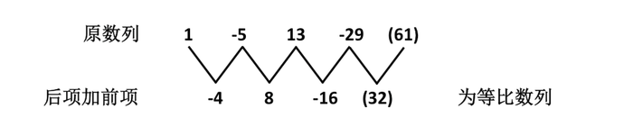

故正确答案为D。

**来源**：2008年湖南省公务员录用考试《行测》题第25题

### 第 26 题

18，24，21，27，24，30，（   ）

A. 19

B. 22

C. 25

D. 27

第 26 题 · 答案与解析

**参考答案（粉笔题库参考内容）**

D

**解析**

原题为交叉数列。

奇数项：18，21，24，（27），为等差数列；

偶数项：24，27，30，为等差数列。

故正确答案为D。

**来源**：2008年湖南省公务员录用考试《行测》题第26题

### 第 27 题

2，4，7，21，（   ），96

A. 24

B. 27

C. 54

D. 81

第 27 题 · 答案与解析

**参考答案（粉笔题库参考内容）**

A

**解析**

原题干数列为分组数列，分组后为作商二级数列。

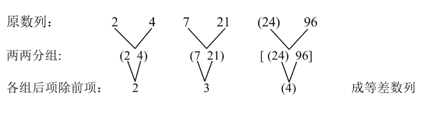

故正确答案为A。

**来源**：2008年湖南省公务员录用考试《行测》题第27题

### 第 28 题

243，199，155，111，（   ）

A. 66

B. 67

C. 68

D. 77

第 28 题 · 答案与解析

**参考答案（粉笔题库参考内容）**

B

**解析**

原题干数列为等差数列，公差为-44，因此结果应为111-44=67。

故正确答案为B。

**来源**：2008年湖南省公务员录用考试《行测》题第28题

### 第 29 题

9/30，7/20，（   ），3/6，1/2

A. 5/7

B. 5/9

C. 5/12

D. 5/18

第 29 题 · 答案与解析

**参考答案（粉笔题库参考内容）**

C

**解析**

分子部分：9、7、（5）、3、1，为等差数列。

分母部分为作差二级数列：

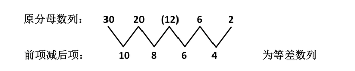

故正确答案为C。

**来源**：2008年湖南省公务员录用考试《行测》题第29题

### 第 30 题

7，13，24，45，（   ）

A. 56

B. 61

C. 71

D. 81

第 30 题 · 答案与解析

**参考答案（粉笔题库参考内容）**

D

**解析**

原数列为作差三级数列。

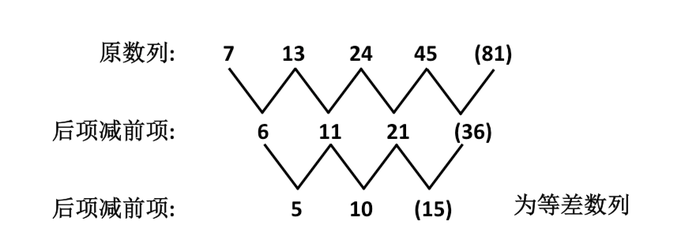

故正确答案为D。

**来源**：2008年湖南省公务员录用考试《行测》题第30题

### 第 31 题

1－2＋3－4＋5－6＋7－8＋…＋1989－1990＋1991＝（   ）

A. 895

B. 896

C. 995

D. 996

第 31 题 · 答案与解析

**参考答案（粉笔题库参考内容）**

D

**解析**

原式 = (1−2)+(3−4)+…+ (1989 − 1990) + 1991 =(-1) × 1990 ÷ 2 + 1991 = 996。

故正确答案为D。

**来源**：2008年湖南省公务员录用考试《行测》题第31题

### 第 32 题

某班学生不到50人，在一次考试中，有1/7人得优，1/3人得良，1/2人及格，其余的均不及格，那么不及格的人数是：

A. 1

B. 2

C. 3

D. 4

第 32 题 · 答案与解析

**参考答案（粉笔题库参考内容）**

A

**解析**

通过题干可知，该班级人数应为7、3、2的公倍数，又因为不能超过50人，所以该班人数为7×3×2＝42人。那么不及格的人数为42－6－14－21＝1。

故正确答案为A。

**考点**：公倍数与公约数问题

**来源**：2008年湖南省公务员录用考试《行测》题第32题

### 第 33 题

在某企业，40%的员工有至少3年的工龄，16个员工有至少8年的工龄。如果90%的员工的工龄不足8年，则工龄至少3年但不足8年的员工有多少人？

A. 48

B. 64

C. 80

D. 144

第 33 题 · 答案与解析

**参考答案（粉笔题库参考内容）**

A

**解析**

通过题干可知，工龄大于等于8年的占1-90%=10%，而这部分有16人，则共有工人160人，同时，通过题干可知，工龄至少3年不足8年的员工数为工龄至少3年的员工数减去工龄至少8年的员工数，为160×40%－16＝48人。

故正确答案为A。

**考点**：和差倍比问题

**来源**：2008年湖南省公务员录用考试《行测》题第33题

### 第 34 题

建造一个容积为8立方米，深为2米的长方体无盖水池。如果池底和池壁的造价分别为120元/平米和80元/平米，那么水池的最低总造价是多少元？

A. 1560

B. 1660

C. 1760

D. 1860

第 34 题 · 答案与解析

**参考答案（粉笔题库参考内容）**

C

**解析**

本题考查几何等量最值性质。

容积为8立方米，深为2米，则底面积为4平方米，当底面为正方形时，周长最小，此时造价最低，故正方形边长为2米，则底面周长为2×4＝8米，而侧面面积＝深度×底面周长＝2×8＝16平方米，则总造价＝120×4＋80×16＝1760元。

故正确答案为C。

**考点**：几何公式类-立体图形、几何结论类-几何小题型、函数最值问题

**来源**：2008年湖南省公务员录用考试《行测》题第34题

### 第 35 题

一项工程，甲单独做，6天可完成；甲乙合做，2天可完成；则乙单独做，多少天可完成？

A. 1.5

B. 3

C. 4

D. 5

第 35 题 · 答案与解析

**参考答案（粉笔题库参考内容）**

B

**解析**

赋值工作量为6和2的最小公倍数12，则甲的效率为6/6=1，甲乙的效率和为6/2=3，乙的效率为3-1=2。因此，乙单独做6/2=3天可完成。

**考点**：给完工时间型

**来源**：2008年湖南省公务员录用考试《行测》题第35题

### 第 36 题

某商品因滞销而降价20%，后因销路不好又降价20%，两次降价后的销售价比降价前的销售价低：

A. 20%

B. 36%

C. 40%

D. 44%

第 36 题 · 答案与解析

**参考答案（粉笔题库参考内容）**

B

**解析**

根据题干可知降价比例为1－(1－20%)(1－20%)＝36%。

故正确答案为B。

**来源**：2008年湖南省公务员录用考试《行测》题第36题

### 第 37 题

某班共有49名学生，其中只有8个独生子女，又知其中28个有兄弟，25个有姐妹，则这个班级中有多少个人既有兄弟又有姐妹？

A. 2

B. 8

C. 12

D. 20

第 37 题 · 答案与解析

**参考答案（粉笔题库参考内容）**

C

**解析**

根据题干可知，非独生子女人数为49－8＝41，设既有兄弟又有姐妹的人为x个人，则41=(28-x)+(25-x)+x，解得x＝12。

故正确答案为C。

**考点**：两集合

**来源**：2008年湖南省公务员录用考试《行测》题第37题

### 第 38 题

汽车往返甲、乙两地之间，上行速度为30公里/时，下行速度为60公里/时，汽车往返的平均速度为多少公里/时？

A. 40

B. 45

C. 50

D. 55

第 38 题 · 答案与解析

**参考答案（粉笔题库参考内容）**

A

**解析**

解析1：

设路程为x，则总时间为x/30+x/60，则平均速度为2x/(x/30 + x/60) = 40。

解析2：

可直接根据等距离平均速度模型公式得到结果。

v̄=2×30×60/(30+60)=40。

故正确答案为A。

注：本方法是解析1的简化，不用设未知数，直接计算得到结果，建议使用。

**考点**：平均速度

**来源**：2008年湖南省公务员录用考试《行测》题第38题

### 第 39 题

一条鱼头长9英寸，尾长为头长加半个身长，身长为头长加尾长，鱼全长共多少英寸？

A. 54

B. 63

C. 72

D. 81

第 39 题 · 答案与解析

**参考答案（粉笔题库参考内容）**

C

**解析**

设鱼的身长为x英寸，尾长为y英寸，则y＝9＋x÷2，x＝9＋y，可得x＝36，y＝27，故鱼长为36＋27＋9＝72英寸。

故正确答案为C。

**来源**：2008年湖南省公务员录用考试《行测》题第39题

### 第 40 题

五个数写成一排，前三个数平均值是15，后两个数平均值是10，则这五个数的平均值是：

A. 11

B. 12.5

C. 13

D. 14

第 40 题 · 答案与解析

**参考答案（粉笔题库参考内容）**

C

**解析**

根据题干可知，前三个数的和为15×3=45，后两个数的和为10×2=20，则五个数的和为65，其平均数为13。

故正确答案为C。

**来源**：2008年湖南省公务员录用考试《行测》题第40题

### 第 41 题

从所给四个选项中，选择最合适的一个填入问号处，使之呈现一定的规律性：

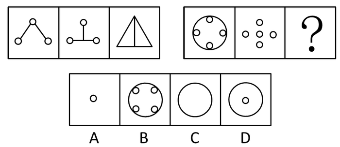

A. A

B. B

C. C

D. D

第 41 题 · 答案与解析

**参考答案（粉笔题库参考内容）**

D

**解析**

前两图叠加后去同存异形成第三个图形。

故正确答案为D。

**考点**：样式规律-加减同异

**来源**：2008年湖南省公务员录用考试《行测》题第41题

### 第 42 题

从所给四个选项中，选择最合适的一个填入问号处，使之呈现一定的规律性：

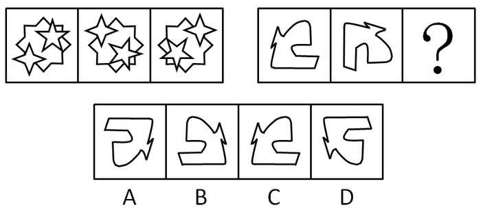

A. A

B. B

C. C

D. D

第 42 题 · 答案与解析

**参考答案（粉笔题库参考内容）**

A

**解析**

元素组成相同，考查位置规律。

已知图形进行顺时针旋转，每次旋转90度。

故正确答案为A。

**考点**：位置规律-旋转

**来源**：2008年湖南省公务员录用考试《行测》题第42题

### 第 43 题

从所给四个选项中，选择最合适的一个填入问号处，使之呈现一定的规律性：

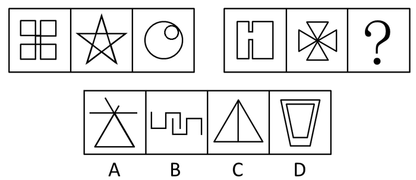

A. A

B. B

C. C

D. D

第 43 题 · 答案与解析

**参考答案（粉笔题库参考内容）**

C

**解析**

元素组成不同，且无明显属性规律，考虑数量规律。观察发现，题干出现五角星、

圆相切等图形，优先考虑笔画数。第一组均为一笔画图形，第二组前两个图形均为一笔画图形，故？处图形也应为一笔画图形，只有C项符合。

故正确答案为C。

**考点**：数量规律-线

**来源**：2008年湖南省公务员录用考试《行测》题第43题

### 第 44 题

从所给四个选项中，选择最合适的一个填入问号处，使之呈现一定的规律性：

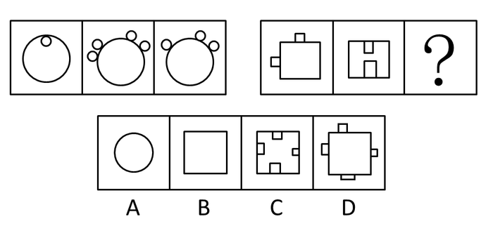

A. A

B. B

C. C

D. D

第 44 题 · 答案与解析

**参考答案（粉笔题库参考内容）**

B

**解析**

第一组图形中的第一、二个图形附带的内外小圈数相抵消后得到第三个图形。

故正确答案为B。

**考点**：数量规律-素

**来源**：2008年湖南省公务员录用考试《行测》题第44题

### 第 45 题

从所给四个选项中，选择最合适的一个填入问号处，使之呈现一定的规律性：

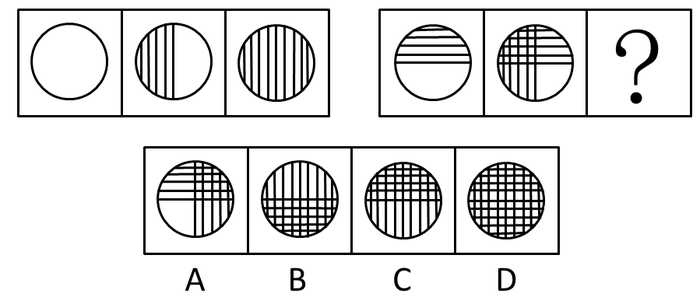

A. A

B. B

C. C

D. D

第 45 题 · 答案与解析

**参考答案（粉笔题库参考内容）**

C

**解析**

第一组图中，第一个图形没有阴影，第二个图形左半边有阴影，第三个图形全部都是阴影。所以第二组图形也符合这一规律，第一个图形虽然上半部有阴影，但这个阴影是图形的组成部分，所以看做没有阴影，第二个图形左半边有阴影，上半部的阴影仍然存在，所以第三个图形应当是整个圆内都有竖条阴影，且上半部有横条阴影。

故正确答案为C。

**来源**：2008年湖南省公务员录用考试《行测》题第45题

### 第 46 题

商品差价是指同一商品由于流通环节、质量、购销地区与季节不同而形成的价格差额。

根据上述定义，下列不属于商品差价的选项是：

A. 同一款手机，在长沙买比在岳阳买贵

B. 市场上早上的白菜一块钱一斤，到了下午八毛钱就能买到

C. 海尔电视机和TCL电视机的价格不同

D. 东北产大米在东北卖比在湖南卖便宜

第 46 题 · 答案与解析

**参考答案（粉笔题库参考内容）**

C

**解析**

第一步：抓住定义中的关键词。

关键词强调“同一商品”且“价格差额”。

第二步：逐一判断选项。

A项中的手机，B项中的白菜，D项中的东北大米，均表示的是同一种商品，而且存在价格差额，都属于商品差价；

C项中的海尔电视机和TCL电视机不是同一种商品，不属于商品差价。

本题为选非题，故正确答案为C。

**考点**：主客体

**来源**：2008年湖南省公务员录用考试《行测》题第46题

### 第 47 题

行政许可是指行政机关根据公民、法人或其他组织的申请，经依法审查，准予其从事特定活动的行为。

下列属于行政许可的是：

A. 上级税务机关基于行政隶属关系对下级税务机关有关业务请示、报告事项的审批

B. 张三为提高专业技能，特向单位申请参加研究生学习，单位领导同意了其申请，并同意在其毕业后为他报销部分学习费用

C. 某人为从事运输，去学习驾驶技术。其考核合格并申请后，公安车辆管理部门为其核发了机动车驾驶证

D. 李某经过四年学习，所有功课合格，经申请，学校为其颁发大学毕业证书

第 47 题 · 答案与解析

**参考答案（粉笔题库参考内容）**

C

**解析**

第一步：抓住定义中的关键词。

关键词强调“行政机关”、“公民、法人或其他组织”。

第二步：逐一判断选项。

A项中的申请者即下级税务机关，不属于公民、法人或其他组织；

B项中审查机关为单位，不是行政机关；

C项符合行政许可定义；

D项中审查机关为学校，不是行政机关。

故正确答案为C。

**考点**：主客体

**来源**：2008年湖南省公务员录用考试《行测》题第47题

### 第 48 题

第三者责任险负责赔偿保险车辆因意外事故，致使第三者遭受人身伤亡或财产的直接损失。所谓第三者是指被保险人及其财产和保险车辆上所有人员与财产以外的他人、他物。所谓“所有人员”指车上的驾驶员和所有乘坐人员，但这些人下车后除驾驶员外，均可视为第三者。

根据以上定义，下列属于第三者责任险赔偿范围的是：

A. 甲驾驶自己的私人车辆出行，途中车辆发生故障。甲下车修理，车辆突然向后滑行，甲被车辆轧断脚掌，本次事故中甲的医疗费用共计5000元

B. 甲驾驶卡车向某市运送货物，由于雪天路滑，在避让行人时，发生了翻车事故。经核查，本次事故中车辆损毁及货物损毁费用共计1.9万元

C. 甲为某长途汽车司机。在车辆行驶过程中，车厢内突然起火。乘客乙被烧伤，财物被烧光。乙要求甲赔偿医疗费用及财物损毁费用共计1万元

D. 甲驾驶大巴车送一批游客去参观名胜古迹。到达旅游地点，甲倒车时将在车后绕行的乘客乙撞伤，后乙向甲索赔2万元。

第 48 题 · 答案与解析

**参考答案（粉笔题库参考内容）**

D

**解析**

第一步：抓住定义中的关键词。

关键词强调“第三者”，即“被保险人及其财产”、“保险车辆上的驾驶员和所有乘坐人员，但这些人下车后除驾驶员外，均可视为第三者”、“财产以外的他人、他物”。

第二步：逐一判断选项。

A项中的甲虽然下车，但是作为司机，不符合“第三者”的范围；

B项中甲是司机不属于第三者，所以没有造成“第三者”的损失；

C项中的乙及其财物都是被保险车辆上的人和财物，不属于“第三者”范围；

D项表述符合第三者责任险定义。

故正确答案为D。

**考点**：主客体

**来源**：2008年湖南省公务员录用考试《行测》题第48题

### 第 49 题

倾销是指企业在国外出售商品的价格低于国内市场的价格或低于生产成本。

根据这一定义，下列行为不属于倾销的是：

A. 某国以低于产品正常价值的价格向他国销售新闻纸

B. 某企业在国内有较高的垄断地位和较大的市场份额，但质量不如国外同类产品，为了抢占国际市场，该企业以低于成本的价格在他国销售

C. 某地为著名的蔬菜生产基地，由于采用先进的科学技术和规模化经营，其生产的蔬菜的价格远远低于国外同类产品的价格

D. 某国软件公司为了获得他国政府采购的订单，与他国同类软件竞争，以低于该产品在本国的销售价格投标

第 49 题 · 答案与解析

**参考答案（粉笔题库参考内容）**

C

**解析**

第一步：抓住定义中的关键词。

关键词强调“在国外出售商品”、“价格低于国内市场的价格或低于生产成本”。

第二步：逐一判断选项。

A项是低于正常价值的价格销售，可以推出是倾销；

B项是该企业以低于成本的价格销售，可以推出是倾销；

C项中价格虽然低于国外同类产品，但是不是低于其成本或正常价格，而是采用了先进的科学技术和规模化经营导致价格低，所以不能推出是倾销；

D项是低于本国的销售价格投标，可以推出是倾销。

本题为选非题，故正确答案为C。

**考点**：单定义-其他句式

**来源**：2008年湖南省公务员录用考试《行测》题第49题

### 第 50 题

泛化是指某种特定刺激的条件反应形成后，另外一些类似的刺激，也会诱发同样的条件反应。新刺激越近似于原刺激，条件反应被诱发的可能性就越大。

根据以上定义，以下可以称为泛化现象的是：

A. 杯弓蛇影

B. 草木皆兵

C. 四面楚歌

D. 一朝被蛇咬，十年怕井绳

第 50 题 · 答案与解析

**参考答案（粉笔题库参考内容）**

D

**解析**

第一步：抓住定义中的关键词。

关键词强调“某种特定刺激的条件反应形成后”、“类似的刺激”、“诱发同样的条件反应”。

第二步：逐一判断选项。

A项，杯弓蛇影的含义是将映在酒杯里的弓影误认为蛇，比喻因疑神疑鬼而引起恐惧；

B项，草木皆兵的含义是把山上的草木都当做敌兵，形容人在惊慌时疑神疑鬼；

C项，四面楚歌的含义是比喻陷入四面受敌，处于孤立无援的窘迫境地；

从A、B、C三项都看不出原先受到过类似的刺激，只有D项给予明确提示，曾被蛇咬过，所以见到类似的井绳时，误以为是蛇而害怕，属于泛化现象，为合适选项。

故正确答案为D。

**考点**：大前提

**来源**：2008年湖南省公务员录用考试《行测》题第50题

### 第 51 题

播种：收获

A. 撒网：捕鱼

B. 贫穷：饥饿

C. 春天：秋天

D. 生病：住院

第 51 题 · 答案与解析

**参考答案（粉笔题库参考内容）**

A

**解析**

第一步：判断题干词语间逻辑关系。

播种是为了收获，二者为方式目的的对应关系。

第二步：判断选项词语间逻辑关系。

A项：撒网是为了捕鱼，二者为方式目的的对应关系，与题干逻辑关系一致，当选；

B项：贫穷可能导致饥饿，二者为因果的对应关系，与题干逻辑关系不一致，排除；

C项：春天和秋天是两个不同季节，二者为并列关系，与题干逻辑关系不一致，排除；

D项：生病可能导致住院，二者为因果的对应关系，与题干逻辑关系不一致，排除。

故正确答案为A。

**考点**：逻辑关系-对应关系

**来源**：2008年湖南省公务员录用考试《行测》题第51题

### 第 52 题

房子：窗户

A. 鞋：袜子

B. 厨房：厕所

C. 动物：东北虎

D. 汽车：轮胎

第 52 题 · 答案与解析

**参考答案（粉笔题库参考内容）**

D

**解析**

第一步：判断题干词语间逻辑关系。

题干两个词构成包容关系，且是包容关系中的组成关系，窗户是房子的重要组成部分。

第二步：判断选项词语间逻辑关系。

A项鞋和袜子是并列关系；

B项厨房和厕所是并列关系；

C项动物和东北虎是包容关系中的种属关系，东北虎是一种动物；

D项汽车和轮胎是包容关系，轮胎是汽车的重要组成部分，符合题干逻辑。

故正确答案为D。

**考点**：逻辑关系-包容关系

**来源**：2008年湖南省公务员录用考试《行测》题第52题

### 第 53 题

枕头：卧具

A. 铅笔：工具

B. 地球：宇宙

C. 宣纸：文具

D. 车厢：火车

第 53 题 · 答案与解析

**参考答案（粉笔题库参考内容）**

C

**解析**

第一步：判断题干词语间逻辑关系。

题干两词是包容关系，且是包容关系中的种属关系，后者包含前者。

第二步：判断选项词语间逻辑关系。

与题干逻辑关系相同的即为C项。

A项中“铅笔”对应的应该为“文具”；

B项中“地球”对应的应该为“行星”；

D项中两词是包容关系中的组成关系。

故正确答案为C。

**考点**：逻辑关系-包容关系

**来源**：2010年黑龙江省公务员录用考试《行测》题第85题

### 第 54 题

白天：黑夜

A. 男人：女人

B. 高山：大海

C. 白色：黑色

D. 老人：小孩

第 54 题 · 答案与解析

**参考答案（粉笔题库参考内容）**

A

**解析**

第一步：判断题干词语间逻辑关系。

题干两词是并列关系，不是白天就是黑夜，没有其他情况，属于并列关系中的矛盾关系。

第二步：判断选项词语间逻辑关系。

与题干逻辑关系相同的即为A项，除了男人就是女人，没有其他情况。

B项是对应关系，高山和大海都属于自然景致；

C、D两项是并列关系中的反对关系，C项除了白色、黑色以外还有别的颜色；D项除了老人、小孩以外还有别的年龄段的人。

故正确答案为A。

**考点**：逻辑关系-并列关系

**来源**：2008年湖南省公务员录用考试《行测》题第54题

### 第 55 题

校长：老师

A. 警察：小偷

B. 经理：职员

C. 老师：学生

D. 医生：护士

第 55 题 · 答案与解析

**参考答案（粉笔题库参考内容）**

B

**解析**

第一步：判断题干词语间逻辑关系。

题干两词是对应关系，前者和后者构成上下级关系。

第二步：判断选项词语间逻辑关系。

A项中警察和小偷是并列关系，两者是相对的职业；

B项中经理和职员构成上下级关系；

C项中老师和学生是并列关系，不是上下级关系；

D项中医生和护士也是并列关系，也不是上下级关系。

故正确答案为B。

**考点**：逻辑关系-对应关系

**来源**：2008年湖南省公务员录用考试《行测》题第55题

### 第 56 题

我们知道当我们接迎面飞来的篮球，手接触到球以后，两臂随球后引至胸前把球接住。这样做的目的是：

A. 减小篮球的动量

B. 减小篮球的动量变化

C. 增大篮球的动量变化

D. 减小篮球的动量变化率

第 56 题 · 答案与解析

**参考答案（粉笔题库参考内容）**

D

**解析**

手接触到球的过程，篮球的动量变化为定值，据动量定理，篮球的冲量也为定值，两臂随篮球后引至胸前，目的是延长接触时间，减小篮球的动量变化率。

故正确答案为D。

注释：

动量定理：Ft=mv2−mv1反映了力对时间的累积效应（冲量），其增量是力在时间上的积累。

**来源**：2008年湖南省公务员录用考试《行测》题第56题

### 第 57 题

在宇宙飞船内的实验室里，可以正常使用的仪器是：

A. 比重计

B. 水银气压计

C. 天平

D. 水银温度计

第 57 题 · 答案与解析

**参考答案（粉笔题库参考内容）**

D

**解析**

在宇宙飞船中，由于失重和气压的关系，比重计、天平、水银气压计均不能正常使用。

故正确答案为D。

**来源**：2008年湖南省公务员录用考试《行测》题第57题

### 第 58 题

两个重量相同的实心铅球和棉球，将它们用细线分别挂在两个同样的弹簧秤下并浸入水中，比较这两个弹簧秤的读数是：

A. 挂铅球的大

B. 挂棉球的大

C. 两者一样

D. 无法确定

第 58 题 · 答案与解析

**参考答案（粉笔题库参考内容）**

A

**解析**

两者体积不同，铅球体积小，浸入水中受到的浮力也小，弹簧秤所受的力＝铅球或者棉花的重力－浮力，两者重力相同，棉花的浮力大，所以相应的弹簧秤的读数小。

故正确答案为A。

**来源**：2008年湖南省公务员录用考试《行测》题第58题

### 第 59 题

以下各齿轮中，旋转得最慢的是：

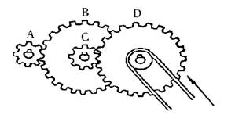

A. A

B. B

C. C

D. D

第 59 题 · 答案与解析

**参考答案（粉笔题库参考内容）**

D

**解析**

本题考查角速度与线速度，齿轮同轴则角速度相同，齿轮相切则线速度相同。

C和D相切，线速度相同，B和A相切，线速度相同，D的半径大于C的半径，所以D的角速度小于C的角速度，B和C同轴，角速度相同，A的半径小于B的半径，所以A的角速度大于B的角速度，所以角速度D＜C＝B＜A。

故正确答案为D。

注释：

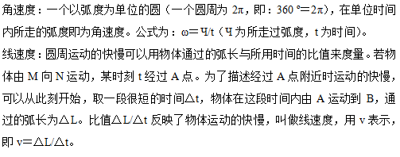

**来源**：2008年湖南省公务员录用考试《行测》题第59题

### 第 60 题

如图所示，人沿水平方向拉牛，但没有拉动。下列说法正确的是：

A. 绳拉牛的力与牛拉绳的力是一对平衡力

B. 绳拉牛的力与地面对牛的摩擦力是一对平衡力

C. 绳拉牛的力小于牛拉绳的力

D. 绳拉牛的力小于地面对牛的摩擦力

第 60 题 · 答案与解析

**参考答案（粉笔题库参考内容）**

B

**解析**

平衡力必须是“作用于同一物体的力”，A项错误；

绳拉牛的力和牛拉绳的力是相互作用力，因此相等，C项错误；

牛没有动，可知作用于牛的力是平衡力，则绳拉牛的力等于地面对牛的摩擦力，D项错误。

故正确答案为B。

注释：

平衡力：几个力作用在同一个物体上，如果这个物体仍然或变成处于静止状态或匀速直线运动状态，则这几个力的作用合力为零，我们就说这几个力平衡。

相互作用力：只要一个物体对另一个物体施加了力，受力物体反过来也肯定会给施力物体增加一个力。这两个力，大小相等，方向相反，作用在两个不同的物体上，且作用在同一直线上。一对相互作用力必然是同时产生，同时消失的。

**来源**：2008年湖南省公务员录用考试《行测》题第60题

### 第 61 题

关于小王、小李和小张，我们知道他们三人中一位是律师，一位是医生，一位是教师，并且我们还知道：小张比教师的年龄大；小王和医生不同岁；医生比小李年龄小。

由此可知：

A. 小王是律师，小李是医生，小张是教师

B. 小王是医生，小李是教师，小张是律师

C. 小王是教师，小李是律师，小张是医生

D. 小王是教师，小李是医生，小张是律师

第 61 题 · 答案与解析

**参考答案（粉笔题库参考内容）**

C

**解析**

第一步：找突破口。

本题突破口是信息量最大的对象，即小张。由小王和医生不同岁和医生比小李年龄小可知，小王和小李都不是医生，那么小张必然是医生。

第二步：抄信息于表中，将题干和第一步的所有信息放在一个表中。

第三步：填空，即填上表中的每一个空格。

故正确答案为C。

**考点**：排除法

**来源**：2008年吉林省公务员录用考试《行测》题（乙级）第62题

### 第 62 题

“并非只有上大学才能成才。”与这一判断等值的是：

A. 不上大学就不能成才

B. 不上大学但也能成才

C. 如果上大学，就能成才

D. 并非如果不成才就是没上大学

第 62 题 · 答案与解析

**参考答案（粉笔题库参考内容）**

B

**解析**

第一步：利用充分必要条件翻译选项。

第一句：-（成才→上大学），利用推导关系的矛盾命题继续推导即为（成才了∧没上大学）。

第二步：逐一翻译选项并判断选项的正确，利用逆否规则。

A项，不上大学∧不能成才，错误；

B项，不上大学∧成才，正确；

C项，上大学→成才，错误；

D项，-（不成才→没上大学），利用推导关系的矛盾命题继续推导即为（不成才∧上大学），错误。

故正确答案为B。

**考点**：常规翻译

**来源**：2008年湖南省公务员录用考试《行测》题第62题

### 第 63 题

四户人家排成一行，已知A家在B家的隔壁，A家与D家不相邻，如果D家与C家也不相邻，那么C家的隔壁应是：

A. A家

B. B家

C. D家

D. 无法判断

第 63 题 · 答案与解析

**参考答案（粉笔题库参考内容）**

A

**解析**

第一步：找突破口。

本题突破口为A、B家。

第二步：将题干信息逐一罗列。

C       A      B        D

D       B      A        C

已知A家在B家的隔壁，A家与D家不相邻，如果D家与C家也不相邻，则C家一定和A家相邻，B家和D家相邻。

故正确答案为A。

**考点**：排除法

**来源**：2008年湖南省公务员录用考试《行测》题第63题

### 第 64 题

如果甲和乙考试都没有及格的话，那么丙就一定及格了。上述前提再增加以下哪项，就可以推出“甲考试及格了”的结论？

A. 丙及格了

B. 乙和丙都没有及格

C. 丙没有及格

D. 乙和丙都及格了

第 64 题 · 答案与解析

**参考答案（粉笔题库参考内容）**

B

**解析**

第一步：利用充分必要条件翻译选项。

第一句：甲不及格 且 乙不及格→丙及格。

第二步：逐一翻译选项并判断选项的正确，利用逆否规则。

甲考试及格属于否定一个前件，如果想得出该结论，必需否后件，即丙不及格，根据逆否规则，丙不及格→—（甲不及格 且 乙不及格），根据摩根规则，拆开括号可得，丙不及格→甲及格 或 乙及格，由于“甲及格 或 乙及格”属于相容性选言，如果否定其中一个选言支必然推出肯定另外一个选言支，需要得到甲及格，则乙没有及格，综上乙和丙都没有及格。

故正确答案为B。

**考点**：常规翻译

**来源**：2008年湖南省公务员录用考试《行测》题第64题

### 第 65 题

有人总结比尔盖茨和戴尔的传奇经历后，发现他们成功的秘诀都是大学中途辍学。则此人认为辍学与成功之间的关系为：

A. 辍学导致成功

B. 辍学可能成功

C. 不辍学不能成功

D. 不辍学可能成功

第 65 题 · 答案与解析

**参考答案（粉笔题库参考内容）**

A

**解析**

第一步：抓住题干主要信息。

从题干可以看出，此人总结一些成功人士的经历后，发现成功的秘诀都是大学中途辍学。

第二步：分析题干信息，并结合选项得出答案。

A项，从题干信息可以看出，此人的观点认为辍学导致成功；

B项，由于此人总结比尔盖茨和戴尔的传奇经历后，发现他们成功的秘诀都是大学中途辍学，这里的“都是”说明此人对结论的肯定，B项中说可能不正确；

C、D两项，题干中没有提及不辍学的情况，并且提问句是“辍学与成功之间的关系”，和不辍学没有关系，属于无关选项。

故正确答案为A。

**考点**：日常结论

**来源**：2008年湖南省公务员录用考试《行测》题第65题

### 第 66 题

“凡外出采访的记者都是可以优先买票的”，下列推理正确的是：

A. 不是外出采访的记者不可以优先买票

B. 优先买票的都是外出采访的记者

C. 他优先买票，所以他是外出采访的记者

D. 他是外出采访的记者，所以可优先买票

第 66 题 · 答案与解析

**参考答案（粉笔题库参考内容）**

D

**解析**

第一步：翻译题干，利用充分必要条件。

第一句：外出采访的记者→优先买票。

第二步：逐一翻译选项并判断选项的正确。

A项：不是外出采访的记者→不可以优先买票，“不是外出采访的记者”属否前件，无法推出绝对表达的结论，错误；

B项：优先买票→外出采访的记者，“优先买票”属肯后件，无法推出绝对表达的结论，错误；

C项：他优先买票→他是外出采访的记者，“优先买票”属肯后件，无法推出绝对表达的结论，错误；

D项：外出采访的记者→优先买票，与原结论相同，正确。

故正确答案为D。

**考点**：常规翻译

**来源**：2008年湖南省公务员录用考试《行测》题第66题

### 第 67 题

经过破译敌人的密码，已经知道“香蕉苹果大鸭梨”的意思是“星期三秘密进攻”，“苹果甘蔗水蜜桃”的意思是“执行秘密计划”，“广柑香蕉西红柿”的意思是“星期三的胜利属于我们”，那么“大鸭梨”的意思是：

A. 秘密

B. 星期三

C. 进攻

D. 执行

第 67 题 · 答案与解析

**参考答案（粉笔题库参考内容）**

C

**解析**

第一步：找突破口。

本题突破口是信息量最大的对象，即苹果、香蕉、秘密、星期三。由“香蕉苹果大鸭梨”的意思是“星期三秘密进攻”，“苹果甘蔗水蜜桃”的意思是“执行秘密计划”可知，苹果的意思是秘密；由“香蕉苹果大鸭梨”的意思是“星期三秘密进攻”，“广柑香蕉西红柿”的意思是“星期三的胜利属于我们”可知，香蕉的意思是星期三。

第二步：将题干和第一步的所有信息进行对比。

由“香蕉苹果大鸭梨”的意思是“星期三秘密进攻”，其中苹果的意思是秘密，香蕉的意思是星期三，则大鸭梨的意思是进攻。

故正确答案为C。

**考点**：从最大信息开始推

**来源**：2008年湖南省公务员录用考试《行测》题第67题

### 第 68 题

某地区有两个出租车公司甲和乙，他们推出的出租车的颜色分别是蓝色和红色。经调查发现：在市场上流通的出租车中有70%是红色的，只有30%是蓝色的；红色出租车发生车祸的平均概率是4%，而蓝色则为6%。现在，该区发生了一起出租车车祸。则：

A. 与红色出租车相比，出车祸的更有可能是蓝色出租车

B. 与蓝色出租车相比，出车祸的更有可能是红色出租车

C. 两种颜色的出租车出车祸的概率是一样的，均为50%

D. 无法比较

第 68 题 · 答案与解析

**参考答案（粉笔题库参考内容）**

B

**解析**

第一步：抓住题干主要信息。

第一点说明在市场上流通的出租车中有70%是红色的，只有30%是蓝色的；第二点说明红色出租车发生车祸的平均概率是4%，而蓝色则为6%；第三点说明现在该区发生了一起出租车车祸。

第二步：分析题干信息，并结合选项得出答案。

由第一步中“在市场上流通的出租车中有70%是红色的，只有30%是蓝色的”和“红色出租车发生车祸的平均概率是4%，而蓝色则为6%”可得，在市场上流通的出租车中红色出租车发生车祸的概率为70%×4%＝2.8%，蓝色的为30%×6%＝1.8%，因此出车祸的更有可能是红色的出租车。通过分析，只有B项的说法符合。

故正确答案为B。

**考点**：日常结论

**来源**：2008年湖南省公务员录用考试《行测》题第68题

### 第 69 题

四个人在议论一位作家的年龄。甲说：“她不会超过35岁。”乙说：“她不超过40岁。”丙说：“她的岁数在50以下。”丁说：“她绝对在40岁以上。”实际上只有一个人说对了。那么下列说法正确的是：

A. 甲说的对

B. 她的年龄在45～50岁之间

C. 她的年龄在50岁以下

D. 丁说的对

第 69 题 · 答案与解析

**参考答案（粉笔题库参考内容）**

D

**解析**

第一步：找突破口。

本题突破口为乙和丁之间的矛盾关系，两人的话必有一真一假。

第二步：看其他人的话。

本题只有一句为真，故乙和丁的话有一个为真，则甲和丙所说的话均为假，则她年龄超过35岁并且在50岁以上。

第三步：判断突破口中两句话的真假。

由她年龄超过35岁并且在50岁以上，可知，丁正确。

故正确答案为D。

**考点**：只有一真/一假

**来源**：2008年湖南省公务员录用考试《行测》题第69题

### 第 70 题

有四个外表看起来没有分别的小球，它们的重量可能各有不同。取一个天平，将甲、乙作为一组，丙、丁为另一组分别放在天平的两边，天平是基本平衡的。将乙和丁对调一下，甲、丁一边明显地要比乙、丙一边重很多。可奇怪的是，我们在天平一边放上甲、丙，而另一边刚放上乙，还没有来得及放上丁时，天平就压向了乙一边。

则这四个球由重到轻的顺序是：

A. 乙、丁、甲、丙

B. 丁、乙、丙、甲

C. 乙、甲、丁、丙

D. 丁、乙、甲、丙

第 70 题 · 答案与解析

**参考答案（粉笔题库参考内容）**

D

**解析**

第一步：分析题干条件。

①甲＋乙＝丙＋丁；

②甲＋丁＞乙＋丙；

③甲＋丙＜乙。

第二步：根据题干条件进行推理。

将①、②相加可得：甲＋甲＋乙＋丁＞乙＋丙＋丙＋丁，两边分别消去相同小球可得：甲＋甲＞丙＋丙，即甲＞丙。结合①可知，当甲球比丙球重量大时，为保持平衡，则乙球需比丁球重量小，即丁＞乙。结合③可知，乙球的重量比甲、丙球都大，综上，四个球由重到轻的顺序为丁＞乙＞甲＞丙。

故正确答案为D。

**考点**：组合排列-单题-其他

**来源**：2008年湖南省公务员录用考试《行测》题第70题

### 第 71 题

行政行为在空间上的表现形式和在时间上的跨度，包括行政行为方式、步骤、次序、时限等。其中不可分割的内容的是：

A. 行政程序

B. 行政诉讼

C. 行政复议

D. 行政处罚

第 71 题 · 答案与解析

**参考答案（粉笔题库参考内容）**

A

**解析**

行政程序是指行政主体行使行政权力，作出行政行为所应遵循的方式、步骤、顺序和期间的总和，不可分割。

故正确答案为A。

本题相关知识点：

行政诉讼是指公民、法人或者其他组织认为行政机关和行政机关工作人员的具体行政行为侵犯其合法权益，依法向人民法院提起诉讼，由人民法院依法进行审理和判决的诉讼制度。

行政复议是指公民、法人或者其他组织不服行政主体作出的具体行政行为，认为行政主体的具体行政行为侵犯了其合法权益，依法向法定的行政复议机关提出复议申请，行政复议机关依法对该具体行政行为进行合法性、适当性审查，并作出行政复议决定的行政行为。

行政处罚是指行政机关依法对违反行政管理秩序的公民、法人或者其他组织，以减损权益或者增加义务的方式予以惩戒的行为。

**考点**：行政法

**来源**：2008年湖南省公务员录用考试《行测》题第71题

### 第 72 题

《中华人民共和国价格法》一方面规定国家实行主要由市场形成价格的机制，另一方面又规定国家要调控价格总水平。国家要调控价格总水平的根本原因是：

A. 市场对资源配置起基础作用

B. 商品的价格总水平不一定完全由社会必要劳动时间决定

C. 完全由市场形成的价格超越了人们的承受能力，所以要国家调控

D. 市场具有自发性、投机性、滞后性的弱点和消极作用

第 72 题 · 答案与解析

**参考答案（粉笔题库参考内容）**

D

**解析**

只有市场配置和国家调控双管齐下，才能营造良好的市场环境；国家调控能克服市场存在的弱点和缺陷，国家要调控价格总水平的根本原因，是市场具有自发性、投机性、滞后性的弱点和消极作用。

故正确答案为D。

**考点**：宏观经济与调控政策

**来源**：2008年湖南省公务员录用考试《行测》题第72题

### 第 73 题

在我国的市场经济条件下，要达到优化资源配置和合理配置的目标，必须做到：

A. 以市场为基础，同时加强国家对经济的宏观调控

B. 完善市场体系，通过市场平等竞争

C. 通过价格传递信息及时协调生产和需求

D. 坚持重要商品价格由国家制定

第 73 题 · 答案与解析

**参考答案（粉笔题库参考内容）**

A

**解析**

建立社会主义市场经济体制要以市场为基础，同时加强国家对经济的宏观调控，方能达到优化资源配置和合理配置的目标。国家实行宏观调控可以克服市场的缺陷，保证市场经济健康有序的发展。

故正确答案为A。

**考点**：宏观经济与调控政策

**来源**：2008年湖南省公务员录用考试《行测》题第73题

### 第 74 题

某工商局任意改变了其所颁发的营业执照中所确定的营业范围。从行政法理论上说，该工商局违反了行政行为效力中的：

A. 确定力

B. 拘束力

C. 执行力

D. 公定力

第 74 题 · 答案与解析

**参考答案（粉笔题库参考内容）**

A

**解析**

行政法律行为效力中的确定力是指行政法律行为的不可变更力，即指行政法律行为有效成立后，不得变更或撤销。营业执照中的营业范围确定后，未经过合法途径是不能随意变更的。

故正确答案为A。

本题相关知识点：

行政行为具有拘束力是指行政行为成立后，其内容对有关人员或组织产生法律上的约束力，有关人员或组织必须遵守、服从。主要表现为对行政主体和行政相对人的拘束力。

行政行为具有执行力是指行政行为生效后，行政主体依法有权采取一定手段，使行政行为的内容得以实现的效力。

行政行为具有公定力是指行政主体作出的行政行为，不论合法还是违法，都推定为合法有效，相关的当事人都应当先加以遵守或服从。这是行政效率原则的要求。

**考点**：行政法

**来源**：2008年湖南省公务员录用考试《行测》题第74题

### 第 75 题

加强社会管理，维护社会稳定，必须创新社会管理体制，健全＿＿＿＿的社会管理格局。

A. 党委领导

B. 政府负责

C. 社会协同

D. 公众参与

第 75 题 · 答案与解析

**参考答案（粉笔题库参考内容）**

ABCD

**解析**

建设社会主义和谐社会，必须加强社会建设和完善社会管理体系，健全党委领导、政府负责、社会协同、公众参与的社会管理格局。

故正确答案为ABCD。

**来源**：2008年湖南省公务员录用考试《行测》题第75题

### 第 76 题

违法主体对违法行为承担的具有强制性的法律后果称为：

A. 法律后果

B. 法律责任

C. 法律制裁

D. 法律处分

第 76 题 · 答案与解析

**参考答案（粉笔题库参考内容）**

B

**解析**

A项错误，法律后果是指行为人做出具体行为时，依法应当承担的法律责任，如赔偿损失，承担违约责任，承担刑事责任、行政责任等。

B项正确，法律责任是指因违反了法定义务或契约义务，或不当行使法律权利、权力所产生的，由行为人承担的不利后果。

C项错误，法律制裁是由特定的国家机关对违法者依其所应承担的法律责任而实施的强制惩罚措施。

D项错误，法律处分是指通过具有法律意义的行为进行的处分行为，比如赠与中的交付，对物权的抛弃等。

故正确答案为B。

**考点**：法理学

**来源**：2008年湖南省公务员录用考试《行测》题第76题

### 第 77 题

宪法与法律的最主要区别有：

A. 以国家强制力为基础

B. 在制定和修改程序上更严格、更复杂

C. 具有最高法律效力

D. 由国家最高立法机关制定

第 77 题 · 答案与解析

**参考答案（粉笔题库参考内容）**

BCD

**解析**

A项错误，该项为宪法和法律共有的特征。

B项正确，宪法的最高法律地位和最高法律效力，决定了宪法的制定和修改程序比普通法律更为严格。

C项正确，宪法是国家的根本大法，它规定国家最根本的事务，是任何组织或个人的根本行为准则，具有最高的法律效力，其他各种法律都是依照宪法来规定、细化的。

D项正确，由于宪法所规定的内容是国家生活中带有全局性、根本性的问题，是国家立法活动的基础，因此，它在国家法律体系中具有最高的法律地位和法律效力，并由国家最高立法机关制定。

故正确答案为BCD。

**考点**：宪法

**来源**：2008年湖南省公务员录用考试《行测》题第77题

### 第 78 题

行政诉讼中，负举证责任的是：

A. 行政机关

B. 公民、法人和其他组织

C. 律师

D. 证人

第 78 题 · 答案与解析

**参考答案（粉笔题库参考内容）**

A

**解析**

我国《行政诉讼法》规定的举证责任的分担规则是“被告（行政机关）对其做出的具体行政行为负举证责任”。

故正确答案为A。

**考点**：行政法

**来源**：2008年湖南省公务员录用考试《行测》题第78题

### 第 79 题

某区政府在整顿市容时对某个农贸自由市场作出了关闭的决定，该行政行为属于：

A. 行政确认行为

B. 行政征收行为

C. 具体行政行为

D. 抽象行政行为

第 79 题 · 答案与解析

**参考答案（粉笔题库参考内容）**

C

**解析**

具体行政行为是指国家行政机关、法律法规授权的组织、行政机关委托的组织以及这些组织的工作人员，在行政管理活动中行使行政职权，针对特定的公民、法人或者其他组织，就特定的具体事物的有关该公民、法人或者其他组织权利义务的单方行为。题干中的情况符合具体行政行为的定义。

故正确答案为C。

本题相关知识点：

行政确认行为是指行政机关和法定授权的组织依照法定权限和程序对有关法律事实进行甄别，通过确定、证明等方式决定管理相对人某种法律地位的行政行为。例如，道路交通事故责任认定，医疗事故责任认定，伤残等级的确定，产品质量的确认。

行政征收行为是指行政机关或者法定授权的组织根据法律、法规的规定，向公民、法人或者其他组织无偿收取一定财物的行政行为。

抽象行政行为是指国家行政机关针对不特定管理对象实施的制定法规、规章和有普遍约束力的决定、命令等行政规则的行为，其行为形式体现为行政法律文件，其中包括规范文件和非规范文件。

**来源**：2008年湖南省公务员录用考试《行测》题第79题

### 第 80 题

法律与道德的共同性体现在：

A. 它们都是社会规范

B. 它们都体现一定的社会价值

C. 它们都是社会调控的手段

D. 它们都体现统治阶级的意志

第 80 题 · 答案与解析

**参考答案（粉笔题库参考内容）**

ABC

**解析**

在一定社会中，一般仅存在代表统治阶级利益的法律，但却可以存在代表不同阶级的道德观。

故正确答案为ABC。

**考点**：法理学

**来源**：2008年湖南省公务员录用考试《行测》题第80题

### 第 81 题

法律对违法行为已经作出行政处罚规定，行政法规需要作出具体规定的，必须在法律规定的给予行政处罚的＿＿＿和幅度的范围内规定。

A. 行为

B. 种类

C. 方法

D. 情节

第 81 题 · 答案与解析

**参考答案（粉笔题库参考内容）**

B

**解析**

本题考查行政法。

根据《行政处罚法》第十一条第二款的规定：“法律对违法行为已经作出行政处罚规定，行政法规需要作出具体规定的，必须在法律规定的给予行政处罚的行为、种类和幅度的范围内规定。”本题出题不严谨，按照法律规定，AB选项均为正确表述。

**考点**：行政法

**来源**：2008年湖南省公务员录用考试《行测》题第81题

### 第 82 题

“究天人之际，通古今之变，成一家之言”是谁的名言？

A. 班固

B. 司马迁

C. 刘醒龙

D. 司马光

第 82 题 · 答案与解析

**参考答案（粉笔题库参考内容）**

B

**解析**

此名言出自司马迁的《报任安书》。

故正确答案为B。

**本题相关知识点**：

《报任安书》是司马迁写给其友人任安的一封回信。在文中，司马迁以极其激愤的心情，申述了自己的不幸遭遇，抒发了内心的无限痛苦，大胆揭露了汉武帝的喜怒无常，刚愎自用，提出了人固有一死，或重于泰山，或轻于鸿毛的比较进步的生死观，并表现出了他为实现可贵的理想而甘受凌辱，坚韧不屈的战斗精神。

**考点**：文学常识

**来源**：2008年湖南省公务员录用考试《行测》题第82题

### 第 83 题

我国的天然气主要分布于：

A. 塔里木盆地

B. 云贵高原

C. 渤海湾

D. 四川盆地

第 83 题 · 答案与解析

**参考答案（粉笔题库参考内容）**

ACD

**解析**

我国天然气资源量区域主要分布在我国的中西盆地。中国天然气探明储量集中在10个大型盆地，依次为：渤海湾、四川、松辽、准噶尔、莺歌海-琼东南、柴达木、吐-哈、塔里木、渤海、鄂尔多斯。

故正确答案为ACD。

**考点**：中国地理

**来源**：2008年湖南省公务员录用考试《行测》题第83题

### 第 84 题

“十五”期间，我国经济发展的各项指标大多超额完成，但环境保护的指标没有完成，主要是二氧化硫排放量与化学需氧量两个指标没完成。环境污染严重。导致这一现象的主要原因是：

A. 环境污染物过多

B. 对环境保护重视不够

C. 产业结构不合理，经济增长方式粗放

D. 环境保护执法不严，监管不力

第 84 题 · 答案与解析

**参考答案（粉笔题库参考内容）**

C

**解析**

出现这一现象的主要原因是：能源消耗总量持续增长，排放物总量增加；产业结构不合理、重工业结构比重高，经济增长方式比较粗放。

故正确答案为C。

**考点**：其他

**来源**：2008年湖南省公务员录用考试《行测》题第84题

### 第 85 题

城市民用天然气的主要成分是：

A. 甲烷

B. 一氧化碳

C. 硫化氢

D. 乙烷

第 85 题 · 答案与解析

**参考答案（粉笔题库参考内容）**

A

**解析**

甲烷是居民使用的天然气的主要成分。

故正确答案为A。

**考点**：生活常识

**来源**：2008年湖南省公务员录用考试《行测》题第85题

### 第 86 题

中国坚定不移地走和平发展道路是基于：

A. 中国国情的必然选择

B. 中国历史文化传统的必然选择

C. 当今世界发展潮流的必然选择

D. 国际经济全球化的必然选择

第 86 题 · 答案与解析

**参考答案（粉笔题库参考内容）**

ABC

**解析**

中国始终坚定不移地走和平发展道路，是基于中国国情的必然选择，是基于中国历史文化传统的必然选择，是基于我们党的基本理论和基本经验的必然选择，是基于当今世界发展潮流的必然选择。

故正确答案为ABC。

**考点**：中国地理

**来源**：2008年湖南省公务员录用考试《行测》题第86题

### 第 87 题

以下各古代思想家中，提出“非攻”“兼爱”等主张的是：

A. 孔子

B. 孟子

C. 墨子

D. 韩非子

第 87 题 · 答案与解析

**参考答案（粉笔题库参考内容）**

C

**解析**

兼爱，包含平等与博爱的意思，与儒家的博爱（“亲亲有术，尊贤有等”）相反。墨子要求君臣、父子、兄弟都要在平等的基础上相互友爱，“爱人若爱其身”，并提出“天下之人兼相爱，强不执弱，众不劫寡，富不辱贫，贵不傲贱，诈不欺愚”，他认为社会上出现强执弱、富侮贫、贵傲贱的现象，是因天下人不相爱所致。同时，墨子也看到春秋战国时期，最大的弊病就是战争，因此，从兼爱的思想中，引申出了非攻。兼爱非攻是墨子最著名的思想。

故正确答案为C。

**本题相关知识点：**

孔子的主要思想有：政治上“为政以德”，用道德和礼教来治理国家是最高尚的治国之道。这种治国方略也叫“德治”或“礼治”；经济上他主张“重义轻利”“见利思义”；教育上他提倡“有教无类”“学而优则仕”。

孟子继承了孔子的思想，并在人性问题上提出性善论，即“人之初，性本善”。

韩非子提倡“法不阿贵”的思想，主张“刑过不避大臣，赏善不遗匹夫”，他被称为法家之集大成者。

**考点**：文学常识

**来源**：2008年湖南省公务员录用考试《行测》题第87题

### 第 88 题

古语道：“人要实，火要虚。”此话的意思是说做人要脚踏实地，才能事业有成；可燃物要架空一些，才能燃烧更旺。“火要虚”的目的是：

A. 增大可燃物的热值

B. 降低可燃物的着火点

C. 增大空气中氧气的含量

D. 增大可燃物与空气的接触面积

第 88 题 · 答案与解析

**参考答案（粉笔题库参考内容）**

D

**解析**

“火要虚”指要增加火与空气的接触面积。

故正确答案为D。

**考点**：生活常识

**来源**：2008年湖南省公务员录用考试《行测》题第88题

### 第 89 题

下列关于生活中的化学常识，说法正确的是：

A. 现在，方便的小包装食品已被广泛接受，为了防止中秋月饼等高脂食品氧化变质，延长食品的保质期，在包装袋中常常放入生石灰

B. 现在用的清洁燃料主要有两类：一类是压缩天然气，另一类是液化石油气，它们属于碳氢化合物

C. 福尔马林是一种良好的杀毒剂，可用于消毒自来水

D. 保护加酶洗衣粉的洗涤效果，应先在60摄氏度以上的热水中溶解洗衣粉

第 89 题 · 答案与解析

**参考答案（粉笔题库参考内容）**

B

**解析**

A项错误，食品氧化变质主要是因为包装袋中的氧气，而生石灰不吸收氧气，只吸收水，不能防止氧化；

C项错误，福尔马林是特定浓度的甲醛水溶液，甲醛有毒，不可用于消毒自来水；

D项错误，酶在高温下会失活。

故正确答案为B。

**考点**：生活常识

**来源**：2008年湖南省公务员录用考试《行测》题第89题

### 第 90 题

控制就是事情按计划进行，为此就需要在组织中建立信息反馈机制，随时监控是否存在偏差。在发现偏差后，有人提倡“消灭偏差”，以下正确的是：

A. 这种提法是正确的，只有消灭了偏差才能确保计划的顺利实现

B. 这种提法是错误的，如果要完全消灭偏差成本太高了

C. 这种提法是错误的，应该允许偏差的存在，只有超出控制标准的偏差才进行纠偏

D. 以上提法都不正确

第 90 题 · 答案与解析

**参考答案（粉笔题库参考内容）**

B

**解析**

“消灭偏差”的说法过于绝对，而且要完全消灭偏差成本太高。

故正确答案为B。

**考点**：其他

**来源**：2008年湖南省公务员录用考试《行测》题第90题

### 第 91 题

温家宝总理在十届全国人大五次会议记者招待会上回答台湾记者提问时表示，台海两岸和平发展是大势所趋，是任何人无法改变的，并引用了“沉舟侧畔千帆过，病树前头万木春”这句诗来表达其要义。“沉舟侧畔千帆过，病树前头万木春”是富于想象而涵义深刻的名句，下列诗句中与此名句蕴含的哲理相同的是：

A. 登高壮观天地间，大江茫茫去不还

B. 飞流直下三千尺，疑是银河落九天

C. 千江有水千江月，万里无云万里天

D. 芳林新叶催陈叶，流水前波让后波

第 91 题 · 答案与解析

**参考答案（粉笔题库参考内容）**

D

**解析**

题中温家宝总理讲话的大意是台海两岸的发展前途是光明的，“芳林新叶催陈叶，流水前波让后波”和“沉舟侧畔千帆过，病树前头万木春”都表达了这个意思。

故正确答案为D。

**考点**：文学常识

**来源**：2008年湖南省公务员录用考试《行测》题第91题

### 第 92 题

社会主义国家改革，其性质应该是：

A. 社会主义基本制度的变革

B. 社会主义经济运行方式的改变

C. 社会主义原有体制的修补

D. 社会主义制度的自我完善和发展

第 92 题 · 答案与解析

**参考答案（粉笔题库参考内容）**

D

**解析**

社会主义国家改革的性质即社会主义制度的自我完善和发展。

故正确答案为D。

**考点**：哲学-其他

**来源**：2008年湖南省公务员录用考试《行测》题第92题

### 第 93 题

马克思主义是指引我们时代前进的旗帜，这是因为马克思主义：

A. 正确概括了时代的实践经验和认识成果

B. 在实践基础上达到了科学性和革命性的统一

C. 包含了一切现实问题的正确答案

D. 提供了研究问题的科学世界观和方法论

第 93 题 · 答案与解析

**参考答案（粉笔题库参考内容）**

ABD

**解析**

A、B、D三项正确，C项错误，马克思主义提供了科学的世界观和方法论，在实践基础上达到了科学性和革命性的统一，正确概括了时代的实践经验和认识成果，但是，并没有包含一切现实问题的正确答案，。

故正确答案为ABD。

**考点**：总论

**来源**：2008年湖南省公务员录用考试《行测》题第93题

### 第 94 题

科学发展观的内涵是：

A. 第一要义是发展

B. 核心是以人为本

C. 基本要求是全面协调可持续

D. 根本方法是统筹兼顾

第 94 题 · 答案与解析

**参考答案（粉笔题库参考内容）**

ABCD

**解析**

科学发展观，第一要义是发展，核心是以人为本，基本要求是全面协调可持续，根本方法是统筹兼顾。这些都属于科学发展观的内涵。

故正确答案为ABCD。

**来源**：2008年湖南省公务员录用考试《行测》题第94题

### 第 95 题

贯穿于邓小平理论形成和发展的全过程，体现在邓小平理论所作出的每一项重大决策中的思想是：

A. 解放思想、实事求是

B. 以经济建设为中心

C. 什么是社会主义，怎样建设社会主义

D. 坚持共产党的领导，坚持改革开放

第 95 题 · 答案与解析

**参考答案（粉笔题库参考内容）**

A

**解析**

解放思想、实事求是是贯穿于邓小平理论形成和发展全过程的思想，这也是邓小平理论的精髓所在。

故正确答案为A。

**来源**：2008年湖南省公务员录用考试《行测》题第95题

### 第 96 题

胡锦涛同志指出，我们要把共同建设、共同享有贯穿于和谐社会建设的全过程，真正做到在共建中共享，在共享中共建。共建共享理论本身所蕴含的道理是：

A. 人民群众是社会实践的主体

B. 人民群众是社会变革的决定力量

C. 人民群众可以创造真理

D. 人民群众是社会财富的创造者

第 96 题 · 答案与解析

**参考答案（粉笔题库参考内容）**

BD

**解析**

A项错误，与题意本身无关；

B、D两项正确，根据“把共同建设、共同享有贯穿于和谐社会建设的全过程，真正做到在共建中共享，在共享中共建”可知，人民群众是社会变革的决定力量，人民群众是社会财富的创造者；

C项错误，真理是永恒存在的，不是某个群体或个人创造的。

故正确答案为BD。

**考点**：唯物史观

**来源**：2008年湖南省公务员录用考试《行测》题第96题

### 第 97 题

近年来，我国政府把治理商业贿赂摆到反腐败工作特别突出的位置。根据国家法律法规的规定，经营者不得采用财物或者其他手段进行贿赂以销售或者购买商品。商业贿赂违背市场经济＿＿＿。

A. 开放原则

B. 自愿原则

C. 平等原则

D. 互利原则

第 97 题 · 答案与解析

**参考答案（粉笔题库参考内容）**

AC

**解析**

商业贿赂违背社会主义市场经济的基本原则，破坏市场秩序，妨碍公平竞争和资源的合理配置，影响投资环境，损害商务事业健康发展，违反了开放原则；增加企业经营成本，造成国家税收减少和公共财产被侵吞，为假冒伪劣商品开了方便之门，违反了平等原则，直接侵害广大消费者的合法权益。

故正确答案为AC。

**考点**：市场经济

**来源**：2008年湖南省公务员录用考试《行测》题第97题

### 第 98 题

在科学发展的基础上，使我国社会更加和谐，让人民生活更加美好，这是我们党立党为公、执政为民的根本落脚点，也是“十一五”规划纲要的根本落脚点。我国政府在全面建设小康社会中坚持“和谐惠民”的主张，这说明：

A. 我国的政权是人民当家作主的政权

B. 我国人民民主具有广泛性

C. 我国民主具有全民性和真实性

D. 我国国家机构是人民意志的执行

第 98 题 · 答案与解析

**参考答案（粉笔题库参考内容）**

ABCD

**解析**

四个选项均属于正确说法，且都符合题意。

故正确答案为ABCD。

**来源**：2008年湖南省公务员录用考试《行测》题第98题

### 第 99 题

有的地方动用执法部门设关卡，不让外地某些产品流入本地；有的公开限制外地产品流入本地市场，强令推销当地产品；有的组织质量监管部门专拣外地产品“曝光”，以达到“扫地出门”的目的。

这些做法：

A. 是实行地方保护主义，不利于开放

B. 有利于本地区经济的发展

C. 违背了市场经济竞争的基本原则

D. 抹杀了社会主义市场经济开放性的特点

第 99 题 · 答案与解析

**参考答案（粉笔题库参考内容）**

ACD

**解析**

题干所陈述的现象属于地方保护主义，不利于开放，不利于地方经济的发展，违背了市场竞争的基本原则。

故正确答案为ACD。

本题相关知识点：地方保护主义是指政权的地方机构及其成员，以违背中央/国家的政策/法规的方式去滥用或消极行使手中权力、以维护或扩大该地方局部利益的倾向。

从短期看，实行地方保护主义对当地的好处有：本地企业在政府的保护下，以较低的成本进行生产，有利于规模经济的实现，获取更多的利润，缴纳更多的税金，为地方政府提供更多的财政收入。同时，企业的发展使投资需求增加，有利于刺激当地经济的有效需求，从而拉动经济的发展。

实行地方保护主义的弊端：政府的保护使企业垄断了资源配置的权利，这样形成的垄断地位，阻碍了资源的自由流动，不利于资源的优化配置，损害了当地消费者的选择权，损害了外地生产同类商品企业的利益。从长远看，一方面地方保护主义造成本地企业市场竞争力低下，最终被市场所淘汰，致使本地经济受损。另外一个方面地方保护主义也会遭到报复，外地也会用同样的保护政策对付保护主义，最后是两败俱伤。

总的来说，地方保护主义是弊大于利的。除非被保护的是一个幼稚工业，经过保护之后，行业能够从没有竞争力变得有竞争力。一般来讲，这种情况是相当少的。地方保护往往会吃力不讨好，最后都会劳而无功，不得不放弃。

**考点**：市场经济

**来源**：2008年湖南省公务员录用考试《行测》题第99题

### 第 100 题

胡锦涛同志在党的十七大报告中指出，改革开放以来我们取得一切成绩和进步的根本原因，归结起来就是：

A. 坚持了邓小平理论的指导

B. 坚持了“三个代表”重要思想的指导

C. 坚持了科学发展观的指导

D. 开辟了中国特色社会主义道路，形成了中国特色社会主义理论体系

第 100 题 · 答案与解析

**参考答案（粉笔题库参考内容）**

D

**解析**

胡锦涛同志在党的十七大报告中指出：“改革开放以来我们取得一切成绩和进步的根本原因，归结起来就是：开辟了中国特色社会主义道路，形成了中国特色社会主义理论体系。高举中国特色社会主义伟大旗帜，最根本的就是要坚持这条道路和这个理论体系。”

故正确答案为D。

**考点**：其他建设

**来源**：2008年湖南省公务员录用考试《行测》题第100题

## 材料 1

进入新世纪以后，云南省126个农业县市中仍有73个国家扶持工作重点县，占全国重点扶贫县市总数592个的12.33%。根据“五普”资料显示，73个贫困县总人口为2208.69万人，占全省总人口4236.01万人的52.14%，其中男性1162.73万人，女性1045.96万人，男女性别比为111.16，高于全省110.06水平。这些贫困地区非农业人口比重仅为8.08%，大大低于全省14.71%的平均水平。这73个国家重点扶持县，人口和土地面积均占全省一半以上，但是经济指标在全省只占很小份额，国内生产总值（GDP）占全省总量的26.1%，地方财政收入仅占全省总数的15.8%，从人均指标看，与全省总体水平相比，差距也是很明显的。2000年，73个国扶县农民人均纯收入仅为全省农民人均纯收入1479元的71.2%，人均GDP2235元，仅为全省人均GDP的48.2%。贫困地区人口受教育程度很低。73个贫困县总人口占全省人口一半以上，而大学本科人数仅占全省的10.80%，而小学文化人口占到了全省总数的55.15%。贫困地区人口一般文盲率为19.02%，比全省一般文盲率15.44%高出3.58个百分点。全省人均受教育年限为6.33年，而贫困地区平均受教育年限只有5.69年，勉强达到小学毕业水平。73个国家扶持重点县中，未工作人口共有216.28万人，其中，丧失工作能力的人口有64.33万人，占未工作人口的29.7%，正在找工作的有10.25万人，占未工作人口的4.74%。丧失工作能力和工作难找导致的贫困人口占有相当的比重。

### 第 101 题

根据上述文字资料，下列说法不正确的是：

A. 云南省贫困地区人口文盲率为19.20%

B. 云南省全省人均受教育年限为6.33年

C. 在云南省的73个扶贫县中有74.58万人无业

D. 进入新世纪后，全国重点扶贫县市有592个

第 101 题 · 答案与解析

**参考答案（粉笔题库参考内容）**

A

**解析**

通过文字资料可知，云南省贫困地区的文盲率为19.02%，而不是19.2%，A项说法错误；

根据材料“全省人均受教育年限为6.33年，而贫困地区平均受教育年限只有5.69年”可知，B项说法正确；

根据“丧失工作能力的人口有64.33万人，占未工作人口的29.7%，正在找工作的有10.25万人，占未工作人口的4.74%”，可得64.33＋10.25＝74.58万人，C项说法正确；

根据材料“进入新世纪以后，云南省126个农业县市中仍有73个国家扶持工作重点县，占全国重点扶贫县市总数592个的12.33%”可知，D项说法正确。

本题为选非题，故正确答案为A。

**考点**：文字资料、综合分析

**来源**：2008年湖南省公务员录用考试《行测》题第101题

### 第 102 题

73个国扶县的未工作人口中大约有多少万人有工作能力？

A. 143.72

B. 151.95

C. 160.86

D. 171.23

第 102 题 · 答案与解析

**参考答案（粉笔题库参考内容）**

B

**解析**

根据材料可知，未工作人口共有216.28万人，其中，丧失工作能力的人口有64.33万人，所以有工作能力的人数为216.28－64.33＝151.95万人。

故正确答案为B。

**考点**：文字资料、简单加减计算

**来源**：2008年湖南省公务员录用考试《行测》题第102题

### 第 103 题

根据上述文字资料，下列关于云南省73个国扶县的说法中，不正确的是：

A. 73个贫困县的总人口占云南全省人口数量的一半以上

B. 这些贫困县中男性居民的数量大于女性居民的数量

C. 73个贫困县共有2208.69万人

D. 云南省国扶县的数量仅占全国重点扶贫县总数的10%

第 103 题 · 答案与解析

**参考答案（粉笔题库参考内容）**

D

**解析**

根据资料可知：

A项正确，占比为52.14%；

B项正确，男女性别比111.16＞100；

C项正确，直接查找可得；

D项错误，云南省126个农业县市中仍有73个国家扶持工作重点县，占全国重点扶贫县市总数592个的12.33%。

本题为选非题，故正确答案为D。

**考点**：文字资料、直接找数

**来源**：2008年湖南省公务员录用考试《行测》题第103题

### 第 104 题

2000年云南省73个国扶县农民人均纯收入比全省农民人均纯收入大约低多少元？

A. 426

B. 347

C. 286

D. 234

第 104 题 · 答案与解析

**参考答案（粉笔题库参考内容）**

A

**解析**

根据材料“2000年，73个国扶县农民人均纯收入仅为全省农民人均纯收入1479元的71.2%”，可得1479×(1－71.2%)＝1479×28.8%。

可利用插值法进行比较，快速得到结果。1479×28.8%＞1400×25%＝350。

故正确答案为A。

**考点**：文字资料、简单加减计算

**来源**：2008年湖南省公务员录用考试《行测》题第104题

### 第 105 题

2000年云南省全省人均GDP大约是多少元？

A. 4356

B. 4636

C. 4879

D. 5203

第 105 题 · 答案与解析

**参考答案（粉笔题库参考内容）**

B

**解析**

根据材料“2000年，73个国扶县······人均GDP2235元，仅为全省人均GDP的48.2%”，可知全省人均GDP＝2235÷48.2%。可根据估算法速算得到答案，

2235 ÷ 0.5 = 4470 ＜ 2235 ÷ 48.2%≈ 2300 ÷ 50% = 4600，与B项最接近。

故正确答案为B。

**考点**：文字资料、简单加减计算

**来源**：2008年湖南省公务员录用考试《行测》题第105题

## 材料 2

自二十世纪末期，山西同全国一样，粮食供需形势发生逆转，粮价持续走低，粮食生产效益滑坡，农民生产积极性受挫。2004年初，中央下发一号文件，实施了“一减三补”等一系列惠农政策，之后连续三年出台中央一号文件，“保护和加强粮食生产，确保粮食安全”被提到空前高度。山西省委、省政府一方面认真贯彻中央精神，加大财政支农力度，另一方面在引导农民调整、优化种植结构的同时，发挥资源优势，发展特色农业，推动农业产业化经营，促进了粮食生产的稳定发展。2004年全省粮食种植面积达到2925.4千公顷，比上年增加91.74千公顷，增长3.24%，加之风调雨顺的气候条件，全省粮食生产再次突破百亿公斤，达到106.2亿公斤。之后三年粮田面积稳定回升，2007年全省粮田面积达3173.21千公顷。2005年尽管遭遇严重旱灾，全省粮食总产仍达到了97.8亿公斤的较高水平。2006年全省粮田面积达3521.45千公顷，全省粮食总产达107.33亿公斤，预计2007年粮食总产可达105亿公斤。十六大以来的五年间，全省粮食生产总量达512.22亿公斤，年均粮食生产总量达102.44亿公斤，这标志着山西粮食综合生产能力稳定迈上百亿公斤台阶。

### 第 106 题

2003年全省粮食种植面积比2004年少：

A. 3.1%

B. 3.2%

C. 3.3%

D. 3.4%

第 106 题 · 答案与解析

**参考答案（粉笔题库参考内容）**

A

**解析**

根据材料直接查找相关数据“2004年全省粮食种植面积达到2925.4千公顷，比上年增加91.74千公顷，增长3.24%”，故可得91.74÷2925.4。根据乘除相抵法，原式≈93÷3000＝3.1%。

故正确答案为A。

**考点**：一般增长率、文字资料

**来源**：2008年湖南省公务员录用考试《行测》题第106题

### 第 107 题

2006年山西省粮食产量和2005年相比增加了：

A. 2.3%

B. 9.7%

C. 23.5%

D. 37.2%

第 107 题 · 答案与解析

**参考答案（粉笔题库参考内容）**

B

**解析**

根据材料“2005年······全省粮食总产仍达到了97.8亿公斤的较高水平。2006年······全省粮食总产达107.33亿公斤”，故同比增长率为(107.33-97.8)÷97.8=9.53÷97.8≈10%。

故正确答案为B。

**考点**：一般增长率、文字资料

**来源**：2008年湖南省公务员录用考试《行测》题第107题

### 第 108 题

下列数值中最大的是：

A. 2004年山西省粮食种植面积比2003年增加的百分比

B. 2003年山西省粮食种植面积比2004年减少的百分比

C. 2006年山西省粮食产量比2005年增加的百分比

D. 2005年山西省粮食产量比2006年减少的百分比

第 108 题 · 答案与解析

**参考答案（粉笔题库参考内容）**

C

**解析**

根据材料可知2004年山西省粮食种植面积比2003年增加的百分比为3.24%；由本材料第一题可知2003年山西省粮食种植面积比2004年减少的百分比数值为3.1%，故A>B；

根据本材料第二题可知2006年山西省粮食产量比2005年增加的百分比为9.7%，根据上面的关系式可知C>D；又C>A，可知C项符合题意。

故正确答案为C。

**考点**：排序类、文字资料

**来源**：2008年湖南省公务员录用考试《行测》题第108题

### 第 109 题

预计2007年山西省平均每千公顷的粮食产量和上年相比：

A. 大约增加了0.0025亿公斤

B. 大约减少了0.0025亿公斤

C. 大约增加了0.0125亿公斤

D. 大约减少了0.0125亿公斤

第 109 题 · 答案与解析

**参考答案（粉笔题库参考内容）**

A

**解析**

根据材料可得增长量为105÷3173.21-107.33÷3521.45，根据估算法，原式 ≈ 1 ÷ 30 − 108 ÷ 3600 ≈ 0.003，与A项最接近。

故正确答案为A。

**考点**：增长量计算、文字资料

**来源**：2008年湖南省公务员录用考试《行测》题第109题

### 第 110 题

根据题面论述，下列说法正确的是：

A. 2004年山西省全省粮食生产首次突破百亿公斤

B. 从2004年到2007年山西省粮食产量一直处于上升状态

C. 十六大以来的五年间，山西省粮食产量并非每年都超过了百亿公斤

D. 十六大以来的五年间，全省年均粮食生产总量未达百亿公斤

第 110 题 · 答案与解析

**参考答案（粉笔题库参考内容）**

C

**解析**

通过材料可知，2004年为再次突破百亿公斤，所以不是首次，A项说法错误；

通过材料可知，2004年总产量为106.2亿公斤，2005年粮食总产为97.8亿公斤，所以不是一直上升，B项说法错误；

通过材料可知，2005年遭遇旱灾，总产量为97.8亿公斤，没超过百亿公斤，C项说法正确；

通过材料可知，十六大五年年均粮食生产总量为102.44亿公斤，超过了百亿公斤，D项说法错误。

故正确答案为C。

**考点**：文字资料、综合分析

**来源**：2008年湖南省公务员录用考试《行测》题第110题

## 材料 3

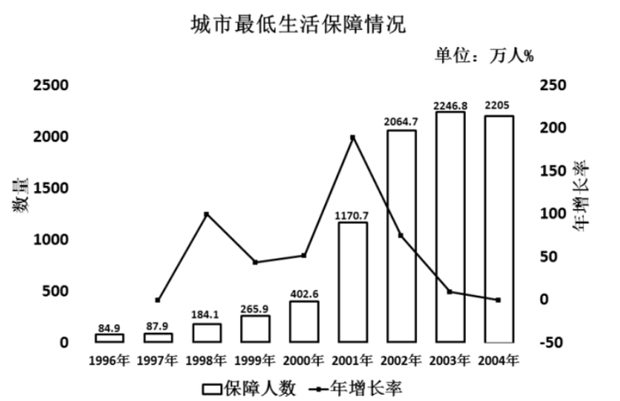

### 第 111 题

根据上图，下列说法正确的是：

A. 1996年至2004年，城市居民最低生活保障人数逐年上升

B. 1996年至2004年，城市居民最低生活保障人数年增长率逐年提高

C. 1996年至2004年，参与城市最低生活保障人数最高的年份是2004年

D. 1996年至2004年，参与城市最低生活保障人数最高的年份是2003年

第 111 题 · 答案与解析

**参考答案（粉笔题库参考内容）**

D

**解析**

A项：定位柱状图，发现2003年城市最低生活保障人数为2246.8万人，2004年城市最低生活保障人数为2205万人，人数降低，说法错误，排除；

B项：定位折线图，发现折线图有起伏变化，说明城市最低生活保障年增长率不是逐年提高的，说法错误，排除；

C项：定位柱状图，发现1996年至2004年参与城市最低生活保障人数最高的年份是2003年（2246.8万人），说法错误，排除；

D项：根据C项结论，可推出D项说法正确，当选。

故正确答案为D。

**考点**：直接找数、统计图

**来源**：2008年湖南省公务员录用考试《行测》题第111题

### 第 112 题

1997年参与城市最低生活保障的人数比1996年提高了几个百分点？

A. 84.9

B. 87.9

C. 3.5

D. 3

第 112 题 · 答案与解析

**参考答案（粉笔题库参考内容）**

C

**解析**

根据题干“1997年······比1996年提高了几个百分点”，判定本题为一般增长率计算问题。定位柱状图可得，1996年、1997年参与城市最低生活保障人数分别为84.9万人、87.9万人。代入公式：增长率 = (现期量 - 基期量)/基期量=(87.9-84.9)/84.9≈3/85≈3.5%，即提高了3.5个百分点。

故正确答案为C。

**考点**：一般增长率、统计图

**来源**：2008年湖南省公务员录用考试《行测》题第112题

### 第 113 题

根据上图，1996年至2004年，城市最低生活保障人数年增长率最高的年份是哪一年？

A. 1998年

B. 2000年

C. 2001年

D. 2003年

第 113 题 · 答案与解析

**参考答案（粉笔题库参考内容）**

C

**解析**

定位折线图可得，1996年至2004年，城市最低生活保障人数年增长率最高的是2001年。

故正确答案为C。

**考点**：直接找数、统计图

**来源**：2008年湖南省公务员录用考试《行测》题第113题

### 第 114 题

2000年参与城市最低生活保障人数的年增长率比1999年提高了几个百分点？

A. 51.4

B. 44.4

C. 9

D. 7

第 114 题 · 答案与解析

**参考答案（粉笔题库参考内容）**

D

**解析**

根据题干“2000年······的年增长率比1999年提高了几个百分点”，可判定本题为一般增长率问题。定位柱状图可得，1998年、1999年、2000年参与城市最低生活保障人数分别为184.1万人、265.9万人、402.6万人。根据公式：增长率 = (现期量 - 基期量)/基期量可得1999年、2000年的年增长率分别为(265.9 − 184.1)/184.1 ≈ 81.8/180 ≈ 45%、(402.6 − 265.9)/265.9 ≈ 136.7/270 ≈ 51%，故2000年的年增长率比1999年提高了51%-45%=6%，即提高了6个百分点，与D项最接近 。

故正确答案为D。

**考点**：一般增长率、统计图

**来源**：2008年湖南省公务员录用考试《行测》题第114题

### 第 115 题

根据上图，下列说法不正确的是：

A. 参与最低生活保障的人数不断上升，说明贫困人口有不断上升的趋势

B. 1996年与2004年间，参与最低生活保障人数年均增长率约为50.2%

C. 2001年，参与城市最低生活保障的人数突破1000万

D. 2004年参与城市最低生活保障的年增长率比2003年下降了10.7个百分点

第 115 题 · 答案与解析

**参考答案（粉笔题库参考内容）**

A

**解析**

A项：定位柱状图可得，参与最低生活保障人数不断上升，但未提及贫困人口的相关信息，无法判断，错误；

B项：定位柱状图可得，1996年、2004年参与最低生活保障人数分别为84.9万人、2205万人，年均增长率公式为(1+r)^n = 现期量/基期量，则(1+r)^n ≈ (1+50%)^8= 2.25^4 ≈ 5^2 = 25，现期量/基期量 = 2205/84.9≈ 26 ＞ 25，则年均增长率略大于50%，正确；

C项：定位柱状图可得，2001年，参与城市最低生活保障的人数为1170.7万人>1000万人，正确；

D项：定位柱状图可得，2002年、2003年、2004年参与城市最低生活保障人数分别为2064.7万人、2246.8万人、2205万人，根据公式：增长率 = (现期量 - 基期量)/基期量可得，2003年、2004年的增长率分别为(2246.8−2064.7)/2064.7≈182.1/2060≈8.8%、(2205 − 2246.8)/2246.8 ≈ −41.8/2250 ≈ −1.9%，故2004年增长率比2003年下降了8.8%-(-1.9%)=10.7%，即下降了10.7个百分点，正确。

本题为选非题，故正确答案为A。

**考点**：统计图、综合分析

**来源**：2008年湖南省公务员录用考试《行测》题第115题

## 材料 4

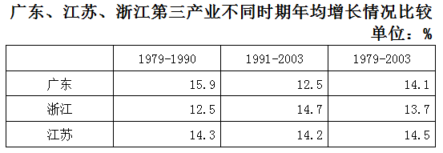

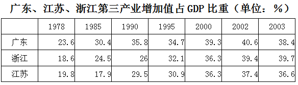

|  | 1978 | 1985 | 1990 | 1995 | 2000 | 2002 | 2003 |
| --- | ---: | ---: | ---: | ---: | ---: | ---: | ---: |
| 广东 | 23.6 | 30.4 | 35.8 | 34.7 | 39.3 | 40.6 | 38.4 |
| 浙江 | 18.6 | 24.5 | 26 | 32.1 | 36.3 | 39.4 | 39.7 |
| 江苏 | 19.8 | 17.9 | 29.5 | 30.9 | 36.3 | 37.4 | 36.6 |

### 第 116 题

根据上表，下列表述正确的是：

A. 1979—1990年，广东第三产业年均增速比浙江高3.4个百分点

B. 从1990年至2003年，江苏第三产业占GDP比重升幅为36.6个百分点

C. 到2003年时，广东第三产业占GDP比重已被江苏超过1.3个百分点

D. 从1990年至2003年，广东第三产业占GDP比重一直居全国首位

第 116 题 · 答案与解析

**参考答案（粉笔题库参考内容）**

A

**解析**

A项：定位第一个表格可得，1979～1990年广东、浙江第三产业年均增速分别为15.9%、12.5%，则1979～1990年，广东第三产业年均增速比浙江高15.9%-12.5%=3.4%，即3.4个百分点，说法正确，当选；

B项：定位第二个表格可得，1990年、2003年江苏第三产业增加值占GDP比重分别为29.5%、36.6%，则从1990年至2003年，江苏第三产业占GDP比重升幅为36.6%-29.5%=7.1%，即7.1个百分点，说法错误，排除；

C项：定位第二个表格可得，2003年广东、江苏第三产业占GDP比重分别为38.4%、36.6%，此时38.4%>36.6%，说明广东第三产业占GDP比重没有被江苏超过，说法错误，排除；

D项：定位第二个表格可得，2003年广东第三产业占GDP比重为38.4%，2003年浙江第三产业占GDP比重为39.7%。38.4%&lt;39.7%，说明2003年广东第三产业占GDP比重比浙江低，说法错误，排除。

故正确答案为A。

**考点**：简单加减计算、统计表

**来源**：2008年湖南省公务员录用考试《行测》题第116题

### 第 117 题

根据上表，下列表述不正确的是：

A. 1979-2003年，广东第三产业年均增速落后于江苏

B. 广东第三产业的增速在进入上世纪90年代后明显加快

C. 从1978年至2003年，浙江第三产业占GDP比重增长率高于广东和江苏

D. 改革开放以来，广东、江苏、浙江第三产业都得到迅速发展

第 117 题 · 答案与解析

**参考答案（粉笔题库参考内容）**

B

**解析**

A项：定位表格“广东、江苏、浙江第三产业不同时期平均增长情况比较”可得，1979-2003年广东、江苏第三产业年均增速分别为14.1%、14.5%，则广东第三产业年均增速落后于江苏，正确；

B项：定位表格“广东、江苏、浙江第三产业不同时期平均增长情况比较”可得，广东在进入九十年代后第三产业增长减慢，错误；

C项：定位表格“广东、江苏、浙江第三产业增加值占GDP比重”可得，1978年浙江、广东、江苏第三产业增加值占GDP的比重分别为18.6%、23.6%、19.8%，2003年分别为39.7%、38.4%、36.6%，则1978-2003年浙江、广东、江苏第三产业占GDP的比重分别上升了39.7%-18.6%=21.1%、38.4%-23.6%=14.8%、36.6%-19.8%=16.8%，浙江增长率高于广东和江苏，正确；

D项：定位表格“广东、江苏、浙江第三产业增加值占GDP比重”可得，改革开放以来，三地的第三产业占GDP的比重明显上升，正确。

本题为选非题，故正确答案为B。

**考点**：统计表、综合分析

**来源**：2008年湖南省公务员录用考试《行测》题第117题

### 第 118 题

2003年，广东第三产业占GDP比重比2002年增长了几个百分点？

A. 40.6

B. 39.3

C. 2.2

D. \-2.2

第 118 题 · 答案与解析

**参考答案（粉笔题库参考内容）**

D

**解析**

由表格“广东、江苏、浙江第三产业增加值占GDP比重”可知2003年为38.4%，2002年为40.6%，故38.4%-40.6%=-2.2%，即-2.2个百分点。

故正确答案为D。

**考点**：简单加减计算、统计表

**来源**：2008年湖南省公务员录用考试《行测》题第118题

### 第 119 题

1991—2003年，浙江第三产业年均增速是：

A. 12.5%

B. 14.7%

C. 13.7%

D. 14.5%

第 119 题 · 答案与解析

**参考答案（粉笔题库参考内容）**

B

**解析**

直接从第一个表格读取，1991~2003年，浙江第三产业年均增速是14.7%。

故正确答案为B。

**考点**：直接找数、统计表

**来源**：2008年湖南省公务员录用考试《行测》题第119题

### 第 120 题

从1990年至2003年，浙江第三产业占GDP比重上升了几个百分点？

A. 2.6

B. 7.1

C. 13.7

D. 39.7

第 120 题 · 答案与解析

**参考答案（粉笔题库参考内容）**

C

**解析**

定位第二个表格可得，1990年、2003年浙江第三产业占GDP比重分别为26.0%、39.7%，因此从1990年至2003年，浙江第三产业占GDP比重上升了39.7%-26.0%=13.7%，即13.7个百分点。

故正确答案为C。

**考点**：简单加减计算、统计表

**来源**：2008年湖南省公务员录用考试《行测》题第120题

