# 2009年湖南省公务员录用考试《行测》题

<!-- gwy:overview:start -->
> **湖南 · 2009 · 行测 · 统考** ｜ 140 题 · 图片 64 处 · 答案随题折叠

| 题型模块 | 题量 | 题号 |
| --- | ---: | ---: |
| 常识判断 | 25 | 1–25 |
| 言语理解与表达 | 40 | 26–65 |
| 判断推理 | 35 | 66–100 |
| 数量关系 | 20 | 101–120 |
| 资料分析 | 20 | 121–140 |
| **合计** | **140** | |

导航：[题型与作答说明](#题型与作答说明) · [题目](#题目) · [材料 1](#材料-1)
<!-- gwy:overview:end -->

> 候选采集稿。参考答案及解析来自粉笔页面，不代表官方答案或真实高分答卷；来源使用许可与原卷对应关系仍需人工核实。

## 题型与作答说明

常识判断

（25题）

常识判断部分涵盖政治、经济、法律、人文、科技等方面的内容，每道题围绕常识性问题列出若干选项，要求从中选出正确答案。本题型均为不定项选择题，错选、多选、少选均不得分。

言语理解与表达

（40题）

根据题目要求，在四个选项中选出一个正确答案。

判断推理

（35题）

本部分包括图形推理、定义判断、类比推理与逻辑判断四种类型的试题。

数量关系

（20题）

本部分包括数字推理与数学运算两种类型的试题。

资料分析

（20题）

资料分析部分包括三种类型的题目。要求根据资料所提供的信息进行分析、比较、计算，从四个备选项中选择最符合题意的答案。

## 题目

### 第 1 题

关于我国宪法的历史，下列说法不正确的是：

A. 《钦定宪法大纲》是以满清光绪帝的名义颁布的

B. 《中华民国临时约法》确立了主权在民和三权分立的资产阶级民主原则

C. 《中华民国约法》（草案）否决了内阁制而采用了总统制

D. 《中国人民政协会议共同纲领》是由中国人民政协会议第一次全体会议通过，是一部具有根本大法性质的临时宪法

第 1 题 · 答案与解析

**参考答案（粉笔题库参考内容）**

C

**解析**

A项正确，《钦定宪法大纲》是中国历史上第一部宪法性文件，清朝光绪三十四年颁布，由“君上大权”和“臣民权利义务”两部分构成。

B项正确，《中华民国临时约法》是中国第一部资产阶级宪法性文件，1912年颁布，《临时约法》规定：“中华民国人民一律平等，无种族、阶级、宗教之区别。”是主权在民；在政府的组织形式上实行“三权分立”的原则。

C项错误，《中华民国约法》（草案）是1914年袁世凯掌握政权以后修改《临时约法》形成的，以确认袁世凯独裁制度为基本特征，取消了国会制，修改了内阁制，把总统的权力提高到如同封建皇帝一样。

D项正确，《中国人民政协会议共同纲领》是1949年由中国人民政协会议第一次全体会议通过,是一部具有根本大法性质的临时宪法。

本题为选非题，故正确答案为C。

**考点**：宪法

**来源**：2009年湖南省公务员录用考试《行测》题第1题

### 第 2 题

根据我国《公务员法》的相关规定，下列情况违反回避制度的是：

A. 李某为教育局审计科副科长，其姐夫为教育局局长

B. 张某为某市档案局普通公务员，希望组织将其妻子调入本局工作

C. 王某为青山县人，现任该县委组织部长

D. 赵某为县地税局局长，其子在某乡税务所任税务员

第 2 题 · 答案与解析

**参考答案（粉笔题库参考内容）**

ACD

**解析**

《公务员回避规定（试行）》对任职回避和地域回避有如下规定：

“第五条 公务员凡有下列亲属关系的，不得在同一机关担任双方直接隶属于同一领导人员的职务或者有直接上下级领导关系的职务，也不得在其中一方担任领导职务的机关从事组织、人事、纪检、监察、审计和财务工作。

（一）夫妻关系；

（二）直系血亲关系，包括祖父母、外祖父母、父母、子女、孙子女、外孙子女；

（三）三代以内旁系血亲关系，包括伯叔姑舅姨、兄弟姐妹、堂兄弟姐妹、表兄弟姐妹、侄子女、甥子女；

（四）近姻亲关系，包括配偶的父母、配偶的兄弟姐妹及其配偶、子女的配偶及子女配偶的父母、三代以内旁系血亲的配偶。

本规定所指直接隶属，是指具有直接上下级领导关系；同一领导人员，包括同一级领导班子成员；直接上下级领导关系，包括上一级正副职与下一级正副职之间的领导关系。”

“第八条 公务员担任县级纪检机关、组织部门、人民法院、人民检察院、公安部门正职领导成员的，应当实行地域回避，一般不得在本人成长地担任市（地、盟）纪检机关、组织部门、人民法院、人民检察院、公安部门正职领导成员。”

A项，李某为教育局审计科副科长，其姐夫为教育局局长，两人为近姻亲关系，在任职上需要回避，故违反回避制度；

B项，张某属于普通公务员，没有担任领导职务或从事组织、人事、纪检、监察、审计和财务工作，不需要回避，故不违反回避制度；

C项，王某为青山县人，现任该县委组织部长，根据地域回避的规定，王某不能任该县委组织部长，故违反回避制度；

D项，赵某为县地税局局长，其子在某乡税务所任税务员，赵某及其儿子是直系血亲关系，县地税局和乡税务局属于直接上下级领导关系，应当回避，故违反回避制度。

故正确答案为ACD。

**考点**：行政法

**来源**：2009年湖南省公务员录用考试《行测》题第2题

### 第 3 题

“观念的东西不外是移入人的头脑并在人的头脑中改造过的物质的东西而已。”这一命题揭示了：

A. 人脑是意识的源泉

B. 意识是人脑产生的特殊物质

C. 意识是客观存在的主观映象

D. 观念的东西同物质的东西是具有同一性的

第 3 题 · 答案与解析

**参考答案（粉笔题库参考内容）**

CD

**解析**

本题考查考生对马克思意识本质论述的理解。“观念的东西”指“意识”，“移入人脑”指的是，意识对客观存在的反映不是头脑中产生的，而是客观存在的主观印象，“改造过的物质的东西”则表明意识和物质具有同一性，才能进行改造。

故正确答案为CD。

**考点**：唯物论

**来源**：2009年湖南省公务员录用考试《行测》题第3题

### 第 4 题

科学发展观的核心是：

A. 坚持以人为本

B. 强调全面协调可持续发展

C. 实现经济社会又快又好发展

D. 实现人的全面发展

第 4 题 · 答案与解析

**参考答案（粉笔题库参考内容）**

A

**解析**

本题考查科学发展观。对于科学发展观，一定要记住以下几点：科学发展观第一要义是发展，核心是以人为本，基本要求是全面协调可持续性，根本方法是统筹兼顾。

故正确答案为A。

**来源**：2009年湖南省公务员录用考试《行测》题第4题

### 第 5 题

社会主义之所以高于并优于资本主义最终要体现在：

A. 提高人民生活水平

B. 完善和发展生产关系

C. 推进精神文明建设

D. 创造比资本主义更高的劳动生产力

第 5 题 · 答案与解析

**参考答案（粉笔题库参考内容）**

D

**解析**

邓小平理论指出，社会主义之所以高于和优于资本主义，最终也要体现在它的生产力要比资本主义发展得更高一些，更快一些。因为一种社会制度是否先进和具有优越性，从根本上说，就是看其能否促进社会生产力的发展，创造出比先前的经济制度更高的社会生产力。

故正确答案为D。

**来源**：2009年湖南省公务员录用考试《行测》题第5题

### 第 6 题

货币的本质体现在它的职能上，职能有很多种，其中基本职能是：

A. 世界货币

B. 价值尺度

C. 流通手段

D. 支付手段

第 6 题 · 答案与解析

**参考答案（粉笔题库参考内容）**

BC

**解析**

货币的职能指的是货币在人们经济生活中所起的作用。在发达的商品经济条件下，货币具有如下五种职能：价值尺度、流通手段、贮藏手段、支付手段和世界货币。其中，价值尺度和流通手段是货币的基本职能，其他三种职能是在商品经济发展中陆续出现的。

故正确答案为BC。

**本题相关知识点：**

价值尺度指货币衡量和表现一切商品价值大小的作用，是货币最基本、最重要的职能。货币之所以能够担当价值尺度，是因为货币本身也是商品，具有价值，所以才能用来衡量其他商品价值的大小。

流通手段的职能是货币作为商品交换的媒介，即购买手段的职能。其主要特点是在商品买卖中，商品的让渡和货币的让渡在同一时间内完成，通俗地说是一手交钱、一手交货。

货币的贮藏手段职能指货币退出流通领域充当独立的价值形式和社会财富的一般代表而储存起来的一种职能。

货币支付手段的职能指货币被用来清偿债务或支付赋税、租金、工资等。

世界货币职能在世界市场上执行一般等价物的职能。

**考点**：市场经济

**来源**：2009年湖南省公务员录用考试《行测》题第6题

### 第 7 题

构建和谐社会最关键和最基础的环节是：

A. 健全社会主义民主法制

B. 切实保障人民的政治、经济和文化权益

C. 逐步扭转城乡、地区发展差距，使收入分配更加合理

D. 推动生产力进一步发展

第 7 题 · 答案与解析

**参考答案（粉笔题库参考内容）**

C

**解析**

本题考查和谐社会的相关知识。

A项错误，健全社会主义民主法制、建设社会主义法治国家有利于和谐社会的建设，但不是最关键和最基础的环节。

B项错误，切实保障人民的政治、经济和文化权益是建设和谐社会的出发点和基本要求，但不是最关键和最基础的环节。

C项正确，构建和谐社会的理论指出，逐步扭转城乡、区域差距扩大的趋势，使收入分配更加合理的目标，就抓住了构建和谐社会的最关键和最基础的环节。

D项错误，推动生产力进一步发展有利于满足人们的物质文化需要，为构建和谐社会创造物质条件，但不是最关键和最基础的环节。

故正确答案为C。

**来源**：2009年湖南省公务员录用考试《行测》题第7题

### 第 8 题

下面的文学形象中不属于吝啬鬼典型的是：

A. 《叶甫盖尼•奥涅金》中的叶甫盖尼•奥涅金

B. 《悭吝人》中的阿巴贡

C. 《威尼斯商人》中的夏洛克

D. 《死魂灵》中的泼留希金

第 8 题 · 答案与解析

**参考答案（粉笔题库参考内容）**

A

**解析**

世界文学名著中，属于吝啬鬼典型的形象主要有以下几个：莫哀里作品《悭吝人》中的阿巴贡、果戈里作品《死魂灵》中的泼留希金、莎士比亚作品《威尼斯商人》中的夏洛克、巴尔扎克作品《欧也妮·葛朗台》的葛朗台，还有中国清末吴敬梓作品《儒林外史》中的严监生。

普希金作品《叶甫盖尼·奥涅金》中的叶甫盖尼·奥涅金是一个受到进步思想影响但最终又未能跳出其狭小圈子的贵族青年的思想面貌和悲剧命运的人，被成功地塑造成了俄国文学中的第一个“多余人”形象，并非吝啬鬼典型。

本题为选非题，故正确答案为A。

**考点**：文学常识

**来源**：2009年湖南省公务员录用考试《行测》题第8题

### 第 9 题

近年国务院制定了我国十大产业振兴规划。下列被纳入的行业有：

A. 物流业

B. 房地产业

C. 钢铁业

D. 轻工业

第 9 题 · 答案与解析

**参考答案（粉笔题库参考内容）**

ACD

**解析**

2009年年初，为应对金融危机，保持经济增长，国务院组织有关部门制定十个重要产业的调整和振兴规划。这十个产业包括钢铁、汽车、纺织、装备制造、船舶工业、轻工业、石化产、电子信息业、有色金属和物流业。

故正确答案为ACD。

**考点**：宏观经济与调控政策

**来源**：2009年湖南省公务员录用考试《行测》题第9题

### 第 10 题

经济全球化本质上是资源配置的全球化，其内容大体可以分为：

A. 生产的全球化

B. 贸易的全球化

C. 文明的全球化

D. 资本的全球化

第 10 题 · 答案与解析

**参考答案（粉笔题库参考内容）**

ABD

**解析**

经济全球化是指世界经济活动超越国界，通过对外贸易、资本流动、技术转移、提供服务、相互依存、相互联系而形成的全球范围的有机经济整体。经济全球化本质上是资源配置的国际化，以资源全球合理配置为核心内容。经济全球化主要表现为四个方面：生产的全球化、贸易的全球化、金融的全球化和资本的全球化。

故正确答案为ABD。

**考点**：国际经济及组织

**来源**：2009年湖南省公务员录用考试《行测》题第10题

### 第 11 题

行政控制活动的起始环节是：

A. 实行有效监控

B. 确立控制标准

C. 采取校正措施

D. 衡量工作绩效

第 11 题 · 答案与解析

**参考答案（粉笔题库参考内容）**

B

**解析**

行政控制是指行政领导者和工作人员为了检查行政执行的进程和完成情况，纠正实施过程中的偏差，以确保实际工作与工作计划相一致而采取的措施。行政控制过程包括确立标准、衡量绩效、纠正偏差三个环节，其中确立控制标准是起始环节。

故正确答案为B。

**来源**：2009年湖南省公务员录用考试《行测》题第11题

### 第 12 题

“十一五”规划坚持用（    ）和（    ）的办法解决前进中的问题。

A. 发展

B. 开放

C. 改革

D. 稳定

第 12 题 · 答案与解析

**参考答案（粉笔题库参考内容）**

AC

**解析**

党的十六届五中全会通过的“十一五”规划《建议》强调：“坚持用发展和改革的办法解决前进中的问题”。发展是根本，改革是动力，两者之间具有内在的联系。

故正确答案为AC。

**来源**：2009年湖南省公务员录用考试《行测》题第12题

### 第 13 题

提高自主创新能力，建立技术创新体系，其基本体制架构是：

A. 政府是主导

B. 企业为主体

C. 市场为导向

D. 产学研相结合

第 13 题 · 答案与解析

**参考答案（粉笔题库参考内容）**

ABCD

**解析**

胡锦涛于2007年10月15日在党的十七大报告中明确指出，“提高自主创新能力，建设创新型国家”是“国家发展战略的核心，是提高综合国力的关键”，并将其放在促进国民经济又好又快发展的八个着力点之首。胡锦涛强调，加快建立以企业为主体、市场为导向、产学研相结合的技术创新体系是提高国家自主创新能力的重要途径。当然这种技术创新体系离不开政府的主导作用，所以基本体制架构可归纳为，以政府为主导、以企业为主体、以市场为导向、产学研相结合。

故正确答案为ABCD。

**来源**：2009年湖南省公务员录用考试《行测》题第13题

### 第 14 题

“桂林山水甲天下”，桂林山水之所以优美的最主要原因是：

A. 桂林属于岩溶地貌

B. 桂林属于高山地形

C. 桂林的年降雨量特别大

D. 桂林的植物种类丰富

第 14 题 · 答案与解析

**参考答案（粉笔题库参考内容）**

A

**解析**

桂林市地处南岭山系的西南部，平均海拔150米，属典型的“喀斯特”岩溶地貌，遍布全市的石灰岩经亿万年的风化浸蚀，形成了“山青、水秀、洞奇、石美”的独特景观，被世人美誉为“桂林山水甲天下”。

故正确答案为A。

**考点**：中国地理

**来源**：2009年湖南省公务员录用考试《行测》题第14题

### 第 15 题

当前我国进一步深化行政管理体制改革的重点是：

A. 机构改革

B. 政府职能改革

C. 人事改革

D. 行政观念改革

第 15 题 · 答案与解析

**参考答案（粉笔题库参考内容）**

B

**解析**

为贯彻落实党的十七大精神，中国共产党第十七届中央委员会第二次全体会议研究了深化行政管理体制改革问题，提出“深化行政管理体制改革要以政府职能转变为核心”。

故正确答案为B。

**来源**：2009年湖南省公务员录用考试《行测》题第15题

### 第 16 题

《XX省旅游条例》规定，纠缠游客购物最高可罚1万元。这种宏观调控运用的方法和手段是:

A. 间接调控

B. 行政手段

C. 经济手段

D. 法律手段

第 16 题 · 答案与解析

**参考答案（粉笔题库参考内容）**

D

**解析**

本题考查经济常识。

A项错误，宏观调控包括直接调控和间接调控两种方法。直接调控靠行政命令，政府直接给企业定计划、下指标，企业必须照做。间接调控则是政府通过调整货币政策、财政政策等宏观经济政策，以及利用市场机制的作用，间接地影响微观经济主体的决策和行为，政府不直接插手具体经营。与题意不符。

B项错误，行政手段是依靠行政机构，采取强制性的命令、指示、规定等行政方式来调节经济活动，以达到宏观调控目标的一种手段。行政手段具有权威性、纵向性、无偿性及速效性等特点。与题意不符。

C项错误，经济手段指政府在自觉依据和运用价值规律的基础上借助于经济杠杆的调节作用，对国民经济进行宏观调控。经济杠杆是对社会经济活动进行宏观调控的价值形式和价值工具，主要包括价格、税收、信贷、工资等，通过媒体宣传，达到调控目的。与题意不符。

D项正确，法律手段指政府依靠法制力量，通过经济立法和司法，运用经济法规来调节经济关系和经济活动，以达到宏观调控目标的一种手段。通过法律手段可以有效地保护公有财产、个人财产，维护各种所有制经济、各个经济组织和社会成员个人的合法权益；调整各种经济组织之间横向和纵向的关系，保证经济运行的正常秩序。《A省旅游条例》的规定属于经济立法。

故正确答案为D。

**考点**：宏观经济与调控政策

**来源**：2009年湖南省公务员录用考试《行测》题第16题

### 第 17 题

法对社会及其公众最基本、最直接的作用是：

A. 法的规范作用

B. 法的社会作用

C. 法的示范作用

D. 法的管理作用

第 17 题 · 答案与解析

**参考答案（粉笔题库参考内容）**

A

**解析**

法的作用是指法对人与人之间所形成的社会关系所发生的一种影响，它表明了国家权力的运行和国家意志的实现。法的作用可以分为规范作用和社会作用，其中法的规范作用是对社会及其公众最基本、最直接的作用。

故正确答案为A。

**考点**：法理学

**来源**：2009年湖南省公务员录用考试《行测》题第17题

### 第 18 题

中国四大名楼中位于长江以南的是：

A. 岳阳楼

B. 鹳雀楼

C. 滕王阁

D. 黄鹤楼

第 18 题 · 答案与解析

**参考答案（粉笔题库参考内容）**

ACD

**解析**

岳阳楼位于湖南岳阳，古有范仲淹名篇《岳阳楼记》。鹳雀楼，古名鹳鹊楼，位于山西省永济县境内。滕王阁位于江西南昌，王勃的《滕王阁序》使之名垂千古。黄鹤楼，位于湖北武昌，江南三大名楼之一。除了鹳雀楼外，都在长江以南。

故正确答案为A、C、D。

**考点**：中国地理

**来源**：2009年湖南省公务员录用考试《行测》题第18题

### 第 19 题

法律实施是指人们在社会生活中实际施行法律、运用法律的活动，法律实施的主要方式包括：

A. 法律确立

B. 法律执行

C. 法律遵守

D. 法律适用

第 19 题 · 答案与解析

**参考答案（粉笔题库参考内容）**

BCD

**解析**

法律实施，也叫法的实施，是指法在社会生活中被人们实际施行，包括执法、司法、守法和法律监督。法是一种行为规范，法在被制定出来后，付诸实施之前，只是一种书本上的法律；法律的实施，就是使法律从书本上的法律变成行动中的法律，使它从抽象的行为模式变成人们的具体行为。法的实施方式可以分为法的遵守、法的执行和法的适用三种。

故正确答案为BCD。

**考点**：法理学

**来源**：2009年湖南省公务员录用考试《行测》题第19题

### 第 20 题

下列行为中，属于行政行为的是：

A. 行政机关租用办公楼

B. 行政机关制定规范性文件

C. 发布天气预报

D. 街道办事处与居委会签订卫生管理承包合同

第 20 题 · 答案与解析

**参考答案（粉笔题库参考内容）**

BD

**解析**

行政行为的法律特征：

（1）主体是行政机关以及得到法律、法规或规章授权的非行政机关组织。

（2）行政行为必须是行政主体行使职权的行为。

（3）行政行为必须是相对人的权利义务产生法律影响的行为。

A项错误，租用办公楼属于民事行为；

B项正确，制定规范性文件属于抽象行政行为；

C项错误，天气预报不符合以上第三点规定，不产生法律效果，其本身不具备法律意义；

D项正确，街道办与居委会的卫生管理合同明显具有行政性质，虽然也具有协商的性质，但更关键还是行政性质，属于行政合同。行政合同和民事合同不同之处在于内容，卫生管理显然不属于民事类。

故正确答案为BD。

**来源**：2009年湖南省公务员录用考试《行测》题第20题

### 第 21 题

按行政行为的启动方式不同，可将其分类为（    ）行政行为。

A. 羁束性

B. 依申请的

C. 依职权的

D. 裁量性

第 21 题 · 答案与解析

**参考答案（粉笔题库参考内容）**

BC

**解析**

行政行为以其启动是否需要行政相对人先行申请为标准，分为依职权行政行为与应请求行政行为。应申请的行政行为是指行政行为以相对人的申请为前提条件，行使行政权力而作出的行政行为。依职权的行政行为是指行政机关主动行使行政权力而作出的行政行为。

羁束性行政行为和裁量性行政行为是以行政行为受法律规范约束程度的大小为标准来划分的。

故正确答案为BC。

**本题相关知识点：**

行政行为大致有九种分类方式，具体如下：

行政行为以其对象是否特定为标准，分为抽象行政行为和具体行政行为。

行政行为以受法律规范拘束的程度为标准，分为羁束行政行为和自由裁量行政行为。

行政行为以有无法定形式要求为标准，分为要式行政行为与非要式行政行为。

行政行为以其启动是否需要行政相对人先行申请为标准，分为依职权行政行为与应请求行政行为。

行政行为以有无限制条件为标准，分为附款行政行为与无附款行政行为。

行政行为以其对行政相对人利益的不同影响为标准，分为授益行政行为与不利行政行为。

行政行为以是否改变现有法律状态为标准，分为作为行政行为和不作为行政行为。

行政行为以是否需要其他行为作为补充为标准，分为独立行政行为和需补充行政行为。

行政行为以其相对人的身份为标准，分为内部行政行为和外部行政行为。

**来源**：2009年湖南省公务员录用考试《行测》题第21题

### 第 22 题

提高党的执政能力，关键在于搞好党的建设，不断增强党的（    ）。

A. 竞争力

B. 创造力

C. 凝聚力

D. 战斗力

第 22 题 · 答案与解析

**参考答案（粉笔题库参考内容）**

BCD

**解析**

党的十六届四中全会指出：“提高党的执政能力，关键在于搞好党的建设，不断增强党的创造力、凝聚力、战斗力。”

故正确答案为BCD。

**来源**：2009年湖南省公务员录用考试《行测》题第22题

### 第 23 题

飞机起飞与降落时，应（    ），最为有利于安全保障。

A. 顺风起飞，顺风降落

B. 逆风起飞，逆风降落

C. 顺风起飞，逆风降落

D. 逆风起飞，顺风降落

第 23 题 · 答案与解析

**参考答案（粉笔题库参考内容）**

B

**解析**

本题考查飞机起降时的顺逆风问题。飞机机翼升力的大小，取决于飞机与空气的相对速度。相对空气运动速度大，获得升力就越大，可以减少滑跑距离。

飞机起飞时，只有当机翼所产生的升力大于飞机的重量，飞机才能够离开地面。而升力的大小，同流过飞机机翼表面的气流速度有很大的关系；气流速度越大，升力就越大，如果迎风起飞，流过机翼表面的气流速度，就等于飞机滑跑的速度加上风速。

A项，飞机顺风起飞时，必须增速克服风速的影响才能保持正常升力，滑跑距离增大。顺风降落时，滑跑距离也会增大，给飞机准确着陆带来困难，甚至使飞机发生冲出跑道的事故。该项应排除。

B项，逆风起降时，受到空气阻力的影响，可以缩短起飞和着陆时的滑行距离。另外，飞机起飞和降落时速度慢、稳定性差，逆风起降不易受到侧风的影响，可以提高飞机起降时的安全性、稳定性。该项应选。

C项，飞机顺风起飞时升力较小，而且易受侧风影响，出现事故的可能性增大。该项应排除。

D项，飞机顺风降落时会增加滑跑距离，更容易发生意外事故。该项应排除。

故正确答案为B。

**考点**：物理常识

**来源**：2009年湖南省公务员录用考试《行测》题第23题

### 第 24 题

热传递的各种方式中，热辐射是以（    ）形式传递热量的。

A. 光波

B. 电磁波

C. 介质流动

D. 物体接触

第 24 题 · 答案与解析

**参考答案（粉笔题库参考内容）**

B

**解析**

热辐射是指物体由于具有温度而辐射电磁波的现象，是热量传递的三种方式之一。一切温度高于绝对零度的物体都会产生热辐射，温度越高，辐射出的总能量就越大，短波成分就越多。由于电磁波的传播无需任何介质，所以热辐射是在真空中唯一的传热方式。

故正确答案为B。

**本题相关知识点：**

热传递有三种方式：传导、对流和辐射。

传导热从物体温度较高的部分沿着物体传到温度较低的部分，叫做传导。 热传导是固体中热传递的主要方式。各种金属都是热的良导体，其中最善于传热的是银，其次是铜和铝。最不善于传热的是羊毛、羽毛、毛皮、棉花、石棉、软木和其他松软的物质。

对流是液体和气体中热传递的主要方式，气体的对流现象比液体更明显。利用对流加热或降温时，必须同时满足两个条件：一是物质可以流动，二是加热方式必须能促使物质流动。

热辐射则是高温物质通过电磁波形式把热量传递给低温物质的过程。

**考点**：物理常识

**来源**：2009年湖南省公务员录用考试《行测》题第24题

### 第 25 题

人体发生花粉等过敏反应时，由于毛细血管壁的通透性增加，血浆蛋白渗出，会造成局部：

A. 血浆量增加

B. 组织液减少

C. 组织液增加

D. 淋巴减少

第 25 题 · 答案与解析

**参考答案（粉笔题库参考内容）**

C

**解析**

在正常情况下，组织液和血液是能够保持平衡，但人体发生花粉过敏反应后，毛细血管壁的通透性增加，血浆蛋白大量渗出进入组织液，使组织液的浓度相对提高，渗透平衡被打破，血浆中的水分渗透到组织间隙中，使组织液增加，导致局部组织水肿。

故正确答案为C。

**考点**：生物常识

**来源**：2009年湖南省公务员录用考试《行测》题第25题

### 第 26 题

元月13日，长沙市中级人民法院与长沙晚报联合召开会议，＿＿＿“星城十佳法官”。

A. 表扬

B. 赞扬

C. 表彰

D. 奖励

第 26 题 · 答案与解析

**参考答案（粉笔题库参考内容）**

C

**解析**

考查近义实词的辨析与填空。

C项“表彰”除了宣扬赞美之外一定有嘉奖，授予某种荣誉称号之意，一般而言“表彰”与“授予称号”是固定搭配，为正确选项。

A项“表扬”和B项“赞扬”重在公开宣扬和赞美，两者之间的区别在于，“赞扬”是内心对一个人所做事情发出的赞美和欣赏，一般针对品行或者态度，“表扬”则是对一件事情或者行为给予的肯定，一般用在上级对下级，大对小，不符合题意，均排除；D项“奖励”则比较宽泛，多侧重物质，排除。

故正确答案为C。

**考点**：实词填空、词的辨析-搭配对象、词的辨析-词义侧重

**来源**：2009年湖南省公务员录用考试《行测》题第26题

### 第 27 题

他并不富裕，但还＿＿＿和照顾比他自己更穷的亲戚。

A. 救济

B. 周济

C. 周恤

D. 赞助

第 27 题 · 答案与解析

**参考答案（粉笔题库参考内容）**

B

**解析**

考查近义实词的辨析与填空。

“救济”是指用金钱或物资帮助灾区或生活困难的人；“赞助”是指拿出财物帮助。这两个词一般表示富人帮助穷人，而题目前提是“他并不富裕”，可排除A、D两项；“周济”和“周恤”都有给人物质帮助的意思，但“周恤”还包含抚恤、同情怜悯的意思，题干中只是帮助更穷的亲戚，不需要同情，故排除C项。

故正确答案为B。

**考点**：实词填空、对应关系-前后呼应、词的辨析-词义侧重

**来源**：2009年湖南省公务员录用考试《行测》题第27题

### 第 28 题

我只不过是替他＿＿＿了几句，说明了事实的真相。

A. 辩护

B. 辩解

C. 辩白

D. 辩证

第 28 题 · 答案与解析

**参考答案（粉笔题库参考内容）**

C

**解析**

考查实词辨析与填空。

C项“辩白”，意思是说明事实的真相，用来消除误会或受到的指责，用在题干中，与后句“说明了事实的真相”呼应，符合本题语境。

D项“辩证”指辩析考证，其繁复严谨程度与题干“几句”不相符合，先排除；A项“辩护”指为了保护别人或自己，提出理由、事实来说明某种见解或行为是正确合理的，或是错误的程度不如别人所说的严重，B项“辩解”是对受人指责的某种见解或行为加以解释。这两个词意味着表达的是见解和道理，试图影响对方的看法，而题干仅仅是“说明事实真相”，并不符合。

故正确答案为C。

**考点**：实词填空、对应关系-前后呼应、词的辨析-词义侧重

**来源**：2009年湖南省公务员录用考试《行测》题第28题

### 第 29 题

说话，写文章，第一要简明扼要，做到＿＿；第二要朴素、自然，防止＿＿。

A. 言之成理 矫揉造作

B. 言简意赅 矫揉造作

C. 有的放矢 言不由衷

D. 言之成理 拖泥带水

第 29 题 · 答案与解析

**参考答案（粉笔题库参考内容）**

B

**解析**

考查成语辨析的能力。

题干结构两个分句分别有两个关键词“做到”和“防止”，也就是第一空要填“简明扼要”的同义词，第二空要填“朴素、自然”的反义词。

只有B项符合，“言简意赅”与“简明扼要”对应，“朴素、自然”与“矫揉造作”对应。

选项A、D中“言之成理”是指说话有道理，与简明与否无关，故排除；选项C中“言不由衷”是指心口不一致，与朴素与否无关，故排除。

故正确答案为B。

**考点**：关联关系-并列关系、成语填空

**来源**：2009年湖南省公务员录用考试《行测》题第29题

### 第 30 题

血管是人的生命之河，堤坝薄弱，随时可能因“决堤”而危及生命，若河流阻塞，则循环受阻，＿＿＿。

A. 后患无穷

B. 遗恨无穷

C. 危在旦夕

D. 身心交病

第 30 题 · 答案与解析

**参考答案（粉笔题库参考内容）**

C

**解析**

考查成语辨析的能力。

句首强调了血管是生命之河，堤坝薄弱会危及生命，据此推断河流阻塞也会带来危及生命的严重后果。

根据这个意思，B项“遗恨无穷”是指后悔，首先排除；D项“身心交病”，题干并没有提到心理、情绪会受到影响，也排除；A项“后患无穷”则强调以后的患祸很多，题干中河流阻塞则危险就在当下，而非尚未到来的“以后”。

C项“危在旦夕”表达了危险就在眼前，更符合语境。

故正确答案为C。

**考点**：对应关系-前后呼应、成语填空

**来源**：2009年湖南省公务员录用考试《行测》题第30题

### 第 31 题

斗茶始于唐代，据考＿＿＿于出产贡茶闻名于世的福建建州茶乡。每年春季是新茶制成后，茶农、茶客们比新茶优良次劣排名顺序的一种比赛活动。有比技巧、斗输赢的特点，富有趣味性和挑战性。一场斗茶比赛的胜败，犹如今天一场球赛的胜败，为众多市民、乡民所＿＿＿。

A. 创造 参与

B. 创建 参与

C. 创造 关注

D. 创始 关注

第 31 题 · 答案与解析

**参考答案（粉笔题库参考内容）**

C

**解析**

考查近义实词辨析与填空。

第一个空，D项“创始”意为开始建立，强调从无到有，积累经验再逐步完善，“创始于”后接时间，而文段中是一个地点；B项“创建”意为创立，一般是先有经验积累然后一次性成功，多用在公司、组织等实体上。A、C项“创造”是想出新方法、建立新理论，与题干中“斗茶”风俗的产生相符合。

第二个空，针对的对象是“比赛的胜败”，用“关注”恰当，C项符合题意。

故正确答案为C。

**考点**：实词填空、词的辨析-搭配对象、词的辨析-词义侧重

**来源**：2009年湖南省公务员录用考试《行测》题第31题

### 第 32 题

刚刚过了秋分\_\_\_\_\_\_\_，就觉得突然增加了一些\_\_\_\_。

A. 气候 寒意

B. 时序 凉意

C. 时间 凉意

D. 节气 寒意

第 32 题 · 答案与解析

**参考答案（粉笔题库参考内容）**

B

**解析**

考查近义实词辨析与填空。

秋分是二十四节气之一，在这里意思是一段相对宽泛的时间。

第一个空，据此A项“气候”是一定地区多年观察所得的概括性气象情况，不是时间概念，首先排除；C项“时间”表示比较短、更为精确，不符合题意，排除；D项“节气”也指二十四节气中每一点所在的那一天，与本题的一段时间不符，排除；B项“时序”是节侯和时节的意思，更适合这里的表达，符合题意。

第二个空，B、D两项分别是凉意和寒意，根据常识判断，秋分（9月中下旬）过后天气转凉，但还达不到寒冷的程度，故“凉意”比较准确，B项符合题意。

故正确答案为B。

**考点**：实词填空、对应关系-前后呼应、词的辨析-搭配对象

**来源**：2009年湖南省公务员录用考试《行测》题第32题

### 第 33 题

避讳，是中国古代十分突出的文化事项，有严密＿＿＿的。在《现代汉语词典》中“避讳”释为:“封建时代为维护等级制度的尊严，说话或写文章时遇到君主或长辈尊亲的名字都不能直接说出或写出，叫做避讳。”古代的社会风习、心理、意识表现在许多方面，比如贵远贱近、向声背实、尊古卑今等等，随着历史的变迁，这些风习依然存在，渗透到了国民＿＿＿之中。

A. 规则 性格

B. 规定 品格

C. 规则 品格

D. 规定 性格

第 33 题 · 答案与解析

**参考答案（粉笔题库参考内容）**

A

**解析**

考查实词辨析与填空。

第一个空，“规则”是指规定出来供大家共同遵守的制度或章程，可以是成文条例也可以是约定俗成的。“规定”是对某一事物方式、方法或数量、质量的决定。本题“避讳”的内容是君主或长辈的名字不能直接说，这属于需要共同遵守的事项，故先排除B、D两项。

第二个空，“品格”强调人的品行，多指道德品质方面。“性格”是指对人、对事的态度和行为方式上所表现出来的心理特征。本题说的就是古时的社会风习、心理意识，并不涉及道德价值判断，故应该是性格方面的因素，A项符合题意。

故正确答案为A。

**考点**：实词填空、词的辨析-词义侧重

**来源**：2009年湖南省公务员录用考试《行测》题第33题

### 第 34 题

良好的口语交际能力是现代公民的重要＿＿＿，口语交际是在一定的语言＿＿＿中，相互传递信息，分享信息的过程，是人与人之间交流和＿＿＿的基本手段。

A. 素养 情境 沟通

B. 修养 情境 沟通

C. 素养 环境 连通

D. 品质 情形 沟通

第 34 题 · 答案与解析

**参考答案（粉笔题库参考内容）**

A

**解析**

考查实词辨析与填空。

第一个空，“品质”涉及道德，不符合语境。“修养”是指养成的正确的待人处事的态度。“素养”指平日养成的理论、知识、艺术、思想等方面的水平。

题干主语是口语交际能力，不涉及道德或态度，搭配“素养”更为合适，故排除B、D项。

第二个空，A、C项“环境”与“情境”的比较，环境是人们所在的周围地方与有关事物，一般分为自然环境与社会环境。情境多指人的内心或人与人之间的场合，如内心情境、会场情境等。相较而言“环境”过于宽泛、模糊，“语言”“情境”的搭配更符合训练口语的情况，A项符合题意。

第三个空，“沟通”也比“连通”更符合人际交流的场景。

故正确答案为A。

**考点**：实词填空、词的辨析-搭配对象、词的辨析-词义侧重

**来源**：2009年湖南省公务员录用考试《行测》题第34题

### 第 35 题

高友工在诗歌本文和抒情美学理论方面的＿＿＿、宇文所安对诗中“时间”的＿＿＿、孙康宣的诗人女权主义＿＿＿、浦安迪的叙事文＿＿＿、余国藩的明清小说跨文化＿＿＿＿等，在此都各显“一家”之气象，颇能引发阅读兴趣。

A. 研究 考察 分析 考察 解析

B. 钻研 探索 追溯 解析 评析

C. 探究 体味 辨析 分析 解读

D. 探求 体会 追忆 考察 剖析

第 35 题 · 答案与解析

**参考答案（粉笔题库参考内容）**

C

**解析**

本题可从第二空入手，根据文意可知，横线处表达感悟诗句呈现的“时间”之意。C项“体味”指体会、领悟事物内涵，D项“体会”指体验领会，均符合文意，保留。A项“考察”指实地调查观察，也指细致深刻地观察，文段并非强调观察，与文意不符，排除；B项“探索”指研究未知事物、多方寻求答案或进行搜查的行为，文段并非强调研究未知事物，与文意不符，排除。

第三空，搭配“女权主义”，C项“辨析”指辨别、分析，与“女权主义”搭配恰当，保留。D项“追忆”指回想记忆中的人或事，文段并非强调回忆，与文意不符，排除。

第一空，代入验证。C项“探究”指通过系统性研究获取新认知，符合文意，保留。

第四空，代入验证。C项“分析”指在头脑中把事物或对象由整体分解成各个部分或属性，符合文意，保留。

第五空，代入验证。C项“解读”指对事物或现象的分析与研究，符合文意，当选。

故正确答案为C。

**考点**：实词填空、对应关系-前后呼应、词的辨析-搭配对象、词的辨析-词义侧重

**来源**：2009年湖南省公务员录用考试《行测》题第35题

### 第 36 题

桥和路不但要为陆上运输而合作，还要为水上运输而合作。＿＿＿过河的桥，下面要走船，水涨船高。＿＿＿桥要求造得高，＿＿＿ 路也要求跟着高。桥在过河的地位上要服从路 ，路在两岸的高度上，也要迁就桥。

A. 虽然 但是 而且

B. 如果 那么 况且

C. 因为 不但 而且

D. 由于 不过 因此

第 36 题 · 答案与解析

**参考答案（粉笔题库参考内容）**

C

**解析**

考查关联词使用的虚词填空题。

首先判断最后一句总结的观点是桥和路应当互相迁就，前面两句分别解释互相迁就的原因。

第一空，后面跟“过河的桥，下面要走船······”这句是陈述既定事实，不需要假设（如果），首先排除B项。

第二空，“桥要求造得高”和前面“水涨船高”不存在转折（不过），故排除D项。

第三空，前后，“桥造得高”自然“路也跟着高”，两句话是递进关系，“不但······而且”符合，选择C项。

故正确答案为C。

**考点**：词的辨析-程度轻重

**来源**：2009年湖南省公务员录用考试《行测》题第36题

### 第 37 题

（1）××市人民政府＿＿＿了《××市未成年人保护条例》。

（2）期满，合同自行＿＿＿。

（3）谁也不能以任何理由＿＿＿ 赡养父母的义务。

A. 制定 中止 推托

B. 制定 终止 推脱

C. 制订 终止 推托

D. 制订 中止 推脱

第 37 题 · 答案与解析

**参考答案（粉笔题库参考内容）**

B

**解析**

考查实词辨析的能力。

第一个空，“制定”是定出（法律、规程、政策等），“制订”是创制拟定（工作计划等），题干宾语是《保护条例》，属于“制定”的固定搭配，故排除C、D两项。

第二个空，“中止”是中途停止，“终止”是最后结束、停止的，题干的情形是“合同期满”，适用“终止”，故排除A项。

第三个空，“推脱”是推卸责任、错误等，侧重推的结果；“推托”是借故拒绝，侧重拒绝的行为，对象多为别人请求的事情。题干所说的赡养义务，相当于责任，故B项当选。

故正确答案为B。

**考点**：实词填空、词的辨析-搭配对象、词的辨析-词义侧重

**来源**：2009年湖南省公务员录用考试《行测》题第37题

### 第 38 题

（1）泛珠合作是顺应经济全球化和区域经济一体化时代大潮的产物，是顺应\_\_\_\_\_\_之举。

（2）这对大熊猫可能安家宝岛，繁衍子孙，\_\_\_\_\_\_时要特别考虑它们之间没有亲缘关系。

（3）无论是人物刻画还是场景描写，它都有可圈可点之处，\_\_\_\_\_\_没有了斧凿的痕迹。

依次填入画横线部分最恰当的一项是：

A. 时势 挑选 着实

B. 时事 遴选 着实

C. 时事 挑选 委实

D. 时势 遴选 委实

第 38 题 · 答案与解析

**参考答案（粉笔题库参考内容）**

D

**解析**

考查近义实词辨析与填空。

第一空，“时势”，是指某一时期的客观形势。“时事”指当前发生的事情。题干顺应的是“时代大潮”，更符合客观形势而非事情，故排除B、C两项。第二空，“遴选”，是谨慎选择之意，对于“送往宝岛的大熊猫”这样的大事件，符合“遴选”的情境，故排除A项。第三空，“着实”，实在、确实之意；“委实”，确实、实在之意。一般“委实”侧重于此事属于客观事实，而“着实”具有肯定意味，程度和语气更重。

故正确答案为D。

**考点**：实词填空、词的辨析-搭配对象、词的辨析-词义侧重

**来源**：2009年湖南省公务员录用考试《行测》题第38题

### 第 39 题

政府提供公共服务所需的资源来自于公民交纳的赋税，而赋税是一种以国家暴力为＿＿＿的财政分配关系，这就使得政府与公民之间既有可能良好合作，也\_\_\_着某种对抗的潜在的可能性。如果政府施政不当，不能造福于民，这种潜在的对抗就有可能转化为现实对抗。因此，即使只是作为对纳税人慷慨奉献的回报，政府也应该承担起向人民提供良好公共服务的\_\_\_来。

A. 依靠 包含 义务

B. 依托 隐含 职责

C. 依托 隐含 责任

D. 依靠 包含 责任

第 39 题 · 答案与解析

**参考答案（粉笔题库参考内容）**

C

**解析**

考查近义实词辨析与填空。

第一个空，“依靠”是指望（某种人或事务来达到一定目的），“依托”有依靠的意思，但侧重有所凭借。

题干中国家暴力只能是收税的合法理由和最终保障，并不需要时刻出动暴力机关达到收税目的，故“依托”更符合本题语境，排除A、D项。

第二个空，应与“潜在的”相呼应，用“隐含”比“包含”更贴切，排除A、D项。

第三个空，“职责”一般是工作范围内所要承担的责任，是具体的可以描述的。“责任”大多是比较抽象的、是内心的一种正义感、维护社会秩序的责任感。题目中政府“向人民提供良好公共服务”并非具体规定的政府活动，而是应该承担的义务，在这里用“责任”更合适，排除B项。

故正确答案为C。

**考点**：实词填空、对应关系-前后呼应、词的辨析-搭配对象、词的辨析-词义侧重

**来源**：2009年湖南省公务员录用考试《行测》题第39题

### 第 40 题

孔子的许多教诲，说来都挺好听，诸如“刚、毅、木、讷”，“温、行、忠、信”以及“温、良、恭、俭、让”等等，都不失“为人之道”。然而，这些“优良品质”历来都是统治者、强者以及教育者用来＿＿＿被统治者、弱者和受教育者的，他们自己一个个却未必＿＿＿。国人历来＿＿＿“成王败寇”的逻辑，而缺乏起码的是非观念。一旦“成王”自然就占据了道德的制高点，获得了空前未有的优势，话语＿＿＿更使他们的话“句句是真理”，“一句顶一万句”。

A. 教训 遵从 遵循 特权

B. 告诫 遵循 遵从 强势

C. 控制 遵守 遵从 优势

D. 训诫 遵从 遵循 霸权

第 40 题 · 答案与解析

**参考答案（粉笔题库参考内容）**

D

**解析**

考查近义实词辨析与填空。

据关键词“然而”分析。

第一空，应该是“优良品质”相反的词，统治者、强者依靠这个对被统治者、弱者施加影响，根据双方地位和要影响的目的判断，训诫（教导和告诫）比较合适，“控制”程度太深，而“告诫”“教训”程度又太浅，由此判断D符合题意。

第三空，“遵循”是遵照，“遵从”则有服从的意思，有上下级关系。此处的对象是“逻辑”，故“遵循”更为合适。

第四空，所填词造成的结果是“句句是真理”，这个程度搭配“霸权”比较合适，“强势”“优势”搭配不通顺，“特权”程度则比较弱。

故正确答案为D。

**考点**：实词填空、词的辨析-搭配对象、词的辨析-程度轻重

**来源**：2009年湖南省公务员录用考试《行测》题第40题

### 第 41 题

在产业转型和新兴市场的开拓＿＿＿<u>的</u>情况下，中国近期的经济发展将更多地 ＿＿＿＿投资和内需。投资涉及政府行为，当然不单纯是个经济问题。如果权力监督不力，低水平、低效率的投资现象便不会是个例。中国有庞大的内需市场，但民间的财富和购买力并没有一些媒体所＿＿＿＿的那么大。低迷的股市使中产阶级的人数＿＿＿＿，处于跌势中的房价在普通民众眼中仍显高昂。要提振中国的内需市场，关键是改变社会财富分配向政府和强势群体倾斜的局面，做到真正的＿＿＿＿。

A. 尚需时日 依赖 渲染 锐减 藏富于民

B. 来日方长 依靠 宣传 减少 为民服务

C. 尚需时日 依赖 报道 骤减 执政为民

D. 来日方长 依靠 传说 递减 为民敛财

第 41 题 · 答案与解析

**参考答案（粉笔题库参考内容）**

A

**解析**

考查成语与实词混搭的辨析与填空。

第一空，应该与后句中“近期的”相对应，“来日方长”是说未来的日子还很长，表示事有可为，或劝人不必急于做某事。“尚需时日”是说还要一段时间。

题干是说转型和开拓新市场，并没有“事有可为”的肯定意味，只单纯说明时间，故填“尚需时日”比较合适，排除B、D两项。

第三空，有关键词“但”，有强调后句的意思。“渲染”指夸大的形容，有贬义，放在这里比“报道”更能表达观点，故排除C项。

本题其他空同样考查语境最佳选择。

第二空，“依靠”是需要他人的帮助，“依赖”是不可缺少对方的帮助，关系已经是不可分割了。题干说经济发展与投资和内需的关系，目前已经到“不可分割”的程度。

第四空，“中产阶级的人数”，用“减少”不够突出情势、“骤减”程度太深，“递减”需要前后比较，这里并没有，所以“锐减”合适。

第五空，“改变财富分配倾斜”，“敛财”是贬义，“为民服务”“执政为民”都没有描述财富转移的情况，所以“藏富于民”合适。

故正确答案为A。

**考点**：关联关系-转折关系、对应关系-前后呼应、混搭填空

**来源**：2009年湖南省公务员录用考试《行测》题第41题

### 第 42 题

人是一种在本能与理想、欲望与价值的冲突中求取＿＿＿＿的动物，本能与欲望是＿＿＿的，理想与价值则是主观建构的。人正是在建构理想与价值的过程中逐渐演化为人的。和平、友爱、宽恕、协作的伦理思想和价值理想就是由人类＿＿＿＿建构起来的。这一理想就是所谓文明的核心，它已经不同程度地内化为人的基本素质。

A. 平均 生而知之 祖祖辈辈

B. 平衡 与生俱来 世世代代

C. 平均 世代相传 祖祖辈辈

D. 平衡 从天而降 世世代代

第 42 题 · 答案与解析

**参考答案（粉笔题库参考内容）**

B

**解析**

考查成语和实词的混搭填空。

第一空，“平均”是把总数按份均匀计算，“平衡”是对立的各方面在数量或质量上相等或相抵。

题干“本能”与“理想”、“欲望”与“价值”的冲突之间只能取得“平衡”，这些矛盾不可能融合再重新分配，所以排除A、C项。

第二空，辨析“与生俱来”和“从天而降”，显然“本能与欲望”不是从天而降的，排除D项。

第三空，“祖祖辈辈”和“世世代代”都表示时间的更迭，但“世世代代”侧重的时间跨度更大，以年代为单位，更为久远，更适合“伦理思想和价值理想”这样宏大的主体。

故正确答案为B。

**考点**：混搭填空、词的辨析-搭配对象、词的辨析-词义侧重

**来源**：2009年湖南省公务员录用考试《行测》题第42题

### 第 43 题

感觉上与我容易投机交谈的人，多是比我年长十岁或十几岁的，也许因为他们都＿＿＿了各个领域的书籍，从年轻时候起就曾深深＿＿＿自我内心和世间万象。我平时所思所想，都是人生观问题，所以与同年代的人往往难有共同语言。对方若是20来岁的年轻人，未曾思考过人生，那自然我们就＿＿＿＿。

A. 摄取 审悉 孤言寡语

B. 涉及 审视 无言以对

C. 涉猎 审视 话不投机

D. 涉猎 审悉 一拍即合

第 43 题 · 答案与解析

**参考答案（粉笔题库参考内容）**

C

**解析**

考查实词与成语混搭填空。

第一空，“摄取”是指吸收（营养等）或者拍摄（照片或录像）。“涉及”是牵涉到、关联到。“涉猎”有粗略的阅读的意思，与题干“各领域的书籍”搭配，故排除A、B项。

第二空，“审视”和“审悉”都有仔细了解的意思。

第三空，面对“未曾思考过人生的年轻人”，所填词要与之产生关系，“一拍即合”显然不符合文意，“无言以对”和“孤言寡语”都是单方面形容话说的不多。而要描述两个人之间没有共同语言，则应该用“话不投机”。

故正确答案为C。

**考点**：对应关系-前后呼应、混搭填空、词的辨析-搭配对象

**来源**：2009年湖南省公务员录用考试《行测》题第43题

### 第 44 题

新时代不是靠一个人开辟的，它靠众多人高举理想，勇于挑战，即使途中＿＿＿也毫不畏惧，＿＿＿，才能开辟新时代，不要怕自己会失败，青年应该想:“即使我成为倒下的一员，也要尽我所能”，甚至在自己倒下的地方，对5年后、10年后、20年后＿＿＿＿自己遗志的挑战者抱着这样的心情：请＿＿＿＿我而前行，将我的失败转为智慧，走得更远。

A. 血流成河 首尾相接 传承 超越

B. 尸横遍野 前赴后继 继承 跨越

C. 血流成河 瞻前顾后 传继 越过

D. 尸横遍野 勇往直前 延续 忘记

第 44 题 · 答案与解析

**参考答案（粉笔题库参考内容）**

B

**解析**

考查成语和实词混搭填空。

第一空，“血流成河”形容被杀的人极多，而“尸横遍野”同样形容死者极多。这两者区别要看是否能与下文中“倒下的一员”相对应，尸体倒下顺承比较直接，故放在这里更为恰当，排除A、C两项。

第二空，在“前赴后继”和“勇往直前”之间选择，联系上下语境“挑战者”“走得更远”，可判定这里填“前赴后继”为宜，排除D项。

第三空，“遗志”的固定搭配是继承，第四空后面的人应是“跨过”前面倒下的人，才能继续前行，“忘记”不符合题意，“超越”有比较的意思也不合适。

故正确答案为B。

**考点**：对应关系-前后呼应、混搭填空

**来源**：2009年湖南省公务员录用考试《行测》题第44题

### 第 45 题

上海男篮在CBA历史上曾多次闯入总决赛，但仅仅获得过一次总冠军，他们总是在最关键的时候＿＿＿。

A. 功亏一篑

B. 马失前蹄

C. 功败垂成

D. 无功而返

第 45 题 · 答案与解析

**参考答案（粉笔题库参考内容）**

A

**解析**

考查成语辨析与填空。

题干中“最关键的时候”是说就差一点点的意思，A项“功亏一篑”比喻一件大事只差最后一点人力物力而不能成功，故A项更符合这里的语境。

B项“马失前蹄”指由于偶然因素而受挫。D项“无功而返”指没有取得成功而不得不打道回府。题干描述的状况“多次闯入总决赛”“仅仅获得过一次总冠军”，存在机会很多与成果很少这两个的对比，B项“马失前蹄”强调偶然、D项“无功而返”强调打道回府，没有对比的意思，首先排除。C项“功败垂成”是说快要成功的时候遭到失败，与A项都含有惋惜的意思，但“功亏一篑”侧重导致不能成功的那一点因素，而“功败垂成”侧重失败的状态描述。

故正确答案为A。

**考点**：对应关系-前后呼应、成语填空

**来源**：2009年湖南省公务员录用考试《行测》题第45题

### 第 46 题

下面四句话中，存在歧义的一句是：

A. 在公共汽车上售票

B. 在公共汽车上作案

C. 在公共汽车上看书

D. 在公共汽车上写字

第 46 题 · 答案与解析

**参考答案（粉笔题库参考内容）**

D

**解析**

考查辨析歧义的能力。

D项既可以理解为在乘坐公共汽车的时候写字，也可以理解为在公共汽车的车身上写字。

故正确答案为D。

**来源**：2009年湖南省公务员录用考试《行测》题第46题

### 第 47 题

在旅游者途经和逗留的地方构成接待群体的居民，有权得到旅游者对他们的习俗、宗教和文化的理解和尊重，因为这些都属于人类的共同遗产，他们有权自由地使用自己的旅游资源，同时通过他们的态度和行为，使<u>他们</u>的自然和文化环境得到尊重。为了对这样的理解和尊重提供便利，旅游者应该尊重接待群体的习俗、传统和宗教的做法，当地的禁忌、名胜和圣地，在旅游者途经和停留的地方构成接待群体的居民，应使旅游者受到好客、礼貌和尊重的接待，这是为和谐的人际和社会关系的发展所必不可少的。

这段文字中，划线部分的“他们”指代的是：

A. 旅游地居民

B. 旅游者

C. 旅游资源

D. 人类遗产

第 47 题 · 答案与解析

**参考答案（粉笔题库参考内容）**

A

**解析**

考查词语指代类的词句理解题。

联系上下句之意，段首“在旅游者途经和逗留的地方构成接待群体的居民”的主语一直没有发生变化，核心意思也是在表达旅游者应当尊重当地的习俗、宗教和文化。

因此，划线部分指代的应该是旅游地居民。

故正确答案为A。

**考点**：代词

**来源**：2009年湖南省公务员录用考试《行测》题第47题

### 第 48 题

春秋战国时期，诸侯之间兼并战争日趋剧烈，社会矛盾空前激化，游侠在民间悄然兴起，他们蔑视法律，标榜正义，“十步杀一人，千里不留行”，轻生死，重承诺，以抑强扶弱为己任，游侠的作为无形中威胁到封建法制，因此遭到了儒、墨、法等学派的敌视和攻击。在这种观点的影响下，诸子百家的著述中很少记载游侠的事迹，尽管如此，游侠故事在民间仍然广泛流传。

游侠故事在民间的广泛流传，反映了当时的社会：

A. 上下各种矛盾空前激化

B. 封建法制遭到严重破坏

C. 游侠行为威胁封建法制

D. 反对儒、墨、法等

第 48 题 · 答案与解析

**参考答案（粉笔题库参考内容）**

A

**解析**

据提问可知此题属于细节判断题。

游侠故事不在诸子百家的著述中而在民间流传，因为诸子百家的著述代表了上层统治者的意思。联系前述民间游侠蔑视法律、抑强扶弱，遭到敌视和攻击，也可判断游侠群体和统治者是对立体。同样，游侠得到百姓的拥护，故事得以流传，也说明了百姓与统治者的矛盾。

A项“反映了当时的社会上下各种矛盾空前激化”更符合题干要求。

B项“严重破坏”并没有表述；C项“威胁封建法制”是游侠本身而不是故事广泛流传；D项“反对儒、墨、法”只是表面现象，排除B、C、D三项。

故正确答案为A。

**考点**：细节判断题

**来源**：2009年湖南省公务员录用考试《行测》题第48题

### 第 49 题

道德属于社会意识形态的范畴，道德一词源于古希腊语，当时指的是习俗风尚。“道”是指事物运动变化必须遵循的普遍规律、法则，“德”指道德、美德、品德。在我国首先把“道德”两字连用成一词的是战国时荀况的《劝学》篇。他说：“故学至乎礼而止矣，夫是之谓道法之极。”他认为人们学了“礼”，按“礼”的要求去处理人与人的关系，也就达到了最高的道德境界。

这段文字阐述的主旨意思是：

A. 道德的内涵

B. 道德的起源

C. 道德的境界

D. 道德的范畴

第 49 题 · 答案与解析

**参考答案（粉笔题库参考内容）**

B

**解析**

据提问知此题属于中心理解题。

文段分成两个并列的分—分结构，“道德属于社会意识形态的范畴”引出论题，首句为一层，二三四五句为一层。首句叙述了道德源于古希腊语以及当时对于道德的解释。二三两句叙述了我国历史上首次把道德连在一起使用时的情况，四五句则是对三句的补充解释说明。

从国内外“道德”这个词最早被使用的情况这个描述来看，这段文字阐述的是道德的起源。故正确答案为B。

A项范围过宽，文段只介绍了道德的起源，只包括了这个词在起源时的内涵，并没有介绍道德一词在今天的含义，A项过度拓展，排除；C项片面截取了文段最后一句，这句只是对文段其中一方面意思的补充阐述，并非文段主要讨论的内容，排除；D项文段没有提及，“道德属于社会意识形态的范畴”讲的是道德属于什么而非道德包括什么，D项片面且理解有误，排除。

故正确答案为B。

**考点**：关联词-并列

**来源**：2009年湖南省公务员录用考试《行测》题第49题

### 第 50 题

原始社会，由于生产力水平低下，人们在采集食物时，由于饥不择食可能吃到有毒的野草果，以致患上疾病甚至死亡，为了防止中毒，他们就对采集的各种植物，经过上千次的尝试、体验，逐渐积累了一些药物知识，《淮南子•修务训》中记载，“神农……尝百草之滋味，水泉之甘苦，令民之所避就。当此之时，一日而遇七十毒。”在这些资料中可以看出，原始人就有了为他人不中毒，而自己去尝试的自我牺牲精神。

 这段文字主要阐述的主旨意思是：

A. 原始人自我牺牲精神

B. 我国医德思想的起源

C. “神农尝百草”的来历

D. 药物知识的积累过程

第 50 题 · 答案与解析

**参考答案（粉笔题库参考内容）**

B

**解析**

第一步，分析文段。文段先讲了原始社会，人们为了防止在采集食物时中毒而做尝试，在尝试的过程中积累了药物知识，然后举了《淮南子》中“神农尝百草”的例子，最后指出原始人有为他人不中毒而自我牺牲的精神。根据“累积的药物知识”和传说中为保佑人民健康而尝百草的“神农氏”可知，原始人为了避免人们中毒而做的这些“牺牲”体现的是“医德”。文段为“分—总”结构，重点在说明在原始社会就已经有了医德的萌芽。

第二步，对比选项。B项是文段重点的同义替换。A项“自我牺牲精神”范围过于宽泛，没有结合前文的“药物知识”和“神农尝百草”，不如B项“医德思想”准确。C项属于举例论证的部分，非重点。D项对应文段第一句和第二句，非文段重点。

故正确答案为B。

**考点**：分述句特征-引入铺垫

**来源**：2009年湖南省公务员录用考试《行测》题第50题

### 第 51 题

王师傅工作勤勤恳恳，＿＿＿。他却谦虚地说自己做得还很不够。

填入横线最恰当的一句话是：

A. 被群众评选为劳动模范

B. 群众评选他为劳动模范

C. 群众把他评选为劳动模范

D. 他成为劳动模范

第 51 题 · 答案与解析

**参考答案（粉笔题库参考内容）**

A

**解析**

考查语句填空。

根据主语一致原则，第一句的两个分句主语都应该是王师傅，故排除B、C两项；D项出现“他”，与后句的“他”重复，而且没有“群众”这个词出现，无法和后句“谦虚地说”的对象形成对应。

故正确答案为A。

**考点**：横线在开头

**来源**：2009年湖南省公务员录用考试《行测》题第51题

### 第 52 题

学会普通话是为了与人交流，学会方言则是为了传承文化。这一主张听起来似乎不无道理，其实很是荒唐。方言的文化价值只是其用于人际交流的工具价值的衍生物，既然普通话已足以胜任人际交流，方言的工具价值之皮犹不存，其文化价值之毛将焉附？再说，同时掌握普通话和方言谈何容易。一个说方言的人很难同时说好普通话，反之亦然，因为二者难免“串味”。

这段话主要支持的观点是：

A. 同时掌握普通话和方言不是一件容易事

B. 学了普通话，没有多大必要再去学方言

C. 方言主要用来传播文化，不是用来沟通

D. 普通话和方言作用不一，不能等同视之

第 52 题 · 答案与解析

**参考答案（粉笔题库参考内容）**

B

**解析**

本文重点在论述方言和普通话同时掌握这种行为的可行性。分别从“工具价值不存在就没有文化价值”和“同时掌握并不容易”两个角度去论述，结论就是掌握了普通话，就没必要再学方言。

A项仅仅为文段论述的一个方面，过于片面，排除；C项理解不正确，文段并未论述，无中生有，排除；D项并非文段主旨，非重点，排除。

故正确答案为B。

**考点**：分述句特征-引入铺垫

**来源**：2009年湖南省公务员录用考试《行测》题第52题

### 第 53 题

下列选项中，关联词语搭配最好的一项是：

A. 骄傲的人哪怕有天大的才能，却难以受到众人的欢迎

B. 平时来这里游览的人尚且这么多，节假日来的就更多了

C. 虽然家里经济条件很差，然而他的学习热情始终高涨

D. 只有从根本上解决了为了什么人的问题，就能全心全意为人民服务

第 53 题 · 答案与解析

**参考答案（粉笔题库参考内容）**

B

**解析**

此题考查辨析虚词使用对错的能力。

A项“哪怕······却”搭配错误，应该是“哪怕······也”；C项“虽然······然而”搭配错误，应该是“虽然······但是”；D项“只有······就”搭配错误，应该是“只有······才”。

故正确答案为B。

**来源**：2009年湖南省公务员录用考试《行测》题第53题

### 第 54 题

将下列句子按语序先后排列，最连贯的一项是：

（1）直到1757年，牛顿的万有引力学说已经确立很久（2）1882年，教皇才被迫承认地动学说（3）科学终于以伟大的不可压抑的力量战胜了（4）1616年， 教皇宣布《天体运行》列入禁书（5）地动学说成了天经地义，这才解除了禁令

A. （1）（3）（2）（5）（4）

B. （4）（2）（1）（3）（5）

C. （4）（1）（5）（2）（3）

D. （1）（4）（5）（2）（3）

第 54 题 · 答案与解析

**参考答案（粉笔题库参考内容）**

C

**解析**

考查语句排序的能力。

从5个分句标注的时间先后可以排列出基本顺序是（4）—（1）—（2），据此就可以将A、B、D三项排除。

故正确答案为C。

**考点**：确定顺序

**来源**：2009年湖南省公务员录用考试《行测》题第54题

### 第 55 题

看来，不只是贵族有偏见，平民也自有平民的偏见，这种偏见就是看不见每个人都应该享有人之为人的尊严和独自为人的权利。由于我们在这方面迷失太久，今天无论是尊重自己的权利，还是尊重他人的权利，都需要经过艰苦的学习。我们要早一天学会这些东西才好。只有先学会了尊重自己和尊重他人，我们才能开始学习有尊严的生活，我们才能尊严地生活在这片大地上。

这段话主要支持的观点是：

A. 尊重自己和尊重他人是自己获得尊严的前提

B. 不论贵族或平民，都有得到别人尊重的权利

C. 先尊重自己，还是先尊重他人，困扰着世人

D. 当今很多人都不会尊重别人，只知索取尊重

第 55 题 · 答案与解析

**参考答案（粉笔题库参考内容）**

A

**解析**

据提问可知此题属于中心理解题。

文段前面叙述了贵族和平民都缺乏对个人和他人权利的尊重。

最后一句关键词“只有······才”构成条件关系表达了主要观点，即尊重自己和尊重他人是自己获得尊严的前提，A项正确。

C项“困扰着世人”和D项“当今很多人”的表述在原文中并没有体现；B项，原文中说“贵族和平民”都存在偏见，都“看不见每个人应该有的尊严和权利”，宾语并非选项中的“得到别人尊重的权利”。

故正确答案为A。

**考点**：关联词-对策

**来源**：2009年湖南省公务员录用考试《行测》题第55题

### 第 56 题

下列句子中，语意前后矛盾的一句是：

A. 流动人口的增加促进了城市的发展

B. 辩论双方你来我往，舌剑唇枪，台上一度出现令人尴尬的冷场

C. 世上无难事，只怕有心人

D. 只要看到一张张微笑的面庞，你就会觉得付出是完全值得的

第 56 题 · 答案与解析

**参考答案（粉笔题库参考内容）**

B

**解析**

此题考查病句辨析能力。

B项中的前句“你来我往，舌剑唇枪”说明气氛热烈，后句却说“一度出现令人尴尬的冷场”，前后逻辑矛盾。

故正确答案为B。

**来源**：2009年湖南省公务员录用考试《行测》题第56题

### 第 57 题

下面表意明确，没有语病的一句是：

A. 我将离你而去，迈着缓慢的脚步，带着沉重的心情， 离开最恼人的城市，告别最难忘的朋友

B. 经过这一段的思考，终于使他明确了今后的人生道路，决心重新振作起来，一切从头开始

C. 地处热带、亚热带的广东、广西、云南、四川、湖北等省区的南部，气候炎热，阳光充足，各种农作物生长茂盛

D. 在一些人对他从事的工作不理解的时候， 也曾使他受到很大的压力

第 57 题 · 答案与解析

**参考答案（粉笔题库参考内容）**

A

**解析**

考查辨析病句的能力。

A项正确。

B项主语不明确，如果是“思考”做主语，不能与后面“决心重新振作”搭配，应该改为“经过这一段思考，他终于明确了今后的人生道路，决心重新振作起来，一切从头开始”；C项第一分句缺少主语，到底是什么“地处南部”？D项也是主语不明确，应改为“在一些人对他从事的工作不理解的时候，他感到很大的压力”。

故正确答案为A。

**来源**：2009年湖南省公务员录用考试《行测》题第57题

### 第 58 题

下面四个单句，与例句的语法结构相同的是：

例:老师希望每个同学都成为合格的毕业生

A. 我告诉他一件事

B. 大家都知道他是新来的学生

C. 连长派通讯员送信

D. 老张想推开门进去把工具取出来

第 58 题 · 答案与解析

**参考答案（粉笔题库参考内容）**

B

**解析**

此题重点考查句子结构的理解。

例句是主谓短语作宾语的复句，B项“他是新来的学生”是主谓句，又是“大家都知道”的宾语。两句结构完全相同。

故正确答案为B。

**来源**：2009年湖南省公务员录用考试《行测》题第58题

### 第 59 题

通过城市化，人类能够实现高度社会化和组织化，能够加强交流和交换，使人类的内心得到某种满足，但这只是满足了人类内心多种要求中的一种。今天我们所面对的是，这种社会化的要求片面地膨胀得太厉害，更多的要求受到了严重的遮蔽和压抑，比如跟自然和谐一致的要求，跟其他生命和平相处的要求，跟宇宙生命的逻辑和谐一致的要求等等。片面地满足人类的一种要求，必定导致生命状态的倾斜和残缺。当前我们所感受到的自然生态不平衡，文化生态不平衡，可能都是由人类自身精神生态的倾斜和残缺造成的。

这段话主要支持的观点是（    ）。

A. 人的欲望膨胀要有一定的限度，不能无限地发展下去

B. 交流是人所有欲望中最根本的，所有活动都由此而起

C. 社会、自然、文化都需要平衡，人类的心也需要平衡

D. 自然的不和谐源于人心不和谐，治理自然先要治理人

第 59 题 · 答案与解析

**参考答案（粉笔题库参考内容）**

C

**解析**

作者第一句话引出话题，说明城市化满足了人们的某种内心要求；第二句话提出问题，这种社会化要求的过多，导致不平衡；第三句话强调由此而带来的严重后果，最后一句话指出原因，这种后果可能是由人类精神生态的倾斜和残缺造成的，因此可以推出社会、自然、文化、人的内心都需要平衡，所以答案选择C选项。

A选项，偷换概念，原文是“社会化的要求片面地膨胀得太厉害”，把“社会化的要求”偷换成“欲望”；

B选项，无中生有，文段没有提及交流是人最根本的欲望；

D选项，过于绝对，文段只是说“可能都是由人类自身精神生态的倾斜和残缺造成的”，并没有进行确定，所以D选项错误。

故正确答案为C。

**考点**：关联词-对策

**来源**：2009年湖南省公务员录用考试《行测》题第59题

### 第 60 题

有挑战，必然有失败，有远大目标的人一定会有失败。可是，惧怕失败就不是年轻人了。惧怕失败的人，可以说他已经是一个老人了。人年纪大了，自然而然就变得保守谨慎，也不去尝试进行种种挑战了。比如经营者，年龄大了就不敢挑战新事物，所以常被赶下第一线。时代在进步，但他们不敢挑战，到了一定年龄，就被说上一句“老而成害，请回家吧”，赶出公司。

这段话主要支持的观点是：

A. 惧怕失败不是年轻人应该有的

B. 怀揣远大理想的人都是年轻人

C. 不敢挑战，害怕失败是衰老的标志

D. 年纪大不是坏处，反而是好事

第 60 题 · 答案与解析

**参考答案（粉笔题库参考内容）**

A

**解析**

根据提问可知本题为中心理解题。

主要观点在关键词“可是”之后，“惧怕失败就不是年轻人了”。此后叙述了老人变得保守谨慎的情况，并举例说明，都是为了证明这个观点。

B项、D项原文都没有提到，排除；C项“衰老的标志”只是为了说明年轻人不该惧怕失败，并没有专门论证老人如何怕失败。

故正确答案为A。

**考点**：关联词-转折

**来源**：2009年湖南省公务员录用考试《行测》题第60题

### 第 61 题

大赛中，总是有发挥失准、名将落马的情况，这类案例在全运会、亚运会、奥运会中俯拾皆是。许多优秀运动员卧薪尝胆，十年磨一剑，千辛苦，万辛苦，但关键时刻功亏一篑，留下“长使英雄泪满襟”的终生遗憾。关键时刻运动员为何发挥失准?这既是媒体炒作的卖点和百姓津津乐道的话题，也是运动心理学探索的重要方向，研究结果表明，这一现象可能同自我意识水平升高有关。

根据这段文字，关键时刻运动员发挥失准的主要原因是：

A. 关键时刻功亏一篑

B. 媒体大肆炒作和百姓津津乐道

C. 将过多的注意集中在自我表现上

D. 在观众面前进行自我表现的愿望不强

第 61 题 · 答案与解析

**参考答案（粉笔题库参考内容）**

C

**解析**

此题属于细节判断题。

找到关键句“关键时刻运动员为何发挥失准？”往后看，只有一句话概括了核心答案，“这一现象可能同自我意识水平升高有关”。

据此A项、B项仅是现象描述而非原因，先排除；根据文意，“自我意识升高”的表现恰恰是过于在乎观众的关注，与D项叙述相反。

故正确答案为C。

**考点**：细节判断题

**来源**：2009年湖南省公务员录用考试《行测》题第61题

### 第 62 题

随着经济的发展，社会化养老是大势所趋，那么，政府应不应该介入社会养老保险?在政府介入养老保险的理由这个问题上，存在许多对立和争议，由于社会养老保险能起到“安全网”和“减震器”的作用，而且在创立之初带有明显的强制性和政府行为特征，所以许多学者将其产品（服务）属性归为中央（或地方）提供的公共产品。实际上，严格从公共产品所具的三个特征(不可分性、非排他性和非竞争性)来考察，养老保险并非公共产品，而是具有私有产品的性质。

下面最符合这段文字意思的一项是：

A. 政府应该介入社会养老保险

B. 养老保险似乎应由市场提供

C. 政府不应该介入社会养老保险

D. 养老保险似乎不应由市场提供

第 62 题 · 答案与解析

**参考答案（粉笔题库参考内容）**

B

**解析**

本题考查细节判断。

根据文段最后一句话，作者严格依据公共产品所具的三个特征考察，认为养老保险并非公共产品，而是私有产品性质，私有物品是可以通过市场竞争来提供的，B项正确。

A、D两项与作者的结论相反，排除；C项为强力干扰项，题中说了在创立之初带有明显的强制性和政府行为特征，肯定了政府在其中的作用，“政府不应该介入社会养老保险”的说法过于主观、绝对。

故正确答案为B。

**考点**：细节判断题

**来源**：2009年湖南省公务员录用考试《行测》题第62题

### 第 63 题

旧历二月初二龙抬头，名人刘侗的《帝京景物略》中说“二月二日，龙抬头”，俗话说“龙不抬头天不下雨”，龙是祥瑞之物，和风化雨的主宰。

这段话的主要目的是告诉我们：

A. 龙抬头的历史记载

B. 龙抬头的祭祀活动

C. 龙抬头的来历

D. 龙抬头的节令

第 63 题 · 答案与解析

**参考答案（粉笔题库参考内容）**

C

**解析**

此题属于中心理解题。

全文所说的是人们为什么称二月初二为龙抬头，即龙抬头的来历是什么。

A项要谈历史必然要叙述起源、演变等阶段描述，文段未提及，故排除；B项要谈祭祀活动必然要对习俗、活动内容做描述，文段未提及，故排除；D项文中也没有涉及。

故正确答案为C。

**考点**：关联词-并列

**来源**：2009年湖南省公务员录用考试《行测》题第63题

### 第 64 题

雪卡毒素属于神经毒素，无色无味，不溶于水，耐热，不易被胃酸破坏，主要存在于热带珊瑚的内脏、肌肉中。 雪卡毒素主要影响人类的胃肠道和神经系统，雪卡毒素中毒的症状与有机磷中毒有些相似，一些受害者开始感到唇、舌和喉刺痛，接着在这些地方出现麻木，另一些病例首先的症状是恶心和呕吐，接着是口干、肠痉挛、腹泻、头痛、寒颤、发热和肌肉痛等症状，接触冷水犹如触电般刺痛，中毒持续恶化直到患者不能行走。

这段话的主要意思是：

A. 雪卡毒素属于神经毒素

B. 雪卡毒素的存在

C. 雪卡毒素中毒的症状

D. 雪卡毒素的特性、存在和危害性

第 64 题 · 答案与解析

**参考答案（粉笔题库参考内容）**

D

**解析**

据提问“主要意思”知此题属于中心理解题。

选项D包含了前三个选项，而且文段确实从整体上对雪卡毒素的特性、存在和危害性进行了描述。

选项 A、B、C均是对该段文字局部的概括，而非整体的概括。

故正确答案为D。

**考点**：关联词-并列

**来源**：2009年湖南省公务员录用考试《行测》题第64题

### 第 65 题

明恩溥在《中国人的素质》里指出，中国政治家的生活和国事文件，好像卢梭的忏悔一样，充满着最崇高的情感和最卑鄙的行为，他杀了一万个人，然后引述孟子的一段话，讲人的生命是神圣的。他把修河堤的钱装进自己的腰包，结果使全省惨遭洪水之害，然后他再悲叹耕者失其田。

上述句中表述的主要意思是：

A. 中国人表里不一

B. 中国人很虚伪

C. 中国人喜欢引经据典

D. 中国政治家很虚伪

第 65 题 · 答案与解析

**参考答案（粉笔题库参考内容）**

D

**解析**

据提问“主要意思”可知此题属于中心理解题。

材料第一句话点明主体词“中国政治家”，后面都是围绕“中国政治家”的所作所为来谈的，只有D项正确，A、B、C三项都放大了主语范围。

回到材料，说“崇高的情感与卑鄙的行为”“杀了人又讲生命神圣”“贪污修河堤的钱让全省惨遭洪灾”，这三个事例都在说明中国政治家的虚伪，验证D选项正确。

故正确答案为D。

**考点**：主题词

**来源**：2009年湖南省公务员录用考试《行测》题第65题

### 第 66 题

从所给四个选项中，选择最合适的一个填入问号处，使之呈现一定的规律性：

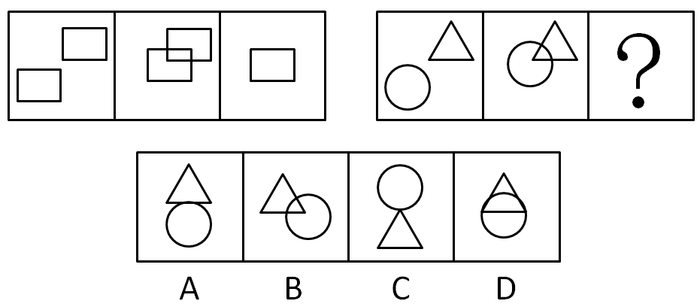

A. A

B. B

C. C

D. D

第 66 题 · 答案与解析

**参考答案（粉笔题库参考内容）**

D

**解析**

元素组成相同，考查位置规律。 主要考查图形的局部元素的平移。根据前一组图形的变化规律，可见图中两个图形逐渐向中心靠拢，并且是右侧图形被左侧图形包容。

故正确答案为D。

**考点**：位置规律-平移

**来源**：2009年湖南省公务员录用考试《行测》题第66题

### 第 67 题

从所给四个选项中，选择最合适的一个填入问号处，使之呈现一定的规律性：

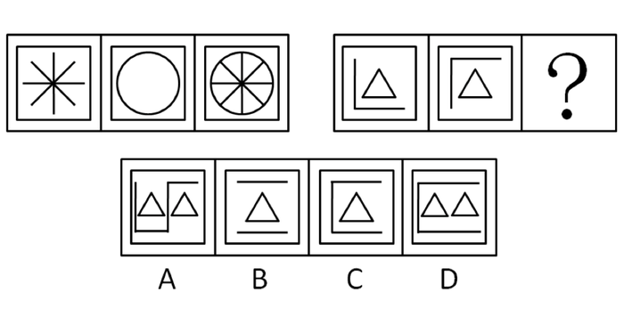

A. A

B. B

C. C

D. D

第 67 题 · 答案与解析

**参考答案（粉笔题库参考内容）**

C

**解析**

这道题主要考查图形的叠加，即前面的图形叠加组成后面的图形。根据前一组图形的变化规律，可见图中的两个图形重叠在一起形成第三个图。

故正确答案为C。

**考点**：样式规律-加减同异

**来源**：2009年湖南省公务员录用考试《行测》题第67题

### 第 68 题

从所给四个选项中，选择最合适的一个填入问号处，使之呈现一定的规律性：

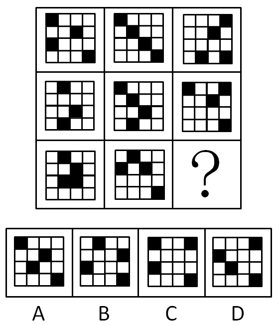

A. A

B. B

C. C

D. D

第 68 题 · 答案与解析

**参考答案（粉笔题库参考内容）**

B

**解析**

这道题主要考查图形每种元素各有几个。

将每一行的三个图形重叠在一起会，恰好每一组图中有8个小黑块和8个小白块。

而第三组图中问号处只有填上B项，然后将三个图形重叠在一起才能得到8个小黑块和8个小白块。

故正确答案为B。

**考点**：数量规律-素

**来源**：2009年湖南省公务员录用考试《行测》题第68题

### 第 69 题

从所给四个选项中，选择最合适的一个填入问号处，使之呈现一定的规律性：

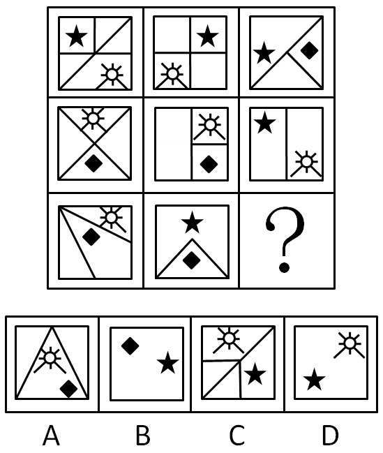

A. A

B. B

C. C

D. D

第 69 题 · 答案与解析

**参考答案（粉笔题库参考内容）**

B

**解析**

元素组成相似，元素周遍和数量的综合考查。每行每列三个图形的以线段划分的区域个数依次递减，三个不同的图形元素累计都应出现6次。

故正确答案为B。

**考点**：数量规律-面、样式规律-遍历

**来源**：2009年湖南省公务员录用考试《行测》题第69题

### 第 70 题

从所给四个选项中，选择最合适的一个填入问号处，使之呈现一定的规律性：

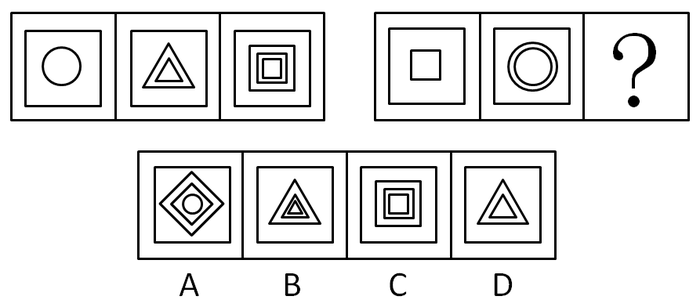

A. A

B. B

C. C

D. D

第 70 题 · 答案与解析

**参考答案（粉笔题库参考内容）**

B

**解析**

内部元素的遍历和数量的综合考查。每组图形中的内部小图形是由圆、三角形、正方形嵌套组成，且层数依次为1、2、3。

故正确答案为B。

**考点**：样式规律-遍历

**来源**：2009年湖南省公务员录用考试《行测》题第70题

### 第 71 题

种群：指在一定空间和时间内的同种生物个体的总和。

下列属于种群的一项是：

A. 一个公园中的花卉

B. 一个牧场里的家畜

C. 一个蜂巢里的蜂

D. 湘江里的鱼

第 71 题 · 答案与解析

**参考答案（粉笔题库参考内容）**

C

**解析**

第一步：抓住定义中的关键词。

关键词强调“一定空间和时间内”和“同种生物”。

第二步：逐一判断选项。

A、B、C、D均符合第一个条件，但只有C项符合第二个条件。

故正确答案为C。

**考点**：主客体

**来源**：2009年湖南省公务员录用考试《行测》题第71题

### 第 72 题

结构性失业：指由于经济结构、体制、增长方式等的变动，使劳动力在包括技能、经验、工种、知识、年龄、性别、主观意愿、地区等方面的供给结构与需求结构不相一致而导致的失业。根据上述定义，下列不属于结构性失业情况的是（    ）。

A. 某电子工艺厂的产品因长期滞销而被迫转产，职工小张因没有合适的岗位而另谋生路

B. 农民小王乘农闲之机进城务工，但一时还找不到工作

C. 小赵去年大学毕业，一心想留在大城市工作，但高不成低不就，无奈之下又继续学习准备报考硕士研究生

D. 小李在某公司工作了两年，感觉没有继续发展的空间，今年辞去了工作，打算另谋高就

第 72 题 · 答案与解析

**参考答案（粉笔题库参考内容）**

D

**解析**

第一步：判断题干中的关键词。

原因：经济结构、体制、增长方式等的变动。

结果：在技能、经验、工种、知识、年龄、性别、主观意愿、地区等方面的供给结构与需求结构不一致。

第二步：逐一分析选项。

A项，电子工艺厂被迫转产是经济结构等方面的变动，小张没有合适岗位是技能、经验等方面的不一致，符合定义。

B项，农民进城务工找不到工作是技能、经验、工种等方面的不一致，符合定义。

C项，小赵高不成低不就主要是主观意愿方面的不一致，符合定义。

D项，小李自己辞去工作，并非经济结构、体制、增长方式等未发生变动，不符合定义。

第三步：再次标注答案

本题为选非题，故正确答案为D。

**考点**：原因结果

**来源**：2009年湖南省公务员录用考试《行测》题第72题

### 第 73 题

发泄：指通过激烈的情绪表达而使情绪稳定的一种方法。

根据上述定义，下列不属于发泄的行为是：

A. 甲得知自己彩票中奖后，一路高歌、手舞足蹈

B. 小兰受到家长的批评后，将布艺小狗的耳朵扯下

C. 甲在就餐时与餐馆发生争执，肢体冲突中高喊“打人了！救命！”

D. 小丁高考落榜后，蒙头大睡三日，不吃不喝

第 73 题 · 答案与解析

**参考答案（粉笔题库参考内容）**

C

**解析**

第一步：首先分析题干条件。

1、行为是“激烈的情绪表达”；2、目的是“使情绪稳定”。

第二步：逐一判断选项。

C项不符合第二个条件，从其呼喊的内容可知他的目的不是使情绪稳定，而是寻求旁人的帮助。

本题为选非题，故正确答案为C。

**考点**：拆词

**来源**：2009年湖南省公务员录用考试《行测》题第73题

### 第 74 题

刻板印象：指社会上对于某一类事物产生一种比较固定的看法，也是一种概括而笼统的看法。

以下选项中不存在刻板印象的是：

A. 老板第一眼看到小李就非常喜欢他，在工作中予以重用

B. 张三不想与日本人合作，因为日本人尚武、有野心

C. 王五从不买温州产品，觉得那里生产的商品质量不好

D. 在人们的心目中，母亲是一个伟大的形象，她们慈爱、温柔、贤慧、为家庭尽心尽力

第 74 题 · 答案与解析

**参考答案（粉笔题库参考内容）**

A

**解析**

第一步：抓住定义中的关键词。

关键词强调是对于“某一类”且“比较固定”。

第二步：逐一判断选项。

A项中老板对小李的印象属于个人对个人的看法，而不是对某一类事物的固定看法，因此不属于刻板印象。

本题为选非题，故正确答案为A。

**考点**：拆词

**来源**：2009年湖南省公务员录用考试《行测》题第74题

### 第 75 题

技术创新：在经济发展理论中，指新技术、新发明在生产中的首次应用，是在生产体系中建立新的生产函数或供用函数，引起一种生产要素和生产条件的新组合，经济学强调技术创新具有非独占性、不确定性、市场性和系统性等特点。

根据以上定义，下列行为属于经济学范畴的技术创新的是：

A. 美国的航天技术极其发达和先进，航天飞机可以在太空自由翱翔

B. 日本某食品制造厂引进国外先进生产技术，提高了产品质量

C. 海尔集团经过不断探索，生产出适合各类人群需要的家用电器，取得极大的市场回报

D. 微软公司的技术可以查到任何一台使用微软软件的计算机的内容

第 75 题 · 答案与解析

**参考答案（粉笔题库参考内容）**

C

**解析**

第一步：抓住定义中的关键词。

定义的关键词有“首次应用、非独占性、不确定性、市场性和系统性”。

第二步：逐一判断选项。

A项不具有市场性；

B项是引进国外先进生产技术，不是新技术的首次应用；

C项是新技术的首次应用，并且突出了市场性的特点，属于技术创新；

D项微软公司的技术具有独占性，不符合技术创新的特点。

故正确答案为C。

**考点**：单定义-其他句式

**来源**：2009年湖南省公务员录用考试《行测》题第75题

### 第 76 题

三段论：由两个含有一个共同项的性质判断作前提得出一个新的性质判断为结论的演绎推理。演绎推理是由普通性的前提推出特殊性结论的推理。

根据以上定义，下列属于三段论的是：

A. 所有的金属都不溶于水，铬是金属，所以铬不溶于水

B. 所有的麻雀都有羽毛，所有的鸽子都有羽毛，所以所有的鸟都有羽毛

C. 甲不是罪犯，乙不是罪犯，所以甲乙都不是罪犯

D. 周恩来是伟大的政治家，周恩来是伟大的军事家，所以周恩来是伟大的政治家和军事家

第 76 题 · 答案与解析

**参考答案（粉笔题库参考内容）**

A

**解析**

第一步：抓住定义中的关键词。

关键词强调三段论为“演绎推理”，即普通性前提推出特殊性结论。

第二步：逐一判断选项。

A项中，“所有的金属都不溶于水”是大前提，即文中“普通性的前提”，“铬是金属”是小前提，“铬不溶于水”是特殊性结论，属于三段论。

B项属于简单的归纳推理，C项和D项都没有得出新的性质的结论。

故正确答案为A。

**考点**：常规问法

**来源**：2009年湖南省公务员录用考试《行测》题第76题

### 第 77 题

强迫症：以强迫观念和强迫动作为主要表现的一种神经症。以有意识的自我强迫与有意识的自我反强迫同时存在为特征，患者明知强迫症状的持续存在毫无意义且不合理，却不能克制的反复出现，愈是企图努力抵制，反愈感到紧张和痛苦。

根据以上定义，下列不属于强迫症的是：

A. 孙某想到“幸福”立即出现“苦难”，说到“好人”就会想到“坏蛋”，他思考问题或说话时总会去想到词的反面，且经常会因为两种对立的词句反复在脑中相继出现而感到苦恼和紧张

B. 张某驾车在路口转弯时不小心撞伤了一个路人，此后张某驾车路过这个路口总是仔细观察路况，小心行车

C. 李某出门后总是疑虑门窗是否确定已经锁好，经常反复数次回去检查，否则会感焦虑不安

D. 赵某每次路过银行，总会产生冲进银行，进行抢劫的想法，因此赵某见到银行总要绕道而行

第 77 题 · 答案与解析

**参考答案（粉笔题库参考内容）**

B

**解析**

第一步：抓住定义中的关键词。

关键词包括“毫无意义”和“不合理”。

第二步：逐一判断选项。

根据题干中强迫症的定义，A、C、D三项都符合定义，而B项中的张某仔细观察路况，是吸取了过去教训的行为，并不是毫无意义且不合理的，不属于强迫症。

本题为选非题，故正确答案为B。

**考点**：单定义-其他句式

**来源**：2009年湖南省公务员录用考试《行测》题第77题

### 第 78 题

金融监管：指一国的金融管理部门为达到稳定货币、维护金融业正常秩序等目的，依照国家法律、行政法规的规定，对金融机构及其经营活动实施外部监督、检查和对其违法行为进行处罚的一系列行为。

根据上述定义，下列属于金融监督行为的是：

A. 接到群众举报，电视台的记者对某银行服务情况进行了秘密采访

B. 中国银监会对银行业监管规章和规范性文件进行了全面清理，并于2007年7月将清理结果向社会公布

C. 湖南省银监局督促辖内银行业金融机构采取具体措施，支持农资部门稳定市场供应，确保春耕

D. 中国证监会要求广大稽查干部切实落实“及时发现、及时制止、及时查处”的方针，加大证券执法力度

第 78 题 · 答案与解析

**参考答案（粉笔题库参考内容）**

C

**解析**

第一步：抓住定义中的关键词。

关键词包括“主体”、“对象”、“目的”和“行为”。

第二步：逐一判断选项。

A项的电视台记者不属于金融管理部门，主体不对；

B、D项的对象都不是金融机构及其经营活动；

只有C项符合金融监管的定义。

故正确答案为C。

**考点**：主客体

**来源**：2009年湖南省公务员录用考试《行测》题第78题

### 第 79 题

社会心理：人们对社会现象的普遍感受和理解，是对社会生活的初级的多含直觉成分的反映，是社会意识的一种形式。表现于人们普遍的生活情绪、态度、言论和习惯之中。

根据上述定义，下列属于社会心理的是：

A. 一阶段的宣传工作结束后，人们普遍意识到只有人人遵纪守法，才能保证社会和谐稳定

B. 在许多欧美人眼中，中国还是清朝时的样子

C. 听了几个在行政机关工作的朋友的倾诉，王某感觉到在政府部门工作简直太不自由了

D. 看到有孕妇上车，公交车上有五六个青年同时站起来让座

第 79 题 · 答案与解析

**参考答案（粉笔题库参考内容）**

B

**解析**

第一步：找出定义关键词。

“人们对社会现象的普遍感受和理解”、“对社会生活的初级的多含直觉成分的反映”。

第二步：逐一分析选项。

A项：一阶段的宣传工作结束后，人们普遍意识到只有人人遵纪守法，才能保证社会和谐稳定，是经过“宣传”后才形成的意识，不符合“对社会生活的初级的多含直觉成分的反映”，不符合定义，排除；

B项：在许多欧美人眼中，中国还是清朝时的样子，是人们（欧美人）对于社会现象的普遍感受和理解，符合“对社会生活的初级的多含直觉成分的反映”，符合定义，当选；

C项：听了几个在行政机关工作的朋友的倾诉，王某感觉到在政府部门工作简直太不自由了，是听过“倾诉”后产生的意识，不符合“对社会生活的初级的多含直觉成分的反映”，不符合定义，排除；

D项：看到有孕妇上车，公交车上有五六个青年同时站起来让座，是经过“传统美德宣传”后才形成的意识，不符合“对社会生活的初级的多含直觉成分的反映”，不符合定义，排除。

故正确答案为B。

**考点**：单定义-其他句式

**来源**：2009年湖南省公务员录用考试《行测》题第79题

### 第 80 题

遗产：指公民死亡时遗留的个人合法财产，其范围包括：公民的收入；房屋、储蓄和生活用品；林木、牲畜和家禽；文物、图书资料；法律允许公民所有的生产资料；著作权、专利权中的财产权；其他合法财产和个人承包应得的收益。明确了遗赠财产是遗产的一部分。

下列不是遗产的是：

A. 死者个人承包应得的收益

B. 死者的著作权

C. 患了绝症的老人的图书资料

D. 遗赠财产

第 80 题 · 答案与解析

**参考答案（粉笔题库参考内容）**

C

**解析**

第一步：找出定义关键词。

“死亡时遗留的个人合法财产”、“公民的收入”、“房屋、储蓄和生活用品”、“林木、牲畜和家禽”、“文物、图书资料”、“法律允许公民所有的生产资料”、“著作权、专利权中的财产权”、“其他合法财产和个人承包应得的收益”、“遗赠财产是遗产的一部分”。

第二步：逐一分析选项。

A项：“死者个人承包应得的收益”在遗产的范围之内，符合定义，排除；

B项：“死者的著作权”在遗产的范围之内，符合定义，排除；

C项：患了绝症的老人还未死亡，不符合“死亡时”，不符合定义，当选；

D项：“遗赠财产”在遗产的范围之内，符合定义，排除。

本题为选非题，故正确答案为C。

**考点**：大前提

**来源**：2009年湖南省公务员录用考试《行测》题第80题

### 第 81 题

窑：陶瓷

A. 唯物主义：唯心主义

B. 整数：负整数

C. 青年：少年

D. 烤箱：面包

第 81 题 · 答案与解析

**参考答案（粉笔题库参考内容）**

D

**解析**

第一步：判断题干之间逻辑关系。

题干两词是对应关系，窑是制作陶瓷的场所。

第二步：判断选项之间的逻辑关系。

A、C两项属于并列关系；

B项属于包容关系；

D项属于对应关系，烤箱是制作面包的场所。

故正确答案为D。

**考点**：逻辑关系-对应关系

**来源**：2009年湖南省公务员录用考试《行测》题第81题

### 第 82 题

纸：草

A. 火药：硝石

B. 磁石：石头

C. 树皮：细胞

D. 酱油：蚕豆

第 82 题 · 答案与解析

**参考答案（粉笔题库参考内容）**

D

**解析**

第一步：判断题干词语间逻辑关系。

纸可以用草为原料制作，也可以用其他原料，比如树木，草不是造纸的必需原料。

第二步：判断选项词语间逻辑关系。

A项：硝石是制作火药的主要原料，而且是必需原料，与题干逻辑关系不一致，排除；

B项：磁石是石头的一种，两者为种属关系，与题干逻辑关系不一致，排除；

C项：树皮与细胞属于组成关系，细胞是树皮的微观构成结构，与题干逻辑关系不一致，排除；

D项：酱油可以用蚕豆酿制，也可以用其他原料酿制，比如黄豆，蚕豆不是酿制酱油的必需原料，与题干逻辑关系一致，当选。

故正确答案为D。

**考点**：逻辑关系-对应关系

**来源**：2009年湖南省公务员录用考试《行测》题第82题

### 第 83 题

税收：调节：差距

A. 政府：宏观：管理

B. 企业：利润：工资

C. 市场：计划：资源

D. 篝火：驱逐：寒冷

第 83 题 · 答案与解析

**参考答案（粉笔题库参考内容）**

D

**解析**

第一步：判断词语之间逻辑关系。

调节差距，二者为动宾关系，税收具有调节收入差距的功能，三者为功能的对应关系。

第二步：判断选项之间的逻辑关系。

A项：宏观为名词，不能和管理构成动宾关系，与题干逻辑关系不一致，排除；

B项：利润为名词，不能和工资构成动宾关系，与题干逻辑关系不一致，排除；

C项：计划资源，二者搭配不当，与题干逻辑关系不一致，排除；

D项：驱逐寒冷，二者为动宾关系，篝火具有驱逐寒冷的功能，三者为功能的对应关系，与题干逻辑关系一致，当选。

故正确答案为D。

**考点**：语法关系、逻辑关系-对应关系

**来源**：2009年湖南省公务员录用考试《行测》题第83题

### 第 84 题

校对：印刷：出版

A. 谈判：签署：废除

B. 抢劫：入狱：判刑

C. 选举：组阁：执政

D. 研发：转让：投入

第 84 题 · 答案与解析

**参考答案（粉笔题库参考内容）**

C

**解析**

第一步：判断题干词语间第一重逻辑关系。

题干存在两种逻辑关系。第一重是时间上严格的顺序，与之相同逻辑关系的是A、B、C三项，D项时序颠倒，“投入”应在“研发”之前。

第二步：答案不唯一时，判断第二重逻辑关系。

第二重逻辑即前者为后者的必经程序，则只有C项符合。

A项“签署”可以不经过“谈判”，并且“废除”是对“签署”的否定，对应关系错误；

B项“抢劫”如果符合法定条件，如抢劫者不具有承担刑事责任的能力，则未必“入狱”。

故正确答案为C。

**考点**：逻辑关系-对应关系

**来源**：2009年湖南省公务员录用考试《行测》题第84题

### 第 85 题

风俗：习惯

A. 男生：女生

B. 科学：技术

C. 江苏：泰州

D. 跳跃：动作

第 85 题 · 答案与解析

**参考答案（粉笔题库参考内容）**

D

**解析**

第一步：判断词语之间逻辑关系。

题干两词属于包容关系中的种属关系，“风俗”是“习惯”的一种。

第二步：判断选项之间的逻辑关系。

D项与之相符。

A项是并列关系，B项无种属关系，C项是组成关系，但位置相反。

故正确答案为D。

**考点**：逻辑关系-包容关系

**来源**：2009年湖南省公务员录用考试《行测》题第85题

### 第 86 题

杂技演员在走钢丝时，如履平地，当身体摇晃要倒下时，会摆动双臂，其目的是：

A. 为了降低重心，使身体站稳

B. 为了扩大面积，稳固重心，使身体站稳

C. 为了调整力臂力矩，使身体站稳

D. 为了调整重心作用线，稳固重心，使身体站稳

第 86 题 · 答案与解析

**参考答案（粉笔题库参考内容）**

D

**解析**

对表演走钢丝的演员进行受力分析，演员受到竖直向下的重力与竖直上向上的支持力，重力作用线通过重心且为竖直方向，支持力作用线通过支撑面（钢丝）且为竖直方向，因此演员想要保持平衡，重力和支持力需要作用在同一条直线上，即物体的重力作用线必须通过支撑面。如果重力作用线不通过支撑面，演员就要倒下来。所以当演员的身体摇晃要倒下时，伸开双臂，左右摆动，就是为了调整重心作用线，使之通过支撑面，以恢复平衡。

故正确答案为D。

**来源**：2009年湖南省公务员录用考试《行测》题第86题

### 第 87 题

如图所示，木块A和B分别受到大小为10N和5N的两个拉力，且在地面上保持静状态。则下列说法正确的是：

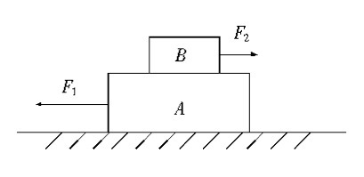

A. F_2与A对B的摩擦力是作用力和反作用的关系

B. A受到地面的摩擦力为15N

C. 如果F_1\=15N时，A和B恰好开始同时向左运动，则A和B在地面作匀速直线运动时受到的摩擦力是10N

D. 如果撤销F_2，保留F_1，A和B仍然保持静止状态，则此时A和B之间不存在摩擦力

第 87 题 · 答案与解析

**参考答案（粉笔题库参考内容）**

D

**解析**

A项混淆了作用力与反作用力的概念，作用力与反作用力是作用在两个物体上的；

B项错误，将A和B木块看做一个统一系统，做受力分析，可知，A受到地面的摩擦力为5N；

C项当F_1\=15N，A、B恰好开始向左运动时，最大静摩擦力就等于10N，但因摩擦力=摩擦系数×正压力，而最大静摩擦力大于动摩擦力，所以当A和B做匀速直线运动时的动摩擦力要小于10N。

故正确答案为D。

**来源**：2009年湖南省公务员录用考试《行测》题第87题

### 第 88 题

普通的子弹射击出后都绕自身的轴作高速旋转，为使子弹旋转，在枪膛内壁刻有螺旋形的槽。让子弹高速旋转，其目的主要是：

A. 旋转运动能使子弹更具有穿透力，增大杀伤力

B. 旋转运动有助于减少空气阻力，使子弹飞行距离更长

C. 旋转运动能使子弹飞行速度更快

D. 旋转运动能使子弹沿弹道飞行更稳定

第 88 题 · 答案与解析

**参考答案（粉笔题库参考内容）**

D

**解析**

当一个力学系统（物体）受到数力的作用，若其合力（大小、方向）为零，且各力对任一点之力矩和亦为零时，就称此力学系统是处于平衡状态。类似陀螺原理，子弹高速旋转的时候，可以尽量使子弹在飞行过程中达到平衡状态，促使子弹飞行更加稳定。

故正确答案为D。

**来源**：2009年湖南省公务员录用考试《行测》题第88题

### 第 89 题

如果一个物体在X点上从飞机上抛出，物件应呈怎样的轨迹是：

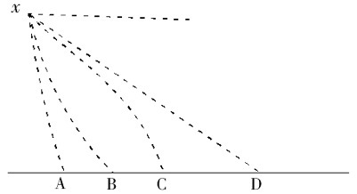

A. A

B. B

C. C

D. D

第 89 题 · 答案与解析

**参考答案（粉笔题库参考内容）**

C

**解析**

将物体的运动分解成两个分运动，垂直方向是自由落体运动，水平方向是匀速直线运动，所以物体呈平抛运动，轨迹为抛物线，并且力是改变物体运动的原因，由于重力会使轨迹越来越向垂直地面方向偏，但永远达不到垂直地面的方向。

故正确答案为C。

**来源**：2009年湖南省公务员录用考试《行测》题第89题

### 第 90 题

如图所示，将一个球放在两块光滑斜面AB和CD之间，两板与水平面夹角相等，现在使两板与水平面夹角α以相同的速度逐渐减小，则球对AB的压力将是：

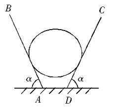

A. 先增大后减小，最后为零

B. 逐渐增大，最后为零

C. 先减小后增大，最后为零

D. 逐渐减小，最后为零

第 90 题 · 答案与解析

**参考答案（粉笔题库参考内容）**

D

**解析**

设球对AB的压力为F，这个力也等于AB对球的支持力，受力分析可知，（），因为重力G不变，所以随着α减小，F逐渐减小，到最后球全部的重量压在地面上，球对板没有压力，所以最后为零。

故正确答案为D。

**来源**：2009年湖南省公务员录用考试《行测》题第90题

### 第 91 题

王平是凤凰公司的经理，李强的所有朋友都在凤凰公司工作。胡斌是李强的朋友。凤凰公司中有些职工来自湖南，凤凰公司所有的职工都是大学生。

据此，我们可以知道：

A. 李强有一些学历不高的朋友

B. 胡斌是大学生

C. 胡斌来自湖南

D. 王平与李强是朋友

第 91 题 · 答案与解析

**参考答案（粉笔题库参考内容）**

B

**解析**

第一步：翻译题干。利用充分必要条件。

第一句：王平：凤凰公司的经理，该句为事实信息，即已经成立的事实；

第二句：李强的朋友⇒凤凰公司的职工；

第三句：胡斌：李强的朋友，该句为事实信息，即已经成立的事实；

第四句：有些凤凰公司的职工⇒来自湖南；

第五句：凤凰公司的职工⇒是大学生。

第二步：从事实信息开始推导，得到结论。

由第二句中“李强的朋友⇒凤凰公司的职工”和第三句中事实信息“胡斌：李强的朋友”得到“胡斌：凤凰公司的职工”，又知第五句中“凤凰公司的职工⇒是大学生”得到“胡斌：是大学生”，即胡斌是大学生。B项即是这一结论，因此B正确。

第三步：逐一判断其他选项。

A项，由第二句中“李强的朋友⇒凤凰公司的职工”和第五句中“凤凰公司的职工⇒是大学生”得到“李强的朋友⇒是大学生”，即李强的所有朋友都是大学生，因此A错；

C项，由题干只能得到“凤凰公司的职工：有些来自湖南”和“胡斌：凤凰公司的职工”，不能断定胡斌来自湖南，因此C无法推出；

D项，题干并未涉及王平和李强之间的关系，因此D无法推出。

故正确答案为B。

**考点**：集合推理

**来源**：2009年湖南省公务员录用考试《行测》题第91题

### 第 92 题

4个人玩游戏，在每张纸上写上1～9中的一个数字，然后叠起来，每人从中抽取2张，然后报出两数的关系，由此猜出剩下没有人拿的那个数字是多少。

已知：

I、 A说他手里的两数相加为10。

II、 B说他手里的两数相减为1。

III、C说他手里的两数之积为24。

IV、 D说他手里的两数之商为3。

由此他们4人都猜出了剩下没有人拿的那个数字，这个数字是：

A. 5

B. 6

C. 7

D. 8

第 92 题 · 答案与解析

**参考答案（粉笔题库参考内容）**

C

**解析**

第一步：找突破口。

本题突破口为四个人说法中符合条件可能的情况最少的，即C手中的两数。由Ⅲ可知，C手中的两数只能是3、8或4、6。

第二步：由突破口作出假设并分析判断。

假设C手中的两数是3、8，由Ⅳ可知，D手中的数字只能是2、6；再由Ⅰ可知，A手中的数字只能是1、9；继而由Ⅱ可知，B手中的数字只能是4、5；所以剩下的数字是7，因此该假设成立。

假设C手中的两数是4、6，由Ⅳ可知，D手中的数字只能是1、3或3、9，即D手中的数字必有3，还有1和9中的一个；再由Ⅰ可知，A手中的数字只能是2、8；则此时不可能满足条件Ⅱ，因此该假设不成立。综上，剩下的数字只能是7。

故正确答案为C。

**考点**：日常结论

**来源**：2009年湖南省公务员录用考试《行测》题第92题

### 第 93 题

人的认识能力是无限的，张某是人，因此，张某的认识能力是无限的。

以下哪项的逻辑错误与上述推理的错误最为相似：

A. 人是宇宙间最宝贵的，我是人，因此，我是宇宙间最宝贵的

B. 人贵有自知之明，你没有自知之明，因此你不是人

C. 干部应起带头作用，我不是干部，所以我不应起带头作用

D. 干部应为人民服务，我是干部，所以，我应为人民服务

第 93 题 · 答案与解析

**参考答案（粉笔题库参考内容）**

A

**解析**

第一步：翻译题干。

人⇒认识能力无限，张某⇒人，结论：张某⇒认识能力无限，逻辑错误是两个关系式中人的概念是不同的，出现概念偷换。

第二步：逐一翻译选项。

A项，人⇒宇宙间最宝贵，我⇒人，结论：我⇒宇宙间最宝贵，逻辑错误是两个关系式中人的概念是不同的，出现概念偷换；

B项，人⇒有自知之明，你⇒－有自知之明，结论：你⇒－人；

C项，干部⇒起带头作用，我⇒－干部，结论：我⇒－起带头作用；

D项，干部⇒为人民服务，我⇒干部，结论：我⇒为人民服务，没有逻辑错误。

将选项与题干对比格式可以看出，A与题干一致。

故正确答案为A。

**考点**：推理形式

**来源**：2009年湖南省公务员录用考试《行测》题第93题

### 第 94 题

位于美国密歇根州的珀纳蒙研究所近期出台了一份研究报告，称北美公司的不少离职雇员在离公司时会随身带走属于公司的机密敏感数据。这其中的许多人将会在新公司的工作岗位上为尽快立足而使用这些数据。金融危机引发的经济衰退导致北美许多公司大幅裁员。人们几乎每天在新闻中都可以看到公司裁员的消息。裁员当然可以使这些公司减少因危机带来的资金压力，但同时也可能因公司管理措施不到位而为公司留下后患，使竞争者从中获利。

由此可以推出：

A. 裁员必然导致公司机密泄漏

B. 金融危机加剧了公司机密泄漏的情况

C. 泄密的公司都曾经裁员

D. 面对金融危机，公司最好不要裁员

第 94 题 · 答案与解析

**参考答案（粉笔题库参考内容）**

B

**解析**

第一步：抓住每句话中的主要内容。

第一句说明不少离职雇员在离公司时会随身带走属于公司的机密敏感数据，第二句说明许多人将会使用这些数据，第三句说明金融危机导致北美许多公司大幅裁员，第五句说明裁员可能为公司留下后患。

第二步：逐一判断选项。

A项，根据“这其中的许多人将会在新公司的工作岗位上为尽快立足而使用这些数据”可知，并非所有被裁的员工都会泄密，因此A错；

B项，由题干可知，裁员可能导致公司机密泄漏，再结合金融危机加剧了裁员的发生，因此可知B正确；

C项，裁员的公司可能被泄密，但不能逆推出泄密的公司都裁员，因此C错；

D项，虽然裁员可能导致公司机密泄漏，但相比面对资金压力，公司还是不得不裁员，D项由题干无法推出，因此D错。

故正确答案为B。

**考点**：日常结论

**来源**：2009年湖南省公务员录用考试《行测》题第94题

### 第 95 题

很多民工之所以带着现金返乡，其中最主要的原因可能还是金融系统的服务还远远不能适应民工的需求。如农村信用社还未真正建立起全国统一的电子汇兑网络，一些经济欠发达地区农村信用社，业务设备、运作手段还十分落后；有些民工选择通过邮局由异地向家乡汇款，但邮局只在乡镇一级的地域设立网点，农民取款往往要往返几十里，极不方便；还有的金融机构的营业网点为了完成存款任务，想方设法不让民工将钱取出，久而久之，民工对这些金融机构便敬而远之。种种因素的存在，决定了民工们像影片《天下无贼》里的傻根一样带现金回家既是心理的偏好，更是不得已而为之。

由此不能推出：

A. 我国农村金融系统很不完善

B. 改善农村金融服务后，农民喜欢带现金的情况就会改变

C. 农民们很少光顾农村金融机构

D. 农民工带现金返乡不仅处于心理习惯

第 95 题 · 答案与解析

**参考答案（粉笔题库参考内容）**

B

**解析**

第一步：分析把握题干说明的内容。

本题题干认为，民工之所以带现金返乡，更多是由于金融系统的服务不能适应民工的需求，是由于农村金融系统的不完善所导致的，而不全是由于心理的偏好。

第二步：逐一判断选项的正确。

A、D项，由第一步中的分析可知A和D两项都可以从题干推出；

B项，由于民工带现金返乡有多方面的因素，因此B项无法推出；

C项，由“久而久之，民工们对这些金融机构便敬而远之”可以推出C项正确。

本题为选非题，故正确答案为B。

**考点**：日常结论

**来源**：2009年湖南省公务员录用考试《行测》题第95题

### 第 96 题

在北京奥运会前后，身穿速比涛公司生产的鲨鱼皮泳衣参赛的游泳运动员们几乎打破了所有的世界纪录。这一旋风直接造成了运动员争相要求身穿这种新式泳衣，而和旧的、自己的赞助商决裂，这影响到了几乎所有的世界级大型体育用品品牌。

由此不能推出：

A. “鲨鱼皮”泳衣大大提高了运动员成绩

B. 除了速比涛公司，其它公司没有制造出这样的泳衣

C. 赞助商一般要求自己赞助的运动员在比赛中穿自己品牌的泳衣

D. 所有世界级大型体育用品品牌都有赞助的运动员

第 96 题 · 答案与解析

**参考答案（粉笔题库参考内容）**

D

**解析**

第一步：抓住每句话中的对象。

第一句说明身穿“鲨鱼皮”泳衣运动员们打破了世界纪录，第二句说明这一旋风影响到了几乎所有的世界级大型体育用品品牌。

第二步：逐一判断选项。

A项由题干第一句可以推断出；

B项由“运动员争相要求身穿这种新式泳衣，而和旧的、自己的赞助商决裂”可以推出；

C项由题干第二句“这一旋风影响到了几乎所有的世界级大型体育用品品牌”也可以推出；

D项题干中说的是“影响到了几乎所有的世界级大型体育用品品牌”，而不是“所有的”，因此D项不能从题干中推出。

本题为选非题，故正确答案为D。

**考点**：日常结论

**来源**：2009年湖南省公务员录用考试《行测》题第96题

### 第 97 题

所有称职的教师都是关心学生的成绩的教师。所有关心学生成绩的教师都工作很忙碌。工作不忙碌的教师都不是优秀教师。

根据以上论述，一定可以推出：

A. 有些优秀教师不是工作忙碌的教师

B. 有些工作忙碌的教师不是优秀教师

C. 所有称职的教师工作都很忙碌

D. 所有忙碌的教师都很关心学生成绩

第 97 题 · 答案与解析

**参考答案（粉笔题库参考内容）**

C

**解析**

第一步：翻译题干。利用充分必要条件。

第一句：称职的教师⇒关心学生成绩的教师，第二句：关心学生成绩的教师⇒工作忙碌，第三句：－工作忙碌⇒－优秀教师。

第二步：逐一翻译选项并判断选项的正确。利用逆否规则。

A项，一些优秀教师⇒－工作忙碌，对第三句“－工作忙碌⇒－优秀教师”利用逆否规则可得：优秀教师⇒工作忙碌，因此A错；

B项，一些工作忙碌教师⇒－优秀教师，“工作忙碌”是对第三句“－工作忙碌⇒－优秀教师”的否前件，无法推出绝对表达的结论，因此B错；

C项，称职的教师⇒工作忙碌，由第一句“称职的教师⇒关心学生成绩的教师”和第二句“关心学生成绩的教师⇒工作忙碌”可得：称职的教师⇒工作忙碌，因此C正确；

D项，工作忙碌⇒关心学生成绩的教师，工作忙碌对于第二句“关心学生成绩的教师⇒工作忙碌”是肯后件，无法推出绝对表达的结论，因此D错。

故正确答案为C。

**考点**：集合推理

**来源**：2009年湖南省公务员录用考试《行测》题第97题

### 第 98 题

所谓“白色污染”，是人们对塑料垃圾污染环境的一种形象称谓。它是指用聚苯乙烯、聚丙烯、聚氯乙烯等高分子化合物制成的各类生活塑料制品使用后被弃置成为固体废物，由于随意乱丢乱扔，又难于自然降解，于是形成环境污染的现象。

由此可以推出：

A. 白色环境污染难以消除

B. 高分子化合物难以自然降解

C. 制止乱丢乱扔就能消除环境污染

D. 容易自然降解的固体不会造成环境污染

第 98 题 · 答案与解析

**参考答案（粉笔题库参考内容）**

B

**解析**

第一步：抓住每句话中的对象。

第一句说明“白色污染”是指塑料垃圾污染环境，第二句说明该污染产生的原因有两个。

第二步：逐一分析选项的正确。

A项，题干中只讲了“白色污染”的成因，未讲如何消除的问题，因此A项是无中生有的结论；

B项，根据推理的传递性可知其正确，高分子化合物构成固体废物，固体废物难以自然降解，因此高分子化合物难以自然降解；

C、D项，根据末句，白色环境污染的成因有二，“随意乱丢乱扔”和“(固体废物)难于自然降解”，C项和D项都只是消灭了一个原因，不全面，因此C和D均错误。

故正确答案为B。

**考点**：日常结论

**来源**：2009年湖南省公务员录用考试《行测》题第98题

### 第 99 题

我国现行的法律法规依所有1200多个，每年中共中央和国务院还要下发100多个新的政策文件。这些法律法规和文件，已经覆盖了中国社会经济发展的各个方面，如果它们都真正得到了切实的贯彻执行，就会有力的推动中国社会经济健康的发展。

因此应该：

A. 继续制定更多的法律政策

B. 努力去实施和执行现有的法律法规和政策

C. 减少新法律的制定

D. 加强法律工作

第 99 题 · 答案与解析

**参考答案（粉笔题库参考内容）**

B

**解析**

第一步：抓住题干所要表达的内容。

本题主要内容是我国现有法律法规和文件已经覆盖了中国社会经济发展的各个方面，这些法律的贯彻执行会有力的推动中国社会经济健康的发展。

第二步：逐一分析判断选项的正确。

通过第一步中的总结显然可以推出应该努力去实施和执行现有的法律法规和政策，因此B项正确；题干并没有涉及法律的制定，因此A、C和D三项均错。

故正确答案为B。

**考点**：日常结论

**来源**：2009年湖南省公务员录用考试《行测》题第99题

### 第 100 题

针对作弊屡禁不止的现象，某学院某班承诺，只要全班同学都在承诺书上签字，那么，如果全班有一人作弊，全班同学的考试成绩都以不及格计。校方接受并实施了该班的这一承诺。结果班上还是有人作弊，但班长的考试成绩是优秀。

从上述判断逻辑得出的结论是：

A. 班长采取不正当的手段使校方没有严格实施承诺

B. 全班多数人没有作弊

C. 全班没有人在承诺书上签字

D. 全班有人没在承诺书上签字

第 100 题 · 答案与解析

**参考答案（粉笔题库参考内容）**

D

**解析**

第一步：翻译题干。

①全班同学都在承诺书上签字 且 有人作弊→全班同学不及格。

②有人作弊，班长的考试成绩是优秀。

第二步：从事实信息开始推导并判断选项。

题干中“②有人作弊，班长的考试成绩是优秀”是事实信息。由条件②可知，-全班同学不及格。根据逆否规则可知：-全班同学不及格→—都在承诺书上签 或 -有人作弊，这是一个相容选言命题，如果否定其中一个选言支，必然推出肯定另一个选言支。根据条件②可知“有人作弊”，这属于否定一个选言支，那么必然推出肯定另一个选言支，即“全班同学不都在承诺书上签字”，也就是说“全班有人没在承诺书上签字”。

故正确答案为D。

**考点**：常规翻译

**来源**：2009年湖南省公务员录用考试《行测》题第100题

### 第 101 题

5，8，（    ），23，35

A. 19

B. 18

C. 15

D. 14

第 101 题 · 答案与解析

**参考答案（粉笔题库参考内容）**

D

**解析**

观察数列，变化起伏小且呈递增趋势，优先考虑作差。后项减前项得到新数列：3、（    ）、（    ）、12，构造最简数列：3、（6）、（9）、12，是公差为3的等差数列，代入题干验证：8＋6＝14＝23-9，符合原数列规律。

故正确答案为D。

**来源**：2009年湖南省公务员录用考试《行测》题第101题

### 第 102 题

0，6，24，60，（    ）

A. 70

B. 80

C. 100

D. 120

第 102 题 · 答案与解析

**参考答案（粉笔题库参考内容）**

D

**解析**

观察数列，每项周围均有幂次数，考虑幂次修正数列。其中：、、、。底数为1，2，3，4，是公差为1的等差数列，下一项底数为5；指数均为3；修正项为减去对应项底数，下一项修正项为-5。故所求项为：。

故正确答案为D。

**来源**：2009年湖南省公务员录用考试《行测》题第102题

### 第 103 题

2，8，32，（   ），512

A. 64

B. 128

C. 216

D. 256

第 103 题 · 答案与解析

**参考答案（粉笔题库参考内容）**

B

**解析**

观察数列，此数列是公比为4的等比数列，所求项为。

故正确答案为B。

**来源**：2009年湖南省公务员录用考试《行测》题第103题

### 第 104 题

2，3，6，18，108，（   ）

A. 2160

B. 1944

C. 1080

D. 216

第 104 题 · 答案与解析

**参考答案（粉笔题库参考内容）**

B

**解析**

数列无明显特征，作差作和均无规律，考虑递推。观察可知：2×3=6，3×6=18，6×18=108，即，故所求项=18×108=1944。

故正确答案为B。

**来源**：2009年湖南省公务员录用考试《行测》题第104题

### 第 105 题

11，4，13，6，（   ），8，17，10

A. 15

B. 16

C. 17

D. 18

第 105 题 · 答案与解析

**参考答案（粉笔题库参考内容）**

A

**解析**

方法一：观察数列，发现数列项数较多，考虑多重数列。优先交叉看，奇数项数列：11、13、（    ）、17，是公差为2的等差数列，故所求项为13+2=15；偶数项数列：4、6、8、10，是公差为2的等差数列。

方法二：观察数列，发现数列项数较多且为偶数项，原数列两两分组：（11，4）、（13，6）、（？，8）、（17，10），组内前项减后项均为7，故所求项为8+7=15。

故正确答案为A。

**来源**：2009年湖南省公务员录用考试《行测》题第105题

### 第 106 题

2，3，6，5，（   ），7，20

A. 12

B. 11

C. 10

D. 8

第 106 题 · 答案与解析

**参考答案（粉笔题库参考内容）**

A

**解析**

数列项数较多，考虑多重数列。优先交叉看，奇数项数列：2、6、（    ）、20，已知项作差后为4和14，14可拆分为6和8，即奇数项数列后项减前项得到新数列：4、6、8，是公差为2的等差数列，所求项应为6+6=12；偶数项数列：3、5、7，是公差为2的等差数列。

故正确答案为A。

**来源**：2009年湖南省公务员录用考试《行测》题第106题

### 第 107 题

1，2，4，（    ），11，16

A. 10

B. 9

C. 8

D. 7

第 107 题 · 答案与解析

**参考答案（粉笔题库参考内容）**

D

**解析**

观察数列，无明显特征，优先考虑多级数列。后项减前项得到新数列：1、2、（    ）、（    ）、5，若猜测该数列是公差为1的等差数列，则有1、2、（3）、（4）、5，故所求项为4+3=7。向后验证：7+4=11，验证成功，即所猜规律成立。

故正确答案为D。

**来源**：2009年湖南省公务员录用考试《行测》题第107题

### 第 108 题

3，6，11，18，（    ），38

A. 23

B. 25

C. 27

D. 29

第 108 题 · 答案与解析

**参考答案（粉笔题库参考内容）**

C

**解析**

观察数列特征，变化起伏较小且呈递增趋势，优先考虑多级数列。后项减前项得到新数列：3，5，7，（    ），（    ），猜测构成公差为2的等差数列，则新数列后两项应为9，11，故所求项为18+9=27。向后验证：27+11=38，验证成功，即所猜规律成立。

故正确答案为C。

**来源**：2009年湖南省公务员录用考试《行测》题第108题

### 第 109 题

0，1，4，11，26，（  ）

A. 61

B. 57

C. 43

D. 33

第 109 题 · 答案与解析

**参考答案（粉笔题库参考内容）**

B

**解析**

观察数列，无明显特征，优先考虑多级数列。后项减前项得到新数列：1、3、7、15，无明显规律；再次作差后得到数列：2、4、8，是公比为2的等比数列，下一项为，则首次作差后得到的新数列下一项为15+16=31，故所求项为26+31=57。

故正确答案为B。

**来源**：2009年湖南省公务员录用考试《行测》题第109题

### 第 110 题

2.01，2.02，2.03，（  ），2.08，2.13

A. 2.04

B. 2.05

C. 2.06

D. 2.07

第 110 题 · 答案与解析

**参考答案（粉笔题库参考内容）**

B

**解析**

观察数列均为小数，优先考虑机械划分。整数部分均为2；小数部分为：01、02、03、（    ）、08、13，猜测规律为第一项+第二项=第三项，则小数部分下一项为02+03=05，验证可得：01+02=03、02+03=05、03+05=08、05+08=13，验证成功，即所猜规律成立。故所求项为2.05。

故正确答案为B。

**来源**：2009年湖南省公务员录用考试《行测》题第110题

### 第 111 题

一列长90米的火车以每秒30米的速度匀速通过一座长1200米的桥，所需时间多少秒：

A. 37

B. 40

C. 43

D. 46

第 111 题 · 答案与解析

**参考答案（粉笔题库参考内容）**

C

**解析**

设过桥所需时间为t秒，根据火车过桥公式：，代入数据得：，解得t=43。

故正确答案为C。

**考点**：火车过桥

**来源**：2009年湖南省公务员录用考试《行测》题第111题

### 第 112 题

超市规定每3个空汽水瓶可以换一瓶汽水，小李有11个空汽水瓶，最多可以换几瓶汽水：

A. 5

B. 4

C. 3

D. 2

第 112 题 · 答案与解析

**参考答案（粉笔题库参考内容）**

A

**解析**

根据空瓶换酒公式：n个空汽水瓶可以换1瓶汽水，x个空汽水瓶最多可以换x/(n-1)瓶汽水。3个空汽水瓶可以换1瓶汽水，有11个空汽水瓶，最多可以换瓶汽水，因瓶数一定是整数，所以最多可以换5瓶汽水。

故正确答案为A。

**来源**：2009年湖南省公务员录用考试《行测》题第112题

### 第 113 题

有两只相同的大桶和一只空杯子，甲桶装牛奶，乙桶装糖水，先从甲桶内取出一杯牛奶倒入乙桶，再从乙桶取出一杯糖水和牛奶的混合倒入甲桶，问，此时甲桶内的糖水多还是乙桶内的牛奶多：

A. 无法判定

B. 甲桶糖水多

C. 乙桶牛奶多

D. 一样多

第 113 题 · 答案与解析

**参考答案（粉笔题库参考内容）**

D

**解析**

两次操作之后，甲桶内溶液总量保持不变。由此可知，甲桶减少了多少牛奶就相应增加了多少糖水，减少的牛奶在乙桶中，增加的糖水在甲桶中，两者相等。因此，此时甲桶内的糖水与乙桶内的牛奶一样多。

故正确答案为D。

**来源**：2009年湖南省公务员录用考试《行测》题第113题

### 第 114 题

甲乙两辆汽车都由北京经长沙开往广州，出发时两车共有乘客160人，在长沙站甲车增17人，乙车减23人，这样在开往广州时，两车的乘客人数正好相等，问甲车原车多少人：

A. 60

B. 75

C. 90

D. 100

第 114 题 · 答案与解析

**参考答案（粉笔题库参考内容）**

A

**解析**

方法一：设甲车原先有乘客x人，乙车原有乘客y人。根据题意可列方程组：x+y=160······①，x+17=y-23······②，联立方程组，解得：x=60，y=100，即甲车原有60人。

方法二：两车经过长沙站后，总人数变为160+17-23=154人，且两车的乘客人数正好相等，则甲车此时人数为人，所以甲车原有77-17=60人。

故正确答案为A。

**考点**：和差倍比问题

**来源**：2009年湖南省公务员录用考试《行测》题第114题

### 第 115 题

某机关单位召开一次会议预期12天，后因会期缩短4天，因此原预算款节约了一部分，其中生活费一项节约了4000元，比计划少用40%，生活费预算占总预算的4/9，则总预算为：

A. 45000

B. 35000

C. 27500

D. 22500

第 115 题 · 答案与解析

**参考答案（粉笔题库参考内容）**

D

**解析**

根据题意，生活费预算为元，故总预算为=22500元。

故正确答案为D。

**考点**：和差倍比问题

**来源**：2009年湖南省公务员录用考试《行测》题第115题

### 第 116 题

某市为合理用电，鼓励各用户安装峰谷电表，市原电价每度0.53元，改新表后，每晚10点至次日早8点为低谷，每度收0.28元，其余时间为高峰期，每度0.56元，为改装新电表每个用户须收取100元改装费，假定某用户每月用200度电，两个不同时段用电量各为100度，那么改装电表12个月后，该用户可节约多少元：

A. 161

B. 162

C. 163

D. 164

第 116 题 · 答案与解析

**参考答案（粉笔题库参考内容）**

D

**解析**

电表改装之前该用户12个月的用电费用为元；改装电表后，该用户12个月的用电费用加上改装费用共元，该用户改装电表12个月后可节约1272-1108=164元。

故正确答案为D。

**考点**：分段计算问题

**来源**：2009年湖南省公务员录用考试《行测》题第116题

### 第 117 题

请计算99999×22222+33333×33334的值：

A. 3333400000

B. 3333300000

C. 3333200000

D. 3333100000

第 117 题 · 答案与解析

**参考答案（粉笔题库参考内容）**

B

**解析**

。

故正确答案为B。

**来源**：2009年湖南省公务员录用考试《行测》题第117题

### 第 118 题

光明小学体育馆保管室的篮球和排球共30个，其比例为7:3，现购入排球x个后，排球占总数的40%，那么x＝（    ）

A. 5

B. 7

C. 10

D. 12

第 118 题 · 答案与解析

**参考答案（粉笔题库参考内容）**

A

**解析**

方法一：根据篮球与排球的比例为7：3可得，购入排球之前篮球和排球分别有个和个。购入x个排球后，总数变为30+x，可得，解得x=5。

方法二：根据篮球与排球的比例为7：3可得：购入排球之前篮球和排球分别有个和个。购入x个排球后，排球占总数的40%，即篮球占总数的1-40%=60%，则这时排球和篮球共有个，因此后购入排球35-30=5个。

故正确答案为A。

**考点**：和差倍比问题

**来源**：2009年湖南省公务员录用考试《行测》题第118题

### 第 119 题

某城市9月平均气温为28.5度，如当月最热日和最冷日的平均气温相差不超过10度，则该月平均气温在30度及以上的日子最多有多少天：

A. 24

B. 25

C. 26

D. 27

第 119 题 · 答案与解析

**参考答案（粉笔题库参考内容）**

B

**解析**

要使30度以上的天数尽可能多，在气温总和一定的情况下，则必然是其他天的温度尽可能低，而由最热日与最冷日的平均气温相差不超过10度，据此构造极端情况，最热天全部为30度，其余天数为最冷天，温度为20度，设平均气温为30度的天数为x，则可得，解得x=25.5，因此最多有25天。

故正确答案为B。

**考点**：构造数列

**来源**：2011年国家公务员录用考试《行测》题第79题

### 第 120 题

小王登山，上山的速度是4km/h， 到达山顶后原路返回，速度为6km/h，设山路长为9km，小王的平均速度为多少km/h？

A. 5

B. 4.8

C. 4.6

D. 4.4

第 120 题 · 答案与解析

**参考答案（粉笔题库参考内容）**

B

**解析**

往返路程相同，平均速度为等距离平均速度。根据等距离平均速度公式可得：km/h。

故正确答案为B。

**考点**：平均速度

**来源**：2009年湖南省公务员录用考试《行测》题第120题

## 材料 1

恩格尔系数，即食品消费支出在总消费支出中所占的比重。联合国粮农组织依据恩格尔系数，将生活水平划分为如下标准：恩格尔系数在59%以上者为绝对贫困状态的消费；50%—59%为勉强度日状态的消费；40%—50%为小康水平的消费；20%—40%为富裕状态的消费；20%以下为最富裕状态的消费。我国城镇和乡村的恩格尔系数，1980年为56.9%和61.8%；2000年分别为39.2%和49.1%；2001年分别为37.1%和47.7%。到2010年我国城乡的恩格尔系数应分别是30%和40%。2020年分别是25%和35%。

### 第 121 题

从数据可以看出，1980年以来，我国城乡恩格尔系数变动呈：

A. 上升态势

B. 快速下降态势

C. 下降态势

D. 快速上升态势

第 121 题 · 答案与解析

**参考答案（粉笔题库参考内容）**

C

**解析**

定位文字材料可得：1980年-2001年，城镇恩格尔系数依次为56.9%、39.2%、37.1%；乡村恩格尔系数依次为61.8%、49.1%、47.7%，故我国城乡恩格尔系数呈下降趋势。

故正确答案为C。

**考点**：文字资料、直接找数

**来源**：2009年湖南省公务员录用考试《行测》题第121题

### 第 122 题

到2020年，我国乡村的消费将属于：

A. 最富裕状态的消费

B. 富裕状态的消费

C. 小康水平的消费

D. 很难判断

第 122 题 · 答案与解析

**参考答案（粉笔题库参考内容）**

B

**解析**

定位文字材料可得：2020年我国乡村恩格尔系数为35%，根据联合国粮农组织依据恩格尔系数划分的生活水平（恩格尔系数在20%—40%为富裕状态的消费），可判定到2020年我国乡村属于富裕状态的消费。

故正确答案为B。

**考点**：文字资料、直接找数

**来源**：2009年湖南省公务员录用考试《行测》题第122题

### 第 123 题

1980年我国乡村消费属于：

A. 绝对贫困状态的消费

B. 勉强度日状态的消费

C. 小康水平的消费

D. 富裕状态的消费

第 123 题 · 答案与解析

**参考答案（粉笔题库参考内容）**

A

**解析**

定位文字材料可得：1980年我国乡村恩格尔系数为61.8%，根据联合国粮农组织依据恩格尔系数划分的生活水平（恩格尔系数在59%以上者为绝对贫困状态的消费），可判定出1980年我国乡村属于绝对贫困状态的消费。

故正确答案为A。

**考点**：文字资料、直接找数

**来源**：2009年湖南省公务员录用考试《行测》题第123题

### 第 124 题

从1980年到2000年，我国城镇恩格尔系数下降的百分点是：

A. 7.8

B. 12.7

C. 17.7

D. 22.6

第 124 题 · 答案与解析

**参考答案（粉笔题库参考内容）**

C

**解析**

定位文字材料可得：1980年我国城镇恩格尔系数为56.9%，2000年我国城镇恩格尔系数为39.2%，则从1980年到2000年，我国城镇恩格尔系数下降的百分点为56.9%-39.2%=17.7%，即17.7个百分点。

故正确答案为C。

**考点**：文字资料、简单加减计算

**来源**：2009年湖南省公务员录用考试《行测》题第124题

## 材料 2

我国第五次人口普查显示我国人口年龄结构发生了较大变化。祖国大陆31个省、自治区、直辖市和现役军人的人口中，0—14岁的人口为28979万人，约占总人口的22.89%；15—64岁的人口为88793万人，约占总人口的70.15%；65岁及以上的人口为8811万人，约占总人口的6.96%。同1990年的第四次人口普查相比，0—14岁人口的比重下降了约4.80%，65岁及以上人口的比重上升了约1.39%。

### 第 125 题

第五次人口普查显示我国65岁及以上的人口占总人口的百分比大约是：

A. 22.89%

B. 5.57%

C. 6.96%

D. 8.62%

第 125 题 · 答案与解析

**参考答案（粉笔题库参考内容）**

C

**解析**

定位文字材料可得：第五次人口普查中，65岁及以上的人口约占总人口的6.96%。

故正确答案为C。

**考点**：文字资料、直接找数

**来源**：2009年湖南省公务员录用考试《行测》题第125题

### 第 126 题

第五次人口普查显示我国15岁及以上的人口占总人口的百分比大约是：

A. 70.15%

B. 75.72%

C. 76.11%

D. 77.11%

第 126 题 · 答案与解析

**参考答案（粉笔题库参考内容）**

D

**解析**

定位文字材料可得：第五次人口普查中，0—14岁的人口约占总人口的22.89%，则15岁及以上的人口占总人口的百分比约为1-22.89%=77.11%。

故正确答案为D。

**考点**：文字资料、简单加减计算

**来源**：2009年湖南省公务员录用考试《行测》题第126题

### 第 127 题

第四次人口普查显示我国65岁及以上人口所占的比重大约是：

A. 5.30%

B. 5.57%

C. 6.96%

D. 8.35%

第 127 题 · 答案与解析

**参考答案（粉笔题库参考内容）**

B

**解析**

定位文字材料可得：第五次人口普查中，65岁及以上的人口约占总人口的6.96%，与第四次人口普查相比，比重上升了约1.39%。则第四次人口普查时65岁及以上人口所占的比重约为6.96%-1.39%=5.57%。

故正确答案为B。

**考点**：文字资料、简单加减计算

**来源**：2009年湖南省公务员录用考试《行测》题第127题

## 材料 3

2008年前三季度国内生产总值201631亿元，按可比价格计算，同比增长9.9%，比上年同期回落2.3个百分点。其中，第一产业增加值21800亿元，增长4.5%，加快0.2个百分点；第二产业增加值101117亿元，增长10.5%，回落3.0个百分点；第三产业增加值78714亿元，增长10.3%，回落2.4个百分点。

### 第 128 题

2007年前三季度国内生产总值约为多少亿元：

A. 183468

B. 179707

C. 192948

D. 177648

第 128 题 · 答案与解析

**参考答案（粉笔题库参考内容）**

A

**解析**

根据题干“2007年前三季度······约为多少亿元”，结合材料时间是2008年前三季度，可判定本题为基期计算问题。定位文字材料可得：2008年前三季度国内生产总值201631亿元，同比增长9.9%。根据公式：基期量，则2007年前三季度国内生产总值亿元，与A项最接近。

故正确答案为A。

**考点**：基期计算、文字资料

**来源**：2009年湖南省公务员录用考试《行测》题第128题

### 第 129 题

2007年前三季度三大产业增加值中，增长速度最快的是：

A. 第一产业

B. 第二产业

C. 第三产业

D. 无法确定

第 129 题 · 答案与解析

**参考答案（粉笔题库参考内容）**

B

**解析**

根据题干“增长速度最快的是”，可判定本题为一般增长率比较问题。定位文字材料可得：2008年前三季度，第一产业增加值增长4.5%，加快0.2个百分点；第二产业增加值增长10.5%，回落3.0个百分点；第三产业增加值增长10.3%，回落2.4个百分点。则2007年前三季度，第一产业增速=4.5%-0.2%=4.3%；第二产业增速=10.5%+3.0%=13.5%；第三产业增速=10.3%+2.4%=12.7%，第二产业增长速度最快。

故正确答案为B。

**考点**：一般增长率、文字资料

**来源**：2009年湖南省公务员录用考试《行测》题第129题

### 第 130 题

2008年前三季度第三产业增加值大约占国内生产总值的：

A. 11%

B. 39%

C. 50%

D. 12.7%

第 130 题 · 答案与解析

**参考答案（粉笔题库参考内容）**

B

**解析**

根据题干“2008年前三季度······占······”，可判定本题为现期比重计算问题。定位文字材料可得：2008年前三季度国内生产总值201631亿元，第三产业增加值78714亿元。根据公式：比重，所求比重=39%。

故正确答案为B。

**考点**：文字资料、现期比重

**来源**：2009年湖南省公务员录用考试《行测》题第130题

## 材料 4

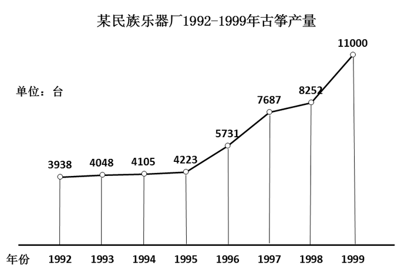

### 第 131 题

该厂1999年古筝产量约是1992年的：

A. 2.605倍

B. 2.681倍

C. 2.717倍

D. 2.793倍

第 131 题 · 答案与解析

**参考答案（粉笔题库参考内容）**

D

**解析**

根据题干“1999年······约是1992年的”，结合选项为倍数，可判定本题为现期倍数问题。定位折线图可得：该厂1999年古筝产量为11000台，1992年为3938台，则所求倍数倍，只有D项满足。

故正确答案为D。

**考点**：现期倍数、统计图

**来源**：2009年湖南省公务员录用考试《行测》题第131题

### 第 132 题

该厂1992—1999年古筝生产量平均每年增加约为：

A. 1009台

B. 1159台

C. 1177台

D. 1379台

第 132 题 · 答案与解析

**参考答案（粉笔题库参考内容）**

A

**解析**

根据题干“该厂1992—1999年······平均每年增加约为”，结合选项有具体单位，可判定本题为年均增长量问题。定位折线图可得：该厂1999年古筝产量为11000台，1992年为3938台。根据公式：年均增长量，则该厂1992—1999年古筝生产量平均每年增加台。

故正确答案为A。

**考点**：年均增长量、统计图

**来源**：2009年湖南省公务员录用考试《行测》题第132题

## 材料 5

下图反映的是美国高中毕业生参加SAT（Scholastic Aptitude Test，学习能力测验）和GPA（GradePoint Average，平均绩点）模拟考试的分数，以及SAT、GPA成绩与这些学生最终升入大学的百分比之间的关系。

图中：%表示最终被大学录取的学生的百分比。

（    ）内表示每个分数段高中毕业生的总人数。

受试学生GPA的成绩大于2.0的共1959人。

受试学生中最终升入大学的共744人。

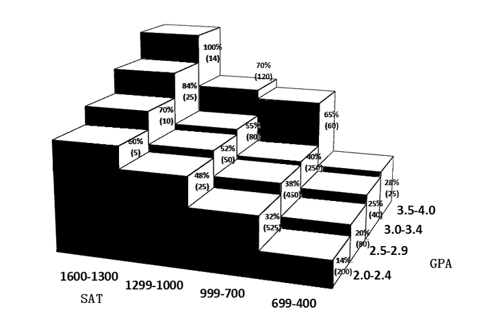

### 第 133 题

GPA成绩在3.5-4.0之间，而SAT成绩在1000-1299之间的学生中有多少人没能升入大学？

A. 84

B. 72

C. 32

D. 36

第 133 题 · 答案与解析

**参考答案（粉笔题库参考内容）**

D

**解析**

GPA成绩在3.5-4.0，SAT成绩在1000-1299对应图形块为70%、(120)，则没被大学录取的学生有。

故正确答案为D。

**考点**：现期比重、综合资料

**来源**：2009年湖南省公务员录用考试《行测》题第133题

### 第 134 题

在1959名学生中,SAT的分数低于700未能升入大学的学生大约占：

A. 7.25%

B. 14.5%

C. 29%

D. 58%

第 134 题 · 答案与解析

**参考答案（粉笔题库参考内容）**

B

**解析**

SAT成绩低于700未能升入大学的学生有=284人，占1959名学生的比例为。

故正确答案为B。

**考点**：现期比重、综合资料

**来源**：2009年湖南省公务员录用考试《行测》题第134题

### 第 135 题

下列选项中，升入大学的学生最多的一组是：

A. 3.0-3.4/700-999

B. 2.0-2.4/700-999

C. 3.5-4.0/400-699

D. 2.5-2.9/700-999

第 135 题 · 答案与解析

**参考答案（粉笔题库参考内容）**

D

**解析**

根据题干“······升入大学的学生最多的一组······”，结合图形材料给出了各个取值区间对应的高中毕业生总人数及部分量的占比，可判定本题为现期比重问题。定位统计图可知，GPA取值范围为3.0-3.4且SAT取值范围为700-999的高中毕业生的总人数为250人，最终被大学录取的学生的百分比为40%；GPA取值范围为2.0-2.4且SAT取值范围为700-999的高中毕业生的总人数为525人，最终被大学录取的学生的百分比为32%；GPA取值范围为3.5-4.0且SAT取值范围为400-699的高中毕业生的总人数为25人，最终被大学录取的学生的百分比为28%；GPA取值范围为2.5-2.9且SAT取值范围为700-999的高中毕业生的总人数为450人，最终被大学录取的学生的百分比为38%。根据升入大学的学生=高中毕业生总人数×最终被大学录取的学生的百分比可得，A项为250×40%=100人；B项为525×32%=168人；C项为25×28%=7人；D项为450×38%=171人。

对比选项可得，D项对应的组别升入大学的学生最多。

故正确答案为D。

**考点**：现期比重、统计图

**来源**：2009年湖南省公务员录用考试《行测》题第135题

## 材料 6

某省规定，公务员考试分笔试和面试两个程序。笔试合格后才有资格进入面试，只有两种考试皆合格才能被录取。

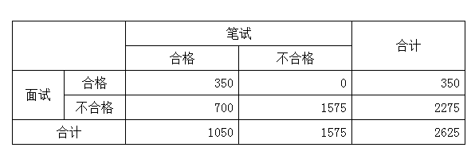

### 第 136 题

本次公务员考试笔试的合格率为：

A. 13.33%

B. 33.33%

C. 40%

D. 60%

第 136 题 · 答案与解析

**参考答案（粉笔题库参考内容）**

C

**解析**

根据题干“本次······笔试的合格率······”，可判定本题为现期比重问题。定位表格材料可知，本次笔试合格人数为1050人，参加本次笔试的总人数为2625人。故笔试合格率，对应C项。

故正确答案为C。

**考点**：现期比重、统计表

**来源**：2009年湖南省公务员录用考试《行测》题第136题

### 第 137 题

本次公务员考试的最终录取率为：

A. 13.33%

B. 33.33%

C. 40%

D. 60%

第 137 题 · 答案与解析

**参考答案（粉笔题库参考内容）**

A

**解析**

根据题干“本次······最终录取率······”，可判定本题为现期比重问题。根据文字材料可知“只有两种考试皆合格才能被录取”，定位表格可知，笔试、面试合格同时人数为350人，参加笔试或面试的总人数为2625人。故本次公务员考试的最终录取率，对应A项。

故正确答案为A。

**考点**：现期比重、统计表

**来源**：2009年湖南省公务员录用考试《行测》题第137题

## 材料 7

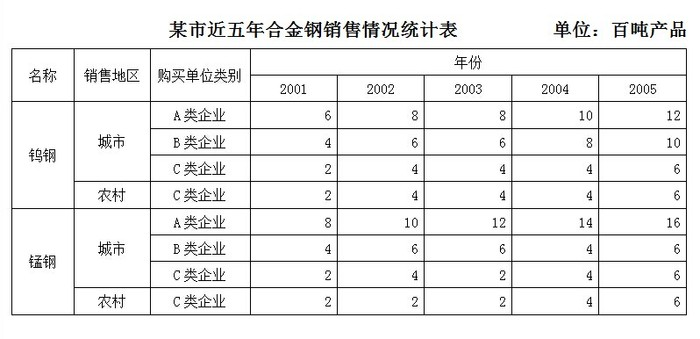

### 第 138 题

销往C类企业的合金钢（钨钢和锰钢）的数量在哪年下降了？

A. 2005

B. 2004

C. 2003

D. 2002

第 138 题 · 答案与解析

**参考答案（粉笔题库参考内容）**

C

**解析**

对比选项年份，定位统计表可知，2001年~2005年销往C类企业的合金钢（钨钢和锰钢）的数量分别为：

2001年：2+2+2+2=8百吨；

2002年：4+4+4+2=14百吨；

2003年：4+4+2+2=12百吨；

2004年：4+4+4+4=16百吨；

2005年：6+6+6+6=24百吨。

对比数据可得，2003年的数据＜2002年的数据，故2001年~2005年销往C类企业的合金钢（钨钢和锰钢）数量产生下降的年份为2003年，对应C项。

故正确答案为C。

**考点**：直接找数、统计表

**来源**：2009年湖南省公务员录用考试《行测》题第138题

### 第 139 题

与2001年相比,2005年销往A类企业的合金钢（钨钢和猛钢）的数量增加了：

A. 50%

B. 100%

C. 150%

D. 200%

第 139 题 · 答案与解析

**参考答案（粉笔题库参考内容）**

B

**解析**

根据题干“与2001年相比，2005年······增加了”，结合选项为百分数，可判定本题为一般增长率计算问题。定位统计表可得，2001年与2005年销往A类企业的合金钢数量分别为6+8=14百吨与12+16=28百吨。根据公式：可得，2005年销往A类企业的合金钢的数量比2001年增加了。

故正确答案为B。

**考点**：一般增长率、统计表

**来源**：2009年湖南省公务员录用考试《行测》题第139题

### 第 140 题

2003年销往A类和B类企业的锰钢占当年全部锰钢销量的比例为：

A. 85.7%

B. 81.8%

C. 75.0%

D. 54.5%

第 140 题 · 答案与解析

**参考答案（粉笔题库参考内容）**

B

**解析**

根据题干“2003年······占······比例······”，结合表格材料给出了2003年相关数据，判定本题为现期比重问题。定位统计表可得，2003年销往A类、B类企业锰钢的数量为12+6=18百吨，2003年全年锰钢销量为12+6+2+2=22百吨。故2003年销往A类和B类企业的锰钢占当年全部锰钢销量的比例，对应B项。

故正确答案为B。

**考点**：现期比重、统计表

**来源**：2009年湖南省公务员录用考试《行测》题第140题

