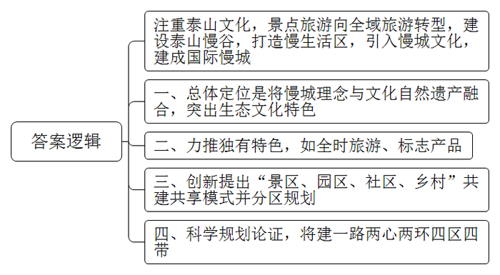
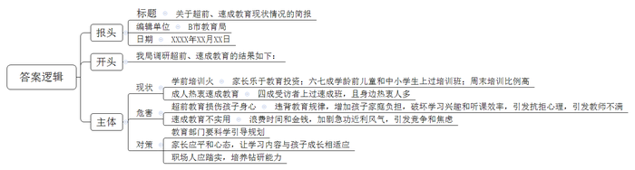
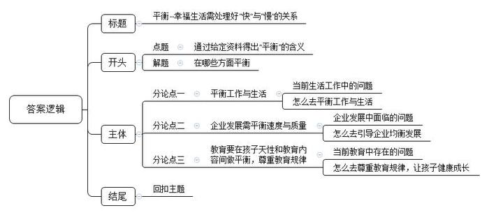

# 2017年公务员多省联考《申论》题（湖南卷）

<!-- gwy:overview:start -->
> **湖南 · 2017 · 申论 · 统考** ｜ 4 题 · 图片 4 处 · 答案随题折叠

导航：[题目](#题目)
<!-- gwy:overview:end -->

> 候选采集稿。参考答案及解析来自粉笔页面，不代表官方答案或真实高分答卷；来源使用许可与原卷对应关系仍需人工核实。

## 给定材料

### 材料 material-c4e9c4379d36d3c7

近年来，泰山景区注重泰山主体文化的重现，以文化体验为主的观光游发展迅猛，游客总量逐年攀升。在游客量保持较高水平的同时，如何解决好均衡游客分布、延展产业链条、让游客留下来的问题，实现从景点旅游向全域旅游的转型，成为泰山景区发展的一项重点。

为了营造最具中国特色的国际慢城，打造闲适从容的理想栖居，泰山景区规划建设泰山慢谷，打造景区东西两翼“慢生活”区，调整泰山景区旅游发展供给侧，希望通过引入慢城文化探秘泰山亲切、闲适的另一面，以平安长寿、健康养生、闲适宜居、泰山文化为四大特色，建成国际慢城。未来，泰山慢谷的建设将有效疏解泰山人流，吸引更多客源，增加游客停留时间，从而带动消费、促进经济腾飞。

泰山景区无论是区位条件，还是自然资源、文化资源，都有利于建设国际慢城。根据初步规划，泰山慢谷总面积为62.37平方公里，包括大津口乡下辖的9个行政村和天烛峰、玉泉寺两个景区，区位条件得天独厚。天烛峰和玉泉寺两个景区的开发已经成熟，能迅速融入泰山慢谷的建设中。大津口乡位于泰山东部，交通便利，乡政府驻地距高铁泰山站12公里。乡内有两条主要道路，连接全乡大部分村落。乡内河流大多为自然河流，村落建筑基本都沿河流分布。大津口乡共计1.5万余人，民风淳朴，居民仍然保持有机餐饮的习惯，人口规模和生活方式都适合建设慢城。大津口乡还是山东省“乡村记忆工程”试点乡镇，拥有独特的自然环境和优越的宜居环境，以及丰富的非物质文化遗产和丰厚的人文历史。

泰山慢谷的总体定位是以壮美山川、深谷秀水、古树茶园、石筑原乡为生态基底，以慢生态、慢出行、慢生活、慢产业、慢服务、慢协作为营造方式，将国际慢城理念与泰山文化自然双遗产深度融合，突出泰山独有的生态特色、文化特色，打造集养生、休闲、度假、体验等中高端旅游产品于一体的国际慢城。

泰山慢谷力推自身独有的特色，包括全时旅游、标志产品等。结合四季特色，推出四季慢运动、四季慢生活，春赏花采茶、夏耕读研学、秋登高采摘、冬养生滑雪，同时开发系列标志土特产、吉祥物、工艺品等。

泰山慢谷的建设摒弃了将慢城建设等同于旅游开发、旧村改造的传统模式，创新提出了“景区、园区、社区、乡村”共建共享的模式。泰山慢谷将泰山的历史文化、民间传说进行梳理，通过智慧解说系统、旅游项目、体验项目等弘扬泰山文化。根据区域内不同的自然和文化优势，泰山慢谷进行分区规划。核心区域在慢谷小镇周围，这里将举办泰山论坛、文艺表演、美术展览等。此外在不同的区域分别建设花乡慢谷、禅修慢谷、养生乐园、耕读农园、记忆家园、慢活彩色森林等。

泰山慢谷通过科学的规划和论证，将建有一路、两心、两环、四区、四带。其中，“一路”指的是生态旅游之路；“两心”指的是作为文化休闲旅游核心的慢谷小镇、作为原住民公共服务中心的慢村集镇；“两环”指的是山地河谷风情环、乡村田园风情环；“四区”指的是南部文化旅游服务区、中部运动休闲体验区、东部养生研学体验区、北部原乡风情体验区；“四带”则为汉御道七彩田园风情带、天烛峰古松石坞风情带、周御道幽谷瀑布风情带、玉泉寺古木禅意风情带。

### 材料 material-e8d1b4267d2960c4

中国车市在经历了迅猛扩张，成为世界最大单体市场的同时，也渐渐放慢了自己向前的步伐，如同中国经济一样，步入新常态阶段。从十二年前的白手起家，到如今已经赫然位居行业第一集团，D公司创造的速度奇迹在业界声名显赫。从最初的单一车型开始，到如今已经成功完成了主流市场区间的全产品布局；从最早只有一个工厂，到现在的四地八厂；从初始的单一合资品牌，到现在坐拥主流合资两大品牌；从零起步到600万保有客户，这一切只用了12年的时间，D公司就快速地完成了从“小字辈”到“大体系”的转变。

然而，在中国车市进入“新常态”已然不可逆转的今天，D公司过去单纯的快速发展模式已经不适用了，对此，该公司周总表示：“车市的新常态只是意味着车市进入到一个新的发展阶段，速度下了一个台阶，并不意味着车市发展的黄金时代已经结束。在新常态下，快是一种质量，慢是一种智慧。未来我们要从‘要素驱动’转化为‘创新驱动’，对企业体系进行全面的优化升级，努力实现‘快’与‘慢’的平衡，以更稳健、更具核心竞争力的姿态，去应对车市新常态。”

随着互联网、信息技术的发展，消费观念的成熟，中国车市进入了以用户为中心的精细化、个性化时代，D公司顺应时代变化，通过基于大数据分析的营销管理和创新，继续保持迅捷的市场反应速度、高效的体系反应能力、迅速的消费响应能力。公司专门成立了数据营销部门，打造国内首个汽车品牌自建的线下线上一体化开放平台，通过互联网手段持续跟踪、收集、分析消费者的需求变化趋势，根据所得结论及时制定和推进符合用户兴趣点的营销计划；同时，产品年轻化的节奏也依然保持着“快”的本色，不断推出符合年轻人口味的高颜值产品。

与此同时，为了实现企业高效的执行力，D公司在其内部进一步提升企业的全价值链体系竞争力，着力打造高效务实具有凝聚力的经营团队，整合企业及合作伙伴资源，充分挖潜，增强每个工作环节的协同效应，让所有部门为同一目标共同发力，实现体系竞争力的最大化。

如果说D公司过去的发展模式是“要素驱动”，那么如今全新体系竞争力的打造，就是以“创新驱动”为核心，推动品牌建设、产品营销、人才体系等每一个层面的发展。D公司坚持品牌向上战略，升级创新自主品牌，不断引进最新技术的国外品牌，以更具时代感、互联气质的品牌印象去赢取更多年轻用户的心。公司旗下的某品牌早已启动了以纯电动汽车为方向的新能源汽车发展战略，未来将以“用户体验”为核心，通过一系列的创新营销手段，逐步将先机转化为市场优势，全面推进该品牌的市场普及，形成新的市场增长点。人才体系的全面升级是确保体系竞争力向卓越跨越的最基础保障。对此，D公司启动了被称为“企业大学”的人才培养计划，针对不同发展阶段、不同类型的员工精心设计培训项目，努力打造核心关键人才团队，通过一揽子人才提升战略去挖掘年轻人才，充分发挥优秀年轻员工的创新活力，让新思想、新创意成为D公司下一阶段发展的核心驱动力。

### 材料 material-5ed31b70fa33a4b5

近年，B市经济的飞速发展，带动了超前教育市场的快速生长，引起了B市政府的重视。市政府要求市教育部门组织人员开展相关调研工作，下面是此次调研所收集的部分材料：

（1）“B市儿童成长状况数据”的调查显示，3至6岁的孩子七成以上都参加过各种培训班，育儿支出占家庭平均收入的23%，近六成的家长把孩子的教育投资放在首位。孩子们的周末时间有41%被各类培训班所占据，留给去广场、公园和游乐场的时间仅有9%。对比26.3%的全国平均数据，B市孩子们的周末时间被培训班占据的比例偏高。

（2）一到周末，不少学龄前儿童的时间就被早教班、才艺班、素质拓展班等各种培训班填满。幼儿园孩子的学习压力堪比小学生，学前教育成了“超前教育”。新任妈妈李某将全部心思放在孩子的学习上，孩子1岁开始学认字，3岁开始学外语，还有钢琴、围棋、绘画、游泳。尚未上学，孩子就每天在和时间赛跑，参加各类培训班。

（3）针对B市中小学超前教育的调查发现，65%左右的学生参加过超前教育，40%受调查的老师表明班中接受过超前教育的学生占大多数。在接受调查的学生中，约88%选择校外补习接受超前教育，仅有少数由父母辅导。调查者发现，在接受调查的学生、家长和老师中大多认为超前教育会在一定程度上增加学习负担。还有的学生不仅没学到有用的知识，甚至因为听不懂而对课程产生了抗拒心理。调查数据还表明超前学习影响了校内听课效率：64%的学生会因为已经提前学习过一遍而偶尔在课堂上开小差，11%会因此经常开小差，4%的学生甚至表示自己因此从来不听讲。

（4）调研发现，很多幼儿园和小学教师对学前教育超前之风有很大意见。一些孩子过早参加了学前教育，却因为生长发育阶段决定了理解力跟不上，导致似懂非懂、似学非学，反而影响了日后正常的学习，而且破坏了学习兴趣。有专家建议，教育重在激发天性、保护个性，最重要的不是学到了什么，而是培养良好的学习能力，形成浓厚的学习兴趣。学前教育也应该有科学的规划，让学习内容和成长阶段相适应。这需要家长保持平和的心态，也要求教育机构的科学引导。

（5）为满足市民们接受继续教育的强烈需求，各种速成班、速成法如雨后春笋般涌现。“欲速则不达，但现在很多人，太心浮气躁了！”一位老师说。现在市面上充斥着各种“速成法”，让人眼花缭乱。就像现在到处流传的各种减肥速成教程一样，很多人非常迷恋，见一个试一个，总抱怨没什么效果，却还是乐此不疲地去尝试。

（6）某媒体的千人在线调查显示，受访者中，41%的人曾参加速成班，60%受访者身边有不少热衷速成班的人。对于速成教育的效果，37%的人觉得有用，63%的人则认为用处不大，其中18%的人直言“完全没用”。张先生感觉工作中竞争压力较大，一直存在心理焦虑。他曾报过一个会计速成班，一个月课程结束后，张先生觉得自己学到不少东西，背了很多公式，但遇到实际问题，他总是想不起来该用哪种方法解决。王女士认为自己知识储备不足，需要充电再教育。去年她报了一期英语速成班，在速成班里，老师确实教了很多新颖的方法记单词，但单词量一多，那些方法就全忘了，而且经常搞混。

（7）调查显示，40%的人担心速成教育盛行加剧了急功近利的社会风气；34%的人认为这会浪费大家的时间和金钱；18%的人觉得会加大人们的竞争压力和焦虑。“速成教育并不靠谱”，曾参加过某速成班的李先生反思说。现在很多人形成了一种“速成习惯”，凡是遇到什么难题，首先总是去想有没有捷径。不能说这完全是个坏习惯，但这种思维方式如果走向极端，就会让人变得急功近利，逐渐丢掉静下来钻研问题的耐心和能力，“还是应该脚踏实地学真本事，不迷信速成法。”

### 材料 material-a2ccaf1a867ddba4

19世纪末的美国传教士雅瑟·亨·史密斯在《中国人的性格》中称中国人是“漠视时间的民族”，随着中国社会日益加快的现代化转型，中国逐渐变成了世界上最忙碌的国家之一。现在，越来越多的人开始重视从紧张的节奏中解脱出来，享受闲适。有学者表示，这种心理的变化轨迹正是社会进步的表现，体现了后工业时代的幸福导向型生活。随着这种观念的流行和它所催生的产业经济，未来人们会有更加丰富多彩的选择。

某地以城市主干道为中心的部分城区被辟为了供市民体验的休闲生活街区。然而，街区内外可谓冰火两重天。一方面，街区内骑自行车的人、步行的人、摆地摊的人，悠然自得；另一方面，在范围更广的周边路段，平常就不顺畅，再加上很多出行的私家车分流至此，拥堵状况可想而知。本来周末出门，很多时候就是不得已的，有的是要加班，有的是趁休息去超市采购或带孩子短途旅游……开车出来就是为了图个快、图个方便。现在速度确实降下来了，人们的心里恐怕只有更多的焦躁，还何谈享受生活呢？这种矛盾值得人们深思。

事实上，要想让人们在某一种生活状态中得到享受，那首先得是人们的自主选择，而只有依靠整体性的社会发展，人们才有充分的选择权。法国于1998年首倡“无车日”，那时法国人均GDP就已经达到24000美元，每周工作时间更是少到让人艳羡的35小时。反观中国目前的情况，2014年人均GDP刚超过7000美元，相当多的劳动者为了体面的生活，连法定的带薪休假甚至双休都放弃了，此时就谈休闲生活，未免过于奢侈了。

倡导休闲生活，要以现实为基础，尊重公众的选择权，尤其要避免给公众“添堵”。倡导要发挥作用，靠的是公众的自觉响应。如果不顾现实情况，违背人们的自主意愿，倡导活动不仅无法落地生根，甚至会因为给公众“添堵”而招致反感。职能部门工作要做得更精细，考虑要更全面，让公众真正感受到好处、享受到便利，所倡导的休闲生活就会成为人们自然而然的选择。

## 题目

### 第 1 题

**根据材料**3**，概括该景区调整旅游发展供给侧方案的主要内容。（15分）**

关联材料：材料 material-c4e9c4379d36d3c7

作答要求：

要求：全面、准确、简明，有条理，不超过150字。

第 1 题 · 答案与解析

**参考答案（粉笔题库参考内容）**

注重泰山文化，景点旅游向全域旅游转型，建设泰山慢谷，打造慢生活区，引入慢城文化，建成国际慢城：1.总体定位是将慢城理念与文化自然遗产融合，突出生态文化特色。2.力推独有特色，如全时旅游、标志产品。3.创新提出“景区、园区、社区、乡村”共建共享模式并分区规划。4.科学规划论证，将建一路两心两环四区四带。

**解析**

**参考答案说明：**答案按照“发展重点和总体方案”“总体定位”“独有特色”“创新模式”“科学规划”的“总-分”形式进行了分条撰写。每条要点之间内容上没有交叉。

**考点**：考点概括主要内容类

**来源**：来源2017年公务员多省联考《申论》题（湖南卷）

粉笔申论页面对本题只提供「解析视频」入口，该入口是会员推广位，页面无视频地址与文字解析。

### 第 2 题

**根据材料**5**，总结D公司的成功对于企业适应新常态有哪些值得借鉴的经验。（20分）**

关联材料：材料 material-e8d1b4267d2960c4

作答要求：

要求：

（1）紧扣资料，内容具体；

（2）分析透彻，条理清晰；

（3）不超过300字。

第 2 题 · 答案与解析

**参考答案（粉笔题库参考内容）**

1.创新营销管理，把握消费者需求。基于大数据分析，成立营销部门，打造线下线上一体化开放式平台，制定符合用户兴趣点的营销计划。

2.注重产品创新。保持产品年轻化、更新快的节奏，推出符合年轻人口味高颜值产品。

3.提升全价值链体系竞争力。打造高效务实具有凝聚力、执行力的经营团队，整合资源，充分挖潜，增强协同效应。

4.提升品牌，创新技术。坚持品牌向上战略，升级创新自主品牌；引进外国技术，以更具时代感、互联气质的品牌吸引年轻人；抓住市场新动向，拓展行业新领域。

5.加强人才队伍建设。启动人才培养计划，针对性设计培训项目，打造核心团队，挖掘年轻人才，发挥创新活力。

**解析**

**参考答案说明：**本参考答案从“创新营销管理，把握消费者需求”“注重产品创新”“提升全价值链体系竞争力”“提升品牌，创新技术”“加强人才队伍建设”五个方面进行了分条撰写。各条要点之间在内容上相互并列，没有交叉。并且撰写每条要点时，都提炼出了概括性强的总括词并前置，满足了题目中规定的“总结”这一要求。

**考点**：考点经验启示类

**来源**：来源2017年公务员多省联考《申论》题（湖南卷）

粉笔申论页面对本题只提供「解析视频」入口，该入口是会员推广位，页面无视频地址与文字解析。

### 第 3 题

**根据资料**6**，假定你是B市教育部门工作人员，请整理一份关于超前、速成教育现状的情况简报，供领导参考。（25分）**

关联材料：材料 material-5ed31b70fa33a4b5

作答要求：

要求：

（1）紧扣资料，内容全面；

（2）层次分明，有逻辑性；

（3）不超过300字。

第 3 题 · 答案与解析

**参考答案（粉笔题库参考内容）**

关于超前、速成教育现状情况的简报

B市教育局 XXXX年XX月XX日

我局调研超前、速成教育的结果如下：

现状。学前培训火。家长乐于教育投资；六七成学龄前儿童和中小学生上过培训班；周末培训比例高。成人热衷速成教育。四成受访者上过速成班，且身边热衷人多。

危害。超前教育损伤孩子身心。违背教育规律，增加孩子家庭负担，破坏学习兴趣和听课效率，引发抗拒心理，引发教师不满。速成教育不实用。浪费时间和金钱，加剧急功近利风气，引发竞争和焦虑。

教育部门要科学引导规划；家长应平和心态，让学习内容与孩子成长相适应；职场人应踏实，培养钻研能力。

**解析**

**参考答案说明：**（1）格式上，本参考答案按照“报头+正文”的格式要求展开。（2）本题在内容上，按照“开头+主体”展开，首先介绍了调研的背景，然后介绍了B市超前教育与速成教育的基本情况，再介绍了超前教育与速成教育的危害，最后提出对策。做到了分条撰写，各条要点之间没有交叉。

**参考答案二**

关于超前、速成教育现状情况的简报

B市教育局 XXXX年XX月XX日

我局调研超前、速成教育的结果如下：

超前教育：1.基本情况：家长乐于教育投资；六七成学龄前儿童和中小学生上过培训班；周末培训比例高。2.危害：损伤孩子身心。违背教育规律，增加孩子家庭负担，破坏学习兴趣和听课效率，引发抗拒心理，引发教师不满。

速成教育：1.基本情况：成人热衷速成教育。四成受访者上过速成班，且身边热衷人多。2.危害：不实用。浪费时间和金钱，加剧急功近利风气，引发竞争和焦虑。

教育部门要科学引导规划；家长应平和心态，让学习内容与孩子成长相适应；职场人应踏实，培养钻研能力。

**考点**：考点总结类

**来源**：来源2017年公务员多省联考《申论》题（湖南卷）

粉笔申论页面对本题只提供「解析视频」入口，该入口是会员推广位，页面无视频地址与文字解析。

### 第 4 题

**参考给定资料，以“平衡”为主标题，自拟副标题，自选角度，写一篇议论文章。（40分）**

关联材料：材料 material-a2ccaf1a867ddba4

作答要求：

要求：

（1）自选角度，立意明确；

（2）联系实际，不拘泥于“给定材料”；

（3）思路清晰，语言流畅；

（4）总字数1000—1200字。

第 4 题 · 答案与解析

**参考答案（粉笔题库参考内容）**

**平衡**

**——幸福生活需处理好“快”与“慢”的关系**

老话虽说“速度造就成功”，但老话又说“过犹不及”。环视周遭，有多少人因追求工作的快速高效而长期加班最终患上重疾，又有多少企业发展之初就因盲目扩张而最终倒闭，甚至有些父母为了咿呀学语的孩子将来有出息而追求超前教育……。一幕幕因“快”导致的悲剧令人扼腕。我们亟需重新审视我们的生活，找到“快”与“慢”的平衡点，让悲剧不再重演，让生活更加幸福。

**我们要平衡工作与生活，让身心协调，在快节奏中享受慢的生活。**随着社会变革的加快，生活成本提高，很多人不得不开启了24小时在岗的超人化工作模式。可随之而来的，人们的健康被严重透支，甚至因过劳而死亡。其实，人生不仅有工作中的金戈铁马，独当一面，还有生活中的兴趣、闲暇、情感。我们要找到快工作与慢生活的平衡点，既要在工作中讲究方法，告别瞎忙，提高效率；又要学会健康休闲，调整身心状态，享受休闲的生活，体味人生的意义。

在“快”的皮鞭的驱使下，不仅造成了生活和工作的失衡，同样也给企业的发展带来重创，也让我们的教育失去原本的色彩。

**企业发展需平衡速度与质量，自身和时代，让企业稳定发展，长远发展**。速度是发展的第一要义，但不是事事讲速度。对于企业而言，战略上应该慢下来，思虑周详，战略才能决胜；行动应该高效，执行力强才能从“小字辈”做成“老字号”。但令人遗憾的是，有很多企业为了更大的市场，更丰厚的利润，罔顾自身条件，急功近利，盲目扩张。这无异于一叶障目，一味地追求经济效益，必将忽视标准化生产，导致产品与社会脱节、质量下降，品牌贬值。长此以往，企业的发展之路必将荆棘丛生。因此，企业在保持高速发展的同时，又要结合自身发展状况，主动降速，以退为进。要敢于驱动创新，优化人才体系，提升企业竞争能力，使企业发展能够长久可持续。

**教育要在孩子天性和教育内容间做平衡，尊重教育规律，用无用成就大用。**关于教育的理论已经数不胜数，但几乎所有教育学家都反对在教育上揠苗助长。然而，可悲的是很少有家长在教育上不是功利派。四年级学完小学课程，初一复习备战中考，高一就学完了所有高中的课程。只有第一名才会有出息，看似一心为了孩子好，实质上却是忽视了孩子的理解能力，枉顾孩子自然的生长规律。长此以往，不仅会降低孩子的听课效率，破坏学习兴趣，更会造成孩子的伪成熟，甚至会酿成更大的悲剧。由此可见，成长永远都不是急于求成的事情，应该有科学规划，让教育的内容与成长阶段相契合。用一本书、一场旅行、一次思想的碰撞，来挖掘孩子的潜能，激发他们的天性，来增加他们生命的厚度，发现真正的自己。

“拳头缩回去，是为了更有力地打出去。”平衡就像中国的太极拳，不是不发展，而是更好地发展，更科学地发展，更持续地发展。“快”不是不顾一切，要注重质量，“慢”也不是懒惰，要有智慧。让我们把握好快与慢的平衡，不急不缓、不浮不躁、循序渐进、稳稳当当地前进吧!

**解析**

**文章分析**

**平衡**

**——幸福生活需处理好“快”与“慢”的关系**

【**标题的优点：**内容上，主标题突出了“平衡”这一主题，副标题明确了平衡的具体内容是“快”与“慢”的关系。形式上，采用了主副搭配的结构，使文章主题、角度都很清晰。】

老话虽说“速度造就成功”，但老话又说“过犹不及”。（1）环视周遭，有多少人因追求工作的快速高效而长期加班最终患上重疾，又有多少企业发展之初就因盲目扩张而最终倒闭，甚至有些父母为了咿呀学语的孩子将来有出息而追求超前教育…….。一幕幕因“快”导致的悲剧令人扼腕。（2）我们亟需重新审视我们的生活，找到“快”与“慢”的平衡点，让悲剧不再重演，让生活更加幸福。

【**开头的优点：**★内容方面。范文的开头是紧扣题目给定的“平衡”这一主题展开的。开头分析阐述了（1）工作生活、企业发展、教育等方面求快的现状、危害；（2）平衡快与慢。★文字表达方面。使用了“但……”“有……又有……甚至……”等关联词，使语言表达有逻辑性。】

**我们要****平衡工作与生活****，****让身心协调****，****在快节奏中享受慢的生活****。**（1）随着社会变革的加快，生活成本提高，很多人不得不开启了24小时在岗的超人化工作模式。可随之而来的，人们的健康被严重透支，甚至因过劳而死亡。其实，人生不仅有工作中的金戈铁马，独当一面，还有生活中的兴趣、闲暇、情感。（2）我们要找到快工作与慢生活的平衡点，既要在工作中讲究方法，告别瞎忙，提高效率；又要学会健康休闲，调整身心状态，享受休闲的生活，体味人生的意义。

【**论述段****1****的优点：**★观点句：范文的观点句是紧扣“平衡”这一文章主题提出的。形式上，它在段首处直接写出，位置突出，容易发现。内容上，关键词突出，内容要点明确，可以明显看出它是从“平衡工作生活的快与慢”入手，指出了“要享受慢生活”。★论述内容：（1）快节奏的工作、生活的状况及其危害；（2）平衡工作与生活的做法。注意：以上几个方面的内容都是紧扣“我们要平衡工作与生活，让身心协调，在快节奏中享受慢的生活”这个观点句进行分析论述的，论述的针对性强，内容层次丰富。在论述方法和论据的选取上做到了讲道理、举例子相结合，做到了丰富多样。】

在“快”的皮鞭的驱使下，不仅造成了生活和工作的失衡，同样也给企业的发展带来重创，也让我们的教育失去原本的色彩。

【**过渡段的优点：**范文过渡段分析了“‘快’给生活、工作、企业发展、教育”带来的危害，承接了论述段1，引出了论述段2、3。】

**企业发展需平衡速度与质量****，自身和时代，让企业稳定发展，长远发展。**（1）速度是发展的第一要义，但不是事事讲速度。对于企业而言，战略上应该慢下来，思虑周详，战略才能决胜；行动应该高效，执行力强才能从“小字辈”做成“老字号”。（2）但令人遗憾的是，有很多企业为了更大的市场，更丰厚的利润，罔顾自身条件，急功近利，盲目扩张。这无异于一叶障目，一味地追求经济效益，必将忽视标准化生产，导致产品与社会脱节、质量下降，品牌贬值。长此以往，企业的发展之路必将荆棘丛生。（3）因此，企业在保持高速发展的同时，又要结合自身发展状况，主动降速，以退为进。要敢于驱动创新，优化人才体系，提升企业竞争能力，使企业发展能够长久可持续。

【**论述段****2****的优点：**★观点句：范文的观点句是紧扣“平衡”这一文章主题提出的。形式上，它在段首处直接写出，位置突出，容易发现。内容上，关键词突出，内容要点明确，可以明显看出它是从“平衡企业发展的快与慢”入手，指出了“企业要平衡速度与质量”。★论述内容：（1）速度对企业发展的重要性；（2）过分追求速度的危害；（3）企业的正确发展之路。注意：以上几个方面的内容都是紧扣“企业发展需平衡速度与质量，自身和时代，让企业稳定发展，长远发展”这个观点句进行分析论述的，论述的针对性强，内容层次丰富。在论述方法和论据的选取上做到了讲道理、举例子相结合，做到了丰富多样。】

**教育要在孩子天性和教育内容间做平衡****，****尊重教育规律****，用无用成就大用****。**关于教育的理论已经数不胜数，但几乎所有教育学家都反对在教育上揠苗助长。（1）然而，可悲的是很少有家长在教育上不是功利派。四年级学完小学课程，初一复习备战中考，高一就学完了所有高中的课程。只有第一名才会有出息，看似一心为了孩子好，实质上却是忽视了孩子的理解能力，枉顾孩子自然的生长规律。长此以往，不仅会降低孩子的听课效率，破坏学习兴趣，更会造成孩子的伪成熟，甚至会酿成更大的悲剧。（2）由此可见，成长永远都不是急于求成的事情，应该有科学规划，让教育的内容与成长阶段相契合。用一本书、一场旅行、一次思想的碰撞，来挖掘孩子的潜能，激发他们的天性，来增加他们生命的厚度，发现真正的自己。

【**论述段****3****的优点：**★观点句：范文的观点句是紧扣“平衡”这一文章主题提出的。形式上，它在段首处直接写出，位置突出，容易发现。内容上，关键词突出，内容要点明确，可以明显看出它是从“平衡教育的快与慢”入手，指出了“教育要兼顾孩子的天性和教育内容”。★论述内容：（1）教育追求速度的现状及危害；（2）正确的教育方法。注意：以上几个方面的内容都是紧扣“教育要在孩子天性和教育内容间做平衡，尊重教育规律，用无用成就大用”这个观点句进行分析论述的，论述的针对性强，内容层次丰富。在论述方法和论据的选取上做到了讲道理、举例子相结合，做到了丰富多样。】

【**论述段之间的关系**：★内容的内在逻辑：范文的论述段之间是依照“并列”的逻辑展开的。论述段1先写了“工作生活中要平衡快与慢”，论述段2再写了“企业发展要平衡快与慢”，论述段3写了“教育要平衡快与慢”。★段与段的外在衔接：段3的“在‘快’的皮鞭的驱使下，不仅……同样……也让……”起到了承接论述段1，引出了论述段2、3的作用。】

“拳头缩回去，是为了更有力地打出去。”平衡就像中国的太极拳，不是不发展，而是更好地发展，更科学地发展，更持续地发展。“快”不是不顾一切，要注重质量，“慢”也不是懒惰，要有智慧。让我们把握好快与慢的平衡，不急不缓、不浮不躁、循序渐进、稳稳当当地前进吧!

【**结尾的优点**：范文的结尾回扣了“平衡”这一主题，发出了号召希望。】

**考点**：考点文章写作题

**来源**：来源2017年公务员多省联考《申论》题（湖南卷）

粉笔申论页面对本题只提供「解析视频」入口，该入口是会员推广位，页面无视频地址与文字解析。

