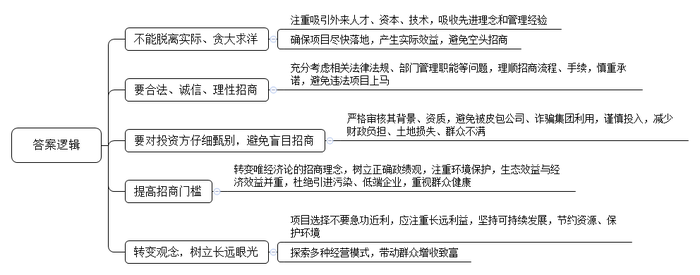
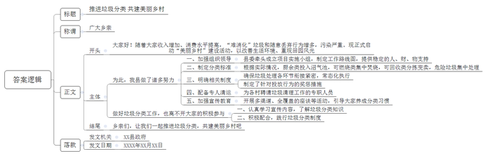
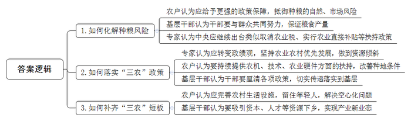
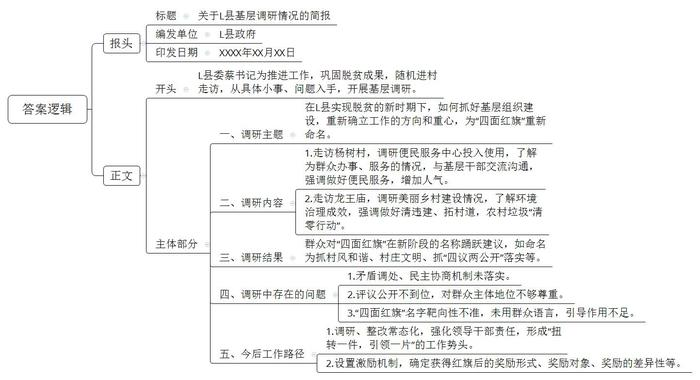

# 2018年公务员多省联考《申论》题（湖南乡镇卷）

<!-- gwy:overview:start -->
> **湖南 · 2018 · 申论 · 乡镇卷** ｜ 4 题 · 图片 4 处 · 答案随题折叠

导航：[题目](#题目) · [材料 1](#材料-1)
<!-- gwy:overview:end -->

> 候选采集稿。参考答案及解析来自粉笔页面，不代表官方答案或真实高分答卷；来源使用许可与原卷对应关系仍需人工核实。

## 给定材料

### 材料 1

以下是某地报纸“读者来信”专栏刊登的有关Y县乡镇招商引资工作的三封来信：

A镇张某：乡村振兴，需要吸引外来的人才、资本、技术“加盟”，为农村发展注入强劲动力。但有的招商引资脱离实际、贪大求洋，导致项目长期落不了地，产生不了实际效益，成为“空头招商”。

我们镇遇上稍有投资意向的企业，便承诺送地、免税、贷款，包办工商、环保、用地等各种手续。可是，真正签订了投资协议，许多手续牵涉到法律规定、部门管理职能等问题，承诺最终要么成了空头支票，要么只能违法强行让企业上马。

为了完成招商引资任务，对投资方不加甄别，往往被皮包公司、诈骗集团利用。前不久，就出现引进的企业非法融资后跑路，引起群众上访事件，损失巨大。

3年前，我们镇与华南的一家投资公司洽谈，合作开发一个乡村旅游项目。签订合作框架协议后，投资方承诺将在3年内投资数千万元。镇政府和村“两委”很重视，抓紧做好土地流转、基础设施建设等工作。可是接下来的几年，投资方却毫无动静，没有投资一分钱，这个项目成了“半拉子工程”。前期投入的数百万元，只能全部由镇里承担。类似的情况还有不少，比如喜欢招大商，为了引进大项目，舍得投入，先后征用土地数千亩，可由于区位无优势，缺乏竞争力等原因，往往项目“泡了汤”，导致土地长时间撂荒，让农民空欢喜一场。

B乡武某：近几年，沿海发达地区在环境整治过程中，淘汰了一批污染严重的企业。对这些企业，内地一些地方像捡到宝一样，纷纷伸出橄榄枝。在种种低门槛、优惠政策的扶持下，一个个被沿海地区淘汰的污染企业又在经济不发达的农村冒了出来，最终遭罪的是老百姓。

我们乡有一家从某沿海城市招商引资进来的水暖器材厂。车还未到厂子大门口，就闻到一股刺鼻的味道。走进车间一看，这个招商引资进来的水暖器材厂，就是一家牺牲当地老百姓健康的落后项目。

这家水暖器材厂，其实就是把招商地加工好的水龙头、淋浴器等半成品，拉运到这里进行镀锌，整个车间都弥漫着“大雾”。由于该厂采取的是“计件工资”制度，老百姓又缺乏健康知识，为了图省事、多挣钱，不要说戴防毒面具，有的甚至连口罩都不戴。

这些情况被反映到上级相关部门后，乡里才不得不关闭了这家害民的水暖器材厂。

C镇应某：我们镇有两个偏远山区村同时搞招商引资。一个村招来了石英矿开发项目，业主财大气粗，不到两个月村子里就车来车往，后山上炮声隆隆，好多群众当上矿产工人，一时间挣了些钱。另一个村，一位退伍军人兴办养羊场，一开始经营不是很顺利，第一年投资买了500只羊，当年并没有给当地带来立竿见影的致富效应。

然而3年过后，光景却大不相同。石英矿采完了，业主撤走了，留下满目疮痍的后山和被重型车辆压坏的水泥路，让村里收拾“烂摊子”。而养羊场在退伍军人精心打理和镇村帮助下，规模发展到了4000多只。不仅在村里聘用了20多个村民当“羊倌”，而且帮群众在坡地种上苜蓿。每年按市场价收购苜蓿作青贮饲料，还探索出了入股分红、托养代管、借种收草等多种经营模式，引导该村及周边群众参与到养羊产业中来，带动了乡亲们增收致富。

### 材料 2

茉莉花香扑鼻而来，村屯道路干净整洁，一派山水田园风光——这是H县石井村的新景象。

“这风光来之不易呀！”村书记老李感叹。村头屯尾越来越多的垃圾，曾让他头疼不已。“乡亲们腰包鼓起来了，消费向城里看齐，垃圾也与城里‘接轨’，包装袋、农药瓶、农膜、塑料袋等‘难消化’的垃圾越来越多。”老李说，不讲究的，随意丢在房前屋后；讲究些的，扔到偏僻角落。依山傍水的清秀小村，被垃圾搞得邋里邋遢。蚊蝇满天飞、污水遍地流，石井村一度被县里通报批评。

省里启动“美丽桂乡”乡村建设活动，以此为契机，H县垃圾分类开始从城区走向农村。

县城里垃圾分类的经验，被石井村改进成“乡村版”分类法：厨余类垃圾，给沼气池“喂饭”；可燃烧类，由村里统一集中焚烧；可回收类，由保洁员拣出卖废品；危险垃圾如电池、旧灯管等有毒有害类，则集中送垃圾处理中心处理。

乡村垃圾分类，H县打的是有准备之仗。县委牵头成立“高规格”项目实施小组，谋篇布局，制定出工作路线图，有计划、有步骤地推开，不管县委县政府领导班子如何变，对垃圾分类工作的人、财、物支持始终如一。

随后的实施当中，居民分类投放、环卫分类收集、车辆分类运输、终端分类处理，环环相扣、无缝衔接，确保了常态化、制度化。工作中讲求策略，既有“大棒”，也有“胡萝卜”。分不好的，居委会大妈、村干部、分类督查员轮番上阵教；屡教不分的，拒收垃圾；乱丢乱倒的，电视曝光，依规重罚。分得好的，每月会得到洗衣粉、肥皂、牙膏等小奖励。

村民每人每年缴纳36元的垃圾费，用于村里聘请保洁员、垃圾清运员、焚烧员等。村里聘请垃圾清运员，每天清运全村14个自然屯的生活垃圾，月薪达6000元。

包括民众环保意识启蒙在内的宣传教育培训及时跟进，座谈、宣讲、会演，乡镇、街道、村落一处不落，为“垃圾分类——举手之劳，保护环境”理念造势。“H县所有学校都有垃圾分类制度，并将其与学生的操行分挂钩。同时，还鼓励各学科老师在课堂‘借题发挥’，引导孩子养成垃圾分类的好习惯。”县教育局李副局长说，“全县中小学生15万人，把他们引导好，影响带动的至少是15万个家庭。如此，代代传承，蔚然成风。”

### 材料 3

如何保证农业农村优先发展？某周刊对话种粮大户老郑、基层干部郭书记和“三农”专家叶教授，分享他们的观察和思考。

主持人：党的十九大提出，实施乡村振兴战略，必须始终把解决好“三农”问题作为全党工作重中之重，加快推进农业农村现代化。关于实现乡村振兴，我们从不同侧面，邀请三位嘉宾来讨论三个问题，倾听你们的期盼。

对第一个问题的讨论：

老郑：现在种地，不换个种法不行。对普通农户来说，每亩地的毛收入也就1500元上下，但农资、机械等各项成本就超过1300元。大户收益靠规模，但风险也更高。今年我们市遭遇自然灾害的日子，比往年足足多了两个月，对稻米产量影响不小。另外，现在我们市稻米价格每斤1.6元上下，比其他地方好些，但与去年相比，还是降了1角多。农民种粮，要面对自然和市场双重风险，真希望政策能给我们撑起更强的保护伞。

郭书记：我们县是农业大县。作为基层干部，我经常与农民打交道，深知一亩三分地对农民的重要性。农业农村农民问题是“饭碗”问题，是发展问题，更是民生问题。尽管今年我们县遭受了自然灾害，但在全县干部群众努力下，小麦总产量还是达到34.73万吨，略高于去年水平。

叶教授：总体来说，当前农业结构调整有序推进，农业绿色发展大步迈进，农村改革稳步推进，农业农村发展取得了历史性成就。这得益于新世纪以来，中央强调要把解决好“三农”问题作为全党工作的重中之重，先后提出了多予少取放活、统筹城乡发展、城乡发展一体化等重大方针，先后采取了取消农业税、实行农业直接补贴、加强农村基础设施建设、建立农村社会保障体系等重大举措。

对第二个问题的讨论：

叶教授：实现农业农村优先发展，必须要把“重中之重”落到实处。抓“三农”，对做大地方GDP、增加地方财政收入难有明显贡献，导致一些地方不愿意把精力放在“三农”工作上，不愿意把稀缺资源投向农业农村。比如，我们在基层调研时经常发现，尽管农产品储藏、加工项目有利于带动当地农业发展和农民增收，但由于产生的固定资产投资、地区生产总值、税收有限，一些地方不愿意为这类项目安排新增建设用地指标，一些产业园区不愿意引进这类项目。

改变这种状况，关键在于转变政绩观。衡量一个地方工作的好坏，要看工业，更要看农业；要看城市，更要看农村；要看经济总量，更要看民生改善。要坚持农业农村优先发展，在领导决策拍板、财政资金分配、重大项目安排时真正做到向农业农村倾斜。

老郑：这些年合作社日子好过，得益于党的政策好。拿农机来说，国家给补贴，我们合作社里有51台“大铁牛”，今年秋收，接了周边区县不少收割的活儿，没闲着。再说科技，我们种有机水稻，每个生产流程都要技术，没有农技部门专家常年在田间指导，肯定干不成。

这几年种地规模越来越大，对硬件条件的要求也越来越高。地多了得用大型农机，但我们这里丘陵多，还有不少泥土路，过去大农机根本进不去，多亏县里修了不少“农机路”。我们发展生态农业，要安装杀虫灯，原来山里不通电，相关部门了解情况后，帮我们解决了用电难题。农田水利设施也逐渐完善。种地条件越来越好，就是给我们吃了“定心丸”。

郭书记：上面千条线，下面一根针，基层干部就是穿针引线的人，要把党对“三农”的重视切实传递到田间地头。虽说粮食连年丰收，农民生活越来越好，但“三农”问题历史欠账多。就我们县而言，农业基础设施的短板还要补，农业规模化经营水平不高，农业的结构性矛盾还未完全破解。

对第三个问题的讨论：

老郑：这些年，村里道路越来越宽，房子越盖越好，娱乐活动越来越多。但也不能说完全没有愁事儿，有的村里还没垃圾桶、垃圾站，满地垃圾影响村容村貌。有些偏远的地方，没有路灯，晚上村民不敢出门。现在，不少村里的年轻人都外出打工，大家都关心以后谁来种地，留在村里的老人娃娃谁管。

郭书记：补齐“三农”发展短板，增强农业农村活力，关键要促进资源要素在城乡间流动。我们县积极引进资本，吸引农民工、高校毕业生返乡创业。大力发展乡村旅游、创意农业，实现“科技+”“教育+”“健康+”等新业态，促进一二三产业融合，提升农业的附加值。

叶教授：实现国家现代化，必须补“三农”这个短板。实现农业农村现代化，也不能平均发力，而应抓重点、补短板、强弱项。

主持人：实现国家现代化，短板在农业，难点在农村。三位访谈嘉宾从各自角度谈了自己的思考。非常感谢！

### 材料 4

党的十九大以来，习近平总书记多次强调，要在全党大兴调查研究之风。县委是我们党执政兴国的“一线指挥部”，县委书记是“一线总指挥”，“一线总指挥”的调查研究开展得怎么样，至关重要。

这天一早，L县委蔡书记事先没打招呼，沿省道随机进村走访。基层组织建设工作连续几年“调研—推进—再调研—再推进”，L县脱贫摘帽以后，需要一轮新的调整。

调研路上，蔡书记讲起当初到村里调研的情景：随机进一个村，村两委大门紧锁。去找人，先来的是村支书，问到具体数字，一般会叫来村会计。这两人往往是多数村里关键的村干部。不少村按要求建村部，村里又找不到地，便远远放在村外头，群众日常是不来的，党员干部开会才用一次。L县抓基层组织建设，就从这些具体问题入手。

说话间，到了杨树村。L县坐落在大平原上，北部黄河滩，出城往东，全是村镇。这天天气预报的大雪还没下来，空气干冷，杨树村便民中心不时有人来办事。蔡书记跟村支书老吴聊天：“便民中心很新很干净，但是将来考核的是这儿的人气，东西不怕用，不怕用坏，可不能只是摆设，应付检查……”

2017年，杨树村争上了红旗村，用老吴的话说“干得正抖劲”，把脸面挣回来了。这个话要说回2016年。那年是L县承诺三年脱贫的最后一年，还有115个村、2万多人戴着贫困的帽子。工作布置到村里，之后如何落实？村干部说“上面千条线，下面一根针”，各条块千头万绪，村里眉毛胡子一把抓。当年的调研，最终确定把“脱贫攻坚、基层党建、产业发展、美丽村庄”列为村一级建设的四大主业。县里借用了焦裕禄书记当年“四面红旗”的称呼，评红旗村。2017年杨树村评上的就是“脱贫攻坚红旗村”。

蔡书记思考的，就是在L县已经实现脱贫的背景下，如果把脱贫攻坚红旗改为奔小康红旗，不免和产业发展红旗有很大重合。那么，在脱贫成果巩固阶段，农村最急需抓的工作定在哪一块？这面红旗该改叫什么名？

对村干部，这可不是小事。每得一面红旗，村支书每月多500元绩效收入，其他村干部每月多300元，每半年一评，各村积极性高涨，“四面红旗”正是指挥棒。名称到底怎么改？怎么奖才有效果？奖村还是奖人？怎么体现差异又不产生矛盾？需要县里无数轮调研、座谈、斟酌，才能确定下来。

从杨树村到赵垛楼，再到龙王庙，随机进村去看。正在开展美丽乡村建设的许多村庄正清违建、拓村道，搞农村垃圾“清零行动”，群众干得热火朝天。一路问下来，有人建议新的这面红旗叫抓村风和谐，有人提出村庄文明，有人说抓“四议两公开”落实……

蔡书记回应说，听到的这些意见里有一个指向：脱贫了发展了，但矛盾调处、民主协商机制没有相应跟上。村庄拆违建，也产生了一些矛盾。很多矛盾是因为协商机制没有落实好、评议公开没有做到位，对群众主体地位还不够尊重。这项工作怎么形成引导机制要琢磨，目前起的名字靶向性不准，还不是群众语言。

调研和整改都是常态化的。L县很多干部随车带有几把小马扎，干什么用？比如不久前，蔡书记在新建的“三馆两场”发现问题，通知相关局委负责人晚上到齐，一路走一路排查。地面破损、路灯不亮、油污未清洁、厕所马桶冲不干净……最后开“马扎会”，各自领责任，县督查局3天后一件一件来核销。蔡书记说，如今在L县，“扭转一件，引领一片”的势头已经形成。

## 题目

### 第 1 题

**根据给定资料**1**，分析Y县在乡镇招商引资工作中应当注意哪些问题？（25分）**

关联材料：材料 1

作答要求：

要求：简明准确，条理清晰，字数在300-400字。

第 1 题 · 答案与解析

**参考答案（粉笔题库参考内容）**

一、不能脱离实际、贪大求洋。注重吸引外来人才、资本、技术，吸收先进理念和管理经验；确保项目尽快落地，产生实际效益，避免空头招商。

二、要合法、诚信、理性招商。充分考虑相关法律法规、部门管理职能等问题，理顺招商流程、手续，慎重承诺，避免违法项目上马。

三、要对投资方仔细甄别，避免盲目招商。严格审核其背景、资质，避免被皮包公司、诈骗集团利用，谨慎投入，减少财政负担、土地损失、群众不满。

四、提高招商门槛。转变唯经济论的招商理念，树立正确政绩观，注重环境保护，生态效益与经济效益并重，杜绝引进污染、低端企业，重视群众健康。

五、转变观念，树立长远眼光。项目选择不要急功近利，应注重长远利益，坚持可持续发展，节约资源、保护环境；探索多种经营模式，带动群众增收致富。

**解析**

**参考答案说明：**本参考答案从“不能脱离实际、贪大求洋”“要合法、诚信、理性招商”“要对投资方仔细甄别，避免盲目招商”“提高招商门槛”“转变观念，树立长远眼光”等五个方面进行分条撰写。各要点之间在内容上相互并列，没有交叉。

### 第 2 题

**给定资料**2**介绍了H县乡村垃圾分类工作取得的成绩，县情基本相似的邻县来学习取经后，决定启动这项工作。假设你是邻县负责此项工作的人员，为做好群众宣传动员工作，请拟定一份给你县农民群众的公开信。（25分）**

关联材料：材料 2

作答要求：

要求：切合主题，条理清晰，语言流畅，字数在400-500字。

第 2 题 · 答案与解析

**参考答案（粉笔题库参考内容）**

推进垃圾分类 共建美丽乡村

广大乡亲：

大家好！随着大家收入增加、消费水平提高，“难消化”垃圾和随意丢弃行为增多，污染严重。现正式启动“美丽乡村”建设活动，以改善生活环境、重现田园风光。

为此，我县将做出如下努力：一、加强组织领导。县委牵头成立项目实施小组，制定工作路线图，提供稳定的人、财、物支持。二、制定分类标准。根据实际情况，厨余类投入沼气池，可燃烧类集中焚烧，可回收类分拣变卖，危险垃圾集中处理。三、明确相关制度。确保垃圾处理各环节衔接紧密，常态化执行；制定了针对投放行为的奖惩措施。四、配备专人清运。为各村聘请垃圾清理工作的专职人员。五、加强宣传教育。开展多渠道、全覆盖的座谈等活动，引导大家养成分类习惯。

做好垃圾分类工作，也离不开大家的积极参与：一、认真学习宣传内容，了解垃圾分类知识。二、积极配合，践行垃圾分类制度。

乡亲们，让我们一起推进垃圾分类，共建美丽乡村吧！

XX县政府

XXXX年XX月XX日

**解析**

**参考答案说明****:**（1）格式方面，本参考答案写到了“标题”“称谓”“正文”“落款”。（2）正文部分，一方面，从内容来看，围绕着“垃圾分类”这一主题，本参考答案的开头先写到了“推进垃圾分类的背景”；主体部分从“政府”和“个人”两个角度给出了具体的措施，最后，结尾发出呼吁号召。另一方面，形式上，本参考答案做到了分段、分条撰写，整体上条理较为清晰。（3）本参考答案能够结合公开信的特点，在语言表达上使用“让我们”等具有号召性、又有感染力的词汇。

### 第 3 题

**给定资料**3**中，嘉宾讨论了三个问题。请你根据该资料，分别阐述每个问题的聚焦点。（15分）**

关联材料：材料 3

作答要求：

要求：准确、简明，每个问题的聚焦点不超过100字。

第 3 题 · 答案与解析

**参考答案（粉笔题库参考内容）**

1.如何化解种粮风险。农户认为应给予更强的政策保障，抵御种粮的自然、市场风险；基层干部认为干部要与群众共同努力，保证粮食产量；专家认为中央应继续出台类似取消农业税、实行农业直接补贴等扶持政策。

2.如何落实“三农”政策。专家认为应转变政绩观，坚持农业农村优先发展，做到资源倾斜；农户认为要持续提供农机、技术、农业硬件方面的扶持，改善种地条件；基层干部认为干部要厘清各项政策，切实传递落实到基层。

3.如何补齐“三农”短板。农户认为应完善农村生活设施，留住年轻人，解决空心化问题；基层干部认为要吸引资本、人才等资源下乡，实现产业新业态。

**解析**

**参考答案说明：**本参考答案依次指出了“如何化解种粮风险”“如何落实‘三农’政策”“如何补齐‘三农’短板”三个问题的聚焦点，并分别对聚焦点的内容进行补充完善。各条要点之间在内容上各自独立，没有交叉。

### 第 4 题

**根据给定资料**4**，假设你是这次调研组的工作人员，请围绕这一天的调研主题和主要内容，写一份调研情况简报。（35分）**

关联材料：材料 1、材料 2、材料 3、材料 4

作答要求：

要求：内容全面，重点突出，条理清晰，字数在500-600字。

第 4 题 · 答案与解析

**参考答案（粉笔题库参考内容）**

关于L县基层调研情况的简报

L县政府 XXXX年XX月XX日

L县委蔡书记为推进工作，巩固脱贫成果，随机进村走访，从具体小事、问题入手，开展基层调研。

一、调研主题：在L县实现脱贫的新时期下，如何抓好基层组织建设，重新确立工作的方向和重心，为“四面红旗”重新命名。

二、调研内容：1.走访杨树村，调研便民服务中心投入使用，了解为群众办事、服务的情况，与基层干部交流沟通，强调做好便民服务，增加人气。2.走访龙王庙，调研美丽乡村建设情况，了解环境治理成效，强调做好清违建、拓村道，农村垃圾“清零行动”。

三、调研结果：群众对“四面红旗”在新阶段的名称踊跃建议，如命名为抓村风和谐、村庄文明、抓“四议两公开”落实等。

四、调研中存在的问题：1.矛盾调处、民主协商机制未落实。2.评议公开不到位，对群众主体地位不够尊重。3.“四面红旗”名字靶向性不准，未用群众语言，引导作用不足。

五、今后工作路径：1.调研、整改常态化，强化领导干部责任，形成“扭转一件，引领一片”的工作势头。2.设置激励机制，确定获得红旗后的奖励形式、奖励对象、奖励的差异性等。

**解析**

**参考答案说明**：（1）本题要求写“调研情况简报”，一般格式为：报头（包括标题、编发单位、印发日期等）+正文（一般包括开头、主体、结尾）。（2）正文部分，一方面，从内容来看，围绕着“L县基层调研”这一主题，参考答案的开头先写到了调研的“背景”，主体部分从调研的“主题”“内容”“结果”“存在的问题”“今后工作路径”五个方面给出了具体的调研内容。另一方面，形式上，参考答案做到了分段、分条撰写，整体上条理较为清晰。

