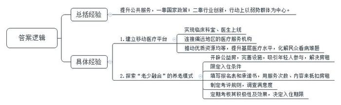
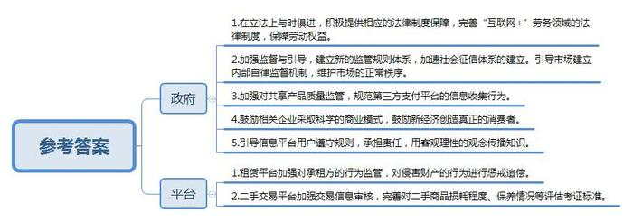
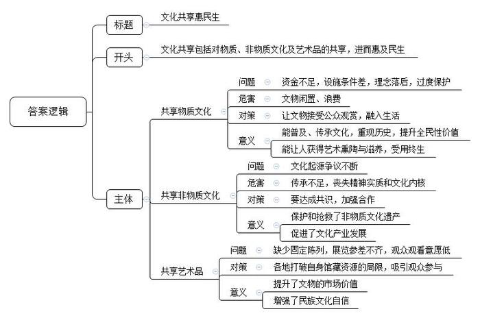
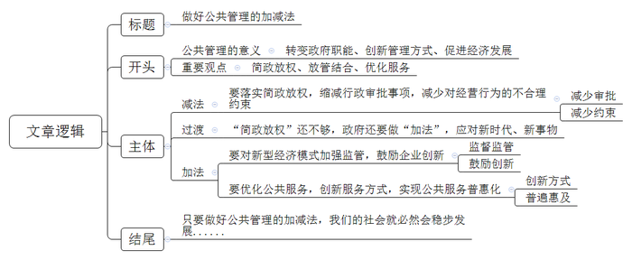

# 2018年公务员多省联考《申论》题（湖南通用卷）

<!-- gwy:overview:start -->
> **湖南 · 2018 · 申论 · 通用卷** ｜ 4 题 · 图片 4 处 · 答案随题折叠

导航：[题目](#题目) · [材料 1](#材料-1)
<!-- gwy:overview:end -->

> 候选采集稿。参考答案及解析来自粉笔页面，不代表官方答案或真实高分答卷；来源使用许可与原卷对应关系仍需人工核实。

## 给定材料

### 材料 1

2016年开始，A省省立医院尝试建立了移动医疗平台，上线临床医技科室53个，医生500余名，连接西南多省的市县医院及基层社区卫生服务中心100余家。2016年年底，位于西南边陲的瑶族自治县人民医院骨科的张医生遇到了一个疑难病例，通过A省省立医院建立的移动医疗平台，张医生与省立医院医生联动，很快拿出了会诊结论，确定了下一步治疗方案。

移动医疗平台让基层医院分享到优质的医疗资源，让基层患者分享到高水平的医疗技术。通过它，让优质医疗资源上下贯通，提升基层医疗服务能力，一定程度上化解了民众看病难、看病贵的难题，提高了公众对医疗卫生服务的满意度。

在新技术不断出现的今天，提升公众对公共服务的满意度，既需要国家拿出顶层设计，也需要各行各业多一些改革探索，多一些奇妙创意，多一些以弱势群体为中心的行动自觉。

日前，B市一家养老机构探索“老少融合”养老新模式，养老院里不光老人能够入住，年轻人也能入住。不过，年轻人必须为老人提供多种形式的志愿服务，通过积累服务时间来兑换住宿权和抵扣房租。

这家养老机构坐落在一栋大楼里，一楼是医院，老人居住区分布在高层的几个楼层，第13层则是专门开辟出来供年轻人居住的公益房——“志愿者之家”。走进“志愿者之家”，首先看到的是公共活动区，干净整洁、设施齐全，配有桌球、跑步机、电视、沙发、冰箱等。工作人员表示，他们开设公益房，就是为了吸引年轻人参与养老事业，增强敬老、爱老、助老之风，同时也为年轻人解决房租太贵的现实问题。这14间公益房既有单人房也有双人房，共二十多个床位。志愿者入住的单人房大概20平方米，里面布置整洁而温馨。双人房有两张床，可入住两人，装修风格也以简洁温馨为主，其他设施和布局跟老年人房间相差不多。

年轻人怎样才能住进养老院的公益房呢？负责人表示，首先要具备养老服务的热情，然后要通过院方考核，最终达成入住协议。根据入住条约，志愿服务采取预约制，必须事先申请，由工作人员统一安排。预约可以通过热线电话、前台现场报名等。获得入住“志愿者之家”资格的志愿者需要填写《志愿者报名表》《志愿者承诺书》，承诺自愿参与为老志愿活动，每周参与志愿服务不低于一定次数。志愿者要提供身份证、证件照等资料，社工查看后方可配发公寓钥匙、志愿服务手册等。志愿者住进养老院的公益房，是不是就意味着可以免费入住，不用负担房租了呢？答案并不是，年轻人要想抵扣房租，就要付出劳动。据介绍，目前租金抵扣的方式是：志愿者每周参与一定次数的志愿者服务活动且完成服务内容，即可获得具有租金抵扣资格的印花，凭印花抵扣房租。志愿者服务统计采取按时长积点制，服务满2小时可获得1枚印花。印花的多少决定抵扣房租的多少。

年轻人入住养老机构的模式，在业内也引发了热议。有业内人士指出，尽管此种模式在国外早有先例，但是在国内试水，也要小心公益变味。年轻人通过付出劳动，换取免费或廉价住宿权益的模式，在国外并不少见。比如在加拿大、澳大利亚等国，留学生可以免费住在老人家里，一旦老人发生意外，可以给予救助。学生也可以利用寒暑假入住老年公寓，陪老人聊天，用服务时间换取便宜的入住权。

对此，工作人员表示，此种模式目前在起步阶段，“志愿者之家”内也提前制定了相应的考评规则，每次志愿服务后都会对老人进行满意度调查，社工会对志愿者统一打分。目前并无强制规定一定要入住多久或者服务到什么程度。不过，机构每半年进行一次志愿者服务考核，按照志愿者参与积极性及完成效果，决定其是否延续入住。

### 材料 2

老李是一位瓜农，年收成一万多斤瓜。每到丰收的日子，他总是喜忧参半。2016年夏天一个早晨，他开着四轮拖拉机赶往城里叫卖。他本想去政府指定的西河小区里卖，可没想到刚走到城里，遇到一女子要买瓜，于是就停下车卖了一个。结果电子台秤就被巡逻的执法人员收走了。老李沮丧地来到西河街道办服务大厅，交了罚款，拿回被收缴的电子台秤。事后，老李说，他也知道自己错了，不该在路边卖瓜影响城市环境，但罚款太高，一天辛苦都白费了。更糟糕的是，为了拿回电子台秤，他奔忙了一上午，西瓜都蔫了。2017年10月起，老李就不必为此担忧、沮丧了。国务院新颁布的《无证无照经营查处办法》规定，在县级以上地方人民政府指定的场所和时间，销售农副产品、日常生活用品，或者个人利用自己的技能从事依法无须取得许可的便民劳务活动不属于无证无照经营，同时取消了“没收工具”等规定，降低了罚款数额。

市民谢女士在一台ATM机旁看到了“使用手机扫描二维码，免费赢取百万大奖”的一条广告，下面还附有一张二维码。谢女士顺手扫描了一下，并按照提示下载了一款APP。但让她万万没有想到的是，没过几天，与手机绑定的信用卡就被盗刷了。事实上，第三方支付的兴起，尤其是网络支付，给用户带来极大便利的同时，也带来了大量沉淀资金的使用争议，增加了洗钱、套现、赌博、欺诈等非法活动的风险。一位业内人士说，只有在企业资质上设闸，才能有效杜绝这些不良现象。是否给第三方支付企业一个名分，给一个什么样的名分，成了争论的焦点。争论归争论，有关部门没有一禁了之。

<u>何时做加法，何时做减法，是一门公共管理的艺术，需要智慧，需要眼光，需要技巧，更需要视野。加法或是减法，不一样的切入角度，体现不一样的心态和思维逻辑，直接决定了最终的成败。</u>党的十八大以来，国务院各部门取消或下放行政审批事项六百多项，取消中央指定地方实施行政审批事项近三百项。“简政放权、放管结合、优化服务”的改革得到了有效落实。面对新经济的商业模式、经营方式等与传统产业的不同，政府把更多精力转向监管，本着鼓励创新、包容审慎的原则，为经济发展和转型留出了空间。

如今的中国常看到这样的场景：出门上班前，通过打车软件叫一辆车；坐在车上，通过手机浏览最新最火的帖子；下班回家太累不想做饭，通过APP平台请一位厨艺达人到家做饭；没有一个房间也可以开酒店，没有一辆车也可以开出租车公司，没有一件商品也可以开商场……如今许多年轻人更喜欢把钱节省下来，用在上面所描述的生活方式上，或者去培养自己的初创企业。在中国，看到消费者在支付终端前摇晃手机或通过扫描二维码完成交易是极寻常的事。

调查显示，中国消费者是全球最倾心于移动支付系统的。2016年，中国移动支付的金额是美国的50倍以上。同时，随着收入增加，消费者对如何消费变得既注重产品质量，还强调服务，这也为新经济模式提供了进一步发展的动力。预计未来五年，中国市场以互联网为依托的新经济年均增长速度将在40%左右，到2020年其规模占GDP的比重将达到10%以上。美国媒体称，互联网时代协同消费模式在中国比在其他任何地方看起来都拥有更加光明的未来。这种很好的氛围意味着全球互联网经济行业中的很多创新都将在中国诞生，而不是美国的硅谷。中国将成为教会全世界该如何分享的老师，中国人民一次又一次证明了他们不缺创新或创业精神。

### 材料 3

互联网的风起云涌，不仅从根本上颠覆了许多传统行业，同时也创造了新的行业和机遇。21世纪初，有学者提出了互联时代协同消费的理念和发展模式，并将其分为若干阶段。最初，是代码共享，即通过互联网向用户提供信息，但信息流是单向的，用户不能参与其中进行评论和交流。当互联网进入Web2.0时代，用户开始通过网络平台向陌生人分享信息、表达观点，但其分享局限于内容或信息，不涉及实物交易，一般也不存在金钱报酬，仅仅是生活共享或是内容共享。

随着物物相联时代到来，网络平台公司通过互联网重新整合闲散资源和富余劳动力，然后再按需精准配置，实现物尽其用，社会分配从专业化向社会化转变，真正实现了离线资源的共享，即线上的分享协作渗透和延伸至线下，并由此改变了我们的文化和经济世界。如今，需求方不但可以享受到低价与个性化服务，也得到了社交机会。对企业而言，随着加入网络的节点及节点间的连接增加，网络的价值会随着用户数量的平方数增加而增加。作为一种新的商业模式，其势必会对现行制度和秩序造成冲击。为此，政府应积极提供相应的法律制度保障，才能实现可持续发展。同时，任何商业行为都是以盈利为目标，任何市场的开发也都需要资金的支撑，但过度的资本运作可能导致市场滥用其优势地位，甚至违背市场规律采取不正当竞争。政府理应鼓励相关企业采取科学的商业模式，新经济应当创造真正的消费者，而不仅是通过补贴来吸引消费者。

在新经济模式中，个体成为自由劳动者，劳动力价值能充分实现，并完全由自己支配。供求双方通过互联网发布自己可供分享和需求的物品，不仅能为特定的供给者和需求者提供可选择的交易对象，还有助于掌握交易对象更多的信息，避免不公平交易，降低了交易成本。对闲置物资的再利用使得前期投入的成本要么已得到回收，要么当作沉没或者折旧成本而收费较低廉，从而令闲置物资的边际成本更低，体现出更大的成本和资源利用效率优势。由于这一系列商业活动，完全有别于过往经济行为，加强政府的监督与引导，显得尤为重要。建立新的监管规则体系迫在眉睫。在新的规则出台之前，可以运用相关的法理，借鉴现行的法律法规，引导市场建立内部自律监督机制，维护市场的正常秩序。

### 材料 4

美国某租赁房屋公司曾发生一起恶性事故。一名房东发现她的公寓被从该公司网站上招来的房客洗劫一空。她在给该公司的信上写道：“他们在我的柜子上凿了个洞，劫走了里面的护照、现金、信用卡和我奶奶的珠宝首饰，不仅如此，他们又搜走了我的照相机、老式电脑和装有我所有相片、日志等备份的外接硬盘。他们掠走了我的一切。”这大概是所有人对互联网时代协同消费经济模式的顾虑了。某调查公司针对美国用户对这一经济模式的调研数据显示，参与其中的人群中，57%的人表示，“对这种消费模式感兴趣，但是仍有顾虑”，而在熟悉这种经济模式的人群中，69%的人认为，“除非信任的人推荐，否则将不会相信”。

共享充电宝在成为许多市民生活“标配”的同时，也引发了不少争议。除了共享充电宝自身的质量安全外，使用者可能还会面临个人信息泄露的风险。曹先生是一位互联网公司的程序员，他说：“每次看到有人使用共享充电宝，我都为他们捏把汗。其实它本质上就是一台电脑，有电脑的地方就会有黑客。现在大数据、算法不断发展，数据公司和社交软件合作，无孔不入地对个人信息进行收集。如今，我们消费时常扫二维码，通过第三方支付对其进行授权，但是第三方支付其实都绑定了个人身份信息、银行卡信息，在扫码过程中，就存在信息泄露的可能。”

本应更方便、更优惠的互联网协同消费经济，有时还会让人陷入更大的麻烦。随着家庭用品加速升级换代，如何让闲置物品流转起来，使旧物出售和消费变成“动动手指就能办成的事”，成为商家瞄准的一片蓝海。不过，由于买卖无须“打照面”、交钱与交货环节分离等原因，网络二手交易平台的信誉难以尽如人意，“省时省力不省心”，是不少人的共同印象。与一般商品不同，非标准化是二手商品的最大特点，其损耗程度、保养情况等很难得到最合理的评估、考证。如何让踏实放心取代买卖双方的彼此猜忌，除了考验平台的服务智慧、相关部门的治理决心，还有赖于社会征信体系的建立。

由于制度建设的相对滞后，经济活动过程中产生的纠纷也让人颇费思量。租车、私厨、保洁……“互联网+”催生了很多以APP为平台的服务业务，通过APP和客户建立联系进行服务，是否就算是和APP的运营公司建立了劳动关系？卢先生、赵先生等7名厨师，通过某公司的APP网约客户，成为上门掌勺的“私厨”。日前他们起诉要求法院确认自己和该公司存在劳动关系，要求支付双倍工资、休息加班费等酬劳。该公司认为，根据双方签订的商务合作协议，赵先生等通过其旗下的APP平台，依照客户需求接单提供服务，是否接单和工作时间赵先生等人均自行掌握，他们不接受公司管理，因此双方非劳动关系。有法律界人士认为，“互联网+”劳务是近年来兴起的劳务形式，网络服务平台运营方与加入平台的劳动者间是否构成劳动关系是一个尚有争议的法律问题，这就造成劳动权益被侵害的风险加大。

某些网站只需付费即可杜撰发布不实词条，让人对这场新经济的盛宴又多添了几分忧虑。有网友打趣，互联网平台在实现“与世界分享你的知识、经验和见解”的同时，也在分享着以假乱真的故事。一方面，这一创新模式让人们醉心于知识的汪洋；另一方面，利益架构起来的知识岛屿往往会误导人们求知的航向。一位哲人曾说，一切背离了公正的知识都应叫作狡诈，而不应称为智慧。平台的开放性与真实性从来都不是背道而行的，更不容许贪婪的欲望主导信息的传播。每个人不管是主动分享，还是被动接受，都应遵守规则、承担责任，用客观理性的观念培育知识的植株，做一名慧眼识珠的花匠、恪尽职守的护花使者，知识的花朵才会灿然盛开、传递芬芳。

### 材料 5

“观众想细看养心殿的文物，不用再趴窗户了。”据媒体报道，从2016年9月28日到次年2月，深藏于故宫博物院养心殿的268件文物“移驾”首都博物馆，接受公众的检阅，这也是养心殿文物首次“出宫”。大批珍贵文物走出故宫，不仅仅是博物馆系统内部的一次完美合作，而且有着更为深广的意义。即文物不再一味地深“藏”不露，矜持内敛，而是正在以越来越开放的姿态，越来越亲民的路径，融入老百姓的生活。正如一位学者所言，一个一流的博物馆并不在于藏品多么丰富，而在于人们要有机会看到这个馆里大量珍贵的藏品，并将博物馆文化融入自己的生活中去，从中汲取有助于现实生活的灵感。

如今飞入寻常百姓家的王谢堂前燕，可谓比比皆是。如公众像“追剧”一样密切关注海昏侯墓的考古挖掘。无论是展示时间，还是展览手段，均创下了纪录。这样的努力，既是一种文化普及，也是一次全民性的价值提升。遗憾的是，从全国范围看，文物休眠的情形不在少数。由于资金缺乏，在许多县级文保所，众多国宝级文物多年深藏在地库之中。有些文保所甚至连一个像样的仓库都没有，大量宝贵的出土文物就随意堆放在地上，令人叹息。第三次全国文物普查数据显示，全国登记的不可移动文物高达76万处，而全国重点文物保护单位为4295处。这里面有多少文物常年深藏“冷宫”，不为人知？听任文物闲置，无疑是一种极大的文化浪费。而国内不少地方，虽然也建起了宏伟富丽的博物馆，但由于理念的落后以及过度保护的错误意识，能够展出来与公众见面的文物仍十分有限。文物就应该走出封闭状态，接受公众的观赏，让民众共享。文化的传承、历史的重现、艺术的熏陶，往往在这种亲炙一面中得以完成。一个人若有幸在众多传承有序、历史和文化价值极高的文物精品中获得滋养，也一定会受用终生。

### 材料 6

从16世纪开始，关于梁祝故里的争议就一直不断。在各地反映梁祝故事的戏曲和民间文艺作品中，梁祝的故乡一直没有得到确定。据考证，梁祝故事的流传涉及多个城市。一直以来，各地都言之凿凿，声称自己是正宗嫡派。相对于竞争故里的热闹，中国民俗保护开发研究中心的陈教授在田野调查时发现，如今能原汁原味将梁祝传说从头至尾讲一个钟头的，只剩寥寥几位老人了。“人们所熟悉的梁祝，只剩一个简单的故事、一个概念。它所蕴含的精神实质和文化内核，实已到了濒危的境地！”面对这样的危机，各地都认识到，合作才能共赢，一花独放不是春，百花齐放春满园。经过多方协商，这些城市达成共识，共同发布“梁祝传说”联合申遗倡议书，确立起“天下梁祝文化是一家”的理念。终于，“梁祝传说”进入我国第一批非物质文化遗产名录。

在这些城市的共同协作下，对梁祝遗存的保护与抢救也取得了很大成绩：抢救了一批梁祝文化传承人的录音、录像；整理了一批梁祝传说、歌谣；收集了一批历代有关梁祝的记载与相关文物、资料；保护了一批与梁祝传说有关的遗址遗迹；创作了一批关于梁祝的文艺作品，出版了《梁祝文化大观》《梁祝文库》等专著。与此同时，共享“梁祝”品牌资源，也给各遗存地注入了发展活力。依托梁祝文化资源，有的城市举办中国梁祝婚俗节、建设梁祝文化园，有的打造梁祝文化小镇，以此带动婚纱摄影、婚庆、休闲旅游等文化产业发展，有的对景区进行改造，恢复传统的观蝶节等。

2011年，全国美术馆开始实行免费开放。在一片叫好声中，也有人担心：面对国内美术馆缺少固定陈列、展览参差不齐的现状，观众愿不愿意走进去？即便走进去了，在公众审美需求不断变化的今天，怎样吸引他们驻足？2012年开始，文化部年年组织推出“全国美术馆馆藏精品展出季”活动，除以国家重点美术馆为代表的一些大型综合类美术馆每年都推出重磅展览之外，还有一些地市级甚至县级的基层美术馆也积极参与其中。参与的美术馆多了，藏在深闺的作品露脸频繁了，公共教育与推广的手段也丰富了。各美术馆打破自身馆藏资源局限和束缚，加强合作，惠民措施层出不穷。像D省美术馆的“水印年华——省美术馆馆藏版画作品精选”巡展至西部多个省，某著名画家私人艺术馆的“艺术回顾展”巡展至公立美术馆，都吸引了大量观众；C省美术馆将展出的所有馆藏精品用微信平台展现，方便观众查阅、分享和收藏，吸引了3500余名观众参与。5年来，“全国美术馆馆藏精品展出季”共推出展览150余个，展出藏品近18000件（套），观众总量约800万人次。一位知名学者说，当一件件文物、一幅幅佳作走出高墙深闺，来到寻常百姓中间，虽然它的容颜依旧，它的价值却早已跨越了市场定位，带给百姓的不仅仅是自豪，还有自信，让他们更加坚定地沿着自己民族的道路走向未来。

## 题目

### 第 1 题

**根据给定资料**1**，简述资料中的做法在改善和提高公共服务方面有哪些可借鉴的经验。（15分）**

关联材料：材料 1

作答要求：

要求：紧扣材料，内容具体，逻辑清晰，层次分明，不超过200字。

第 1 题 · 答案与解析

**参考答案（粉笔题库参考内容）**

提升公共服务，一靠国家政策；二靠行业创新，行动上以弱势群体为中心。

1.建立移动医疗平台。实现临床科室、医生上线；连接偏远地区的医疗服务机构；推动优质资源均等，提升基层医疗水平，化解民众看病难题。

2.探索“老少融合”的养老模式。开辟公益房，完善设施，吸引年轻人参与，解决房租；限定入住条件；填写报名表和承诺书，用服务次数、内容来抵扣房租；制定考评规则，调查满意度；定期考核其积极性及效果，决定入住期限。

**解析**

**参考答案说明：**本参考答案形式上呈“总分”结构，先介绍了提升公共服务的总体经验；其次分别从“建立移动医疗平台”和“探索‘老少融合’的养老新模式”两个方面介绍了具体经验，各条要点在内容上相互并列，没有交叉。

**考点**：经验启示类

**来源**：2018年公务员多省联考《申论》题（湖南通用卷）

### 第 2 题

**根据给定资料**3**～**4**，针对当前互联网协同消费经济存在的问题，提出解决对策。（20分）**

关联材料：材料 3、材料 4

作答要求：

要求：紧扣材料，对策可行，不超过300字。

第 2 题 · 答案与解析

**参考答案（粉笔题库参考内容）**

参考答案一：

一、完善制度法律，加强监督监管。1.借鉴现行法律法规，引导市场建立自律监督机制，完善监管规则，维护市场秩序，避免不正当竞争。2.完善“互联网+”劳务等领域的法律制度，界定劳动关系，保障劳动权益。

二、保障财产信息安全。1.鼓励企业采取科学商业管理模式，创造消费者。2.督促租赁平台监管租赁双方，及时追责违法行为。3.把控产品质量，监管第三方支付平台信息收集，加强信息安全保护。

三、加强信用道德建设。1.引导用户遵守规则，承担责任，用客观理性理念传播知识。2.完善社会征信体系，提升信任感，提升二手交易平台信誉，完善二手商品评估考证标准。

参考答案二：

一、政府：1.在立法上与时俱进，积极提供相应的法律制度保障，完善“互联网+”劳务领域的法律制度，保障劳动权益。2.加强监督与引导，建立新的监管规则体系，加速社会征信体系的建立。引导市场建立内部自律监督机制，维护市场的正常秩序。3.加强对共享产品质量监管，规范第三方支付平台的信息收集行为。4.鼓励相关企业采取科学的商业模式，鼓励新经济创造真正的消费者。5.引导信息平台用户遵守规则，承担责任，用客观理性的观念传播知识。二、平台：1.租赁平台加强对承租方的行为监管，对侵害财产的行为进行惩戒追偿。2.二手交易平台加强交易信息审核，完善对二手商品损耗程度、保养情况等评估考证标准。

**解析**

**参考答案说明：**答案按照“政府”和“平台”这两个不同的主体进行了分条撰写。且各条要点之间内容上没有交叉。

**考点**：提出对策类

**来源**：2018年公务员多省联考《申论》题（湖南通用卷）

### 第 3 题

**假设你是某文化报的记者，请根据给定资料**5**～**6**，以“文化共享惠民生”为题，写一篇短评。（25分）**

关联材料：材料 5、材料 6

作答要求：

要求：紧扣主题，内容具体，层次分明，语言流畅，不超过350字。

第 3 题 · 答案与解析

**参考答案（粉笔题库参考内容）**

文化共享惠民生

文化共享包括对物质、非物质文化及艺术品的共享，进而惠及民生。

共享物质文化。由于资金不足，设施条件差，理念落后，过度保护，导致文物闲置、浪费。让文物接受公众观赏，融入生活，能普及、传承文化，重现历史，提升全民性价值；能让人获得艺术熏陶与滋养，受用终生。

共享非物质文化。文化起源争议不断，导致其传承不足，丧失精神实质和文化内核。我们要达成共识，加强合作，不仅保护和抢救了非物质文化遗产，还促进了文化产业发展。

共享艺术品。过去缺少固定陈列，展览参差不齐，观众观看意愿低。各地打破自身馆藏资源的局限，吸引观众参与。提升了文物的市场价值，增强了民族文化自信！

**解析**

**参考答案说明：**（1）本参考答案写到了标题和正文两个部分。（2）正文部分：一方面从内容来看，围绕着“文化共享”这一主题，开头部分总体介绍了“文化共享”的内涵，主体部分从“共享物质文化”“共享非物质文化”“共享艺术品”三个方面展开，指出了文化共享惠民生的三个层面。另一方面从形式来看，本参考答案进行分段撰写，做到了层次分明，为了体现公文题的逻辑性，还加上了“导致”“还”等连接词承接上下文。

**考点**：评论类

**来源**：2018年公务员多省联考《申论》题（湖南通用卷）

### 第 4 题

**针对给定资料**2**中划线部分，“何时做加法，何时做减法，是一门公共管理的艺术，需要智慧，需要眼光，需要技巧，更需要视野。加法或是减法，不一样的切入角度，体现不一样的心态和思维逻辑，直接决定了最终的成败”，自选角度，自拟题目，写一篇文章。（40分）**

关联材料：材料 1、材料 2、材料 3、材料 4、材料 5、材料 6

作答要求：

要求：

（1）观点清晰，立意明确；

（2）参考给定资料，不拘泥于给定资料；

（3）逻辑清晰，语言流畅；

（4）字数1000-1200字。

第 4 题 · 答案与解析

**参考答案（粉笔题库参考内容）**

**做好公共管理加减法**

公共管理是一门艺术，体现行政部门的眼光与智慧，责任与担当。提升公共管理能力，对于转变政府职能、创新管理方式、促进经济发展等都意义重大。因此，党的十八大以来，面对复杂多变的社会事物，我国政府怀抱开放的心态和辩证的思维逻辑，致力于平衡公共管理中的“加法”与“减法”，全面推进“简政放权、放管结合、优化服务”改革，翻开了社会公共管理的新篇章。

**政府要做好公共管理的****“减法”，****就要落实简政放权****，缩减行政审批事项，****减少对****经营行为****的不合理约束****。**过去，政府审批事项过多，种种限制也多有不合理之处，影响了市场主体的积极性。比如农民销售自家的农产品，可能会因没有经营执照而被没收工具，甚至缴纳高额罚款。这就需要落实中央“简政放权”的方针，把政府不该管的事交给市场。但是，简政放权的目标还没有完全实现，今后还要继续推进“负面清单”的制定和公开工作，并将其写入法律制度，尤其要注意进一步减少对于微观事务的管理，从而减少对市场主体一些不必要、不合理的约束。这也是清权、减权的过程。清单越合理、越清晰，改革效果就越大。

当然，“简政放权”并不意味着政府责任的减少。政府还要做好公共管理的“加法”，应对新时代、新事物。

**政府要做好公共管理的****“加法”，****就要对新型经济模式****加强监管，鼓励企业创新。**当前，如互联网产业等新事物、新模式、新产业等层出不穷，它们不但是我国经济的希望所在，也为群众的生活带来了诸多便利。但这些新经济在发展模式、机制和特点等方面与传统经济有很大不同，政府过去的经验不一定能适用。套用老办法，可能将很多新事物扼杀，既制约创新活力，也对创新创业者不公平，甚至可能会引发新风险。所以，政府必须要通过审慎全面的监管，去芜存菁，推动新经济健康发展。同时，政府还应本着鼓励创新、包容审慎的原则，鼓励企业利用新技术、创造新模式。共享单车、共享汽车等企业，就正是在政府的监管和鼓励下一步一步发展壮大，有了今天的规模。

**政府要做好公共管理的****“加法”，还要优化公共服务，创新服务方式，实现公共服务普惠化。**无论是政府推动简政放权，还是完善监管体系，其最终的落脚点都是为了优化公共服务，最终实现服务群众。但随着社会发展，人民群众对公共服务也提出了更多样化、更高质量的要求，这就需要政府充分利用现代技术，让服务方式更加现代化、多元化。比如现在几乎所有社会企业，都开通了移动支付功能，便利消费者，但很多国营企业或景点仍未能开通，这就是政府应该努力的方向。另外，像文化、医疗、养老等公共服务，关系到千家万户，政府还应该进一步普及公共服务，让更多群众能享受到政府福利，提升生活幸福感。

在新时代，只要掌握好公共管理的艺术，做好公共管理的加减法，我们的社会就必然会在这种平衡中稳步发展，群众的生活质量也必然会节节攀升。

**文章分析**

**做好公共管理加减法**

【**标题的优点：**首先，范文的标题“做好公共管理加减法”突出了“公共管理的加减法”这一主题。其次，形式上，文字简洁明快。】

（1）<u>公共管理是一门艺术</u>，<u>体现行政部门的眼光与智慧</u>，<u>责任与担当</u>。（2）<u>提升公共管理能力</u>，<u>对于转变政府职能、创新管理方式、促进经济发展等都意义重大</u>。因此，（3）党的十八大以来，<u>面对复杂多变的社会事物</u>，<u>我国政府怀抱开放的心态和辩证的思维逻辑</u>，<u>致力于平衡公共管理中的</u><u>“加法”与“减法”</u>，<u>全面推进</u><u>“简政放权、放管结合、优化服务”改革</u>，翻开了社会公共管理的新篇章。

【**开头的优点：**★内容方面。范文的开头是紧扣题目给定的“何时做加法，何时做减法，是一门公共管理的艺术，需要智慧，需要眼光，需要技巧，更需要视野……”这句话展开的。首先，开头点出主题，做到了主题明确。其次，对“公共管理的加减法”这一主题进行了分析阐述：（1）先指出了“公共管理”的含义。（2）接着指出了“提高公共管理能力”的意义。（3）最后指出了“做好公共管理加减法”的对策。★文字表达方面：使用了“因此”“从而”等关联词，使语言表达有逻辑性；长短句配合使用，使语言表达有节奏感。】

**政府要做好公共管理的****“减法”，****就要落实简政放权****，缩减行政审批事项，****减少对****经营行为****的不合理约束****。**（1）过去，政府<u>审批事项过多</u>，种种<u>限制也多有不合理之处</u>，<u>影响了市场主体的积极性</u>。比如农民销售自家的农产品，可能会因没有经营执照而被没收工具，甚至缴纳高额罚款。这就需要落实中央“简政放权”的方针，把政府不该管的事交给市场。但是，（2）简政放权的目标还没有完全实现，今后还要<u>继续推进</u><u>“负面清单”的制定和公开工作</u>，并将其<u>写入法律制度</u>，尤其要注意进一步<u>减少对于微观事务的管理</u>，从而<u>减少对市场主体一些不必要、不合理的约束</u>。这也是<u>清权、减权的过程</u>。（3）清单越合理、越清晰，<u>改革效果</u>就越大。

【**论述段****1****的优点：**★观点句：范文的观点句是紧扣“公共管理的加减法”这一文章主题提出的。形式上，它在段首处直接写出，位置突出，容易发现。内容上，关键词突出，内容要点明确，可以明显看出它是从“简政放权”入手，指出了“政府公共管理中的‘减法’”。★论述内容：（1）先介绍了“过去政府行政管理存在的问题”；（2）接着介绍了“贯彻落实简政放权的具体措施”；（3）最后介绍了“简政放权的意义”。注意：以上三个方面的内容都是紧扣“政府要做好公共管理的‘减法’，就要落实简政放权，缩减行政审批事项，减少对经营行为的不合理约束”这个观点句进行分析论述的，论述的针对性强，内容层次丰富。在论述方法和论据的选取上做到了讲道理、举例子相结合，做到了丰富多样。】

当然，“简政放权”并不意味着政府责任的减少。政府还要做好公共管理的“加法”，应对新时代、新事物。

【**过渡段的优点：**范文过渡段分析了“公共管理的加减法”不仅要“减”，还要“加”。此外，还要注意过渡段末尾的“政府还要做好公共管理的‘加法’，应对新时代、新事物”是用来引起下文的过渡句。】

**政府要做好公共管理的****“加法”，****就要对新型经济模式****加强监管，鼓励企业创新。**（1）当前，如<u>互联网产业等新事物、新模式、新产业等层出不穷</u>，它们不但是<u>我国经济的希望所在</u>，也<u>为群众的生活带来了诸多便利</u>。（2）但这些新经济在发展模式、机制和特点等方面与传统经济有很大不同，政府过去的经验不一定能适用。<u>套用老办法</u>，可能将很多<u>新事物扼杀</u>，既<u>制约创新活力</u>，也<u>对创新创业者不公平</u>，甚至可能会<u>引发新风险</u>。所以，（3）政府必须要通过<u>审慎全面的监管</u>，<u>去芜存菁</u>，推动<u>新经济健康发展</u>。同时，政府还应本着鼓励创新、包容审慎的原则，<u>鼓励企业利用新技术、创造新模式</u>。共享单车、共享汽车等企业，就正是在政府的监管和鼓励下一步一步发展壮大，有了今天的规模。

【**论述段****2****的优点：**★观点句：范文的观点句是紧扣“公共管理的加减法”这一文章主题提出的。形式上，它在段首处直接写出，位置突出，容易发现。内容上，关键词突出，内容要点明确，可以明显看出它是从“政府加强监管，鼓励企业创新”入手，指出了“政府公共管理中的‘加法’”。★论述内容：（1）先介绍了“我国新经济取得的成绩”；（2）接着介绍了“老方法不适用于新经济”；（3）最后从“加强监管、鼓励创新”两个方面介绍了政府应采取的措施。注意：以上三个方面的内容都是紧扣“政府要做好公共管理的‘加法’，就要对新型经济模式加强监管，鼓励企业创新”这个观点句进行分析论述的，论述的针对性强，内容层次丰富。在论述方法和论据的选取上做到了讲道理、举例子相结合，做到了丰富多样。】

**政府要做好公共管理的****“加法”，还要优化公共服务，创新服务方式，实现公共服务普惠化。**（1）无论是政府推动简政放权，还是完善监管体系，其<u>最终的落脚点都是为了优化公共服务</u>，最终<u>实现服务群众</u>。（2）但随着社会发展，<u>人民群众对公共服务也提出了更多样化、更高质量的要求</u>，这就需要<u>政府充分利用现代技术</u>，让<u>服务方式更加现代化、多元化</u>。比如现在几乎所有社会企业，都开通了移动支付功能，便利消费者，但很多国营企业或景点仍未能开通，这就是政府应该努力的方向。另外，（3）像<u>文化、医疗、养老等公共服务</u>，关系到千家万户，政府还<u>应该进一步普及公共服务</u>，<u>让更多群众能享受到政府福利</u>，<u>提升生活幸福感</u>。

【**论述段****3****的优点：**★观点句：范文的观点句是紧扣“公共管理的加减法”这一文章主题提出的。形式上，它在段首处直接写出，位置突出，容易发现。内容上，关键词突出，内容要点明确，可以明显看出它是从“优化公共服务”入手，指出了“政府公共管理中的‘加法’”。★论述内容：（1）先介绍了“政府工作的落脚点是服务群众”；（2）接着介绍了“让公共服务现代化、多元化”；（3）最后介绍了“让公共服务普及化”。注意：以上三个方面的内容都是紧扣“政府要做好公共管理的‘加法’，还要优化公共服务，创新服务方式，实现公共服务普惠化”这个观点句进行分析论述的，论述的针对性强，内容层次丰富。在论述方法和论据的选取上做到了讲道理、举例子相结合，做到了丰富多样。】

【**论述段之间的关系**：★内容的内在逻辑：范文的论述段之间有两层逻辑。第一层，整体上是从“减法”到“加法”的逻辑展开的。第二层，其中观点2和观点3又是从“加法”出发，论述段2先写了“政府要做好加法，加强监管职能”，论述段3再写了“政府也应当做好服务的加法，让公共服务实现普惠化”。★段与段的外在衔接：论述段1、论述段2之间的过渡段“当然，‘简政放权’并不意味着政府责任的减少。政府还要做好公共管理的‘加法’，应对新时代、新事物”起到了承接论述段1、引出了论述段2、3的作用。】

在新时代，掌握好公共管理的艺术，（1）<u>做好公共管理的加减法</u>，我们的（2）<u>社会必然会在这种平衡中稳步发展</u>，<u>群众的获得感</u>、<u>幸福感也必然会节节攀升</u>。

【**结尾的优点**：范文的结尾回扣了“公共管理的加减法”这一主题。（1）再次提到了“公共管理的加减法”；（2）发出了展望，阐述了深远意义。】

**解析状态：unknown（来源未提供）**

**考点**：文章写作题

**来源**：2018年公务员多省联考《申论》题（湖南通用卷）

