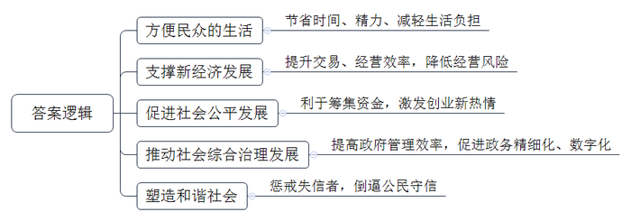
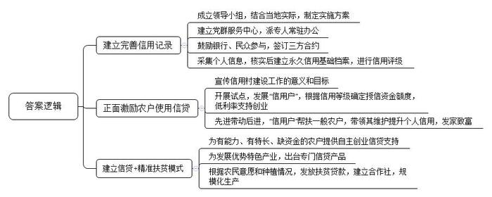
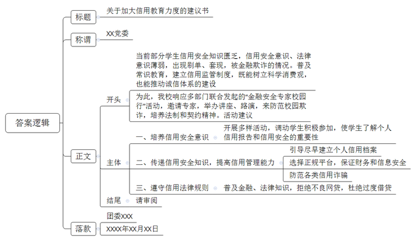

# 2019年公务员多省联考《申论》题（湖南通用卷）

> 候选采集稿。参考答案及解析来自粉笔页面，不代表官方答案或真实高分答卷；来源使用许可与原卷对应关系仍需人工核实。

## 给定材料

### 材料 material-a384abb394a819b8

一年前，小张从北京到杭州工作，在租房时，她惊喜地被中介告知，由于她的信用记录良好，所以不用缴纳两倍于月租的租房押金；而北京的胡先生，却遇上了一件让他颜面尽失的事情。原本在假期准备租辆宝马车和朋友外出自驾游玩，没想到却被租车公司拒绝。原来，胡先生由于欠款许久未还，已经被列入了“老赖”名单，导致自己的信用数据不佳，被禁止租车。

2018年2月起，到E市妇女儿童医疗中心就诊的病患们发现，只要自己的信用度足够好，在医疗中心就可以“先诊疗后付费”，而无需一次次在诊室、检查室和交费处之间奔波，大大节省了自己的时间和精力。

信用骑车、信用住店、信用借书、公交车扫码乘车……这一幕一幕，都是真真切切正在我们身边发生的场景，告诉我们中国正在迈进信用社会。随着大数据时代的来临，信用成为每个人的“第二张身份证”。每个人、每个机构的信用度都可以被量化，曾经“看不见”“摸不到”的信用，正在逐步“变现”。

信用也提升了交易效率，为新经济提供支撑。对于废旧手机回收利用创业者向先生而言，信用就为他解决了“先收手机还是先付款”的难题。“先收手机，用户不放心。先付款，我们也怕损失。”向先生说，引入信用评分后，对高分用户优先付款，不仅订单量上浮一倍，也没有出现违约情况。

有了信用的助力，企业经营效率变得更高。目前，多家共享单车企业已实现信用免押金，大大方便了新用户开通使用。一些共享汽车、共享租衣企业也在研究信用梯度收费等模式，最大限度吸引用户。用户对信用的珍视也令人惊喜。以租车为例，引入信用评分后，行业租金欠款率下降了52%，违章罚款欠款率下降了27%。

在网络高度发达的今天，资源的分布不再局限于有形市场，很多资源分布在网络上。资金资源不再集中在类似于银行这种金融机构身上，而是通过互联网分散分布。一个人只要拥有足够的信用水平，在网络上就能够筹集到资金。所以，信用社会给予了人们一个公平发展的环境。“信用既是商业社会的内在原则，也创造价值和财富。”某研究员说，随着信用体系不断完善，每个人都能在社会中获得公平发展的机会，这将大大激发全社会创业创新热情。

在某信用机构负责人看来，10年后，国内绝大多数城市都将成为信用城市。诚实守信的市民和商家，会享受到非常大的便利，政府的管理效率也将大大提高。信用体系的建立可以推动整个社会综合治理的发展。

在S市，26万老人领取养老金不用亲自跑腿去现场，只需要在手机上进行一次信用认证。购房者提取公积金时也不需要准备大量证明材料，柜台的人脸识别系统扫描后，他的相关信用信息迅速呈现……在促进政务精细化管理方面，“信用”正在发挥越来越重要的作用，有着高信用值的市民在通过实名认证之后，越来越多的政务服务都可以通过互联网进行办理，“刷脸”即可，而无需到窗口排队。

凑一堆人就走的“中国式过马路”、不走寻常路玩“跨越”、开车煲电话粥、没事打开远光灯……这些交通违规行为带来安全隐患，给城市管理增加了困难。当前，有的城市把这些交通违规行为纳入个人信用记录，已经能实现这样的应用场景：一名过马路闯红灯的路人，被监控系统识别身份，达到一定次数将扣除相应信用分，降低信用等级，严重的甚至影响贷款。这种做法背后的逻辑是，一个不尊重交规的人，也可能做出不尊重其他公共规则的行为。个人信用信息就是对个人的一种人格勾勒。在一个公民素质发育成熟的社会，对公民的信用评估，往往是以公民在公共事务中的态度和做法为基本出发点的。信用既是一种道德品质，也是一种制度和规则。信用体系全面建立的意义不仅在于解决押金带来的纠纷，更在于塑造一个和谐的社会。换言之，每个人都更规矩——因为违反社会规则，将令你寸步难行。

### 材料 material-e6550784005c28fa

老潘是G县龙台村农民，前些年一直在沿海某省的服装厂打工，收入也很稳定。但由于离家远，无法照顾子女，于是萌生了在家乡开服装加工厂的念头。可是租厂房、找工人、买机器设备几乎花光了他所有的积蓄，周转资金的事让老潘一筹莫展。万般无奈之下，妻子提出了找银行贷款的主意。令他们没想到的是，仅仅两天，老潘就如愿获得了5万元的贷款，服装厂顺利开工。老潘说，不用担保人，也无需资产抵押，简简单单就贷到款了。这样的便捷，就是因为“信用村”这个称号。

龙台村以农业为主，几年前，村民因既无合法抵押物和担保人，又无任何社会信用记录，无法获得银行贷款，基本生产资金靠民间借贷，更谈不上高投入、高产出。近年来，当地政府和银行成立“创建信用村”领导小组，结合该村实际情况，制定了《龙台村创建信用村实施方案》。政府建立“党群服务中心”并派专人常驻办公，相关银行全力参与。政府、银行和村民三方共同签订守信合约。合约约定村民用身份证在银行代办网点登记建立个人基本信息，银行核实后为村民建立永久信用基础信息档案，对农户进行信用评级。此外还对贫困户分别制定帮扶计划和脱贫致富奔小康规划，做到“一户一策，精准扶贫”。

在创建信用村过程中，针对部分农户不愿参与的情况，领导小组利用各种载体，广泛宣传信用村建设工作的重要意义和目标要求，采取“以先进带后进，正向激励形成面”的思路，发展一批、争取一批“信用户”，根据信用等级对其授信2至5万元，及时为其提供低利率的创业及经营资金，让农户看到当上“信用户”的实惠。同时，“信用户”积极帮扶一般农户争创“信用户”，带领其维护和提升个人信用，发展养殖、种植发家致富。“这样做不仅有利于工作开展，还能促进村民之间信任互助的关系，形成良好的民风。”龙台村党支部书记说。

为强化“信贷+扶贫”的引领作用，针对农户不同的情况，领导小组量身定制不同扶贫信贷模式。像老潘这样有能力、有特长、缺资金的农户，银行发放信用贷款支持其自主创业。针对当地药材种植这一优势特色产业，专门出台信贷产品“药农贷”，支持药材种植户。此外，领导小组还在自愿的基础上，根据当地村民普遍种植红薯的情况，发放专门的项目扶贫贷款。该村红薯种植合作社成立后，吸收了48户贫困户入社，银行发放扶贫项目贷款70万元，支持他们种植红薯，这些农户因种植红薯户均收入大幅增加。

### 材料 material-560a96599f4aed8f

为帮助大学生树立科学的消费观，推动年轻人群信用意识升级和诚信体系建设，团中央、教育部、银监会等多部门联合发起“金融安全专家校园行”活动。活动将调动全国3000余所高校的团组织共同参与，邀请金融安全专家走进校园，常年举办信用安全讲堂以及校园金融风险识别路演。

王先生是互联网金融服务公司L集团的运营官，作为活动嘉宾来到Z大学，在活动现场向近300名学生宣讲信用安全的重要性及如何管理和保护个人信用。“信用是一个人的终身档案和隐形简历。”在演讲中，王先生建议，年轻人要学会保护个人信用，小心各类信用诈骗；同时也要学会管理个人信用，“越早建立个人信用，随着时间推移，其信用分值会随着积累而越高。”

此次“金融安全专家校园行”活动在形式上也有所创新，除了演讲外，现场还设置了问答及有奖竞猜环节。学生们积极踊跃地参与互动和答题，三名同学幸运地获得了手机大奖。

校团委老师表示：“自己平时对信用安全方面的知识基本没有了解过，更不知道迟交手机通讯费和水电费都会影响到信用。可以想象大学生们对这方面的了解更是少之又少，今天的讲座收获满满，希望以后开展更多这样有益于大学生信用安全的活动。”

现场大学生感言：“通过讲座我了解了如何保护自己的信息，也知道了如何避免生活中的一些陷阱骗局，明白了如何选择正确平台，保证自己财务和信息的安全。”

某大学发布的《全国大学生信用认知调研报告》显示，当前有近六成大学生缺乏信用知识，逾八成的大学生没有听说过或不了解个人信用报告。而发生在校园的大部分金融欺诈行为，都和学生的信用安全意识、法律意识薄弱有关。大学生兼职刷单、用信用卡违规套现……“有些大学生缺乏基本的信用意识，对自己的征信信息并不珍惜，在这些学生眼中，个人征信信息是可以拿去做交易的筹码，甚至对欠贷不还将给自己造成的信用污点毫不了解。”有专家认为，加大信用教育的力度，拓宽常识教育的广度，建立信用约束机制和监管制度，已成为时代对高校思想政治工作和管理职责的要求。“举办这类交流讲座，很好地弥补了学生们的知识空白。这不仅有助于从根源上防范校园金融欺诈，也有利于培养具有法制意识和契约精神的现代公民。”

### 材料 material-c5b8c502b2f1f37d

人无信不立，业无信不兴。诚信不仅是个人安身立命的根本，也是社会良序发展的基石。

党的十八大以来，党和国家高度重视诚信建设。习近平总书记在多个不同场合围绕诚信主题发表了一系列重要论述，从战略高度为新时代中国的诚信建设提供了基本遵循。他从历史维度、价值维度、实践维度对诚信问题进行了深刻阐述，进一步指出中华文化关于诚信的思想和理念，不论过去还是现在，都有其鲜明的民族特色，都有其永不褪色的时代价值。他强调，要运用法治手段解决道德领域突出问题。对突出的诚信缺失问题，既要抓紧建立覆盖全社会的征信系统，又要完善守法诚信褒奖机制和违法失信惩戒机制，使人不敢失信、不能失信。对见利忘义、制假售假的违法行为，要加大执法力度，让败德违法者受到惩治、付出代价。

为全面推进诚信建设，党和国家作出了一系列重要部署。中共中央办公厅印发的《关于培育和践行社会主义核心价值观的意见》强调：“以诚信建设为重点，加强社会公德、职业道德、家庭美德、个人品德教育，形成修身律己、崇德向善、礼让宽容的道德风尚。”中央文明委发布《关于推进诚信建设制度化的意见》，明确规定通过曝光失信当事人、限制严重失信者高消费行为等手段打击失信行为，这是我国第一份强调从制度层面推进国家诚信建设的中央文件。国务院先后发布《关于建立完善守信联合激励和失信联合惩戒制度加快推进社会诚信建设的指导意见》《关于加快推进失信被执行人信用监督、警示和惩戒机制建设的意见》，建立起社会诚信奖惩制度，并进一步完善了失信惩戒制度。诚信建设从注重教育走向教育与制度建设并重。

## 题目

### 第 1 题

**根据资料**2**，请谈谈信用体系建设对当前社会有哪些积极影响？（15分）**

关联材料：material-a384abb394a819b8

作答要求：

要求：全面、准确、简明，不超过150字。

### 第 2 题

**G县拟在全县范围内开展信用村创建工作，请根据资料**3**，谈谈龙台村的经验对这项工作有何启示。（20分）**

关联材料：material-e6550784005c28fa

作答要求：

要求：（1）紧扣资料，内容全面；（2）层次分明，有逻辑性；（3）不超过300字。

### 第 3 题

**某高校党委向全校师生征集关于****“加大信用教育力度”的建议，假定你是该学校团委工作人员，请根据资料**5**，给学校党委提交一份建议书。（25分）**

关联材料：material-560a96599f4aed8f

作答要求：

要求：（1）紧扣资料，内容具体；（2）分析透彻，措施可行；（3）不超过400字。

### 第 4 题

**参考给定资料，以****“信与用”为题，联系实际，写一篇文章。（40分）**

关联材料：material-c5b8c502b2f1f37d

作答要求：

要求：（1）自选角度，立意明确；（2）联系实际，不拘泥于资料；（3）思路清晰，语言流畅；（4）总字数1000-1200字。

## 答案与解析

第 1 题

**参考答案（粉笔题库参考内容）**

一、方便民众的生活。节省时间、精力、减轻生活负担。

二、支撑新经济发展。提升交易、经营效率，降低经营风险。

三、促进社会公平发展。利于筹集资金，激发创业创新热情。

四、推动社会综合治理发展。提高政府管理效率，促进政务精细化、数字化。

五、塑造和谐社会。惩戒失信者，倒逼公民守信。

**解析**

**参考答案说明：**本参考答案从“方便民众的生活”“支撑新经济发展”“促进社会公平发展”“推动社会综合治理发展”“塑造和谐社会”五个方面展开。各条答案要点之间在内容上相互并列，没有交叉。

**考点**：考点影响类

**来源**：来源2019年公务员多省联考《申论》题（湖南通用卷）

粉笔申论页面对本题只提供「解析视频」入口，该入口是会员推广位，页面无视频地址与文字解析。

第 2 题

**参考答案（粉笔题库参考内容）**

一、建立完善信用记录。1.成立领导小组，结合当地实际，制定实施方案。2.建立党群服务中心，派专人常驻办公。3.鼓励银行、民众参与，签订三方合约。4.采集个人信息，核实后建立永久信用基础档案，进行信用评级。

二、正面激励农户使用信贷。1.宣传信用村建设工作的意义和目标。2.开展试点，发展“信用户”，根据信用等级确定授信资金额度，低利率支持创业。3.先进带动后进，“信用户”帮扶一般农户，带领其维护提升个人信用，发家致富。

三、建立信贷+精准扶贫模式。1.为有能力、有特长、缺资金的农户提供自主创业信贷支持。2.为发展优势特色产业，出台专门信贷产品。3.根据农民意愿和种植情况，发放扶贫贷款，建立合作社，规模化生产。

**解析**

**参考答案说明：**本参考答案从“建立完善信用记录”“正面激励农户使用信贷”“建立信贷+精准扶贫模式”这三个方面进行了分条撰写。各条要点之间在内容上相互并列，没有交叉。

  

**考点**：考点经验启示类

**来源**：来源2019年公务员多省联考《申论》题（湖南通用卷）

粉笔申论页面对本题只提供「解析视频」入口，该入口是会员推广位，页面无视频地址与文字解析。

第 3 题

**参考答案（粉笔题库参考内容）**

关于加大信用教育力度的建议书

XX党委：

当前部分学生信用安全知识匮乏，信用安全意识、法律意识薄弱，出现刷单、套现，被金融欺诈的情况。普及常识教育，建立信用监管制度，既能树立科学消费观，也能推动诚信体系的建设。为此，我校响应多部门联合发起的“金融安全专家校园行”活动，邀请专家，举办讲座、路演，来防范校园欺诈，培养法制和契约精神。活动建议：一、培养信用安全意识。开展多样活动，调动学生积极参加，使学生了解个人信用报告和信用安全的重要性。二、传递信用安全知识，提高信用管理能力。引导尽早建立个人信用档案；选择正规平台，保证财务和信息安全；防范各类信用诈骗。三、遵守信用法律规则。普及金融、法律知识，拒绝不良网贷，杜绝过度借贷。请审阅。

团委XXX

XXXX年XX月XX日

**解析**

**参考答案说明：**（1）本参考答案写到了“标题+称谓+正文+落款”四个部分。（2）正文部分：从内容来看，围绕着“加大信用教育力度”这一主题，开头部分介绍了当前学生在信用教育方面存在的主要问题，学校加强信用教育的好处以及总体建议等，主体部分分别从“培养信用安全意识”“传递信用安全知识，提高信用管理能力”“遵守信用法律规则”这三个方面对如何加强信用教育进行了分条撰写，最后给出了“请审阅”的结尾。从形式来看，本参考答案做到了分段撰写，为了体现公文题的逻辑性，还加上了连接词来承接上下文。

参考答案二

关于加大信用教育力度的建议书

校党委：

当下，近六成大学生缺乏信用知识。帮助大学生树立科学消费观，提升法制意识和契约精神，加大信用教育力度，已成为高校思政工作的重要内容。为此，我建议：

一、邀请金融安全专家走进校园，宣讲信用安全的重要性、管理和保护个人信用的相关方式方法等。

二、举办信用安全讲堂，创新活动形式，如设置问答及有奖竞猜环节，提升现场互动参与性，增加师生基本的信用安全知识。

三、举行校园金融风险识别路演，避免生活中的陷阱骗局，学会选择正确平台，保障财务和信息安全。

学校信用教育任重道远，盼校领导审阅并实施。

校团委

XXXX年XX月XX日

**考点**：考点方案类

**来源**：来源2019年公务员多省联考《申论》题（湖南通用卷）

粉笔申论页面对本题只提供「解析视频」入口，该入口是会员推广位，页面无视频地址与文字解析。

第 4 题

**参考答案（粉笔题库参考内容）**

**信与用**

信用，一般指“诚信”。但若对“信用”做更深入的解读，则有“信”与“用”两层意思。“信”即诚信，是一种道德品质，也是一种制度和规则；“用”是一种方法，也是一种证明信的凭证。“信”与“用”相互促进、辩证统一，二者能形成良性循环，实现道德价值与实用价值的高度统一。因此，我们要建立社会诚信体系，并利用其推动社会进步、优化政府管理。

**建立社会诚信体系，要依靠法治手段，完善奖惩机制。**以往，教育是诚信建设的主要手段，但却已无法适应社会发展，而现代社会的奖惩机制就是最好补充。褒奖机制，奖励的是守信行为，形成正向激励。如给守信者提供医疗、教育、消费等领域的“免押金”支持，让群众看到诚信福利。惩戒机制，则要惩罚失信行为。被网友称为“教科书式老赖”的黄淑芬，就因其对法院判决有执行能力而拒不执行，所以被列入了全国法院失信被执行人名单。所以，法治是诚信体系建设的重要保障。

**完善社会诚信体系，要利用技术手段，广泛采集信息，丰富征信主体。**依靠法治建设诚信体系，需用大量信用数据。但诸如交通违章、社区违建、非法经营等行为却并未纳入信用体系，加之信息人口覆盖度不高，这使我们的诚信体系建设始终处于“初级阶段”。因此，拓宽信息角度、扩大覆盖人口便显得尤为重要。同时，我们还要推进征信主体多元化，引进民营机构，共同征信。只有各方运用现代技术，丰富信息内容，推进信息共享，才能让征信系统日趋完善。

征信系统的建立，能让社会更有“诚信”，我们也要充分“利用”这些信，因为只有“用”，才能更好地促进信、保护信，让信的基础更坚实、更可持续。

**要利用信用体系，便利群众生活，改善企业经营，推动社会进步。**支付宝中的“芝麻信用”，能让信用良好者享受到信用购、信用租、信用住等便利服务，这正是利用了信用积分来改变消费模式，让群众享受到便利。另外，企业也可以引入信用评分，与客户建立互信关系，降低交易风险，提高交易效率；甚至还可以结合信用梯度，创新收费方式，形成新兴商业模式。这些都会大大降低社会运行成本，促进社会发展，让人们更坚信“信”的作用。

**要用好信用体系，优化政务服务，改善社会治理，促进社会公平，提升政府管理水平。**战国时期，商鞅立木建信，从而推动商鞅变法，便已向我们展现了何为用“信”治国。而今，信用在政务服务中应用更加广泛。多地均已利用信用信息，实现了联网办理养老金、公积金领取服务。此外，一些贫困山村也用“信贷+扶贫”的模式帮助群众顺利贷款、成功脱贫。这正是用信用体系在缩小贫富差距、改善社会治理、促进社会公平。未来，我们更要充分利用征信系统，全面提升政府管理水平，让人们更深刻地体会“信”的价值。

孔子曰：“人而无信，不知其可也。”诚信的重要性早已不需赘述。而当代社会的“信”与“用”，更是不可分割的整体。我们只有让“信”为我所“用”，才能让我们朝着更规矩、更便利、更公平的社会不断前进。

**解析**

**文章分析**

**信与用**

【**标题的优点：**首先，范文的标题“信与用”突出文章主题，符合题目命题要求。】

信用，一般指“诚信”。但若对“信用”做更深入的解读，则有“信”与“用”两层意思。（1）“信”即诚信，是一种道德品质，也是一种制度和规则；“用”是一种方法，也是一种证明信的凭证。（2）“信”与“用”相互促进、辩证统一，二者能形成良性循环，实现道德价值与实用价值的高度统一。因此，我们要建立社会诚信体系，并利用其推动社会进步、优化政府管理。

【**开头的优点：**★内容方面。范文的开头是紧扣题目给定的“信与用”这一主题展开的。首先，开头即点出主题，做到了主题明确。其次，对“信与用”这一主题进行了分析阐述，指出了（1）“信与用”的含义，（2）“信与用”的关系。注意以上两个方面的阐述在逻辑上有先后顺序：先写“含义”，再写“关系”。★文字表达方面：长短句配合使用，使语言表达有节奏感。】

**建立社会诚信体系，要依靠法治手段，完善奖惩机制。**以往，教育是诚信建设的主要手段，但却已无法适应社会发展，（1）而现代社会的奖惩机制就是最好补充。褒奖机制，奖励的是守信行为，形成正向激励。如给守信者提供医疗、教育、消费等领域的“免押金”支持，让群众看到诚信福利。（2）惩戒机制，则要惩罚失信行为。被网友称为“教科书式老赖”的黄淑芬，就因其对法院判决有执行能力而拒不执行，所以被列入了全国法院失信被执行人名单。所以，法治是诚信体系建设的重要保障。

【**论述段****1****的优点**：★观点句：范文的观点句是紧扣“信与用”这一文章主题提出的。形式上，它在段首处直接写出，位置突出，容易发现。内容上，内容要点明确，可以明显看出它是从“法治”入手，指出了如何“建立社会诚信体系”。★论述内容：（1）介绍了“奖励守信行为，形成正向激励”；（2）总结了“惩罚失信行为，起到警示作用”。注意：以上两个方面的内容都是紧扣“建立社会诚信体系，要依靠法治手段，完善奖惩机制”这个观点句进行分析论述的，论述的针对性强，内容层次丰富。论述方法上采用了讲道理、举例子相结合，做到了丰富多样。】

**完善社会诚信体系，要利用技术手段，广泛采集信息，丰富征信主体。**依靠法治建设诚信体系，需用大量信用数据。但诸如交通违章、社区违建、非法经营等行为却并未纳入信用体系，加之信息人口覆盖度不高，这使我们的诚信体系建设始终处于“初级阶段”。（1）因此，拓宽信息角度、扩大覆盖人口便显得尤为重要。同时，（2）我们还要推进征信主体多元化，引进民营机构，共同征信。只有各方运用现代技术，丰富信息内容，推进信息共享，才能让征信系统日趋完善。

【**论述段****2****的优点**：★观点句：范文的观点句是紧扣“信与用”这一文章主题提出的。形式上，它在段首处直接写出，位置突出，容易发现。内容上，内容要点明确，可以明显看出它是从“技术”入手，指出了如何“完善社会诚信体系”。★论述内容：（1）介绍了“拓宽信息角度、扩大覆盖人口”；（2）介绍了“推进征信主体多元化，引进民营机构”。注意：以上两个方面的内容都是紧扣“完善社会诚信体系，要利用技术手段，广泛采集信息，丰富征信主体”这个观点句进行分析论述的，论述的针对性强，内容层次丰富。论述方法上采用了讲道理、举例子相结合，做到了丰富多样。】

征信系统的建立，能让社会更有“诚信”，我们也要充分“利用”这些信，因为只有“用”，才能更好地促进信、保护信，让信的基础更坚实、更可持续。

【**过渡段：**阐述“只有‘用’才能更好地促进信、保护信，让‘信’的基础更坚实、更可持续”，同时起到引出下文中“用”的作用。】

**要利用信用体系，便利群众生活，改善企业经营，推动社会进步。**（1）支付宝中的“芝麻信用”，能让信用良好者享受到信用购、信用租、信用住等便利服务，这正是利用了信用积分来改变消费模式，让群众享受到便利。（2）另外，企业也可以引入信用评分，与客户建立互信关系，降低交易风险，提高交易效率；甚至还可以结合信用梯度，创新收费方式，形成新兴商业模式。这些都会大大降低社会运行成本，促进社会发展，让人们更坚信“信”的作用。

【**论述段****3****的优点**：★观点句：范文的观点句是紧扣“信与用”这一文章主题提出的。形式上，它在段首处直接写出，位置突出，容易发现。内容上，内容要点明确，可以明显看出它是从“群众、企业”入手，指出了如何“利用信用体系”。★论述内容：（1）介绍了“让信用良好者享受生活便利”；（2）介绍了“引导企业利用信用信息，创新发展模式”。注意：以上两个方面的内容都是紧扣“要利用信用体系，便利群众生活，改善企业经营，推动社会进步”这个观点句进行分析论述的，论述的针对性强，内容层次丰富。在论述方法上采用了讲道理、举例子相结合，做到了丰富多样。】

**要用好信用体系，优化政务服务，改善社会治理，促进社会公平，提升政府管理水平。**战国时期，商鞅立木建信，从而推动商鞅变法，便已向我们展现了何为用“信”治国。而今，（1）信用在政务服务中应用更加广泛。多地均已利用信用信息，实现了联网办理养老金、公积金领取服务。此外，一些贫困山村也用“信贷+扶贫”的模式帮助群众顺利贷款、成功脱贫。（2）这正是用信用体系在缩小贫富差距、改善社会治理、促进社会公平。未来，我们更要充分利用征信系统，全面提升政府管理水平，让人们更深刻地体会“信”的价值。

【**论述段****4****的优点**：★观点句：范文的观点句是紧扣“信与用”这一文章主题提出的。形式上，它在段首处直接写出，位置突出，容易发现。内容上，内容要点明确，可以明显看出它是从“政府”入手，指出了如何“用好信用体系”。★论述内容：（1）介绍“完善政务服务，改善群众体验”；（2）介绍“信用扶贫，促进社会公平”。注意：以上两个方面的内容都是紧扣“要用好信用体系，优化政务服务，改善社会治理，促进社会公平，提升政府管理水平”这个观点句进行分析论述的，论述的针对性强，内容层次丰富。在论述方法上采用了讲道理、举例子相结合，做到了丰富多样。】

【**论述段之间的关系**：★内容的内在逻辑：范文的论述段之间是依照并列逻辑展开的。论述段1、2先写了“信”，论述段3、4再写了“用”。★段与段的外在衔接：过渡段起到了承接论述段1、2，引出论述段3、4的作用。】

孔子曰：“人而无信，不知其可也。”诚信的重要性早已不需赘述。而当代社会的“信”与“用”，更是不可分割的整体。我们只有让“信”为我所“用”，才能让我们朝着更规矩、更便利、更公平的社会不断前进。

【**结尾的优点：**范文的结尾回扣了“信与用”这一主题。（1）再次总结了“信与用”；（2）发出了号召希望。】

**考点**：考点文章写作题

**来源**：来源2019年公务员多省联考《申论》题（湖南通用卷）

粉笔申论页面对本题只提供「解析视频」入口，该入口是会员推广位，页面无视频地址与文字解析。

