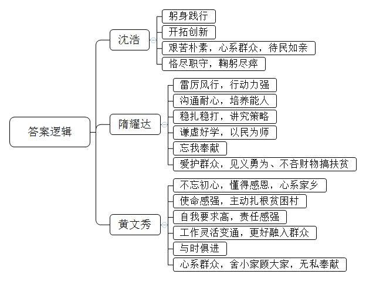
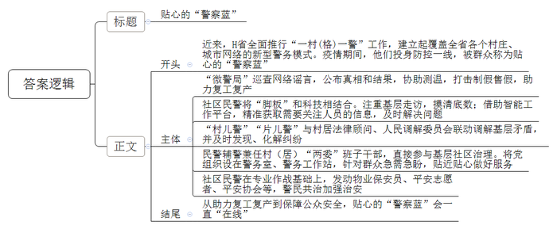
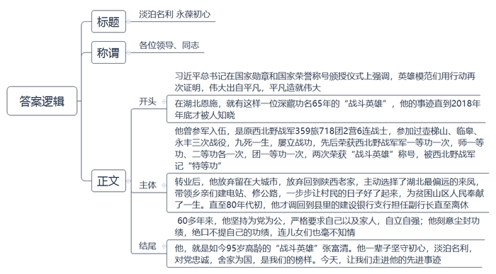
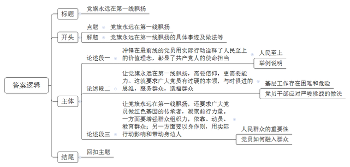

# 2020年0725公务员多省联考《申论》题（湖南通用卷）

<!-- gwy:overview:start -->
> **湖南 · 2020 · 申论 · 通用卷** ｜ 4 题 · 图片 4 处 · 答案随题折叠

导航：[题目](#题目) · [材料 1](#材料-1)
<!-- gwy:overview:end -->

> 候选采集稿。参考答案及解析来自粉笔页面，不代表官方答案或真实高分答卷；来源使用许可与原卷对应关系仍需人工核实。

## 给定材料

### 材料 1

中共中央总书记、国家主席、中央军委主席习近平对进一步做好防汛救灾工作作出重要指示。他指出，近期，长江、淮河等流域，洞庭湖、鄱阳湖、太湖等湖泊处于超警戒水位，重庆、江西、安徽、湖北、湖南、江苏、浙江等地发生严重洪涝灾害，造成人员伤亡和财产损失，防汛形势十分严峻。他强调，当前，已进入防汛的关键时期，各级党委和政府要压实责任、勇于担当，各级领导干部要深入一线、靠前指挥，组织广大干部群众，采取更加有力有效的措施，切实做好监测预警、堤库排查、应急处置、受灾群众安置等各项工作，全力抢险救援，尽最大努力保障人民群众生命财产安全。

江西鄱阳县昌江圩险段，在那里处置险情的500名武警江西总队机动支队官兵已经坚持了四个昼夜，其中不少战士是“90后”甚至“00后”。“我要上，让我来！”有的武警战士救生衣上写着这样的小字。为了对武警战士表示感谢，当地村民送来绿豆汤和茶水。在另一险情段，河水离堤面只有50公分，有的地方还开始渗水，全村党员干部全员上堤，组织村民运土加高堤面，党员小徐的双脚已经在泥水里泡了18个小时，顾不上休息的他说：“我们必须守护好身后的家园。”洞庭湖连日来持续出现超警戒甚至超保证水位。目前，湖南省超过40万干部群众奋战在防汛抗洪一线，大堤上，湖区干部群众24小时值守巡查、清基扫障、开挖浸沟、查险找险。在大堤防汛灯照耀下，戴着红袖章的巡逻队员们有的用强光手电寻找蚁穴、鼠洞、渗漏等险情，有的敲打“竹梆子”报平安，抢险队员的对讲机通话声此起彼伏……湖区干部和人民以实战状态全力迎战来势汹汹的洪水。

张家界市主要领导及各级党员干部争分夺秒，冒着大雨，踩着淤泥，蹚过积水，赶赴汛情最为严峻的乡镇，现场指挥部署防汛救灾工作，在启动防汛Ⅱ级响应后连夜深入受灾乡镇（街道）进行值班值守督查。“洪灾面前，没有理由不冲在最前。”近期，湖南省张家界市永定区局部暴雨天气，累积雨量大。“在疫情防控期间，我们就一直坚守在应急物资配送及社区防控第一线。在应对强降雨带来的洪灾面前，我们没有理由不冲在最前沿。”永定区应急管理局党组书记宋书记说。7月6日晚，慈利县许家坊土家族乡雨势较大，该乡党委书记谢坚立即组织调度相关人员重心下沉，开展防汛防灾巡查工作，查看存在隐患的山塘水库、地质灾害点，并叮嘱相关负责人、附近住户提高警惕，做好防护措施，有危险立即转移。

红岩村党支部朱书记冒着被水冲走的危险，前往河边查看水位，并上门查看住在附近村民的相关情况；咸水村党支部邓书记分时段对辖区内的山塘水库、地质灾害点进行实时巡查，并及时反馈巡查结果；云山村成立了一支14人的应急救援队，24小时轮班，洪水冲毁了道路，队员们第一时间组织抢险保畅通。

面对持续的降雨，谢坚连夜发布一条信息：“今晚雨势未见减弱，请乡、村两级防汛防地质灾害责任人迅速到位，加强巡查，对存在较大危险隐患地段的住户进行紧急转移，有任何情况立即上报至乡、村，收到请回复！”

“收到！”

“收到！”

### 材料 2

选派优秀机关干部到村任第一书记，是加强农村基层党组织促脱贫攻坚的重要举措，这一举措已经实施多年。在我国著名的小岗村，就有一位让人难以忘怀的第一书记。“一朝越过温饱线，20年没进富裕门”是小岗村当时的写照。2004年，40岁的沈浩从安徽省财政厅来到这里之后，带领村民修路、打井，支持青年创业致富……渐渐地，他找到了一条适合小岗村发展的新路，让小岗村发生了巨变。他住的那间十几平方米的小屋，床头贴着村民的联系方式，大门从不上锁，谁都能推门而入。他也成了群众心中“离不开的干部”。

40多年前，小岗村的18位村民曾按下红手印，改变了这个村子的命运。沈浩到来后，群众们又两次用这种方式表达了他们最真实的心愿——在沈浩任期届满时，村民们集体按下红手印，留住他。2009年11月6日，因积劳成疾，沈浩突发心脏病倒在工作岗位上，村民们再一次集体按下红手印，请求将这位好书记安葬在小岗村。

从省直机关来到贫困山村的还有一位“羊书记”——隋耀达。在海南省保亭黎族苗族自治县共村群众眼中，他经常穿着迷彩服，做事雷厉风行。来到共村之初，为了“扶志”，隋耀达给村里的一个贫困户做思想工作，帮助他一步一步成了致富能人，还当了村里的后备干部。一个家庭的变化激发了整个村子的动力。村民们有了精神头，隋耀达开始着手发展产业。种植红毛丹，圈养黑山羊，编织黎锦工艺品，建设光伏发电站……经过3年多的发展，羊场的黑山羊产值近60万元，贫困户家家分红，户户增收，实现了良性循环。其他的三个项目也形势喜人，共村摘掉了“贫穷帽”。谈到为什么选择这些产业，隋耀达有自己的诀窍，他说要当好带头人，不能盲目地指挥，“农民都是专家，要向他们请教学习。”

别看这位“70后”书记干起工作来风风火火，其实在2014年省里派选驻村干部时，他刚被查出颈动脉瘤，不能过度劳累，但他还是主动报了名。不仅如此，这些年来，无论遇到什么样的情况，隋耀达都会第一时间站出来保护群众，连见义勇为获得的奖金也全部拿出来用于扶贫。

在第一书记的队伍里，还有更年轻的“战士”。1989年出生的黄文秀，在同学们的心中是个“爱美，喜欢穿裙子，会弹古筝”的姑娘。她牢记着父亲的话——“没有共产党，我们家不可能脱贫”，硕士毕业后，选择回到家乡广西百色革命老区成为市委宣传部干部，并主动请缨到贫困村担任驻村第一书记。刚到村里的时候，群众并不信任这个“女娃娃”，甚至对她有些排斥。她到贫困户家走访，群众也不愿意过多交谈，觉得她是个“小年轻”，跟她聊了也没用。面对这种情况，黄文秀着急得睡不着觉。但是很快她就改变方式方法，从帮着贫困户干活，到学习说桂柳话，慢慢地融入了这个村子，群众开始接受她。解决基础设施问题，发展特色产业，对接市场，建立电商服务站，在黄文秀的带领下，这个贫困山村开始发生变化。2018年，百坭村88户贫困户实现脱贫，贫困发生率从22.88%下降到2.71%。

2019年6月16日，黄文秀回家陪护刚做完肝癌手术的父亲，看着天气突变，她担心村里受灾，顾不上病床上父亲对她安全的担忧，着急返回百坭村，临走前还嘱咐父亲要按时吃药。一路上她不断与村里的干部联系，询问灾情，特别叮嘱要立即组织群众防灾救灾。此时，雨越下越大，山洪突发。她给自己的哥哥发信息说，“被困住了，两头都走不了”。而这却成为她留给家里人的最后一句话。

脱贫攻坚决胜小康，是黄文秀心中的“长征”，而她美丽的生命已经永远定格在这条“长征”路上。8年前，也是在6月份，她加入了中国共产党。当初，她在自己的入党申请书中写下这样一句话：“一个人要活得有意义，生存得有价值，就不能光为自己而活。”

### 材料 3

2014年以来，H省全面推行“一村（格）一警”，建立起覆盖全省各个村庄、城市网络的新型警务模式。自新冠肺炎疫情防控阻击战打响以来，H省的7806个警务室、4.3万个警务工作站，9834名社区民警和4.3万名辅警，迅速投身防控工作一线，被群众称为贴心的“警察蓝”。

2020年2月的一天，派出所刘所长接到“微警局”案件通报：辖区一家口罩生产公司高层确诊新冠肺炎，公司数十名技术员和工人纷纷停下生产机器，抱着行李往外跑。刘所长、“村儿警”小李感到事态严重，该公司日产上百万只口罩，一旦停产，影响不小。两人决定先去现场劝说工人，再寻找信源。两人很快就查清：公司一名外来人员的远房亲戚确诊，与此人无关，更没有传染公司员工。谣言澄清，人心安定。疫情期间，“微警局”加强巡查网络谣言，由驻村民警及时公布事实真相、处理结果。同时，协助测控体温、打击制假售假，保障辖区40家口罩、防护服生产企业复工复产。

社区民警小宋2018年初到基层时，一头雾水。老民警教他，迈开两条腿，练就“铁脚板”，摸清底数，才能心里有数。小宋用5个多月时间走遍了123个楼栋1803户群众，了解到老旧小区情况后，便着手推动对小区进行封闭管理、技防物防改造。与此同时，他手机上还安装了“一村（格）一警”智能工作平台。该平台可以提醒社区民警“今天任务”“走访考察任务清单”，做到信息精细推送、要素智能采集、任务精准派单、矛盾隐患动态清零、档案自动生成、考核实时完成。凡是需要关注的人员，平台会及时推送信息，民警也能够及时上门走访。2020年1月24日下午，小宋接到社区通知，有一名疑似患者，需要紧急隔离，可此人情绪激动，拒绝配合社区人员。小宋冒着被感染的风险，迅速赶到疑似患者家门口，讲风险、说政策，终于说服其住进定点医院。

“村儿警”“片儿警”常年“泡”在基层，与村居法律顾问、人民调解委员会联动调解，可以及时发现苗头，化解矛盾纠纷。3月1日，马庄村“讲理堂”，村警务室的民警小许主持化解了一起持续多年的邻里纠纷。村民金某和顾某因为争执80厘米宽的一垄地，互不相让。近日，两家矛盾升级，金某脸被划破，住进医院。小许眼见纠纷越闹越凶，于是联合村干部到田间测量地块，到家里耐心说服。最终，金某和顾某各退一步，达成和解协议，确保春季正常备耕。

小何不仅是“片儿警”，还兼任滨河社区党支部副书记，直接参与基层社区治理。和民警小何一样，H省有8452名社区民警、34756名社区辅警进村（居）“两委”班子，兼任村（居）党组织副书记、村（居）委会副主任，兼任率分别达到100%和98.5%。将党组织设在警务室、警务工作站，针对群众急需急盼，贴近贴心做好服务。2020年2月初开始，大部分居民自觉“宅”在家里。可是，困难群众的生活却成了问题。滨河社区的老章腿有残疾，独自居住。社区民警小何了解情况后，组织辖区党员、退役军人、志愿者组成“暖心小分队”，及时采购、捐赠生活物资，送给老章等困难户。老章感动不已：“社区不仅‘零疫情’，而且‘最温暖’。”

文化路公安分局黄局长说：“社区民警既要专业作战，又要发动物业保安员、平安志愿者、平安协会等力量。”文化路公安分局辖区的商圈有20平方公里，住了近20万人，客流量大、租房户多，一度案件高发。社区民警小张到任后，督促商场、小区增加保安力量，增设高清监控设备；协同文化路公安分局警力，集中侦破手机扒窃、入室盗窃、电信诈骗等“硬骨头”案件。仅用3年时间，原来每天案发20多起的社区，实现200多天“零发案”。

### 材料 4

2019年9月29日，中共中央总书记、国家主席、中央军委主席习近平在国家勋章和国家荣誉称号颁授仪式上强调，英雄模范们用行动再次证明，伟大出自平凡，平凡造就伟大。

在湖北恩施，有一位深藏功名65年的“战斗英雄”张富清，他的事迹直到2018年年底才被人知晓。95岁的老党员张富清是原西北野战军359旅718团2营6连战士。1948年3月，张富清光荣入伍，加入到王震所领导的英雄部队。6月，壶梯山战役，张富清担任突击组长，第一次被授予“战斗英雄”称号，并记师一等功。8月，张富清如愿入党。9月，临皋战役，张富清担任班长。11月，永丰战役打响，张富清担任突击连连长，战斗胜利结束后张富清荣立军一等功，并再次获得“战斗英雄”称号，王震亲自为他佩戴勋章。永丰战役后，西北野战军进入到战略反攻阶段。1949年年底到1951年两年间，张富清随所在的部队，一路从陕北挺进新疆，最后将红旗插到帕米尔高原。张富清先后荣获西北野战军军一等功一次，师一等功、二等功各一次，团一等功一次，两次荣获“战斗英雄”称号，被西北野战军记“特等功”。

1955年，张富清转业，他原本可以选择去大城市，或回到老家陕西汉中，但他却选择去往湖北恩施，来到湖北省最偏远的来凤县工作，为贫困山区人民奉献了一生。“他总是一个月在农村20多天，我们根本见不上他的面。”提及童年时期对父亲的印象，张富清的小儿子张建全这样说，“像别人都有的趴在爸爸背上的记忆，我们都几乎没有。”但在当地山区年长的村民的印象里，却正是这个小个子党员干部，带领组织大家建电站、修公路，一步步让村民的日子好了起来。直至80年代初，张富清才调回到县里的建设银行支行担任副行长直至离休。

60多年来，张富清坚持为党为公，严格要求自己，严格要求家人。“人要自立，不能给组织添麻烦”，这几乎是张富清随时挂在嘴边的话。张富清刻意尘封功绩，连儿女也不知情。2018年年底，在退役军人信息采集中，张富清的事迹被发现，这段英雄往事重现在人们面前。“父亲从来不让我们碰他的皮箱，更没跟我们讲过这些事情。”张建全说，“直到这次信息采集，我们让他配合组织工作，他才拿出了这些。”

### 材料 5

自湖北武汉发生新冠肺炎疫情后，中南大学三所附属医院（湘雅医院、湘雅二医院、湘雅三医院）各级党组织和共产党员立即集结。在抗击新冠病毒感染的肺炎疫情防控阻击战中，党员干部冲锋在第一线、战斗在最前沿，<u>党旗永远在第一线飘扬。</u>

湘雅医院肾内科党支部争先向医院党委提交请战书，请战书落款处是支部全体24名党员的签名和手印。同日，急诊科党支部“80后”急诊医师宋延民带着行李箱到科室，并给急诊科党支部书记李湘民发去了这样一段话：“如医院有援助湖北的任务，我要求报名参加，不计报酬、不论生死。我今天上班已经把行李带来了，如有指示，可随时加入战斗。”湘雅医院呼吸内科党支部全体34名党员向医院党委提交请战书。“我是儿科党支部书记，必须第一个报名。”“我是党员，也是医生，选择了这个职业就要有担当，如果武汉需要，我报名。”……这样的党员还有很多很多，他们用自己的举动擦亮了共产党员的先锋底色。

湘雅二医院发出动员令后，成立了疫情防控预备队，得到广大职工特别是共产党员的积极响应，报名人数每天都在刷新，其中共产党员占80%以上。“我申请加入‘抗疫’一线，我儿子也是学医的，我要用实际行动教会他比任何专业课更重要的一课——责任与担当！”湘雅二医院神经外科监护室的罗征医生向党组织提出申请。感染科党支部是医院新冠肺炎防控的第一梯队，也是主战场，支部28位共产党员，除2位在国外，春节期间均在上班。急诊科除了日常接诊，还承担了发热病人的筛查和初步救治工作，党支部书记贺志飚带头坚守一线，从医22年，这是他第19个没有回家的春节。放射科党支部向全体职工和共产党员发出倡议，以战时状态奋力投入疫情防控阻击战，用行动诠释责任与大义。检验综合科党支部书记胡敏带领支部党员同志，与时间赛跑，克服重重困难，建立新型冠状病毒核酸检测的方法学，为“早发现、早隔离、早治疗”提供了有力支持。

湘雅三医院第一时间组建了由感染科、呼吸内科专家和全院党员志愿者组成的工作团队，他们的一组背影被大家称为“年三十最温暖的背影。”因为穿了隔离服认不清谁是谁，医护人员就在背后写上自己的名字，并互相打气加油。自启动新型冠状病毒感染的肺炎疫情防控工作以来，一线医护人员每人要穿5层防护衣，戴上口罩、面罩、眼罩等，4个小时轮班下来，全身都被汗水浸湿。湘雅医院感染病科总住院医师郑宜翔表示，“工作的时候没感觉，但是出来坐下之后，就感觉自己像泡在水里面一样。而为了节约防护用品，大家甚至连水都不敢多喝，有的甚至穿上了尿不湿。”有网友说：“看着他们的背影，感觉到安心和放心。没有什么岁月静好，都是因为你们在守护着我们！”

1月26日，在接到国家卫健委的支援湖北的任务后，湘雅医院迅速向重症医学科发出征集通知，30分钟内便有21名医护人员志愿请命。由张春艳、殷俊、喻赛红、李湘湘、朱恋5位重症护理专家组成的中南大学湘雅医院国家医疗队组建完毕。临行之际，4名非党员队员郑重写下入党申请书：“我们跟着共产党员上抗疫前线，要像共产党员一样去战斗！”

## 题目

### 第 1 题

**请根据****“给定资料**2**”，概括提炼三位脱贫攻坚第一书记所展现的优秀品格。（15分）**

关联材料：材料 2

作答要求：

要求：全面、准确、有条理，字数不超过200字。

第 1 题 · 答案与解析

**参考答案（粉笔题库参考内容）**

一、沈浩：躬身践行；开拓创新；艰苦朴素，心系群众，待民如亲；恪尽职守，鞠躬尽瘁。

二、隋耀达：雷厉风行，行动力强；沟通耐心，培养能人；稳扎稳打，讲究策略；谦虚好学，以民为师；忘我奉献；爱护群众，见义勇为、不吝财物搞扶贫。

三、黄文秀：不忘初心，懂得感恩，心系家乡；使命感强，主动扎根贫困村；自我要求高，责任感强；工作灵活变通，更好融入群众；与时俱进；心系群众，舍小家顾大家，无私奉献。

**参考答案说明：**本参考答案对“沈浩”“隋耀达”“黄文秀”三位脱贫攻坚第一书记所展现的优秀品格进行了分条撰写；各条答案要点之间在内容上相互并列，没有交叉。

**解析状态：unknown（来源未提供）**

### 第 2 题

**假设你是****H省公安厅宣传处工作人员，请根据“给定资料**3**”，撰写一篇新闻报道。（20分）**

关联材料：材料 3

作答要求：

要求：主题突出、内容完整、提纲挈领、层次清晰，字数不超过400字。

第 2 题 · 答案与解析

**参考答案（粉笔题库参考内容）**

贴心的“警察蓝”

近来，H省全面推行“一村（格）一警”工作，建立起覆盖全省各个村庄、城市网络的新型警务模式。疫情期间，他们投身防控一线，被群众称为贴心的“警察蓝”。

“微警局”巡查网络谣言，公布真相和结果，协助测温，打击制假售假，助力复工复产。社区民警将“脚板”和科技相结合。注重基层走访，摸清底数；借助智能工作平台，精准获取需要关注人员的信息，及时解决问题。“村儿警”“片儿警”与村居法律顾问、人民调解委员会联动调解基层矛盾，并及时发现、化解纠纷。民警辅警兼任村（居）“两委”班子干部，直接参与基层社区治理。将党组织设在警务室、警务工作站，针对群众急需急盼，贴近贴心做好服务。社区民警在专业作战基础上，发动物业保安员、平安志愿者、平安协会等，警民共治加强治安。

从助力复工复产到保障公众安全，贴心的“警察蓝”会一直“在线”！

**参考答案说明：**（1）格式方面，本参考答案写到了“标题”“正文”。（2）正文部分，一方面从内容来看，围绕着“贴心的‘警察蓝’”这一主题，本参考答案的开头先进行背景介绍，主体分别从“‘微警局’助力复工复产”“社区民警将‘脚板’和科技相结合”“基层矛盾调解”“参与基层社区治理”“警民共治”等五个方面介绍了警务工作的具体内容。另一方面，形式上，本参考答案做到了分段、分条撰写，整体上条理颇为清晰。

**解析状态：unknown（来源未提供）**

### 第 3 题

**某局机关党委拟举办张富清同志先进事迹报告会，假设你是主持人，请根据****“给定资料**4**”，拟写一篇报告会的主持词。（25分）**

关联材料：材料 4

作答要求：

要求：主题明确、重点突出、层次清晰、结构完整，字数不超过500字。

第 3 题 · 答案与解析

**参考答案（粉笔题库参考内容）**

淡泊名利 永葆初心

各位领导、同志：

习近平总书记在国家勋章和国家荣誉称号颁授仪式上强调，英雄模范们用行动再次证明，伟大出自平凡，平凡造就伟大。在湖北恩施，就有这样一位深藏功名65年的“战斗英雄”，他的事迹直到2018年年底才被人知晓。

他曾参军入伍，是原西北野战军359旅718团2营6连战士，参加过壶梯山、临皋、永丰三次战役，九死一生，屡立战功，先后荣获西北野战军军一等功一次，师一等功、二等功各一次，团一等功一次，两次荣获“战斗英雄”称号，被西北野战军记“特等功”。转业后，他放弃留在大城市，放弃回到陕西老家，主动选择了湖北最偏远的来凤，带领乡亲们建电站、修公路，一步步让村民的日子好了起来，为贫困山区人民奉献了一生。直至80年代初，他才调回到县里的建设银行支行担任副行长直至离休。

60多年来，他坚持为党为公，严格要求自己以及家人，自立自强；他刻意尘封功绩，绝口不提自己的功绩，连儿女们也毫不知情。他，就是如今95岁高龄的“战斗英雄”张富清。他一辈子坚守初心，淡泊名利，对党忠诚，舍家为国，是我们的榜样。今天，让我们走进他的先进事迹。

**参考答案说明：**（1）格式部分，本参考答案按照“标题+称谓+正文”的格式展开。（2）正文部分，一方面从内容来看，围绕着“张富清同志先进事迹”这一主题，本参考答案开头先用背景介绍，引出张富清同志。主体部分包括“战斗中的先进事迹”和“工作中的先进事迹”两个方面。结尾部分写了张富清同志身上体现的精神品质，并过渡到本次报告会。另一方面，形式上，本参考答案做到了分段撰写，整体上条理颇为清晰。

**解析状态：unknown（来源未提供）**

### 第 4 题

**“给定资料**5**”中划线句子提到“党旗永远在第一线飘扬”，请以此为标题，联系实际，写一篇文章。****（****40分）**

关联材料：材料 1、材料 2、材料 3、材料 4、材料 5

作答要求：

要求：

（1）自选角度，立意明确；

（2）参考“给定资料”，但不拘泥于“给定资料”；

（3）思路清晰，语言流畅；

（4）字数1000—1200字。

第 4 题 · 答案与解析

**参考答案（粉笔题库参考内容）**

**党旗永远在第一线飘扬**

在防汛抗疫的最前线，广大党员干部主动请战，不计报酬，不论生死，守护人民群众的生命财产安全；在脱贫攻坚的主战场，第一书记躬身践行，殚精竭虑，做群众致富的带头人；在基层治理的最前沿，社区民警履职尽责，化解矛盾，维护治安，解决群众烦心事……**一个党员就是一面旗帜。**在每一个人民需要的地方和时刻，各行各业的**共产党员挺身而出、冲锋在前，充分发挥了战斗堡垒作用和先锋模范作用**。

正因为有他们，党旗在第一线迎风飘扬、熠熠生辉。**这些冲锋在最前线的党员用实际行动诠释了人民至上的价值理念，彰显了共产党人的使命担当。**中国共产党作为马克思主义政党，党性和人民性从来都是一致的、统一的。人民，唯有人民，才是中国共产党的根基所在、血脉所系。**所谓人民至上**，就是要始终把人民利益摆在至高无上的地位，努力为人民创造更美好、更幸福的生活。**人民至上不是一句空洞的口号，而是共产党人用责任和担当兑现的铮铮誓言。**从用辛苦指数换脱贫幸福指数的扶贫干部到全力保障人民群众身体健康和生命安全的抗疫人员，他们知重负重、攻坚克难，舍小家为大家，奉献牺牲，书写无愧于共产党人称号的人生。

**让党旗永远在第一线飘扬，需要信仰，更需要能力。这就要求广大党员有过硬的本领，与时俱进的思维，服务群众，造福群众。**贫困地区，发展受限，需求多元；危难时刻，瞬息万变，性命攸关。一线工作中的困难和危险是加量的，甚至是无法预估的。没有金刚钻，揽不了瓷器活。**面对严峻挑战**，党员干部要在学习、实践中增长才干智慧，不断提高化解矛盾、促进发展的本领能力。各级党委也要坚持选优配强的原则，充实基层党员干部队伍。**此外**，新形势下，广大党员干部要勤于统筹规划，善于抓主要矛盾，寻求问题解决的突破口；**同时**，也要因地制宜、因时制宜，实事求是，开拓创新，在危机中寻求新机，在变局中打开新局。

**党员有限，民力无穷。让党旗永远在第一线飘扬，还要求广大党员做红色基因的传承者，凝聚前行力量。一方面要增强群众组织力，依靠、动员、教育群众；另一方面要以身作则，用实际行动影响和带动身边人。**人民有信仰，国家有力量，民族有希望。人民群众是中国共产党的力量源泉，扩大最广大人民力量是我党永葆生机的关键。**因此**，一线的党员干部要融进群众，以民为师，引领群众，通过能力作风、实绩成效赢取群众信任，进而调动群众干事创业的积极性、主动性、创造性。广大党员是人民的公仆，也是无数小家的一份子。古人云，修身齐家治国平天下。**可见**，对于党员干部来说，教好子女，管好家人，塑造良好家风是何其重要。无名英雄张富清深藏功名，约束家人之举，是广大党员的学习楷模。

疾风知劲草，板荡识诚臣。无论何时，无论何地，只要国家召唤，人民需要，共产党人始终义无反顾、身先士卒，报效祖国，服务人民，奉献社会，将党旗插遍第一线！

**文章分析**

**党旗永远在第一线飘扬**

【**标题的优点：**首先，范文的标题“党旗永远在第一线飘扬”符合题目要求，突出文章主题。】

（1）在防汛抗疫的最前线，<u>广大党员干部主动请战</u>，<u>不计报酬</u>，<u>不论生死</u>，<u>守护人民群众的生命财产安全</u>；<u>在脱贫攻坚的主战场</u>，<u>第一书记躬身践行</u>，<u>殚精竭虑，做群众致富的带头人</u>；<u>在基层治理的最前沿</u>，<u>社区民警履职尽责</u>，<u>化解矛盾</u>，<u>维护治安</u>，<u>解决群众烦心事</u>……一个党员就是一面旗帜。（2）<u>在每一个人民需要的地方和时刻</u>，<u>各行各业的共产党员挺身而出、冲锋在前</u>，<u>充分发挥了战斗堡垒作用和先锋模范作用</u>。

【**开头的优点：**★内容方面。范文的开头是紧扣题目给定的“党旗永远在第一线飘扬”这一主题展开的：（1）先介绍了一系列“广大党员干部的先进事迹”，并点出主题。（2）再指出了“党员要冲锋在前”。★文字表达方面：使用了排比的修辞手法，使语言表达有气势。】

正因为有他们，党旗在第一线迎风飘扬、熠熠生辉。<u><b>这些冲锋在最前线的党员用实际行动诠释了人民至上的价值理念</b></u>**，**<u><b>彰显了共产党人的使命担当</b></u>。（1）中国共产党作为马克思主义政党，<u>党性和人民性从来都是一致的、统一的</u>。<u>人民，唯有人民</u>，<u>才是中国共产党的根基所在</u>、<u>血脉所系</u>。<u>所谓人民至上</u>，<u>就是要始终把人民利益摆在至高无上的地位</u>，<u>努力为人民创造更美好、更幸福的生活</u>。人民至上不是一句空洞的口号，而是共产党人用责任和担当兑现的铮铮誓言。（2）从用辛苦指数换脱贫幸福指数的扶贫干部到全力<u>保障人民群众身体健康和生命安全的抗疫人员</u>，他们知重负重、攻坚克难，舍小家为大家，<u>奉献牺牲</u>，书写无愧于共产党人称号的人生。

【**论述段****1****的优点：**★观点句：范文的观点句是紧扣“党旗永远在第一线飘扬”这一文章主题提出的。形式上，它在段首处直接写出，位置突出，容易发现。内容上，关键词突出，内容要点明确，主要介绍了“共产党人的责任与担当”。★论述内容：（1）先介绍了“人民至上”；（2）再举例说明。注意：以上两个方面的内容都是紧扣“冲锋在最前线的党员用实际行动诠释了人民至上的价值理念，彰显了共产党人的使命担当”这个观点句进行分析论述的，论述的针对性强，内容层次丰富。最后，在论述方法和论据的选取上做到了讲道理、举例子相结合，做到了丰富多样。】

**让党旗永远在第一线飘扬，**<u><b>需要信仰</b></u>**，**<u><b>更需要能力</b></u>。<u><b>这就要求广大党员有过硬的本领</b></u>**，**<u><b>与时俱进的思维</b></u>**，**<u><b>服务群众</b></u>**，**<u><b>造福群众</b></u>。（1）<u>贫困地区</u>，<u>发展受限</u>，<u>需求多元</u>；<u>危难时刻</u>，<u>瞬息万变</u>，<u>性命攸关</u>。<u>一线工作中的困难和危险是加量的</u>，<u>甚至是无法预估的</u>。没有金刚钻，揽不了瓷器活。（2）面对严峻挑战，<u>党员干部要在学习</u>、<u>实践中增长才干智慧</u>，<u>不断提高化解矛盾</u>、<u>促进发展的本领能力</u>。<u>各级党委也要坚持选优配强的原则</u>，<u>充实基层党员干部队伍</u>。此外，<u>新形势下</u>，<u>广大党员干部要勤于统筹规划</u>，<u>善于抓主要矛盾</u>，<u>寻求问题解决的突破口</u>；同时，<u>也要因地制宜</u>、<u>因时制宜</u>，<u>实事求是</u>，<u>开拓创新</u>，<u>在危机中寻求新机</u>，<u>在变局中打开新局</u>。

【**论述段****2****的优点：**★观点句：范文的观点句是紧扣“党旗永远在第一线飘扬”这一文章主题提出的。形式上，它在段首处直接写出，位置突出，容易发现。内容上，关键词突出，内容要点明确，主要介绍了“共产党人的信仰与能力”。★论述内容：（1）先介绍了“基层工作存在困难和危险”；（2）再介绍了“党员干部面对严峻挑战应该如何做”。注意：以上两个方面的内容都是紧扣“让党旗永远在第一线飘扬，需要信仰，更需要能力。这就要求广大党员有过硬的本领，与时俱进的思维，服务群众，造福群众”这个观点句进行分析论述的，论述的针对性强，内容层次丰富。最后，在论述方法和论据的选取上主要采用讲道理的方式，论述内容清晰明确。】

党员有限，民力无穷。**让党旗永远在第一线飘扬，**<u><b>还要求广大党员做红色基因的传承者</b></u>**，**<u><b>凝聚前行力量</b></u>**。**<u><b>一方面要增强群众组织力</b></u>**，**<u><b>依靠、动员、教育群众</b></u>**；**<u><b>另一方面要以身作则，用实际行动影响和带动身边人</b></u>**。**（1）<u>人民有信仰</u>，<u>国家有力量，民族有希望</u>。<u>人民群众是中国共产党的力量源泉</u>，<u>扩大最广大人民力量是我党永葆生机的关键</u>。（2）因此，<u>一线的党员干部要融进群众</u>，<u>以民为师</u>，<u>引领群众</u>，<u>通过能力作风</u>、<u>实绩成效赢取群众信任</u>，<u>进而调动群众干事创业的积极性、主动性、创造性</u>。<u>广大党员是人民的公仆，也是无数小家的一份子</u>。<u>古人云，修身齐家治国平天下</u>。可见，<u>对于党员干部来说</u>，<u>教好子女，管好家人</u>，<u>塑造良好家风是何其重要</u>。无名英雄张富清深藏功名，约束家人之举，是广大党员的学习楷模。

【**论述段****3****的优点：**★观点句：范文的观点句是紧扣“党旗永远在第一线飘扬”这一文章主题提出的。形式上，它在段首处直接写出，位置突出，容易发现。内容上，关键词突出，内容要点明确，主要介绍了“共产党人的传承”。★论述内容：（1）先介绍了“人民群众的重要性”；（2）再介绍了“党员如何融入群众”。注意：以上两个方面的内容都是紧扣“还要求广大党员做红色基因的传承者，凝聚前行力量”这个观点句进行分析论述的，论述的针对性强，内容层次丰富。最后，在论述方法和论据的选取上主要采用讲道理的方式，论述内容清晰明确。】

疾风知劲草，板荡识诚臣。无论何时，无论何地，只要国家召唤，人民需要，共产党人始终义无反顾、身先士卒，<u>报效祖国</u>，<u>服务人民</u>，<u>奉献社会</u>，<u>将党旗插遍第一线</u>！

【**结尾的优点：**范文的结尾回扣了“党旗永远在第一线飘扬”这一主题。再次提到“党旗永远在第一线飘扬”，并发出了号召。】

**解析状态：unknown（来源未提供）**

