# 2020年湖南公务员考试《行测》试题（网友回忆版）

<!-- gwy:overview:start -->
> **湖南 · 2020 · 行测 · 统考** ｜ 120 题 · 图片 166 处 · 答案随题折叠

| 题型模块 | 题量 | 题号 |
| --- | ---: | ---: |
| 常识判断 | 15 | 1–15 |
| 言语理解与表达 | 40 | 16–55 |
| 数量关系 | 10 | 56–65 |
| 判断推理 | 40 | 66–105 |
| 资料分析 | 15 | 106–120 |
| **合计** | **120** | |

导航：[题型与作答说明](#题型与作答说明) · [题目](#题目) · [材料 1](#材料-1)
<!-- gwy:overview:end -->

> 候选采集稿。参考答案及解析来自粉笔页面，不代表官方答案或真实高分答卷；来源使用许可与原卷对应关系仍需人工核实。

## 题型与作答说明

常识判断

（15题）

根据题目要求，在四个选项中选出一个最恰当的答案。

言语理解与表达

（40题）

本部分包括表达与理解两方面的内容。请根据题目要求，在四个选项中选出一个最恰当的答案。

数量关系

（10题）

在这部分试题中，每道题呈现一段表述数字关系的文字，要求你迅速、准确地计算出答案。

判断推理

（40题）

本部分包括图形推理、定义判断、类比推理与逻辑判断四种类型的试题，在四个选项中选出一个最恰当的答案。

资料分析

（15题）

所给出的图、表、文字或综合性资料均有若干个问题要你回答。你应根据资料提供的信息进行分析、比较、计算和判断处理。

## 题目

### 第 1 题

2020年《政府工作报告》提出，2019年“三大攻坚战取得关键进展”。下列不属于“关键进展”内容的是

A. 脱贫攻坚取得决定性成就

B. 生态环境总体改善

C. 金融运行总体平稳

D. 外贸外资保持稳定

第 1 题 · 答案与解析

**参考答案（粉笔题库参考内容）**

D

**解析**

本题考查政治常识。

A、B、C三项正确，2020年5月22日，国务院总理李克强在第十三届全国人民代表大会第三次会议上作政府工作报告。李克强在报告中提出：“三大攻坚战取得关键进展。农村贫困人口减少1109万，贫困发生率降至0.6%，脱贫攻坚取得决定性成就。污染防治持续推进，主要污染物排放量继续下降，生态环境总体改善。金融运行总体平稳。”

D项错误，外贸外资保持稳定不属于2019年“三大攻坚战”取得的“关键进展”。

本题为选非题，故正确答案为D。

**考点**：重要文件

**来源**：2020年湖南公务员考试《行测》试题（网友回忆版）第1题

### 第 2 题

2019年是中国航天的超级大年，在这一年取得的成就不包括的是：

A. 嫦娥4号在月球背面登陆

B. 长征11号火箭中国首次海上平台发射

C. 长征三号运载火箭发射北斗卫星第54颗

D. 中国运力最强的长征五号遥三“胖五”发射

第 2 题 · 答案与解析

**参考答案（粉笔题库参考内容）**

C

**解析**

本题考查科技常识。

A项正确，2019年1月3日，“嫦娥四号”探测器成功着陆在月球背面，这也是迄今为止人类首次在月球背面进行登陆活动。

B项正确，2019年6月5日，长征11号火箭在我国黄海实施发射，成功将捕风一号A/B卫星、中电网通一号A/B卫星、吉林一号高分03A卫星、天启三号卫星和潇湘一号04星共计7颗卫星送入轨道。此次发射填补了我国运载火箭海上发射空白，为中国快速进入太空提供了新型发射模式。

C项错误，2020年3月9日，我国在西昌卫星发射中心用长征三号乙运载火箭，成功发射北斗系统第54颗导航卫星。卫星顺利进入预定轨道，后续将进行变轨、在轨测试、试验评估，适时入网提供服务。

D项正确，“胖五”特指我国长征五号系列运载火箭，它是我国最大推力的大型运载火箭，具备近地轨道25吨级、地球同步转移轨道14吨级的运载能力。2019年12月27日，长征五号遥三运载火箭在文昌卫星发射中心点火起飞，成功将实践二十号卫星送入预定轨道。

本题为选非题，故正确答案为C。

**考点**：科技理论与成就

**来源**：2020年湖南公务员考试《行测》试题（网友回忆版）第2题

### 第 3 题

国家最高科学技术奖自设立以来，已有33位杰出科学工作者获得该奖。下列国家最高科学技术奖得主与其主要贡献对应正确的是：

A. 李振声一一中国现代预警机事业的开拓者和奠基人，被誉为“中国预警机之父”

B. 闵恩泽一一从事石油炼制催化剂制造技术领域研究，被誉为“中国催化剂之父”

C. 曾庆存一一为中国核潜艇事业的发展做出重要贡献，被誉为“中国核潜艇之父”

D. 侯云德一一从事医学病毒学、新发传染病控制研究，被誉为“中国传染病学之父”

第 3 题 · 答案与解析

**参考答案（粉笔题库参考内容）**

B

**解析**

本题考查科技常识。

A项错误，李振声，中国科学院院士、第三世界科学院院士，著名小麦遗传育种学家，中国小麦远缘杂交育种奠基人，有“当代后稷”和“中国小麦远缘杂交之父”之称。王小谟，中国现代预警机事业的开拓者和奠基人，被誉为“中国预警机之父”，2013年1月18日荣获2012年度国家最高科学技术奖。

B项正确，闵恩泽，石油化工催化剂专家，2007年度国家最高科学技术奖获得者，中国炼油催化应用科学的奠基者，石油化工技术自主创新的先行者，被誉为“中国催化剂之父”。

C项错误，曾庆存，国际著名大气科学家，国际数值天气预报奠基人之一，为现代大气科学和气象事业的两大领域——数值天气预报和气象卫星遥感做出了开创性的贡献，2020年1月10日，获得2019年度国家最高科学技术奖。黄旭华，中国第一代攻击型核潜艇和战略导弹核潜艇总设计师，被誉为“中国核潜艇之父”，2020年1月10日，获得2019年度国家最高科学技术奖。

D项错误，侯云德，医学病毒学专家，我国分子病毒学和基因工程药物的开拓者，在国内首先研制成功临床级人白细胞干扰素，被誉为“中国干扰素之父”，2018年1月8日，获得2017年度国家最高科学技术奖。

故正确答案为B。

**考点**：科技理论与成就

**来源**：2020年湖南公务员考试《行测》试题（网友回忆版）第3题

### 第 4 题

《荀子·儒效》中写道，“不闻不若闻之，闻之不若见之，见之不若知之，知之不若行之”。

关于这句论述反映的思想，下列说法错误的是：

A. 知行合一

B. 实践出真知

C. 人定胜天

D. 实践决定认识

第 4 题 · 答案与解析

**参考答案（粉笔题库参考内容）**

C

**解析**

本题考查政治常识。

“不闻不若闻之，闻之不若见之，见之不若知之，知之不若行之”意思是：学习中听说比不听好，见到比听说好，知晓比见到好，实践比知晓好，学习的最终就是实践，实践了，就明白了。反映了实践和认识的辩证关系，实践是认识的基础，实践决定认识。认识对实践有反作用，正确的认识、科学的理论对实践有指导作用。错误的认识、不科学的理论对实践有阻碍作用。

A项正确，“知”就是知识，理论；“行”指行为，也就是实践。“知行合一”就是要将理论转化为实践，而且实践是理论的具体体现，是题干所反映的实践和认识的辩证关系。

B项正确，题干反映了任何事情只有通过自己亲自尝试、实践，才能真正地认识、理解、掌握。即“实践出真知”。

C项错误，“人定胜天”过分夸大了主观能动性，否认了规律的客观性。主观能动性的发挥要受到客观条件的制约。

D项正确，题干反映了实践是认识的基础，实践决定认识。

本题为选非题，故正确答案为C。

**考点**：认识论

**来源**：2020年湖南公务员考试《行测》试题（网友回忆版）第4题

### 第 5 题

二十八星宿对于古人来说，不仅与军事、农耕等有紧密关系，与文学关系也很密切，所以古代诗文中对于二十八星宿的引用很多。下列诗句中，没有涉及到二十八星宿的是：

A. 二十四桥仍在，波心荡，冷月无声

B. 人生不相见，动如参与商

C. 迢迢牵牛星，皎皎河汉女

D. 七月流火，九月授衣

第 5 题 · 答案与解析

**参考答案（粉笔题库参考内容）**

A

**解析**

本题考查人文常识。

二十八星宿，是中国古代天文学名词，由东方苍龙、南方朱雀、西方白虎、北方玄武各七宿组成。东方苍龙七宿：角宿，亢宿，氐宿，房宿，心宿，尾宿，箕宿；北方玄武七宿：斗宿，牛宿，女宿，虚宿，危宿，室宿，壁宿；西方白虎七宿：奎宿，娄宿，胃宿，昴宿，毕宿，觜宿，参宿；南方朱雀七宿：井宿，鬼宿，柳宿，星宿，张宿，翼宿，轸宿。

A项错误，“二十四桥仍在，波心荡，冷月无声”出自姜夔的《扬州慢·淮左名都》。意思是二十四桥仍然还在，桥下江中的波浪浩荡，凄冷的月色，处处寂静无声。未涉及二十八星宿。

B项正确，“人生不相见，动如参与商”出自杜甫的《赠卫八处士》。意思是世间上的挚友真难得相见，好比此起彼落的参星与商星这两个星宿。参星属西方白虎七宿。商星属东方苍龙七宿中的心宿。

C项正确，“迢迢牵牛星，皎皎河汉女”出自《迢迢牵牛星》。意思是看那遥远的牵牛星，明亮的织女星。牵牛星和织女星分别属于北方玄武七宿中的牛宿和女宿。

D项正确，“七月流火，九月授衣”出自《七月》。意思是在农历七月天气转凉的时节，天黑以后可以看见大火星从西方落下去。九月就该准备御寒的衣服了。此处的“大火星”即商星。商星，属东方苍龙七宿中的心宿，由于它火红的颜色，也称“大辰”、“大火”、“龙星”。

本题为选非题，故正确答案为A。

**考点**：文化常识

**来源**：2020年湖南公务员考试《行测》试题（网友回忆版）第5题

### 第 6 题

李某认为某电商平台上的商户所销售服装的外观侵害了其设计著作权，于是通知电商平台对该商户采取删除、屏蔽、断开链接、终止交易和服务等措施。关于李某的上述通知，下列说法正确的是：

A. 李某只需要提出主张，无须举证，举证商户是否侵权的责任由电商平台和商户承担

B. 李某通知错误，造成商户损失的，李某应当加倍赔偿商户损失

C. 李某必须提供商户侵权的确切证据

D. 李某必须提供商户侵权的初步证据

第 6 题 · 答案与解析

**参考答案（粉笔题库参考内容）**

D

**解析**

本题考查法律常识。

根据《电子商务法》第四十二条规定：“知识产权权利人认为其知识产权受到侵害的，有权通知电子商务平台经营者采取删除、屏蔽、断开链接、终止交易和服务等必要措施。通知应当包括构成侵权的初步证据。电子商务平台经营者接到通知后，应当及时采取必要措施，并将该通知转送平台内经营者；未及时采取必要措施的，对损害的扩大部分与平台内经营者承担连带责任。因通知错误造成平台内经营者损害的，依法承担民事责任。恶意发出错误通知，造成平台内经营者损失的，加倍承担赔偿责任。”

A项错误，李某作为知识产权权利人认为其知识产权受到侵害提出主张，需要举证。

B项错误，恶意发出错误通知，造成平台内经营者损失的，才是加倍承担赔偿责任。

C项错误，D项正确，通知应当包括的是侵权的初步证据，不是确切证据。

故正确答案为D。

**考点**：劳动法和经济法

**来源**：2020年湖南公务员考试《行测》试题（网友回忆版）第6题

### 第 7 题

甲方将乙方诉至人民法院，要求乙方偿还借款期限为一年，且已到期的2万元借款以及借款利息。在诉讼中，甲方向法庭提交了借据作为乙方借款的证据。下列与之相关的说法正确的是：

A. 甲方除了提交借据外，还需要提交向乙方实际付款的凭证，才能证明甲、乙双方之间的借贷关系真实发生

B. 虽然借据上未约定利息，但是乙方仍应按照年利率6%的标准向甲方支付借期内和逾期后的资金占用利息

C. 甲方提交借据足以证明甲、乙双方之间的借贷关系合法成立，乙方抗辩无效

D. 借据上没有约定利息，故乙方无须向甲方支付借期内利息

第 7 题 · 答案与解析

**参考答案（粉笔题库参考内容）**

D

**解析**

本题考查法律常识。

A项错误，根据《最高人民法院关于审理民间借贷案件适用法律若干问题的规定(2020第二次修正)》第二条第一款规定：“出借人向人民法院提起民间借贷诉讼时，应当提供借据、收据、欠条等债权凭证以及其他能够证明借贷法律关系存在的证据。”甲方凭借借据提起诉讼，可以证明甲乙之间借贷法律关系存在。

B项错误，根据《最高人民法院关于审理民间借贷案件适用法律若干问题的规定(2020第二次修正)》第二十八条规定：“借贷双方对逾期利率有约定的，从其约定，但是以不超过合同成立时一年期贷款市场报价利率四倍为限。未约定逾期利率或者约定不明的，人民法院可以区分不同情况处理：（一）既未约定借期内利率，也未约定逾期利率，出借人主张借款人自逾期还款之日起参照当时一年期贷款市场报价利率标准计算的利息承担逾期还款违约责任的，人民法院应予支持；（二）约定了借期内利率但是未约定逾期利率，出借人主张借款人自逾期还款之日起按照借期内利率支付资金占用期间利息的，人民法院应予支持。”因此，甲、乙双方之间借据上未约定利息，则视为不支付借款期间内的利息，但是甲可以主张乙自逾期还款之日起承担逾期还款违约责任。

C项错误，根据《最高人民法院关于审理民间借贷案件适用法律若干问题的规定(2020第二次修正)》第十五条规定：“第十五条　原告仅依据借据、收据、欠条等债权凭证提起民间借贷诉讼，被告抗辩已经偿还借款的，被告应当对其主张提供证据证明。被告提供相应证据证明其主张后，原告仍应就借贷关系的存续承担举证责任。被告抗辩借贷行为尚未实际发生并能作出合理说明的，人民法院应当结合借贷金额、款项交付、当事人的经济能力、当地或者当事人之间的交易方式、交易习惯、当事人财产变动情况以及证人证言等事实和因素，综合判断查证借贷事实是否发生。”因此，在甲提供借据的情况下，乙仍然可以抗辩。

D项正确，根据《民法典》第六百八十条规定：“禁止高利放贷，借款的利率不得违反国家有关规定。借款合同对支付利息没有约定的，视为没有利息。借款合同对支付利息约定不明确，当事人不能达成补充协议的，按照当地或者当事人的交易方式、交易习惯、市场利率等因素确定利息；自然人之间借款的，视为没有利息。”因此，借据上没有约定利息，乙方无需向甲方支付借期内利息。

故正确答案为D。

**考点**：民法典

**来源**：2020年湖南公务员考试《行测》试题（网友回忆版）第7题

### 第 8 题

关于统筹推进新冠肺炎疫情防控和经济社会发展工作，下列表述错误的是：

A. 疫情防控的总要求是坚定信心、同舟共济、科学防治、精准施策

B. 疫情防控的总目标是坚决遏制疫情蔓延势头、坚决打赢疫情防控阻击战

C. 新冠肺炎疫情改变了我国经济的基本局面，其冲击是长期的

D. 在应对疫情中，暴露出我国在重大疫情防控体制机制方面存在的明显短板

第 8 题 · 答案与解析

**参考答案（粉笔题库参考内容）**

C

**解析**

本题考查政治常识。

A、B两项正确，2020年2月23日，习近平总书记在统筹推进新冠肺炎疫情防控和经济社会发展工作部署会议上的讲话中指出，打胜仗首先要有正确战略策略。党中央审时度势、综合研判，及时提出坚定信心、同舟共济、科学防治、精准施策的总要求，明确了坚决遏制疫情蔓延势头、坚决打赢疫情防控阻击战的总目标。

C项错误，从长期来看，中国经济具有超强的发展韧性，疫情所造成的经济短期波动会逐渐减弱并回归到经济发展的一般趋势，它改变不了我国以供给侧结构性改革推进实现经济高质量发展的大逻辑，不会改变我国经济稳中向好、长期向好的基本趋势，不会改变中国经济在全球经济中的上升地位。

D项正确，应对新冠肺炎疫情，暴露出我国在重大疫情防控体制机制、公共卫生体系等方面存在的一些短板，要改革完善疾病预防控制体系，建设平战结合的重大疫情防控救治体系，健全应急物资保障体系，加快构建关键核心技术攻关新型举国体制，深入开展爱国卫生运动，不断完善我国公共卫生体系，切实提高应对突发重大公共卫生事件的能力和水平。

本题为选非题，故正确答案为C。

**考点**：重要会议讲话

**来源**：2020年湖南公务员考试《行测》试题（网友回忆版）第8题

### 第 9 题

2020年3月6日，习近平总书记出席决战决胜脱贫攻坚座谈会，就确保高质量完成脱贫攻坚目标任务作出重大部署。关于高质量完成脱贫攻坚目标任务，下列说法错误的是：

A. 继续聚焦“三区三州”等深度贫困地区，落实脱贫攻坚方案

B. 接续推进全面脱贫与乡村振兴有效衔接

C. 做好对因疫致贫返贫人口的帮扶，及时落实好兜底保障等措施

D. 要重点解决全国易地扶贫搬迁中的贫困人口搬得出的问题

第 9 题 · 答案与解析

**参考答案（粉笔题库参考内容）**

D

**解析**

本题考查政治常识。

2020年3月6日，习近平出席决战决胜脱贫攻坚座谈会并发表重要讲话。

A项正确，习近平在会上指出：“要继续聚焦‘三区三州’等深度贫困地区，落实脱贫攻坚方案，瞄准突出问题和薄弱环节狠抓政策落实。”

B项正确，习近平在会上指出：“接续推进全面脱贫与乡村振兴有效衔接。”

C项正确，习近平在会上指出：“要做好对因疫致贫返贫人口的帮扶，密切跟踪受疫情影响的贫困人口情况，及时落实好兜底保障等帮扶措施，确保他们基本生活不受影响。”

D项错误，习近平指出：“全国易地扶贫搬迁960多万贫困人口，中西部地区还同步搬迁500万非贫困人口，相当于一个中等国家的人口规模。现在搬得出的问题基本解决了，下一步的重点是稳得住、有就业、逐步能致富。”全国易地扶贫搬迁中的贫困人口搬得出的问题基本解决了，所以脱贫攻坚目标任务中，重点不是“搬得出”，而是“稳得住、有就业、逐步能致富”。

本题为选非题，故正确答案为D。

**考点**：经济建设、重要会议讲话

**来源**：2020年湖南公务员考试《行测》试题（网友回忆版）第9题

### 第 10 题

下列关于生活中数学现象的表述错误的是：

A. 用瓷砖铺地，只有用正三角、四角、六角、八角这四种正多角砖才能刚好将地铺满

B. 圆形的井盖是利用了直径相等原理，这样不论怎么移动井盖，盖子都不会掉下去

C. 每个平面地图都可以只用四种颜色来染色，而且没有两个邻接的区域颜色相同

D. 世界上只有五种正多面体，即正四、六、八、十二、二十面体

第 10 题 · 答案与解析

**参考答案（粉笔题库参考内容）**

A

**解析**

本题考查科技常识。
A项错误，正多角形瓷砖能刚好把地面铺满，则每个角应为360°的约数。根据多边形内角和公式可知，正八角形的瓷砖一个角的度数为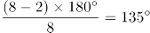，不能被360°整除。

B项正确，圆的每一条直径均相等，井盖设计为圆形，无论如何转动其直径长度都不变，因此不会掉下去。

C项正确，根据四色定理，只需要四种颜色就可以将平面地图都涂上颜色，且保证相邻两个区域颜色不同。

D项正确，正多面体要求必须是多个全等的正多边形组成，满足此要求的只有正四面体、正六面体、正八面体、正十二面体和正二十面体五种类型。

本题为选非题，故正确答案为A。

**来源**：2020年湖南公务员考试《行测》试题（网友回忆版）第10题

### 第 11 题

植物在自然环境中会遇到生物胁迫，比如食植动物和各种病原微生物的侵害，在进化过程中，植物发展了多种物理和化学防御机制。下列叙述中，不属于植物防御生物胁迫的是：

A. 玫瑰长刺

B. 睡莲长出宽大的叶子

C. 巨魔芋的花散发烂鱼臭虾似的臭气

D. 伞形科植物释放特殊气味吸引胡蜂捕食其体上的毛毛虫

第 11 题 · 答案与解析

**参考答案（粉笔题库参考内容）**

B

**解析**

本题考查科技常识。

A项正确，玫瑰是一种叶子嫩绿、多花的植物，而这种植物恰好是许多食草动物喜欢的食物，这便是玫瑰遇到的生物胁迫，为了不被动物吃掉，在进化过程中，玫瑰慢慢生出了又尖又硬的刺，属于物理防御机制。

B项错误，睡莲长出宽大的叶子是为了增大光合作用面积，更好的利用阳光进行光合作用，并非是为了应对生物胁迫。

C项正确，巨魔芋的花朵开放时，会发出阵阵恶臭，一方面是为了招引苍蝇、甲虫等帮助传粉，另一方面也让一些食草动物无法接近，更好的保护自己，属于化学防御机制。

D项正确，毛毛虫是伞形科植物遇到的生物胁迫，伞形科植物释放特殊气味吸引胡蜂捕食毛毛虫，属于化学防御机制。

本题为选非题，故正确答案为B。

**考点**：生物常识

**来源**：2020年湖南公务员考试《行测》试题（网友回忆版）第11题

### 第 12 题

随着地球环境的变迁，地球生物也随之不断演化。下列关于生物进化的表述正确的是：

A. 个体是生物进化的基本单位

B. 种群变异是生物进化的基础

C. 地理隔离是物种形成和进化的必要条件

D. 在生物进化中自然选择的作用是不定向的

第 12 题 · 答案与解析

**参考答案（粉笔题库参考内容）**

B

**解析**

本题考查科技常识。

A项错误，种群是生物进化的基本单位。生物进化的实质是种群基因频率的改变，个体发生有利的变异后，若不能遗传下来，这个变异也就结束，因此种群是生物进化的基本单位。

B项正确，遗传与变异是遗传现象中不可分离的两个方面，遗传和变异是对立的统一体，如果没有能遗传的变异，就不会产生新的生物类型，生物就不能由简单到复杂、由低等到高等地不断进化，遗传使物种得以延续，变异则使物种不断进化，遗传与变异是生物界普遍发生的现象，也是物种形成和生物进化的基础。

C项错误，隔离是物种形成的必要条件。隔离分生殖隔离与地理隔离，生殖隔离的形成往往先经过长期地理隔离，然后达到生殖隔离后就形成不同的物种。但物种的形成不一定经过地理隔离，如多倍体的形成。而生物进化与地理隔离没有必然联系，生物通过产生大量的样本增加变异的机率，因此繁殖过剩是生物进化的必要条件。

D项错误，在自然选择的作用下，具有有利变异的个体有更多的机会产生后代，种群中相应基因的频率会不断提高；相反，具有不利变异的个体留下后代的机会少，种群中相应基因的频率会下降。因此，在自然选择的作用下，种群的基因频率会发生定向改变，导致生物朝着一定的方向不断进化，因此生物的变异是不定向的，自然选择是定向的。

故正确答案为B。

**考点**：生物常识

**来源**：2020年湖南公务员考试《行测》试题（网友回忆版）第12题

### 第 13 题

西汉末巧工丁缓发明的“被中香炉”是世界上已知最早的常平支架，其构造精巧，使用时把燃烧的炭火放入香炉中心的火盆中，无论香炉如何滚动，香炉中心的火盆都能保持水平，炭火始终不会掉出来。下列装置的物理原理与之相同的是：

A. 指南针

B. 陀螺仪

C. 水平仪

D. 高度计

第 13 题 · 答案与解析

**参考答案（粉笔题库参考内容）**

B

**解析**

本题考查科技常识。

“被中香炉”的核心是万向支架结构，炉体由内外两层同心圆环支承，各支承轴互相垂直，炉体在重力作用下始终下垂，因此无论外壳如何滚动，中心火盆都能保持水平，炭火不会掉出。

A项错误，指南针是利用磁铁“同性相斥、异性相吸”的特性，与题干“被中香炉”原理不同。

B项正确，陀螺仪同样采用了万向支架结构。两者在结构上一致，均通过多层可转动支架使中心部件保持稳定方向。

C项错误，水平仪利用的是重力方向竖直向下（如气泡始终上浮至最高点）的原理，虽涉及重力，但不涉及万向支架结构。

D项错误，常见的高度计主要为气压高度计，利用气压差得出高度差，在3000m范围内，每升高12m，大气压减小1mmHg，与题干“被中香炉”原理不同。

故正确答案为B。

**考点**：物理常识

**来源**：2020年湖南公务员考试《行测》试题（网友回忆版）第13题

### 第 14 题

2019年12月4日，中共中央、国务院印发《关于营造更好发展环境支持民营企业改革发展的意见》，充分肯定了我国民营经济的地位和作用，提出了有力举措，为民营企业未来发展指明了方向。下列与之相关的说法错误的是：

A. 要进一步放开民营企业市场准入和实施公平统一的市场监管制度，保障民营企业平等获得资源要素

B. 民营企业在推动发展、促进创新、增加就业、改善民生和扩大开放等方面发挥了不可替代的作用

C. 支持民营企业发行债券，降低可转债发行门槛

D. 对民营企业实行公平竞争审查制度的软性约束

第 14 题 · 答案与解析

**参考答案（粉笔题库参考内容）**

D

**解析**

本题考查政治常识。

2019年12月4日，中共中央、国务院印发《关于营造更好发展环境支持民营企业改革发展的意见》（以下简称《意见》）。

A项正确，《意见》第二项，优化公平竞争的市场环境。（三）进一步放开民营企业市场准入······（四）实施公平统一的市场监管制度。深化要素市场化配置体制机制改革，健全市场化要素价格形成和传导机制，保障民营企业平等获得资源要素。

B项正确，《意见》中指出，改革开放40多年来，民营企业在推动发展、促进创新、增加就业、改善民生和扩大开放等方面发挥了不可替代的作用。民营经济已经成为我国公有制为主体多种所有制经济共同发展的重要组成部分。

C项正确，《意见》第三项，完善精准有效的政策环境。（九）完善民营企业直接融资支持制度。支持民营企业发行债券，降低可转债发行门槛。在依法合规的前提下，支持资管产品和保险资金通过投资私募股权基金等方式积极参与民营企业纾困。鼓励通过债务重组等方式合力化解股票质押风险。积极吸引社会力量参与民营企业债转股。

D项错误，《意见》第二项，优化公平竞争的市场环境。（五）强化公平竞争审查制度刚性约束。坚持存量清理和增量审查并重，持续清理和废除妨碍统一市场和公平竞争的各种规定和做法等。

本题为选非题，故正确答案为D。

**考点**：经济建设、重要文件

**来源**：2020年湖南公务员考试《行测》试题（网友回忆版）第14题

### 第 15 题

2019年，亚马孙雨林和澳大利亚东部丛林分别发生了严重的山火，对生态环境造成多方面影响。下列影响属于不可逆的是：

A. 当地生物种群数量的降低

B. 植物燃烧留下的有毒物质

C. 生物遗传多样性的丧失

D. 森林植被的破坏

第 15 题 · 答案与解析

**参考答案（粉笔题库参考内容）**

C

**解析**

本题考查科技常识。

根据对生态环境所造成影响程度的大小可以分为三种类型：一是不可逆转的影响，二是负面作用较大的影响，三是负面作用较小的影响。

A、D项错误，对于生物数量降低、森林植被的破坏，都是生物数量的减少，经过一段时间的生物繁殖可以得到恢复，不是不可逆的，属于负面作用较大的影响。

B项错误，对于植物燃烧留下的有毒物质，可以采取措施控制它的危害，且经过一段时间后有毒物质也会自然降解，不是不可逆的，属于负面作用较大的影响。

C项正确，亚马孙雨林和澳大利亚山火使大面积的森林被焚烧，超十亿野生动物因此丧生，有些物种很可能因此灭绝，造成生物种类多样性和遗传多样性的丧失，且丧失的物种和遗传特性是无法完全恢复的，属于不可逆的影响。

故正确答案为C。

**考点**：生物常识

**来源**：2020年湖南公务员考试《行测》试题（网友回忆版）第15题

### 第 16 题

现在，随着人们对橡胶认识的深入，橡胶技术也             ，不论是天然橡胶还是人工合成橡胶，都已经成为我们生活的必需品。没有一种原材料像橡胶这样，        了我们生活的方方面面：从家居日用品到体育娱乐制品，从医疗领域到军事工业，都随处可见橡胶制品的影子。

依次填入划横线部分最恰当的一项是：

A. 高歌猛进 总括

B. 日臻完善 囊括

C. 今非昔比 概括

D. 革故鼎新 包括

第 16 题 · 答案与解析

**参考答案（粉笔题库参考内容）**

B

**解析**

第一空，搭配“橡胶技术”，根据“随着人们对橡胶认识的深入”“不论是天然橡胶还是人工合成橡胶，都已经成为我们生活的必需品”可知，横线处表示橡胶技术不断提高，越来越好。B项“日臻完善”指一天天逐步达到完美的境地，C项“今非昔比”指现在不是过去所能比得上的，形容变化很大，均符合文意，保留。A项“高歌猛进”指高声歌唱，勇猛前进，形容在前进的道路上，充满乐观精神，侧重形容情绪高涨，与“橡胶技术”搭配不当，排除；D项“革故鼎新”泛指除去旧的，建立新的，文段并未指出去掉旧的，排除。

第二空，冒号进行解释说明，横线处表示我们生活的方方面面都有橡胶，B项“囊括”指包罗、席卷一切，符合文意，当选。C项“概括”指归纳、总括，把事物的共同特点归结在一起加以简明地叙述，与文意不符，排除。

故正确答案为B。

【文段出处】《橡胶改变世界》

**考点**：对应关系-前后呼应、混搭填空、对应关系-解释说明

**来源**：2020年湖南公务员考试《行测》试题（网友回忆版）第16题

### 第 17 题

研究需要            ，传播需要放下架子。中科院将物理公式和黑洞等天文现象艺术化设计后，做成了井盖涂鸦，颠覆了科学        的刻板印象，        其趣味性和人情味，推动了科学与艺术的结合，有利于科学传播以及科学氛围的形成。

依次填入划横线部分最恰当的一项是:

A. 专心致志 高雅 增强

B. 穷经皓首 严谨 赋予

C. 学而不厌 理性 给予

D. 锲而不舍 高冷 强化

第 17 题 · 答案与解析

**参考答案（粉笔题库参考内容）**

B

**解析**

第一空，横线处所填词语形容“研究”所需要的精神品质，A项“专心致志”指一心一意，集中精神；B项“穷经皓首”指直到年老头白还在钻研经书和古籍，形容勤勉好学，至老不倦；D项“锲而不舍”比喻做事情能坚持到底，不半途而废，也形容有恒心，有毅力，三项均能体现出“研究”应具备的精神品质，保留。C项“学而不厌”意思是学习没有满足的时候，比喻非常好学，用在此处修饰“研究”不恰当，排除。

第二空，横线处所填词语形容“科学”具有的特点，B项“严谨”指严密谨慎；D项“高冷”指高傲冷淡，这两项用在此处形容大众对科学的刻板印象，均恰当，保留。A项“高雅”指高尚，不粗俗，通常用来形容艺术，与“科学”搭配不当，排除。

第三空，横线处所填词语搭配“趣味性和人情味”，且由“中科院将物理公式和黑洞等天文现象艺术化设计后，做成了井盖涂鸦”可知，“科学与艺术”相结合给予了科学“趣味性和人情味”。D项“强化”指加强，文段并未出现科学已有一定趣味的内容，故“强化”与文意不符，排除。B项“赋予”指给予，井盖文化给予了科学“趣味性和人情味”，符合文意，当选。

故正确答案为B。

【文段出处】《中科院的“井盖涂鸦”，算亵渎科学吗》

**考点**：词的辨析-搭配对象、对应关系-前后呼应、混搭填空

**来源**：2020年湖南公务员考试《行测》试题（网友回忆版）第17题

### 第 18 题

尽管许多人相信宇宙的其他地方存在生命，但我们没有证据证明这一点。因此，重要的是要将所有生命都看作是        的，不管其大小、数量或位置。地球支持着宇宙中唯一        的生命。因此，无论太阳系或宇宙其他地方的生命形式如何，我们都必须确保它们        有害的污染——无论它们更接近地球生命，还是完全陌生的外星生命。

依次填入划横线部分最恰当的一项是：

A. 平等 确认 远离

B. 宝贵 已知 免受

C. 仅有 了解 避免

D. 珍稀 可知 免遭

第 18 题 · 答案与解析

**参考答案（粉笔题库参考内容）**

B

**解析**

第一空，横线处所填词语形容对生命的态度。根据“将所有生命都看作”可知，此处的“生命”可能不只一种，C项“仅有”的意思是只有一个，再没有别的，与文意不符，排除。根据“不管其大小、数量或位置”可知，其数量不一定很少，D项“珍稀”指珍贵而稀有，与文意不符，排除。A项“平等”泛指地位平等；B项“宝贵”指极有价值，这两项均符合文意，保留。

第二空，横线处所填词语搭配“生命”。A项“确认”指明确承认，地球上存在生命的事实，无须再“明确承认”，不符合文意，排除。B项“已知”指已经知道，符合文意，保留。

第三空，代入验证。横线处所填词语搭配“有害的污染”，B项“免受”指避免遭受的意思，与“污染”搭配恰当，当选。

故正确答案为B。

【文段出处】《看不见的外星人？地球也许存在着我们未知的生命形式》

**考点**：词的辨析-搭配对象、实词填空、对应关系-前后呼应

**来源**：2020年湖南公务员考试《行测》试题（网友回忆版）第18题

### 第 19 题

对人类而言，环境发挥着两方面的功能。一方面它是人类生存与发展的物质来源；另一方面它承受着各种人类活动所产生的        。这种功能决定了人类自身的活动越来越强烈地影响着环境的发展过程，因此，人类必须彻底地        利己主义，保护好环境，保持同环境和谐与协调的互利关系。

依次填入划横线部分最恰当的一项是：

A. 效果 唾弃

B. 结果 摒弃

C. 后果 扬弃

D. 恶果 遗弃

第 19 题 · 答案与解析

**参考答案（粉笔题库参考内容）**

B

**解析**

第一空，根据“各种人类活动”“影响着环境的发展过程”可知，此处为中性表达，人类活动带来的影响有好有坏，横线处应该填一个中性词，B项“结果”为中性词，符合文意，保留。 A项“效果”多指有某种力量、做法产生较好的结果，为积极感情色彩，排除；C项“后果”即有害的或不幸的结果，D项“恶果”即从恶事之因而生的苦果，均为消极感情色彩，排除。

第二空，代入验证，搭配“利己主义”，横线处表达人类必须放弃利己主义， B项“摒弃”即为了达到自己的目的抛弃一些东西，搭配恰当，符合语境，当选。

故正确答案为B。

【文段出处】《科学发展观与环境保护》

**考点**：词的辨析-感情色彩、实词填空

**来源**：2020年湖南公务员考试《行测》试题（网友回忆版）第19题

### 第 20 题

繁花盛开的季节，蜜蜂在姹紫嫣红之间辛勤劳作，如果你仔细观察一只蜜蜂的活动就会发现，蜜蜂对柑橘和咖啡的花朵仿佛着了魔一般，而对其他植物的花朵            ， 这是为什么呢？

填入划横线部分最恰当的一项是：

A. 旁若无人

B. 素不相识

C. 熟视无睹

D. 置若罔闻

第 20 题 · 答案与解析

**参考答案（粉笔题库参考内容）**

C

**解析**

文段通过“而”对前后的内容进行对比，横线处所填成语与前文“蜜蜂对柑橘和咖啡的花朵仿佛着了魔一般”语义相反，表达蜜蜂对其他植物的花朵应该是不在意、忽视的含义。C项“熟视无睹”形容对事物漫不经心或不重视，与文段语境相符，当选。A项“旁若无人”形容态度自然或高傲，文段强调的是蜜蜂只注意这一种花朵，对其他花朵不重视，与文意不符，排除；B项“素不相识”意思是向来不认识，文段强调的是不在意、忽视，而非不认识，与文意不符，排除；D项“置若罔闻”意思是放在一边，好像没有听见似的，指不去过问或不予关心，强调的是不听，蜜蜂表示对花朵不重视的方式是不看而非不听，排除。

故正确答案为C。

【文段出处】中国科学院-科普文章《蜜蜂为何单恋一枝花》

**考点**：成语填空、关联关系-转折关系

**来源**：2020年湖南公务员考试《行测》试题（网友回忆版）第20题

### 第 21 题

民族精神是衡量一个国家综合国力强弱的重要因素，是衡量一个民族有无凝聚力、向心力、战斗力的重要指标。一个国家重视民族精神的培养，就能凝心聚力、            ，各项事业就会             ；忽视民族精神的培养，只会             、消极颓废，各项事业都难以搞好。

依次填入划横线部分最恰当的一项是：

A. 奋发图强 一日千里 一盘散沙

B. 精神振奋 兴旺发达 人心涣散

C. 聚精会神 繁荣昌盛 离心离德

D. 精神抖擞 蒸蒸日上 分崩离析

第 21 题 · 答案与解析

**参考答案（粉笔题库参考内容）**

B

**解析**

第一空，横线处与“凝心聚力”构成并列结构，形容重视民族精神的培养所带来的好处， A项“奋发图强”指振作精神,努力工作,以谋求强盛；B项“精神振奋”指振作精神，奋发努力；D项“精神抖擞”形容精神振奋，饱满。三项均符合文意，保留。C项“聚精会神”形容专心致志，注意力高度集中的样子，常用于搭配具体的某事，如聚精会神地听课，与文段中“国家”“民族精神”搭配不当，排除。

第二空，根据“民族精神是······重要因素·······重要指标”可知，国家重视培养民族精神后，各项事业就会发展得很好，A项“一日千里”比喻进展极快；B项“兴旺发达”指事物或事业充分发展、欣欣向荣的景象；D项“蒸蒸日上”比喻事情蓬勃发展，日日都有进步，均符合文意，保留。

第三空，横线处与“消极颓废”构成近义并列，B项“人心涣散”形容人心不齐，与“消极颓废”语意相近，且可以作为不注重民族精神培养的结果，当选。A项“一盘散沙”比喻涣散不团结或力量分散没有组织起来，相较于“人心涣散”缺少“人心”这一重要主语，导致前后衔接不够准确，排除；D项“分崩离析”形容国家或集团四分五裂，这一后果程度过重，且与后文“消极颓废”的并列不够准确，排除。

故正确答案为B。

【文段出处】《光明日报--厚植家国情怀 培育精神家园》

**考点**：词的辨析-搭配对象、成语填空、关联关系-并列关系

**来源**：2020年湖南公务员考试《行测》试题（网友回忆版）第21题

### 第 22 题

旧中国“老京张”铁路的修建可谓            。由于八达岭段坡度较大，施工装备有限，投入经费不足，工人靠肩挑手凿才打通了长度仅一公里的八达岭隧道。而“新京张”铁路的修建配备最大台车、最智能盾构机、最快铺轨机，全周期智能建造、智能运维，12公里的新八达岭隧道内更建成了埋深102米的“世界最深高铁站”。施工装备与建造技术之变，正是中国        建造强国的生动缩影。

依次填入划横线部分最恰当的一项是：

A. 步履维艰 跻身

B. 艰苦奋斗 变身

C. 困难重重 侧身

D. 举步艰难 置身

第 22 题 · 答案与解析

**参考答案（粉笔题库参考内容）**

A

**解析**

第一空，根据文段信息“由于八达岭段坡度较大，施工装备有限，投入经费不足，工人靠肩挑手凿才打通了长度仅一公里的八达岭隧道”可知，“老京张”铁路修建难度大。B项“艰苦奋斗”指不怕艰难困苦，坚持英勇斗争，与“铁路”搭配不当，排除。A项“步履维艰”指行走困难行动不方便，可体现事情进行不顺利，很艰难；C项“困难重重”指一个困难接着一个困难；D项“举步艰难”比喻办事情每向前进行一步都十分不容易，均能体现“老京张”铁路修建难度大，保留。

第二空，根据文意可知，由新旧京张铁路的历程，反映了中国技术的腾飞，现在的中国已成为建造强国。A项“跻身”指使自己上升到（某种行列、位置等），与文段对应恰当，当选。C项“侧身”指（向旁边）歪斜身体，D项“置身”指把自己放在，存身（于），均体现不出置身于好的行列，排除。

故正确答案为A。

【文段出处】《从“新京张”看百年巨变》

**考点**：对应关系-前后呼应、混搭填空

**来源**：2020年湖南公务员考试《行测》试题（网友回忆版）第22题

### 第 23 题

病毒的故事或许还要从远古说起。在那个            的地球上，海洋占据了世界的绝大部分，而无垠的大海之下是数亿年            的火山活动。在某些            之下，海水中产生了史上第一批有机大分子，从而点燃了生命的星星之火。

依次填入划横线部分最恰当的一项是：

A. 病入膏肓 动荡不安 阴差阳错

B. 死气沉沉 经天纬地 不期而遇

C. 了无生机 连绵不断 机缘巧合

D. 奄奄一息 接踵而至 逢机遘会

第 23 题 · 答案与解析

**参考答案（粉笔题库参考内容）**

C

**解析**

第一空，所填词语用来形容“地球”，根据后文“海水中产生了史上第一批有机大分子”可知，之前的地球是没有生命存在、没有生机的。B项“死气沉沉”指气氛不活泼，也形容人精神消沉，不振作，C项“了无生机”指一点生命的活力都没有，均符合地球没有生命气息的文意，保留。A项“病入膏肓”指病情特别严重，无法医治，D项“奄奄一息”比喻事物即将消亡、湮没或毁灭，文中没有描述地球面临重大问题、即将毁灭的状态，均排除。

第二空，搭配“火山活动”，B项“经天纬地”形容人的才能极大，能做非常伟大的事业，搭配不当，排除。C项“连绵不断”指连续不止，一直都不中断，与“火山活动”搭配恰当，且能与“数亿年”形成对应，符合文意，保留。

第三空，代入验证，C项“机缘巧合”指特殊的缘分，巧妙地融合遇到，在一起，符合地球在偶然间产生第一批有机大分子之意，当选。

故正确答案为C。

【文段出处】《病毒从哪里来》

**考点**：词的辨析-搭配对象、对应关系-前后呼应、成语填空

**来源**：2020年湖南公务员考试《行测》试题（网友回忆版）第23题

### 第 24 题

防控疫情，应该多一些“小题大做”的        意识。小题大做，不是无理取闹，更不是渲染紧张气氛，而是体现出对疫情的        ，以及对防控疫情的重视。

依次填入划横线部分最恰当的一项是：

A. 警惕 戒备

B. 大局 防御

C. 敏锐 监测

D. 谨慎 预判

第 24 题 · 答案与解析

**参考答案（粉笔题库参考内容）**

A

**解析**

第一空，对应“小题大做”，“小题大做”本意指把小事当作大事来处理，可以体现出防控疫情要十分严谨、小心。A项“警惕”是指对可能发生的危险情况或错误倾向保持敏锐的感觉，D项“谨慎”指对外界事物或自己言行密切注意，以免发生不利或不幸的事情，均符合文意，保留。B项“大局”指整个局势，整个局面，文段并无体现，排除；C项“敏锐”指反应灵敏，头脑灵活，目光尖锐，不能体现“严谨、小心”之意，排除。

第二空，横线处与“重视”意思相近，指“小题大做”，可以体现出对疫情重视的态度。A项“戒备”指警惕防备以应不测，符合文意，当选。D项“预判”指对即将到来的事进行判断，不能体现对疫情的防备和重视，排除。

故正确答案为A。

【文段出处】《疫情面前要算大账，不为一己私利，才可能切实抓好防控》

**考点**：实词填空、对应关系-前后呼应、对应关系-主题词

**来源**：2020年湖南公务员考试《行测》试题（网友回忆版）第24题

### 第 25 题

“新鲜”与“创新”，二者有一字之别却            。当今，一些篆刻家努力创作出某些颇为“新鲜”的作品，它们也许是“创新”的前奏，却缺乏艺术土壤的滋养，必会            而凋谢。

依次填入划横线部分最恰当的一项是：

A. 相去甚远 昙花一现

B. 毫无二致 烜赫一时

C. 大相径庭 电光火石

D. 各有千秋 稍纵即逝

第 25 题 · 答案与解析

**参考答案（粉笔题库参考内容）**

A

**解析**

第一空，根据“却”字可知前后文语义相反，前文“一字之别”表达两者差距很小，故横线处所填词语要体现出两者差距很大之意，A项“相去甚远”，C项“大相径庭”均可表达差距很大之意，保留。B项“毫无二致”表达丝毫没什么两样，与文意相悖，排除；D项“各有千秋”强调各有所长，各有优点，各自有特色，与差距大小无关，排除。

第二空，根据“却”转折可知，文段表达“新鲜”的作品也许是“创新”的前奏，但最终依然不是创新，不能被保留下来，很快就会消失，A项“昙花一现”比喻稀有的事物或显赫一时的人物出现不久就消逝，与文意相符，且与文段“艺术土壤的滋养”及“凋谢”形象表达对应恰当，当选；C项“电光火石”现多形容事物像闪电和石火一样一瞬间就消失，在形容时间时往往用为“电光火石间”，此处用法不当，且与文段“艺术土壤的滋养”及“凋谢”形象表达的对应不及“昙花一现”准确，排除。

故正确答案为A。

【文段出处】《保持艺术新鲜度》

**考点**：成语填空、关联关系-转折关系

**来源**：2020年湖南公务员考试《行测》试题（网友回忆版）第25题

### 第 26 题

社交裂变简单点来说就是病毒式传播，爆款单品能在短时间内        最多用户，平台也由此获得大量用户和粉丝。获客成本高成为传统电商增长的瓶颈，以人和内容为核心的社交平台，利用用户自身的社交关系网络，能够更快地实现商品和用户        ，自然就被当做商品营销的新渠道。

依次填入划横线部分最恰当的一项是：

A. 成就 碰撞

B. 催生 融合

C. 捕捉 适配

D. 抵达 连接

第 26 题 · 答案与解析

**参考答案（粉笔题库参考内容）**

D

**解析**

第一空，搭配“用户”，结合后文，平台也由此获得大量用户和粉丝，可以看出横线处指爆款单品能够让用户了解、吸引用户。D项“抵达”指到达，在文中指被用户看到、了解，符合文意，保留。A项“成就”指造就成全，一般指辅助对方获得成绩，不符合文意，排除；B项“催生”指催产、助产或促使事物发生或形成，排除；C项“捕捉”指捉拿、缉拿，与“用户”搭配不当，且通过“社交裂变简单点来说就是病毒式传播”可知，病毒没有捕捉的功能，瞻前顾后“捕捉”不符合，排除。

第二空，代入验证，D项“连接”指相互衔接、相连，在文中指借助社交平台使用户能够直接了解商品、商品也能够直接推销到用户面前，对应后文的“渠道”，符合文意，当选。

故正确答案为D。

【文段出处】《盘点微信小程序裂变玩法，分分钟告别流量困扰！》

**考点**：词的辨析-搭配对象、实词填空、对应关系-前后呼应

**来源**：2020年湖南公务员考试《行测》试题（网友回忆版）第26题

### 第 27 题

中国长城是在农耕民族和游牧民族的分界线上耸立起来的，这条分界线随着双方力量的            ，在不同历史时期就像改道的黄河一样，在大地上留下深浅不一的痕迹：有的        如巨龙蜿蜒，有的湮灭如草蛇灰线。

依次填入划横线部分最恰当的一项是：

A. 变幻莫测 连绵

B. 斗转星移 盘旋

C. 此消彼长 清晰

D. 日异月殊 交错

第 27 题 · 答案与解析

**参考答案（粉笔题库参考内容）**

C

**解析**

第一空，横线处修饰“双方力量”，根据文段信息“中国长城是在农耕民族和游牧民族的分界线上耸立起来的”“留下深浅不一的痕迹”可知，形成长城的“双方力量”应当有变化，C项“此消彼长”指这个下降，那个上升，与文段对应恰当，保留。A项“变幻莫测”指事物变化多端，难以预测，B项“斗转星移”指季节或时间的变化，D项“日异月殊”形容变化大，均仅能体现变化，但无法表现“双方力量”，排除。

第二空，横线处是对“深浅不一的痕迹”进行的解释说明。“草蛇灰线”比喻事物留下隐约可寻的线索和迹象，“有的湮灭如草蛇灰线”体现出有的长城破败，仅留下模糊的痕迹，对应“浅”，故横线处应当对应“深”，体现出留下清楚的痕迹，C项“清晰”符合文意，当选。A项“连绵”指（山脉、河流、雨雪等）接连不断，B项“盘旋”指环绕着飞或者走，D项“交错”指交叉、错杂，均与“深浅”对应不当，排除。

故正确答案为C。

【文段出处】《世界有多少长城》

**考点**：对应关系-前后呼应、混搭填空、对应关系-解释说明

**来源**：2020年湖南公务员考试《行测》试题（网友回忆版）第27题

### 第 28 题

这一片花海，随四季不同而栽培，每个季节都有十几种花卉        。远离城市        ，回归大自然的宁静，让人诗意地        ，微风拂过，花香撩起的情丝，不知拨动过多少人的心弦。

依次填入划横线部分最恰当的一项是：

A. 开放 喧闹 安居

B. 盛放 喧哗 隐居

C. 绽放 喧嚣 栖息

D. 怒放 喧嚷 歇息

第 28 题 · 答案与解析

**参考答案（粉笔题库参考内容）**

C

**解析**

第一空搭配“花卉”，四个词语均可，因此可从第二空判断，第二空搭配“城市”，且与后文“大自然的宁静”对应，说明城市环境不安静。A项“喧闹”和C项“喧嚣”均可用来形容环境不安静，比较吵闹之意，用在此处形容城市环境不安静，符合文意，保留。B项“喧哗”指大声说笑或叫喊，D项“喧嚷”指大声地叫，两词多用来形容具体的声音，一般不形容整体的环境，用于此处形容城市的环境不恰当，排除。

第三空，对应文段中“远离城市”“回归大自然的宁静”“微风拂过，花香撩起的情丝”，可知停留此处让人很舒适。C项“栖息”指歇息、暂住，置于文段可表达人们在花海中诗意地歇息，符合文意，当选。A项“安居”指安定地生活、定居，文段并未体现在花海之中定居之意，排除。

故正确答案为C。

【文段出处】《留在心尖上的花朵》

**考点**：实词填空、对应关系-前后呼应

**来源**：2020年湖南公务员考试《行测》试题（网友回忆版）第28题

### 第 29 题

无论经历多少艰难、付出多大牺牲，都不能忘了为什么出发，不能忘了肩负的使命任务，始终信念如磐、意志如铁、            ，做到“千磨万击还坚劲，任尔东西南北风”。在见世面中强大内心，既能容得下征途顺利时的春风得意，谦虚谨慎、再接再厉、再创佳绩，也能容得下前进受挫时的            ，淡定从容、            、不言放弃，做到“不管风吹浪打，胜似闲庭信步”。

依次填入划横线部分最恰当的一项是：

A. 不忘初心 苦心孤诣 积极进取

B. 初心不改 沉重打击 乐观向上

C. 牢记使命 困难挫折 开朗乐观

D. 使命担当 艰苦磨难 力争上游

第 29 题 · 答案与解析

**参考答案（粉笔题库参考内容）**

B

**解析**

第一空，根据顿号可以看出，横线处填入的成语与信念如磐，意志如铁构成并列有非常坚定的语义，根据前文“不能忘了为什么出发”“ 不能忘了肩负的使命任务”可知，A项“不忘初心”、B项“初心不改”、C“牢记使命”，均符合文意，保留；D项“使命担当”中的担当文段中没有体现；排除。

第二空，根据“受挫时”可知横线，所填词语体现出遇到挫折困难时的状态。B项“沉重打击”与文段对应恰当，保留。A项“苦心孤诣”意为费尽心思钻研或经营,感情色彩积极，与文段不符，排除。C项的“困难挫折”与受挫构成语义重复；排除；

验证第三空B项“乐观向上”填入文段与后文“不管风吹浪打，胜似闲庭信步”形成对应，符合文意，当选。

故正确答案为B。

【文段出处】《坚持在重大斗争中摔打磨砺》

**考点**：对应关系-前后呼应、成语填空

**来源**：2020年湖南公务员考试《行测》试题（网友回忆版）第29题

### 第 30 题

只要是创新，就会突破一些条条框框，往往越是重大的创新，对传统标准的        也会越大。我们鼓励创新，就不能把所有的现行技术标准都当成            ，而要一定程度上允许新技术去挑战某些旧的标准，只有这样，才不会让旧的标准成为阻挡创新的绊脚石。

填入横线处最恰当的一组词是：

A. 修正 理所当然

B. 冲击 金科玉律

C. 超越 天经地义

D. 调整 不易之论

第 30 题 · 答案与解析

**参考答案（粉笔题库参考内容）**

B

**解析**

第一空，根据文段信息“只要是创新，就会突破一些条条框框”，说明此处也应体现创新会打破传统标准之意，并且横线处体现的是“重大的创新”对于“传统标准的影响”，可知此处所填词语程度较重。B项“冲击”指冲拍撞击；C项“超越”指超过、胜过，均可体现出打破、突破之意，保留。A项“修正”指改正错误使之正确，文段并非是改正错误，排除；D项”调整“指重新调配整顿，使适应新的情况和要求，无法体现打破、突破之意，程度较轻，排除。

第二空，搭配“标准”，且体现不允许挑战、改动之意，B项“金科玉律”比喻必须遵守、不能变更的信条，搭配恰当，当选。C项“天经地义”指绝对正确,不能改变的道理，也指理所当然的事，常搭配道理、事件，与“标准”搭配不当，排除。

故正确答案为B。

【文段出处】《人民日报观象台：创新需要智慧和勇气》

**考点**：词的辨析-搭配对象、词的辨析-程度轻重、对应关系-前后呼应、混搭填空

**来源**：2020年湖南公务员考试《行测》试题（网友回忆版）第30题

### 第 31 题

有些作家，他们笔尖触动的生活与人性之深，文字创造力之强，令人吃惊。待到人们去        去议论，他们又不声不响扎到什么地方去了。惟有这样才能写出真正        社会人生的作品来。

依次填入划横线部分最恰当的一项是：

A. 捧读 知悉

B. 拜读 熟悉

C. 研读 获悉

D. 品读 洞悉

第 31 题 · 答案与解析

**参考答案（粉笔题库参考内容）**

D

**解析**

本题可从第二空入手。第二空，搭配“社会人生”，D项“洞悉”即以敏锐的洞察力辨别，用在此处搭配恰当，且与“他们笔尖触动的生活与人性之深”形成对应，保留。A项“知悉”即知道、了解，通常搭配为“知悉情况”、“知悉流程”；B项“熟悉”即了解得清楚，通常搭配为“熟悉工作”、“熟悉业务”；C项“获悉”即得到消息，通常用法为“从······获悉”，均与“社会人生”搭配不当，且体现不出了解的深入之意，排除。

第一空代入验证，“品读”填入文段搭配恰当，符合语境，当选。

故正确答案为D。

【文段出处】《作家是最沉得住气的一群人》

**考点**：词的辨析-搭配对象、实词填空、对应关系-前后呼应

**来源**：2020年湖南公务员考试《行测》试题（网友回忆版）第31题

### 第 32 题

数学是世界各个地方、各个民族最先发展起来的精密科学。以《九章算术》为代表的中国传统数学，同以几何为代表的古希腊数学            ，有如两颗璀璨的明珠在世界的东方和西方            。

依次填入划横线部分最恰当的一项是：

A. 各有千秋 交相辉映

B. 平分秋色 相映成趣

C. 半斤八两 一唱一和

D. 势均力敌 遥相呼应

第 32 题 · 答案与解析

**参考答案（粉笔题库参考内容）**

A

**解析**

第一空，应表达中国传统数学和古希腊数学的关系，根据文段信息“有如两颗璀璨的明珠”可知，两者均有重要价值。A项“各有千秋”强调各有所长，各有优点，各自有特色，B项“平分秋色”比喻双方各得一半，不分上下，均符合题意，保留。C项“半斤八两”，比喻彼此一样，不相上下，多为贬义，感情色彩不符，排除；D项“势均力敌”指双方势力相当，不分高下，用于对抗、竞争的语境，文段并未体现中国传统数学和古希腊数学两者在竞争、对抗，与文意不符，排除。

第二空，根据文段信息“有如两颗璀璨的明珠”可知，文段将中国传统数学和古希腊数学比作“明珠”，A项“交相辉映”意指各种光亮、色彩等互相映照，与“明珠”形成对应，当选。B项“相映成趣”指相互衬托着，显得很有趣味，很有意思，文段并未体现“趣味”，排除。

故正确答案为A。

【文段出处】《科学网--留存与弘扬中国的数学基因》

**考点**：对应关系-前后呼应、成语填空、对应关系-形象表达

**来源**：2020年湖南公务员考试《行测》试题（网友回忆版）第32题

### 第 33 题

大自然的            创造了光这个神奇的东西，因为光，我们能去感受这个斑斓的世界。光有着绚丽的色彩，而其中最为神奇的要数绿光了。尽管            的世界里到处都能看到绿色，但是植物的绿色属于反射光，植物本身并不是绿光源。

填入横线处最恰当的一组词是：

A. 鬼斧神工 五彩缤纷

B. 巧夺天工 五颜六色

C. 天造地设 万紫千红

D. 匠心独运 姹紫嫣红

第 33 题 · 答案与解析

**参考答案（粉笔题库参考内容）**

A

**解析**

第一空，搭配“大自然”，指非人力所为。A项“鬼斧神工”形容艺术技巧高超，不是人力所能达到的，与“大自然”搭配恰当，符合文段语境，保留；B项“巧夺天工”指精巧的人工胜过天然，形容技艺极其精巧，形容人工的事物，不能搭配“大自然”，排除；C项“天造地设”指自然形成而合乎理想，“造”指制作、创造，与横线后“创造”一词表述重复，排除；D项“匠心独运”指独创性地运用精巧的心思，形容文学艺术等方面构思巧妙，与“大自然”搭配不当，排除，初步确定A项。

第二空，代入验证，A项“五彩缤纷”指颜色繁多，色彩绚丽，十分好看的样子，与后文“绿色”对应，强调在多彩的世界中绿色到处可见，语意相符，当选。

故正确答案为A。

【文段出处】《寻找大自然中神秘的绿光》

**考点**：词的辨析-搭配对象、对应关系-前后呼应、成语填空

**来源**：2020年湖南公务员考试《行测》试题（网友回忆版）第33题

### 第 34 题

从结绳记事到竹简纸张，从计算机存储到光盘刻录，人类从未停止        更加高效便捷的信息存储方式，信息存储方式的变革很大程度上也        着我们获取信息和认知世界的方式。

依次填入划横线部分最恰当的一项是：

A. 追求 塑造

B. 追逐 制造

C. 探求 创造

D. 探究 缔造

第 34 题 · 答案与解析

**参考答案（粉笔题库参考内容）**

A

**解析**

第一空，根据文段信息“从结绳记事到竹简纸张”、“从计算机存储到光盘刻录”可知，我们一直在让我们的信息存储方式更加高效便捷，故横线处应表示“努力达到某种目的”、“想要”之意，A项“追求”表达通过行动达到某种目的，B项“追逐”表达积极追寻，C项“探求”意为探索寻求，均与文段对应恰当，保留。D项“探究”意为探索研究，文中并无研究之意，与文意不符，排除。

第二空，前文搭配“信息存储方式的变革”，后文搭配“我们获取信息和认知世界的方式”，表达信息存储方式的变革对我们获取信息和认知世界方式有重大影响之意，A项“塑造”强调通过培养、改造使人或事物达到某种预定的目标，当选。B项“制造”往往搭配“装备”“机器”等具体事物，且“制造”的主体多为人，与前文“信息存储方式的变革”搭配不当，排除；C项“创造”重在强调首次做出或建立，强调开创性，而我们获取信息和认知世界的方式是始终存在的，并非首次开创，排除。

故正确答案为A。

【文段出处】《数字存储打开想象空间》

**考点**：词的辨析-搭配对象、实词填空、对应关系-前后呼应

**来源**：2020年湖南公务员考试《行测》试题（网友回忆版）第34题

### 第 35 题

人类命运共同体，顾名思义，就是每个民族、每个国家的前途命运都紧紧联系在一起，应该            、荣辱与共，努力把我们生于斯、长于斯的这个星球建成一个和睦的大家庭，把世界各国人民对美好生活的向往变成现实。

填入划横线部分最恰当的一项是：

A. 风流云散

B. 风雨同舟

C. 如影随形

D. 通同一气

第 35 题 · 答案与解析

**参考答案（粉笔题库参考内容）**

B

**解析**

横线后出现顿号，表示同义并列，所填成语与“荣辱与共”语义相近，表示构建人类命运共同体的做法，“荣辱与共”的意思是光荣与耻辱共同分享与承担。B项“风雨同舟”指在狂风暴雨中同乘一条船，一起与风雨搏斗，比喻共同经历患难，与“荣辱与共”语义一致，当选。A项“风流云散”比喻原来在一起的人四下离散，与文意相悖，排除；C项“如影随形”比喻两个事物关系密切或两个人关系密切不能分离，体现不出共同经历患难之意，且文段强调的是“共同体”“大家庭”“各国人民”，并非两个对象的关系，排除；D项“通同一气”的意思是串通在一起，与文段感情色彩不符，排除。

故正确答案为B。

【文段出处】《人类命运共同体：维护世界和平与发展的“中国方案”》

**考点**：成语填空、关联关系-并列关系

**来源**：2020年湖南公务员考试《行测》试题（网友回忆版）第35题

### 第 36 题

重大疫情面前，及时发布权威信息，公开透明回应群众关切，能够有效解决信息不对称的问题，压减谣言等虚假信息传播空间，更好地维护社会大局稳定。一段时间以来，有关部门和相关机构及时发布确诊、疑似、治愈和病亡人员数据，一些互联网企业运用大数据、云计算、可视化技术，推出“实时疫情动态”“疫情地图”“同乘患者查询系统”“发热门诊地图”等产品，同步普及科学防护知识，有效满足了民众的信息需求，引导群众理性看待疫情，增强自我防范意识和防护能力。

这段文字意在强调：

A. 信息公开透明有助于疫情防护

B. 利用技术手段增强自我防护能力

C. 利用技术手段普及科学防护知识

D. 信息公开透明满足了人民信息需求

第 36 题 · 答案与解析

**参考答案（粉笔题库参考内容）**

A

**解析**

文段开门见山提出对策 “及时发布权威信息，公开透明回应群众关切”，并阐述对策带来的意义。接着列举“有关部门和相关机构”以及“一些互联网企业”的具体事例，进行解释说明，故整个文段为“总分”结构，首句的对策句即为中心句，对应A项。

B项和C项，“利用技术手段”，是后文分述句的内容，非重点，均排除；

D项，信息公开透明是为了有效引导群众抗击疫情，该项未包含核心话题“疫情”，排除。

故正确答案为A。

【文段出处】《防控疫情要用好大数据》

**考点**：分述句特征-其他

**来源**：2020年湖南公务员考试《行测》试题（网友回忆版）第36题

### 第 37 题

智慧城市在带动城市产业发展、转变城市发展模式、推动城市精细化治理等方面具有优势，而且能够在人口、空间、人工智能等方面发挥组合效应，带动政府各部门、城市居民、社会力量共同参与，                    。例如，深圳市确定了智能交通总体框架，既为治堵工作提供了精准的支撑，又通过互联网民意平台，推动了交通治理的共享共治。

填入划横线部分最恰当的一项是：

A. 有助于打造共建共治共享的社会治理格局

B. 有助于撬动社会治理智能化和法治化支点

C. 形成信息早掌握、问题早解决的良好局面

D. 有助于加强信息基础设施的网络安全防护

第 37 题 · 答案与解析

**参考答案（粉笔题库参考内容）**

A

**解析**

横线出现在文段中间，需要结合前后文内容进行分析。前文论述了智慧城市在城市治理方面具有诸多优势，接着“而且”论述智慧城市可以发挥组合效应，带动各个主体共同参与。后文通过“深圳市确定了智能交通总体框架”的例子，论述了智能交通带来的两方面意义，既为治堵工作提供了帮助，又推动了交通治理的共享共治。故结合例子，横线处应论述智慧城市通过带动多个社会主体，实现对城市治理工作的共享共治，对应A项。

B项“法治化”、C项“信息早掌握、问题早解决”、D项“信息基础设施的网络安全防护”均与文段论述的智能城市带来的“共享共治”话题不一致，排除。

故正确答案为A。

【文段出处】《人民日报新论：依托智慧城市推进治理升级》

**考点**：横线在中间

**来源**：2020年湖南公务员考试《行测》试题（网友回忆版）第37题

### 第 38 题

①“适度距离”不单是居住空间上的物理距离，也是心理上的“代际距离”。

②个性解放、知识快速更新和年轻一代的经济独立不断冲击着传统家长权威。

③当年轻人与父辈的价值观念和行为方式难以快速趋同时，保持适度距离是确保良性代际互动的前提。

④在社会转型进程中，中国的家庭结构经历着革命式变迁。

⑤有学者提出，两代人的居住格局应保持“一碗汤的距离”，既要让子代和父代有各自的独立空间，又要维系家庭成员之间的亲密关系。

⑥不同价值观念和行为方式在同一时空并存的环境下，代际之间的适度空间和社会距离是彼此有效沟通与和谐共处的基本条件之一。

将以上6个句子重新排列，语序正确的一项是：

A. ⑤①③④②⑥

B. ②⑥③④①⑤

C. ④②⑥③⑤①

D. ⑥③⑤④①②

第 38 题 · 答案与解析

**参考答案（粉笔题库参考内容）**

C

**解析**

观察选项，②④⑤⑥充当首句，对比这四句话，②句指出年轻一代冲击家长权威，提出问题，④句提出中国家庭结构发生变迁这一观点，根据文意可知②句是对④句中国结构的变迁这一观点进行原因的解释说明，因此④句应该在②句的前面，排除B项。接下来⑤句学者通过“应”提对策，逻辑顺序应该是先提出问题然后给出对策，因此不适合放在首句，排除A项；并且对比⑤②这两句话，②句是提出问题，⑤句是给出对策，故②句在⑤句的前面，排除D项。

故正确答案为C。

【文段出处】光明日报《春节，代际弥合好时机》

**考点**：确定顺序

**来源**：2020年湖南公务员考试《行测》试题（网友回忆版）第38题

### 第 39 题

隐球菌首先通过肺部感染侵入人体，而后蔓延至包括大脑在内的其他各处器官，可导致胸痛、干咳、腹部肿胀、头痛、视力模糊等症状。其中，隐球菌性脑膜炎最为严重，如治疗不及时，约有86%的患者可能在一年内死亡；即使在目前已有多种药物治疗的情况下，其死亡率仍保持在40%至65%。更可怕的是，在那些幸免于死的病人中，部分患者还可能留下失明、听力障碍、偏瘫、头痛、下肢肌肉萎缩等后遗症，其致残率约为20%。

这段文字主要介绍的是：

A. 隐球菌病的症状明显

B. 隐球菌病的死亡率高

C. 隐球菌病的后遗症多

D. 隐球菌病的危害性大

第 39 题 · 答案与解析

**参考答案（粉笔题库参考内容）**

D

**解析**

文段开篇介绍隐球菌如何进入人体以及所带来的症状，引出隐球菌话题，然后通过程度词“最”表示其所带来的疾病十分严重，后文通过一系列数据，对于为什么说疾病严重进行解释说明，故文段重在强调隐球菌所带来的疾病危害性非常大，对应D项。

A项，“症状明显”对应首句引出话题，并非文段重点，排除；

B项，“死亡率高”对应文段“如治疗不及时，约有86%的患者可能在一年内死亡”，为解释说明的一部分，表述片面且非文段重点，排除；

C项，“后遗症多”对应文段“在那些幸免于死的病人中，部分患者还可能留下失明、听力障碍、偏瘫、头痛、下肢肌肉萎缩等后遗症”，为解释说明的一部分，表述片面且非文段重点，排除。

故正确答案为D。

【文段出处】《破解“木乃伊诅咒”之谜，揭示夺命真菌-生物通》

**考点**：分述句特征-数据资料

**来源**：2020年湖南公务员考试《行测》试题（网友回忆版）第39题

### 第 40 题

①实际上，根据闪电发生时的电量密度、空气密度以及电压变化等，可以估算闪电（包括非发光区域在内的闪电）约粗1至40米。

②最长闪电甚至可以长达数百千米，这么长，这么细，怪不得我们常说“瘦成一道闪电”呢。

③但是通过观测闪电的发光部分，可以判断其直径约为3至23厘米。

④闪电发生时，常常呈现出明亮的闪电通路。

⑤从闪电灼烧形成的地面坑洼直径来看，闪电的能量集中区域不足5厘米，但闪电的长度变化较大，从数百米到数千米不等。

将以上5个句子重新排列，语序正确的一项是：

A. ④①③⑤②

B. ①④③②⑤

C. ⑤③①④②

D. ②⑤③①④

第 40 题 · 答案与解析

**参考答案（粉笔题库参考内容）**

A

**解析**

首先对比选项，判断首句。①句通过“实际上”强调“可以估算闪电（包括非发光区域在内的闪电）约粗1至40米”，为关联词的后半部分，不适合作为首句，排除B项。②句介绍最长的闪电的特征，根据“甚至”可知，为递进关系的后半部分，之前有关于闪电长度的内容，不适合作为首句，排除D项；又根据⑤句介绍闪电发生后，根据灼烧地面坑洼直径判断闪电能量集中区域的范围，而④句介绍“闪电发生”时的情景，按照时间顺序④句应在⑤句前，排除C项。

故正确答案为A。

【文段出处】《雷电知多少？》

**考点**：确定首句-非首句特征、确定顺序

**来源**：2020年湖南公务员考试《行测》试题（网友回忆版）第40题

### 第 41 题

VR技术是Virtual Reality（虚拟现实技术）的英文缩写，近年来，我国的VR技术不断发展，并在医疗、教育、智能制造等行业中得到广泛的运用。5G网络会大大提升虚拟现实体验的仿真度、沉浸感和交互性，这将促进虚拟现实产业的进一步发展。

文末划横线的“这”指的是：

A. 中国VR技术的不断发展

B. VR技术在各行各业中的运用

C. 5G网络所带来的更完美感受

D. 5G网络商用范围的扩大

第 41 题 · 答案与解析

**参考答案（粉笔题库参考内容）**

C

**解析**

根据提问方式，本题为词句理解题，应定位代词的位置，去前文查找指代的内容。文段开篇引入VR技术这一话题，并介绍了VR技术，即虚拟现实技术，在我国的发展和应用。后指出5G网络可给虚拟现实体验更好的感受，再结合“这将促进虚拟现实产业的进一步发展”，故能促进虚拟现实产业的进一步发展的应当是“5G网络所带来的更完美感受”，对应C项。

A、B两项，都是引入话题之后背景铺垫的内容，且后文“促进虚拟现实产业的进一步发展”应该是强调5G对虚拟现实产业的促进作用，均没有提到核心话题5G，排除。

D项，属于无中生有，排除。

故正确答案为C。

**考点**：代词

**来源**：2020年湖南公务员考试《行测》试题（网友回忆版）第41题

### 第 42 题

就青少年网络成瘾这个社会心理痼疾，社会各界一直在努力寻找对策。相关科学研究从生物医学、心理学和社会学等不同角度阐释了游戏成瘾的生成机理并寻求相应的干预治理机制。生化科学家从生物医学角度研究发现，游戏成瘾应作为一种大脑神经多巴胺系统疾病开展治疗；心理学家从大量案例研究中揭示了游戏成瘾大多来源于缺陷人格、认知偏离、平衡内心世界和外界现实冲击的特定防御机制；社会学研究则关注游戏成瘾行为背后的国家政策、社会环境、家庭教育、亲子关系、学校教学、社会交往方式及重要的生活事件环境因素等。

接下来作者最有可能讲述的是：

A. 生化科学家研发治疗青少年网瘾的药物

B. 心理学家提出解决青少年网瘾的对策

C. 社会学家分析青少年网瘾问题的成因

D. 社会各界如何解决青少年网瘾问题

第 42 题 · 答案与解析

**参考答案（粉笔题库参考内容）**

D

**解析**

该题为接语选择题。文段开篇指出社会各界一直在寻找针对青少年网络成瘾的解决对策，接下来从生化科学、心理学、社会学三个不同角度阐释游戏成瘾的生成机理的研究成果。后文应全面承接并提出对策，对应D项，“社会各界”是对前文提及三个角度的概括，“如何解决⋯⋯”为对策表述。

A项“生化科学家”、B项“心理学家”、C项“社会学家”均为文段最后提及的一个方面，表述片面，排除。

故正确答案为D。

【文段出处】《光明日报：形成防范青少年网络游戏成瘾的合力》

**考点**：接语选择题

**来源**：2020年湖南公务员考试《行测》试题（网友回忆版）第42题

### 第 43 题

在过去很长一段时期里，大气中二氧化碳的含量基本上保持恒定，这是由于大气中的二氧化碳始终处于“边增长、边消耗”的动态平衡状态。大气中的二氧化碳有80%来自人和动植物的呼吸，20%来自燃料的燃烧。散布在大气中的二氧化碳有75%被海洋、湖泊、河流等地面水及空中降水吸收溶解。还有5%的二氧化碳通过植物光合作用，转化为有机物质贮藏起来。这就是多年来二氧化碳占空气成分0.03%（体积分数）始终保持不变的原因。

这段文字主要介绍的是：

A. 大气中二氧化碳的含量

B. 大气中二氧化碳的来源

C. 大气中二氧化碳的平衡

D. 大气中二氧化碳的消耗

第 43 题 · 答案与解析

**参考答案（粉笔题库参考内容）**

C

**解析**

文段开篇指出大气中二氧化碳的含量保持恒定，处于动态平衡状态。接着对大气中二氧化碳的来源进行介绍，随后说明大气中二氧化碳是如何被吸收、溶解、贮藏的，指出这就是大气中二氧化碳含量得以保持恒定的原因。因此文段主要介绍了大气中二氧化碳处于平衡状态，对应C项。

A项“含量”、B项“来源”、D项“消耗”分别对应后文解释说明部分，并非文段重点，排除。

故正确答案为C。

**考点**：分述句特征-数据资料

**来源**：2020年湖南公务员考试《行测》试题（网友回忆版）第43题

### 第 44 题

糖皮质激素是由人体肾上腺皮质分泌生成的一种类固醇激素，具有调节糖、脂肪和蛋白质的生物合成和代谢的作用，称其为“糖皮质激素”是因为其调节糖类代谢的活性最早为人们所认识。此外，糖皮质激素也可对炎症反应起调控作用，因而常被用作抗炎药物治疗免疫系统过激反应导致的疾病，例如过敏、哮喘和类风湿关节炎。糖皮质激素还常用于对抗癌症患者体内的炎症。在细胞内，糖皮质激素需通过与糖皮质激素受体的相互作用来发挥其生理功能。

这段文字主要介绍：

A. 糖皮质激素的定义

B. 糖皮质激素的功用

C. 糖皮质激素的特征

D. 糖皮质激素的性质

第 44 题 · 答案与解析

**参考答案（粉笔题库参考内容）**

B

**解析**

文段开头向我们说明糖皮质激素具有调节糖、脂肪和蛋白质的生物合成和代谢的作用。接下来通过“此外”表示并列，向我们讲述了糖皮质激素对炎症反应的调控作用，接下来用“还常用于”继续阐述糖皮质激素的作用，最后再继续阐述这些功能如何发挥。因此该文段整体上可认为是一个并列文段，提取共性，即主要向我们介绍了糖皮质激素的功能作用，对应B项。

A项，对应文段开头，并列的前半部分，表述片面，排除。

C、D两项，原文在特征以及性质方面均没有明确的表述，无中生有，排除。

故正确答案为B。

**考点**：关联词-并列

**来源**：2020年湖南公务员考试《行测》试题（网友回忆版）第44题

### 第 45 题

从土地开发（农业经济时代的“活动对象”），到技术开发（工业经济形态的“活动方式”），再到素质提升（知识经济形态的“活动主体”），是随着经济形态的时间历时性演进，由“客体”向“主体”不断迁移的空间秩序性的发展结果。只有在知识经济形态下，人的实践活动要素——实践主体（知识结构）、实践方式（专业技能）、实践对象（职业责任）和实践目的（创新能力），才能构成一个具有内在联系的有机价值整体。这既是提升素质生产力的重要原因，也是强调创新驱动的依据所在。

这段文字最后一句话中划横线的“这”指的是：

A. 从农业经济的“活动对象”到工业经济的“活动方式”，再到知识经济的“活动主体”，三者构成一个价值整体

B. 在知识经济形态下，人的实践活动要素——实践主体、实践方式、实践对象、实践目的本身就是一个价值整体

C. 农业经济、工业经济、知识经济，随着经济形态的历时性演进，逐渐构成一个具有内在联系的有机价值整体

D. 知识经济将人的实践活动要素——实践的主体、方式、对象和目的构成一个具有内在联系的有机价值整体

第 45 题 · 答案与解析

**参考答案（粉笔题库参考内容）**

D

**解析**

代词出现在文段的结尾，需结合前文进行判断。文段首先说明经济形态从高到低的时间历时性演进就是“客体”向“主体”的不断迁移，即随着经济形态的演进，“人的实践活动要素”中的“主体”越来越凸显，强调的是人的实践活动，然后用条件句说明“知识经济形态”是人的实践各要素构成有机价值整体的必要条件，依然还是在说人的实践活动，并且强调人的活动依靠知识经济形态，由前文可知，“这”应指代前面条件句的内容，即在知识经济条件下，人的实践活动要素构成有机价值整体，对应D项。

A项的“三者构成一个价值整体”、C项的“逐渐构成······有机价值整体”与文意不符，排除；

B项，“本身就是”不符文意，文段强调是“在知识经济形态下”，四者才能构成有机价值整体，而不是说四者是一个价值整体，排除。

故正确答案为D。

【文段出处】《刘梓良 | 从实践哲学思维看卓越全球城市建设》

**考点**：代词

**来源**：2020年湖南公务员考试《行测》试题（网友回忆版）第45题

### 第 46 题

当前我国正处于人口结构高速转变的时期，农村人力资源开发将需要同时面临“农村劳动力转移的难度加大”与“农村劳动力存量的整体素质趋于降低”两大问题。从农业农村发展的要求出发，今后一个时期，开发农村人力资源、优化农村人力资本结构必须着眼于提升农村人力资源的自我发展能力和辐射带动能力，通过“以点带面”加快促进农村劳动者整体素质的提高，从而有效缓解当前人力资源日益短缺的问题，促进农业农村平稳发展。

这段文字主要强调的是：

A. 当前我国农村人力资源开发的问题

B. 当前农村人力资源日益短缺的问题

C. 农村劳动者整体素质提升的策略

D. 农村劳动力资源短缺的解决办法

第 46 题 · 答案与解析

**参考答案（粉笔题库参考内容）**

D

**解析**

文段首先铺垫背景，介绍当前我国人口结构正处于高速转变时期，紧接着指出农村人力资源开发面临着“农村劳动力转移的难度加大”与“农村劳动力存量的整体素质趋于降低”两大问题，之后由“必须”给出对策，即“着眼于提升农村人力资源的自我发展能力和辐射带动能力”，通过“以点带面”来提升农村劳动者的整体素质，解决当前人力资源短缺的问题，故文段重点强调解决人力资源短缺的对策，对应D项。

A、B两项，均为问题的表述，文段重点强调对策，排除；

C项，“农村劳动者整体素质提升”非文段重点，文段最终要解决的是“农村劳动力资源短缺”的问题，排除。

故正确答案为D。

【文段出处】《职教培训需补齐乡村人才“短板”》

**考点**：关联词-对策

**来源**：2020年湖南公务员考试《行测》试题（网友回忆版）第46题

### 第 47 题

克黎利引述《新科学家》杂志的文章称，记忆的作用不一定是为了记住过去，而是帮助我们走向未来，记忆有时会运用想象和创造的方式，让我们知道接下来怎么做，或者在某些情况下做出什么反应。有些人以为自己有预见未来的能力，其实也许是过去的碎片化记忆而已。如果似曾相识的感觉是来自一段想不起来的记忆，那么就容易产生这样的错觉：接下来发生的事情也是来自于这段记忆，自己具备了“心灵能力”。

与这段文字观点不符的是：

A. 似曾相识不是“心灵能力”

B. 似曾相识能够帮助我们预见未来

C. 似曾相识是对过去不完整的记忆

D. 人们的记忆不一定是对过去的回忆

第 47 题 · 答案与解析

**参考答案（粉笔题库参考内容）**

B

**解析**

B项，根据“有些人以为自己有预见未来的能力，其实也许是过去的碎片化记忆而已”可知，人们并无“预见未来的能力”，表述错误；

A项，根据尾句可知，似曾相识的感觉是基于“一段想不起来的记忆”，并导致“自己具备了‘心灵能力’”这一错觉，故“似曾相识”并不是“心灵能力”，表述正确；

C项，根据“有些人以为自己有预见未来的能力，其实也许是过去的碎片化记忆而已”以及“如果似曾相识的感觉是来自一段想不起来的记忆······”可知，表述正确；

D项，根据首句可知，人们的记忆可以“运用想象和创造的方式，让我们知道接下来怎么做，或者在某些情况下做出什么反应”，故“人们的记忆不一定是对过去的回忆”，也可能是想象等，表述正确。

本题为选非题，故正确答案为B。

【文段出处】《“似曾相识”是一种心灵能力吗？》

**考点**：细节判断题

**来源**：2020年湖南公务员考试《行测》试题（网友回忆版）第47题

### 第 48 题

从社会治理的角度看，占用消防通道的行为之所以屡禁不止，除了违法者缺乏公共安全观念、对生命和法律缺乏敬畏以及监管不到位等因素之外，也有停车难的深层原因。随着我国汽车保有量不断攀升，一些居民区面临停车位紧缺的问题。特别是一些老旧小区，当初设计建设的局限，使得这一矛盾愈发凸显。这也是一些地方占用消防通道的现象反复出现，治理举措管得了一阵子，却无法管长期、管根本的原因所在。就此而言，保持消防通道畅通、有效解决停车难题，既要管要堵，更要疏要导，这考验着基层社会治理的有效性和精准度。

这段文字接下来最可能讲的是：

A. 加大处罚力度、提高违法成本等措施

B. 在纾解停车难问题上进行的有益探索

C. 占用消防通道现象反复出现的原因

D. 探讨停车难问题的深层次原因

第 48 题 · 答案与解析

**参考答案（粉笔题库参考内容）**

B

**解析**

接语选择题。文段开篇分析占用消防通道行为屡禁不止的深层原因，随后进行进一步的解释说明，尾句通过“就此而言”得出结论，强调“保持消防通道畅通、有效解决停车难题，既要管要防，更要疏要导，这考验着基层社会治理的有效性和精准度”，故文段最后针对保持消防通道畅通，解决停车难题论述解决对策，后文应继续围绕解决这一问题进行展开，对应B项。

A项，“加大处罚力度、提高违法成本等措施”表述不明确，且没有提到文段最后谈论的核心话题“停车难题”，排除；

C项 “占用消防通道现象反复出现的原因”、D项 “停车难问题的深层次原因”前文均已阐述，故后文不会再论述，排除。

故正确答案为B。

【文段出处】《破解停车难题，畅通生命通道》

**考点**：接语选择题

**来源**：2020年湖南公务员考试《行测》试题（网友回忆版）第48题

### 第 49 题

数字孪生，按字面意思来讲，就是为真实的物理世界搭建一个高度镜像化的数字世界。随着技术的不断演进，数字孪生发挥重要价值的应用场景会相应增加，其性价比也将不断提高。比如，在技术设计和测试时，数字孪生可以让很多由于物理条件限制、依赖于真实的物理实体而无法完成的操作变成可能；再比如，当数字孪生技术应用于造价不菲的航天器、核电站时，这些设施的性能与安全都将得到进一步提升与保障。

这段文字没有涉及的是：

A. 概念与定义

B. 市场的反馈

C. 性价比优势

D. 应用性前景

第 49 题 · 答案与解析

**参考答案（粉笔题库参考内容）**

B

**解析**

A项，“概念与定义”对应文段“数字孪生······就是······数字世界”可知，文段介绍了数字孪生的含义，表述正确，排除；

B项，文段并未提及“市场的反馈”，无中生有，表述错误，当选；

C项，“性价比优势”对应文段“其性价比也将不断提高。比如······”，可知文段对其性价比优势进行了举例说明，表述正确，排除；

D项，“应用性前景”对应文段“比如······再比如······”，可知数字孪生可应用于技术设计和测试以及航天器、核电站等，表述正确，排除。

本题为选非题，故正确答案为B。

【文段出处】《数字孪生技术前景广阔》

**考点**：细节判断题

**来源**：2020年湖南公务员考试《行测》试题（网友回忆版）第49题

### 第 50 题

目前一些地区产生相对贫困问题，就是由于这些地区的人群缺乏信息和资源。在现代信息社会中，掌握较多信息和资源的人群能够获得更多的致富机会；相反，缺少信息和资源的一部分人群就会被逐渐分化，成为相对贫困人群。要针对相对贫困问题的产生根源和主要特征，在进一步加大政策扶持和资金投入力度、加快基础设施建设的同时，形成产业扶贫、金融扶贫、技术扶贫、信息扶贫、教育扶贫、就业扶贫、文化扶贫、减灾扶贫、医疗扶贫等解决相对贫困的多层次资源支撑和保障。

这段文字意在说明:

A. 相对贫困受到各种条件与因素的制约

B. 形成解决相对贫困的多层次资源支撑

C. 信息和资源是造成相对贫困的主要因素

D. 解决相对贫困是扶贫的重要内容与途径

第 50 题 · 答案与解析

**参考答案（粉笔题库参考内容）**

B

**解析**

文段开篇引出话题，即一些地区的人群由于缺乏信息和资源，出现了相对贫困的问题，紧接着从两个方面分析了掌握信息和资源的多少对于贫困的影响，即一方面论述了掌握信息和资源较多的人，致富的机会更多，另一方面论述了缺少信息和资源的人，会成为相对贫困人群，文段尾句针对如何解决相对贫困的问题提出对策，也就是要通过多层次资源的支持和保障来解决，故文段强调的是应该通过多层次的资源支持来解决相对贫困的问题，对应B项。

A项，“受到······制约”为问题阐述，与文段强调的解决相对贫困的对策对应不当，非重点，排除。

C项，为问题产生的原因阐述，而文段强调的是解决相对贫困的对策，非重点，排除。

D项，文段并未提及“扶贫”的内容与途径，无中生有，排除。

故正确答案为B。

【文段出处】光明日报：《建立解决相对贫困的长效机制》

**考点**：关联词-对策

**来源**：2020年湖南公务员考试《行测》试题（网友回忆版）第50题

### 第 51 题

在闽江及其支流上存在着大量的传统村镇与古厝，如琴江满族村、闽安古镇、林浦村的“泰山行宫”、大埕村“九条金带”等。它们在类型和内涵上都有相似之处，虽然得到了一定程度的保护，但开发和利用力度仍普遍不够，导致一些历史记忆有湮灭的危险。随着城市化进程的加速及旧城改造规模的不断扩大，传统村镇与古厝必然会面临如何被有效保护的问题。

接下来作者最有可能讲述的是：

A. 传统村镇和古厝的招商引资

B. 传统村镇和古厝的文物保护

C. 传统村镇和古厝的开发与保护

D. 传统村镇和古厝的文化内涵

第 51 题 · 答案与解析

**参考答案（粉笔题库参考内容）**

C

**解析**

接语选择题。文段开篇引出传统村镇与古厝的话题，随后指出其开发和利用力度欠缺，最后强调“传统村镇与古厝必然会面临如何被有效保护的问题”，故把握“保护传统村镇与古厝”这一核心话题，可对应C项。

A项“招商引资”、B项“文物保护”、D项“文化内涵”均无中生有，且与文段最后谈论的话题衔接不一致，排除。

故正确答案为C。

【文段出处】《古厝特色成为“福州元素”》

**考点**：接语选择题

**来源**：2020年湖南公务员考试《行测》试题（网友回忆版）第51题

### 第 52 题

朊病毒是一种结构异常的蛋白，能迫使正常蛋白呈现相同的错误折叠形状并像传染病一样在组织中传播。这是继认识到细菌、病毒、支原体等微生物可以引发疾病后，人类又发现的另一种引发疾病的病原体。因此，如果想要成功开发有效的治疗方法，需要针对（靶向）有活性的朊病毒，而不是已经死亡的斑块和缠结物中的大量蛋白。

从这段文字我们可以推出:

A. 朊病毒的结构非常复杂

B. 朊病毒比细菌危害更大

C. 朊病毒能够引发疾病

D. 朊病毒引发的疾病能够被有效治疗

第 52 题 · 答案与解析

**参考答案（粉笔题库参考内容）**

C

**解析**

A项，根据“朊病毒是一种结构异常的蛋白”，只是强调其结构和其他的不一样，并未阐述结构复不复杂，偷换概念，排除；

B项，文段只是论述朊病毒同细菌、病毒等微生物一样，可以引发疾病，并未涉及到朊病毒和细菌谁危害性更大的比较，无关对比，排除；

C项，根据“这是继认识到细菌、病毒、支原体等微生物可以引发疾病后，人类又发现的另一种引发疾病的病原体”可知，表述正确，当选；

D项，根据“如果想要成功开发有效的治疗方法”可知，文中只是论述一种有效治疗方法的假设情况，选项以肯定语气论述出来，偷换语气，故表述错误，排除。

故正确答案为C。

【文段出处】《谨慎看待老年性痴呆药物的历史性突破》

**考点**：细节判断题

**来源**：2020年湖南公务员考试《行测》试题（网友回忆版）第52题

### 第 53 题

数字经济的重要意义不仅体现在对总量的贡献上，更重要的是                    ，一方面表现为数字技术赋能传统产业，另一方面表现为数字技术催生新产业。数字技术赋能传统产业，通常也被称为产业数字化，即利用数字技术对传统行业的业务进行升级，进而提升生产数量和效率。从生产流程角度看，数字技术可以通过对企业生产过程中产生的数据进行分析，将程序性业务交给计算机处理，从而降低了操作失误率。同时，企业通过数据分析，能够对业务流程进行全面而系统的监督，及时发现经营过程中的异常和隐患，大大降低风险。

填入划横线部分最恰当的一项是：

A. 及时降低企业经营过程中的损耗与风险

B. 将数字化的知识和信息转化为生产要素

C. 对产业结构优化升级所起到的推动作用

D. 不断发掘与推动产业经济的新增长点

第 53 题 · 答案与解析

**参考答案（粉笔题库参考内容）**

C

**解析**

横线出现在文段开头，需结合后文内容进行分析。后文先说明数字经济的重要意义体现为两方面，即数字技术赋能传统产业和数字技术催生新产业。接着对数字技术赋能传统产业展开介绍，指出其本质是通过数字技术对传统产业结构进行的优质升级，随后分别通过生产流程及业务流程两方面继续围绕数字技术赋能传统产业展开详细说明。横线后文重在强调数字技术能够为传统产业结构的调整带来积极作用，故横线处所填内容应体现出数字技术对产业结构变化起到了重要的助推作用，对应C项。

A项“降低······损耗与风险”对应后文详细展开论述的一部分，表述片面且非重点，排除；

B项“将······转化为生产要素”文段没有体现，无中生有，排除；

D项“······产业经济的新增长点”仅对应文段“另一方面表现为数字技术催生新产业”，表述片面，排除。

故正确答案为C。

【文段出处】《人民日报：激发数字经济“牵引力”》

**考点**：横线在开头

**来源**：2020年湖南公务员考试《行测》试题（网友回忆版）第53题

### 第 54 题

大多数星系正在远离我们而去，其退行速度（红移）和星系的距离成正比。这一比例系数如今被称为哈勃常数，它表示着宇宙当前的膨胀速度。观测宇宙学的核心任务之一就是测量距离与红移的关系，它描述宇宙膨胀的历史，回答关于宇宙年龄、几何、组成成分等基本问题，甚至能够检验很多新物理预言。在天文观测中，遥远天体的红移可以精确获得，但距离的精确测量从来都是天文学家最大的难题。

接下来作者最有可能讨论的是：

A. 天文学家如何精确测量距离

B. 天文学家如何精确测量红移

C. 在距离测量方面遇到的困难

D. 在距离测量方面获得的突破

第 54 题 · 答案与解析

**参考答案（粉笔题库参考内容）**

A

**解析**

根据提问方式可知，本题为接语选择题，重点关注文段尾句，把握尾句的核心话题。尾句通过转折词“但”强调天文学家面临“距离的精确测量”的难题，因此文段接下来也应该围绕“天文学家”和“距离的精确测量”两个话题展开论述，可阐述解决方法，对应A项。

B项，“精确测量红移”为尾句转折前的话题，并非尾句的核心话题，排除；

C、D两项，尾句强调的是“距离的精确测量”而非“距离测量”且未提到另一个核心话题“天文学家”，均排除。

故正确答案为A。

【文段出处】中国科学院《天文学家首次实现类星体几何距离测量》

**考点**：接语选择题

**来源**：2020年湖南公务员考试《行测》试题（网友回忆版）第54题

### 第 55 题

在现实中，农民工维权时往往面临证据不足、难以取证的问题。B市某法院审理的案件统计数据显示，在农民工讨薪案件中，约有80%的败诉是农民工没有相关证据而导致的。虽然劳动合同、工资卡、工资条、银行转账记录、考勤表、工作证等资料证明都可以作为农民工被欠薪的证据，但很多农民工跟着包工头干活仅以现金结账，而没有留存证据。再加上部分农民工缺乏证据意识，也可能导致被欠薪后拿不出足够证据来维权。

这段文字接下来最可能讲述的是：

A. 用法规来解决农民工被欠薪之后证据不足的问题

B. 用法规来强制用工单位解决农民工被欠薪问题

C. 培训农民工学会用法规维护自己合法权益

D. 农民工在讨薪过程中遇到的法规问题

第 55 题 · 答案与解析

**参考答案（粉笔题库参考内容）**

A

**解析**

根据提问方式可知，本题为接语选择题，应在阅读全文基础上，重点关注文段最后谈论的核心话题。文段首先指出农民工维权时面临证据不足、难以取证的问题，并举例论证，紧接着围绕这一问题进行了原因分析，说明很多农民工的工资以现金结账，而没有留存证据，尾句通过“再加上”表示并列，指出问题产生的另一原因在于农民工缺乏证据意识，故文段是提出问题+分析问题的结构，后文也应围绕“证据不足”展开论述，综合选项分析，对应A项。

B项“强制用工单位······”对应文段倒数第二句，仅可解决用工单位导致的证据不足问题，C项“农民工学会用法规······”对应文段尾句，仅可解决农民工自身原因导致的证据不足问题，表述均片面，排除；

D项，文段尾句强调的是证据不足而导致的问题，“讨薪过程中遇到的法规问题”概念扩大，排除。

故正确答案为A。

【文段出处】人民网《北青报：依法破解农民工工资维权举证难》

**考点**：接语选择题

**来源**：2020年湖南公务员考试《行测》试题（网友回忆版）第55题

### 第 56 题

某水果经销商到一山区水果基地采购猕猴桃和苹果。猕猴桃和苹果的采购价分别为10元/斤和4元/斤，销售价分别为25元/斤和12元/斤。已知该经销商在本次经营中获利40000元，每种水果采购都超过500斤且为整数。那么该经销商的最佳投入资金是：

A. 20000元

B. 21260元

C. 21300元

D. 21280元

第 56 题 · 答案与解析

**参考答案（粉笔题库参考内容）**

B

**解析**

根据题意，设采购了猕猴桃、苹果分别x、y斤，根据获利40000元为等量关系列方程，则有(25-10)x+(12-4)y=40000，化简得：15x+8y=40000，8y和40000都是8的倍数，则x是8的倍数；“最佳投入资金”即尽可能投入较少资金，猕猴桃利润率为，苹果利润率为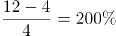。则利润率低的猕猴桃数量应该尽量少，又因为题干说明每种水果采购都超过500斤且为整数，则x最少为504，解得y=4055，因此最佳投入资金为504×10+4055×4=21260元。

故正确答案为B。

**考点**：非典型最值问题、经济利润问题

**来源**：2020年湖南公务员考试《行测》试题（网友回忆版）第56题

### 第 57 题

某医疗器械公司为完成一批口罩订单生产任务，先期投产了A和B两条生产线，A和B的工作效率之比为2：3，计划8天可完成订单生产任务，两天后公司又对这批订单投产了生产线C，A和C的工作效率之比为2：1，问该批口罩订单任务将提前几天完成？

A. 1

B. 2

C. 3

D. 4

第 57 题 · 答案与解析

**参考答案（粉笔题库参考内容）**

A

**解析**

根据题意，A、B生产线工作效率之比为2：3，A、C生产线工作效率之比为2：1，则A、B、C三条生产线工作效率之比为2：3：1。赋值A、B、C三条生产线工作效率分别为2、3、1，则生产任务总量=(2+3)×8=40。A、B两条生产线工作两天后，又投产生产线C，因此完成任务还需天，则该批口罩订单任务将提前8-2-5=1天完成。

故正确答案为A。

**考点**：给效率比例型

**来源**：2020年湖南公务员考试《行测》试题（网友回忆版）第57题

### 第 58 题

统计学专业学生正在学习《博弈论》，老师给每个学生发了一张卡片，要求每个学生在卡片上随机地从1到100中写下一个数，谁写下的数离他们的平均数的二分之一最接近就胜出，已知该专业共50人，问写下哪个数最可能胜出？

A. 12

B. 25

C. 50

D. 60

第 58 题 · 答案与解析

**参考答案（粉笔题库参考内容）**

B

**解析**

每人随机写下一个数字，则所写数字越多，他们的平均数将越接近于1-100的平均数即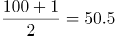，平均数的二分之一为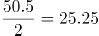，与B项最接近，可知写下25最有可能胜出。

故正确答案为B。

备注：写数具有随机性，写的越多，越接近于平均数。如果每个学生都知道此结论，那么他们所写的数字会围绕25附近，此时取胜的数字为12.5，与A项最接近；如果所有学生都考虑到这一点，则会围绕12附近来写，此时取胜的为6，以此类推，博弈结果将越来越小，趋近于1，本题没有对应选项。且题干中只强调了学生随机写数的情况，因此粉笔倾向于不考虑博弈的情况，只把它当作纯粹的数学题来给结果。

**考点**：平均数问题

**来源**：2020年湖南公务员考试《行测》试题（网友回忆版）第58题

### 第 59 题

红星中学高二年级在本次期末考试中竞争激烈，年级前七名的三科（语文、数学、英语）平均成绩构成公差为1的等差数列，第七、八、九名的平均成绩既构成等差数列，又构成等比数列，张龙位列第十，与第九名相差1分，张龙的英语成绩为121分，但老师误登记为112分。那么，张龙的名次本该是：

A. 第四

B. 第五

C. 第七

D. 第八

第 59 题 · 答案与解析

**参考答案（粉笔题库参考内容）**

B

**解析**

根据题意，第七、八、九名的平均成绩构成等差数列，设分别为a+d、a、a-d，因三人的平均成绩又构成等比数列，则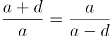，解得d=0，即第七、八、九名的平均成绩均为a。张龙平均成绩为a-1，因为英语成绩实为121分，误登记为112分，则三科平均成绩应比目前平均成绩多9/3=3分，实为a-1+3=a+2。前七名平均成绩构成公差为1的等差数列，从高到低分别为a+6、a+5、a+4、a+3、a+2、a+1、a，张龙实际成绩为a+2，名次本该是并列第五名。

故正确答案为B。

**考点**：平均数问题、数列问题

**来源**：2020年湖南公务员考试《行测》试题（网友回忆版）第59题

### 第 60 题

小李一家3人进行抢红包游戏，每人发1个红包。结果每人抢得金额总额一致，均为100元，刚巧3人所发红包金额为互不相同整数且成等差数列。问3人中所发红包金额最多的可能是多少元？

A. 197

B. 198

C. 199

D. 200

第 60 题 · 答案与解析

**参考答案（粉笔题库参考内容）**

C

**解析**

根据题意，“每人抢得金额总额一致，均为100元”，那么三人红包的总额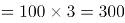元，“3人所发红包金额为互不相同整数且成等差数列”，则中间的金额应为三个红包的总额平均数100元，想要最大的红包金额最多，则最小的红包金额应该为最小，3人每人都发1个红包，金额不能为0元，那么最小金额为1元，则最大的红包金额为300-100-1=199元。

故正确答案为C。

备注：本题问法不够严谨，题目的本意应为金额最大的红包，金额最多是多少元。

**考点**：构造数列、数列问题

**来源**：2020年湖南公务员考试《行测》试题（网友回忆版）第60题

### 第 61 题

某药材公司以每千克8元的价格收购了5000千克药材，深加工后得到合格品和废料，合格品分为一、二、三等品，其比例为1：3：6，每千克售价分别为80元、50元、20元，废料价值为零。公司在加工中需投入其他成本20000元，最终获利108000元。问加工中药材的废品率是多少？

A. 1%

B. 4%

C. 6%

D. 8%

第 61 题 · 答案与解析

**参考答案（粉笔题库参考内容）**

B

**解析**

由题干“合格品分为一、二、三等品，其比例为1：3：6”，设一、二、三等合格品分别为x千克，3x千克，6x千克，根据公式：总利润=总售价-总成本，可得108000=(80×x+50×3x+20×6x)-(8×5000+20000)，解得x=480，则合格品=480×(1+3+6)=4800千克，废料=5000-4800=200千克，则废品率。

故正确答案为B。

**考点**：经济利润问题

**来源**：2020年湖南公务员考试《行测》试题（网友回忆版）第61题

### 第 62 题

同事甲、乙两人共携带120千克行李乘坐飞机，根据规定，甲单独托运则超重需支付200元，乙单独托运则超重需支付100元。若全部行李由一人负责托运，则超重需支付450元。问每位乘客的免费托运的行李最多为多少千克？

A. 20

B. 25

C. 30

D. 35

第 62 题 · 答案与解析

**参考答案（粉笔题库参考内容）**

C

**解析**

根据题意，“甲单独托运则超重需支付200元，乙单独托运则超重需支付100元”，甲、乙分别单独托运超重共需支付200+100=300元，“若全部行李由一人负责托运，则超重需支付450元”，全部由一人托运比甲、乙单独托运需多支付450-300=150元，多出的150元费用就是其中一个人免费的重量变成超重部分产生的费用。设免费重量为x千克，超出部分的费用为y元/千克，根据题意列方程组：x×y=150······①，(120-x)×y=450······②；解得x=30，y=5，故每位乘客的免费托运的行李最多为30千克。

故正确答案为C。

**考点**：分段计算问题

**来源**：2020年湖南公务员考试《行测》试题（网友回忆版）第62题

### 第 63 题

甲、乙、丙三人沿着长为500米，宽为250米的长方形场地跑步，三人以2：1：3的速度之比匀速顺时针跑步，当甲开跑时乙刚跑完1/3圈，丙开跑时甲跑了100米。问当乙跑完2圈时，甲与丙的位置关系如何？

A. 丙领先甲2350米

B. 丙领先甲2450米

C. 丙领先甲2900米

D. 丙领先甲3000米

第 63 题 · 答案与解析

**参考答案（粉笔题库参考内容）**

A

**解析**

长方形周长为(500+250)×2=1500米；乙比甲提前开跑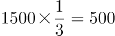米；甲比丙提前开跑100米；根据甲、乙、丙的速度之比为2：1：3，则乙比丙提前开跑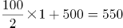米；乙跑完2圈即1500×2=3000米，此时甲跑了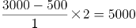米，丙跑了米，因此，丙领先甲7350-5000=2350米。

故正确答案为A。

**考点**：普通行程

**来源**：2020年湖南公务员考试《行测》试题（网友回忆版）第63题

### 第 64 题

春节期间，省图书馆邀请多位书法老师免费为读者书写春联。现场书写的春联中有188副不是刘老师书写的，有219副不是陈老师书写的，刘、陈两位老师今年一共书写了311副春联。问陈老师今年一共书写了多少副春联？

A. 208

B. 171

C. 140

D. 126

第 64 题 · 答案与解析

**参考答案（粉笔题库参考内容）**

C

**解析**

设各位书法老师共写了x副春联，可列式为(x-188)+(x-219)=311，解得x=359，则陈老师写了359-219=140副。

故正确答案为C。

**考点**：和差倍比问题

**来源**：2020年湖南公务员考试《行测》试题（网友回忆版）第64题

### 第 65 题

疫情期间，某地推出电子健康码，用户需凭电子健康码出入小区、学校、医院等公共场所。健康码是黑白相间的二维码，该二维码是边长为15cm的正方形，现利用随机模拟的方法向该健康码内投入1500个点，其中落入黑色部分的点的个数为800个，则该健康码的黑色部分的面积约为多少cm^2？

A. 135

B. 120

C. 115

D. 105

第 65 题 · 答案与解析

**参考答案（粉笔题库参考内容）**

B

**解析**

该二维码的面积为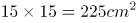。投入1500个点有800个在黑色部分，那么黑色部分占总面积之比为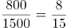，则黑色部分的面积为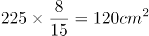。

故正确答案为B。

**考点**：几何公式类-平面图形

**来源**：2020年湖南公务员考试《行测》试题（网友回忆版）第65题

### 第 66 题

把下面的六个图形分为两类，使每一类图形都有各自的共同特征或规律，所给四个选项中分类正确的一项是：

A. ①②③；④⑤⑥

B. ①②④；③⑤⑥

C. ①②⑤；③④⑥

D. ①⑤⑥；②③④

第 66 题 · 答案与解析

**参考答案（粉笔题库参考内容）**

C

**解析**

本题为分组分类题目。元素组成不同，且无明显属性规律，考虑数量规律。观察发现，图①、图②均为生活化图形，可以考虑部分数。其中，图①②⑤均由多部分组成，图③④⑥均由一部分组成。因此，图①②⑤为一组、图③④⑥为一组。

注：分组分类题目中一组为一部分、一组为多部分的规律并不严谨，但此题出现明显生活化图形，无其他明显规律，且在以往的考试中确有出现过在考查部分数的知识点时，分为一部分与多部分两组的情况，故此题粉笔倾向于根据部分数进行分组分类。

故正确答案为C。

**考点**：数量规律-素

**来源**：2020年湖南公务员考试《行测》试题（网友回忆版）第66题

### 第 67 题

下列立体图形，其视图（正视图、俯视图、侧视图）不可能是所给四个选项中的哪一项？

A. A

B. B

C. C

D. D

第 67 题 · 答案与解析

**参考答案（粉笔题库参考内容）**

D

**解析**

本题考查三视图:

A项，从前往后看可以看到，为主视图，排除；

B项，从右往左看可以看到，为右视图，排除；

C项，从上往下看可以看到，为俯视图，排除；

本题为选非题，故正确答案选D。

**考点**：空间类-三视图

**来源**：2020年湖南公务员考试《行测》试题（网友回忆版）第67题

### 第 68 题

从所给的四个选项中，选择最合适的一个填入问号处，使之呈现一定的规律性：

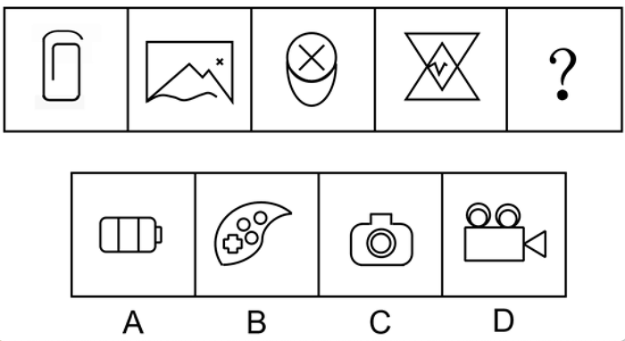

A. A

B. B

C. C

D. D

第 68 题 · 答案与解析

**参考答案（粉笔题库参考内容）**

A

**解析**

元素组成不同，且无明显属性规律，优先考虑数量规律。由于图形封闭面明显，优先考虑数面的数量。观察发现，题干图形面的数量依次为0、1、2、3，构成了递增的等差数列，因此？处图形面的个数应为4。A项面的个数为4，B项面的个数为5，C项面的个数为3，D项面的个数为6，只有A项符合要求。

故正确答案为A。

**考点**：数量规律-面

**来源**：2020年湖南公务员考试《行测》试题（网友回忆版）第68题

### 第 69 题

从下列四个图形中，找出一个和其他三个具有不同规律的图形：

A. A

B. B

C. C

D. D

第 69 题 · 答案与解析

**参考答案（粉笔题库参考内容）**

D

**解析**

每幅图形都是由一个正六边形、小黑点和两条曲线构成，元素组成相同，考虑位置规律。观察发现，A、B、C三项均可以只通过旋转得出同一图形，而D项需经过翻转得出与其余三项旋转后相同的图形。

本题为选非题，故正确答案为D。

**考点**：位置规律-综合

**来源**：2020年湖南公务员考试《行测》试题（网友回忆版）第69题

### 第 70 题

从所给四个选项中，选择最合适的一项填入问号处，使之呈现一定的规律性。

A. A

B. B

C. C

D. D

第 70 题 · 答案与解析

**参考答案（粉笔题库参考内容）**

B

**解析**

本题为九宫格题。元素组成相同，优先考虑位置规律。九宫格优先看横行，第一行图1旋转180°得到图2，图2左右翻转得到图3，第二行验证符合此规律。第三行应用此规律，图1旋转180°得到图2，故？处图形由图2左右翻转得到，只有B项符合。

故正确答案为B。

**考点**：位置规律-综合

**来源**：2020年湖南公务员考试《行测》试题（网友回忆版）第70题

### 第 71 题

从所给的四个选项中，选择最合适的一项填入问号1和问号2处，使之具有一定规律。

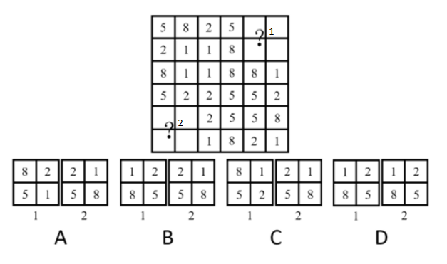

A. A

B. B

C. C

D. D

第 71 题 · 答案与解析

**参考答案（粉笔题库参考内容）**

D

**解析**

本题为九宫格题目。元素组成相同，优先考虑位置规律。根据“？”部分都是2×2宫格，观察发现题干其余部分2×2宫格形式当中包含的数字相同，所以考虑2×2宫格的位置关系。

观察发现九宫格中“米”字的两端的2×2宫格完全相同（如下图中相同颜色标记的图形完全相同），所以1图和2图中的两个图形应该完全相同，只有D项符合。

故正确答案为D。

**考点**：数量规律-素、文字/字母/数字类

**来源**：2020年湖南公务员考试《行测》试题（网友回忆版）第71题

### 第 72 题

从下列四个图形中，找出一个和其他三个具有不同规律的图形。

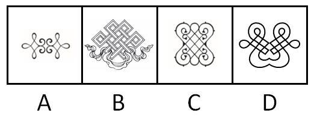

A. A

B. B

C. C

D. D

第 72 题 · 答案与解析

**参考答案（粉笔题库参考内容）**

B

**解析**

本题让我们找出一个和其他三个具有不同规律的图形。

解析一：观察发现，题干四个图形整体看起来很规整，因此考虑对称性，其中A、C、D选项均是轴对称图形，B选项两侧不对称，不是轴对称图形，与题干其他图形存在不同规律。

故正确答案为B。

解析二：观察发现，题干图形趋向于生活化，因此考虑部分数。其中B、C、D选项中图形都是一部分，A选项中图形是两部分，与题干其他图形存在不同规律。

故正确答案选A。

由于题干图形对称性更为明显，所以倾向考查对称，如果想考部分数，图形没必要出的这么对称，并且B选项迷惑性比较强，因此本题答案粉笔倾向于B。

**考点**：属性规律-对称性

**来源**：2020年湖南公务员考试《行测》试题（网友回忆版）第72题

### 第 73 题

从所给四个选项中，选择最合适的一项填入问号处，使之呈现一定的规律性。

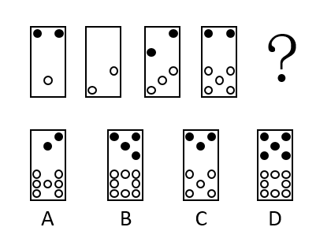

A. A

B. B

C. C

D. D

第 73 题 · 答案与解析

**参考答案（粉笔题库参考内容）**

B

**解析**

元素组成不同，且无明显属性规律，优先考虑数量规律。题干由若干小元素构成，考虑素的数量，其中白元素的个数分别为：1、2、3、5、？，没有明显的规律，再次观察发现存在1+2=3、2+3=5的运算规律，？处应该为3+5=8，排除A、C两项；黑元素的个数分别为：2、0、2、2、？，同样存在2+0=2、0+2=2的运算规律，？处应该为2+2=4，对应B项。

故正确答案为B。

**考点**：数量规律-素

**来源**：2020年湖南公务员考试《行测》试题（网友回忆版）第73题

### 第 74 题

从所给的四个选项中，选择最合适的一个填入问号处，使之呈现一定的规律。

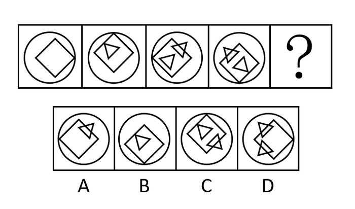

A. A

B. B

C. C

D. D

第 74 题 · 答案与解析

**参考答案（粉笔题库参考内容）**

D

**解析**

图形元素组成不同，且无明显属性规律，考虑数量规律。

观察发现，每幅图的圆形外框和正方形都有一个交点，且交点的位置依次逆时针旋转90°，因此问号处图形中该交点应旋转到右侧，只有D选项符合；且题干图形内部三角形与正方形的交点数依次是0、1、2、3个，因此问号处图形内部三角形与正方形的交点数应是4个，D选项也符合规律。

故正确答案为D。

**考点**：数量规律-点

**来源**：2020年湖南公务员考试《行测》试题（网友回忆版）第74题

### 第 75 题

左图为某一零件的立体图形，右边哪一项不属于该立体图形的截面图？

A. A

B. B

C. C

D. D

第 75 题 · 答案与解析

**参考答案（粉笔题库参考内容）**

C

**解析**

本题考查截面图，逐一分析选项。

A项：如上图所示，沿着立体图形，从上到下竖直方向进行切割，可以切出，排除；

B项：如上图所示，沿着立体图形，从前到后斜着进行切割，可以切出，排除；

C项：该项的缺口处不是正圆，而题干缺口处是正圆，因此缺口只能斜着切出来，但按照这样的方向切，无法得到下方椭圆跟外框相接的图形，无法切出，当选；

D项：如上图所示，沿着立体图形，圆柱前面的底端斜切至圆柱后面的顶端，可以切出，排除。

本题为选非题，故正确答案为C。

**考点**：空间类-截面图

**来源**：2020年湖南公务员考试《行测》试题（网友回忆版）第75题

### 第 76 题

社交焦虑障碍，是指个体在可能受到他人审视的一种或多种社交环境中存在持久的强烈恐惧和回避行为。

根据上述定义，下列属于社交焦虑障碍的是：

A. 尽管已经获得了公务员招录面试资格，但考虑到排名靠后再加上自己一贯不善于表达，陈某决定放弃这次机会

B. 随着演讲比赛日期的临近，王刚的焦虑和压力也与日俱增，最后他干脆放弃了

C. 小杨一想到下周要当众发言，紧张得一连几天都睡不好觉

D. 大强因为担心被父母催婚，今年春节决定不回家过年

第 76 题 · 答案与解析

**参考答案（粉笔题库参考内容）**

B

**解析**

第一步：找出定义关键词。

“个体”、“可能受到他人审视的一种或多种社交环境中”、“持久的强烈恐惧”、“回避”。

第二步：逐一分析选项。

A项：陈某，符合“个体”，考虑到排名靠后和不善表达而放弃机会，不符合“持久的强烈恐惧”，不符合定义，排除；

B项：王刚，符合“个体”，演讲比赛临近，符合“可能受到他人审视的一种或多种社交环境中”，他的焦虑压力与日俱增，符合“持久的强烈恐惧”，最后放弃，符合“回避”，符合定义，当选；

C项：小杨，符合“个体”，想到下周要当众发言，符合“可能受到他人审视的一种或多种社交环境中”，紧张得一连几天睡不好觉，符合“持久的强烈恐惧”，但不符合“回避”，不符合定义，排除；

D项：大强，符合“个体”，被父母催婚，不符合“可能受到他人审视的一种或多种社交环境中”，不符合定义，排除。

故正确答案为B。

**考点**：大前提

**来源**：2020年湖南公务员考试《行测》试题（网友回忆版）第76题

### 第 77 题

闯入性思维是指一些非自主的、反复出现的、无规律的进入个体大脑的干扰性想法，会造成一系列适应问题并诱发负面情绪，包括焦虑、抑郁和强迫症等。

根据上述定义，下列属于闯入性思维的是：

A. 每到年底，在外地工作的小孟都要为回不回老家过年而纠结，并因此而情绪烦躁

B. 这段时期股市波动较大，股民老张的心情也像股票指数一样起伏难料，焦虑至极

C. 小强在上课的时候，头脑中总是出现网络游戏的画面，这让他很难静下心来学习

D. 一想到完不成销售任务所带来的负面后果，小程都感到一阵阵的沮丧

第 77 题 · 答案与解析

**参考答案（粉笔题库参考内容）**

C

**解析**

第一步：找出定义关键词。

“非自主的、反复出现的、无规律的”、“干扰性想法”、“造成一系列适应问题”。

第二步：逐一分析选项。

A项：小孟为回不回老家过年而纠结，是小孟自主的想法，不符合“非自主的、反复出现的、无规律的”、“干扰性想法”，不符合定义，排除；

B项：股民老张的心情像股票指数一样起伏难料，但心情不是“想法”，不符合“非自主的、反复出现的、无规律的”、“干扰性想法”，不符合定义，排除；

C项：小强在上课时头脑中总是出现网络游戏的画面，符合“非自主的、反复出现的、无规律的”，这让他很难静下心来学习，符合“干扰性想法”、“造成一系列适应问题”，符合定义，当选；

D项：一想到完不成销售任务所带来的负面后果，是小程自主的想法，不符合“非自主的、反复出现的、无规律的”、“干扰性想法”，不符合定义，排除。

故正确答案为C。

**考点**：原因结果

**来源**：2020年湖南公务员考试《行测》试题（网友回忆版）第77题

### 第 78 题

情绪惰性，是指个体当前情绪状态能被之前情绪状态所预测的程度，预测程度越大则反映情绪惰性水平越高，情绪惰性作为情绪动态性指标之一反映了情绪变化的速度。

根据上述定义，下列情形属于情绪惰性的是：

A. 冬季往往容易使人情绪低落，所以这个冬天也不会例外

B. 调皮的小铭被老师批评之后终于老实了，随后几天都一直规规矩矩的

C. 自从万师傅的老伴儿半年前去世后他就一直很忧郁，估计一时半会儿好不起来

D. 自从首长做了战时动员令之后，整个工厂的工人都保持着激昂的心情努力生产

第 78 题 · 答案与解析

**参考答案（粉笔题库参考内容）**

C

**解析**

第一步：找出定义关键词。

“个体当前情绪状态”、“能被之前情绪状态所预测的程度，预测程度越大则反映情绪惰性水平越高”。

第二步：逐一分析选项。

A项：冬季使人情绪低落，这个冬天也不例外，只是体现冬天的普遍情绪状态，没有指明“个体当前情绪状态”，并不能说明预测程度到底怎么样，不符合“能被之前情绪状态所预测的程度，预测程度越大则反映情绪惰性水平越高”，不符合定义，排除；

B项：小铭被批评之后就老实了，之后几天也都规规矩矩的，没有体现出通过之前情绪进行预测的过程，不符合“能被之前情绪状态所预测的程度，预测程度越大则反映情绪惰性水平越高”，不符合定义，排除；

C项：万师傅在老伴儿去世后一直很忧郁，估计一时半会好不了，既体现了当前的情绪状态，又体现了能被之前的情绪所预测，符合“个体当前情绪状态”、“能被之前情绪状态所预测的程度，预测程度越大则反映情绪惰性水平越高”，符合定义，当选；

D项：工人们在战时动员令后保持着激昂的心情努力生产，并没有体现出通过之前情绪进行预测的过程，不符合“能被之前情绪状态所预测的程度，预测程度越大则反映情绪惰性水平越高”，不符合定义，排除。

故正确答案为C。

**考点**：单定义-其他句式

**来源**：2020年湖南公务员考试《行测》试题（网友回忆版）第78题

### 第 79 题

类别化是指个体对自身或他人在社会中所处位置的感知和判断，这种感知和判断不仅基于现实社会中社会体制的不同分类标准，也基于自身与他人的社会比较过程。类别化分为社会类别化和自我类别化。社会类别化是个体基于共享的相似性把他人分为不同群体类别的主观心理过程。自我类别化指个体从独立个体到群体成员的过程是通过类别化而得以实现的，是通过“去个性化”实现对群体的归属和成员身份的定位。

根据上述定义，下列属于自我类别化的是：

A. 只要每个人的素质提高了，我们整个国民的素质也就自然提高了，因此，重要的是首先做好自己

B. 小明打算应聘公司某职位，但他的父母却认为他更适合做公务员

C. 同学们都说小倩长得像明星，做主播肯定有前途

D. 王医生常常为自己所从事的职业感到无比自豪

第 79 题 · 答案与解析

**参考答案（粉笔题库参考内容）**

D

**解析**

第一步：找出定义关键词。

类别化：“个体对自身或他人在社会中所处位置的感知和判断”、“基于现实”、“也基于自身与他人的社会比较”；

社会类别化：“个体基于共享的相似性”、“把他人分为不同群体类别”；

自我类别化：“个体从独立个体到群体成员”、“实现对群体的归属和成员身份的定位”。

第二步：逐一分析选项。

A项：强调做好自己的重要性，并不涉及“个体对自身或他人在社会中所处位置的感知和判断”，不符合题干中任何一个定义，排除；

B项：父母认为小明适合做公务员，符合“个体基于共享的相似性”、“把他人分为不同群体类别”，符合“社会类别化”定义，不符合“自我类别化”定义，排除；

C项：同学们觉得小倩长得像明星，做主播有前途，符合“个体基于共享的相似性”、“把他人分为不同群体类别”，符合“社会类别化”定义，不符合“自我类别化”定义，排除；

D项：王医生为自己所从事的职业感到自豪，符合“个体从独立个体到群体成员”、“实现对群体的归属和成员身份的定位”，符合“自我类别化”定义，当选。

故正确答案为D。

**考点**：常规问法

**来源**：2020年湖南公务员考试《行测》试题（网友回忆版）第79题

### 第 80 题

员工绿色行为是指组织中员工展现的一系列旨在保护生态环境，降低个人活动对自然环境造成负面影响的行为，这些行为是组织正式绿色管理计划的重要补充，能提高组织绿色管理措施的效率，最终有利于环境的可持续发展。

根据上述定义，下列属于员工绿色行为的是：

A. 公司员工自觉遵守公司关于垃圾分类的规定

B. 部门经理经常利用废纸打印一些非正式文件

C. 办公室的一位女员工宁愿忍受高温也不愿开冷气，她认为这样更健康

D. 公司保洁员经常把垃圾箱内的废塑料瓶收集起来，下班时顺便带回家

第 80 题 · 答案与解析

**参考答案（粉笔题库参考内容）**

B

**解析**

第一步：找出定义关键词。

“组织中员工展现的一系列旨在保护生态环境，降低个人活动对自然环境造成负面影响”、“组织正式绿色管理计划的重要补充”、“提高组织绿色管理措施的效率，最终有利于环境的可持续发展”。

第二步：逐一分析选项。

A项：公司员工自觉遵守公司关于垃圾分类的规定，说明是公司规定的，不是员工自愿的，不符合“组织中员工展现的一系列旨在保护生态环境，降低个人活动对自然环境造成负面影响”，不符合定义，排除；

B项：部门经理用废纸打印非正式文件，符合“组织中员工展现的一系列旨在保护生态环境，降低个人活动对自然环境造成负面影响”，也符合“组织正式绿色管理计划的重要补充”、“提高组织绿色管理措施的效率，最终有利于环境的可持续发展”，符合定义，当选；

C项：办公室的女员工不开冷气，认为这样更健康，是为了自己身体健康并不是为了环保，不符合“组织中员工展现的一系列旨在保护生态环境，降低个人活动对自然环境造成负面影响”，不符合定义，排除；

D项：公司保洁员把垃圾箱的废塑料瓶收集起来带回家，只是带回了家并不是为了环保，不符合“组织中员工展现的一系列旨在保护生态环境，降低个人活动对自然环境造成负面影响”，不符合定义，排除。

故正确答案为B。

**考点**：方式目的

**来源**：2020年湖南公务员考试《行测》试题（网友回忆版）第80题

### 第 81 题

和谐管理是组织为了达到其目标，在变动的环境中，围绕社会、市场、政府和职工等和谐主题要素，以优化和不确定性消减为和谐手段提供问题解决方案的实践活动。

根据上述定义，下列属于和谐管理的是：

A. 甲公司为在竞标政府项目中获得优势，专门成立公关部门与政府搞关系

B. 丙企业为了治理因生产所造成的环境污染，成立专门基金进行长效维护

C. 乙公司为了让产品赢得市场，孤注一掷花费巨资请明星代言

D. 丁公司为了强化公司的“狼性”文化，经常让员工超时加班

第 81 题 · 答案与解析

**参考答案（粉笔题库参考内容）**

B

**解析**

第一步：找出定义关键词。

“组织为了达到其目标”、“在变动的环境中，围绕社会、市场、政府和职工等和谐主题要素”、“以优化和不确定性消减为和谐手段提供问题解决方案的实践活动”。

第二步：逐一分析选项。

A项：甲公司为在竞标政府项目中获得优势，专门成立公关部门与政府搞关系，有可能会促进企业和政府的关系，也有可能会产生跨越红线的事，不符合“以优化和不确定性消减为和谐手段提供问题解决方案的实践活动”，不符合定义，排除；

B项：丙企业为了治理因生产所造成的环境污染，成立专门基金进行长效维护，该企业治理自己产生的污染，可以减少因环境污染给企业自身带来的问题，消减了不确定性，符合“以优化和不确定性消减为和谐手段提供问题解决方案的实践活动”，符合定义，当选；

C项：乙公司为了让产品赢得市场，孤注一掷花费巨资请明星代言，孤注一掷风险较大，不能消减不确定性，不符合“以优化和不确定性消减为和谐手段提供问题解决方案的实践活动”，不符合定义，排除；

D项：丁公司为了强化公司的“狼性”文化，经常让员工超时加班，会影响员工与公司的关系，增加不确定性，不符合“以优化和不确定性消减为和谐手段提供问题解决方案的实践活动”，不符合定义，排除。

故正确答案为B。

**考点**：拆词

**来源**：2020年湖南公务员考试《行测》试题（网友回忆版）第81题

### 第 82 题

辟谣有时会使受众将谣言错记为“事实”，其中原因之一是受众遗忘了谣言的反驳信息，即事实幻觉效应。为了避免这一认知错觉，可以采用“反驳改述谣言”的方法，即辟谣者可以将谣言改述为否定句式，再进行反驳。

根据上述定义，下列属于“反驳改述谣言”的是：

A. 食用野兔等野生动物安全，这不是谣言

B. 即便少量饮酒也不利于健康，这是谣言

C. 有节制的吸烟不易致癌，这不是谣言

D. 药品X是危险的，这是谣言

第 82 题 · 答案与解析

**参考答案（粉笔题库参考内容）**

B

**解析**

第一步：找出定义关键词。

“将谣言改述为否定句式”、“再进行反驳”。

第二步：逐一分析选项。

A项：食用野兔等野生动物安全，不符合“将谣言改述为否定句式”，且“这不是谣言”也不符合“再进行反驳”，不符合定义，排除；

B项：少量饮酒也不利于健康，符合“将谣言改述为否定句式”，且“这是谣言”符合“再进行反驳”，符合定义，当选；

C项：有节制的吸烟不易致癌，符合“将谣言改述为否定句式”，但“这不是谣言”不符合“再进行反驳”，不符合定义，排除；

D项：药品X是危险的，不符合“将谣言改述为否定句式”，不符合定义，排除。

故正确答案为B。

**考点**：单定义-其他句式

**来源**：2020年湖南公务员考试《行测》试题（网友回忆版）第82题

### 第 83 题

反生产力工作行为是指员工应对通常工作压力情境以及缓解其负面情绪体验，有意从事对组织或其成员有所损害的冲动性适应行为，并对组织具有广泛的不利影响。

根据上述定义，下列属于反生产力工作行为的是：

A. 过高的物价使得民众难以承受，纷纷聚集到市政厅进行抗议

B. 新部门工作节奏较快，小孙因工作压力过大只好请假不去上班

C. 为反对公司要求每天工作14小时的规定，很多员工开始磨洋工

D. 小李被领导批评后很不服气，偷偷将单位机密散布到网上，给单位带来了巨大损失

第 83 题 · 答案与解析

**参考答案（粉笔题库参考内容）**

D

**解析**

第一步：找出定义关键词。

“员工”、“应对通常工作压力情境以及缓解其负面情绪体验”、“有意从事对组织或其成员有所损害的冲动性适应行为”、“对组织具有广泛的不利影响”。

第二步：逐一分析选项。

A项：过高的物价使得民众难以承受，民众不符合“员工”，不符合定义，排除；

B项：小孙因工作压力过大只好请假不去上班，不符合“有意从事对组织或其成员有所损害的冲动性适应行为”，不符合定义，排除；

C项：为反对公司每天工作14小时的规定，很多员工开始磨洋工，不符合“有意从事对组织或其成员有所损害的冲动性适应行为”，不符合定义，排除；

D项：小李由于被领导批评不服气，偷偷将单位机密散布到网上，符合“员工有意从事对组织或其成员有所损害的冲动性适应行为”，给单位带来了巨大损失，符合“对组织具有广泛的不利影响”，符合定义，当选。

故正确答案为D。

**考点**：方式目的

**来源**：2020年湖南公务员考试《行测》试题（网友回忆版）第83题

### 第 84 题

分割谬误是指基于整体拥有某性质，而推论其中的部分或全部个体也都具备该性质。

根据上述定义，下列属于分割谬误的是：

A. 本案被告很有钱，因为他出门都开豪华跑车

B. 这座城市到处都有抢劫案，我光是在《城市晚报》就读到三起

C. 这个足球队是本赛季最强的足球队，毫无疑问该球队的守门员也是最强的

D. 这个交响乐团中的每一位乐师都非常出色，所以这支交响乐团非常出色

第 84 题 · 答案与解析

**参考答案（粉笔题库参考内容）**

C

**解析**

第一步：找出定义关键词。

“整体拥有某性质，而推论其中的部分或全部个体也都具备该性质”。

第二步：逐一分析选项。

A项：因为出门开豪华跑车，推出被告很有钱，不符合“整体拥有某性质，而推论其中的部分或全部个体也都具备该性质”，不符合定义，排除；

B项：从报纸读到三起抢劫案，推出城市到处都有抢劫案，不符合“整体拥有某性质，而推论其中的部分或全部个体也都具备该性质”，不符合定义，排除；

C项：从足球队最强，推出球队守门员最强，符合“整体拥有某性质，而推论其中的部分或全部个体也都具备该性质”，符合定义，当选；

D项：交响乐团的每一位乐师都出色，推出交响乐团出色，不符合“整体拥有某性质，而推论其中的部分或全部个体也都具备该性质”，不符合定义，排除。

故正确答案为C。

**考点**：单定义-其他句式

**来源**：2020年湖南公务员考试《行测》试题（网友回忆版）第84题

### 第 85 题

在高大建筑物顶端安装一根金属棒，并用金属线与埋在地下的金属板连接起来，通过金属棒尖端放电，让云层所带的电和地上的电逐渐中和，以保护建筑物免遭雷击。这种做法应用于管理界时被称为避雷针效应，指事先疏导，防患于未然，引领事态积极发展，即善疏则通，能导必安的管理方法。

根据上述定义，下列做法与避雷针效应无关的是：

A. 某市推行“全民参与精准找茬”工作破解城市治理盲区漏点，市民怨气少了满意多了

B. 某小区改建车库，物业方广泛地征求了业主的意见，并形成共识，使该工程顺利推进

C. 某地实行“有事好商量”协商议事工作法，解决大量群众关心的事，化解了社会矛盾

D. 某公司将召开员工发展问题研讨会，要求部门主管会前要调查掌握员工发展需求

第 85 题 · 答案与解析

**参考答案（粉笔题库参考内容）**

D

**解析**

第一步：找出定义关键词。

“事先疏导，防患于未然”、“引领事态积极发展”。

第二步：逐一分析选项。

A项：推行“全民参与精准找茬”工作，可以让市民指出城市潜在的治理问题，符合“事先疏导，防患于未然”，市民怨气少了满意多了，反映出该工作的积极效果，也符合“引领事态积极发展”，符合定义，排除；

B项：物业方在改建车库前广泛地征求了业主的意见，符合“事先疏导，防患于未然”，征求之后，双方达成了共识，使该工程得以顺利推进，也符合“引领事态积极发展”，符合定义，排除；

C项：“有事好商量”协商议事工作法可以起到协调商讨的作用，减少群众冲突的发生，符合“事先疏导，防患于未然”，这种工作法解决了大量群众关心的事，化解了社会矛盾，也符合“引领事态积极发展”，符合定义，排除；

D项：公司将召开员工发展问题研讨会，要求部门主管会前要调查掌握员工发展需求，符合“事先疏导，防患于未然”，但并未提及员工是否会有好的发展，不符合“引领事态积极发展”，不符合定义，当选。

本题为选非题，故正确答案为D。

**考点**：故事类

**来源**：2020年湖南公务员考试《行测》试题（网友回忆版）第85题

### 第 86 题

内核：硬核

A. 声波：光波

B. 价值：价格

C. 水波：秋波

D. 症结：原因

第 86 题 · 答案与解析

**参考答案（粉笔题库参考内容）**

C

**解析**

第一步：判断题干词语间逻辑关系。

内核是操作系统最基本的部分；硬核原指一种力量感强、节奏激烈的说唱音乐风格，后来引申指“面向核心观众，有一定难度和欣赏门槛的事物”，二者都是核，且内核是本意，硬核具有引申义。

第二步：判断选项词语间逻辑关系。

A项：发声体的振动在空气或其他物质中的传播叫做声波；光波是指波长在之间的电磁波，二者为并列关系，且光波无引申义，与题干逻辑关系不一致，排除；

B项：价值是价格的基础，价格是价值的外在表现，二者为对应关系，且价格无引申义，与题干逻辑关系不一致，排除；

C项：水波指水的波浪；秋波是秋风中的湖波涟漪，在古人的诗中，秋波引申成为女人的眼睛，二者都是波，且水波是本意，秋波具有引申义，与题干逻辑关系一致，当选；

D项：症结比喻事情弄坏或不能解决的关键；原因指造成某种结果或引起另一件事情发生的条件，且原因无引申义，与题干逻辑关系不一致，排除。

故正确答案为C。

**考点**：语义关系-比喻象征义、逻辑关系-并列关系

**来源**：2020年湖南公务员考试《行测》试题（网友回忆版）第86题

### 第 87 题

护士：输液

A. 策划：文案

B. 园丁：教师

C. 主持人：晚会

D. 钢琴家：演奏

第 87 题 · 答案与解析

**参考答案（粉笔题库参考内容）**

D

**解析**

第一步：判断题干词语间逻辑关系。

输液为护士的工作内容，二者为职业和工作内容的对应关系。

第二步：判断选项词语间逻辑关系。

A项：策划文案为动宾结构，与题干逻辑关系不一致，排除；

B项：园丁指专门从事园艺的劳动者，可以将教师比作园丁，二者为比喻象征义，与题干逻辑关系不一致，排除；

C项：主持人的工作内容为主持，而不是晚会，与题干逻辑关系不一致，排除；

D项：演奏为钢琴家的工作内容，二者为职业和工作内容的对应关系，与题干逻辑关系一致，当选。

故正确答案为D。

**考点**：逻辑关系-对应关系

**来源**：2020年湖南公务员考试《行测》试题（网友回忆版）第87题

### 第 88 题

摇曳：晃动

A. 自满：自谦

B. 翻天覆地：一成不变

C. 悲痛：欲绝

D. 顺风转舵：见机行事

第 88 题 · 答案与解析

**参考答案（粉笔题库参考内容）**

D

**解析**

第一步：判断题干词语间逻辑关系。

摇曳指摇荡；晃动指摇晃、摆动，二者为近义关系。

第二步：判断选项词语间逻辑关系。

A项：自满多指满足于自己已有的成绩而沾沾自喜的心理状态；自谦指的是自抱谦逊态度，二者为反义关系，与题干逻辑关系不一致，排除；

B项：翻天覆地形容变化大；一成不变指的是一经形成，不再改变，二者为反义关系，与题干逻辑关系不一致，排除；

C项：悲痛指悲伤哀痛；欲绝指感情极其强烈的，非常激动的，用来形容悲痛的程度，二者为对应关系，与题干逻辑关系不一致，排除；

D项：顺风转舵比喻顺着情势改变态度；见机行事指看具体情况灵活办事，二者为近义关系，与题干逻辑关系一致，当选。

故正确答案为D。

**考点**：语义关系-近义关系

**来源**：2020年湖南公务员考试《行测》试题（网友回忆版）第88题

### 第 89 题

栉风：沐雨

A. 门当：户对

B. 东山：再起

C. 万里：长城

D. 助人：为乐

第 89 题 · 答案与解析

**参考答案（粉笔题库参考内容）**

A

**解析**

第一步：判断题干词语间逻辑关系。

“栉风”指的是以风梳头，“沐雨”指的是以雨洗发，二者为并列关系。

第二步：判断选项词语间逻辑关系。

A项：“门当”与“户对”是古民居建筑中大门的组成部分，古人结婚讲究二者要对等，二者为并列关系，与题干逻辑关系一致，当选；

B项：“东山”是名词，“再起”是一个动作，二者不是并列关系，与题干逻辑关系不一致，排除；

C项：“万里”是修饰“长城”的，二者为偏正关系，与题干逻辑关系不一致，排除；

D项：“助人”指的是帮助他人，“为乐”指当作快乐，二者为主谓关系，与题干逻辑关系不一致，排除。

故正确答案为A。

**考点**：逻辑关系-并列关系

**来源**：2020年湖南公务员考试《行测》试题（网友回忆版）第89题

### 第 90 题

筚路蓝缕：艰辛

A. 焦金流石：干燥

B. 伏虎降龙：强大

C. 毕雨箕风：简陋

D. 集萤映雪：夏夜

第 90 题 · 答案与解析

**参考答案（粉笔题库参考内容）**

B

**解析**

第一步：判断题干词语间逻辑关系。

“筚路蓝缕”意思是驾着简陋的柴车，穿着破烂的衣服去开辟山林道路，形容创业的艰苦，与“艰辛”是近义关系。

第二步：判断选项词语间逻辑关系。

A项：“焦金流石”意思是把金属烤焦，把石头晒化，形容极其炎热难耐，与“干燥”不是近义关系，与题干逻辑关系不一致，排除；

B项：“伏虎降龙”意思是用威力使猛虎和恶龙屈服，形容力量强大，能战胜一切敌人和困难，与“强大”是近义关系，与题干逻辑关系一致，当选；

C项：“毕雨箕风”原指民性如星，星好风雨，比喻庶民喜好人主的恩泽，后为颂扬统治者普施仁政之词，与“简陋”不是近义关系，与题干逻辑关系不一致，排除；

D项：“集萤映雪”意思是家境贫穷，勤学苦读，与“夏夜”不是近义关系，与题干逻辑关系不一致，排除。

故正确答案为B。

**考点**：语义关系-近义关系

**来源**：2020年湖南公务员考试《行测》试题（网友回忆版）第90题

### 第 91 题

蛛丝马迹∶鸟迹虫丝

A. 寒酸落魄∶寒心酸鼻

B. 堆玉积金∶屯粮积草

C. 冰肌玉骨∶劲骨丰肌

D. 挨冻受饿∶担饿受冻

第 91 题 · 答案与解析

**参考答案（粉笔题库参考内容）**

C

**解析**

第一步：判断题干词语间逻辑关系。

蛛丝马迹指事情所留下的隐约可寻的痕迹和线索，鸟迹虫丝比喻极易消失的事物，二者没有明显的语义关系，考虑拆分。蛛丝马迹可拆分为“蛛丝（蜘蛛的丝）”、“马迹（灶马留下的痕迹）”，鸟迹虫丝可拆分为“鸟迹（鸟的爪印）”、“虫丝（虫吐的丝）”，均为偏正结构。

第二步：判断选项词语间逻辑关系。

A项：寒酸落魄指穷困、狼狈的样子， “寒酸”和“落魄”都是形容词，与题干逻辑关系不一致，排除；

B项：堆玉积金指金玉多得可以堆积起来，“堆玉”和“积金”是动宾结构；屯粮积草指储存粮食和草料，“屯粮”和“积草”是动宾结构。四词均非偏正结构，与题干逻辑关系不一致，排除；

C项：冰肌玉骨指肌骨如同冰玉一般，“冰肌（像冰一样的肌肤）”和“玉骨（像玉一样的肌骨）”是偏正结构；劲骨丰肌指书法有力而丰润，“劲骨（有力的骨架）”和“丰肌（丰满的肌肉）”也是偏正结构，与题干逻辑关系一致，当选；

D项：挨冻受饿指遭受饥饿与寒冷侵袭，“挨冻”和“受饿”是动宾结构；担饿受冻意思与挨饿受冻相同，且 “担饿”和“受冻”也是动宾结构。四词均非偏正结构，与题干逻辑关系不一致，排除。

故正确答案为C。

**考点**：拆分思维、语法关系

**来源**：2020年湖南公务员考试《行测》试题（网友回忆版）第91题

### 第 92 题

大豆：豆油：压榨

A. 茶叶：茶水：冲泡

B. 水泥：房屋：建造

C. 布料：成衣：缝制

D. 太阳：阳光：辐射

第 92 题 · 答案与解析

**参考答案（粉笔题库参考内容）**

A

**解析**

第一步：判断题干词语间逻辑关系。

大豆经过压榨得到豆油，三者为原材料、成品和工艺的对应关系，并且豆油是通过提取大豆中的成分得到的成品。

第二步：判断选项词语间逻辑关系。

A项：茶叶经过冲泡得到茶水，三者为原材料、成品和工艺的对应关系，并且茶水是通过提取茶叶中的成分得到的成品，与题干逻辑关系一致，当选；

B项：水泥经过建造得到房屋，三者为原材料、成品和工艺的对应关系，但房屋不是通过提取水泥中的成分得到的成品，与题干逻辑关系不一致，排除；

C项：布料经过缝制得到成衣，三者为原材料、成品和工艺的对应关系，但成衣不是通过提取布料中的成分得到的成品，与题干逻辑关系不一致，排除；

D项：太阳以辐射的方式产生阳光，三者不是原材料、成品和工艺的对应关系，与题干逻辑关系不一致，排除。

故正确答案为A。

**考点**：逻辑关系-对应关系

**来源**：2020年湖南公务员考试《行测》试题（网友回忆版）第92题

### 第 93 题

固根基：扬优势：补短板

A. 清谈客：奋斗者：泥菩萨

B. 勤思考：爱劳动：学习好

C. 涉险滩：破坚冰：攻堡垒

D. 有政治：有形象：有人格

第 93 题 · 答案与解析

**参考答案（粉笔题库参考内容）**

C

**解析**

第一步：判断题干词语间逻辑关系。

固根基、扬优势和补短板三者均为动宾结构。

第二步：判断选项词语间逻辑关系。

A项：清谈客指纸上谈兵的人，奋斗者指奋斗的人，泥菩萨比喻虚弱不中用的人，三者均不是动宾结构，与题干逻辑关系不一致，排除；

B项：勤思考为偏正结构，爱劳动为动宾结构，学习好为主谓结构，与题干逻辑关系不一致，排除；

C项：涉险滩、破坚冰和攻堡垒三者均为动宾结构，与题干逻辑关系一致，保留；

D项：有政治、有形象、有人格三者均为动宾结构，与题干逻辑关系一致，保留。

对比C、D两项，题干和C项的动宾结构是根据不同的宾语搭配不同的动词，三个动词均不相同，而D项均为同一个动词，故C项与题干更一致，当选。

故正确答案为C。

**考点**：语法关系

**来源**：2020年湖南公务员考试《行测》试题（网友回忆版）第93题

### 第 94 题

青年人：公务员：服务人民

A. 当代史：革命史：史海耕耘

B. 下农村：进工厂：劳动锻炼

C. 创业者：劳动者：市场打拼

D. 大学生：志愿者：奉献社会

第 94 题 · 答案与解析

**参考答案（粉笔题库参考内容）**

D

**解析**

第一步：判断题干词语间逻辑关系。

有的青年人是公务员，有的公务员是青年人，有的青年人不是公务员，有的公务员不是青年人，二者是交叉关系，“公务员”的宗旨是“服务人民”，二者是对应关系。

第二步：判断选项词语间逻辑关系。

A项：世界当代史为1945年-至今，中国当代史为1949年-至今，而革命史指二战结束前（1945年）一些具有历史意义革命的历史，当代史与革命史时间范围上不存在交叉，因此二者不属于交叉关系，与题干逻辑关系不一致，排除；

B项：“下农村”和“进工厂”是两种不同的“劳动锻炼”方式，二者是并列关系，与题干逻辑关系不一致，排除；

C项：“创业者”是主导劳动方式的领导人，“劳动者”是对从事劳作活动的一类人的统称，“创业者”是“劳动者”，二者是种属关系，与题干逻辑关系不一致，排除；

D项：有的大学生是志愿者，有的志愿者是大学生，有的大学生不是志愿者，有的志愿者不是大学生，二者是交叉关系，“志愿者”的宗旨是“奉献社会”，二者为对应关系，与题干逻辑关系一致，当选。

故正确答案为D。

**考点**：逻辑关系-交叉关系、逻辑关系-对应关系

**来源**：2020年湖南公务员考试《行测》试题（网友回忆版）第94题

### 第 95 题

和谐 对于 （ ） 相当于 谦虚 对于 （ ）

A. 强硬蛮横；安分守己

B. 融洽无间；夜郎自大

C. 波澜不惊；虚怀若谷

D. 动荡不安；趾高气扬

第 95 题 · 答案与解析

**参考答案（粉笔题库参考内容）**

D

**解析**

逐一代入选项。

A项：强硬蛮横是指骄横跋扈的人，与和谐没有语义关系；安分守己是指规矩本分的人，与谦虚没有语义关系，前后逻辑关系不一致，排除；

B项：融洽无间是指没有隔阂，相处和谐，与和谐是近义关系；夜郎自大比喻骄傲无知的肤浅自负或自大行为，与谦虚是反义关系，前后逻辑关系不一致，排除；

C项：波澜不惊是指没有什么变化或曲折，与和谐没有语义关系；虚怀若谷是指十分谦虚，能容纳别人的意见，与谦虚是近义关系，前后逻辑关系不一致，排除；

D项：动荡不安是指局势不稳定、不平静，与和谐是反义关系；趾高气扬是指骄傲自满，得意忘形的样子，与谦虚是反义关系，前后逻辑关系一致，当选。

故正确答案为D。

**考点**：语义关系-反义关系

**来源**：2020年湖南公务员考试《行测》试题（网友回忆版）第95题

### 第 96 题

国外某公司从农户手中收购伪步行虫和蟋蟀等昆虫，把它们加工成粉末或油，再与其它食材混合，制成让人吃不出昆虫味道的美味食品。2019年该公司销售这种食品已实现百万美元盈利。联合国粮农组织肯定这家公司的做法，并指出食用昆虫，有利于应对世界性粮食供应紧缺和营养不良的问题。

上述论证若要成立，必须增加的前提是：

A. 世界粮食供应紧张状况还将持续，开发昆虫等新食材，可有效应对食物需求增长

B. 昆虫富含蛋白质、脂肪、补足维生素和铁的营养成分，是量大低成本的补充食材

C. 国外某权威研究机构称，在本世纪，食用昆虫有利于人口增长和蛋白质消费增加

D. 亚洲、非洲一些缺粮且人口营养不良的地区在大力发展昆虫养殖加工业

第 96 题 · 答案与解析

**参考答案（粉笔题库参考内容）**

B

**解析**

第一步：找出论点和论据。

论点：食用昆虫，有利于应对世界性粮食供应紧缺和营养不良的问题。

论据：把昆虫加工成粉末或油，再与其它食材混合，制成美味食品，销售这种食品已经实现百万美元盈利。

本题的论点和论据都围绕食用昆虫展开，论点和论据话题一致，提问为“前提”，优先考虑必要条件。

第二步：逐一分析选项。

A项：昆虫等新食材可以有效应对食物需求增长，说的是昆虫可以应对食物需求增长，是论证成立的前提，但没有涉及补充营养，比较片面，排除；

B项：如果昆虫营养价值不高，那么就无法应对营养不良问题，如果昆虫没有量大价低的优势，那么就无法应对世界性粮食供应紧缺问题，选项是论点成立的必要条件，是论证成立的前提，并且两个方面都有涉及，比A项更好，当选；

C项：国外某研究机构的观点主要指出本世纪食用昆虫有相关好处，但并不明确食用昆虫是否能应对世界性粮食供应紧缺等问题，不是论证成立的前提，排除；

D项：亚洲、非洲部分地区正在发展昆虫养殖加工业，但并不明确发展昆虫养殖加工业是否能应对世界性粮食供应紧缺等问题，不是论证成立的前提，排除。

故正确答案为B。

**考点**：必要条件

**来源**：2020年湖南公务员考试《行测》试题（网友回忆版）第96题

### 第 97 题

一项研究利用250多万份图像，训练人工智能算法分析脑癌。研究结果表明，计算机能在三分钟内诊断出常见癌症，而一名医学专家作出诊断大约需要30分钟。在一项278名脑瘤患者参与的临床试验中，研究人员发现，人工智能算法的诊断结果与病理学家的诊断相符——实际上更准确一些。一实验中，医生误诊17次，而人工智能仅误诊14次。由此，研究者得出结论：人工智能虽还不能取代医生，但可以发挥复查作用，确保诊断万无一失。

以下各项如果为真，最能支持研究人员上述结论的是：

A. 人工智能全天候二十四小时无间歇工作的特质，可以有效缓解现阶段优秀医生极度紧缺的状况

B. 培养一名医生至少需要十年以上的时间，但人工智能只要技术上实现一次突破，就可以被复制

C. 病理学家误诊的病例，人工智能无一出错；同时人工智能误诊的病例，也被病理学家逐一纠正

D. 现阶段，病例诊疗软件已经用于医学院教学和培训青年医生，机器人完成的手术台数已经破万

第 97 题 · 答案与解析

**参考答案（粉笔题库参考内容）**

C

**解析**

第一步：找出论点和论据。

论点：人工智能虽还不能取代医生，但可以发挥复查作用，确保诊断万无一失。

论据：人工智能算法的诊断结果与病理学家的诊断相符——实际上更准确一些。一实验中，医生误诊17次，而人工智能仅误诊14次。

本题论点和论据都在说人工智能的诊断结果准确，话题一致，可以通过补充论据的方式进行加强，即解释原因或举例。

第二步：逐一分析选项。

A项：该项说的是人工智能可以缓解现阶段优秀医生极度紧缺的状况，选项未涉及人工智能能否起到“复查作用”，话题不一致，无法加强，排除；

B项：该项说的是人工智能技术上的突破可以被复制，选项未涉及人工智能能否起到“复查作用”，话题不一致，无法加强，排除；

C项：病理学家误诊的病例，人工智能无一出错；同时人工智能误诊的病例，也被病理学家逐一纠正，二者是相辅相成的，能够说明人工智能可以发挥“复查作用”、确保诊断准确，补充论据，当选；

D项：该项说的是人工智能已经用于医学教学等领域，选项未涉及人工智能能否起到“复查作用”，话题不一致，无法加强，排除。

故正确答案为C。

**考点**：补充论据

**来源**：2020年湖南公务员考试《行测》试题（网友回忆版）第97题

### 第 98 题

研究表明，锻炼对人类大脑有积极作用，如果坚持锻炼，阿尔茨海默病等神经退行性疾病的发病风险就会降低。

由此可以推出：

A. 人类大脑如果不进行锻炼，阿尔茨海默病等神经退行性疾病的发病风险就会进一步提高

B. 如果没有降低阿尔茨海默病等神经退行性疾病的发病风险，那一定是没有坚持锻炼

C. 如果阿尔茨海默病等神经退行性疾病的发病风险降低了，那么就一定是坚持锻炼的结果

D. 是否坚持锻炼，直接决定了阿尔茨海默病等神经退行性疾病的发病风险能否得到降低

第 98 题 · 答案与解析

**参考答案（粉笔题库参考内容）**

B

**解析**

第一步：翻译题干。

坚持锻炼→发病风险降低

第二步：逐一分析选项。

A项：翻译为-锻炼→发病风险提高，是对题干的否前，否前推不出确定性结论，排除；

B项：翻译为-发病风险降低→-坚持锻炼，是对题干的否后，否后必否前，可以推出，当选；

C项：翻译为发病风险降低→坚持锻炼，是对题干的肯后，肯后推不出确定性结论，排除；

D项：“是否坚持锻炼”是同时对题干的肯前和否前，否前是推不出确定性结论，排除。

故正确答案为B。

**考点**：常规翻译

**来源**：2020年湖南公务员考试《行测》试题（网友回忆版）第98题

### 第 99 题

磷存在于我们的DNA中，是构成生命的基本元素之一，但它早期是如何到达地球的仍是一个谜。近日，科学家通过观测恒星形成区域，追踪到了含磷分子从宇宙到达地球的“旅程”。观测结果表明，含磷分子是在大质量恒星形成时产生的，刚形成的恒星会释放气流，在星际云中打造出一条通道。随着恒星震动和释放辐射，含磷分子在这些通道壁上沉积并产生大量一氧化磷粒子，这些粒子逐渐汇聚、融合，从一块小石头变成了彗星，而这些彗星，就成为了生命的“信使”，携带着生命分子来到了地球。

以下各项如果为真，最能质疑上述结论的是：

A. 科学家已经在陨石中找到了证据，研究发现为数不多的一些陨石携带有包含了一氧化二磷等含磷分子的有机物

B. 彗星撞击地球表面时，可产生36万个大气压，温度可达2500℃，会引发彗星晶体中的磷元素发生未知化学变化

C. 早期的彗星撞击事件为地球带来每年10万亿千克的有机物质，它们进入地球环境后开启了地球生命的演化历程

D. 仅仅是拥有DNA的所需物质是远远不够的，只有上千万甚至是上亿万分之一的概率才能满足生命形成所需的条件

第 99 题 · 答案与解析

**参考答案（粉笔题库参考内容）**

B

**解析**

第一步：找出论点和论据。

论点：磷如何到达地球？含磷分子是在大质量恒星形成时产生的，刚形成的恒星会释放气流，在星际云中打造出一条通道。随着恒星震动和释放辐射，含磷分子在这些通道壁上沉积并产生大量一氧化磷粒子，这些粒子逐渐汇聚、融合，从一块小石头变成了彗星，而这些彗星，就成为了生命的“信使”，携带着生命分子来到了地球。

论据：无。

本题只有论点，没有论据，优先考虑否论点。

第二步：逐一分析选项。

A项：该项讨论的是陨石携带包含了一氧化二磷等含磷分子的有机物，题干讨论的是彗星携带一氧化磷粒子，讨论主体不一致，不能削弱，排除；

B项：该项表明彗星携带的磷元素在撞击地球表面时，会发生未知的化学变化，那么磷可能到达不了地球，无法成为构成生命的基本元素之一，可以削弱，当选；

C项：该项表明彗星撞击事件为地球带来了很多有机物质，开启了地球生命的演化历程，肯定了彗星携带着生命分子来到了地球，可以加强，排除；

D项：该项讨论的是生命形成所需的条件，与磷如何到达地球无关，无关项，排除。

故正确答案为B。

**考点**：削弱论点

**来源**：2020年湖南公务员考试《行测》试题（网友回忆版）第99题

### 第 100 题

科研人员发现，鸟蛋颜色与温度有极大关联。研究结果显示，在日照强度较低的地方，深色鸟蛋更常见；而在阳光强度更高、更暖和的区域，鸟蛋颜色普遍更浅。研究小组认为，更深颜色的壳意味着可以吸收更多热量，从而在更寒冷的环境中具有生存优势。因为蛋中胚胎需要稳定的环境温度，但其自身却不具备温度调节能力。

以下各项如果为真，最能支持上述结论的是：

A. 将不同品种的鸡蛋放置在阳光中，颜色更深的鸡蛋比浅色鸡蛋升温更快，而且其蛋壳表面保持较高温度的时间更长

B. 大杜鹃将自己生的蛋寄宿在一百多种鸟的巢中，为了避免蛋被鸟巢主人赶跑，它们能够高仿出二十多种色型的鸟蛋

C. 要孵化出小鸟，适宜的温度十分重要，所以为了保证小鸟能顺利破壳，鸟妈妈只能待在窝里孵蛋，来提高蛋的温度

D. 蛇、乌龟的蛋大多埋在地下，有隐蔽性，所以是白色的，而鸟蛋暴露在环境中，则需要斑纹和颜色做障眼法迷惑天敌

第 100 题 · 答案与解析

**参考答案（粉笔题库参考内容）**

A

**解析**

第一步：找出论点和论据。

论点：更深颜色的壳意味着可以吸收更多热量，从而在更寒冷的环境中具有生存优势。

论据：研究结果显示，在日照强度较低的地方，深色鸟蛋更常见；而在阳光强度更高、更暖和的区域，鸟蛋颜色普遍更浅。蛋中胚胎需要稳定的环境温度，但其自身却不具备温度调节能力。

本题的论点是蛋壳颜色与温度的关系，论据是在日照强度较低的地方深色鸟蛋更多，且蛋的胚胎不具备温度调节的能力，二者话题一致，优先考虑补充论据的方式加强，即举例子或解释原因。

第二步：逐一分析选项。

A项：举出鸡蛋在阳光中的例子，说明颜色更深的蛋壳可以吸收更多热量，举例加强，当选；

B项：该项说的是大杜鹃鸟为了避免蛋被鸟巢主人赶跑而高仿出二十多种颜色的鸟蛋，但是没有说明鸟蛋颜色的深浅与温度之间的关系，属于无关项，无法加强，排除；

C项：该项说的是为了保证小鸟顺利破壳，鸟妈妈只能待在窝里孵蛋，没有提及鸟蛋的颜色，属于无关项，无法加强，排除；

D项：该项说的是鸟蛋需要颜色做障眼法迷惑天敌，但是没有说明鸟蛋颜色的深浅与温度之间的关系，属于无关项，无法加强，排除。

故正确答案为A。

**考点**：补充论据

**来源**：2020年湖南公务员考试《行测》试题（网友回忆版）第100题

### 第 101 题

小严在商场看中一款鞋子，纠结是买黑色好还是买白色好。同行的好朋友小芳说：你去问下柜员，是黑色的销量高，还是白色的销量高，不就知道了吗？

以下选项与题干中的问答方式最为相似的是：

A. 准备考研的小张在A培训班和B培训班之间犹豫不决，室友小王说：你去问问已经考上了研究生的学长学姐们，看看他们报的是A还是B，不就知道了吗

B. 老郑打算给乔迁新居的战友老袁买一件礼物，在书法字画和艺术盆景之间有点为难，老伴说：你去花店打听下，乔迁送艺术盆景的人多不多，不就知道了吗

C. 小莫和男友去网红美食街探寻美食，面对众多从未吃过的各地特色美食不知如何取舍，男友说：我们看看哪家店门口的队伍排得最长，就去吃哪家的吧

D. 七夕节到了，小汪准备给女朋友送一支口红，不知道女朋友是喜欢001色号还是006色号，同事小林建议说：你上网查下哪个色号最热门，就选哪个呗

第 101 题 · 答案与解析

**参考答案（粉笔题库参考内容）**

D

**解析**

第一步：分析题干问答方式。

小严在买黑色鞋还是白色鞋之间犹豫，而小芳建议询问柜员二者销量来进行选择，即建议是通过对比二者的销量来确定应该买什么。

第二步：逐一分析选项。

A项：准备考研的小张在报A班还是报B班之间犹豫，室友小王建议询问考上研究生的学长学姐们如何选择，即建议是通过别人报了什么来进行选择，而没有通过对比二者报名数量的多少来进行选择，与题干问答形式不一致，排除；

B项：老郑在买书法字画和艺术盆景之间犹豫，他老伴的建议是询问花店乔迁送艺术盆景的人多不多，建议的方式只是看艺术盆景的销量，而没有对比艺术盆景和书法字画的销量，与题干问答方式不一致，排除；

C项：小莫面对众多从未吃过的美食不知如何取舍，这是在众多美食中进行取舍，而不是二选一，与题干问答形式不一致，排除；

D项：小汪在买001色号和006色号之间犹豫，同事小林建议查找二者谁更热门来进行选择，即建议是通过对比二者的销量来确定应该买什么，与题干问答形式一致，当选。

故正确答案为D。

**考点**：论证结构

**来源**：2020年湖南公务员考试《行测》试题（网友回忆版）第101题

### 第 102 题

近年来，伴随着信息技术的发展和传播形态的演变，出现了一种“深度造假”新现象，这一现象是指经过处理的视频，或者通过人工智能技术生成的其他数字内容，它们会产生看似真实的虚假图像和声音。2019年初，某国际知名人工智能杂志的一篇文章提到：人工智能基金会筹集了1000万美元，开发了一套系统工具，能够通过人工审核或机器学习来识别诸如深度造假之类的欺骗性恶意内容。这篇文章还介绍了一家总部位于荷兰的科技初创公司努力将对抗性机器学习“作为探测深度造假的主要工具”。

由此可以推出：

A. “深度造假”的技术往往是领先于最新的检测技术的

B. 我们依靠技术进步才能解决“深度造假”带来的挑战

C. 人类无法像人工智能那样能识别出“深度造假”现象

D. 强大的人工智能技术可以用来检测虚假或欺骗性内容

第 102 题 · 答案与解析

**参考答案（粉笔题库参考内容）**

D

**解析**

日常结论题，根据题干信息逐一分析选项。

A项：题干中指出“开发了一套系统工具，能够通过人工审核或机器学习来识别诸如深度造假之类的欺骗性恶意内容”，选项中是“深度造假”的技术领先于最新的检测技术，题干中并未对“深度造假”技术和检测技术进行比较，无法判断谁更领先，无法推出，排除；

B项：题干中指出开发的工具可以识别和探测深度造假，只是说明针对“深度造假”现象，技术进步可以解决，但没有提及我们是否只能依靠技术进步才能解决“深度造假”现象，逻辑错误，排除；

C项：题干中指出“开发了一套系统工具，能够通过人工审核或机器学习来识别诸如深度造假之类的欺骗性恶意内容”，选项中是人类无法像人工智能那样能识别出“深度造假”现象，题干中并未对人类和人工智能的识别水平进行比较，无法推出，排除；

D项：根据最后一句可知，机器学习可作为识别和探测深度造假的主要工具，机器学习属于人工智能技术，可以推出人工智能技术能用来检测虚假或欺骗性内容，该项属于最后一句的同义替换，可以推出，当选。

故正确答案为D。

**考点**：日常结论

**来源**：2020年湖南公务员考试《行测》试题（网友回忆版）第102题

### 第 103 题

人体在37℃左右的时候，能够使用最小的动力来维持身体需求的平衡。也就是说，人类在37℃时通过获取少量的能量，就能达到最大的行动力。因此，一个多世纪以来，37℃一直被当作人类健康的体温标准。然而日前一项研究却揭示，在过去的一个世纪，正常状态下人类的体温越来越低了，约每10年下降0.03℃。

以下各项如果为真，最不能支持上述结论的是：

A. 温度计制造技术的逐步发展使得测量数据变得越来越精细

B. 现代生活方式降低了人类劳动强度，导致新陈代谢率下降

C. 现代医学的进步降低了人类患病频次，炎症反应逐渐减少

D. 温室效应引发全球气温上升，也使人类自降体温对抗炎热

第 103 题 · 答案与解析

**参考答案（粉笔题库参考内容）**

A

**解析**

第一步：找出论点和论据。

论点：在过去的一个世纪，正常状态下人类的体温越来越低了，约每10年下降0.03℃。

论据：无。

本题只有论点，没有论据，加强方式考虑补充论据，即解释为什么正常状态下的人类体温越来越低或者举例证明正常状态下的人类体温越来越低。

第二步：逐一分析选项。

A项：该选项说的是温度计的测量数据变得越来越精细，但是温度计的数据对人类的体温不会产生影响，属于无关项，无法加强，当选；

B项：该选项说的是人类劳动强度下降，新陈代谢率下降，而新陈代谢率下降会对体温产生影响，解释了为什么正常状态下的人类体温越来越低，补充论据，排除；

C项：该选项说的是人类患病频次降低，炎症反应减少，炎症会导致体温上升，炎症的减少就可以解释为什么正常状态下的人类体温越来越低，补充论据，排除；

D项：该选项说的是温室效应引发的全球气温上升，使人类体温降低对抗炎热，解释了为什么正常状态下的人类体温越来越低，补充论据，排除。

本题为选非题，故正确答案为A。

备注：【题目来源】http://www.xinhuanet.com/science/2020-01/21/c\_138722473.ht

《生活方式进步，炎症反应减少 人类因此越来越“冷”》

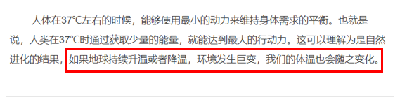

**考点**：加强选非题

**来源**：2020年湖南公务员考试《行测》试题（网友回忆版）第103题

### 第 104 题

研究人员发现，全球温室气体排放或使得澳大利亚森林火灾成为一种常态。

以下哪项如果为真，最能支持上述结论？

A. 澳大利亚森林火灾将产生大量温室气体排放

B. 澳大利亚森林火灾是在高温、干燥、少雨和强风的共同作用下形成

C. 澳大利亚与美国西部、加拿大等一样存在高温、干燥、少雨和强风气候条件

D. 如果不对温室气体排放做出限制，将使得陆地气温持续上升，陆地气温上升容易发生森林火灾

第 104 题 · 答案与解析

**参考答案（粉笔题库参考内容）**

D

**解析**

第一步：找出论点和论据。

论点：全球温室气体排放或使得澳大利亚森林火灾成为一种常态。

论据：无。

本题的论点是在说全球温室气体排放或使得澳大利亚森林火灾成为一种常态，无明显论据，故加强方式可以用补充论据对论点进行说明即可。

第二步：逐一分析选项。

A项：该选项在说澳大利亚森林火灾会产生大量温室气体，而论点说的是温室气体导致澳大利亚森林火灾经常发生，属于因果倒置，具有削弱作用，排除；

B项：该选项在说澳大利亚森林火灾是在高温、干燥、少雨和强风的共同作用下形成，与温室气体排放会不会使澳大利亚火灾成为常态无关，话题不一致，无法加强，排除；

C项：该选项在说澳大利亚与美国西部、加拿大等一样存在高温、干燥、少雨和强风气候条件，但没有明确说明这些气候条件与全球温室气体排放具体有何关系，也未明确说明上述条件与会使澳大利亚火灾成为常态是否有关，无法加强，排除；

D项：该选项对温室气体排放导致森林火灾的原因进行解释，补充论据，可以加强，当选。

故正确答案为D。

**考点**：补充论据

**来源**：2020年湖南公务员考试《行测》试题（网友回忆版）第104题

### 第 105 题

最新研究显示，常喝绿茶有益心血管。研究者对十万余名参与者进行了为期七年的跟踪研究。参与者被分成两组：有喝绿茶习惯者（即每周喝绿茶三次以上的人）和没有喝绿茶习惯者（即从不或每周喝绿茶次数不到三次的人）。研究者发现，与没有喝绿茶习惯者相比，有喝绿茶习惯者患心脏病和中风的风险低20%，死于心脏病和中风的风险低22%。

以下各项如果为真，最能支持上述结论的是：

A. 与常喝绿茶的人相比，从不吸烟者患心脏病和中风的风险低14%

B. 绿茶中含有的黄酮醇类，具有预防血液凝块及血小板成团的作用

C. 绿茶中的儿茶素和多种维他命成分，可有效延缓衰老、预防癌症

D. 习惯喝绿茶组的参与者其年龄普遍大于无喝绿茶习惯组的参与者

第 105 题 · 答案与解析

**参考答案（粉笔题库参考内容）**

B

**解析**

第一步：找出论点和论据。

论点：常喝绿茶有益心血管。

论据：研究者对十万余名参与者进行了为期七年的跟踪研究。参与者被分成两组：有喝绿茶习惯者（即每周喝绿茶三次以上的人）和没有喝绿茶习惯者（即从不或每周喝绿茶次数不到三次的人）。研究者发现，与没有喝绿茶习惯者相比，有喝绿茶习惯者患心脏病和中风的风险低20%，死于心脏病和中风的风险低22%。

本题论点说的是常喝绿茶有益心血管，论据是对比有喝绿茶习惯者和没有喝绿茶习惯者患心脏病和中风的风险及死于心脏病和中风的风险的数据结果。二者话题一致，加强优先考虑补充论据。

第二步：逐一分析选项。

A项：论点说的是常喝绿茶有益心血管，对比的是常喝绿茶和不常喝绿茶，该项是常喝绿茶的人与从不吸烟者相比，话题不一致，无法加强，排除；

B项：该项说的是绿茶中的黄酮醇类，具有预防血液凝块及血小板成团的作用，而中风等心血管疾病常见的原因之一是血液凝固成团，解释了为什么常喝绿茶有益心血管，补充论据，当选；

C项：绿茶中的儿茶素和多种维他命成分，可有效延缓衰老、预防癌症，并没有说明绿茶中的儿茶素和多种维他命成分对心血管的益处，话题不一致，无法加强，排除；

D项：习惯喝绿茶组的参与者其年龄普遍大于无喝绿茶习惯组的参与者，无法确定中风和心脏病的患病和死亡风险与年龄之间的关系，也无法确定两组参与者之间的具体年龄差距，属于不明确选项，无法加强，排除。

故正确答案为B。

**考点**：补充论据

**来源**：2020年湖南公务员考试《行测》试题（网友回忆版）第105题

## 材料 1

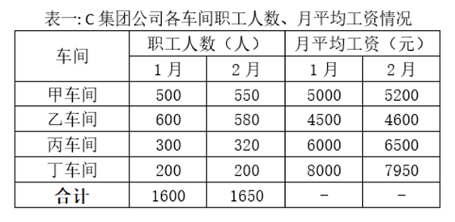

### 第 106 题

与上个月相比较，2月份职工人数变动幅度最大的是：

A. 甲车间

B. 乙车间

C. 丙车间

D. 丁车间

第 106 题 · 答案与解析

**参考答案（粉笔题库参考内容）**

A

**解析**

根据题干“······变动幅度最大的是”，可判定本题为一般增长率问题。定位表一，可得甲、乙、丙、丁4个车间1月份的职工人数分别为500、600、300、200，2月份的职工人数分别为550、580、320、200。变动幅度比较大小，比较增长率的绝对值即可。根据增长率=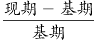，可得甲、乙、丙、丁4个车间职工人数的环比增速分别为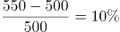，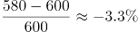，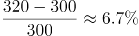，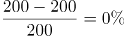，甲车间职工人数的变动幅度最大。

故正确答案为A。

**考点**：一般增长率、综合资料

**来源**：2020年湖南公务员考试《行测》试题（网友回忆版）第106题

### 第 107 题

与上月相比较，2月份工资总额变动率最大的车间是：

A. 甲车间

B. 乙车间

C. 丙车间

D. 丁车间

第 107 题 · 答案与解析

**参考答案（粉笔题库参考内容）**

C

**解析**

根据题干“······2月份工资总额变动率最大”，可判定本题为一般增长率比较问题。根据月工资总额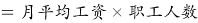，定位材料表格可得：

甲车间2月工资总额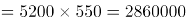=286万元，1月工资总额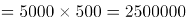=250万元 ，根据公式：变动率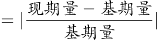可知，甲车间工资总额变动率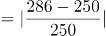=|36/250|≈14%；

乙车间2月工资总额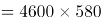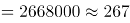万元，1月工资总额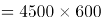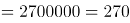万元，乙车间工资总额变动率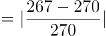=|-3/270|≈1%；

丙车间2月工资总额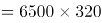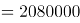\=208万元，1月工资总额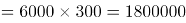=180万元，丙车间工资总额变动率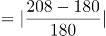=|28/180|≈16%；

丁车间2月工资总额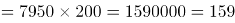万元，1月工资总额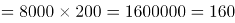万元，丁车间工资总额变动率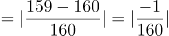≈0.6%。

工资总额变动率最大的是丙车间。

故正确答案为C。

**考点**：一般增长率、综合资料

**来源**：2020年湖南公务员考试《行测》试题（网友回忆版）第107题

### 第 108 题

2月工资总额与产值比率最大的车间：

A. 甲车间

B. 乙车间

C. 丙车间

D. 丁车间

第 108 题 · 答案与解析

**参考答案（粉笔题库参考内容）**

C

**解析**

根据题干“······与······比率最大的车间”，结合材料2月的职工人数、月平均工资及各车间产值，可判定本题为比值比较问题。根据月工资总额=月平均工资×职工人数，定位材料可得：

甲车间2月工资总额=5200×550=2860000=286万元，工资总额与产值比率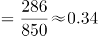；

乙车间2月工资总额=4600×580=2668000≈267万元，工资总额与产值比率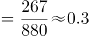；

丙车间2月工资总额=6500×320=2080000=208万元，工资总额与产值比率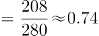；

丁车间2月工资总额=7950×200=1590000=159万元，工资总额与产值比率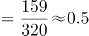， 工资总额与产值比率最大的为丙车间。

备注：本题将单位换算统一，比较时直接列式比较即可。

故正确答案为C。

**考点**：比值比较、综合资料

**来源**：2020年湖南公务员考试《行测》试题（网友回忆版）第108题

### 第 109 题

与上月相比，2月份工厂的总产值增长了百分之几？

A. 28

B. 32

C. 41

D. 48

第 109 题 · 答案与解析

**参考答案（粉笔题库参考内容）**

C

**解析**

根据题干“与上月相比，2月份工厂的总产值增长了百分之几”，结合选项为百分数，可以判定本题为一般增长率的计算问题。根据表二可知，1月公司各车间的总产值之和为500+600+250+300=1650，2月公司各车间的总产值之和为850+880+280+320=2330。根据一般增长率计算公式：，可得与上月相比，2月份工厂的总产值增长了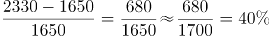，与C项最接近。

故正确答案为C。

**考点**：一般增长率、综合资料

**来源**：2020年湖南公务员考试《行测》试题（网友回忆版）第109题

### 第 110 题

能够从上述资料中推出的是：

A. 1月份人均产值最大的是乙车间

B. 除丙车间外，2月份各车间的人均产值都有所上升

C. 2月份丁车间的人均产值低于整个集团公司的人均产值

D. 与上个月相比较，整个集团公司的工资增长率低于产值增长率

第 110 题 · 答案与解析

**参考答案（粉笔题库参考内容）**

D

**解析**

A项：根据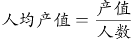，由表一和表二可知，1月甲车间人均产值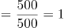，乙车间人均产值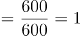，丙车间人均产值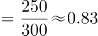，丁车间人均产值，故1月份人均产值最大的是丁车间，错误；

B项：由表一和表二可知2月份甲车间人均产值， 2月份乙车间人均产值，2月份丙车间人均产值，2月份丁车间人均产值，结合A项可得, 2月份各车间的人均产值都有所上升，错误；

C项：由表一和表二可知2月份整个集团人均产值，结合B项可得2月份丁车间的人均产值（1.6）高于整个集团公司的人均产值（1.4），错误；

D项：由107题解题过程可知2月份整个集团工资总额≈286+267+208+159=920万元，1月份整个集团工资总额=250+270+180+160=860万元，故增长率为。由109题可知整个集团的产值增长率为41%，故与上个月相比较，整个集团公司的工资增长率低于产值增长率，正确。

故正确答案为D。

注：B项题干没有明确说明是同比上升还是环比上升，从材料出发倾向于环比上升，而同比上升无数据。因此，无论从何种角度理解此项均错误。

**考点**：综合分析、综合资料

**来源**：2020年湖南公务员考试《行测》试题（网友回忆版）第110题

## 材料 2

### 第 111 题

妇幼出院人数占4所三甲医院妇科和儿科出院总数比重最小的是：

A. 甲医院

B. 乙医院

C. 丙医院

D. 丁医院

第 111 题 · 答案与解析

**参考答案（粉笔题库参考内容）**

A

**解析**

根据题干“妇幼出院人数占4所三甲医院妇科和儿科出院总数比重最小······”，可判定本题为现期比重问题，其中部分量为各医院的“妇幼出院人数”，总体量为“4所三甲医院妇科和儿科出院总数”。因总体量相同，故只需比较部分量的大小关系即可。

定位表格，4所医院的妇幼出院人数分别为：甲医院：320+130=450人；乙医院：840+580=1420人；丙医院：450+350=800人；丁医院：280+240=520人。对比可得，甲医院的人数最少，则占比最小。

故正确答案为A。

**考点**：现期比重、统计表

**来源**：2020年湖南公务员考试《行测》试题（网友回忆版）第111题

### 第 112 题

该市三甲医院外科的治愈率在以下哪个范围内：

A. 30%-50%

B. 50%-70%

C. 70%-90%

D. 90%以上

第 112 题 · 答案与解析

**参考答案（粉笔题库参考内容）**

D

**解析**

方法一：根据题干“······的治愈率在以下哪个范围”，结合“治愈率”，可判定本题为现期比重问题。定位表格可得该市三甲医院外科的治愈人数和出院人数，则所求治愈率，D项满足。

方法二：4所医院的外科的治愈率分别为：、、、，因每个医院的外科治愈率均大于90%，则总体治愈率也一定大于90%，D项满足。

故正确答案为D。

**考点**：现期比重、统计表

**来源**：2020年湖南公务员考试《行测》试题（网友回忆版）第112题

### 第 113 题

儿科治愈率高于外科治愈率的医院是：

A. 甲医院

B. 乙医院

C. 丙医院

D. 丁医院

第 113 题 · 答案与解析

**参考答案（粉笔题库参考内容）**

B

**解析**

根据题干“儿科治愈率高于外科治愈率”，由治愈率，可判定本题为现期比重比较问题。定位表格儿科和外科数据可得：

甲医院：儿科治愈率<外科治愈率；

乙医院：儿科治愈率外科治愈率；

丙医院：儿科治愈率外科治愈率；

丁医院：儿科治愈率外科治愈率；

根据结果可知乙医院满足要求。

故正确答案为B。

**考点**：现期比重、统计表

**来源**：2020年湖南公务员考试《行测》试题（网友回忆版）第113题

### 第 114 题

治愈率最低的科室是:

A. 内科

B. 外科

C. 妇科

D. 儿科

第 114 题 · 答案与解析

**参考答案（粉笔题库参考内容）**

A

**解析**

方法一：根据题干“治愈率最低······”，结合“”，可判定本题为现期比重问题。定位表格可得4个科室对应的治愈人数和出院人数，则4个科室的治愈率分别为：

内科：；

外科：，根据本篇材料第二题可得其治愈率为90+%；

妇科：；

儿科：；

对比可得，内科的治愈率最低。

方法二：在4所医院中，内科的治愈率分别为：、、、。则总体治愈率低于50%；

外科的治愈率，根据本篇材料第二题可得其为90+%；

妇科的治愈率分别为：、、、。则总体治愈率高于50%；

儿科的治愈率分别为：、、、。则总体治愈率高于50%；

对比可得，内科治愈率最低。

故正确答案为A。

**考点**：现期比重、统计表

**来源**：2020年湖南公务员考试《行测》试题（网友回忆版）第114题

### 第 115 题

下列说法正确的是：

A. 与其他医院相比，甲医院的总体治愈率最低

B. 乙医院的总体治愈率最高，原因是该医院妇科和儿科的出院人数最多

C. 与其他医院相比，内科治愈率最高的是丙医院

D. 丁医院的儿科治疗水平高于其他医院

第 115 题 · 答案与解析

**参考答案（粉笔题库参考内容）**

A

**解析**

A项：根据，定位表格最后一行，甲、乙、丙、丁医院总体治愈率分别为：、、、；根据结果可知甲医院的总体治愈率最低，正确；

B项：由A项医院总体治愈率比较结果可知，乙医院的总体治愈率最高；根据 ，分数比较大小，并不是只看分子或分母的大小，所以治愈率高并非仅由出院人数决定，应由治愈人数和出院人数共同决定，错误；

C项：根据，定位表格数据第一行，甲、乙、丙、丁医院内科治愈率分别为：、、、；根据结果可知内科治愈率最高的是丁医院，错误；

D项：“儿科治疗水平”的高低即比较“儿科治愈率”的大小。根据，定位表格数据倒数第二行，甲、乙、丙、丁医院儿科治愈率分别为：、、、；根据结果可知儿科治愈率最高的是乙医院，错误。

故正确答案为A。

**考点**：综合分析、统计表

**来源**：2020年湖南公务员考试《行测》试题（网友回忆版）第115题

## 材料 3

2019年全国房地产开发投资132194亿元，比上年增长9.9%，增速比上年加快0.4个百分点。其中，住宅投资97071亿元，增长13.9%，增速比上年加快0.5个百分点。2019年，全国商品房销售面积171558万平方米，比上年下降0.1%。其中，住宅销售面积增长1. 5%，办公楼销售面积下降14.7%，商业营业用房销售面积下降15.0%。商品房销售额159725亿元，增长6. 5%，增速比上年回落5.7个百分点。其中，住宅销售额增长10.3%，办公楼销售额下降15.1%，商业营业用房销售额下降16.5%。

### 第 116 题

2018年全国房地产开发投资比上年增长：

A. 48114亿元

B. 11427亿元

C. 10436亿元

D. 10278亿元

第 116 题 · 答案与解析

**参考答案（粉笔题库参考内容）**

C

**解析**

根据题干“2018年······比上年增长”，结合选项数据带单位，可判定本题为增长量计算问题。定位文字材料第一段“2019年全国房地产开发投资132194亿元，比上年增长9.9%，增速比上年加快0.4个百分点”，故2018年全国房地产开发投资金额亿元，2018年全国房地产开发投资同比增长率=9.9%-0.4%=9.5%，因此2018年全国房地产开发投资比上年增长金额×1/10.5亿元，最接近C项。

故正确答案为C。

**考点**：增长量计算、综合资料

**来源**：2020年湖南公务员考试《行测》试题（网友回忆版）第116题

### 第 117 题

与2018年相比，2019年全国商品房销售均价约：

A. 增长580元

B. 增长710元

C. 下降580元

D. 下降710元

第 117 题 · 答案与解析

**参考答案（粉笔题库参考内容）**

A

**解析**

根据题干“与2018年相比，2019年······均价约”，结合选项为增长/下降+单位，可判定本题为平均数的增长量计算问题。定位文字材料第一段“2019年，全国商品房销售面积171558万平方米，比上年下降0.1%······商品房销售额159725亿元，增长6.5%”，商品房销售均价，代入平均数的增长量公式：元，最接近A项。

故正确答案为A。

**考点**：平均数的增长量、综合资料

**来源**：2020年湖南公务员考试《行测》试题（网友回忆版）第117题

### 第 118 题

2019年全国住宅投资占房地产开发投资比重排名第二的地区是：

A. 东部地区

B. 中部地区

C. 西部地区

D. 东北地区

第 118 题 · 答案与解析

**参考答案（粉笔题库参考内容）**

D

**解析**

根据题干“2019年······占······比重”，材料时间为2019年，可判定本题为现期比重问题。定位表一，可知四个地区的住宅投资额和房地产开发投资额。根据公式：比重，可得东部地区比重72%，中部地区比重78%，西部地区比重73%，东北地区比重3847/5100≈75%，故比重排名第二的地区是东北地区。

故正确答案为D。

**考点**：现期比重、综合资料

**来源**：2020年湖南公务员考试《行测》试题（网友回忆版）第118题

### 第 119 题

2018年房地产投资额最多的地区约为排名第二地区的：

A. 2.0倍

B. 2.5倍

C. 3.0倍

D. 3.5倍

第 119 题 · 答案与解析

**参考答案（粉笔题库参考内容）**

B

**解析**

根据题干“2018年······约为······的”，结合材料时间为2019年，可判定本题为基期倍数问题。定位表一，可知2019年各地区的房地产投资额及增长率。根据基期量，可得2018年东部地区房地产投资额亿元，中部地区房地产投资额亿元，西部地区房地产投资额亿元，东北地区房地产投资额亿元。故2018年房地产投资额最多的地区为东部地区，排名第二的地区为西部地区，则倍数。

故正确答案为B。

**考点**：基期倍数、综合资料

**来源**：2020年湖南公务员考试《行测》试题（网友回忆版）第119题

### 第 120 题

根据上述材料可以推出：

A. 2019年商品房销售均价东北地区高于中部地区

B. 2018年东部地区商品房销售面积比西部地区约多3000万平方米

C. 2018年住宅投资占房地产开发投资比重最低的地区是东部地区

D. 如果2017年全国商品房销售均价要与2018年持平，其销售面积应达到163055万平方米

第 120 题 · 答案与解析

**参考答案（粉笔题库参考内容）**

A

**解析**

A项：定位表二可知，2019年东北地区商品房销售均价亿元/万平方米，中部地区商品房销售均价亿元/万平方米<0.71亿元/万平方米，东北地区高于中部地区，正确；

B项：定位表二可知，2018年东部地区商品房销售面积万平方米，2018年西部地区商品房销售面积万平方米，67607-45410=22197万平方米，错误；

C项：定位表一可知，2019年四个地区住宅投资和房地产开发投资额及增长率，结合118题可知，东部地区比重，西部地区比重，可知2018年东部地区比重；2018年西部地区比重，西部地区占比显然更低，错误；

D项：定位表二可知，2018年全国商品房销售均价≈亿元/万平方米；定位文字材料可知，2019年全国商品房销售额159725亿元，增长6.5%，增速比上年回落5.7个百分点，则2017年全国商品房销售额≈亿元，若保持2018年和2017年的商品房销售均价不变，则2017年的销售面积应为万平方米，错误。

故正确答案为A。

**考点**：综合分析、综合资料

**来源**：2020年湖南公务员考试《行测》试题（网友回忆版）第120题

