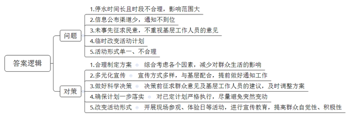
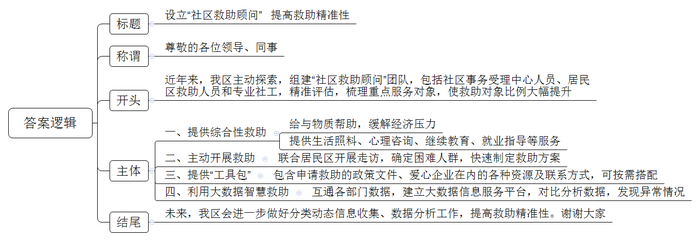
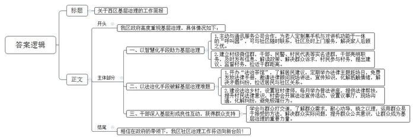
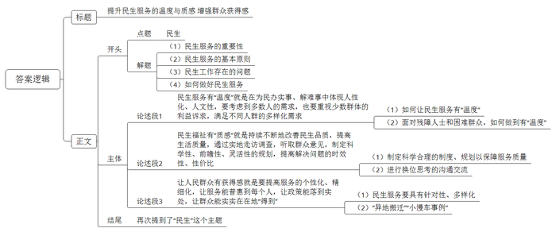

# 2021年公务员多省联考《申论》题（湖南通用卷）

<!-- gwy:overview:start -->
> **湖南 · 2021 · 申论 · 通用卷** ｜ 4 题 · 图片 4 处 · 答案随题折叠

导航：[题目](#题目) · [材料 1](#材料-1)
<!-- gwy:overview:end -->

> 候选采集稿。参考答案及解析来自粉笔页面，不代表官方答案或真实高分答卷；来源使用许可与原卷对应关系仍需人工核实。

## 给定材料

### 材料 1

3月19日，F市水利局在官网上公布了关于开展第二届“限水体验日”活动的通知。通知要求，“在3月22日‘世界水日’这天，由市主城区范围内的4家供水公司对其供水范围内用水户（不包括企业、医院、学校及生产经营单位）实施停水。”通知还指出，“各县区活动实施范围为各县区政府驻地，活动时间和具体要求与市主城区相同，停水时间为当天的上午09:30分至晚上08:30分，共计11个小时。”

3月20日，F市水利局在当地晚报上刊登了F市“限水体验日”活动宣传公告，在公布停水区域及时间段的同时，还希望广大市民对活动给予理解与支持。

F市水利局领导向闻讯前来采访的记者表示：“本次活动的目的是通过限制用水这个方式，进一步增强大家的节水意识，创建一个节约用水的城市氛围。”同时还说明，“市区内大部分的地方会停水，但是学校、企业、医院和生产经营单位都会保障供水。”

记者还了解到，“限水体验日”活动已经是该市第二年举办。去年采用的是“减压供水”，今年为了能更好地达到预期目的，改为了“实施停水”。

F市许多市民看到相关通知后表示，在用水高峰时段停水11个小时，确实有点儿“狠”，这个“限水体验日”应该叫“最狠体验日”。

记者随机走访了一些市民，询问对此事的看法。王女士表示停水一天时间太长，“孩子刚满2个月，洗洗涮涮的，很多地方都需要用水，停水一天肯定会很不方便。”

“刚听隔壁邻居说的，都不知道有这么一回事，这事社区应该提前告诉我们呀。再说了，去年减压供水已经够让人感到用水紧张了。”李先生感到非常不理解。

“一直要停到晚上八点半，晚上做饭和洗漱都成问题了。停水的初衷是好的，但这么重大的事情应该事先征求市民意见。”赵女士说。

一位不愿意透露姓名的区水利局工作人员表示，接到通知时他们也感到诧异，担心市民会有意见，并向上级反馈了，但是结果如何他们也不好说，上面有要求，下面就得执行。

记者同时走访了相关部门，了解到在F市主城区就有65万人口，下属县区政府驻地还有近8万人口，如果停水，这部分人中的绝大多数都将受到影响。

3月21日下午，F市水利局发布了《F市关于对“世界水日”限水活动进行调整的通知》。通知称，鉴于市民对限水体验活动的不同意见，经统筹研究，决定3月22日停水活动调整为自愿节水活动，希望能更好地营造全民节水氛围，鼓励全市市民为保护珍贵水资源，共创和谐家园贡献自己的力量，同时感谢广大市民对节水活动的关注，诚挚邀请社会各界对节水活动提出宝贵意见和建议。

记者了解到，对于这一临时改变，许多市民表示长舒了一口气，原本以为一天都没有水用，现在不用担心了。还有一些市民说，自己已经做好了停水准备，所以接了很多水备着，现在一下子又说不停水了，接了的水太占地方只能倒掉，有点浪费。

也有市民建议：“活动初衷不错，只不过以后可以改变一下形式，比如开展参观污水处理厂、自来水厂之类更加灵活多样的活动。”

### 材料 2

“把她的家粉刷一新，给独自生活的她更多支持”。

某公益平台上，为女孩儿小珊修缮房屋的公募计划得到不少爱心网友的参与。1元、10元、100元……不到一个月，爱心捐款就超过了修缮所需费用。

小珊的故事是C市社会救助综合改革的一个缩影。家住C市N区的小珊，唯一的亲人去世，自己又身患多种疾病，让她一度有轻生念头，是N区“社区救助顾问”团队把她从疾病与孤独中拉了出来。

“我们希望为她‘粉刷’的不仅是墙面，还有内心。”社区救助顾问小李说。为小珊修缮房屋正是为其定制的“救助组合拳”中的一步：修缮后的房屋腾出一间出租，能有效缓解其家庭债务。同时，提供专业心理咨询、继续教育、就业指导等服务，帮助她重拾生活信心。

近年来，尽管C市已建立较完备的现代社会救助体系，但因救助工作涉及部门较多、政策内容复杂，总有一些不愿主动求助、不知如何求助的“沉默”困难群众未得到应有的救助。2019年，N区组建了一支由社区事务受理中心人员、居民区救助人员和专业社工组成的300余人“社区救助顾问”团队。截至目前，N区已对7000多户居民进行了精准评估，梳理出高度困境家庭重点服务对象1300多户，其中不少属于“沉默”的困难人群。

“解决救助工作‘最后一公里’难题需要在思路上有转变。N区是全国社会救助综合改革试点区，我们想通过先试先行，为全市社会救助工作摸索出一条新路子来，所以，2019年9月，最先在N区实施了‘社区救助顾问’制度。”C市民政局负责人说。

新冠肺炎疫情下，那些本就脆弱的家庭会否面临更大的风险？N区红桥路街道救助顾问联合居民区开展主动走访。他们发现，来N区务工的苏先生所在公司因疫情无法开工，妻子无业在家，还有三胞胎女儿需要照顾，家庭基本生活难以维持。救助顾问以最快速度制定救助方案，除发放临时帮扶资金外，还主动对接外部资源，帮助苏先生的妻子找到了一份工作。

“我们给每名救助顾问一个‘政策包’和‘资源包’，‘政策包’里装着为困难群众申请救助的政策文件，‘资源包’里则有包括爱心企业、群团组织、基金会等在内的各种资源及联系方式。这就是救助顾问的‘工具包’，可以按需搭配。”N区民政局社会救助科科长说。

在N区华新路街道，近年来通过打通民政、人社、卫健、医保、残联等部门数据，形成了“可统计、可分析、可关联”的智慧救助大数据。街道办何主任举例说，救助顾问在比对居民医保与工会数据时，发现陈女士家庭医药费支出突然增大，上门走访后得知陈女士最近做了一场大手术，丈夫又生病在家，儿子也找不到工作。救助顾问随即为陈女士一家对接救助政策，不仅解决了大部分自费医药费，还帮助其儿子找到了临时工作，使这个家庭很快走出了困境。

“过去，我们只是物质救助，现在不仅是这些，还包括生活照料、精神慰藉、能力提升等综合性的。”N区民政局社会救助科科长说。

“精准救助首先要对象精准，确保‘应保尽保，不落一户’。我们区虽然初步建立了救助大数据信息服务平台，但是，做好低保家庭、低收入家庭、支出型贫困家庭和特殊困难家庭的分类动态信息收集、数据分析工作还有一段路要走。”N区民政局申局长说。

“社区救助顾问”制度在N区试点以来，越来越多的困难人群被救助顾问发现，并得到及时救助。数据显示，N区救助目标对象占全区户籍人口的比例已从1%升至约6%。

### 材料 3

小谢是西区政府办公室工作人员，2021年3月1日，他和办公室其他同志一起到西区基层就基层治理工作进行调研，以下是他的访谈记录。

某社区张主任：针对我们社区留守老人、独居老人较多这一具体情况，为了更好地给他们提供服务，社区工作人员主动与某通讯服务公司联系，定制了一款集手机与对讲机功能于一体的“呼叫器”，发放给老年人使用。老人们如需要帮助，通过“呼叫器”，随时能与社区取得联系，我们会在第一时间安排相关人员上门服务。去年5月份，我们社区张大娘在家中不慎摔倒，导致腰部旧伤复发，病情严重，无法挪动，她立即通过随身携带的这款“呼叫器”，向社区寻求帮助。社区干部得知消息后，第一时间将张大娘送往医院就医，并及时与张大娘在外地打工的儿子取得联系。住院期间，社区干部、党员、志愿者等多次开展帮助，解决张大娘的实际困难。“摔倒了，起不了床，我都可以按一下按键，通知社区里的人来帮忙，这就方便了不少。”张大娘说，有了呼叫器，就不用再担惊受怕了，这点很贴心，儿子在外面工作也很放心。

某社区丁书记：在我们社区“法治茶馆”的墙上，写了“乡里茶谈”四个字，就是把社区邻里的矛盾纠纷、居民对社区工作的建议意见等放到台面上，在大家聊天、喝茶、拉家常的过程中得到解决。在这里，每个月有两次法律主题的赶场日，为村民免费发放土地纠纷、老年人权益保护等法律手册，并有法律顾问现场讲解一些法律问题。前年，电力公司准备在社区修建一座高压铁塔，老陈等居民认为辐射大，极力反对，社区干部多次上门做工作也没用。一次赶场日，社区工作人员专门邀请老陈到茶馆一起喝茶聊天，还请了电力公司的专业技术人员介绍高压铁塔的安全性。老陈听了后如释重负地说道：“看来是我对高压铁塔的安全性了解不够多，建铁塔看来是好事嘛。”事后，老陈遇到我，专门提起这件事，他说：“喝茶的时候我就不那么有抵触情绪，感觉和你们之间也没有隔阂了。”

村民老张：在我们村，以前村民有纠纷，会有一些打架等极端行为。现在，区司法局为每个村配备了律师，每个月都有普法讲座，村民依法维权意识大大增强。前些年，我把自家的3亩地租给了柑橘园刘老板，开始还能按时付租金，但从2017年起，刘老板不再如期支付租金，我多次要账无果。2019年区里推行律师驻村后，我靠免费法律帮扶要回了租金。如果没有驻村律师帮助，我不知道还要多花多少钱。我当时想把他的水利设备破坏掉出口气。现在看来，还是法律维权最好。如今，村委会不仅增设了“乡村大喇叭”，讲法律、“摆”道理，还设置了议事厅，有了小矛盾小纠纷，大家都可以到议事厅里，心平气和把事情“摆”出来，把道理讲清楚，共同解决问题。

某镇纪委胡书记：我们镇所有村都建立了村级微信群，让乡镇干部、民（辅）警、村组干部、每户村民代表等成为“微友”，并要求进群干部实行“实名+职务”亮明身份。按照要求，群内及时发布新政策动态、工程评议过程、议事决策以及村务信息等。群众对村里工作有建议，也可以直接在微信里提出来，还可对村里的老大难问题进行监督。不久前，龙溪村因上季度财务未定期公开，一些群众通过村级微信群表示质疑。镇党委按照加强基层管理的有关要求，立即着手调查，发现村财务并无问题，只是村务公开不及时，遂责成该村迅速公开财务，并向群众作出检讨。2020年来，我们镇通过“村级微信群”共解决涉及政策解答、诉求回应的便民服务类问题510件，收到“微友”反映的问题线索30余条。村级微信群让群众更便捷更直观地参与到了村级事务管理中，拉近了村民和村干部之间的距离。

某镇党委刘书记：我们在基层治理工作中，既需要群众给我们支持，理解我们的政策措施，推动工作落实落地，但更需要我们的干部深入基层干实事解难事，这样群众就会更加支持政府工作，形成干群关系良性互动，有理有法推动基层治理。我们镇上有对外乡夫妇，有一手烤羊肉串的好手艺，雇了5名员工，经营羊肉串摊。刚到镇上时，由于生意火爆，经常违规占道经营。派出所、城管执法队员和社区志愿者开始做劝导工作的时候，夫妻二人很不理解。执法人员耐心指导，动之以情，晓之以理，并耐心地帮他们经营出点子，所在社区还帮助解决了他们孩子入学的问题。现在，他们一家在镇上安顿下来，买了房子，租了门面，生意越来越红火。2019年，他们向所在社区捐出1万元和大米、菜油等爱心物资，帮助了25名困难群众。

区基层治理办小秦：我参加工作5年多了，做好基层治理工作，我最大的体会是，单靠法治是不够的，应在基层党委的领导下，还要学会和群众打交道的艺术，了解群众的需求，用群众易于接受的方法合情合理合法的推进。同样一个道理，一个政策，用不同的方法，就有不同的效果。有时候好的方法，不仅能让群众理解透政策，还能收获到他们的支持和好点子。关键也是要以心换心。

### 材料 4

在2021年L省两会上，“聚力民生服务、为群众办实事”是重要议题。在讨论环节，不少来自基层的代表分享了各自“办实事”的故事：

代表一：我是一名社区工作者。上班第一天，我就遇到了处理不了的“麻烦”。到社区入户走访时，一名听力障碍居民因为不会写字，着急地比划着手势。看不懂手语的我一头雾水，只能干着急。这次经历令我自责不已。虽然社区里听力障碍居民不多，但如果不能与他们有效沟通，连打招呼都困难，更别说主动提供服务了。后来，我打定主意要学手语。看书、上网课、请教专业老师……刚学会几句简单用语，我便主动找听力障碍居民“聊天”，再帮他们做些小事。慢慢地，沟通的桥梁畅通了。去年初，我创建了“无声服务室”，内设“调解室”“谈心角”等功能区，帮他们找工作，解决问题，无声的交流成了社区一道风景。这次经历给我最大的感受是，多数人的需求要考虑，少数群体的利益诉求也不能被忽视。

代表二：我是一名驻村干部。去年的一次村民座谈会上，有村民提出用电泵引水上山，以解决人畜季节性缺水问题。但有村民质疑，电泵引水上山，尽管不用承担建设成本，但以后用电抽水，电费可能很高。为此，村民们争论不休。会后，我和村干部组成工作队，带着这些问题，在村里专门进行了走访调查，特别听取了一些熟悉山里情况老人的意见。一位老人提到村子的后山上有个废弃水库，漏水很多年，如果把它修好，说不定能行。我们实地考察后发现，利用旧水库投资小、维护易，的确可行。项目完工后，村民用水成本比原计划减少了一半，邻近的村子也受益。

代表三：我是柳荫新区街道办副主任。柳荫新区有不少群众是从高山地区易地搬迁来的，适应新环境还需要有个过程。“电梯怎么用？”“过马路为啥要看红绿灯？”入户走访过程中，我发现，大家的许多困难都是语言不通、生活不习惯带来的。找到了问题的关键，有人提出了办“夜校”的想法。“夜校”办起来后，我和同事们精心准备课程，大到法律法规、国家政策，小到城市生活常识、本地方言，凡是和搬迁群众生活密切相关的，都找人来讲。每次上课，都要下足功夫，做充分的准备。民警讲交通规则、防骗知识，社区工作人员关注易地搬迁移民的衣食住行、生活小事，随迁干部鼓励大家放下乡情、主动拥抱新生活。一年多来，40多期“夜校”真正融入了搬迁群众生活的一点一滴，照亮了“新城里人”融入城市生活的路，在干部群众之间架起了一座“连心桥”。

代表四：我是5633次“小慢车”列车乘务员。尽管最近几年山里的大多数村子都修了公路，但是山区经常出现落石、滑坡和泥石流等地质灾害，阻断公路畅通，冬季也经常封路。对于大山深处的老乡们来说，5633次列车还是最安全、时间最有保障的出行方式，很多时候也是唯一的出行方式。即使某些区段因为各种原因无法通行，我们也会保障其他区段的运行。

在过去的几十年间，这趟“小慢车”早已彻底融入当地人的日常生活。作为孩子们的校车、当地人的赶集车、公交车、婚车......我们这趟列车在用“润物无声”的方式支持着山区的脱贫攻坚。有的时候，山里的土特产在“小慢车”上就完成了交易。老乡们在车厢里拿出秤杆子，当场称重交易，省时又省力。为了方便日常老乡运输家禽、牲口，“小慢车”贴心地在行李车厢增设了牲畜拴挂处，每趟车进行消毒，实现了牲畜与旅客分开，让车厢环境更卫生、整洁。

为了供阿树上学，他父母通过“小慢车”销售家里种植的烤烟、土豆、玉米。他们最大的心愿就是阿树能找到一份稳定的工作。2017年，铁路部门履行扶贫承诺来到学校招工，阿树与另外5名彝族同学脱颖而出，成为“小慢车”的乘务员，得知儿子能够在“铁路部门”上班的消息，一家人都高兴坏了，妈妈说，“这下阿树既找到了稳定的工作，又缓解了家里的经济压力。”从乘客变为铁路人，“小慢车”一直温暖着这位青年的心。

一位省人大代表在接受采访时表示，2021年“十四五”开局之年，在继续统筹抓好疫情防控和社会经济发展的大背景下，L省将从交通、教育、医疗、就业、健康等各个方面，办好更多民生实事，在改善民生品质上干出一番新气象。报告有温度，为民情怀浓，就是要以政府的紧日子换取群众的好日子，努力让民生服务更有“温度”，民生福祉更有“质感”，让人民群众的获得感更足。

## 题目

### 第 1 题

**假如你是F市水利局的一名工作人员，请根据“给定资料1”，概括F市组织“限水体验日”活动存在的问题，并谈谈如何在今后工作中避免类似情况发生。（15分）**

关联材料：材料 1

作答要求：

要求：准确，全面，条理清晰，具体可行，不超过250字。

第 1 题 · 答案与解析

**参考答案（粉笔题库参考内容）**

问题：1.停水时间长且时段不合理，影响范围大；2.信息公布渠道少，通知不到位；3.未事先征求民意，不重视基层工作人员的意见；4.临时改变活动计划；5.活动形式单一、不合理。

对策：1.合理制定方案。综合考虑各个因素，减少对群众生活的影响；2.多元化宣传。宣传方式多样，与基层配合，提前做好通知工作；3.做好科学决策。决策前征求群众意见及基层工作人员的建议，及时调整方案；4.确保计划一步落实。对已定计划严格执行，尽量避免突然变动；5.改变活动形式。开展现场参观、体验日等活动，进行宣传教育，提高群众自觉性、积极性。

**解析**

**参考答案说明：**本参考答案宏观上从“问题”和“对策”两个方面展开。在“问题”方面，又从“停水时间长且时段不合理，影响范围大”“信息公布渠道少，通知不到位”“未事先征求民意，不重视基层工作人员的意见”“临时改变活动计划”“活动形式单一、不合理”等不同的方面进行分条撰写；在“对策”方面，针对“停水时间长且时段不合理，影响范围大”的问题，从“合理制定方案”这一方面提出对策；针对“信息公布渠道少，通知不到位”的问题，从“多元化宣传”这一方面提出对策；针对“未事先征求民意，不重视基层工作人员的意见”的问题，从“做好科学决策”这一方面提出对策；针对“临时改变活动计划”的问题，从“确保计划一步落实”这一方面提出对策；针对“活动形式单一、不合理”的问题，从“改变活动形式”这一方面提出对策。各条要点之间在内容上相互并列，没有交叉。

**考点**：提出对策类

**来源**：2021年公务员多省联考《申论》题（湖南通用卷）

### 第 2 题

**C市准备召开社区救助工作经验交流座谈会，如果由你代表N区在座谈会上作简要发言，请根据“给定资料2”，拟写一份发言稿。（20分）**

关联材料：材料 2

作答要求：

要求：内容全面，有逻辑性，语言流畅，不超过350字。

第 2 题 · 答案与解析

**参考答案（粉笔题库参考内容）**

设立“社区救助顾问” 提高救助精准性

尊敬的各位领导、同事：

近年来，我区主动探索，组建“社区救助顾问”团队，包括社区事务受理中心人员、居民区救助人员和专业社工，精准评估，梳理重点服务对象，使救助对象比例大幅提升。

一、提供综合性救助。给与物质帮助，缓解经济压力；提供生活照料、心理咨询、继续教育、就业指导等服务。二、主动开展救助。联合居民区开展走访，确定困难人群，快速制定救助方案。三、提供“工具包”。包含申请救助的政策文件、爱心企业在内的各种资源及联系方式，可按需搭配。四、利用大数据智慧救助。互通各部门数据，建立大数据信息服务平台，对比分析数据，发现异常情况。

未来，我区会进一步做好分类动态信息收集、数据分析工作，提高救助精准性。谢谢大家！

**解析**

**参考答案说明：**本参考答案包括标题、称谓、正文，符合发言稿的形式。内容上，开头先整体介绍了N区社会救助的情况；主体部分从“提供综合性救助”“主动开展救助”“提供‘工具包’”“利用大数据智慧救助”四个方面介绍了具体做法；结尾表明了未来的发展方向。各条答案要点之间在内容上相互并列，没有交叉。

**考点**：总结类

**来源**：2021年公务员多省联考《申论》题（湖南通用卷）

### 第 3 题

**假如你是西区政府办公室工作人员小谢，请根据“给定资料3”，写一份反映西区基层治理工作简报。（25分）**

关联材料：材料 3

作答要求：

要求：准确全面，条理清晰，语言流畅，不作格式要求，不超过500字。

第 3 题 · 答案与解析

**参考答案（粉笔题库参考内容）**

**参考答案一：**

关于西区基层治理的工作简报

我区政府高度重视基层治理，具体情况如下：

一、以智慧化手段助力基层治理。1.主动与通讯服务公司合作，为老人定制集手机与对讲机功能于一体的“呼叫器”，可与社区随时联系，社区及时上门服务，解决家人后顾之忧。2.建立村级微信群，干部、民警、村民代表等实名进群，干部亮明职务，及时发布信息、解读政策、解决群众诉求，村民参与村务，提出建议、监督村务，拉近干群距离。

二、以法治化手段破解基层治理难题。1.开办“法治茶馆”，了解居民建议，定期举办法律主题赶场日，免费发放法律手册，邀请法律顾问现场讲法，宣传知识，化解抵触情绪，解决矛盾纠纷，拉近居民与社区关系。2.建设法治乡村，设置驻村律师，每月举办普法讲座，提供法律帮扶，提升村民法律意识，村委会开展法治宣传活动，设置议事厅，现场沟通，化解纠纷，避免极端行为。

三、干部深入基层形成良性互动，获得群众支持。学会与群众打交道，了解群众需求，耐心劝导，晓之以理，运用群众易于接受的方法，解决群众实际问题，提升群众公共意识，让群众成为基层治理的重要力量。

相信在政府的带领下，我区社区治理工作将迈向新台阶！

**解析**

**参考答案说明：**（1）本题是公文题，要求写一份工作简报，并且要求不必考虑格式，保险起见，可以加上标题，即“标题+正文”。（2）本参考答案的内容方面，开头先介绍了西区基层治理的特点，主体部分从“以智慧化手段助力基层治理”“以法治化手段破解基层治理难题”“干部深入基层形成良性互动，获得群众支持”这三个方面对西区基层治理工作进行了具体展开。形式方面，本参考答案做到了分段、分条撰写，整体上条理较为清晰。

**参考答案二：**

关于西区基层治理的工作简报

我区政府高度重视基层治理，具体情况如下：

一、定制“呼叫器”，服务老人确保安心放心。主动与通讯服务公司合作，为老人定制集手机与对讲机功能于一体的“呼叫器”，可与社区随时联系，社区及时上门服务，解决家人后顾之忧。

二、开办“法治茶馆”，解决矛盾纠纷。了解居民建议，定期举办法律主题赶场日，免费发放法律手册，邀请法律顾问现场讲法，宣传知识，化解抵触情绪，拉近居民与社区关系。

三、建设法治乡村，避免极端行为。设置驻村律师，每月举办普法讲座，提供免费法律帮扶，提升村民法律意识，村委会开展法治宣传活动，设置议事厅，现场沟通，化解纠纷。

四、建立村级微信群，引导村民参与村务，拉近干群距离。干部、民警、村民代表等实名进群，干部亮明职务，及时公开村务、解读政策，听取群众建议，接受群众监督，解决群众诉求。

五、干部深入基层形成良性互动，获得群众支持。学会与群众打交道，了解群众需求，耐心劝导，晓之以理，运用群众易于接受的方法，解决群众实际问题，提升群众公共意识，让群众成为基层治理的重要力量。

相信在政府的带领下，我区社区治理工作将迈向新台阶！

**考点**：总结类

**来源**：2021年公务员多省联考《申论》题（湖南通用卷）

### 第 4 题

**“给定资料4”中提到“努力让民生服务更有‘温度’，民生福祉更有‘质感’，让人民群众的获得感更足”。请你深入思考这句话，联系实际，自选角度，自拟题目，写一篇议论文。（40分）**

关联材料：材料 1、材料 2、材料 3、材料 4

作答要求：

要求：

（1）参考给定资料，但不拘泥于给定资料；

（2）思路清晰，语言流畅；

（3）字数1000-1200字。

第 4 题 · 答案与解析

**参考答案（粉笔题库参考内容）**

**提升民生服务的温度与质感 增强群众获得感**

党的十九大报告指出：“增进民生福祉是发展的根本目的。必须多谋民生之利、多解民生之忧，在发展中补齐民生短板。”民生服务保障工作必须谨遵“群众至上”的原则，需要一代又一代人的不断奋斗与努力。但是如今还是存在就业不稳定、教育缺失、交通拥堵等问题，政府的民生工作和群众的民生需求出现了“错位”，说明在一定程度上政府工作脱离了群众、脱离了实际。

因此，**只有让群众有更稳定的工作、更可靠的保障、更舒适的居住条件、更满意的收入等，才能展现民生服务的“温度”与“质感”，让群众有获得感。**

**民生服务有“温度”就是在为民办实事、解难事中体现人性化、人文性，要考虑到多数人的需求，也要重视少数群体的利益诉求，满足不同人群的多样化需求。**有“温度”的民生服务要贴近群众实际，获得群众支持，遵从群众意愿。比如面对残障人士，一方面要积极主动学习，提升自身服务水平；另一方面可创建“无声服务室”，帮助听障居民找到工作，解决实际困难。对于困难群众，可联合居民区主动走访、调查，快速制定救助方案，发放临时帮扶资金，对接外部资源帮助就业等。

**民生福祉有“质感”就是持续不断地改善民生品质，提高生活质量，通过实地走访调查，听取群众意见，制定科学性、前瞻性、灵活性的规划，提高解决问题的时效性、性价比。**制度、规划是提升服务质量的保障，科学合理的停水方案，既能增强节水意识，又能保证正常生活；换位思考的沟通交流，不仅能快速反馈群众意见建议，还能提高制度、章程的落实效率。再如社区制定“社区救助顾问”制度，有效解决了困难弱势群众的问题；智能“呼叫器”的普及，可以为社区老人提供更灵活、更精细的服务。

**让人民群众有获得感就是要提高服务的个性化、精细化，让服务能普惠到每个人，让政策能落到实处，让群众能实实在在地“得到”。**民生服务涉及到群众生活的各个方面，包括教育、就业、住房、健康等诸多领域，要注重服务的针对性、多样化。帮助易地搬迁群众融入城市生活，为其开办“夜校”，讲解法律法规、国家政策、生活常识、本地方言等，鼓励大家放下乡情、主动拥抱新生活；“小慢车”开进大山深处，不但是山村最安全、时间最有保障的出行方式，还能切实帮助群众实现就业，缓解经济压力。

民生无小事。“保障和改善民生没有终点，只有连续不断的新起点。”这是对群众的承诺，是对国家的负责，不但温暖亿万群众心田，还能保障国家发展节节高。用政府的紧日子换取群众的好日子，同时带动中国经济“芝麻开花节节高”。

**解析**

**文章分析**

**提升民生服务的温度与质感 增强群众获得感**

【**标题的优点**：首先，范文的标题突出了“民生服务的温度与质感”“群众获得感”这些关键词。其次，从形式上来说，前半句是大主题，后半句点明意义，使标题更加完整、饱满，且与文章结构对应，富有逻辑性。】

（1）党的十九大报告指出：“<u>增进民生福祉是发展的根本目的</u>。必须多谋民生之利、多解民生之忧，在发展中补齐民生短板。”（2）<u>民生服务保障工作必须谨遵“群众至上”的原则</u>，需要一代又一代人的不断奋斗与努力。（3）但是如今还是存在<u>就业不稳定、教育缺失、交通拥堵等问题</u>，<u>政府的民生工作和群众的民生需求出现了“错位”</u>，说明在一定程度上政府工作脱离了群众、脱离了实际。

（4）因此，只有<u>让群众有更稳定的工作、更可靠的保障、更舒适的居住条件、更满意的收入等</u>，才能展现民生服务的“温度”与“质感”，让群众有获得感。

【**开头的优点**：★内容方面：范文的开头是紧扣题目给定的“民生服务”这一主题词展开的。首先，开头第一句话点出了“民生”，非常明确。其次，对“民生服务”这一主题词进行了分析阐述，指出了：（1）民生服务的重要性；（2）民生服务的基本原则；（3）民生工作存在的问题；（4）如何做好民生服务。★文字表达方面：使用了“只有……才”等关联词，让语言更有逻辑。】

**民生服务有“温度”就是在为民办实事、解难事中体现人性化、人文性，要考虑到多数人的需求，也要重视少数群体的利益诉求，满足不同人群的多样化需求。**（1）有“温度”的民生服务<u>要贴近群众实际</u>，<u>获得群众支持</u>，<u>遵从群众意愿</u>。（2）比如<u>面对残障人士</u>，一方面要积极主动学习，提升自身服务水平；另一方面可创建“无声服务室”，帮助听障居民找到工作，解决实际困难。<u>对于困难群众</u>，可联合居民区主动走访、调查，快速制定救助方案，发放临时帮扶资金，对接外部资源帮助就业等。

【**论述段1的优点**：★观点句：范文的观点句是紧扣“民生服务”这一文章主题词提出的。形式上，它在段首处直接写出，位置突出，容易被发现；内容上，关键词突出，内容要点明确，可以明显看出它是从“民生服务的‘温度’”这一角度入手，指出了为民办事要体现人性化、人文性，既要考虑多数人的需求，也要考虑少数人的需求。★论述内容：本段主要围绕“民生服务”这一主题词进行分析阐述，指出了：（1）如何让民生服务有“温度”；（2）面对残障人士和困难群众，如何做到有“温度”。注意：以上两个方面的内容都是紧扣观点句“民生服务有‘温度’就是在为民办实事、解难事中体现人性化、人文性，要考虑到多数人的需求，也要重视少数群体的利益诉求，满足不同人群的多样化需求”进行分析论述的，针对性强、内容层次丰富。在论证方法和论据选取方面，讲道理和举例子相结合，做到了丰富多样。】

**民生福祉有“质感”就是持续不断地改善民生品质，提高生活质量，通过实地走访调查，听取群众意见，制定科学性、前瞻性、灵活性的规划，提高解决问题的时效性、性价比。**（1）<u>制度、规划是提升服务质量的保障</u>，科学合理的停水方案，既能增强节水意识，又能保证正常生活；（2）<u>换位思考的沟通交流</u>，不仅能快速反馈群众意见建议，还能提高制度、章程的落实效率。再如社区制定“社区救助顾问”制度，有效解决了困难弱势群众的问题；智能“呼叫器”的普及，可以为社区老人提供更灵活、更精细的服务。

【**论述段2的优点**：★观点句：范文的观点句是紧扣“民生服务”这一文章主题词提出的。形式上，它在段首处直接写出，位置突出，容易被发现；内容上，关键词突出，内容要点明确，可以明显看出它是从“民生福祉有‘质感’”这一角度入手，指出了要改善民生品质，提高生活质量。★论述内容：本段主要围绕“民生服务”这一主题词进行分析阐述，指出了：（1）制定科学合理的制度、规划以保障服务质量；（2）进行换位思考的沟通交流。注意：以上两个方面的内容都是紧扣观点句“民生福祉有‘质感’就是持续不断地改善民生品质，提高生活质量，通过实地走访调查，听取群众意见，制定科学性、前瞻性、灵活性的规划，提高解决问题的时效性、性价比”进行分析论述的，针对性强、内容层次丰富。在论证方法和论据选取方面，讲道理和举例子相结合，做到了丰富多样。】

**让人民群众有获得感就是要提高服务的个性化、精细化，让服务能普惠到每个人，让政策能落到实处，让群众能实实在在地“得到”。**（1）民生服务涉及到群众生活的各个方面，包括教育、就业、住房、健康等诸多领域，<u>要注重服务的针对性、多样化</u>。（2）<u>帮助易地搬迁群众融入城市生活</u>，为其开办“夜校”，讲解法律法规、国家政策、生活常识、本地方言等，鼓励大家放下乡情、主动拥抱新生活；<u>“小慢车”开进大山深处</u>，不但是山村最安全、时间最有保障的出行方式，还能切实帮助群众实现就业，缓解经济压力。

【**论述段3的优点**：★观点句：范文的观点句是紧扣“民生服务”这一文章主题词提出的。形式上，它在段首处直接写出，位置突出，容易被发现；内容上，关键词突出，内容要点明确，可以明显看出它是从“让人民群众有获得感”这一角度入手，指出了要提高服务的个性化、精细化。★论述内容：本段主要围绕“民生服务”这一主题词进行分析阐述，指出了：（1）民生服务要具有针对性、多样化；（2）介绍了“易地搬迁”“小慢车”两个事例。注意：以上两个方面的内容都是紧扣观点句“让人民群众有获得感就是要提高服务的个性化、精细化，让服务能普惠到每个人，让政策能落到实处，让群众能实实在在地‘得到’”进行分析论述的，针对性强、内容层次丰富。在论证方法和论据选取方面，讲道理和举例子相结合，做到了丰富多样。】

【**论述段之间的关系**：★内容的内在逻辑：范文的论述段之间是依照并列逻辑展开的。论述段1先写了“民生服务的温度”，论述段2又写了“民生福祉的质感”，论述段3再写了“让群众有获得感”。★段与段的外在衔接：论述段1、2、3都在开头段直接点题，使文章整体上看起来逻辑清晰。】

民生无小事。“保障和改善民生没有终点，只有连续不断的新起点。”这是对群众的承诺，是对国家的负责，不但温暖亿万群众心田，还能保障国家发展节节高。用政府的紧日子换取群众的好日子，同时带动中国经济“芝麻开花节节高”。

【**结尾的优点**：范文结尾是回扣题目给定的“民生服务”这一主题词展开的，再一次强调了“民生服务”的深远意义。】

**考点**：文章写作题

**来源**：2021年公务员多省联考《申论》题（湖南通用卷）

