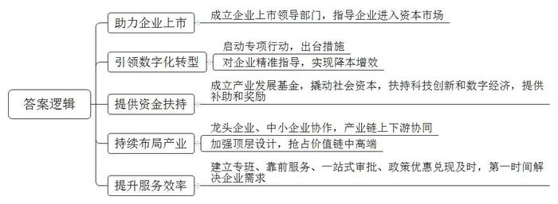
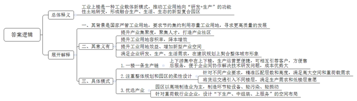
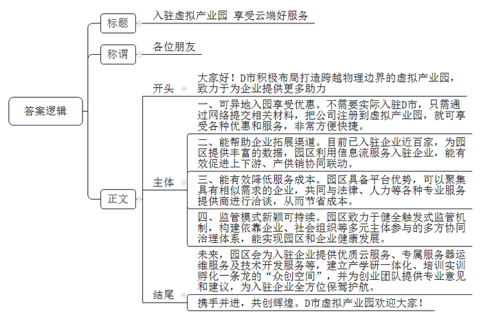
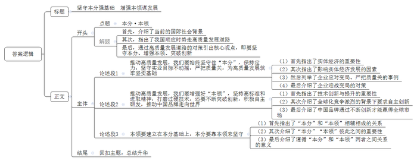

# 2023年公务员多省联考《申论》题（湖南省市卷）

<!-- gwy:overview:start -->
> **湖南 · 2023 · 申论 · 省市卷** ｜ 4 题 · 图片 4 处 · 答案随题折叠

导航：[题目](#题目) · [材料 1](#材料-1)
<!-- gwy:overview:end -->

> 候选采集稿。参考答案及解析来自粉笔页面，不代表官方答案或真实高分答卷；来源使用许可与原卷对应关系仍需人工核实。

## 给定材料

### 材料 1

20多年来，J市根据企业需求不断推出新举措，当好企业的“引路人、推车手、服务员”。早在2001年，J市政府就成立了企业上市领导小组办公室，指导多家集团通过进入资本市场，为其发展壮大补充“资本燃料”。

2021年初，J市启动数字经济发展三年行动，出台了《支持产业数字化转型升级十二条措施》，扶持传统制造业数字化转型。针对不同企业在研发、生产、管理、销售等各环节面临的具体问题，为他们提供智能运维、调度、物流、管网及算法软件优化等精准指导，帮助企业降本增效。J市经信委相关负责同志介绍，数字化转型运行两年来，样板企业平均用工减少60%，运营成本降低20%，产品研发周期缩短50%，生产效率提升40%。

中科院某装备制造研究中心是中科院与J市人民政府共同建设的科研单位，该中心以赋能中小企业“环节突破”为核心要务，已为全市200多家中小企业提供了数字化转型服务。

2022年7月，由市政府主导、国有企业出资、总规模达50亿元的产业发展母基金正式成立。相关负责人介绍：“我们将以此撬动至少200亿元社会资本形成合力，用以投向科技创新和数字经济领域。”对鞋服、建材、医疗器械等传统产业的数字化转型标杆样板企业，市政府按照不超过其投入金额20%的标准给予补助；对于工业互联网平台、系统服务商，最高可获30万元奖励。

市发改委相关负责人表示，经过持续多年的产业布局，J市有7000多亿元的工业底盘，26万多个市场主体。行业龙头企业的周边活跃着数以千计的中小企业为之提供配套服务。他们中绝大多数的服务辐射半径在50公里以内。这就意味着，龙头企业能够快捷便利地找到配套商，大大降低了成本，而中小企业只需专注于产业链条某一环节的研发生产。龙头企业和中小企业同向发力，产业链上下游协同，是近年来J市发挥产业集群优势、稳住实体经济大盘的秘诀。某公司负责人说：“2022年以来，从鞋服、纸箱到标识、模具，产业链上下游500多家做配套的中小企业，全部和我们一道保持满负荷生产。”

泰信集团是一家纺织面料、纺织机械生产企业，为配合海外客户需求，公司于2016年在东南亚设立工厂。泰信集团总裁说：“东南亚国家企业生产双运动鞋所需的高端面料、纱线、鞋底材料等，很大程度上依赖国内出口。在东南亚国家建设智能车间、数字化生产线，也离不开来自国内的技术人员和工程师。”对此，市发改委相关负责人表示，这是企业转型升级的机遇，要抓住这个机遇，接下来J市要通过顶层设计，统筹布局、高位推动，以产业集群优势，在精细化工、中高端面料、智能装备、高端设备、示范工厂等方面发力，抢占价值链中高端。

2022年3月，疫情使众多企业生产经营受到影响。多家企业负责人回忆，当时正是生产旺季，很多企业已经提前交付了海运集装箱定金，如果不能按时交货，将承担巨额违约责任。危急时刻，J市政府帮助困难企业闭环生产，点对点运送货物至港口出海，保障了按时生产和交货，挽救了一批企业。2022年8月，胜科纳米科技公司的芯片分析测试实验室正式运行。这家高科技企业，从决定在J市设立公司开始到正式运营，仅用了半年时间。J市的服务效率给公司刘总留下了深刻印象，“市里建立专班，靠前服务，各项审批手续一个窗口完成，人才补贴当年兑现，员工租房、联系食堂等也迅速协调解决。只要企业有需求，随时给政府部门打电话，都能在第一时间得到回应和解决。”

### 材料 2

B省M市重点打造的智全科创园建筑面积17万平方米，设有生产研发、总部办公、产业配套、生活配套等功能区。目前，园区入驻企业120多家，入驻率95%，主导产业为机器人和智能装备，园区企业年产值35亿元，是2018年“工业上楼”改造之前的19倍。作为B省“工业上楼”的鼻祖，智全科创园的华丽转身证明了“工业上楼”可行有效。

2019年7月，M市在全国率先出台《M市工业上楼工作指引》，规定容积率放宽到3.5以上，建筑密度放宽至55%，屋顶绿化折算绿地率，配套用房建筑面积可达到30%。2020年2月，B省出台《关于进一步推进工业用地提质增效的意见》，鼓励引导工业用地的多途径盘活利用，提升工业用地含金量。当前，产业社区已成为都市型工业的升级版，其不仅关联产业，更是“人城产”的深度融合。B省发改委廖主任说：“‘工业上楼’是我们打造产业社区的第一步，通过‘工业上楼’提升产业集聚度，进而聚集人才、形成社区。”

2020年底，B省N市也启动建设“工业上楼”项目——满天星科创产业园，推动工业用地向“研发+生产”的功能性土地转变。“产业园一期运营以来，已吸引和扶持人工智能、智能制造等领域科创项目32个。”满天星科创产业园熊主任说，“我们的目标是形成融合生产、生活、生态的新型复合园区。”“2022年以来，全市新上工业项目用地平均容积率较2021年提高了7%，亩均产出提高15%，用地成本却降低了10%。”该市自然资源和规划局涂局长说。

“人多地少是基本省情，制造业蓬勃发展，不断寻求增量空间。在国家严管工业用地的背景下，如何节约集约利用存量工业用地，寻求更高质量的发展，已事关全省发展大局。”B省一高校的龚教授说，“我省近年积极探索‘工业上楼’这种工业载体新模式已成为提升工业用地效益、增加新型产业空间的重要趋势。”调研发现，“工业上楼”不仅满足了企业的研发、生产、生活需求，而且在建筑规划上最大限度契合了整体城市形象，这已成为B省很多“工业上楼”项目的共同特点。

2022年10月，B省Q市科中激光研究院入驻产业园。研究院黄副院长说：“入驻产业园后，发现上下楼就是上下游，有一种如鱼得水的感觉。作为新型研发机构，我们成了联系上下游的‘轴’。”“除了空间更大，企业在生产运营方面的便捷也是‘上楼’前不能想象的。”Q市彗星产业园王经理说。当客户挑选完激光切割设备后，速光科技负责人李总将客户引荐到了同一栋楼上的下游企业升科智能。“当初就是看到速光科技入驻了彗星产业园，我才来的。上下游企业有相同的客户群体，客户到我们这里来看设备，还可以楼上楼下参观、交流，售后服务也方便。”升科智能宋总说，“碰到技术研发上的问题，大家还能协作攻关，带来很大的成本优势。一栋楼就是一条生产链。”

“提升容积率是‘上楼’的首要目的，但楼层并非越高越好，整体规划和园区的柔性设计也很重要。”贤云科技集团设计部闵经理说，“不同产业对层高要求不一样，因此工业楼宇的层数和整体高度要精准匹配、量身定制。”N市多个“工业上楼”项目均采用了新型工业化建造方式，以高适应性的空间去配合企业，满足企业对高大空间和重荷载的需求。“楼上”的产业空间体验好不好、功能全不全，企业说了算。贤云科技通过对企业“上楼意愿”及代表案例的总结研究，在N市山南智造城市更新项目中，提出了“折叠空间、多维产城”设计理念，将货运交通引入不同楼层平台，实现“多首层”厂房，最大程度满足高端制造业的生产需求及入驻企业的低楼层意愿，得到入驻企业的高度评价。

“上楼有很多好处，但不是谁都能上楼。越轻越往上，哪些企业哪些行业上楼，是对产业的一次优选。现阶段‘工业上楼’园区多以电子信息、智能装备、医疗器械、新材料等产业为主，要求入驻企业的制造环节具备轻设备、轻污染、轻振动等特征。”龚教授说。瑞名智能包装公司新厂房，楼高8层，其中1至5层分别为生产车间、仓储部、装配车间以及调试车间，6至8层为办公室。Q市城投城市更新投资有限公司刘经理说，针对这些重荷载行业企业，他们设计了“下生产、中组装、上服务”的“工业上楼”空间布局。2022年底，原分散于三个区平摊式的生产线整体搬迁上楼，顺利实现良性运转。

### 材料 3

“虽然我们的办公地点还在深圳，但我们可以享受到千里之外的D市‘云端’服务和税收等优惠政策。”启程科技公司周经理高兴地对记者说。启程科技公司所享受的服务和优惠，源于D市积极布局打造跨越物理边界的虚拟产业园。近日，《D市日报》记者专门对虚拟产业园发展现状进行了一次调研走访。

据记者了解，加入D市虚拟产业园，已成为不少企业的新选择。相较于传统产业园区，企业只需把公司注册到虚拟产业园，不用入驻指定地理区域生产经营，可自由选择办公城市和地点，也就是说，虚拟产业园内的企业可以分布在全国各地。

前不久，布拉电商科技有限公司成为D市虚拟产业园的新成员。“我们在深圳通过网络提交了相关材料，D市虚拟产业园的工作人员随即帮我们完成了工商注册，非常方便。”公司陈总经理说。

“截至目前，虚拟产业园招商入驻企业近100家，主要为互联网企业、电商企业、高科技企业等，初步促成了企业在线规模化集聚。”D市虚拟产业园负责人石主任向记者介绍。目前，D市虚拟产业园为入驻企业提供了合作需求发布、企业资源交换、信息共享、互动交流等多方面服务。“我们掌握着比较丰富的数据，利用这些信息流，可以有效促进上下游、产供销协同联动。最近，我们正在帮助园区内的一些电商企业与相关企业对接、合作，拓展渠道。”石主任说，“但是我们发现，部分企业入驻产业园的主要目的是减税，与平台产业链上下游进行联动的意愿不强，创新链、服务链与产业链之间的有机衔接没有达到预期，产业链供应链还缺乏稳定性。”

在D市工业经济研究所何研究员看来，目前选择入驻虚拟产业园的大多数为初创型企业，这些企业往往资金规模较小，除了基础的政务服务需求外，也希望能够以较低的成本获取法律、人力、财务、营销、金融、品牌等专业服务。部分企业因为行业特性还会衍生出不少个性化的需求，例如电商企业对客服、营销服务的需求，文创企业对设计、美工服务的需求。“虚拟产业园原本就有平台优势，可以把具有相似需求的企业聚集在一起，共同与服务提供商进行洽谈，从而节省成本，现在的关键问题是如何把这个优势发挥好。”

“虚拟产业园要发展，需在盈利模式上有所突破。与传统产业园区相比，虚拟产业园在房地产方面的销售和租赁收入很少，目前主要依靠税收返还、政府补贴等渠道获取收入，但这并非长久之计！”D市经信委袁副主任说，以D市虚拟产业园为例，市里不仅为入驻企业和个人提供地方留存税收的80%作为奖励，还外加最高600万元的人才补贴、企业上云补贴等奖励。“我觉得有必要加快培育一批具有运营管理能力的市场化主体，构建市场化的投入和盈利模式，比如向企业收取一定的园区管理费或场地租用费来增加园区收入。”

“作为新业态新模式的虚拟产业园，如何实现打破行政边界后的有效监管对虚拟产业园发展至关重要。”D大学贺教授表示，要打破传统业态按区域、按行业治理的惯性思维，探索创新监管模式。“从企业的角度来看，我认为虚拟产业园还应该在推动产业集聚、上下游联动方面多做工作，同时要多一些有针对性的设计，在增值服务方面也还有进一步提升的空间。”君和咨询公司游经理向记者表示，D市虚拟产业园应该探索拓展盈利新渠道和新模式，如通过入股园区内企业、为企业嫁接资源等方式参与企业经营，既为入驻企业发展提供支撑，也能实现产业园自身的发展。

“虚拟产业园的监管是一个全新的课题。”何研究员说，“市经信委正委托我们开展专题研究，主要聚焦在健全触发式监管机制，构建依靠企业、社会组织等多元主体参与的多方协同治理体系，促进其健康发展。”

袁副主任不久前才去了沿海某城市，考察了当地的网商虚拟产业园建设。“他们为入驻企业提供了安全、稳定、快速和优惠的云服务，以及专属服务器运维服务。此外，产业园还以技术入股或低于市场价格的方式为入驻企业提供技术开发服务，如平台系统搭建、APP开发、网站开发、公众号开发等。”袁副主任感慨地说，“他们在产业园建设了产学研一体化、培训实训孵化一条龙的‘众创空间’，并邀请知名企业家、教授为创业团队提供专业意见和建议。目前产业园已成功孵化项目超过30个，我很受启发。”

## 题目

### 第 1 题

**请根据“给定资料1”，概括J市政府是如何当好企业的“引路人、推车手、服务员”的。（10分）**

关联材料：材料 1

作答要求：

要求：全面、准确。不超过200字。

第 1 题 · 答案与解析

**参考答案（粉笔题库参考内容）**

1.助力企业上市。成立企业上市领导部门，指导企业进入资本市场。

2.引领数字化转型。启动专项行动，出台措施；对企业精准指导，实现降本增效。

3.提供资金扶持。成立产业发展基金，撬动社会资本，扶持科技创新和数字经济，提供补助和奖励。

4.持续布局产业。龙头企业、中小企业协作，产业链上下游协同；加强顶层设计，抢占价值链中高端。

5.提升服务效率。建立专班、靠前服务、一站式审批、政策优惠兑现及时，第一时间解决企业需求。

**解析**

**参考答案说明**：本参考答案从“助力企业上市”“引领数字化转型”“提供资金扶持”“持续布局产业”和“提升服务效率”这五个方面展开。各条答案要点在内容上相互并列，没有交叉。

**考点**：概括措施类

**来源**：2023年公务员多省联考《申论》题（湖南省市卷）

粉笔申论页面对本题只提供「解析视频」入口，该入口是会员推广位，页面无视频地址与文字解析。

### 第 2 题

**请根据“给定资料2”，谈谈你对“工业上楼”的理解。（25分）**

关联材料：材料 2

作答要求：

要求：内容全面，分析透彻。不超过400字。

第 2 题 · 答案与解析

**参考答案（粉笔题库参考内容）**

工业上楼是一种工业载体新模式，推动工业用地向“研发+生产”的功能性土地转变，形成融合生产、生活、生态的新型复合园区。

一、其背景是国家严管工业用地，要求节约集约利用存量工业用地，寻求更高质量的发展。

二、其意义有：提升产业集聚度，聚集人才，打造产业社区；提升工业用地容积率，降本增效；提升工业用地效益、增加新型产业空间；满足企业研发、生产、生活需求，在建筑规划上契合整体城市形象。

三、具体模式：1.一楼一条生产链。上下游集中在上下楼，生产运营更便捷，可相互引荐客户，方便售后服务，便于企业间协作解决技术研发问题，成本优势大。2.注重整体规划和园区的柔性设计。针对不同产业要求，精准匹配层数和高度，满足高大空间和重荷载需求；将货运交通引入不同楼层，满足生产需求和低楼层意愿。3.优选产业。园区以高端制造业为主，制造环节轻设备、轻污染、轻振动；针对重荷载行业企业，设计“下生产、中组装、上服务”的空间布局。

**解析**

**参考答案说明：**（1）思路方面，本参考答案按照词句解释题“总体释义+展开解释”的一般答题思路展开。（2）内容方面，本参考答案先对“工业上楼”的含义进行了总体解释；再从背景、意义和具体模式三个角度展开解释：从“产业社区”“容积率”“工业用地效益”“城市形象”四个方面介绍了“工业上楼”带来的意义；最后从“一楼一条生产链”“注重整体规划和园区的柔性设计”“优选产业”三个方面介绍了“工业上楼”的具体模式。（3）词句表达方面，本参考答案加上了“一、”“二、”等连接词来承接上下文，使上下衔接更顺畅。

**考点**：词句解释类

**来源**：2023年公务员多省联考《申论》题（湖南省市卷）

粉笔申论页面对本题只提供「解析视频」入口，该入口是会员推广位，页面无视频地址与文字解析。

### 第 3 题

**为进一步推进虚拟产业园，D市准备在官方平台做一场网络直播，请结合“给定资料3”，写一篇推介宣传稿。（25分）**

关联材料：材料 3

作答要求：

要求：紧扣资料，重点突出。逻辑清晰，语言生动。不超过500字。

第 3 题 · 答案与解析

**参考答案（粉笔题库参考内容）**

入驻虚拟产业园 享受云端好服务

各位朋友：

大家好！D市积极布局打造跨越物理边界的虚拟产业园，致力于为企业提供更多助力。这里能为企业做的有：

一、可异地入园享受优惠。不需要实际入驻D市，只需通过网络提交相关材料，把公司注册到虚拟产业园，就可享受各种优惠和服务，非常方便快捷。二、能帮助企业拓展渠道。目前已入驻企业近百家，为园区提供丰富的数据，园区利用信息流服务入驻企业，能有效促进上下游、产供销协同联动。三、能有效降低服务成本。园区具备平台优势，可以聚集具有相似需求的企业，共同与法律、人力等各种专业服务提供商进行洽谈，从而节省成本。四、监管模式新颖可持续。园区致力于健全触发式监管机制，构建依靠企业、社会组织等多元主体参与的多方协同治理体系，能实现园区和企业健康发展。

未来，园区会为入驻企业提供优质云服务、专属服务器运维服务及技术开发服务等，建立产学研一体化、培训实训孵化一条龙的“众创空间”，并为创业团队提供专业意见和建议，为入驻企业全方位保驾护航。

携手并进，共创辉煌。D市虚拟产业园欢迎大家！

**解析**

**参考答案说明:**（1）格式方面，本参考答案写到了“标题”“称谓”“正文”三个部分｡（2）正文部分，一方面从内容上来看，答案的开头先写到了打造虚拟产业园的目的；主体部分从“可异地入园享受优惠”“能帮助企业拓展渠道”“能有效降低服务成本”“监管模式新颖可持续”四个方面具体介绍了入驻虚拟产业园的优势；结尾进行了总结､展望｡另一方面，形式上，本参考答案做到了分段､分层撰写，整体上条理较为清晰｡

**考点**：宣传类

**来源**：2023年公务员多省联考《申论》题（湖南省市卷）

粉笔申论页面对本题只提供「解析视频」入口，该入口是会员推广位，页面无视频地址与文字解析。

### 第 4 题

**结合给定资料，写一篇关于“本分·本领”的文章，联系实际，自定标题，自定格式。（40分）**

关联材料：材料 1

作答要求：

要求：

（1）观点明确，见解深刻；

（2）参考给定资料，但不拘泥于给定资料；

（3）1000～1200字。

第 4 题 · 答案与解析

**参考答案（粉笔题库参考内容）**

**坚守本分强基础 增强本领谋发展**

当今世界正处于百年未有之大变局，新一轮科技革命风起云涌，产业变革深入发展。如何于变局中开新局，中国智慧彰显出力量，我们国家顺应时势提出了高质量发展道路。前进的方向已经明确，前行的道路已经开拓，我们必须以坚守本分为原则，以增强本领为手段，以突破创新为核心动力，大力推动经济高质量发展，为全面建设社会主义现代化强国开好局起好步。

**推动高质量发展，我们要始终坚守住“本分”，保持定力，坚守实业目标不动摇，严把质量关，为高质量发展筑牢坚实基础。**实体经济是国民经济的基础和命脉，是国家强盛和民族复兴的重要支柱。而在实体经济的主战场上，质量是企业的立身之本。变局之下，大环境的不确定性、不稳定性增加，做实业考验着企业的定力。如何应对变局？格力给出了自己的答案。“好空调格力造”，这句脍炙人口的广告是格力三十年如一日坚持做实业、“锱铢必较”严把质量关的生动写照。因此，迎战变局，企业一方面需要拿出“咬定青山不放松”的定力，迎难而上、攻坚克难，聚焦目标、聚焦实业。另一方面要严把材料关、生产关、检验关，确保产品质量过硬，用高品质立身。

**推动高质量发展，我们要增强好“本领”，坚持高标准和进取精神，打磨过硬技术，还要不断突破创新，积极自主研发，推动中国品牌走向世界。**技术创新是推动企业发展的核心驱动力。通过不断提升技术水平，企业能够生产出更具竞争力的产品和提供更优质的服务，从而满足消费者需求。无论是对企业自身的提升，还是对整体经济的发展，打磨过硬技术都是不可或缺的。另一方面，在全球化竞争日益激烈的背景下，依靠模仿和跟随的发展模式已经无法适应市场需求。只有通过自主研发和创新，才能在国际竞争中脱颖而出。通过不断推陈出新，中国品牌能够树立起自身的技术和品牌优势，并逐步赢得全球市场的认可。

**本领要建立在本分基础上，本分要靠本领来坚守。**本分与本领如鸟之两翼、车之两轮，相辅相成，不可或缺，既要守本分又要有本事是能干事干成事的重要前提。没有本分作为基础，本领就没有准确的方向和目标；而没有本领作为支撑，本分就无法得到有效地履行。只有将本领建立在本分的基础上，我们才能够真正坚守本分，履行好自己的责任和义务。也只有通过不断提升本领，我们才能更好地履行自己的本分，并取得更大的成就。

君子务本，本立而道生。坚守物质技术基础，增强创新能力，我们就一定能于变局之中开新局，在危机之中育先机。不断推进高质量发展，把我国建设成为社会主义现代化强国。

**解析**

**文章分析**

**坚守本分强基础** **增强本领谋发展**

【**标题的优点：**首先，范文的标题突出了“本分·本领”这一主题。其次，它在形式上采用对称式结构，使标题更加饱满。】

（1）当今世界正处于百年未有之大变局，新一轮科技革命风起云涌，产业变革深入发展。（2）如何于变局中开新局，中国智慧彰显出力量，我们国家顺应时势提出了高质量发展道路。（3）前进的方向已经明确，前行的道路已经开拓，我们必须以坚守本分为原则，以增强本领为手段，以突破创新为核心动力，大力推动经济高质量发展，为全面建设社会主义现代化强国开好局起好步。

【**开头的优点：**★内容方面：范文的开头是紧扣“本分·本领”这一主题展开的。首先，介绍了当前的国际社会背景；其次，指出了我国顺应时势走高质量发展道路；最后，通过高质量发展道路的对策引出核心观点，即要坚守本分、增强本领、突破创新。★文字表达方面：长短句配合使用，使语言表达有节奏感。】

**推动高质量发展，我们要始终坚守住“本分”，保持定力，坚守实业目标不动摇，严把质量关，为高质量发展筑牢坚实基础。**（1）实体经济是国民经济的基础和命脉，是国家强盛和民族复兴的重要支柱。（2）而在实体经济的主战场上，质量是企业的立身之本。（3）变局之下，大环境的不确定性、不稳定性增加，做实业考验着企业的定力。如何应对变局？格力给出了自己的答案。“好空调格力造”，这句脍炙人口的广告是格力三十年如一日坚持做实业、“锱铢必较”严把质量关的生动写照。（4）因此，迎战变局，企业一方面需要拿出“咬定青山不放松”的定力，迎难而上、攻坚克难，聚焦目标、聚焦实业。另一方面要严把材料关、生产关、检验关，确保产品质量过硬，用高品质立身。

【**论述段1的优点：**★观点句：范文的观点句是紧扣“本分·本领”这一文章主题提出的。形式上，它在段首处直接写出，位置突出，容易发现。内容上，关键词突出，内容要点明确，可以明显看出他是从“本分”入手，指出了如何坚守“本分”。★论述内容：（1）首先指出了实体经济的重要性；（2）其次指出了影响实体经济发展的因素；（3）然后列举了企业应对变局、严把质量关的事例；（4）最后介绍了企业迎战变局的对策。注意：以上四个方面的内容都是紧扣“推动高质量发展，我们要始终坚守住‘本分’，保持定力，坚守实业目标不动摇，严把质量关，为高质量发展筑牢坚实基础”这个观点句论述的，论述的针对性强，内容层次丰富。在论述方法上采用了讲道理、举例子相结合，做到了丰富多样。】

**推动高质量发展，我们要增强好“本领”，坚持高标准和进取精神，打磨过硬技术，还要不断突破创新，积极自主研发，推动中国品牌走向世界。**（1）技术创新是推动企业发展的核心驱动力。通过不断提升技术水平，企业能够生产出更具竞争力的产品和提供更优质的服务，从而满足消费者需求。无论是对企业自身的提升，还是对整体经济的发展，打磨过硬技术都是不可或缺的。（2）另一方面，在全球化竞争日益激烈的背景下，依靠模仿和跟随的发展模式已经无法适应市场需求。只有通过自主研发和创新，才能在国际竞争中脱颖而出。（3）通过不断推陈出新，中国品牌能够树立起自身的技术和品牌优势，并逐步赢得全球市场的认可。

【**论述段2的优点：**★观点句：范文的观点句是紧扣“本分·本领”这一文章主题提出的。形式上，它在段首处直接写出，位置突出，容易发现。内容上，关键词突出，内容要点明确，可以明显看出他是从“本领”入手，指出了如何增强“本领”。★论述内容：（1）首先指出了技术创新与提升的重要性；（2）其次介绍了全球化竞争激烈的背景下要求自主创新；（3）最后介绍了中国品牌通过不断创新才能赢得全球市场。注意：以上三个方面的内容都是紧扣“推动高质量发展，我们要增强好‘本领’，坚持高标准和进取精神，打磨过硬技术，还要不断突破创新，积极自主研发，推动中国品牌走向世界”这个观点句论述的，论述的针对性强，内容层次丰富。在论述方法上主要采用了讲道理的方式，论述清晰透彻。】

**本领要建立在本分基础上，本分要靠本领来坚守。**（1）本分与本领如鸟之两翼、车之两轮，相辅相成，不可或缺，既要守本分又要有本事是能干事干成事的重要前提。（2）没有本分作为基础，本领就没有准确的方向和目标；而没有本领作为支撑，本分就无法得到有效地履行。只有将本领建立在本分的基础上，我们才能够真正坚守本分，履行好自己的责任和义务。也只有通过不断提升本领，我们才能更好地履行自己的本分，并取得更大的成就。

【**论述段3的优点：**★观点句：范文的观点句是紧扣“本分·本领”这一文章主题提出的。形式上，它在段首处直接写出，位置突出，容易发现。内容上，关键词突出，内容要点明确，可以明显看出他是从“本分”和“本领”入手，指出了“本分”和“本领”之间的关系。★论述内容：（1）首先指出了“本分”和“本领”相辅相成的关系；（2）其次介绍了“本分”“本领”彼此之间的重要性；（3）最后介绍了遵循“本分”和“本领”两者之间关系的意义。注意：以上三个方面的内容都是紧扣“本领要建立在本分基础上，本分要靠本领来坚守”这个观点句论述的，论述的针对性强，内容层次丰富。在论述方法上主要采用了讲道理的方式，论述清晰透彻。】

【**论述段之间的关系：**★内容的内在逻辑：论述段1先写了“推动高质量发展，我们要始终坚守住‘本分’，保持定力，坚守实业目标不动摇，严把质量关，为高质量发展筑牢坚实基础”，论述段2接着写了“推动高质量发展，我们要增强好‘本领’，坚持高标准和进取精神，打磨过硬技术，还要不断突破创新，积极自主研发，推动中国品牌走向世界”，论述段3最后写了“本领要建立在本分基础上，本分要靠本领来坚守”，各论述段分别从“本分”“本领”“本分与本领的关系”展开，逻辑清晰。】

君子务本，本立而道生。坚守物质技术基础，增强创新能力，我们就一定能于变局之中开新局，在危机之中育先机。不断推进高质量发展，把我国建设成为社会主义现代化强国。

【**结尾的优点：**范文的结尾回扣了“本分·本领”这个主题，并且进行了总结提升。】

**考点**：文章写作题

**来源**：2023年公务员多省联考《申论》题（湖南省市卷）

粉笔申论页面对本题只提供「解析视频」入口，该入口是会员推广位，页面无视频地址与文字解析。

