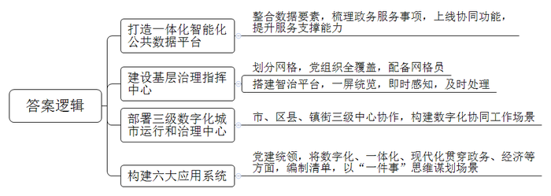
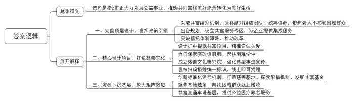
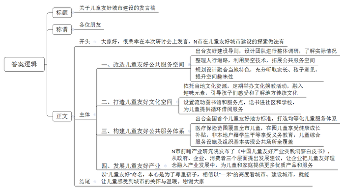
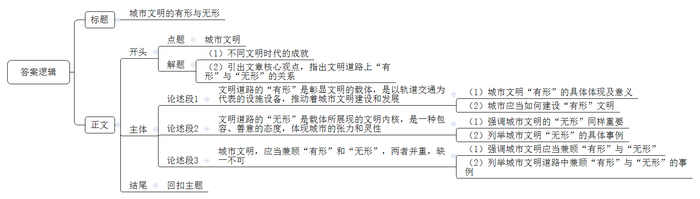

# 2024年公务员多省联考《申论》题（湖南省市卷）

> 候选采集稿。参考答案及解析来自粉笔页面，不代表官方答案或真实高分答卷；来源使用许可与原卷对应关系仍需人工核实。

## 给定材料

### 材料 material-b63d94120b500791

“我们早上9点提交申请，不到半小时就收到资料检查通过的短信，10点签了个字，下午3点企业就注册成功了。”12月1日，创业者小苏在网上提交“企业开办一件事”申请，轻松完成了企业开办手续。

2023年以来，H市持续打造一体化智能化公共数据平台，不断提升平台服务支撑能力。目前，已建成一体化平台数据要素“一组库”，为76个市级部门、41个区县开通数据仓环境；“快办”平台精细化梳理了2866个政务服务事项，支撑53项“一件事一次办”上线运行，“快政”平台形成了16项协同功能，日均活跃用户40万。

H市N区双桂镇将原有办公场地建成为基层治理指挥中心，形成党建统领、经济生态、平安法治和公共服务4个板块。全镇共划为176个网格，全覆盖建立网格党支部或党小组，采取整合、招聘、下沉等方式，配备专职网格员176人，通过搭建智治平台，以网格为单元核准“人、房、地、事、物”等信息，实现全镇网格一屏统览。一旦发生紧急事件，网格地图将立即变色并闪烁预警，实现即时感知、及时处理。

H市现有3000万常住人口，兼具“大城市”与大农村特点，治理难度大。2023年初，H市启动部署市、区县、镇街三级数字化城市运行和治理中心正式运行，初步构建起全局“一屏掌控”、政令“一键智达”、执行“一贯到底”、监督“一览无余”的数字化协同工作场景。“如果说传统的城市管理是‘农家土布’，那么数字时代的城市治理就是‘江南刺绣’。”H市大数据发展局黎局长说。

目前，全市842家医疗机构已实现影像检查结果互认，共汇聚检查报告1925万份，存储数据1852TB。医疗机构可以跨院调阅患者的影像检查结果，避免患者重复检查，让医生的诊断更加高效；B区智慧养老服务中心对居家养老群体的居住环境进行适老化改造，装上一键呼叫等设备，一旦出现异常，工作人员会第一时间联系处理；在革命纪念馆，游客借助数字技术手段，便能“穿越”时空，沉浸式感受红色文化……

一年多来，H市始终坚持党建统领，把数字化、一体化、现代化贯穿到党建、政务、经济、社会、文化、法治建设全过程各方面，着力构建“六大应用系统”，编制应用重大需求清单、多跨场景清单、重大改革清单，并以“一件事”思维谋划场景930个。

数字化场景应用正渐渐改变着人们生活的方方面面，赋予城市发展生生不息的力量。H市加“数”前行，数字化运行与治理的想象和场景还在不断拓展……

### 材料 material-5edf7357a127c66b

二十大报告强调，分配制度是促进共同富裕的基础性制度。坚持按劳分配为主体、多种分配方式并存，构建初次分配、再分配、第三次分配协调配套的制度体系。公益慈善事业作为第三次分配的重要载体，被赋予了时代使命。

“谢谢你们，孩子再也不用在塑料凳上写作业了。”日前，在T县山坝村小雨家里，小雨的爷爷高兴地对送书桌上门的“爱心小书房”志愿者说。在陈旧、简陋的家具摆设中，崭新的书桌格外醒目。点滴之爱，为困难家庭的孩子带来了更多的阳光和希望。

“爱心小书房”是Z市慈善促富专项行动中涌现出的品牌慈善项目。该项目采取民生服务共富结对的机制开展。“过去一年，Z市9个区民政部门与T县等3个县民政部门结对共建，组成3个共建团队，聚焦当地老人、小孩和困难群众的民生服务需求，统筹资源支持3个县民政民生协同发展。”Z市民政局慈善事业促进处韦处长表示，慈善促富专项行动已累计撬动投入慈善资金近亿元，落地290个重点民生领域项目。

“我们出台《Z市慈善事业高质量发展规划》，在全省各行政审批服务中心，率先设立慈善共富服务专区，紧扣企业反映的捐赠发票、税收抵扣、捐赠形式、慈善信托等问题提供集成服务，让企业更好走进慈善、了解慈善、支持慈善。”韦处长说。一年多来，已实施慈善募捐、救助等服务项目110个。Z市还突破慈善信托起步初期的体制障碍，形成了慈善信托捐赠“穿透开票”机制、全国首单全流程规范化不动产所有权慈善信托等系列改革成果。

围绕群众的“急难愁盼”，Z市各级慈善总会精心设计一批“扩中提低”共富项目，将每一份关爱精准送到最需要的地方。

“油烟机终于装上了，灶具也换新的了。厨房不仅干净了许多，也更加安全了。感谢你们！”市民李大妈开心地对绿能集团工作人员说。这个叫“暖厨计划”的项目，由Z市慈善总会和绿能集团联合发起，计划投入3000万元、持续三年时间为低保家庭改造厨房，帮助更换油烟机、灶具等厨房设备。绿能集团公益慈善基金会负责人表示，“暖厨计划”已累计改造厨房4000多家。如果说，“暖厨计划”慈善项目让善意的微光照进烟火日常，助学行动则是面向未来的希望之光。

近日，又一批家境困难的学生得到社会的援助。在“学子自强计划”帮助下，T县等3县的60名大学生收到了社会各界捐赠的每人16000元助学金。“有善始者实繁，能克终者盖寡。”Z市慈善总会负责人表示，“‘学子自强计划’已连续开展18年，是助学行动的有效组成部分。”帮扶困难学生，可以推动从“帮扶一个人”到“幸福一个家庭”，今年慈善系统助学项目已投入慈善资金2800余万元，帮扶12000余人次。

2023年1月至8月，Z市慈善系统支出2亿元，救助困难群众38万人次。9月，Z市慈善文化研究院揭牌成立。“我们将从历史和现实着眼，汲取中国传统慈善文化精髓，加快慈善文化阵地建设，强化慈善典型事迹宣传，服务慈善事业大格局。”研究院娄院长说。同月，Z市发布“慈善一日捐”扫码捐赠统一标识，市民通过政务App、支付宝、微信即可捐赠，将“人人可慈善、时时可慈善、处处可慈善”落到实处。

日前，Z市对外发布首批16个慈善基地。东城区孝爱慈善基地打造线上线下智慧慈善超市、西城区幸福乡里共同体慈善基地守护“朝夕美好”、T县太安村幸福直播慈善基地帮助低收入农户家门口就业……随着Z市的慈善基地“触角”延伸，“身边慈善”蔚然成风，慈善矩阵效应得以不断放大。

在红帆路，一个情意暖暖的幸福里慈善街区规模初现，慈善摊位、爱心助岗……“我们以帮扶困难群众就业为重点，打造公益慈善与商圈资源相融合的街区慈善文化。”江北区慈善总会负责人介绍，目前该街区正全力打造幸福里慈善驿站，已经筹资30余万元成立慈善信托，提供就业岗位300余个。

在“就业、帮扶、慈善捐”等领域，Z市建立各类慈善项目，让“善”意流淌在每个角落。港山区善“芹”共富基地依托当地的芹菜特色种植，承包70亩连片土地，免费提供给困难农户种植。截至今年2月，该基地结对帮扶农户35户，直接增收300余万元。目前，Z市已建成具备造血功能的帮扶基地14个，累计帮扶困难农户逾1万人次，有力推动了困难农户增收。

Z市创新慈善事业标准化运行机制体制，通过打造慈善基地、探索配捐机制、发展共富基金，有效推动基层慈善活动走深走实。日前，在镇街共富基金的撬动下，西城区健康共富直通车“开”进砚台镇，为居民提供公益医疗服务，还为行动不便的老年人提供送餐、助浴等多方位慈善养老服务。

“慈善资源向基层下沉，不仅助力共同富裕发挥‘夯基’作用，也做好了社会治理的底板。”目前，Z市已设立镇街共富基金1亿元，将推动慈善在基层不断释放潜能。韦处长说：“公益事业这只‘温柔之手’可感可及，正在推动共同富裕美好愿景转化为美好生活。”

### 材料 material-573738726c127042

“这顶凉帽是我在去年暑假跟师傅学着做的。他教我们编织的时候，还给我们讲凉帽民俗和客家历史。”恬恬自豪地说。来自华成区凉帽新村的恬恬亲手编织的客家凉帽在N市首届儿童友好博览会上引起了围观，大人小孩纷纷试戴合影。

凉帽新村是一个典型的城中村，村里有500余名儿童，占总人口的16%。在N市儿童友好空间改造工作之前，华成区城管局活力城中村项目负责人小青带领设计团队做了整体调研，发现诸如凉帽新村这样的城中村普遍存在空间狭小、安全隐患多、环境差、儿童游乐设施少等问题。

为此，设计团队重新整理了凉帽新村西侧人行道路，利用架空技术，将人行道扩展出3800平方米的公共服务空间。“其中有一处红色的儿童无动力设施——空中乐园最受孩子欢迎，每天一放学，这里就会‘长满’孩子。”小青说，设施的顶是形似竹编的钢结构，契合了凉帽新村的竹编特色。“设计过程中，我们专门听了家长和孩子们的意见，尽量避免过度设计可能带来的千篇一律、剥夺孩子想象空间的问题。对孩子而言，随处有一滩水、一处沙、一个捉迷藏的空间，比安装一个固定的滑梯更友好。”

“以前接小孩子放学后就要寸步不离看着他，村里的车乱开乱停，小孩子跑来跑去很危险。现在孩子们都喜欢去空中乐园玩，我们都很放心。”一个孩子妈妈开心地说。除了有形的友好空间，凉帽新村也为儿童打造了友好的文化空间。村里以市级非遗凉帽编织技艺为主题，定期举办科普、彩绘等亲子文化娱教活动，并融入趣味元素，引导孩子们感受和了解地方传统文化。

“打造儿童友好空间已经成为N市2135个城中村改造升级的重要内容之一。”N市妇联刘主席表示，市里去年出台了城中村儿童友好空间建设导则，目标是根据城中村的基础以及居住的儿童数量，为居住在城中村的孩子们创造更多安全游乐的空间。

“妈妈，流动图书馆大巴怎么开到这里来了！”看到儿童友好博览会场外停着的一辆彩绘大巴，安化区中心小学的一菡同学激动地说，“我已经从流动图书馆里借阅了快100本书了！每次大巴车开到家门口，我都约了好朋友一起上车挑选，我太喜欢流动图书馆了！”

“安化区城中村比较多，有的村没有条件建设图书馆，有不少孩子反映日常看书借书不方便，于是我们就用大巴车将书送到孩子身边。”图书馆姚馆长说，“大巴车按社区路线走，每个小朋友一次可以借阅20本，两个月内大巴车会循环回来，届时小朋友可以还书再借新书。”

安化区流动车站自2020年在N市率先启用以来，已在8个社区和16所学校设置服务点，至今，流动图书馆已累计投入优质儿童书籍11万余册，总借阅量超过7万册次。

2022年，N市出台全国首个儿童友好地方标准《儿童友好公共服务体系建设指南》，明确从法律保护等八个方面构建儿童友好公共服务体系。刘主席说：“作为一座移民城市，N市一直致力打造无户籍地域差异、优质均衡发展的儿童公共服务体系，来了就是N市人，来了就是N市的娃，让改革发展成果更公平惠及所有儿童。”

N市的医疗保险范围已覆盖全市中小学、托幼机构在册的非户籍儿童，3至4岁儿童均可享受健康成长补贴，每年有58万名孩子受益。51%的义务教育学位给了非本地户籍学生，使这些孩子作为与户籍学生平等的主体。

截至2023年底，N市已建成市级儿童友好基地452个、友好公民儿童议事组织580个、社区儿童之家761个，建成母婴室1270间，基本保障公共场所全覆盖，创新推广移动母婴室，让儿童出行更为便利。

在首届儿童友好博览会开幕式上，N市前瞻产业研究院发布了《中国儿童友好产业实践洞察白皮书》，从政府、企业、消费者三个层面提出儿童产业发展的建议。“我们希望企业把儿童友好理念融入产业发展中，为儿童和家庭提供更多优质产品和服务，更好支撑儿童友好城市建设的‘硬设施’和‘软服务’。”

“去年，我们在湖华小学调研时，曾询问孩子们什么是‘儿童友好’，随机询问了1名6年级学生，他想了想，说是‘尊重’。我觉得最容易被忽略的，就是对孩子的尊重，这也是‘儿童友好’的本源。只有学会以‘一米’的高度看城市，才能让儿童真正感受到城市的关怀与温暖。”

## 题目

### 第 1 题

**请根据****“给定资料**1**”，谈谈****H****市是如何加****“数”前行的。（10分）**

关联材料：material-b63d94120b500791

作答要求：

要求：全面、准确、有条理，不超过200字。

### 第 2 题

**请根据****“给定资料**2**”，结合Z市在公益慈善事业方面的做法，谈谈你对画线句子中“****‘****温柔之****手****’可****感可及****”的理解。（20分）**

关联材料：material-5edf7357a127c66b

作答要求：

要求：理解准确，内容全面，条理清晰。不超过300字。

### 第 3 题

**市妇联刘主席代表****N市在省首届儿童友好城市建设研讨会上做主题发言，请根据“给定资料**3**”，为刘主席拟写一份发言稿。（30分）**

关联材料：material-573738726c127042

作答要求：

要求：

（1）紧扣资料，内容全面；

（2）要点突出，条理清晰；

（3）结构完整，语言生动；

（4）不超过600字。

### 第 4 题

**“给定资料**4**”中提到“文明的道路，有些是有形的，有些是无形的”，请你深入思考这句话，联系实际，自选角度，自拟题目，写一篇文章。（40分）**

关联材料：material-b63d94120b500791

作答要求：

要求：

（1）观点明确、见解深刻；

（2）参考给定资料，但不拘泥于给定资料；

（3）思路清晰，语言流畅；

（4）字数1000-1200字。

## 答案与解析

第 1 题

**参考答案（粉笔题库参考内容）**

1.打造一体化智能化公共数据平台。整合数据要素，梳理政务服务事项，上线协同功能，提升服务支撑能力。

2.建设基层治理指挥中心。划分网格，党组织全覆盖，配备网格员；搭建智治平台，一屏统览，即时感知，及时处理。

3.部署三级数字化城市运行和治理中心。市、区县、镇街三级中心协作，构建数字化协同工作场景。

4.构建六大应用系统。党建统领，将数字化、一体化、现代化贯穿政务、经济等方面，编制清单，以“一件事”思维谋划场景。

**解析**

**参考答案说明：**本参考答案分别从“打造一体化智能化公共数据平台”“建设基层治理指挥中心”“部署三级数字化城市运行和治理中心”“构建六大应用系统”四个方面介绍了H市“加‘数’前行”的做法，各条要点之间在内容上相互并列，没有交叉。

**考点**：考点概括措施类

**来源**：来源2024年公务员多省联考《申论》题（湖南省市卷）

粉笔申论页面对本题只提供「解析视频」入口，该入口是会员推广位，页面无视频地址与文字解析。

第 2 题

**参考答案（粉笔题库参考内容）**

该句是指Z市正大力发展公益事业，推动共同富裕美好愿景转化为美好生活。

一、完善顶层设计，发挥政策引领。采取共富结对机制，区县结对组成团队，统筹资源，聚焦老人小孩和困难群众；出台规划，设立共富服务专区，为企业提供集成服务；突破信托体制障碍，推动改革。

二、精心设计项目，打造慈善文化。设计扩中提低共富项目，精准送达关爱；为低保家庭改造厨房，帮扶困难学生；成立慈善文化研究院，强化典型事迹宣传；发布扫码捐赠统一标识，线上即可捐赠。

三、资源下沉基层，放大矩阵效应。创新标准化运行机制，打造慈善基地、探索配捐机制、发展共富基金；延伸基地触角，帮扶困难群众就业增收；共富直通车进基层，提供公益医疗养老服务。

**解析**

**参考答案说明**：（1）思路方面，本参考答案按照词句解释题“总体释义+展开解释”的答题思路展开。（2）内容方面，本参考答案首先对“‘温柔之手’可感可及”进行总体释义，再分别从“完善顶层设计，发挥政策引领”“精心设计项目，打造慈善文化”“资源下沉基层，放大矩阵效应”这三个层面进行展开解释。

**考点**：考点词句解释类

**来源**：来源2024年公务员多省联考《申论》题（湖南省市卷）

粉笔申论页面对本题只提供「解析视频」入口，该入口是会员推广位，页面无视频地址与文字解析。

第 3 题

**参考答案（粉笔题库参考内容）**

关于儿童友好城市建设的发言稿

各位朋友：

大家好，很荣幸在本次研讨会上发言，N市在儿童友好城市建设的探索做法有：

一、改造儿童友好公共服务空间。出台友好建设导则，设计团队进行整体调研，了解实际情况；整理人行道路，利用架空技术，拓展公共服务空间；规划设计融合当地特色，充分听取家长、孩子意见，提升空间趣味性。

二、打造儿童友好文化空间。依托当地文化资源，定期举办文化娱教活动，融入趣味元素，引导孩子们感受和了解地方传统文化；设置流动图书馆和服务点，送书进社区和学校，为儿童提供循环借阅服务。

三、构建儿童友好公共服务体系。出台全国首个儿童友好地方标准，打造均等化儿童服务体系；医疗保险范围覆盖全市儿童，在园儿童享受健康成长补贴，非本地户籍学生平等享受义务教育，儿童综合服务设施及组织基本实现公共场所全覆盖。

四、发展儿童友好产业。N市前瞻产业研究院发布了《中国儿童友好产业实践洞察白皮书》，从政府、企业、消费者三个层面提出发展建议，让企业把儿童友好理念融入产业发展中，为儿童和家庭提供更多优质产品和服务。

以“儿童友好”命名，本心是为了尊重孩子，相信以“一米”的高度看城市、建设城市，就能让儿童感受到城市的关怀与温暖。谢谢大家！

**解析**

**参考答案说明：**（1）格式方面，本参考答案写到了“标题”“称谓”“正文”三个部分。（2）正文部分，一方面从内容上来看，围绕“儿童友好城市建设”这一主题，本参考答案的开头先简单问好，引出主题；主体部分从“改造儿童友好公共服务空间”“打造儿童友好文化空间”“构建儿童友好公共服务体系”“发展儿童友好产业”四个方面展开；结尾进行了总结。另一方面，形式上，本参考答案做到了分段、分条撰写，整体上条理较为清晰。

**考点**：考点总结类

**来源**：来源2024年公务员多省联考《申论》题（湖南省市卷）

粉笔申论页面对本题只提供「解析视频」入口，该入口是会员推广位，页面无视频地址与文字解析。

第 4 题

**参考答案（粉笔题库参考内容）**

**城市文明的有形与无形**

石器文明，原始粗糙的生产工具、武器与器皿，让人在行为与意识上与动物进行了区别，创造意识涌现；农业文明，铁制的生产工具，使人改变自然的能力产生了质的飞跃，衣食足，知荣辱；工业文明，蒸汽机、发动机的涌现，推动社会文明现代发展，工业化、城市化、民主化、法制化成为了时代的代名词……文明化的道路上，始终是“有形”与“无形”并存的，正如老子所言，天下万物生于有，有生于无。

**文明道路的****“****有形****”****是彰显文明的载体，是以轨道交通为代表的设施设备，推动着城市文明建设和发展。**文明之始，先见于“物”，城镇文明，体现在城市的高楼林立、车水马龙、人来人往……这种“有形”的文明成果，让城镇化建设的程度不断完善，促使了城乡文明的充分流动，反映了社会经济发展的成就，是文明进步的直接体现。所以，这些设施、设备的建设需要经过科学规划、精心设计和严格管理，以确保其安全、高效、便捷地服务于居民，展示城市对文明建设的追求和承诺。

**文明道路的****“****无形****”****是载体所展现的文明内核，是一种包容、善意的态度，体现城市的张力和灵性。**“城，所以盛民也；民，乃城之本也。”一座城市的文明程度与它对不同阶层人群的接纳程度成正相关，城市的发展，不能只有井然有序、机械轰鸣，清早装满蔬菜的背篓、夜市里嘈杂的叫卖，也同样是城市的风景。山城重庆开通的“背篓专列”，一头连接乡村生计，一头连接城市需求，这条轨道交通，跑出的不只是风驰电掣的速度，还“跑”出了便民惠民的温度，释放了城市的情怀，更彰显着人性化管理的智慧，这些无形的态度才是城市文明的真正灵魂。

**城市文明，应当兼顾“有形”和“无形”，两者并重，缺一不可。**让“公文包”与“菜背篓”在现代化的轨道列车上融为一体，是城市中一道独特的风景线，有魅力，更有温度，而如何让这道风景线更加美丽，更加普及，考验着城市治理者的智慧和担当。我国很多城市都在打造“幸福城市”，正如杭州图书馆免费向拾荒者开放、广州夜市推行“高效服务+包容监管”、四川达州为流动摊贩划定临时经营区域……用人性化安排呵护烟火日常，用制度设计提升大家的幸福感，这才是城市发展与普通百姓的双向奔赴，是文明道路中“有形”与“无形”的有机结合。

“背篓专列”是观察城市文明的一扇窗口，是于细微之处见大爱，生动地展示了城市的人文关怀和城市包容性，用温柔背起了菜农的生计，也载着人们驶向美好生活。

**解析**

**文章分析**

**城市文明的有形与无形**

【**标题的优点：**首先，范文的标题突出了“城市文明”这一主题。其次，形式上，文字简洁明快，不拖沓。】

（1）石器文明，原始粗糙的生产工具、武器与器皿，让人在行为与意识上与动物进行了区别，创造意识涌现；农业文明，铁制的生产工具，使人改变自然的能力产生了质的飞跃，衣食足，知荣辱；工业文明，蒸汽机、发动机的涌现，推动社会文明现代发展，工业化、城市化、民主化、法制化成为了时代的代名词……文明化的道路上，始终是“有形”与“无形”并存的，正如老子所言，天下万物生于有，有生于无。

【**开头的优点：**★内容方面：范文的开头是紧扣“城市文明”这一主题展开的。首先，开头点出主题，做到了主题明确。其次，对“城市文明”这一主题进行了分析阐述：（1）首先列举了不同文明时代的成就；（2）接着引出文章核心观点，指出了文明道路上“有形”与“无形”的关系。★文字表达方面：长短句配合使用，使语言表达有节奏感。】

**文明道路的“有形”是彰显文明的载体，是以轨道交通为代表的设施设备，推动着城市文明建设和发展。**（1）文明之始，先见于“物”，城镇文明，体现在城市的高楼林立、车水马龙、人来人往……这种“有形”的文明成果，让城镇化建设的程度不断完善，促使了城乡文明的充分流动，反映了社会经济发展的成就，是文明进步的直接体现。（2）所以，这些设施、设备的建设需要经过科学规划、精心设计和严格管理，以确保其安全、高效、便捷地服务于居民，展示城市对文明建设的追求和承诺。

【**论述段****1****的优点：**★观点句：范文的观点句是紧扣“城市文明”这一文章主题提出的。形式上，它在段首处直接写出，位置突出，容易发现。内容上，关键词突出，内容要点明确，可以明显看出它是从“有形”这个角度入手，指出了城市文明“有形”的内涵。★论述内容：（1）首先指出了城市文明“有形”的具体体现及意义；（2）其次指出了城市应当如何建设“有形”文明。注意：以上两个方面的内容都是紧扣“文明道路的‘有形’是彰显文明的载体，是以轨道交通为代表的设施设备，推动着城市文明建设和发展”这个观点句进行分析论述的，论述的针对性强，内容层次丰富。最后，在论述方法上主要采用了讲道理的方式，论述深刻有力。】

**文明道路的“无形”是载体所展现的文明内核，是一种包容、善意的态度，体现城市的张力和灵性。**（1）“城，所以盛民也；民，乃城之本也。”一座城市的文明程度与它对不同阶层人群的接纳程度成正相关，城市的发展，不能只有井然有序、机械轰鸣，清早装满蔬菜的背篓、夜市里嘈杂的叫卖，也同样是城市的风景。（2）山城重庆开通的“背篓专列”，一头连接乡村生计，一头连接城市需求，这条轨道交通，跑出的不只是风驰电掣的速度，还“跑”出了便民惠民的温度，释放了城市的情怀，更彰显着人性化管理的智慧，这些无形的态度才是城市文明的真正灵魂。

【**论述段****2****的优点：**★观点句：范文的观点句是紧扣“城市文明”这一文章主题提出的。形式上，它在段首处直接写出，位置突出，容易发现。内容上，关键词突出，内容要点明确，可以明显看出它是从“无形”这个角度入手，指出了城市文明“无形”的内涵。★论述内容：（1）首先强调了城市文明的“无形”同样重要；（2）其次列举了城市文明“无形”的具体事例。注意：以上两个方面的内容都是紧扣“文明道路的‘无形’是载体所展现的文明内核，是一种包容、善意的态度，体现城市的张力和灵性”这个观点句进行分析论述的，论述的针对性强，内容层次丰富。最后，在论述方法上主要采用了讲道理与举例子结合，做到了丰富多样。】

**城市文明，应当兼顾“有形”和“无形”，两者并重，缺一不可。**（1）让“公文包”与“菜背篓”在现代化的轨道列车上融为一体，是城市中一道独特的风景线，有魅力，更有温度，而如何让这道风景线更加美丽，更加普及，考验着城市治理者的智慧和担当。（2）我国很多城市都在打造“幸福城市”，正如杭州图书馆免费向拾荒者开放、广州夜市推行“高效服务+包容监管”、四川达州为流动摊贩划定临时经营区域……用人性化安排呵护烟火日常，用制度设计提升大家的幸福感，这才是城市发展与普通百姓的双向奔赴，是文明道路中“有形”与“无形”的有机结合。

【**论述段****3****的优点：**★观点句：范文的观点句是紧扣“城市文明”这一文章主题提出的。形式上，它在段首处直接写出，位置突出，容易发现。内容上，关键词突出，内容要点明确，可以明显看出它是从“有形”与“无形”这个角度入手，指出了两者的关系。★论述内容：（1）首先强调城市文明应当兼顾“有形”与“无形”；（2）其次列举了城市文明道路中兼顾“有形”与“无形”的事例。注意：以上两个方面的内容都是紧扣“城市文明，应当兼顾‘有形’和‘无形’，两者并重，缺一不可”这个观点句进行分析论述的，论述的针对性强，内容层次丰富。最后，在论述方法上主要采用了讲道理与举例子结合，做到了丰富多样。】

【**论述段之间的关系：**★内容的内在逻辑：范文的论述段之间是依照“并列”的逻辑展开的。论述段1先写了城市文明的“有形”，论述段2接着写了城市文明的“无形”，论述段3最后写了城市文明要兼顾“有形”与“无形”。三个论述段相互并列，逻辑清晰。】

“背篓专列”是观察城市文明的一扇窗口，是于细微之处见大爱，生动地展示了城市的人文关怀和城市包容性，用温柔背起了菜农的生计，也载着人们驶向美好生活。

【**结尾的优点：**范文的结尾回扣了“城市文明”这个主题，并且进行了总结提升。】

**考点**：考点文章写作题

**来源**：来源2024年公务员多省联考《申论》题（湖南省市卷）

粉笔申论页面对本题只提供「解析视频」入口，该入口是会员推广位，页面无视频地址与文字解析。

