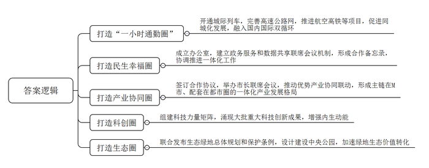
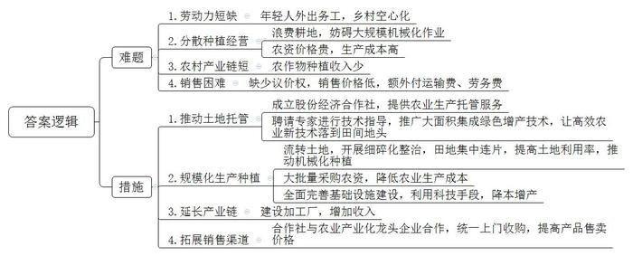
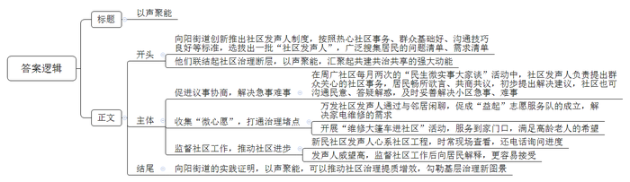

# 2025年公务员多省联考《申论》题（湖南省市卷）

> 候选采集稿。参考答案及解析来自粉笔页面，不代表官方答案或真实高分答卷；来源使用许可与原卷对应关系仍需人工核实。

## 给定材料

### 材料 material-691bec2bf18294f8

每天早上7点，家住M市的倪女士都会乘坐城际列车，到同一都市圈的K市上班。“40分钟就能到。”倪女士说，“每班列车间隔只有几分钟，非常方便。”某知名高科技公司先后在KMN都市圈内的三个城市设立园区。“我们开车走高速公路，从M市中心到这些园区不用一个小时。”公司总裁杨总说。K、M、N三市建设都市圈内主要城市机场直联快联通道，打造国际航空客货运双枢纽；推进高铁项目，加快构建四通八达的高铁网……改善“微循环”，促进都市圈同城化发展；贯通主动脉，融入国内国际双循环，KMN都市圈“一小时通勤圈”正在成型。

近年来，KMN都市圈的市民惊喜地发现：公积金、医保和户籍等事项都能在城市政务服务数字平台和实体大厅“跨域通办”；都市圈内公立医疗机构全面实现就医“一卡通”；M市名校开始向K、N市延伸，三市义务教育学校师资开展交流轮岗试点……随着都市圈一体化程度不断加深，缩短的是时空距离，扩大的是生活范围；减少的是政策阻碍，提升的是群众幸福感与获得感。“省政府确定K、M、N三个城市共同建设都市圈，牵头组织三市成立了都市圈建设办公室，建立了政务服务和数据共享联席会议机制，形成了合作备忘录，协调推进一体化工作。”KMN都市圈建设办公室吴主任介绍，都市圈建设有“破”有“联”，只有城市破除自身单一的圈子，彼此高度协同，才能使KMN都市圈真正成为民生幸福圈。

位于N市开发区的一家电子电路股份有限公司的车间内，一套套自动化生产设备开足马力；车间外，一批批液晶面板、5G通讯等产品正等待交货。这家公司原来在M市，后来为了与N市其他电子材料企业形成产业配套，经两市协商对接，将该公司引进到N市，有效推动了当地电子信息产业供应链优化升级。与此同时，N市电子信息产业还直接为M市的大型光电面板企业、汽车制造企业提供产品配套，有效补强了M市光电显示产业链条，实现KMN都市圈的圈内循环。

“我们签订了都市圈产业协同发展合作协议，并且每年举办市长联席会议，规划都市圈的产业发展。”M市张市长说。根据合作协议，KMN都市圈聚焦光电子信息、生命健康、高端装备等产业，推动优势产业协同联动，提升中心城市M市的经济密度；促进M市一般制造业向周边的K、N市有序转移，逐步形成主链在M市、配套在都市圈的一体化产业发展格局。在KMN都市圈，双向互动、高能级再造渐成常态，产业链上“你中有我、我中有你”的格局有效激活了各城市资源禀赋优势。去年，KMN都市圈GDP同比增长6.3%，占全省GDP近60%，产业链韧性和竞争力有效提升。

M市有众多高校和科研机构，科创资源丰富。“都市圈的产业定位决定了我们必须紧紧抓住科学技术这个第一生产力。”张市长说。怎样有效释放M市的科创势能，增强都市圈的内生动能？N市在M市成立离岸科创中心，N市企业纷纷签约入驻。“成立离岸科创中心，有利于企业就近利用M市的人才和科创资源。”N市一家工艺有限公司执行董事吴先生说，企业深入对接M市的广电创意产业园、省美术学院等资源，更好地在数字文化产业、文化科技融合、新材料开发与应用等领域发力。K市积极搭建科创平台，鼓励企业建立研发机构和博士后工作站，吸引科技人才，加快科技创新和成果转化。目前，K市与M市14所高校院所开展合作，在研科技合作重点项目达99个，创历史新高……靠过去、引进来，科技同兴，产业同旺，都市圈也是科创圈。KMN都市圈以高校、科研院所和企业为基石组建科技力量矩阵，近年来涌现出一大批国内首款产品及国家急需的重大科技创新成果，有力带动了都市圈的蓬勃发展。

“生态环境是高质量发展的核心目标之一，是衡量区域现代化进程的重要标尺。”张市长说。KMN都市圈中心地带有一块总面积500多平方公里的生态绿地，它不仅是地理版图上的一抹绿，更是KMN都市圈的“绿肺”。三市联合发布都市圈生态绿地总体规划和保护条例，保护这块绿地不受城市化进程的“蚕食”。去年，三市共同委托一家设计研究院制定《生态绿地中央公园总体设计方案》。目前，第一期的绿道已基本完成主体建设，原始的山林土路变身健身绿道，沿线还建有科普、诗词、地方文化等多个不同风格、主题的“驿站”，成为了三市居民休闲游玩的好去处。绿地的生态价值转化正在加速，在KMN都市圈内，一幅人与自然和谐共生的现代化图景正在铺展开来。

### 材料 material-1a98a0a6fb1a5896

又是一年秋至，小麦到了收割的时间。“搁几年前，大中午也得下地干活，忙得团团转。”D市大有村的村民老刘说，“如今松快多了，从种到收再到销售，全过程托管，省心又省力。”老刘每天送完孙子去上学，就到村里的股份经济合作社打工。在老刘看来，合作社真是帮他解决了大问题。

老刘是当地种庄稼有名的“老把式”，自家的田地他都坚持自己耕种，后来随着年龄越来越大，儿女也都在外地打工，他逐渐感到有些力不从心了。“年轻人纷纷去城里打拼，村里种地的人越来越少。”村党支部叶书记说，“当时，连老刘这种愿意种地的人都坚持不下去了。”

D市推广农业社会化服务的东风吹到了大有村。“为了有效破解我市农村农业发展的难题，我们引进了新的经营主体，积极开展多种形式的农业社会化服务。”D市农业农村局韩局长介绍。在村支部的推动下，大有村很快成立了股份经济合作社，向村民提供农业生产托管服务。当年春耕开始前，就有69户村民与合作社签订合同，托管土地1.5万余亩。“不瞒你们，一开始我是反对的。”老刘有些不好意思，“我种了这么多年的地，他们能有我种得好吗？”为了动员老刘，叶书记开出条件：带地入社，还可以在合作社当农机手。老刘依然没松口。到了秋收，老刘发现，自己种的地和合作社的托管地紧挨着，收成却大不相同——托管地玉米每亩多收了50斤，大豆每亩多收了20斤。原来，除了提供托管服务、为农户统一供应农资农具、耕种及病虫害防治等服务外，合作社还聘请了省农业大学教授进行技术指导，大力推广一喷多防、水肥一体、智慧农机等大面积集成绿色增产技术，让高效农业新技术落到了田间地头。“比我们靠老经验好多了！”老刘说。第二年春耕前，不用人劝，老刘早早来到合作社，交钱、签单，把土地全部托管。至此，大有村实现整村托管。

D市农田长期分散种植经营，东一块、西一块，田埂沟渠不但浪费耕地，也妨碍大规模机械化作业。“土地流转给合作社后，合作社开展细碎化整治工作，把一块一块的田地集中连片。”韩局长说，这不仅提高了土地利用率，也为开展大规模机械化工作奠定了基础。在大有村，全村粮食生产由农户单家独户种植变为全村范围内集中连片规模种植。昔日的小田块被连片开阔的大田所替代，田块成方，沟渠成网，一望无际的金黄色麦田里，一台台无人驾驶的联合收割机正来回穿梭，构成一幅生机勃勃的乡村画面。合作社共流转土地3000余亩，其中通过整合边角零碎土地，为村集体新增耕地资源约200亩，不仅实现了“小田”变“大田”，每年还可为村集体增收20余万元。“利用这些新增加的收入，村里办起了小麦加工厂。”叶书记说，“以往农村产业链比较短，从小麦身上赚到的钱不多，现在有了小麦加工厂，就可以赚更多的钱了。”

“看，今年的小麦麦粒多饱满！”D市某种植专业合作社社长老沈站在麦田里，把麦穗放在手里搓碎，又轻轻吹净麦皮，一把泛着清香的麦粒呈现在他的掌心。“今年种的是最新品种，通过科学种植，亩产可以达到1400斤，比去年平均亩产量多出了近200斤！”老沈的语气里透露着欣喜，“过去农户买种子，价格一直谈不下来。但我们现在是大批量购买，哪怕是新品种，价格也能优惠很多。不光是种子，农药、农具等农资，合作社去谈都能便宜不少。”在老沈看来，有了规模优势，农业生产的成本远远低于分散种植。就拿浇水来说，小麦返青、拔节、灌浆三个关键时期，要是都浇足水了，一亩就能多收两三百斤麦子。但浇一亩地一次得花100元左右，很多老百姓会少浇甚至“看天吃饭”。合作社把土地集中连片后，全面铺开改闸改水、水管铺设等基础设施建设，采取数字监控等科技手段，按需及时浇水，实现了每亩种植成本降低13%、粮食增产11%。

“丰收了也不愁不好卖。”老沈说，“以往农民自己去卖小麦，在市场上没有议价权，卖不上价格不说，还要额外付运输费、劳务费，我们合作社与一家农业产业化龙头企业合作，他们统一上门收购，每斤小麦还多卖5分钱。”

借助数字化时代浪潮推动农业社会化服务迈上新台阶，D市正在行动。“我市强化全域数字化服务，积极探索智慧农业建设，整合卫星遥感、北斗导航、多光谱分析、物联网、气象监测等技术，构建集采集、分析、预警、决策于一体的数字化动态监测体系，使社会化服务更加科学和精细。”韩局长表示。农业社会化服务让小农户也能搭上现代农业的快车，为推进乡村全面振兴注入了强劲动能。

### 材料 material-52bfe9f070b06785

清晨，向阳街道周广社区里喧闹起来。“民生微实事大家谈”的展板前，街坊们拉着板凳围坐一处，居委会干部、物业代表也纷纷到场，热络“开聊”——

“10栋门前的地闲着太可惜了！杂草丛生，影响市容市貌。”一开场，社区发声人杨大姐率先提出了大家都关切的闲置地块问题。

“这次议事的主题是‘建设美丽家园’，对于这个地块的运营，大家有什么好主意吗？”随着本次“民生微实事大家谈”主持人、周广社区邵书记的提问，居民们纷纷建言献策：

“一半种上紫苏、一半种上辣椒，改造成花园式菜地。”

“种出来的劳动成果，由咱们全体居民定期采摘。”

“暑假期间，还可以组织亲子活动，让孩子们参与进来，感受农耕的苦与乐。”

经过一番热烈讨论，不仅解决办法有了，邻里相亲的温暖氛围也在大伙儿心间荡漾开。当邵书记宣布讨论结果时，现场掌声热烈、叫好声不断。

每月两次的“民生微实事大家谈”活动，既是居民畅所欲言、共商共议的舞台，也是社区沟通民意、答疑解惑的平台。社区发声人负责提出最近大家关心的社区事务，居民共同讨论，提出初步解决建议。小区所面临的一桩桩急事、难事，都得到妥善解决。“这样的议事机制非常好！大家坐在一起，像‘拉家常’一样，想说什么就说什么，很多问题都得到了及时解决！”杨大姐欣喜地说。

去年，向阳街道社区发声人聘任仪式举行，12名社区发声人正式“持证上岗”。此次选拔是根据热心于社区事务、群众基础好、具备良好沟通技巧和社区影响力等标准，通过自愿报名、社区推荐、公开选拔等方式，从每个社区选拔出两名发声人，正式聘任组成一支12人的队伍。杨大姐是这次受聘的社区发声人之一，在周广社区生活了三十多年。杨大姐是个不折不扣的社区“红人”，她一直热心参与社区的公益活动，从电梯加装到处理居民纠纷，都可以看到她的身影。“有了这个新身份，担子更重了，但覆盖面也更广，可以帮助更多群众去发声。”杨大姐说，接下来她要努力提升自己的能力，充当好联系社区和居民的桥梁，为居民解决更多难事烦心事，增进邻里之间的信任与互助。

“家电坏了找‘益起’。”在万发社区，有一支“益起”志愿服务队，专门从事常见的家电维修，服务范围已覆盖全街道，名声也越来越响亮。这支队伍的成立源自万发社区发声人老陈和邻居们的一次闲聊。“我家高压锅坏了，小区附近没有维修点，我都找过很多次了。”周阿姨无奈地说道。她的话打开了大家的话匣子：“我家的电视机也坏了，我一个星期都没看上电视。”“我家空调最近很吵，让人根本没办法睡。”……老陈这才发觉社区周边没有家电维修点。他把成立家电维修志愿服务队的想法告诉了社区书记老方，老方一听，立刻表示支持，当天就在社区微信群里发布了招募公告。很快，“益起”志愿服务队就成立了。“社区发声人能从小处着手，收集‘微心愿’，有助于及时打通社区治理的堵点。”向阳街道办事处郭主任表示。

目前，“益起”志愿服务队共有成员25名，其中，核心成员15名。“社区发声人把居民的烦恼告诉我们，起到了很好的沟通作用。”志愿者李先生说，“能为大家解决一些小问题，我也很开心。”随着服务范围的逐渐扩大，越来越多的居民知道了这支队伍。不少高龄老人提出了“便民维修来到家门口”的希望。老陈把他们的希望告诉了志愿服务队，经过多方协商，志愿服务队开展“维修大篷车进社区”活动，将“小修小补”搬到了居民家门口。

“最近停车位的工程进展到哪一步了？”新民社区的社区发声人老魏心系项目，从施工开始就时不时到现场看看，出差在外还打电话到社区询问进度。“已经在划线了，很快就能完工。”新民社区党委丁书记耐心回答。“很多居民平时工作忙，不一定了解一个项目有多少事要做，有时会着急，我们的解释也听不进去。”丁书记说，社区发声人在居民中威望较高，他们定期监督社区的工作，然后向居民解释，居民更容易接受。“我们已经习惯接受社区发声人的监督了，有了他们的督促，社区就会进步更快。”

社区发声人队伍广泛搜集居民的“问题清单”“需求清单”。去年以来，向阳街道下辖6个社区已收集群众需求115个，确定项目106个，投入资金1611.80万元，其中社会资本1134.79万元。伴随着社区发声人队伍的助力，“小而美”的变化在向阳街道时时发生。

“社区是社会治理的基本单元，是党和政府联系、服务群众的‘最后一公里’，也是城市精细化治理的‘主战场’。”郭主任表示，“社区发声人的形式能有效联结起社区治理中的断层，以声聚能，把社区和居民‘联’起来，‘聚’成社区治理的新动能。”

## 题目

### 第 1 题

**根据****“给定资料**1**”，请你谈谈K、M、N三市是如何打造KMN都市圈的****。（****15分****）**

关联材料：材料 material-691bec2bf18294f8

作答要求：

要求：全面、准确、有条理。不超过250字。

### 第 2 题

**根据****“给定资料**2**”，请你谈谈D市通过农业社会化服务破解了哪些本地农业发展难题，又是如何破解的。****（****20分）**

关联材料：材料 material-1a98a0a6fb1a5896

作答要求：

要求：

（1）归纳合理、准确；

（2）层次分明，条理清晰；

（3）不超过350字。

### 第 3 题

**假如****“给定资料**3**”是当地日报上的一篇报道，请你以“以声聚能”为题，为这篇报道写一则短评。****（****25分）**

关联材料：材料 material-52bfe9f070b06785

作答要求：

要求：

（1）观点明确，见解深刻；

（2）紧扣资料，重点突出；

（3）逻辑清晰，语言流畅；

（4）不超过500字。

### 第 4 题

**“给定资料**4**”提到“在当今这个充满活力的时代，我们要善于汇聚各种力量形成合力。联结好当下，就能畅通奔向未来的路”，请对此进行深入思考，参考给定资料，联系实际，自选角度，自拟题目，写一篇文章。****（****40分）**

关联材料：材料 material-691bec2bf18294f8

作答要求：

要求：

（1）观点明确，见解深刻，内容充实；

（2）思路清晰，语言流畅；

（3）参考给定资料，但不拘泥于给定资料；

（4）1000-1200字。

## 答案与解析

第 1 题

**参考答案（粉笔题库参考内容）**

1.打造“一小时通勤圈”。开通城际列车，完善高速公路网，推进航空高铁等项目，促进同城化发展，融入国内国际双循环。

2.打造民生幸福圈。成立办公室，建立政务服务和数据共享联席会议机制，形成合作备忘录，协调推进一体化工作。

3.打造产业协同圈。签订合作协议，举办市长联席会议，推动优势产业协同联动，形成主链在M市、配套在都市圈的一体化产业发展格局。

4.打造科创圈。组建科技力量矩阵，涌现大批重大科技创新成果，增强内生动能。

5.打造生态圈。联合发布生态绿地总体规划和保护条例，设计建设中央公园，加速绿地生态价值转化。

**解析**

**参考答案说明：**本参考答案从“打造‘一小时通勤圈’”“打造民生幸福圈”“打造产业协同圈”“打造科创圈”“打造生态圈”五个方面展开，各条答案要点之间在内容上相互并列，没有交叉。

**考点**：考点概括措施类

**来源**：来源2025年公务员多省联考《申论》题（湖南省市卷）

粉笔申论页面对本题只提供「解析视频」入口，该入口是会员推广位，页面无视频地址与文字解析。

第 2 题

**参考答案（粉笔题库参考内容）**

难题：

1.劳动力短缺。年轻人外出务工，乡村空心化。

2.分散种植经营。浪费耕地，妨碍大规模机械化作业；农资价格贵，生产成本高。

3.农村产业链短。农作物种植收入少。

4.销售困难。缺少议价权，销售价格低，额外付运输费、劳务费。

措施：

1.推动土地托管。成立股份经济合作社，提供农业生产托管服务；聘请专家进行技术指导，推广大面积集成绿色增产技术，让高效农业新技术落到田间地头。

2.规模化生产种植。流转土地，开展细碎化整治，田地集中连片，提高土地利用率，推动机械化种植；大批量采购农资，降低农业生产成本；全面完善基础设施建设，利用科技手段，降本增产。

3.延长产业链。建设加工厂，增加收入。

4.拓展销售渠道。合作社与农业产业化龙头企业合作，统一上门收购，提高产品售卖价格。

**解析**

**参考答案说明：**本参考答案分为“难题”和“措施”两个部分。其中“难题”部分从“劳动力短缺”“分散种植经营”“农村产业链短”“销售困难”四个方面展开；“措施”部分从“推动土地托管”“规模化成产种植”“延长产业链”“拓展销售渠道”四个方面展开。本参考答案做到了分类分条撰写，各条答案要点之间在内容上相互并列，没有交叉。

**考点**：考点多要素组合类

**来源**：来源2025年公务员多省联考《申论》题（湖南省市卷）

粉笔申论页面对本题只提供「解析视频」入口，该入口是会员推广位，页面无视频地址与文字解析。

第 3 题

**参考答案（粉笔题库参考内容）**

以声聚能

向阳街道创新推出社区发声人制度，按照热心社区事务、群众基础好、沟通技巧良好等标准，选拔出一批“社区发声人”，广泛搜集居民的问题清单、需求清单。他们联结起社区治理断层，以声聚能，汇聚起共建共治共享的强大动能。

促进议事协商，解决急事难事。在周广社区每月两次的“民生微实事大家谈”活动中，社区发声人负责提出群众关心的社区事务，居民畅所欲言、共商共议，初步提出解决建议，社区也可沟通民意、答疑解惑，及时妥善解决小区急事、难事。

收集“微心愿”，打通治理堵点。万发社区发声人通过与邻居闲聊，促成“益起”志愿服务队的成立，解决家电维修的需求；开展“维修大篷车进社区”活动，服务到家门口，满足高龄老人的希望。

监督社区工作，推动社区进步。新民社区发声人心系社区工程，时常现场查看，还电话询问进度；发声人威望高，监督社区工作后向居民解释，更容易接受。

向阳街道的实践证明，以声聚能，可以推动社区治理提质增效，勾勒基层治理新图景。

**解析**

**参考答案说明：**（1）格式方面，本参考答案写到了“标题”“正文”两个部分。（2）正文部分，一方面从内容上来看，围绕着“以声聚能”这一话题，本参考答案的开头指出了向阳街道推出社区发声人制度的背景并给出评价；接着主体部分从“促进议事协商，解决急事难事”“收集‘微心愿’，打通治理堵点”“监督社区工作，推动社区进步”三个方面展开；最后结尾部分进行了总结。另一方面，形式上，本参考答案做到了分段、分层撰写，整体上条理较为清晰。

**考点**：考点评论类

**来源**：来源2025年公务员多省联考《申论》题（湖南省市卷）

粉笔申论页面对本题只提供「解析视频」入口，该入口是会员推广位，页面无视频地址与文字解析。

第 4 题

**参考答案（粉笔题库参考内容）**

**汇聚联结之力，共赴时代新程**

“积力之所举，则无不胜也；众智之所为，则无不成也。”在当今充满活力的时代，汇聚各种力量形成合力，已成为推动社会进步与发展的关键。联结当下各方资源，畅通奔向未来的路，这不仅是一种发展智慧，更是时代赋予我们的使命。

**联结产业链条，培育龙头企业，打造产业集群，实现产业协同发力。**产业是经济发展的基石，而产业链的联结则是产业发展的强大引擎。以深圳的电子信息产业为例，华为、腾讯等龙头企业凭借强大的研发实力和市场影响力，吸引上下游众多中小企业集聚，形成了涵盖芯片设计、软件开发等完整的产业链条。通过产业集群，企业间实现了资源共享、优势互补，实现了降本增效。在激烈的市场竞争中，各企业协同发力，共同抵御风险，推动了产业在全球占据领先地位，成为城市经济发展的重要支柱。

**联结民意与基层，畅通民意表达，凝聚治理合力，形成共建共治共享的治理格局。**基层治理是国家治理的基石，民意则是基层治理的源头活水。浙江诸暨的“枫桥经验”给我们提供了诸多启示：当地通过建立多样化的民意表达渠道，如村民议事会、社区听证会等，让民众充分参与到基层事务的决策与管理中。民众的诉求得到及时回应，问题得以有效解决，极大地激发了民众参与基层治理的积极性。这种联结民意与基层的模式，使基层治理从“政府独奏”转变为“全民合唱”，凝聚起强大的治理合力，营造出和谐稳定的社会环境。

**联结跨域资源，打破行政壁垒，推动优势互补，实现协同发展。**在经济全球化的大背景下，区域之间的合作与协同发展已成为大势所趋。长江三角洲地区便是实践的典范。上海作为经济中心，拥有强大的金融、科技与人才资源；江苏制造业基础雄厚；浙江民营经济活跃。三地打破行政壁垒，加强区域合作，通过产业转移、技术共享、人才流动等方式，实现优势互补，形成了一体化发展的强大合力。这种跨域合作不仅促进了区域经济的快速增长，还提升了长三角地区在全球的竞争力。

**联结城乡要素，推动要素自由流动，促进双向融合，实现城乡共荣。**城乡发展不平衡是我国面临的重要问题，联结城乡要素是解决这一问题的有效途径。乡村通过发展乡村旅游、特色农业等产业，吸引了城市的资金、技术与人才流入。同时，乡村的生态环境、农产品等资源也为城市提供了新的发展空间与消费选择。城乡要素的自由流动，使乡村焕发出新的活力，城市也获得了更广阔的发展腹地，实现了城乡的共同繁荣。

“孤举者难起，众行者易趋。”在时代的浪潮中，我们唯有联结各方力量，形成强大合力，才能在发展的道路上披荆斩棘，实现国泰民安的美好愿景。

**解析**

**文章分析**

**汇聚联结之力，共赴时代新程**

【**标题的优点：**首先，范文的标题突出了“聚力发展”这一主题。其次，形式上，文字简洁明快，不拖沓。】

（1）“积力之所举，则无不胜也；众智之所为，则无不成也。”（2）在当今充满活力的时代，汇聚各种力量形成合力，已成为推动社会进步与发展的关键。联结当下各方资源，畅通奔向未来的路，这不仅是一种发展智慧，更是时代赋予我们的使命。

【**开头的优点：**★内容方面：范文的开头是紧扣“聚力发展”这一主题展开的。首先，开头点出主题，做到了主题明确。其次，对“聚力发展”这一主题进行了分析阐述：（1）通过古语引出主题；（2）阐述汇聚力量的重要性，点明文章核心观点。★文字表达方面：使用了“不仅……更……”的关联词，使语言表达有逻辑性。】

**联结产业链条，培育龙头企业，打造产业集群，实现产业协同发力。**（1）产业是经济发展的基石，而产业链的联结则是产业发展的强大引擎。（2）以深圳的电子信息产业为例，华为、腾讯等龙头企业凭借强大的研发实力和市场影响力，吸引上下游众多中小企业集聚，形成了涵盖芯片设计、软件开发等完整的产业链条。通过产业集群，企业间实现了资源共享、优势互补，实现了降本增效。（3）在激烈的市场竞争中，各企业协同发力，共同抵御风险，推动了产业在全球占据领先地位，成为城市经济发展的重要支柱。

【**论述段****1的优点：**★观点句：范文的观点句是紧扣“聚力发展”这一文章主题提出的。形式上，它在段首处直接写出，位置突出，容易发现。内容上，关键词突出，内容要点明确，可以明显看出它是从“联结产业链”这个角度入手。★论述内容：（1）首先指出产业与产业链联结的重要性；（2）其次列举通过龙头企业聚集产业链条的事例及成效；（3）最后总结企业协同发力的意义。注意：以上三个方面的内容都是紧扣“联结产业链条，培育龙头企业，打造产业集群，实现产业协同发力”这个观点句进行分析论述的，论述的针对性强，内容层次丰富。最后，在论述方法上主要采用了讲道理与举例子结合，做到了丰富多样。】

**联结民意与基层，畅通民意表达，凝聚治理合力，形成共建共治共享的治理格局。**（1）基层治理是国家治理的基石，民意则是基层治理的源头活水。（2）浙江诸暨的“枫桥经验”给我们提供了诸多启示：当地通过建立多样化的民意表达渠道，如村民议事会、社区听证会等，让民众充分参与到基层事务的决策与管理中。民众的诉求得到及时回应，问题得以有效解决，极大地激发了民众参与基层治理的积极性。（3）这种联结民意与基层的模式，使基层治理从“政府独奏”转变为“全民合唱”，凝聚起强大的治理合力，营造出和谐稳定的社会环境。

【**论述段****2****的优点：**★观点句：范文的观点句是紧扣“聚力发展”这一文章主题提出的。形式上，它在段首处直接写出，位置突出，容易发现。内容上，关键词突出，内容要点明确，可以明显看出它是从“联结民意与基层”这个角度入手。★论述内容：（1）首先指出基层治理与民意的重要性；（2）其次列举基层治理畅通民意的事例及成效；（3）最后总结联结民意与基层的的意义。注意：以上三个方面的内容都是紧扣“联结民意与基层，畅通民意表达，凝聚治理合力，形成共建共治共享的治理格局”这个观点句进行分析论述的，论述的针对性强，内容层次丰富。最后，在论述方法上主要采用了讲道理与举例子结合，做到了丰富多样。】

**联结跨域资源，打破行政壁垒，推动优势互补，实现协同发展。**（1）在经济全球化的大背景下，区域之间的合作与协同发展已成为大势所趋。（2）长江三角洲地区便是实践的典范。上海作为经济中心，拥有强大的金融、科技与人才资源；江苏制造业基础雄厚；浙江民营经济活跃。三地打破行政壁垒，加强区域合作，通过产业转移、技术共享、人才流动等方式，实现优势互补，形成了一体化发展的强大合力。（3）这种跨域合作不仅促进了区域经济的快速增长，还提升了长三角地区在全球的竞争力。

【**论述段****3****的优点：**★观点句：范文的观点句是紧扣“聚力发展”这一文章主题提出的。形式上，它在段首处直接写出，位置突出，容易发现。内容上，关键词突出，内容要点明确，可以明显看出它是从“联结区域”这个角度入手。★论述内容：（1）首先指出当下的国际背景趋势；（2）其次列举跨域合作的事例；（3）最后总结跨域合作的意义。注意：以上三个方面的内容都是紧扣“联结跨域资源，打破行政壁垒，推动优势互补，实现协同发展”这个观点句进行分析论述的，论述的针对性强，内容层次丰富。最后，在论述方法上主要采用了讲道理与举例子结合，做到了丰富多样。】

**联结城乡要素，推动要素自由流动，促进双向融合，实现城乡共荣。**（1）城乡发展不平衡是我国面临的重要问题，联结城乡要素是解决这一问题的有效途径。（2）乡村通过发展乡村旅游、特色农业等产业，吸引了城市的资金、技术与人才流入。同时，乡村的生态环境、农产品等资源也为城市提供了新的发展空间与消费选择。（3）城乡要素的自由流动，使乡村焕发出新的活力，城市也获得了更广阔的发展腹地，实现了城乡的共同繁荣。

【**论述段****4****的优点：**★观点句：范文的观点句是紧扣“聚力发展”这一文章主题提出的。形式上，它在段首处直接写出，位置突出，容易发现。内容上，关键词突出，内容要点明确，可以明显看出它是从“联结城乡”这个角度入手。★论述内容：（1）首先指出解决城乡发展不平衡的对策；（2）其次列举城乡要素相互流动的事例；（3）最后总结城乡要素流动的意义。注意：以上三个方面的内容都是紧扣“联结城乡要素，推动要素自由流动，促进双向融合，实现城乡共荣”这个观点句进行分析论述的，论述的针对性强，内容层次丰富。最后，在论述方法上主要采用了讲道理与举例子结合，做到了丰富多样。】

【**论述段之间的关系：**★内容的内在逻辑：范文的论述段之间是依照并列的逻辑展开的。论述段1先写了“联结产业链条，培育龙头企业，打造产业集群，实现产业协同发力”，论述段2接着写了“联结民意与基层，畅通民意表达，凝聚治理合力，形成共建共治共享的治理格局”，论述段3再写了“联结跨域资源，打破行政壁垒，推动优势互补，实现协同发展”，论述段4最后写了“联结城乡要素，推动要素自由流动，促进双向融合，实现城乡共荣”。这四个论述段分别从“联结产业链”“联结民意与基层”“联结区域”“联结城乡”展开，相互并列，逻辑清晰。】

“孤举者难起，众行者易趋。”在时代的浪潮中，我们唯有联结各方力量，形成强大合力，才能在发展的道路上披荆斩棘，实现国泰民安的美好愿景。

【**结尾的优点：**范文的结尾回扣了“聚力发展”这个主题，并且进行了总结呼吁。】

**考点**：考点文章写作题

**来源**：来源2025年公务员多省联考《申论》题（湖南省市卷）

粉笔申论页面对本题只提供「解析视频」入口，该入口是会员推广位，页面无视频地址与文字解析。

