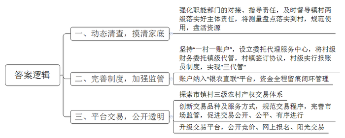
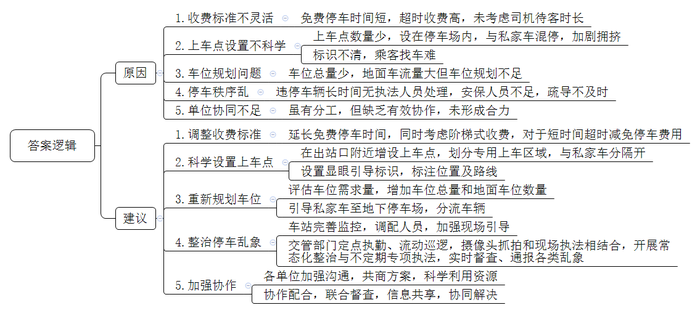
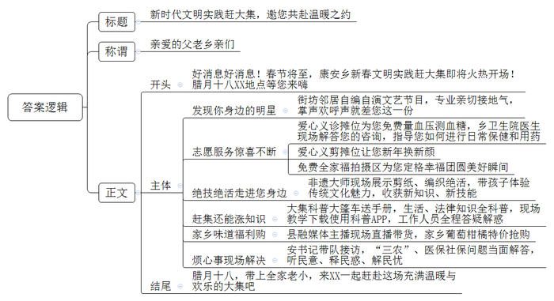

# 2025年公务员多省联考《申论》题（湖南行政执法卷）

<!-- gwy:overview:start -->
> **湖南 · 2025 · 申论 · 行政执法** ｜ 4 题 · 图片 4 处 · 答案随题折叠

导航：[题目](#题目)
<!-- gwy:overview:end -->

> 候选采集稿。参考答案及解析来自粉笔页面，不代表官方答案或真实高分答卷；来源使用许可与原卷对应关系仍需人工核实。

## 给定材料

### 材料 material-e9d642185e5eaa25

“‘三资’（资产、资源、资金）治理不仅关系到村民富不富，也关系到村庄美不美。”E市水北镇杨庄村党支部书记说，“‘三资’治理就是要摸清家底，规范使用，盘活资源。落实到村里，主要是测量盘点，把现有资源搞‘活’。通过治理，不仅资产明晰了，资源变现了，资金到位了，而且民心稳了，风气正了，村庄面貌也随之焕然一新。”

杨庄村属于典型的城边村，村内企业占地较多，但过去一段时间，“三资”问题一直困扰着干部和群众。“不少地块都是本村村民在承包，但由于大伙签订合同的背景不一样，价格也存在差异，群众之间又有攀比心理，所以工作一直很难推进。”杨庄村党支部书记介绍，“一旦开展‘三资’清查，就要推翻很多过去已经签好的合同，涉及到村里很多企业的资金问题，要让商户和村民都接受、配合，的确很不容易。”

近年来，借着市里乡村振兴工作计划“三资”治理专项实施的契机，杨庄村在市农业农村局指导下多次召开村“两委”联席会议，讨论制定了“三资”清查方案，成立了“三资”清查工作小组。

清查的第一步，就是摸清家底。为确保公正公开，杨庄村采取实地测量的方式，邀请企业方、测量方、村干部、村民代表等多方同时在场进行土地测量，测量结果需得到多方认可，在公示无异议后才能生效。“这是一项为村为民的好政策，就先从我家的大棚开始吧。”党员老纪不仅第一个接受实地测量，第一个重新签署合同、缴纳承包费，还主动加入工作小组，负责土地测量工作。像老纪一样，全村54名党员充分发挥先锋模范作用，以实际行动支持“三资”治理工作。在他们的影响下，原本心存疑虑的村民逐渐转变态度，纷纷配合入户进企实地测量，捋顺合同、明晰债权债务，开展企业租赁合同续签、改签等工作，使清查工作得到了有序推进。

自治理专项开展以来，E市进一步强化职能部门的对接、指导责任，及时督导镇村两级落实好主体责任，着力推动治理工作走深走实。截至目前，共清收各类闲置或被侵占的机动地、集体建设用地、四荒水面等10769亩，盘活15167亩，增收2832万元。摸排合同35194份，规范问题合同10344份，清收债权6418笔，金额共计6840万元。

在动态清查农村集体“三资”底数的同时，E市也在不断完善相应的监管制度。坚持“一村一账户”，将村级财务委托镇级代管，村集体与镇级业务部门签订协议，村级实行报账员制度。在各乡镇（街道）设立农村财务委托代理服务中心，在坚持村级集体资产所有权、使用权、财务审批权不变和会计核算主体不变的前提下，统一管理村级账目，实现现金、账本、凭证“三代管”。将所有村级账户纳入“银农直联”网络监管平台，依托平台对村集体资金实行全程留痕闭环管理，做到干部不经钱、会计不见钞，切实杜绝以往村集体现金交易难监管的现象。

最近，水北镇法柳村的夜市成了当地居民的热门打卡地。每当夜幕降临，人们汇聚在此，不仅可以品尝近百种特色美食，还能观看灯光秀和演出。然而一年前，这里还是堆满建筑废料、生活垃圾的荒地，一到下雨天便污水横流。在“三资”治理专项实施过程中，这片荒地成为镇村干部关注的重点。镇村两级多次组织召开协商议事会，广泛征集干部和群众意见。“隔壁杨庄村的夜市搞得挺红火的，我们是不是也可以搞？”“对啊，我们周边人流量大，这个优势可得好好利用！”……经充分研究论证，法柳村“两委”决定借助企业力量将荒地发展为夜市。水北镇第一时间将情况汇报给市农业农村局，并协助村“两委”将夜市招标信息发布至农村产权线上交易平台。

“几家企业竞价角逐，最终价高者得。与企业签订的合同中土地租金是一年26万元，超过了我们最初的预期。”法柳村党支部杨书记说道，“从申请报名到与企业签订土地租赁合同，前后也就半个多月时间。”

“村里的这笔交易做得好啊，我们有活干，村里有钱挣，人气也旺了。”53岁的夜市清洁员赵大姐说，她现在每月能增加3000元的收入。

十年前，E市建成省内首家农村产权线上交易平台。多年来，E市积极探索市、镇、村三级农村产权交易体系，在市级成立农村产权交易中心，在乡镇（街道）设分中心，在村庄设信息点。同时，不断创新交易品种及服务方式，规范交易程序，完善市场监管，促进交易公开、公平、有序进行。

随着数字技术的发展和农村资源要素活力的释放，去年，E市又对交易平台进行了升级。目前，所有项目均采取公开竞价、网上报名、阳光交易的模式，部分交易项目溢价超3倍，为农村集体资源变现发挥着更加便捷、积极的作用。

### 材料 material-9998fea8134d5850

火车站是城市交通的重要枢纽，更是城市的形象窗口。Z市火车站打车难、行车慢、停车乱问题层出不穷，“本来几分钟就可以上车，在这里竟然要等上几十分钟。”一位乘客无奈地说。

Z市火车站网约车的上车点设在地面停车场内。周日上午，网约车上车点的车辆不多，但地面停车场入口与外部相连接的道路上却停靠了十余辆车。走近一看，车上都坐着候客的网约车司机。这些司机为何不停靠在上车点内，而在道路上违停呢？“上车点在停车场内，超过15分钟就要收费。”网约车司机李师傅说，“既是上车点又是停车场，私家车跟网约车混在一起停车，车位本来就不够，这样就更挤啦。”

私家车主范先生表示，他之前来火车站接女儿时把车停到地面停车场，要出去时网约车、出租车、私家车把通道堵得水泄不通，一小段路开了20多分钟。有了这次糟糕的停车体验后，他注意到地下停车场不仅停车位充足，车流量还更小。之后，他每次到车站都把车停在地下停车场，“场地出口也存在局限。应当让私家车在地下停车场停车、接人，网约车都在地面接客。”“我们地面的车流量要远远高于地下，但是地下停车场有192个车位，地面停车场只有170个，地面车位本来就规划不足。”物业刘经理坦言，Z市火车站总共加起来不足400个车位，目前的地面停车场车位也确实有限，能做的暂时只能是多安排工作人员在现场引导。

虽然加强了现场引导，但下客高峰期车流量大，网约车的上车点内不断有车进入，车位很快就几近饱和，后来的司机就只能“见缝插针”。一辆网约车因没有车位违停在通道上，二十多分钟过去了，都没有执法人员前来处理。直到停车场的安保人员发现通道上的车辆排起长队，上前疏导，通道才得以畅通。“整个车站就只有地面上一个网约车上车点，画线的位置都被停了，我要是到偏一点的地方，乘客就不好找，说不定还得被投诉。”网约车司机封师傅说。蔡女士下了火车后，找了许久才找到上车点。好不容易到了上车点，也没看到她约的车。“从车站出来后，一路上的标识牌都不显眼，甚至连上车点内都没有明确的标识牌。”她说，“上车点应当设个明显的牌子。现在网约车的需求这么大，应该多设置几个上车点，这样乘客好找车，司机也好等客。”

在执法人员走访过程中，不少市民表示，网约车上车点应当做得大些、规范些，让车辆好通行，市民好上车。部分市民认为，导致堵车的原因还在于，停车场内上车点的位置不清晰，应当划分出一块专门的上车区，而不是将一个“微缩”的上车点设在停车场中。

谈到停车场收费标准时，网约车司机陆师傅表示，时常会遇到一些乘客列车还没停稳就开始约车，乘客到网约车上车点的时间难以确定，“有时候乘客快到了，但停车场的15分钟免费停车时间就要用完，我们只能开出去再进来，否则接一单赚的钱可能还不够停车费。能不能调低网约车的停车收费标准呢？”他说，“出租车有专门的上车点，这些点网约车是不能随意进出的，而网约车上车点跟私家车混在一起，不方便不说，还要担心超时收费，真的很无奈。”

针对网约车停车乱象，“我们以后会在停车场内设置喇叭与指示牌，引导网约车尽量进入车位，不要停在通道上。针对人手不够的问题，我们准备将其他区域的安保人员充实到车站管理一线。”刘经理说，“我们还将从有限的资金中提出一部分，完善监控系统，消除监控死角，希望能通过监控及时发现问题。但是如果确实存在比较严重的违停现象，还是需要交管部门加强巡逻处理。”

“我们将采取定点执勤与流动巡逻相结合的方式，加大巡逻管控力度，对违停挡道、有场不进的车辆进行重点整治。”交警中队薛队长说，“同时通过高清摄像头抓拍和交警现场执法，形成严管态势，及时纠正不规范停车行为，确保火车站道路通畅。今后，我们也将开展常态化整治，不定期进行专项执法，实时督查并及时通报各类乱象。”

“火车站停车管理的分工其实是很明确的，各单位都作出了一定的努力，但‘头痛医头’‘各自为战’是不够的。分工的表象在分，但其实质是分背后的合，真正考察的是合的能力。”火车站执法人员说，“想要标本兼治还需要多方协作，更科学地利用火车站停车资源，共同发力彻底破解停车乱象，为群众提供一个良好的停车环境。”

### 材料 material-079f102b911acebe

腊月十八，一场新时代文明实践赶大集活动在F县康安乡举行。根据乡村大集人气聚集的特点，县里统筹各方资源，直接在赶大集当日开展“一站式”文明实践活动，服务广大群众，给老百姓带去了精神和物质的双丰收。

当天的活动在精彩纷呈的文艺演出中拉开帷幕，现场的掌声、欢呼声此起彼伏。“演出为大家提供了展示的舞台。今天上台的都是街坊邻居，但表演效果一点不输专业演员，相比之下，更亲切、更接地气，我们都很喜欢。”现场观众纷纷表示。

文明实践搭台，各方都来唱戏。乡党委宣传委员介绍，早在半个多月前，乡里就发动驻村党员干部和村干部开展线上线下“大走访”，了解“微心愿”，组织梳理各村报来的最集中、最急需的“心愿”，形成“需求清单”，报送给县文明实践中心。县里整合各方资源，组建志愿服务队伍，根据集市地点、规模、群众需求等调配资源，把群众最需要的民生服务直接送达群众手中。在他们的带动下，青年志愿者协会、义工协会等团体和很多爱心企业、热心群众也广泛参与进来，将一个个为民、便民、利民、惠民的“大礼包”送到老百姓的心坎上。

赶大集、看大戏，逛摊位、解难题。活动现场，大家一边看演出，一边逛集市，各志愿服务摊位前居民络绎不绝。爱心义诊摊位前，大家自觉排起长队，量血压、测血糖、健康咨询等医疗志愿服务很受欢迎。乡卫生院的医生耐心解答现场居民的咨询，进行保健、用药指导，并细心嘱咐老年人注意冬季健康防护。爱心服务摊位上，志愿者手中的推子、梳子上下翻飞，“磨剪子来戗菜刀”声声入耳，干净利落的发型、锋利趁手的菜刀……居民对志愿者的暖心之举赞不绝口。在大集上展焕新颜的不只是这些，更有那一张张满意的笑脸。“大爷，头稍微往上抬一点；大妈，放松，保持微笑。3、2、1，看镜头……”在免费拍全家福的场地，志愿者们用镜头记录美好瞬间，让照片定格幸福时光。

手艺达人走近身边，绝技绝活演在眼前。在非遗展示区，精美绝伦的剪纸、喜庆吉祥的春联、美观实用的编织手工艺品……一系列民俗文化项目吸引了众多居民前来参观体验，大家对于这些精美的民俗文化作品展现出极大的兴趣，每个摊位前都挤满了围观群众。“我带孩子们体验了剪纸、编织技艺，让他们感受到传统文化的魅力，也收获了新知识、新技能。”一名现场群众说道。

分享小案例，阐释大道理。反诈、禁毒、安全生产、民法典宣传等同样吸引了很多群众。活动现场，科普大篷车上摆放着各类宣传手册，工作人员向现场居民宣传卫生健康、生态环保、食品安全、法律等知识，指导居民下载使用科普App，并耐心细致解答他们的问题。“我前年在县城买了套房，买房款是通过中间人付的，后来房屋归属发生争议，我着急把钱要回来，也不知该咋弄。刚才在法律咨询摊位，律师告诉我，他可以帮忙看看协议，应该还能要回来。我赶紧回家去拿！”居民张先生说。

大集上热闹非凡，平台上同样火爆。“支持我们的家人们，在公屏上把‘葡萄’二字扣起来，把粉丝灯牌亮起来，我再给大家来一波更大的福利……”县融媒体中心的主持人也加入了志愿服务队伍。借助新媒体平台，农产品推广服务队在集市上开展直播带货，助力推介当地的葡萄、柑橘等优质特色农产品。

康安乡党委安书记时而坐在接访摊位，时而走到群众之中，和大家聊家常。居民讲得详细，书记听得认真。“安书记，我当姥爷了！你有空可得来看看我孙女儿，长得可好看了！”“安书记，我们村头的路太窄了，出行不方便，想修修，这该怎么弄呀？”……赶集的崔姨笑着说：“不管啥事儿，都想和小安书记说说。从她嘴里讲出来的道理听起来格外实在！我们村之前和隔壁大槐村因为垃圾处理站归谁负责的问题吵得不可开交，是小安书记来做我们的工作，一点点掰碎了和我们说道理，大家听得进去，也愿意去做，现在我们两个村可是周围村子里最干净的！”以安书记为代表的乡镇干部现场接访，解答“三农”、医保社保等群众关心的问题，切实做到听民意、释民惑、解民忧。

为提高新时代文明实践赶大集活动热度，县融媒体中心对活动进行全程跟踪报道，在本地新闻频道、官方网站、各社交平台等同步开设专栏，分阶段、持续性发布报道推文，有效扩大了活动影响力和知晓度。

## 题目

### 第 1 题

**根据****“给定资料**1**”，请你谈谈E市是如何做好“三资”治理工作的。（15分）**

关联材料：材料 material-e9d642185e5eaa25

作答要求：

要求：全面、准确、有条理。不超过250字。

第 1 题 · 答案与解析

**参考答案（粉笔题库参考内容）**

一、动态清查，摸清家底。强化职能部门的对接、指导责任，及时督导镇村两级落实好主体责任，将测量盘点落实到村，规范使用，盘活资源。

二、完善制度，加强监管。坚持“一村一账户”，设立委托代理服务中心，将村级财务委托镇级代管，村镇签订协议，村级实行报账员制度，实现“三代管”；账户纳入“银农直联”平台，资金全程留痕闭环管理。

三、平台交易，公开透明。探索市镇村三级农村产权交易体系；创新交易品种及服务方式，规范交易程序，完善市场监管，促进交易公开、公平、有序进行；升级交易平台，公开竞价、网上报名、阳光交易。

**解析**

**参考答案说明：**本参考答案从“动态清查，摸清家底”“完善制度，加强监管”“平台交易，公开透明”三个方面展开，各条答案要点之间在内容上相互并列，没有交叉。

**考点**：考点概括措施类

**来源**：来源2025年公务员多省联考《申论》题（湖南行政执法卷）

粉笔申论页面对本题只提供「解析视频」入口，该入口是会员推广位，页面无视频地址与文字解析。

### 第 2 题

**请你根据****“给定资料**2**”，分析Z市火车站打车难、行车慢、停车乱问题的原因，并提出解决建议。（20分）**

关联材料：材料 material-9998fea8134d5850

作答要求：

要求：

（1）分析全面、准确；

（2）所提建议具体明确、切实可行；

（3）层次分明，条理清晰；

（4）不超过450字。

第 2 题 · 答案与解析

**参考答案（粉笔题库参考内容）**

原因：1.收费标准不灵活。免费停车时间短，超时收费高，未考虑司机待客时长。2.上车点设置不科学。上车点数量少，设在停车场内，与私家车混停，加剧拥挤；标识不清，乘客找车难。3.车位规划问题。车位总量少，地面车流量大但车位规划不足。4.停车秩序乱。违停车辆长时间无执法人员处理，安保人员不足，疏导不及时。5.单位协同不足。虽有分工，但缺乏有效协作，未形成合力。

建议：1.调整收费标准。延长免费停车时间，同时考虑阶梯式收费，对于短时间超时减免停车费用。2.科学设置上车点。在出站口附近增设上车点，划分专用上车区域，与私家车分隔开；设置显眼引导标识，标注位置及路线。3.重新规划车位。评估车位需求量，增加车位总量和地面车位数量；引导私家车至地下停车场，分流车辆。4.整治停车乱象。车站完善监控，调配人员，加强现场引导；交管部门定点执勤、流动巡逻，摄像头抓拍和现场执法相结合，开展常态化整治与不定期专项执法，实时督查、通报各类乱象。5.加强协作。各单位加强沟通，共商方案，科学利用资源；协作配合，联合督查，信息共享，协同解决。

**解析**

**参考答案说明：**本参考答案整体上分为“原因”和“建议”两个要素，其中，“原因”部分从“收费标准”“上车点设置”“车位规划”“停车秩序”“单位协同”五个方面展开，“建议”部分与“原因”部分相对应。各条答案要点之间在内容上相互并列，没有交叉。

**考点**：考点提出对策类

**来源**：来源2025年公务员多省联考《申论》题（湖南行政执法卷）

粉笔申论页面对本题只提供「解析视频」入口，该入口是会员推广位，页面无视频地址与文字解析。

### 第 3 题

**在新时代文明实践赶大集活动开展前，为了吸引广大群众参与，****F县融媒体中心拟通过乡广播站开展宣传。请你根据“给定资料**3**”，拟写一份广播稿。（25分）**

关联材料：材料 material-079f102b911acebe

作答要求：

要求：

（1）紧扣资料，内容全面；

（2）条理清晰，语言生动；

（3）答题不得泄露个人真实姓名；

（4）不超过500字。

第 3 题 · 答案与解析

**参考答案（粉笔题库参考内容）**

新时代文明实践赶大集，邀您共赴温暖之约

亲爱的父老乡亲们：

好消息好消息！春节将至，康安乡新春文明实践赶大集即将火热开场！腊月十八XX地点等您来嗨！

发现你身边的明星！街坊邻居自编自演文艺节目，专业亲切接地气，掌声欢呼声就差您这一份！

志愿服务惊喜不断！爱心义诊摊位为您免费量血压测血糖，乡卫生院医生现场解答您的咨询，指导您如何进行日常保健和用药；爱心义剪摊位让您新年换新颜；免费全家福拍摄区为您定格幸福团圆美好瞬间！

绝技绝活走进您身边！非遗大师现场展示剪纸、编织绝活，带孩子体验传统文化魅力，收获新知识、新技能！

赶集还能涨知识！大集科普大篷车送手册，生活、法律知识全科普，现场教学下载使用科普APP，工作人员全程答疑解惑！

家乡味道福利购！县融媒体主播现场直播带货，家乡葡萄柑橘特价抢购！

烦心事现场解决！安书记带队接访，“三农”、医保社保问题当面解答，听民意、释民惑、解民忧！

腊月十八，带上全家老小，来XX一起赶赴这场充满温暖与欢乐的大集吧！

**解析**

**参考答案说明：**（1）格式方面，本参考答案写到了“标题”“称谓”“正文”三个部分。（2）正文部分，一方面从内容上来看，围绕“新时代文明实践赶大集”这一主题，本参考答案的开头先简要通知本次活动的时间、地点等背景信息；主体部分从“发现你身边的明星”“志愿服务惊喜不断”“绝技绝活走进您身边”“赶集还能涨知识”“家乡味道福利购”“烦心事现场解决”这几个方面介绍了本次活动的具体内容；最后，结尾进行了呼吁号召。另一方面，形式上，本参考答案做到了分段、分条撰写，整体上条理较为清晰。

**考点**：考点宣传类

**来源**：来源2025年公务员多省联考《申论》题（湖南行政执法卷）

粉笔申论页面对本题只提供「解析视频」入口，该入口是会员推广位，页面无视频地址与文字解析。

### 第 4 题

**“给定资料**4**”中提到“保护古树名木单靠我们是远远不够的，不仅要让大家认识、了解古树名木，还要唤醒大家的保护意识，引导全社会共同参与”。请你深入思考这句话对做好执法工作的借鉴意义，参考给定资料，联系实际，自选角度，自拟题目，写一篇文章。（40分）**

关联材料：材料 material-e9d642185e5eaa25

作答要求：

要求：

（1）观点明确，见解深刻，内容充实；

（2）参考给定资料，但不拘泥于给定资料；

（3）思路清晰，语言流畅；

（4）字数800-1000字。

第 4 题 · 答案与解析

**参考答案（粉笔题库参考内容）**

**借鉴古树保护的智慧，推进执法工作升级**

北京故宫博物院里，古树上挂着不同颜色的古树铭牌，详细介绍了古树的品种、年龄，这个细节生动诠释了保护古树名木的核心要义——唯有唤起全民珍视，才能实现真正守护。见微知著，古树保护的智慧恰为破解行政执法困境提供了关键启示。借鉴古树保护“认知-认同-参与”的三阶推进策略，行政执法应当构建“普法教育+价值认同+协同治理”的新型治理范式，破解单边治理与多元诉求之间的矛盾。

**做好行政执法工作，要强化执法宣传，****公开流程****与制度，****增进公众理解认同****。**部分执法争议的根源在于信息不对称——公众因不了解相关规定，对执法行为产生误解甚至抵触。破解这一认知壁垒，关键在于提高法治透明度，增进社会共识。北京市城管局开展的“执法微课堂”，通过短视频解析占道经营执法标准后，提升了商户主动整改率；深圳市通过开展“直播式”执法行动，在直播互动中以案释法，提升市民法治认同度……这些创新实践实现了执法效益与社会效益的有机统一。未来应构建多层次、立体化的普法体系，让执法过程可感知、法律依据看得懂、程序规则信得过**。**

**做好行政执法工作，要****凸显****其****现实价值****，唤醒群众保护意识，提高参与主动性。**行政执法工作的目标一方面是纠正违法行为，另一方面是传递法治精神，引导公众自觉守法、主动护法。杭州市城管局在整治违建时，会说明违建对消防通道的危害，居民从“事不关己”转变为主动举报线索；广州市在推行垃圾分类时，执法部门在对违规行为处罚的同时推出“绿色账户”制度，让环保行为直接获益，垃圾分类准确率显著提升。只有让群众切实感受到执法对其生活质量的提升，明确自身在法治社会中的角色，才能打破“政府干、群众看”的困局。

**做好行政执法工作，要****完善参与机制，构建多元治理格局****，引导全社会参与。**当前城市治理面临新业态崛起、社会结构转型等挑战，单靠行政执法力量已难以应对复杂治理需求，需引导各方主动参与。将新业态就业群体转化为“流动网格员”，使快递小哥成为城市运行的“毛细血管传感器”，让社区志愿者担当民情民意的“神经末梢”……微光汇集，让“小角色”能散发“大能量”。多主体参与能够激发全社会主人翁意识，共同构建治理新图景。

以认知培育筑基、价值共鸣聚力、机制创新破局，构建全民共建的法治新生态，让行政执法焕发新活力。

**解析**

**文章分析**

借鉴古树保护的智慧，推进执法工作升级

【**标题的优点：**首先，标题中含有主题词，使文章主题更突出、清晰。其次，形式上采用对称式结构，使标题更加完整、饱满。】

（1）北京故宫博物院里，古树上挂着不同颜色的古树铭牌，详细介绍了古树的品种、年龄，这个细节生动诠释了保护古树名木的核心要义——唯有唤起全民珍视，才能实现真正守护。（2）见微知著，古树保护的智慧恰为破解行政执法困境提供了关键启示。借鉴古树保护“认知-认同-参与”的三阶推进策略，行政执法应当构建“普法教育+价值认同+协同治理”的新型治理范式，破解单边治理与多元诉求之间的矛盾。

【**开头的优点：**★内容方面。范文的开头是紧扣“做好执法工作”这一主题展开的。首先，开头点出主题，做到了主题明确。其次，对“做好执法工作”这一主题进行了分析阐述，指出了：（1）保护古树名木的核心要义；（2）古树保护的智慧为行政执法工作带来的启示。★文字表达方面。使用了“唯有……才能……”等关联词，使语言表达有逻辑性；长短句配合使用，使语言表达有节奏感。】

**做好行政执法工作，要强化执法宣传，公开流程与制度，增进公众理解认同。**（1）部分执法争议的根源在于信息不对称——公众因不了解相关规定，对执法行为产生误解甚至抵触。（2）破解这一认知壁垒，关键在于提高法治透明度，增进社会共识。北京市城管局开展的“执法微课堂”，通过短视频解析占道经营执法标准后，提升了商户主动整改率；深圳市通过开展“直播式”执法行动，在直播互动中以案释法，提升市民法治认同度……这些创新实践实现了执法效益与社会效益的有机统一。（3）未来应构建多层次、立体化的普法体系，让执法过程可感知、法律依据看得懂、程序规则信得过。

【**论述段****1的优点：**★观点句：范文的观点句是紧扣“做好执法工作”这一文章主题提出的。形式上，它在段首处直接写出，位置突出，容易发现。内容上，关键词突出，内容要点明确，可以明显看出主要从“增进公众理解认同”的角度展开论述。★论述内容：（1）部分执法争议产生的原因；（2）提高法治透明度，增进社会共识的事例及意义；（3）未来完善普法体系的对策。注意：以上几个方面的内容都是紧扣“做好行政执法工作，要强化执法宣传，公开流程与制度，增进公众理解认同”这个观点句进行分析论述的，论述的针对性强，内容层次丰富。在论述方法上采用了讲道理与举例子相结合的方式，论述充实深刻。】

**做好行政执法工作，要凸显其现实价值，唤醒群众保护意识，提高参与主动性。**（1）行政执法工作的目标一方面是纠正违法行为，另一方面是传递法治精神，引导公众自觉守法、主动护法。（2）杭州市城管局在整治违建时，会说明违建对消防通道的危害，居民从“事不关己”转变为主动举报线索；广州市在推行垃圾分类时，执法部门在对违规行为处罚的同时推出“绿色账户”制度，让环保行为直接获益，垃圾分类准确率显著提升。只有让群众切实感受到执法对其生活质量的提升，明确自身在法治社会中的角色，才能打破“政府干、群众看”的困局。

【**论述段****2的优点：**★观点句：范文的观点句是紧扣“做好执法工作”这一文章主题提出的。形式上，它在段首处直接写出，位置突出，容易发现。内容上，关键词突出，内容要点明确，可以明显看出主要从“唤醒群众保护意识”的角度展开论述。★论述内容：（1）行政执法工作的目标；（2）凸显执法价值，提高群众参与主动性的事例及意义。注意：以上几个方面的内容都是紧扣“做好行政执法工作，要凸显其现实价值，唤醒群众保护意识，提高参与主动性”这个观点句进行分析论述的，论述的针对性强，内容层次丰富。在论述方法上采用了讲道理与举例子相结合的方式，论述充实清晰。】

**做好行政执法工作，要完善参与机制，构建多元治理格局，引导全社会参与。**（1）当前城市治理面临新业态崛起、社会结构转型等挑战，单靠行政执法力量已难以应对复杂治理需求，需引导各方主动参与。（2）将新业态就业群体转化为“流动网格员”，使快递小哥成为城市运行的“毛细血管传感器”，让社区志愿者担当民情民意的“神经末梢”……微光汇集，让“小角色”能散发“大能量”。多主体参与能够激发全社会主人翁意识，共同构建治理新图景。

【**论述段****3的优点：**★观点句：范文的观点句是紧扣“做好执法工作”这一文章主题提出的。形式上，它在段首处直接写出，位置突出，容易发现。内容上，关键词突出，内容要点明确，可以明显看出主要从“引导全社会参与”的角度展开论述。★论述内容：（1）引导各方参与治理工作的必要性；（2）多主体参与治理的事例及意义。注意：以上几个方面的内容都是紧扣“做好行政执法工作，要完善参与机制，构建多元治理格局，引导全社会参与”这个观点句进行分析论述的，论述的针对性强，内容层次丰富。在论述方法上采用了讲道理与举例子相结合的方式，论述充实到位。】

【**论述段之间的关系：**★内容的内在逻辑：范文的论述段之间是依照“递进”的逻辑展开的。论述段1先写了“做好行政执法工作，要强化执法宣传，公开流程与制度，增进公众理解认同”，论述段2再写了“做好行政执法工作，要凸显其现实价值，唤醒群众保护意识，提高参与主动性”，论述段3接着写了“做好行政执法工作，要完善参与机制，构建多元治理格局，引导全社会参与”。文章按照“认知-认同-参与”的逻辑层层递进，整体思路清晰。】

以认知培育筑基、价值共鸣聚力、机制创新破局，构建全民共建的法治新生态，让行政执法焕发新活力。

【**结尾的优点：**范文的结尾回扣了“做好执法工作”这个主题，并且进行了总结提升。】

**考点**：考点文章写作题

**来源**：来源2025年公务员多省联考《申论》题（湖南行政执法卷）

粉笔申论页面对本题只提供「解析视频」入口，该入口是会员推广位，页面无视频地址与文字解析。

