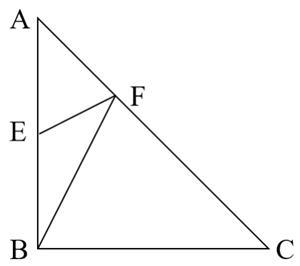
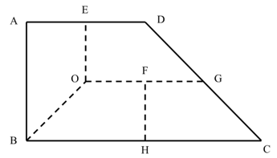
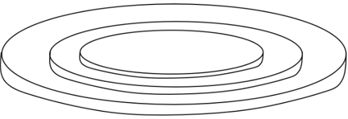
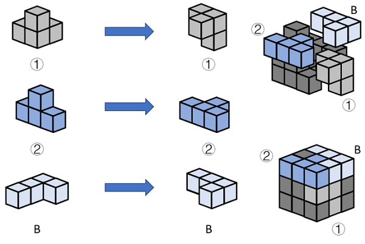
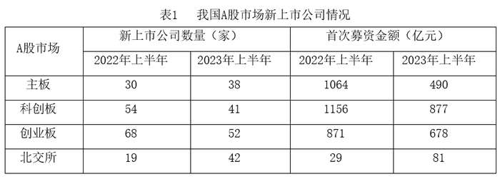
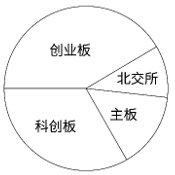
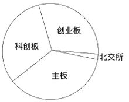
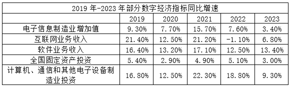

# 2025年湖南省公务员录用考试《行测》题（网友回忆版）

<!-- gwy:overview:start -->
> **湖南 · 2025 · 行测 · 统考** ｜ 120 题 · 图片 184 处 · 答案随题折叠

| 题型模块 | 题量 | 题号 |
| --- | ---: | ---: |
| 政治理论 | 10 | 1–10 |
| 常识判断 | 10 | 11–20 |
| 言语理解与表达 | 35 | 21–55 |
| 数量关系 | 10 | 56–65 |
| 判断推理 | 35 | 66–100 |
| 资料分析 | 20 | 101–120 |
| **合计** | **120** | |

导航：[题型与作答说明](#题型与作答说明) · [题目](#题目) · [材料 1](#材料-1)
<!-- gwy:overview:end -->

> 候选采集稿。参考答案及解析来自粉笔页面，不代表官方答案或真实高分答卷；来源使用许可与原卷对应关系仍需人工核实。

## 题型与作答说明

政治理论

（10题）

根据题目要求，在四个选项中选出一个最恰当的答案。

常识判断

（10题）

根据题目要求，在四个选项中选出一个最恰当的答案。

言语理解与表达

（35题）

本部分包括表达与理解两方面的内容。请根据题目要求，在四个选项中选出一个最恰当的答案。

数量关系

（10题）

在这部分试题中，每道题呈现一段表述数字关系的文字，要求你迅速、准确地计算出答案。

判断推理

（35题）

本部分包括图形推理、定义判断、类比推理与逻辑判断四种类型的试题，在四个选项中选出一个最恰当的答案。

资料分析

（20题）

所给出的图、表、文字或综合性资料均有若干个问题要你回答。你应根据资料提供的信息进行分析、比较、计算和判断处理。

## 题目

### 第 1 题

习近平总书记强调，要坚持城乡融合发展，畅通城乡要素流动。关于城乡融合发展，下列说法正确的有几项？

①城乡融合发展是中国式现代化的必然要求

②推进以乡镇为重要载体的新型城镇化建设，发展各具特色的乡镇经济

③发展新型农村集体经济，构建产权明晰、分配合理的运行机制

④完善覆盖农村人口的常态化防止返贫致贫机制

⑤允许农户合法拥有的住房通过出租、入股、合作等方式盘活利用

A. 1项

B. 2项

C. 3项

D. 4项

第 1 题 · 答案与解析

**参考答案（粉笔题库参考内容）**

D

**解析**

本题考查理论与政策。

2024年7月18日，中国共产党第二十届中央委员会第三次全体会议通过《中共中央关于进一步全面深化改革 推进中国式现代化的决定》（以下简称《决定》）。

①正确，《决定》在“六、完善城乡融合发展体制机制”部分指出：“城乡融合发展是中国式现代化的必然要求。必须统筹新型工业化、新型城镇化和乡村全面振兴，全面提高城乡规划、建设、治理融合水平······”

②错误，2024年11月4日至6日，习近平总书记在湖北考察时指出，推进以县城为重要载体的新型城镇化建设，发展各具特色的县域经济。故“乡镇经济”说法错误。

③正确，《决定》在“六、完善城乡融合发展体制机制”部分指出：“（21）巩固和完善农村基本经营制度······发展新型农村集体经济，构建产权明晰、分配合理的运行机制，赋予农民更加充分的财产权益。”

④正确，《决定》在“六、完善城乡融合发展体制机制”部分指出：“（22）完善强农惠农富农支持制度······完善覆盖农村人口的常态化防止返贫致贫机制，建立农村低收入人口和欠发达地区分层分类帮扶制度。”

⑤正确，《决定》在“六、完善城乡融合发展体制机制”部分指出：“（23）深化土地制度改革······允许农户合法拥有的住房通过出租、入股、合作等方式盘活利用。”

故正确的有①③④⑤，共4项。

故正确答案为D。

**考点**：经济建设、重要文件

**来源**：2025年河北省公务员录用考试《行测》题（网友回忆版）第4题

### 第 2 题

习近平总书记指出，纵观人类历史，教育兴则国家兴，教育强则国家强，世界强国无一不是教育强国，教育始终是强国兴起的关键因素。关于建设教育强国，下列表述正确的有几项？

①要坚持不懈用新时代中国特色社会主义思想铸魂育人，着力加强社会主义核心价值观教育

②必须以坚持党对教育事业的全面领导为根本保证

③坚持把高速高效发展作为各级各类教育的生命线

④建设教育强国，龙头是义务教育

A. 1项

B. 2项

C. 3项

D. 4项

第 2 题 · 答案与解析

**参考答案（粉笔题库参考内容）**

B

**解析**

本题考查理论与政策。

2023年5月29日，中共中央政治局就建设教育强国进行第五次集体学习，中共中央总书记习近平主持学习会议并发表讲话。

①正确，习近平总书记指出，要坚持不懈用新时代中国特色社会主义思想铸魂育人，着力加强社会主义核心价值观教育，引导学生树立坚定的理想信念，永远听党话、跟党走，矢志奉献国家和人民。

②正确，习近平总书记强调，我们要建设的教育强国，是中国特色社会主义教育强国，必须以坚持党对教育事业的全面领导为根本保证······

③错误，习近平总书记强调，要坚持把高质量发展作为各级各类教育的生命线，加快建设高质量教育体系。建设教育强国，基点在基础教育······故“高速高效发展”说法错误。

④错误，习近平总书记强调，建设教育强国，龙头是高等教育。要把加快建设中国特色、世界一流的大学和优势学科作为重中之重，大力加强基础学科、新兴学科、交叉学科建设······故“龙头是义务教育”说法错误。

故表述正确的是①②，共2项。

故正确答案为B。

**考点**：重要会议讲话、社会建设

**来源**：2025年河北省公务员录用考试《行测》题（网友回忆版）第20题

### 第 3 题

习近平总书记指出，如期实现建军一百年奋斗目标，加快把人民军队建成世界一流军队，是全面建设社会主义现代化国家的战略要求。关于实现建军一百年奋斗目标，下列举措恰当的是：

①加强军史学习教育，繁荣发展强军文化，强化战斗精神培育

②加强军人军属荣誉激励和权益保障，做好退役军人服务保障工作

③积极开展军事斗争，塑造安全态势，遏控危机冲突，阻止局部战争

④研究掌握信息化智能化战争特点规律，创新军事战略指导，发展人民战争战略战术

A. ①②③

B. ①②④

C. ①③④

D. ②③④

第 3 题 · 答案与解析

**参考答案（粉笔题库参考内容）**

B

**解析**

本题考查理论与政策。

①正确，党的二十大报告在“十二、实现建军一百年奋斗目标，开创国防和军队现代化新局面”部分指出：“全面加强人民军队党的建设，确保枪杆子永远听党指挥······加强军史学习教育，繁荣发展强军文化，强化战斗精神培育。”

②正确，党的二十大报告在“十二、实现建军一百年奋斗目标，开创国防和军队现代化新局面”部分指出：“加强军人军属荣誉激励和权益保障，做好退役军人服务保障工作。”

③错误，党的二十大报告在“十二、实现建军一百年奋斗目标，开创国防和军队现代化新局面”部分指出：“加强军事力量常态化多样化运用，坚定灵活开展军事斗争，塑造安全态势，遏控危机冲突，打赢局部战争。”故"积极开展军事斗争"“阻止局部战争”表述错误，应为“灵活开展军事斗争”“打赢局部战争”。

④正确，党的二十大报告在“十二、实现建军一百年奋斗目标，开创国防和军队现代化新局面”部分指出：“研究掌握信息化智能化战争特点规律，创新军事战略指导，发展人民战争战略战术。”

故①②④表述正确。

故正确答案为B。

**考点**：重要会议讲话、其他建设

**来源**：2025年河北省公务员录用考试《行测》题（网友回忆版）第15题

### 第 4 题

习近平总书记指出，现代化产业体系是现代化国家的物质技术基础，关于现代化产业体系建设，下列表述正确的有几项？

①坚持把发展经济的着力点放在国有企业上

②推动制造业高端化、智能化、绿色化发展

③推动战略性新兴产业融合集群发展

④推动现代服务业同先进制造业、现代农业深度融合

⑤优化基础设施布局、结构、功能和系统集成，构建现代化基础设施体系

A. 5项

B. 4项

C. 3项

D. 2项

第 4 题 · 答案与解析

**参考答案（粉笔题库参考内容）**

B

**解析**

本题考查理论与政策。

②③④⑤正确，①错误，二十大报告在“四、加快构建新发展格局，着力推动高质量发展”中指出“（二）建设现代化产业体系。坚持把发展经济的着力点放在实体经济上，推进新型工业化，加快建设制造强国、质量强国、航天强国、交通强国、网络强国、数字中国。实施产业基础再造工程和重大技术装备攻关工程，支持专精特新企业发展，推动制造业高端化、智能化、绿色化发展······推动战略性新兴产业融合集群发展，构建新一代信息技术、人工智能、生物技术、新能源、新材料、高端装备、绿色环保等一批新的增长引擎。构建优质高效的服务业新体系，推动现代服务业同先进制造业、现代农业深度融合······优化基础设施布局、结构、功能和系统集成，构建现代化基础设施体系。”故“发展经济的着力点放在国有企业上”说法错误。

故正确答案为B。

**考点**：经济建设

**来源**：2025年湖南省公务员录用考试《行测》题（网友回忆版）第4题

### 第 5 题

习近平总书记强调，中国式现代化，民生为大。新时代新征程，各级党委和政府秉持人民为上，加强对政府工作的领导，增加普惠性、基础性、兜底性，民生建设决定人民最关键最直接最现实的利益问题，不断推动民政事务高质量发展。下列属于民政工作的有几项？

①健全分层分级社会救助体系，推进社会救助法律法规

②做好儿童福利工作，加强新时代儿童福利工作基层制度

③推进老年人友好型城市，完善社区养老，持续营造敬老孝亲社会氛围

④规范地名命名、更名、使用管理，加强社区边界建设

A. 1项

B. 2项

C. 3项

D. 4项

第 5 题 · 答案与解析

**参考答案（粉笔题库参考内容）**

D

**解析**

本题考查理论与政策。

民政工作可概括为四个方面：一是社会救助和社会福利方面的工作，主要包括城乡低保、五保供养、救灾救济、慈善、社会捐助、福利彩票、福利机构管理等工作；二是基层民主政治建设方面的工作，主要是农村村民自治和城市社区建设工作；三是服务军队和国防建设方面的工作，主要包括双拥、优抚、安置等工作；四是管理专项社会事务方面的工作，主要是民间组织、区划地名、婚姻登记、殡葬管理、收养登记等。

①正确，社会救助包括城乡最低生活保障、临时救助、特困人员救助供养等，是民政工作的重要职责之一。健全社会救助体系，推进相关法律法规建设，有助于更好地保障困难群众的基本生活，维护社会公平正义。

②正确，儿童福利工作涉及儿童收养、儿童保护、困境儿童保障、农村留守儿童关爱等方面，是民政工作的重要内容。加强儿童福利基层制度建设，能够为儿童提供更好的保障和服务，促进儿童健康成长。

③正确，民政部门承担着推进养老服务体系建设的职责，包括发展居家和社区养老服务、建设养老机构、制定老年人福利政策等。推进老年人友好型城市建设，完善社区养老服务，营造敬老孝亲社会氛围，有利于积极应对人口老龄化，提高老年人的生活质量。

④正确，地名管理是民政工作的一部分。规范地名命名、更名与使用管理，有助于提高地名管理的科学性和规范性，方便社会交往和经济发展；加强社区边界建设，对于明确社区范围、促进社区治理和服务具有重要意义。

故①②③④正确，共4项。

故正确答案为D。

**考点**：社会建设

**来源**：2025年河北省公务员录用考试《行测》题（网友回忆版）第19题

### 第 6 题

习近平总书记强调，要加强新时代廉洁文化建设，教育引导广大党员、干部增强不想腐的自觉，清清白白做人、干干净净做事。下列属于加强新时代廉洁文化建设的举措有几项？

①开办红色廉洁文化专题展览，在红色教育中传承党的廉洁基因

②对新入职党员、干部及时开展廉洁教育，扣好年轻干部廉洁从政第一粒扣子

③注重从优秀传统家训家规中汲取营养，开展红色家风传承活动

④挖掘历史文献、文化经典、文物古迹中的廉洁思想，整理古圣先贤、清官廉吏的嘉言懿行

A. 1项

B. 2项

C. 3项

D. 4项

第 6 题 · 答案与解析

**参考答案（粉笔题库参考内容）**

D

**解析**

本题考查理论与政策。

①正确，《关于加强新时代廉洁文化建设的意见》指出：“注重发掘总结党反对腐败、建设廉洁政治的历史和经验，提炼革命文化蕴含的廉洁理念，运用好革命博物馆、纪念馆、党史馆等红色资源，开办红色廉洁文化专题展览，在红色教育中传承党的廉洁基因。”

②正确，《关于加强新时代廉洁文化建设的意见》指出：“对新入职党员、干部及时开展廉洁教育，扣好年轻干部廉洁从政第一粒扣子。”

③正确，《关于加强新时代廉洁文化建设的意见》指出：“注重从优秀传统家训家规中汲取营养，开展红色家风传承活动，把对党忠诚纳入家庭家教家风建设。”

④正确，《关于加强新时代廉洁文化建设的意见》指出：“挖掘历史文献、文化经典、文物古迹中的廉洁思想，整理古圣先贤、清官廉吏的嘉言懿行，推动中华优秀传统文化创造性转化、创新性发展。”

故①②③④表述正确，有4项。

故正确答案为D。

**考点**：文化建设

**来源**：2025年新疆公务员录用考试《行测》试题（网友回忆版）第4题

### 第 7 题

党的二十届三中全会提出，要健全社会治理体系。关于健全社会治理体系，下列表述不准确的是：

A. 健全城乡社区治理体系，及时把矛盾纠纷化解在基层、化解在萌芽状态

B. 提高市域社会治理能力，强化市民热线等公共服务平台功能

C. 坚持和发展“枫桥经验”是健全社会治理体系的基础和前提

D. 健全发挥家庭家教家风建设在基层治理中作用的机制

第 7 题 · 答案与解析

**参考答案（粉笔题库参考内容）**

C

**解析**

本题考查理论与政策。

A项正确，党的二十大报告中“十一、推进国家安全体系和能力现代化，坚决维护国家安全和社会稳定”部分的“（四）完善社会治理体系”指出：“······在社会基层坚持和发展新时代‘枫桥经验’，完善正确处理新形势下人民内部矛盾机制，加强和改进人民信访工作，畅通和规范群众诉求表达、利益协调、权益保障通道，完善网格化管理、精细化服务、信息化支撑的基层治理平台，健全城乡社区治理体系，及时把矛盾纠纷化解在基层、化解在萌芽状态。”

B、D两项正确，《中共中央关于进一步全面深化改革、推进中国式现代化的决定》（以下简称《决定》）中“十三、推进国家安全体系和能力现代化”部分的“（52）健全社会治理体系”指出：“提高市域社会治理能力，强化市民热线等公共服务平台功能，健全‘高效办成一件事’重点事项清单管理机制和常态化推进机制。健全社会心理服务体系和危机干预机制。健全发挥家庭家教家风建设在基层治理中作用的机制。深化行业协会商会改革。健全社会组织管理制度。”

C项错误，《决定》中“十三、推进国家安全体系和能力现代化”部分的“（52）健全社会治理体系”指出：“坚持和发展新时代‘枫桥经验’，健全党组织领导的自治、法治、德治相结合的城乡基层治理体系，完善共建共治共享的社会治理制度。”健全社会治理体系是一个复杂的系统工程，涉及到诸多方面的基础和前提条件。坚持和发展“枫桥经验”是健全社会治理体系的重要内容和有效途径，具有极其重要的作用。故“基础和前提”这种表述不准确。

本题为选非题，故正确答案为C。

**考点**：重要文件、社会建设

**来源**：2025年河北省公务员录用考试《行测》题（网友回忆版）第11题

### 第 8 题

毛泽东同志带领人民锻造了伟大光荣正确的中国共产党，他明确提出要把党的建设作为一项“伟大的工程”来推进，并且成功领导实施了这一伟大工程。下列有关说法正确的有几项?

①着重强调要从思想上建党，创造了通过批评和自我批评进行思想教育的整风形式

②概括形成了党的“三大作风”，成为中国共产党区别于其他任何政党的显著标志

③创造性地运用民主集中制原则正确处理党内关系、维护党的团结统一

④在马克思主义政党史上第一次科学地阐明了党的建设同党的政治路线的关系，揭示了党的建设的基本规律

A. 1项

B. 2项

C. 3项

D. 4项

第 8 题 · 答案与解析

**参考答案（粉笔题库参考内容）**

D

**解析**

本题考查毛泽东思想。

2023年12月26日，习近平总书记在纪念毛泽东同志诞辰130周年座谈会上的讲话中指出，毛泽东同志在马克思主义政党史上第一次科学地阐明了党的建设同党的政治路线的关系，揭示了党的建设的基本规律，为加强党的建设指明了方向；着重强调要从思想上建党，创造了通过批评和自我批评进行思想教育的整风形式；创造性地运用民主集中制原则正确处理党内关系、维护党的团结统一；概括形成了党的“三大作风”，成为中国共产党区别于其他任何政党的显著标志；在探索跳出历史周期率的深刻思考中，给出了第一个答案，那就是“让人民来监督政府”，等等。

故①②③④表述正确。

故正确答案为D。

**来源**：2025年新疆公务员录用考试《行测》试题（网友回忆版）第12题

### 第 9 题

数字贸易是数字经济的重要组成部分，已成为国际贸易发展的新趋势和经济的新增长点，关于数字贸易改革创新发展，下列表述不正确的是：

A. 按照创新为要、安全为基，扩大开放、合作共赢，深化改革、系统治理，试点先行、重点突破的原则，促进数字贸易改革创新发展

B. 到2035年，可数字化交付的服务贸易规模占我国服务贸易总额的比重提高到50%以上

C. 发展云外包、平台分包等服务外包新业态新模式，推动服务外包加快数字化转型

D. 鼓励引入数据安全、数据资产、数字信用等第三方国际服务机构

第 9 题 · 答案与解析

**参考答案（粉笔题库参考内容）**

D

**解析**

本题考查理论与政策。

2024年11月28日，《中共中央办公厅 国务院办公厅关于数字贸易改革创新发展的意见》（以下简称《意见》）对外发布。

A、B两项正确，《意见》在“一、总体要求”部分指出：“按照创新为要、安全为基，扩大开放、合作共赢，深化改革、系统治理，试点先行、重点突破的原则，促进数字贸易改革创新发展。主要目标是：到2029年，可数字化交付的服务贸易规模稳中有增，占我国服务贸易总额的比重提高到45%以上······到2035年，可数字化交付的服务贸易规模占我国服务贸易总额的比重提高到50%以上；有序、安全、高效的数字贸易治理体系全面建立，制度型开放水平全面提高。”

C项正确，《意见》在“二、支持数字贸易细分领域和经营主体发展”中“（二）持续优化数字服务贸易”部分指出：“促进数字金融、在线教育、远程医疗、数字化交付的专业服务等数字服务贸易创新发展，提升品牌和标准影响力。发展云外包、平台分包等服务外包新业态新模式，推动服务外包加快数字化转型。”

D项错误，《意见》在“四、完善数字贸易治理体系”中“（十一）加快构建数字信任体系”部分指出：“加快数字贸易认证体系建设，促进数字信任前沿技术的开发创新与应用推广，培育数字信任生态。推动数字证书、电子签名等国际互认。鼓励数据安全、数据资产、数字信用等第三方服务机构国际化发展。”

本题为选非题，故正确答案为D。

**考点**：经济建设、重要文件

**来源**：2025年新疆公务员录用考试《行测》试题（网友回忆版）第13题

### 第 10 题

统一开放的交通运输市场是有效衔接供需、促进国民经济循环畅通的重要基础，关于加快建设统一开放的交通运输市场，下列举措不恰当的是：

A. 建立交通运输装备能源清洁替代机制，保障规划实施全类运输工具应用新能源、清洁能源

B. 对交通运输领域招标投标、政府采购等相关规章制度按照有关规定进行公平竞争审查

C. 依托全国一体化大数据中心协同创新体系布局，构建综合交通大数据中心体系

D. 防止利用数据、算法、技术等手段排除限制竞争、侵害从业人员合法权益

第 10 题 · 答案与解析

**参考答案（粉笔题库参考内容）**

A

**解析**

本题考查理论与政策。

2024年12月12日，《中共中央办公厅 国务院办公厅关于加快建设统一开放的交通运输市场的意见》（以下简称《意见》）发布。

A项错误，《意见》在“二、深化交通运输重点领域改革”部分指出：“（六）推动交通运输绿色智慧转型升级······完善交通运输装备能源清洁替代政策，推动中重型卡车、船舶等运输工具应用新能源、清洁能源······”故并非“全类运输工具应用新能源、清洁能源”。

B项正确，《意见》在“三、完善交通运输市场制度”部分指出：“（十）完善交通领域价格机制······对交通运输领域招标投标、政府采购、经营行为规范、资质标准等相关规章制度按照有关规定进行公平竞争审查，维护公平竞争市场秩序。”

C项正确，《意见》在“四、优化交通运输市场要素资源配置”部分指出：“（十六）推进数据和技术赋能交通运输发展。依托全国一体化大数据中心协同创新体系布局，构建综合交通大数据中心体系······”

D项正确，《意见》在“五、完善交通运输市场监管机制”部分指出：“（十九）强化反垄断和反不正当竞争。加强交通运输领域市场竞争状况评估，依法查处垄断和不正当竞争行为，防止利用数据、算法、技术等手段排除限制竞争、侵害从业人员合法权益······”

本题为选非题，故正确答案为A。

**考点**：经济建设、重要文件

**来源**：2025年新疆公务员录用考试《行测》试题（网友回忆版）第14题

### 第 11 题

下列关于法规的表述正确的是：

A. 国家监察委员会根据宪法、法律和行政法规，制定监察法规

B. 《中华人民共和国军事设施保护法》和《国际军事合作工作条例》都属于军事法规

C. 地方性法规是指各地方政府按照宪法、法律、行政法规的规定制定的规范性法律文件

D. 党内法规是体现党的统一意志，规范党的领导和党的建设活动、依靠党的纪律保证实施的专门规章制度

第 11 题 · 答案与解析

**参考答案（粉笔题库参考内容）**

D

**解析**

本题考查法律常识。

A项错误，根据《中华人民共和国立法法》第一百一十八条规定：“国家监察委员会根据宪法和法律、全国人民代表大会常务委员会的有关决定，制定监察法规，报全国人民代表大会常务委员会备案。”因此，国家监察委员会制定监察法规的根据包含宪法和法律、全国人民代表大会常务委员会的有关决定，并不包括行政法规。

B项错误，根据《中华人民共和国立法法》第十条第三款规定：“全国人民代表大会常务委员会制定和修改除应当由全国人民代表大会制定的法律以外的其他法律；在全国人民代表大会闭会期间，对全国人民代表大会制定的法律进行部分补充和修改，但是不得同该法律的基本原则相抵触。”第一百一十七条规定：“中央军事委员会根据宪法和法律，制定军事法规。”由此说明，《中华人民共和国军事设施保护法》属于法律，由全国人民代表大会常务委员会制定。《国际军事合作工作条例》属于军事法规，由中央军委制定。

C项错误，根据《中华人民共和国立法法》第八十条规定：“省、自治区、直辖市的人民代表大会及其常务委员会根据本行政区域的具体情况和实际需要，在不同宪法、法律、行政法规相抵触的前提下，可以制定地方性法规。”第八十一条第一款规定：“设区的市的人民代表大会及其常务委员会根据本市的具体情况和实际需要，在不同宪法、法律、行政法规和本省、自治区的地方性法规相抵触的前提下，可以对城乡建设与管理、生态文明建设、历史文化保护、基层治理等方面的事项制定地方性法规······”因此，地方性法规是由特定的地方人大及其常委会制定，并非地方政府制定。

D项正确，根据《中国共产党党内法规制定条例》第三条第一款规定：“党内法规是党的中央组织，中央纪律检查委员会以及党中央工作机关和省、自治区、直辖市党委制定的体现党的统一意志、规范党的领导和党的建设活动、依靠党的纪律保证实施的专门规章制度。”

故正确答案为D。

**考点**：其他法律法规

**来源**：2025年新疆公务员录用考试《行测》试题（网友回忆版）第19题

### 第 12 题

个人信息应受法律保护，下列做法符合个人信息保护法律规定的是：

A. 某县政府网站“信息公开”栏目公布农机购置补贴发放情况，内容包括购机农户姓名、身份证号、购机型号、银行账号等基本情况

B. 某音乐视频教学类APP要求使用者授权其照片、文件、手机设备号、人脸等信息才提供其产品和服务，使用者同意该授权

C. 某住户与同层邻居一起团购可视门铃，分别安装在自己家门口，不仅能看到自家门前情况，也能看到邻居家门前情况

D. 某小区以刷脸作为业主出入小区的唯一验证方式，不同意某业主提出的使用密码、门禁卡等其他验证方式的要求

第 12 题 · 答案与解析

**参考答案（粉笔题库参考内容）**

C

**解析**

本题考查法律常识。

A项错误，根据《中华人民共和国民法典》第一千零三十九条规定：“国家机关、承担行政职能的法定机构及其工作人员对于履行职责过程中知悉的自然人的隐私和个人信息，应当予以保密，不得泄露或者向他人非法提供。”选项中，县政府网站公布农机购置补贴发放情况，不得将农户的身份证号、银行账号等个人信息公开。

B项错误，根据《中华人民共和国个人信息保护法》第十六条规定：“个人信息处理者不得以个人不同意处理其个人信息或者撤回同意为由，拒绝提供产品或者服务；处理个人信息属于提供产品或者服务所必需的除外。”选项中，某音乐视频教学类APP要求授权个人信息才提供服务的做法违反法律规定。

C项正确，根据《中华人民共和国民法典》第一千零三十三条第二、三项规定：“除法律另有规定或者权利人明确同意外，任何组织或者个人不得实施下列行为：（二）进入、拍摄、窥视他人的住宅、宾馆房间等私密空间；（三）拍摄、窥视、窃听、公开他人的私密活动；”（注意：本题存在争议，C项的表述并不能认定邻居之间明确同意可视门铃拍摄自家的门前情况。建议掌握该知识点即可）

D项错误，根据《最高人民法院关于审理使用人脸识别技术处理个人信息相关民事案件适用法律若干问题的规定》第十条第一款规定：“物业服务企业或者其他建筑物管理人以人脸识别作为业主或者物业使用人出入物业服务区域的唯一验证方式，不同意的业主或者物业使用人请求其提供其他合理验证方式的，人民法院依法予以支持。”某业主有权提出使用密码、门禁卡等其他验证方式的要求。

故正确答案为C。

**考点**：其他法律法规

**来源**：2025年新疆公务员录用考试《行测》试题（网友回忆版）第20题

### 第 13 题

下列诗文涉及的人物或事件对应的时期错误的是：

A. 合从离衡，佩印者六——战国

B. 饮马瀚海，封狼居胥——东汉

C. 被遇神宗，致位宰相——北宋

D. 血战歼倭，勋垂闽浙——明朝

第 13 题 · 答案与解析

**参考答案（粉笔题库参考内容）**

B

**解析**

本题考查人文常识。

A项正确，“合从离衡，佩印者六”出自《史记·苏秦列传》，指的是苏秦游说六国合作抗秦，佩有六国相印。苏秦为战国时期人物。

B项错误，“饮马瀚海，封狼居胥”出自《史记·卫将军骠骑列传》，指的是霍去病带领汉军深入漠北，大败匈奴，在狼居胥山举行祭天封礼，在瀚海让马饮水，彰显了汉朝军队的赫赫战功和强大军威。霍去病为西汉而非东汉时期人物。

C项正确，“被遇神宗，致位宰相”出自《宋史·王安石传》，指的是王安石受到宋神宗的知遇之恩，得以官至宰相。王安石是北宋时期人物。

D项正确，“血战歼倭，勋垂闽浙”出自《明神宗实录》，指的是戚继光等人经过残酷激烈的战斗，歼灭了倭寇，在福建和浙江地区立下了不朽的功勋。戚继光为明朝时期人物。

本题为选非题，故正确答案为B。

**考点**：中国历史

**来源**：2025年河北省公务员录用考试《行测》题（网友回忆版）第24题

### 第 14 题

下列选项与无线充电器主要工作原理相同的是：

A. 微波炉

B. 电磁炉

C. 电热毯

D. 电熨斗

第 14 题 · 答案与解析

**参考答案（粉笔题库参考内容）**

B

**解析**

本题考查科技常识。

无线充电器的主要工作原理是电磁感应，主要通过线圈间变化的磁场产生感应电流来实现能量传递。

A项错误，微波炉是利用微波来加热食物，微波使食物中的水分子高频振动产生大量热能，从而加热食物，与电磁感应无关。

B项正确，电磁炉利用线圈产生交变磁场，当导磁性锅具（如铁锅）置于磁场中时，锅底会因电磁感应产生涡流，涡流的焦耳热效应使锅具发热。其主要工作原理为电磁感应，与无线充电器主要工作原理相同。

C项错误，电热毯内部有电阻丝，通过电阻丝产生焦耳热，属于电阻加热，即电能直接转化为热能，主要工作原理为电流的热效应，与电磁感应无关。

D项错误，传统电熨斗通过电阻丝加热底板，蒸汽熨斗则通过电加热水产生蒸汽，核心为电阻加热或蒸汽加热，主要工作原理为电流的热效应，与电磁感应无关。

故正确答案为B。

**考点**：物理常识

**来源**：2025年新疆公务员录用考试《行测》试题（网友回忆版）第25题

### 第 15 题

中国外汇交易中心公布某日人民币兑美元中间价报7.1101，而一月前人民币兑美元中间价报6.8928，下列与之相关说法正确的是：

A. 人民币兑美元中间价属于人民币在岸价

B. 相较于一月前，人民币兑美元是相对升值

C. 中国证券监督管理委员会是负责全国外汇市场的监督管理机构

D. 人民币兑美元中间价为银行间外汇市场中人民币兑美元汇率的算术平均值

第 15 题 · 答案与解析

**参考答案（粉笔题库参考内容）**

A

**解析**

本题考查经济常识。

A项正确，D项错误，在岸人民币是指在中国大陆境内交易的人民币，其价格形成机制是基于中国外汇交易中心在每日银行间外汇市场开盘前，向各银行间外汇市场做市商询价，去掉最高和最低报价后，将剩余做市商报价加权平均得到人民币兑美元中间价，并非简单的算术平均值。这个中间价作为当日银行间即期外汇市场以及银行柜台交易汇率的中间价，对在岸人民币汇率的定价起到关键作用。所以，人民币兑美元中间价是在岸人民币价格体系中的重要参考指标，属于人民币在岸价的范畴。

B项错误，一月前人民币兑美元中间价是6.8928，而某日是7.1101，说明同样数量的人民币能兑换的美元数量减少了，人民币相对美元是贬值的，而不是升值。

C项错误，国家外汇管理局负责全国外汇市场的监督管理工作；承担结售汇业务监督管理的责任；培育和发展外汇市场，而不是中国证券监督管理委员会。

故正确答案为A。

**考点**：宏观经济与调控政策

**来源**：2025年新疆公务员录用考试《行测》试题（网友回忆版）第22题

### 第 16 题

人们日常体检中的很多仪器，其原理都和射线有关，目前最常用的是伽马射线和伦琴射线，下列关于这两种射线的说法错误的是（ ）。

A. 这两种射线都属于电磁波

B. 伽马射线的辐射性较强，不能用于食品杀菌

C. 伦琴射线可用于CT（电子计算机断层扫描）检查中

D. 这两种射线的辐射伤害可以用不同厚度的铅板来阻挡

第 16 题 · 答案与解析

**参考答案（粉笔题库参考内容）**

B

**解析**

本题考查科技常识。

A项正确，电磁波按照波长从长到短（频率从低到高）可分为无线电波、微波、红外线、可见光、紫外线、伦琴射线（X射线）、伽马射线等。

B项错误，伽马射线是原子核受激发后产生的，波长极短，频率极高。利用伽马射线进行食品杀菌是一种常见的食品辐照保鲜技术。该技术利用放射性元素（如钴-60、铯-137）产生的伽马射线对食品进行照射，能够杀死食品中的细菌、霉菌、酵母菌等微生物，还可以抑制食品中害虫的生长和繁殖，从而达到延长食品保质期、防止食品腐败变质的目的。

C项正确，伦琴射线是原子内层电子受激发后产生的，具有较高的频率和能量。CT检查主要是利用精确准直的X射线（即伦琴射线）束对人体进行断层扫描，X射线穿过人体时，由于人体不同组织对X射线的吸收和衰减程度不同，探测器会接收穿过人体后的X射线强度信息，这些信息被传输到计算机中，计算机利用专门的算法对数据进行处理和重建，从而生成人体被扫描部位的断层图像，医生可以根据这些图像来观察人体内部的结构和病变情况。

D项正确，伽马射线和伦琴射线都具有较强的穿透能力，而铅板具有高密度、高原子序数的特点，能够有效地吸收和散射这些射线，从而起到防护作用。一般来说，射线能量越高，需要的铅板厚度就越大，以达到足够的防护效果，阻挡射线对人体或其他物体的伤害。所以，可以根据实际情况，使用不同厚度的铅板来阻挡伽马射线和伦琴射线的辐射伤害。

本题为选非题，故正确答案为B。

**考点**：物理常识

**来源**：2025年河北省公务员录用考试《行测》题（网友回忆版）第22题

### 第 17 题

以下关于我国航母的说法错误的是：

A. 目前我国列装的航母满载排水量均超过5万吨

B. “福建舰”是我国自主建造的弹射型国产航母，采用平直通长飞行板

C. 我国首艘国产航母“辽宁舰”于2012年入列，目前已形成体系作战能力

D. 2019年12月，中国第二艘航母被正式命名为“山东舰”，其突破了船体结构，动力核心设备这两项重大技术瓶颈

第 17 题 · 答案与解析

**参考答案（粉笔题库参考内容）**

C

**解析**

本题考查科技常识。

A项正确，目前我国列装的航母包括辽宁舰、山东舰和福建舰三艘。其中辽宁舰和山东舰属于6万吨级的中型航母，而福建舰是满载排水量8万余吨的大型航母，所以目前我国列装的航母满载排水量均超过5万吨。

B项正确，“福建舰”是我国完全自主设计建造的首艘弹射型航空母舰，采用平直通长飞行甲板，配置电磁弹射和阻拦装置。

C项错误，我国首艘国产航母是“山东舰”，2019年入列。“辽宁舰”2012年入列，前身是苏联海军的“瓦良格”号，并非我国首艘国产航母。

D项正确，2019年12月17日，中国第二艘航母（第一艘国产航母）正式交付海军。山东舰入列仪式在海南三亚某军港举行，经中央军委批准，中国第一艘国产航母命名为“中国人民解放军海军山东舰”，舷号为“17”。山东舰突破了船体结构、动力核心设备这两项制约中国航母事业发展的重大技术瓶颈，以及发电机组、综合电力系统、节能减排装置等船舶动力产品设计建造关键技术。

本题为选非题，故正确答案为C。

**考点**：科技理论与成就

**来源**：2025年新疆公务员录用考试《行测》试题（网友回忆版）第21题

### 第 18 题

细菌A能产生水解氨苄青霉素的酶而具有氨苄青霉素抗性，细菌B没有，将细菌A和细菌B放在一起培养一段时间，发现部分细菌B也获得了氨苄青霉素抗性，把具有氨苄青霉素抗性的细菌B继续培养，其子代均具有氨苄青霉素抗性，由此可以推断，细菌B获得了细菌A的哪种物质而具有氨苄青霉素抗性？

A. DNA

B. RNA

C. 蛋白质

D. 氨苄青霉素

第 18 题 · 答案与解析

**参考答案（粉笔题库参考内容）**

A

**解析**

本题考查科技常识。

A项正确，细菌的遗传物质是DNA，抗性基因通常位于DNA上。在细菌A和B共同培养时，可能发生了基因转移现象，比如通过转化、转导或接合等方式，使细菌A中携带氨苄青霉素抗性基因的DNA片段进入细菌B，使细菌B获得抗性。

B项错误，细菌的遗传物质是DNA，RNA不是细菌遗传信息的主要载体，不具备像DNA那样稳定的遗传特性，难以将抗性基因稳定地传递给子代。

C项错误，蛋白质是生命活动的主要承担者，不具备遗传物质的特性，不能将抗性相关的遗传信息传递给细菌B。即使细菌B摄入了细菌A的蛋白质，这些蛋白质也会在细菌B的细胞内被分解为氨基酸等基本单位。

D项错误，氨苄青霉素是一种抗生素，不是遗传物质，不具备传递遗传信息和赋予细菌抗性的能力。

故正确答案为A。

**考点**：生物常识

**来源**：2025年湖南省公务员录用考试《行测》题（网友回忆版）第18题

### 第 19 题

“超级满月”是月球位于近地点时刚好出现满月，使月亮看起来又大又亮的现象。其发生需要满足的条件是：

A. 农历初一前后，地球运动到太阳与月球之间

B. 农历初一前后，月球运动到太阳与地球之间

C. 农历十五前后，地球运动到太阳与月球之间

D. 农历十五前后，月球运动到太阳与地球之间

第 19 题 · 答案与解析

**参考答案（粉笔题库参考内容）**

C

**解析**

本题考查地理国情。

C项正确，A、B、D三项错误，满月发生在农历十五前后，此时月球运行至地球背向太阳的一侧，即地球位于太阳和月球之间（三者近似直线），月球被太阳照亮的半球完全朝向地球，形成“满月”。若此时月球恰好位于近地点，则为“超级满月”。

故正确答案为C。

**考点**：自然地理

**来源**：2025年新疆公务员录用考试《行测》试题（网友回忆版）第24题

### 第 20 题

以下生活常识正确的是：

A. 飞机舷窗采用椭圆状设计可以减少飞机内外压力差

B. 如果汽车挡风玻璃出现小裂缝，可以通过在裂纹末尾钻一个适当大小的洞来阻止裂缝的扩散

C. 在地面上将一堆苹果堆成圆锥状，底部正中央的那个苹果，受到的压力最大，最容易被压坏

D. 往烧得通红的滚烫铁板上滴几滴水，如果看到水滴悬浮在空中，没有马上蒸发，是因为铁板温度不够高

第 20 题 · 答案与解析

**参考答案（粉笔题库参考内容）**

B

**解析**

本题考查科技常识。

A项错误，飞机舷窗采用椭圆状设计，主要是因为飞机在高空飞行时，机舱内压力高于外部，机身会向外膨胀。圆形或椭圆状设计能让压力均匀分布，避免应力集中，降低舷窗破裂风险。而不是减少飞机内外压力差。

B项正确，通过在汽车挡风玻璃的裂缝的末端钻孔，可以消除应力集中点，防止裂缝进一步扩散，这种方法被称为“止裂孔”，是一种常见的临时修复方法。需要注意的是，这种方法只能暂时解决问题，最终仍需要专业修复或更换挡风玻璃。止裂孔的原理是中断裂纹的扩展路径，减少应力集中。

C项错误，当苹果堆成圆锥状时，由于颗粒物质的成拱现象，压力会沿着堆叠的方向向下传递并分散到果堆外围部分，从而形成中间颗粒受力小的“压力凹陷”情况。所以，底部正中央的苹果所受压强比同一层中附近的其他苹果要小，不是最容易被压坏的。

D项错误，莱顿弗罗斯特效应是指液体在接触远高于其沸点的高温表面时，液体底部迅速汽化形成一层蒸气层，使液体悬浮并减缓蒸发速度的现象。往烧得通红的滚烫铁板上滴几滴水，如果看到水滴悬浮在空中，没有马上蒸发，恰恰说明铁板温度非常高，而不是不够高。

故正确答案为B。

**考点**：生活常识

**来源**：2025年河北省公务员录用考试《行测》题（网友回忆版）第29题

### 第 21 题

在其他动物体内，抗体的重轻链配对组成的Y形结构可以对抗种类繁多的微生物入侵者。这种结构久经考验，是重链和轻链蛋白质的编码基因片段混合重排的结果。由于每一条链对应的基因排列方式多种多样，所以组合起来就可以千变万化，而纳米抗体只有重链，多样性          。

填入画横线部分最恰当的一项是：

A. 大打折扣

B. 寥寥无几

C. 微乎其微

D. 乏善可陈

第 21 题 · 答案与解析

**参考答案（粉笔题库参考内容）**

A

**解析**

搭配“多样性”，且根据“抗体的重轻链配对组成的Y形结构······所以组合起来就可以千变万化，而纳米抗体只有重链”可知，横线处应体现纳米抗体的多样性与正常抗体相比有所减少之意。A项“大打折扣”指由于某种原因，使某物或某事的价值、功能、作用、影响等方面的程度有了大幅度的减少，符合文意，当选。

B项“寥寥无几”指数量很少，没有几个，通常用于形容可数事物的数量，与“多样性”搭配不当，排除；C项“微乎其微”指非常少或非常小，程度过重，且不如“大打折扣”能体现与正常抗体多样性的对比，与文意不符，排除；D项“乏善可陈”指说不出有什么优点，没有什么好称道的，无法体现多样性变少之意，排除。

故正确答案为A。

【文段出处】澎湃新闻《“瘦身版”纳米抗体，能庇佑人类走多远》

**考点**：词的辨析-搭配对象、词的辨析-程度轻重、对应关系-前后呼应、成语填空

**来源**：2025年河北省公务员录用考试《行测》题（网友回忆版）第53题

### 第 22 题

从航天任务连战连捷到重大航空工程深入推进，从空间科学探索到航天科技成果服务经济社会发展，十年来，一次次振奋人心的火箭腾飞，一项项令人惊叹的航空成就，        出航天人接续奋斗的轨迹。

填入画横线部分最恰当的一项是：

A. 见证

B. 描摹

C. 创造

D. 勾勒

第 22 题 · 答案与解析

**参考答案（粉笔题库参考内容）**

D

**解析**

搭配“轨迹”，且根据“一次次振奋人心的火箭腾飞，一项项令人惊叹的航空成就”可知，横线处应表达展现出了航天人接续奋斗的轨迹之意，D项“勾勒”指用线条描画出轮廓，与“轨迹”搭配恰当，且符合文意，当选。A项“见证”指当场目睹可以做证，与文意不符，且与“轨迹”搭配不当，排除；B项“描摹”指照原样描写或描画，文段并未体现照原样之意，与文意不符，排除；C项“创造”指想出新方法、建立新理论、做出新的成绩或东西，与“轨迹”搭配不当，排除。

故正确答案为D。

【文段出处】人民网《10年来航天任务连战连捷 重大工程深入推进》

**考点**：词的辨析-搭配对象、实词填空、对应关系-前后呼应

**来源**：2025年河北省公务员录用考试《行测》题（网友回忆版）第52题

### 第 23 题

司马迁说：“余读孔氏书，想见其为人。适鲁，观仲尼庙堂······祗回留之，不能去。”“余读《离骚》······悲其志。适长沙，观屈原所自沉渊······想见其为人。”《史记》的“太史公曰”据信有120余篇，大多            ，彰显客观公正的史学观。唯有对孔子和屈原则是带着浓烈的个人情感，以基本相同的笔调，发出了触动人们心灵的赞叹。

填入画横线部分最恰当的一项是：

A. 隐晦曲折

B. 直言不讳

C. 秉笔直评

D. 光明正大

第 23 题 · 答案与解析

**参考答案（粉笔题库参考内容）**

C

**解析**

横线后“彰显客观公正的史学观”对横线处进行解释说明，且需要与后文“唯有对孔子和屈原则是带着浓烈的个人情感”形成语义相反，因此横线处应体现《史记》的“太史公曰”是秉持客观公正的态度、不带有过多个人情感来进行书写。C项“秉笔直评”指拿起笔不加隐讳地径直写出，置于文段可体现出《史记》的“太史公曰”不隐瞒、不夸大、真实地反映情况之意，符合文意，当选。A项“隐晦曲折”指写文章或说话时用隐隐约约、转弯抹角的方式来表达某种思想，无法体现出客观公正之意，与文意不符，排除；B项“直言不讳”指说话坦率，毫无顾忌，侧重表达方式的直白坦率，与文段强调《史记》“太史公曰”的内容客观公正无关，与文意不符，排除；D项“光明正大”形容襟怀坦白，行为正派，而横线处修饰《史记》“太史公曰”的写作内容，并非行为，搭配不当，排除。

故正确答案为C。

【文段出处】《屈原的文化高度：与日月同辉》

**考点**：词的辨析-搭配对象、对应关系-前后呼应、成语填空

**来源**：2025年湖南省公务员录用考试《行测》题（网友回忆版）第23题

### 第 24 题

综合，意味着包容和吸纳。武术、杂技、魔术等表演“绝活儿”，凡是有益于戏曲创作的，皆可为戏曲所用。当下流行的“跨界融合”，无论是戏曲汲取其他当代艺术元素的创新，还是戏曲给予其他艺术样式灵感与素材，实质上都与中国戏曲综合性艺术特征相        。综合意味着            ，而不是自设边界。

依次填入画横线部分最恰当的一项是：

A. 契合 吐故纳新

B. 投合 兼收并蓄

C. 迎合 推陈出新

D. 符合 融会贯通

第 24 题 · 答案与解析

**参考答案（粉笔题库参考内容）**

A

**解析**

第一空，搭配“艺术特征”，且根据前文“综合，意味着包容和吸纳”可知，文段强调“跨界融合”与中国戏曲综合性艺术特征在本质上是相同的，故横线处所填词语要体现出相同、相符之意。A项“契合”指符合，D项“符合”指相合，均符合文意，保留。B项“投合”指相合、合得来，多表述为意气投合、性情投合，与“艺术特征”搭配不当，排除；C项“迎合”指有意使自己的言行或举动适合别人心意，感情色彩偏消极，与文段感情色彩不符，排除。

第二空，根据“无论是戏曲汲取其他当代艺术元素的创新”以及“意味着······而不是”可知，横线处所填成语与“自设边界”语义相反，强调戏曲应当对外开放，并汲取创新元素，A项“吐故纳新”比喻扬弃旧的，吸收新的，符合文意，当选。D项“融会贯通”指各方面的知识或道理融合贯穿起来，从而得到系统透彻的理解，未提及“汲取创新元素”之意，排除。

故正确答案为A。

【文段出处】光明网《戏曲创新 从源头活水到海纳百川》

**考点**：词的辨析-搭配对象、词的辨析-感情色彩、对应关系-前后呼应、混搭填空、关联关系-并列关系

**来源**：2025年湖南省公务员录用考试《行测》题（网友回忆版）第24题

### 第 25 题

不同国家和民族之间的对话，很大一部分是建立在世界意识的基础之上。世界之大，个人只能涉足有限的处所；作为一种彼此相知的语汇，文学可以帮助不同民族的人们            ，乃至共同参与世界。所以，世界范围            的文学经典展示了“人类”的存在。“人类”生活在地球的各个角落，然而，他们是相互联系的共同体——不论他们自己能否意识到这一点。

依次填入画横线部分最恰当的一项是：

A. 心中有数 形形色色

B. 心心相印 跃然纸上

C. 心领神会 林林总总

D. 融会贯通 多姿多彩

第 25 题 · 答案与解析

**参考答案（粉笔题库参考内容）**

C

**解析**

第一空，根据前文“不同国家和民族之间的对话”以及“作为一种彼此相知的语汇，文学可以帮助不同民族的人们······”可知，横线处要表达出文学能帮助不同民族的人们相互理解的意思，C项“心领神会”指对方没有明说，心里已经领会，符合文意，保留。A项“心中有数”指对情况和问题有基本的了解，处理事情有一定把握，无法体现出不同民族的人们相互理解的意思，与文意不符，排除；B项“心心相印”指彼此的心意不用说出，就可以互相了解，形容彼此的思想感情完全一致，置于此处程度过重，排除；D项“融会贯通”指各方面的知识或道理融合贯穿起来，从而得到系统透彻的理解，与文意无关，排除。

第二空，代入验证，横线处与“文学经典”搭配，且根据前文“世界范围”可知，横线处要表达出世界上众多文学经典的意思，C项“林林总总”形容人或事物众多，与文意相符，当选。

故正确答案为C。

【文段出处】光明日报《以文学这门“世界语言”沟通心灵》

**考点**：词的辨析-搭配对象、词的辨析-程度轻重、对应关系-前后呼应、成语填空

**来源**：2025年湖南省公务员录用考试《行测》题（网友回忆版）第25题

### 第 26 题

大数据、人工智能、虚拟现实等新兴技术不断改写信息传播        ，“融媒”“智媒”快速迭代升级。在万物皆媒、虚实同构的传播语境下，融会贯通不同传播主体、不同传播方式，实现资源跨国配置、价值跨界创造，尤其是要        各国青年群体的媒介使用习惯和内容选择偏好，研究他们在视听文本、审美旨趣方面的特点，才能有效地增强中华文明的国际影响力。

依次填入画横线部分最恰当的一项是：

A. 模式 认清

B. 版图 熟悉

C. 格局 洞悉

D. 形式 明确

第 26 题 · 答案与解析

**参考答案（粉笔题库参考内容）**

C

**解析**

第一空，根据“大数据、人工智能、虚拟现实等新兴技术不断改写信息传播”及“‘融媒’‘智媒’快速迭代升级”可知，横线处所填词语应体现新兴技术改变了信息传播的方式、状态。A项“模式”指某种事物的标准形式或使人可以照着做的标准样式，C项“格局”指结构和格式，D项“形式”指事物的形状、结构等，均符合文意，保留。B项“版图”原指户籍和地图，今借指国家的领土、疆域，与文意无关，且与“信息传播”搭配不当，排除。

第二空，“尤其”表递进，且根据“有效地增强中华文明的国际影响力”可知，横线处所填词语程度较重，体现出要深入了解各国青年群体的媒介使用习惯和内容选择偏好，C项“洞悉”指很清楚地知道，强调深入、透彻地了解，程度轻重与文段相符，当选。A项“认清”指认识清楚，D项“明确”指清晰明白而确定不移，与“洞悉”相比，均程度较轻，排除。

故正确答案为C。

【文段出处】人民日报《提升中华文明的传播效能（新论）》

**考点**：词的辨析-搭配对象、词的辨析-程度轻重、实词填空、对应关系-前后呼应

**来源**：2025年湖南省公务员录用考试《行测》题（网友回忆版）第26题

### 第 27 题

消极语言行为有其情绪输出的          ，但因其具有关注度高、“杀伤力”大、传播迅速等特点，消极语言行为一旦社会化就会造成          不良影响。所以，消极语言行为需要及时治理。另外，消极语言行为对语言学习者语言价值观的塑造及形成有很强的影响力，危害显而易见。

依次填入画横线部分最恰当的一项是:

A. 恰当性 极大的

B. 合理性 持久的

C. 应急性 客观的

D. 正当性 主观的

第 27 题 · 答案与解析

**参考答案（粉笔题库参考内容）**

B

**解析**

第一空，横线后出现“但”，故前后文存在转折关系，由“但因其具有关注度高、‘杀伤力’大、传播迅速等特点······不良影响”可知，横线处需体现消极语言行为虽有危害，但在情绪输出这个层面也有其存在的道理之意。B项“合理性”指合乎道理或事理，D项“正当性”指合理合法，基本符合文意，保留。A项“恰当性”该词作为一个文化术语，意指创设恰当的情境，发现问题、解决问题的过程，很少作为一个普通语义的词语进行使用，用于横线处使用不当，排除；C项“应急性”指应付迫切的需要，与文意无关，排除。

第二空，搭配“不良影响”，且根据“所以”引导的结论“消极语言行为需要及时治理”反推可知，横线处强调消极语言行为社会化之后造成较为严重的不良影响，B项“持久的”符合文意且与“不良影响”搭配恰当，当选。D项“主观的”无法体现出“不良影响”的严重性，不符合文意，排除。

故正确答案为B。

【文段出处】社会科学战线《【语言规划与治理】高宁，宋晖|论语言治理的问题域、困境与原则》

**考点**：词的辨析-搭配对象、实词填空、关联关系-转折关系

**来源**：2025年新疆公务员录用考试《行测》试题（网友回忆版）第28题

### 第 28 题

新文化运动作为一场思想文化领域的革命，实际构建了        传统儒学意识形态的现代意识形态。新文化运动时期形成的社会观、伦理观、中西文化观对        中国现代的社会形态提供了观念性的基础。

依次填入画横线部分最恰当的一项是：

A. 赓续 改进

B. 替代 形塑

C. 取用 重构

D. 转换 完善

第 28 题 · 答案与解析

**参考答案（粉笔题库参考内容）**

B

**解析**

第一空，搭配“现代意识形态”，根据文意可知，横线处表达现代意识形态取代了传统儒学意识形态之意，B项“替代”指代替，符合文意，且与“现代意识形态”搭配恰当，保留。A项“赓续”指延续，C项“取用”指拿来使用，采用，均与文意不符，排除；D项“转换”指改变、改换，文段并非表达使传统儒学意识形态发生改变之意，而是强调现代意识形态取代了传统儒学意识形态，与文意不符，排除。

第二空，代入验证。搭配“社会形态”，B项“形塑”指形成、塑造，与“社会形态”搭配恰当，当选。

故正确答案为B。

【文段出处】《欧阳哲生：新文化运动的文献整理与历史诠释——编辑<复兴文库·新文化运动>卷之旨趣》

**考点**：词的辨析-搭配对象、实词填空、对应关系-前后呼应

**来源**：2025年河北省公务员录用考试《行测》题（网友回忆版）第60题

### 第 29 题

古人说寿县“恃水以为固”，            。五代十国时期，后周大军将寿县重重包围，守将刘仁瞻誓死守城。后遇大雨，淮河淝水暴涨后周兵营水深数尺，死伤严重，不战而退。春秋战国时，寿县是可与洛阳、邯郸、临淄        的重要都会。自晋到唐、宋，寿县也以繁华著称于世，舟楫如梭，商贾如云。

依次填入画横线部分最恰当的一项是：

A. 所言不虚 比肩

B. 言之有理 媲美

C. 当之无愧 鼎峙

D. 名不虚传 扛鼎

第 29 题 · 答案与解析

**参考答案（粉笔题库参考内容）**

A

**解析**

第一空，根据后文“五代十国时期······后周兵营水深数尺，死伤严重，不战而退”可知，横线处所填成语应体现“古人说寿县‘恃水以为固’”的说法是正确的，符合客观事实的，A项“所言不虚”指所说的话真实可靠，D项“名不虚传”指流传的名声和实际相符合，均符合文意，保留。B项“言之有理”指说的话有道理，侧重强调说话有道理，文段强调古人对寿县的点评是正确的，而非有道理，排除；C项“当之无愧”指担得起某种荣誉或某个职务，无须感到惭愧，文段并未涉及荣誉或职务，排除。

第二空，根据“春秋战国时，寿县是······重要都会”以及“自晋到唐、宋，寿县也以繁华著称于世”可知，寿县在当时是非常重要的城市，与洛阳、邯郸、临淄的地位不相上下，A项“比肩”指并肩，也比喻地位相等，符合文意，当选。D项“扛鼎”指举鼎，常用来比喻有大才，能负重任，也比喻攘夺国家政权，其词义均与文意无关，排除。

故正确答案为A。

**考点**：对应关系-前后呼应、混搭填空

**来源**：2025年河北省公务员录用考试《行测》题（网友回忆版）第55题

### 第 30 题

古徽州地处山区，受地理因素限制，无法像中原世族一样修建豪宅大院，只能在风格和工艺上            ，追求极致的雕刻，因而逐渐形成斗技、斗艺的风尚。受此影响，徽州的砖雕、木雕和石雕不仅图案日渐        ，而且形成了极为丰富的层次。

依次填入画横线部分最恰当的一项是：

A. 精雕细琢 精美

B. 狂放不羁 奇绝

C. 另辟蹊径 繁复

D. 独具慧眼 精细

第 30 题 · 答案与解析

**参考答案（粉笔题库参考内容）**

C

**解析**

第一空，根据“古徽州地处山区，受地理因素限制，无法像中原世族一样修建豪宅大院”可知，横线处应体现出古徽州因地理因素限制只能修建风格和工艺与中原世族不同的宅院之意，C项“另辟蹊径”指另创一种新风格或另找一个新途径、新方法，与文意相符，保留。A项“精雕细琢”指精雕细刻，无法体现出风格与工艺与中原不同之意，排除；B项“狂放不羁”指任性豪放，不受约束，D项“独具慧眼”指能看到别人看不到的东西，形容眼光敏锐，见解高超，能作出精细判断，均多用于形容人，无法形容“风格和工艺”，排除。

第二空，代入验证。根据“而且形成了极为丰富的层次”可知，横线处应体现出徽州的砖雕、木雕和石雕在图案上越来越多样之意，C项“繁复”指多而繁杂，符合文意，当选。

故正确答案为C。

【文段出处】中国国家地理《徽州三雕 青砖黛瓦间的艺术之花，今天是否仍然鲜活？》

**考点**：词的辨析-搭配对象、对应关系-前后呼应、混搭填空

**来源**：2025年河北省公务员录用考试《行测》题（网友回忆版）第58题

### 第 31 题

衰老伴随着一系列生理功能的丧失和疾病的痛苦。但是从精神层面而言，老年人更能理解人生的真谛，如果修炼得好，能够做到心静似水，            ，超然于生活中的各种失意与失落，对世事            ，这样的境界是一般年轻人无法抵达的。

依次填入画横线部分最恰当的一项是：

A. 乐天知命 洞幽烛微

B. 荣辱不惊 洞若观火

C. 宠辱若惊 举重若轻

D. 宠辱偕忘 明哲保身

第 31 题 · 答案与解析

**参考答案（粉笔题库参考内容）**

B

**解析**

第一空，根据“心静似水”及“超然于生活中的各种失意与失落”可知，横线处所填成语应体现不被失意与失落影响的心境，B项“荣辱不惊”指受宠或受辱都不放在心上，形容不以得失而动心，D项“宠辱偕忘”指受宠或受辱都毫不计较，常指一种通达的超绝尘世的态度，两者置于横线处，均能体现不被失意与失落影响的心境，保留。A项“乐天知命”指相信宿命论的人认为自己的一切都由命运支配，于是安于自己的处境，没有任何忧虑，强调一种顺其自然的态度，无法体现不被失意与失落影响的心境，与文意不符，排除；C项“宠辱若惊”指无论受宠、受辱，心里都要振动，形容人非常计较得失，与文意相悖，排除。

第二空，根据“从精神层面而言，老年人更能理解人生的真谛”可知，横线处所填成语应体现老年人对世事看得清楚、透彻的意思，B项“洞若观火”形容看得清楚明白，符合文意，当选。D项“明哲保身”原指明智的人不参与可能给自己带来危险的事，现在指因怕犯错误或有损自己利益而对原则性问题不置可否的处世态度，与文意无关，排除。

故正确答案为B。

【文段出处】中国科普博览《韩启德院士：衰老是什么？》

**考点**：对应关系-前后呼应、成语填空

**来源**：2025年湖南省公务员录用考试《行测》题（网友回忆版）第31题

### 第 32 题

冠心病、心肌梗塞、脑梗塞、下肢坏死······糖尿病带来的并发症令人痛苦不堪，更麻烦的是，它还会        认知障碍，例如轻度认知损伤和阿尔茨海默病。有研究显示，近十几年来，在死亡的糖尿病患者中，患有认知障碍的        越来越大。因此，亟须找到引发糖尿病患者认知障碍的            。

依次填入画横线部分最恰当的一项是：

A. 激发 比值 元凶巨恶

B. 导致 比例 幕后黑手

C. 诱发 比重 罪魁祸首

D. 招致 比率 始作俑者

第 32 题 · 答案与解析

**参考答案（粉笔题库参考内容）**

C

**解析**

第一空，搭配“认知障碍”，根据“糖尿病带来的并发症令人痛苦不堪，更麻烦的是”可知，横线处应体现糖尿病会引发认知障碍这类不好的结果之意，B项“导致”指造成，常用于不好的结果，C项“诱发”指导致发生（多指疾病），D项“招致”指引起（后果），三者均符合文意，保留。A项“激发”指刺激使奋发，常搭配“动能”“活力”等，与“认知障碍”搭配不当，排除。

第二空，根据“在死亡的糖尿病患者中”可知，横线处应表示在这一范围内患有认知障碍的占比情况，B项“比例”指比重，C项“比重”指一种事物在整体中所占的分量，D项“比率”指比值，均能体现这种占比关系，保留。

第三空，“因此”引导因果关系，根据“在死亡的糖尿病患者中，患有认知障碍的        越来越大”可知，横线处应体现亟须找到引发糖尿病患者认知障碍的原因，为其预防或治疗提供依据，C项“罪魁祸首”指作恶犯罪的头目，也指灾祸的主要原因，置于此处可以形象地表达出要找到导致认知障碍的主要原因，符合文意，当选。B项“幕后黑手”指在背后起到推动作用的人或力量，常带有较强人为故意、阴谋诡计的意味，D项“始作俑者”比喻第一个做某项坏事的人或恶劣风气的创始人，文段仅强调要找到糖尿病引发认知障碍的原因，而非查找暗中操作的人或者创始人是谁，均与文意不符，排除。

故正确答案为C。

【文段出处】科技日报《脂肪中小分子“作恶”，影响糖尿病患者认知》

**考点**：词的辨析-搭配对象、对应关系-前后呼应、混搭填空、关联关系-因果关系

**来源**：2025年新疆公务员录用考试《行测》试题（网友回忆版）第31题

### 第 33 题

网络直播本质而言是一种“眼球经济”，极具效仿意味和引导效应。如果本该弘扬正能量、        真善美的镜头，却频频出现打擦边球、违背社会公序良俗的行为，那么长此以往不仅会        直播行业的健康发展，也会        风清气正的环境。

依次填入画横线部分最恰当的一项是：

A. 散布 妨碍 损害

B. 撒播 阻挠 腐化

C. 传递 干扰 摧毁

D. 传播 阻碍 侵蚀

第 33 题 · 答案与解析

**参考答案（粉笔题库参考内容）**

D

**解析**

第一空，搭配“真善美”，C项“传递”指由一方交给另一方，D项“传播”指广泛散布、传递，均与“真善美”搭配恰当，保留。A项“散布”指分散到各处或广泛传播，多用于消极语境，如“散布谣言”等，与横线处的感情色彩不符，排除；B项“撒播”一般指把种子均匀地撒在田地里，常搭配具体对象，与“真善美”这一抽象概念搭配不当，排除。

第二空，根据“却频频出现打擦边球、违背社会公序良俗的行为”可知，横线处应体现不良的网络直播行为对直播行业健康发展产生消极影响之意。C项“干扰”意思是打扰、妨碍，D项“阻碍”指使不能顺利通过或发展，均符合文意，保留。

第三空，搭配“环境”，且根据前文可知，横线处应体现不良的网络直播行为对风清气正的环境产生不利影响之意。D项“侵蚀”指逐渐侵害使变坏，与“环境”搭配恰当，且符合文意，当选。C项“摧毁”指用强大的力量破坏，“摧毁风清气正的环境”程度过重，排除。

故正确答案为D。

【文段出处】人民网《人民艺起评：莫让低俗成为网络直播的标签》

**考点**：词的辨析-搭配对象、词的辨析-感情色彩、词的辨析-程度轻重、实词填空、对应关系-前后呼应

**来源**：2025年新疆公务员录用考试《行测》试题（网友回忆版）第29题

### 第 34 题

福建屏南，群峰耸峙、雨量        ，孕育了茂密的竹海，也造就了屏南传统竹木弓箭制作技艺。一代代弓箭工匠，致力于        竹木弓箭制作工艺、        传统竹木射箭运动，让传统体育运动重新焕发光彩。

依次填入画横线部分最恰当的一项是：

A. 充足 再现 恢复

B. 充沛 复原 复兴

C. 丰沛 修复 弘扬

D. 充实 还原 振兴

第 34 题 · 答案与解析

**参考答案（粉笔题库参考内容）**

B

**解析**

第一空，横线处所填词语搭配“雨量”，且根据“孕育了茂密的竹海”可知，横线处所填词语需体现出雨量丰富，为屏南的自然环境提供了充足的水分，A项“充足”指足够、充分，B项“充沛”指充足、旺盛，常用于形容精力、感情或雨量，C项“丰沛”指丰富、充足，多用于形容雨水、物产，均符合文意，保留；D项“充实”指丰富、充足（多指内容或人员物力的配备），与“雨量”搭配不当，排除。

第二空，搭配“制作工艺”，且根据“让传统体育运动重新焕发光彩”可知，横线处所填词语需体现出工匠们努力恢复或重现传统工艺之意，A项“再现”指再次出现，重现，B项“复原”指恢复原状，均符合文意，保留；C项“修复”指修理使恢复完整，多用于破损物品的修复，与“制作工艺”搭配不当，排除。

第三空，根据“让传统体育运动重新焕发光彩”可知，横线处所填词语需体现出使传统竹木射箭运动重新兴盛之意，B项“复兴”指再次兴盛，符合文意，当选；A项“恢复”仅指回到原有状态，无法体现出“重新兴盛”之意，排除。

故正确答案为B。

【文段出处】人民日报《复原制作技艺，复兴传统射箭运动，福建屏南——一张竹木弓的铿锵回响（关注体育产业·工匠精神）》

**考点**：词的辨析-搭配对象、实词填空、对应关系-前后呼应

**来源**：2025年湖南省公务员录用考试《行测》题（网友回忆版）第34题

### 第 35 题

一些家长对孩子近视存在认识误区，认为近视可以逆转，不带孩子到正规医院眼科验光、配镜，而是给孩子尝试各种        。其实一旦孩子确诊为近视，就要及时在专业医师的指导下配镜，控制或        近视发展。专家呼吁，家长应帮助孩子养成良好的用眼习惯，        孩子过早接触电子产品，多带孩子参加户外活动。

依次填入画横线部分最恰当的一项是：

A. 古方 缓解 防止

B. 疗法 遏止 预防

C. 秘方 减轻 提防

D. 偏方 延缓 避免

第 35 题 · 答案与解析

**参考答案（粉笔题库参考内容）**

D

**解析**

第一空，根据“不带孩子到正规医院眼科验光、配镜，而是······”可知，横线处应与“正规”语义相反，形容“非正规”的方法。C项“秘方”指奇秘或巧妙的方法，D项“偏方”指民间流传不见于古典医学著作的中药方，均含有“非正规方法”之意，保留。A项“古方”指古代流传下来的方法及技巧，B项“疗法”指治疗的方法，均无法体现“非正规方法”之意，排除。

第二空，横线处搭配“发展”，且与“控制”语义相近，D项“延缓”指使发展缓慢，符合文意，保留。C项“减轻”指使程度减少，与“发展”搭配不当，排除。

第三空，代入验证。D项“避免”指设法不使某种情形发生，符合文意，当选。

故正确答案为D。

【文段出处】新华网《新华全媒+丨世界视力日：保护青少年美好“视”界》

**考点**：词的辨析-搭配对象、实词填空、关联关系-并列关系

**来源**：2025年河北省公务员录用考试《行测》题（网友回忆版）第63题

### 第 36 题

人工智能所带来的智能化和自动化社会发展趋势提升了社会生产效率，并对传统公共管理者的决策和服务角色带来挑战。人工智能作为新型的权利所有者逐渐代替传统公共管理者，作为基于计算逻辑、算法规则和数据的公共管理者参与到社会治理过程之中，从而使未来人工智能场景下的公共管理者角色由“事务性供给”转向“公共性维护”，这一趋势在将传统的公共管理者从社会事务管理中解放出来的同时，也淡化了传统公共管理者在社会中的管理者角色，使社会治理逐渐呈现由自由平等的生产者联合治理的特点。

这段话所要表达的中心思想是：

A. 人工智能消除公共权利

B. 人工智能加速生产者联合

C. 人工智能提高技术治理能力

D. 人工智能推动社会自主管理的实现

第 36 题 · 答案与解析

**参考答案（粉笔题库参考内容）**

D

**解析**

文段开篇指出人工智能提升了社会生产效率，同时也为传统公共管理带来了挑战，接着指出人工智能参与到社会治理过程之中，使传统公共管理者角色由“事务性供给”转向“公共性维护”，之后通过“这一趋势”总结前文，指出人工智能对传统公共管理者带来的影响，最后通过因果标志词“使”得出结论，强调人工智能使得社会治理呈现出新特点，即社会治理由自由生产者联合治理，对应D项。

A项，“消除公共权利”文段并未提及，无中生有，且“消除”程度过重，文段仅为“淡化了传统公共管理者在社会中的管理者角色”，排除；

B项，文段强调“社会治理”模式的转变，而不是单纯强调生产者联合这一现象本身，偏离文段核心话题，排除；

C项，“技术治理能力”文段并未提及，无中生有，且文段核心话题为“社会治理”，“技术治理”概念偷换，排除。

故正确答案为D。

**考点**：关联词-因果、主题词

**来源**：2025年河北省公务员录用考试《行测》题（网友回忆版）第40题

### 第 37 题

在海洋中，人们一直认为固氮作用多是通过蓝细菌完成的，但实际上也有其他的固氮菌在大海中进行固氮作用。研究人员在固氮作用活跃海域的海水样本中发现了编码固氮酶的基因片段，不过，这些基因并不属于蓝细菌，反而与在陆地上能和豆类共生的根瘤菌关系密切。因此研究人员推测，这些基因所属的固氮菌很可能也是一种共生根瘤菌。这种固氮菌总是集中出现在硅藻体内的同一位置。新发现成功地将根瘤菌的宿主范围从陆地上的豆科植物扩展至海洋中的硅藻，进一步观测发现，这种共生现象在海洋中广泛存在。

这段文字意在说明：

A. 大海中存在着很多共生的固氮菌

B. 海洋中的硅藻是根瘤菌的主要宿主

C. 根瘤菌-硅藻共生体也是海洋固氮的主要参与者

D. 除蓝细菌外，海洋中还有其他固氮菌进行固氮作用

第 37 题 · 答案与解析

**参考答案（粉笔题库参考内容）**

C

**解析**

文段开篇指出人们一直以来认为固氮作用多是通过蓝细菌完成的，随后通过转折“但实际上”指出还有其他的固氮菌。接下来介绍了研究人员发现了编码固氮酶的基因片段，并通过转折“不过”强调这些基因和根瘤菌关系密切，随后通过“因此”进行总结，指出这些基因所属的固氮菌很可能也是一种共生根瘤菌，随后指出这种固氮菌出现在硅藻体内的同一位置，尾句进一步论述该发现的意义。故文段重在说明研究人员的新发现，即在硅藻体内的这一共生根瘤菌也能参与海洋的固氮作用，对应C项。

A项，对应文段尾句，非重点，且未提及文段主题词“根瘤菌”，排除；

B项，未提及根瘤菌“固氮”这一重要作用，偏离文段重点，排除；

D项，“还有其他固氮菌”表述不及C项明确，排除。

故正确答案为C。

**考点**：关联词-因果、主题词

**来源**：2025年新疆公务员录用考试《行测》试题（网友回忆版）第36题

### 第 38 题

历史早期季节体系的发展演变与农事周期之间具有紧密联系。殷商及其以前的“二时”观念是围绕种植粟、黍等农作物的农事活动而产生的一种社会时间，殷商以来对冬小麦的推广种植并使其嵌入到固有的农业结构中，推动了先秦时期人们“四时”观念的萌生与演进。所以，“四时”观念的产生，是在对既有的“二时”观念进一步细化的基础上得以实现的，而冬小麦的推广种植及其在农业生产中重要地位的逐渐凸显，成为人们细化“二时”观念为“四时”观念的契机。

这段文字主要讲述的是：

A. 社会时间超过自然时间之外而独立存在

B. 先秦“四时”观念与“二时”观念的联系

C. 冬小麦的推广种植在农业生产中的重要地位

D. 冬小麦的推广种植与先秦“四时”观念的产生

第 38 题 · 答案与解析

**参考答案（粉笔题库参考内容）**

D

**解析**

文段开篇指出历史早期季节体系与农事周期联系紧密，接着说明殷商及其以前的“二时”观念与农事活动相关，随后指出殷商以来冬小麦的推广种植推动了先秦时期“四时”观念的萌生与演进，最后通过结论词“所以”强调冬小麦的推广种植是人们将“二时”观念细化为“四时”观念的契机。故文段主要论述冬小麦的推广种植促进先秦“四时”观念的产生，对应D项。

A项，“社会时间”对应结论词前的内容“殷商······一种社会时间”，非重点，且“超过自然时间之外而独立存在”文段未提及，无中生有，排除；

B项未提及文段主题词“冬小麦”，C项未提及文段主题词“四时”，均排除。

故正确答案为D。

【文段出处】《小麦的推广种植与先秦时期“四时”观念的强化》

**考点**：关联词-因果、主题词、分述句特征-引入铺垫

**来源**：2025年新疆公务员录用考试《行测》试题（网友回忆版）第33题

### 第 39 题

与工业经济、数字经济相比，生物经济最大的特点是打破了数字经济“赢者通吃”的商业模式，具有资源依赖性强、技术多样性高、市场垄断程度低等特点，为生物资源丰富、生物技术相对落后的国家提供了一次难得的、可能实现跨越式发展的机遇。我国生物资源丰富、市场潜力大，生物技术已有良好基础，做强做大生物经济，不仅能有效缓解甚至最终解决粮食安全、能源安全、环境安全、生物安全等问题，而且能够大幅度提高人民健康水平，推进新一轮经济增长。

这段文字旨在说明：

A. 我国生物经济的发展现状与前景研判

B. 全球生物经济演进的规律和发展布局

C. 中国面临生物经济的巨大机遇和挑战

D. 生物经济对构建新发展格局意义重大

第 39 题 · 答案与解析

**参考答案（粉笔题库参考内容）**

A

**解析**

文段开篇引出“生物经济”的话题，详细介绍了生物经济的特点，并指出生物经济“为生物资源丰富、生物技术相对落后的国家提供了一次难得的、可能实现跨越式发展的机遇”。接着指出我国有良好的生物基础，并点明做大做强生物经济，不仅能有效缓解甚至最终解决粮食安全、能源安全、环境安全、生物安全等问题，而且能够大幅度提高人民健康水平，推进新一轮经济增长。故文段重在围绕“生物经济”及“我国”展开论述，强调我国发展生物经济有良好的基础，及做大做强生物经济的好处，对应A项。

B项，缺少文段核心话题“我国”，且“全球生物经济演进的规律和发展布局”无中生有，排除；

C项，“中国面临生物经济的挑战”无中生有，排除；

D项，缺少文段核心话题“我国”，且“新发展格局”无中生有，排除。

故正确答案为A。

【文段出处】光明网《我国生物经济发展现状与前景研判》

**考点**：主题词、分述句特征-引入铺垫

**来源**：2025年新疆公务员录用考试《行测》试题（网友回忆版）第32题

### 第 40 题

在中老年患者中，动脉硬化是个常见病。当血管出现硬化病变后，很多人认为只要将硬化的血管变“软”就可以改善病情。事实上，动脉硬化是以脂质代谢障碍为基础的一类病变，以胆固醇及低密度脂蛋白为主的脂质首先在血管内膜下沉积，然后逐渐在局部形成血栓，进一步通过纤维化及钙化形成动脉硬化斑块，最终导致动脉壁增厚变硬、血管腔狭窄。动脉硬化是一个不可逆的过程，出现硬化后的血管是无法恢复到正常状态的，因此动脉硬化的进程只能延缓，不能逆转。

这段文字旨在说明：

A. 硬化的血管难再“软”

B. 老年人难逃动脉硬化

C. 动脉硬化是个常见病

D. 动脉硬化是基础病变

第 40 题 · 答案与解析

**参考答案（粉笔题库参考内容）**

A

**解析**

文段开篇介绍动脉硬化在中老年患者这一群体中是常见病，引出动脉硬化这一话题，接着指出很多人认为将硬化的血管变“软”可以改善病情，随后通过转折词“事实上”介绍动脉硬化的具体形成过程，尾句强调硬化后的血管是无法恢复到正常状态的，最后通过“因此”对前文进行总结，表明动脉硬化的进程只能延缓，不能逆转，即动脉硬化后的血管是无法恢复到“软”状态的，故文段为分总结构，强调硬化后的血管是无法再变“软”的，对应A项。

B项，“难逃动脉硬化”表述过于绝对，排除；

C项、D项，分别对应前文“动脉硬化是个常见病”、“动脉硬化是以脂质代谢障碍为基础的一类病变”，为结论前的内容，非重点，均排除。

故正确答案为A。

【文段出处】北京青年报《洋葱沙拉、凉拌木耳、保健醋、深海鱼油······竟都是吃了个“寂寞”——原来血管是没办法被软化的》

**考点**：关联词-转折

**来源**：2025年河北省公务员录用考试《行测》题（网友回忆版）第38题

### 第 41 题

当前，中国的移动短视频行业由增量市场转向存量市场，短视频行业格局稳中有变；长短视频在角逐中呈现融合发展态势，“短视频+直播”成为热门传播形态；主流媒体强势布局短视频，短视频在媒体深度融合中的社会价值日益凸显。在行业发展热点中，多维场景推进“短视频+”跨界融合、差异化布局创新盈利模式、短视频创新推动城市传播与乡村振兴，平台社会责任意识助力短视频行业有序发展。但是，内容同质化与浅层次叙事、侵权频发与直播乱象等都成为短视频行业发展需要解决的重点问题。

这段文字主要介绍了当前我国移动短视频行业的：

A. 总体概况

B. 社会价值

C. 发展格局

D. 疑难问题

第 41 题 · 答案与解析

**参考答案（粉笔题库参考内容）**

A

**解析**

文段首先介绍了我国移动短视频“由增量市场转向存量市场”“格局稳中有变”的行业现状，接着介绍了长短视频融合及“短视频+直播”的发展趋势，之后介绍了短视频在媒体深度融合中的社会价值以及发展热点，最后指出其存在“内容同质化与浅层次叙事”等多方面问题，故文段从行业现状、发展趋势等多个维度介绍了我国移动短视频行业的总体概况，对应A项。

B项“社会价值”、C项“发展格局”、D项“疑难问题”均只对应文段的部分内容，表述片面，排除。

故正确答案为A。

【文段出处】中国知网-《我国移动短视频发展现状及趋势》

**考点**：关联词-并列

**来源**：2025年新疆公务员录用考试《行测》试题（网友回忆版）第35题

### 第 42 题

在距今约1.26亿年至7200万年之间，树脂产量和沉积量特别大，地层里的琥珀十分丰富，该时段称为白垩纪树脂时期，比白垩纪树脂时期更早期的琥珀非常稀少，且很少包含生物；白垩纪结束后琥珀数量明显下降，近乎消失，直到6100万年前新生代地层中才开始出现新的琥珀。白垩纪树脂时期全球气候温暖湿润，大气中二氧化碳和甲烷等温室气体含量较高，频繁的火山活动促进气候变暖、改变大气成分，有利于松柏类植物生长，生物活跃、病虫害增加使树木分泌更多树脂，野火频发，促进树脂产生与埋藏，海平面上升使许多内陆低地被淹没，土层中石化树脂被冲刷、搬运、沉积形成琥珀矿藏。

这段文字主要介绍了白垩纪树脂时期琥珀化石的：

A. 形态特征

B. 科学价值

C. 形成原因

D. 类别划分

第 42 题 · 答案与解析

**参考答案（粉笔题库参考内容）**

C

**解析**

文段开篇指出白垩纪树脂时期琥珀非常丰富，接着论述这一时期气候温暖湿润、温室气体含量较高，以及频繁的火山活动有利于植物生长，生物活跃、病虫害增加使得树木分泌更多树脂，接着进一步指出，野火频发促进了树脂的产生与埋藏，之后论述海平面的上升使得石化树脂沉积，从而最终形成了琥珀矿藏，故整个文段重点围绕白垩纪树脂时期琥珀化石形成的全过程，介绍了其具体原因，对应C项。

A项“形态特征”、B项“科学价值”、D项“类别划分”文段均未提及，无中生有，排除。

故正确答案为C。

【文段出处】新华网《新研究解析白垩纪琥珀化石丰富的原因》

**考点**：分述句特征-多角度论述、主题词

**来源**：2025年新疆公务员录用考试《行测》试题（网友回忆版）第38题

### 第 43 题

人会患上\*\*\*\*\*\*性的不良作用有关。因此，如果能找到控制小胶质细胞执行不同作用的\*开关”，我们或许就能通过切换\*开关”的新疗法来治疗阿尔兹海默病。

这段文字主要介绍了：

A. 小胶质细胞或成治愈阿尔兹海默病关键

B. 脑内出现的免疫反应与小胶质细胞有关

C. 小胶质细胞可以起到凝集蛋白质的作用

D. 小胶质细胞的紊乱导致了阿尔兹海默病

第 43 题 · 答案与解析

**参考答案（粉笔题库参考内容）**

A

**解析**

43.

单选题

人会患上\*\*\*\*\*\*性的不良作用有关。因此，如果能找到控制小胶质细胞执行不同作用的\*开关”，我们或许就能通过切换\*开关”的新疗法来治疗阿尔兹海默病。

这段文字主要介绍了：

-   A

    小胶质细胞或成治愈阿尔兹海默病关键

-   B

    脑内出现的免疫反应与小胶质细胞有关

-   C

    小胶质细胞可以起到凝集蛋白质的作用

-   D

    小胶质细胞的紊乱导致了阿尔兹海默病

A正确答案

未作答你的答案

93 %全站正确率

D易错项

解析

略

考点

中心理解题

来源

2025年湖南省公务员录用考试《行测》题（网友回忆版）第43题

笔记

**考点**：中心理解题

**来源**：2025年湖南省公务员录用考试《行测》题（网友回忆版）第43题

### 第 44 题

不少消费者在选择食品时会关注其添加剂种类及含量，尽管他们对很多添加剂并不了解，但是配料表成分简单、化学名称成分少，成为他们购买食品的主要考量。事实上，规范使用的食品添加剂本身是安全的，完全不使用食品添加剂的食品在现代食品工业环境里很难找到。食品添加剂被认为是食品工业的标志产物，正因为食品工业的成熟，才让更丰富的食品进入消费者的视野。目前看来，食品安全和添加剂知识科普道阻且长。

这段文字意在说明：

A. 食品安全和食品添加剂的关系

B. 消费者应理性看待食品添加剂

C. 食品添加剂是食品工业成熟的标志

D. 需要不断加强食品添加剂知识科普

第 44 题 · 答案与解析

**参考答案（粉笔题库参考内容）**

D

**解析**

文段开篇指出消费者选择食品时会关注添加剂，且倾向于购买配料表成分简单、化学名称成分少的食品，接着通过“事实上”进行转折，指出规范使用的食品添加剂是安全的，且正因为食品工业的成熟，才让更多丰富食品进入消费者视野，即公众对食品添加剂存在误解，尾句指出目前食品安全和添加剂知识科普道阻且长。故文段层层铺垫，最后提出问题，即食品安全和添加剂知识科普道阻且长，选项需围绕“食品添加剂知识科普”给出针对性对策，对应D项。

A、C两项，均对应文段非重点的部分，且缺少文段主题词“知识科普”，偏离文段中心，排除；

B项，文段并非强调消费者应如何看待食品添加剂，而是强调要通过“知识科普”这一对策纠正消费者对于食品添加剂的错误认知，因此B项偏离文段中心，排除。

故正确答案为D。

【文段出处】消费日报《食品企业为配料表“瘦身”》

**考点**：关联词-对策、主题词、分述句特征-引入铺垫

**来源**：2025年新疆公务员录用考试《行测》试题（网友回忆版）第37题

### 第 45 题

蝶翅是承载着复杂功能的器官。例如，蝶翅上的鳞片能够帮助蝶类调控体温，主要作用原理是通过张开或闭合鳞片，调节入射光线的角度，减少或增加对阳光中热能的吸收，将体温维持在正常范围。雄蝶的蝶翅可能具有一些特殊的发香鳞，这些发香鳞混于普通鳞片之中，具有腺体，可产生挥发性的信息素以便在求偶过程中吸引雌蝶。此外，很多蝶翅的图案和花纹还具有吓退捕食者或转移捕食者攻击目标的作用。可见，                    ，在蝶类生命活动中发挥着不可或缺的作用。

填入画横线部分最恰当的一项是:

A. 鳞片和多形态的翅纹提高了蝴蝶的自我保护能力

B. 蝶翅鳞片具体功能因蝴蝶种类不同而有差异

C. 具有多种功能的蝶翅是成为拟态高手的关键

D. 蝶翅集控温、求偶、御敌等功能于一体

第 45 题 · 答案与解析

**参考答案（粉笔题库参考内容）**

D

**解析**

横线位于文段结尾，且由“可见”引导，所填句子应对前文内容进行总结。文段开篇提出蝶翅承载复杂的功能，接着通过“例如”举例说明，介绍蝶翅上的鳞片能够帮助蝶类调控体温，随后又介绍雄蝶蝶翅上的发香鳞可用于求偶，紧接着通过并列标志词“此外”介绍蝶翅的图案和花纹有吓退捕食者或转移捕食者攻击目标的作用，横线处所填内容是对前文的总结，强调蝶翅具有多种功能，对应D项。

A项，“提高了蝴蝶的自我保护能力”仅涉及其中一个方面，表述片面，排除；

B项，“蝶翅鳞片具体功能因蝴蝶种类不同而有差异”文段未提及，无中生有，排除；

C项，“拟态高手”文段未提及，无中生有，排除。

故正确答案为D。

**考点**：横线在结尾

**来源**：2025年新疆公务员录用考试《行测》试题（网友回忆版）第42题

### 第 46 题

压力感和焦虑都是情绪反应。处于压力之下的人会出现烦躁、疲劳等心理和身体症状，而焦虑的人会出现持续和过度担忧，即使没有压力来源，这种担忧也不会消失。压力感是身体对危险或压力情况的自然和必要反应，可以由特定事件或情况触发，即所谓的压力源。通常，一旦压力情况得到解决，这些症状就会消失。焦虑的特点是过度担心或持续恐惧，在压力源消失后仍会继续存在。焦虑的症状可能与压力感的症状相似，但往往更持久。控制压力感和焦虑，可以尝试使用一些放松技巧，如保持均衡饮食、定期锻炼等。

与这段文字意思不符的一项是：

A. 压力感和焦虑两者之间存在差别

B. 压力感的症状往往比焦虑的症状短暂

C. 压力源消失后，压力感和焦虑就会消失

D. 通过身心锻炼有利于减轻压力感和焦虑

第 46 题 · 答案与解析

**参考答案（粉笔题库参考内容）**

C

**解析**

A项，根据“压力感是身体对危险或压力情况的自然和必要反应······焦虑的症状可能与压力感的症状相似，但往往更持久”可知，压力感与焦虑之间存在区别，表述正确，排除；

B项，根据“焦虑的症状可能与压力感的症状相似，但往往更持久”可知，表述正确，排除；

C项，根据“焦虑的特点是过度担心或持续恐惧，在压力源消失后仍会继续存在”可知，焦虑不会因为压力源消失而消失，与文意相悖，当选；

D项，根据“控制压力感和焦虑，可以尝试使用一些放松技巧，如保持均衡饮食、定期锻炼等”可知，表述正确，排除。

本题为选非题，故正确答案为C。

【文段出处】参考消息网《紧张和焦虑，傻傻分不清？》

**考点**：细节判断题

**来源**：2025年新疆公务员录用考试《行测》试题（网友回忆版）第47题

### 第 47 题

中国科学院大气物理研究所开发的起沙模型很好地模拟出了2001年至2017年东亚沙尘暴频次的年际变化和减弱趋势，模拟的起沙通量与观测的沙尘天数具有很好的相关关系，相关系数达0.75。从变化的原因来看，沙尘源区上地表风速减弱、植被覆盖增加、土壤变湿均起到了重要作用，贡献率分别为46%、30%、24%。可见，风速减弱起主导作用，而植被覆盖增加和土壤变湿也有关键作用。

由此可以推知：

A. 沙尘暴的起因有三方面

B. 起沙模型还有提升空间

C. 风速减弱属于人为因素

D. 增加植被覆盖率能够减弱沙尘暴

第 47 题 · 答案与解析

**参考答案（粉笔题库参考内容）**

D

**解析**

A项，文段并未介绍“沙尘暴的起因”，文段介绍的是2001-2017年沙尘暴频次的年际变化和减弱趋势的原因，无中生有，排除；

B项，文段并未提及起沙模型是否还有提升空间，无中生有，排除；

C项，文段并未提及风速减弱属于人为因素，无中生有，排除；

D项，根据“中国科学院大气物理研究所开发的起沙模型很好地模拟出了2001年至2017年东亚沙尘暴频次的年际变化和减弱趋势，······从变化的原因来看，沙尘源区上地表风速减弱、植被覆盖增加、土壤变湿均起到了重要作用，贡献率分别为46%、30%、24%。可见风速减弱起主导作用，而植被覆盖增加和土壤变湿也有关键作用”可知，增加植被覆盖率能够减弱沙尘暴，当选。

故正确答案为D。

【文段出处】中国科学院《大气所等揭示近20年来东亚沙尘暴活动减弱的原因》

**考点**：细节判断题

**来源**：2025年河北省公务员录用考试《行测》题（网友回忆版）第41题

### 第 48 题

从交通出行到餐饮消费，从垃圾分类到噪声治理，群众的日常生活与城市治理息息相关。提升城市治理精细化水平，也是适应城市发展新阶段、新要求，打造宜居、韧性、智慧城市的必然要求。过去5年，我国常住人口城镇化率稳步提升，由大规模增量建设转为存量提质改造和增量结构调整并重。在这样的大背景下，燃气管网、桥梁等如何实现实时监测，红绿灯如何配时，公园绿地如何布局等，都考验着城市治理精细化水平。

这段文字接下来最可能介绍的是：

A. 城市治理智能化带来的新问题

B. 如何进行城市软硬件增量建设

C. 城市精细化治理与百姓的关联性

D. 如何提升城市治理的精细化水平

第 48 题 · 答案与解析

**参考答案（粉笔题库参考内容）**

D

**解析**

本题为接语选择题，需通读全文，重点关注文段最后谈论的核心话题。文段开篇引出“城市治理”这一话题，指出群众的日常生活与城市治理息息相关，随后通过“必然要求”强调提升城市治理精细化水平的重要性，并简单介绍过去5年我国城镇化发展情况，尾句通过“在这样的大背景下”对前文总结，强调诸多民生事宜都考验着城市治理精细化水平。故文段最后讨论的核心话题为“城市治理精细化水平”，根据话题一致原则，后文应继续围绕这一话题展开，对应D项。

A项“城市治理智能化”、B项“城市软硬件增量建设”文段均未提及，无中生有，且均未提及文段最后讨论的核心话题“城市治理精细化水平”，排除；

C项，文段开头以及尾句已经论述过群众的日常生活与城市精细化治理息息相关，后文不会再继续论述，且未提及文段最后讨论的核心话题“城市治理精细化水平”，排除。

故正确答案为D。

【文段出处】人民日报《城市治理要下足绣花功夫（人民时评）》

**考点**：接语选择题

**来源**：2025年新疆公务员录用考试《行测》试题（网友回忆版）第45题

### 第 49 题

上门代厨、上门收纳整理、上门推拿、上门养老······近年来，各类上门服务新业态涌现，为市场经济输入新鲜血液。但“上门经济”并非只有红利没有烦恼。调查发现，目前“上门经济”面临监管存在盲区、消费者维权难、取证溯源难等问题，亟待加强规范引导。规范是保障行业健康有序发展、维护各方合法权益的基础。只有把规矩立起来，加强规范引导，才能促进“上门经济”良性发展。

最适合做这段文字标题的是：

A. “上门经济”规范有序方能行稳致远

B. “上门经济”并非只有红利没有烦恼

C. “上门经济”为市场经济输入新血液

D. “上门经济”既要敞开门也要守好门

第 49 题 · 答案与解析

**参考答案（粉笔题库参考内容）**

A

**解析**

文段开篇论述各类上门服务新业态涌现给市场经济带来活力，接着通过转折关联词“但”指出“上门经济”存在监管盲区、消费者维权难、取证溯源难等问题，并通过“亟待”提出对策，强调要对其加强规范引导，尾句通过“只有······才”再次强调，确立规矩，加强规范引导才能促进“上门经济”的良性发展。故文段为提出问题—解决问题的结构，重在提对策，强调“上门经济”的发展需加强规范引导，对应A项。

B项，对应文段问题表述，非重点，排除；

C项，对应文段开篇部分，为转折前内容，非重点，排除；

D项，“要敞开门也要守好门”表述不明确，未体现对策“加强规范引导”，偏离文段中心，排除。

故正确答案为A。

【文段出处】安徽日报《“上门经济”立规才能长远》

**考点**：标题填入题

**来源**：2025年新疆公务员录用考试《行测》试题（网友回忆版）第40题

### 第 50 题

我们都知道很多植物的种子是靠动物来传播的，很多木本植物，喜欢利用鸟类来帮助它们传播种子。但对草本植物来说，有更适合它们的“工具人”——蚂蚁，而这些利用蚂蚁传播种子的植物有一个专有名词——蚁播植物。蚂蚁小，蚁播植物的种子也非常不起眼。原来，草本植物在种子上带了块营养丰富的“肉”，这个“肉”富含蚂蚁所需的油脂或者其他营养成分，而被叫做“油质体”。不管油质体种类是有多么丰富多彩，外形是有多么天差地别，但都逃不了两项原则：既要充当着诱惑蚂蚁的食物，还要作为蚂蚁叼着这些种子的抓手。

接下来最有可能讲的是：

A. 蚂蚁如何处理蚁播植物

B. “油质体”如何充当着诱惑蚂蚁的食物

C. 鸟类如何帮助木本植物传播它们的种子

D. 草本植物的“油质体”被其他植物“偷食”

第 50 题 · 答案与解析

**参考答案（粉笔题库参考内容）**

B

**解析**

本题为接语选择题，应在通读全文的基础上，重点关注文段最后论述的核心话题。文段开篇指出很多植物的种子靠动物来传播，接着通过转折关联词“但”指出草本植物更适合靠蚂蚁传播种子，接着介绍草本植物种子上存在“油质体”，既要充当诱惑蚂蚁的食物，又要作为蚂蚁叼种子的抓手。故文段最后论述的核心话题为“油质体”和“蚂蚁”，且根据逻辑应先论述“油质体”如何作为食物诱惑蚂蚁，对应B项。

A项“蚂蚁如何处理蚁播植物”、C项“鸟类如何帮助木本植物传播种子”均偏离文段最后论述的核心话题“油质体”，排除；

D项“其他植物”偏离文段最后论述的核心话题“蚂蚁”，无法和尾句衔接，排除。

故正确答案为B。

【文段出处】《什么，蚂蚁竟然也能“种地”？！》

**考点**：接语选择题

**来源**：2025年新疆公务员录用考试《行测》试题（网友回忆版）第44题

### 第 51 题

我国主要粮食品种供给充足，但在资源和环境双重约束下，构建多元食物供给体系还面临较大压力。现代设施农业包含设施种植、设施畜牧、设施渔业和工厂化育秧设施、粮食烘干设施、仓储冷链物流设施等公共服务设施，可以利用现代信息技术、生物技术、工程装备技术与现代经营管理方式，突破资源、环境和市场的限制，拓宽农业发展时空，缓解粮食生产面临的问题，尽可能规避市场风险。

与这段文字意思相符的一项是：

A. 我国设施农业应用广泛，粮食品种供给充足

B. 现代经营管理方式构建了多元食物供给体系

C. 解决育秧难问题，须建设工厂化育秧设施

D. 现代设施农业可以突破资源、环境的制约

第 51 题 · 答案与解析

**参考答案（粉笔题库参考内容）**

D

**解析**

A项，根据“我国主要粮食品种供给充足”可知，“粮食品种供给充足”范围扩大，与文意不符，排除；

B项，根据“构建多元食物供给体系还面临较大压力”可知，“多元食物供给体系”还没有构建完毕，与文意不符，排除；

C项，“育秧难问题”文段并未提及，无中生有，排除；

D项，根据“现代设施农业包含设施种植······突破资源、环境和市场的限制”可知，表述正确，当选。

故正确答案为D。

【文段出处】人民日报《因地制宜发展现代设施农业（纵横）》

**考点**：细节判断题

**来源**：2025年新疆公务员录用考试《行测》试题（网友回忆版）第39题

### 第 52 题

传统文化与数字文明相遇，在“尼山对话”专题活动中获得了更为直观的体现。“礼”有了形象，“乐”有了声音，居延汉简、敦煌遗书可以数字巡游，阿房宫、未央殿可以“云端漫步”，我们有了一个全新的角度审视传统文化。传统文化的数字化叙事过程，                    。传统文化依托数字技术，在内容互嵌基础上创新转化为符合人们文化体验需要的新模式，不仅连接过去与现在，也将在未来展现出更强大的感染力与魅力。

填入画横线部分最恰当的一项是：

A. 构筑了国家文化软实力的新优势

B. 成为人类文明进步的一个重要标志

C. 为人工智能技术与传统文化的融合发展开辟新道路

D. 是对中华优秀传统文化内容的再创造与再阐释的过程

第 52 题 · 答案与解析

**参考答案（粉笔题库参考内容）**

D

**解析**

本题为语句填空题，横线在文段中间，需承上启下。横线前通过“尼山对话”专题活动，列举了传统文化与数字文明相遇的具体表现，如“礼”有了形象、“乐”有了声音、古籍可以数字巡游、古建筑可以“云端漫步”，强调了数字技术为传统文化带来的新视角。横线后指出传统文化依托数字技术，在内容上创新转化为符合文化体验需要的新模式，展现出强大的感染力与魅力。故横线处应体现数字化对传统文化内容创新转化相关的内容，对应D项。

A、B两项，文段并未涉及“国家文化软实力”“人类文明进步”，均偏离文段核心话题，且未体现出传统文化内容创新转化，与后文衔接不当，排除；

C项，“人工智能技术”偷换概念，文段强调的是“数字技术”，排除。

故正确答案为D。

【文段出处】《光明日报》《【光明时评】当传统文化与数字文明相遇》

**考点**：横线在中间

**来源**：2025年新疆公务员录用考试《行测》试题（网友回忆版）第43题

### 第 53 题

隐私计算作为一项可以实现数据在流转过程中“可用不可见”的技术，其价值被快速发掘并放大，成为数据安全、数据保护市场的关注焦点。隐私计算为解决数据存证、数据流通安全及隐私保护等问题提供了基础支撑，为海量复杂数据要素的全面流通提供了坚实的技术保障。这使隐私计算等技术成为驱动金融科技纵深发展的重要引擎。然而，隐私计算也面临着算力挑战。未来应重点探索隐私计算安全、性能、效果的平衡与统一，构建高安全、高效率、高可能的数据流通生态，实现隐私计算扩大应用落地范围，更好地推动数字经济发展。

这段文字未谈论隐私计算的：

A. 应用前景

B. 技术保障

C. 发展难题

D. 发展方向

第 53 题 · 答案与解析

**参考答案（粉笔题库参考内容）**

B

**解析**

A项，根据“隐私计算为解决数据存证、数据流通安全及隐私保护等问题提供了基础支撑······这使隐私计算等技术成为驱动金融科技纵深发展的重要引擎”可知，“应用前景”文段已谈论，排除；

B项，根据“隐私计算为解决数据存证、数据流通安全及隐私保护等问题提供了基础支撑，为海量复杂数据要素的全面流通提供了坚实的技术保障”可知，隐私计算是海量复杂数据要素全面流通的技术保障，但文段并未提及隐私计算的技术保障，无中生有，当选；

C项，根据“然而，隐私计算也面临着算力挑战”可知，“发展难题”文段已谈论，排除；

D项，根据“未来应重点探索隐私计算安全、性能、效果的平衡与统一······实现隐私计算扩大应用落地范围，更好地推动数字经济发展”可知，“发展方向”文段已谈论，排除。

本题为选非题，故正确答案为B。

**考点**：细节判断题

**来源**：2025年新疆公务员录用考试《行测》试题（网友回忆版）第48题

### 第 54 题

粉笔暂未收录本题（来源缺题，题位保留）

第 54 题 · 答案与解析

**答案状态：unknown（来源未提供）**

**解析状态：unknown（来源未提供）**

### 第 55 题

①这种电池可以被用于驱动各种低功率、一次性可丢弃的电子器件

②加上一点水，纸带上的盐会溶解，释放出带电离子，这些离子在纸带上弥散激活电池组

③纸张和锌的生物可降解性，使这种电池能够最大程度减少可丢弃、低功率电子器件带来的环境影响

④纸带上分布着氯化钠，纸带较短端浸了蜡，含有石墨薄片的油墨印制在纸带一面，有锌粉的油墨印制在纸带的另一面

⑤一种新电池，主要由一个1平方厘米的电池单元组成，还包含3种印在长方形纸带上的油墨

⑥这种油墨将电池组正负极和两根电线连接起来，电线位于有蜡的那端

将以上6个句子重新排列，语序正确的是：

A. ⑤①⑥④②③

B. ⑤③④⑥①②

C. ⑤④⑥②①③

D. ⑤⑥④③②①

第 55 题 · 答案与解析

**参考答案（粉笔题库参考内容）**

C

**解析**

观察选项，首句均为⑤句，可通过对比⑤句之后的内容进行判断。⑤句引出“新电池”的话题，并介绍了其主要组成部分，包括1平方厘米的电池单元以及印在长方形纸带上的3种油墨，⑤句之后有①、③、④、⑥四个句子。①句介绍的是“这种电池”的功用范围，①句解题线索不明显；④句详细描述了纸带的物质分布情况，包括纸带较短端浸了蜡以及纸带两面分别印制有含石墨薄片和锌粉的油墨，而③句介绍了纸张和锌的生物可降解性对电池性能的影响，根据逻辑顺序，应先指出纸带上有“锌”再论述其具体作用，故④句在③句之前，排除B项；⑥句介绍的是油墨的功能及“电线位于有蜡的那端”，根据逻辑顺序，应先指出纸带上有油墨和蜡，之后再论述油墨的功能及与“蜡”相关内容，故④句在⑥句之前，排除A、D两项，锁定C项。

验证C项，⑤句引出话题，介绍新电池的组成部分，④⑥②三句对新电池组成部分及如何激活电池组作了介绍，①③两句对新电池的优势作了阐述，逻辑恰当，当选。

故正确答案为C。

【文段出处】光明网《加点水，激活纸电池》

**考点**：确定顺序

**来源**：2025年新疆公务员录用考试《行测》试题（网友回忆版）第50题

### 第 56 题

小明在网络二手交易平台按照每张150元的价格转手了两张珍藏版CD，其中一张盈利25%，另一张亏损25%，则小明转手这两张CD总的盈亏情况是：

A. 不盈不亏

B. 盈利20元

C. 亏损20元

D. 亏损25元

第 56 题 · 答案与解析

**参考答案（粉笔题库参考内容）**

C

**解析**

每张CD转手价格为150元，则盈利25%的CD原价为元；亏损25%的CD原价为元。可得小明购买两张CD原价为120+200=320元，转手价格为150×2=300元，亏损了20元钱。

故正确答案为C。

**考点**：经济利润问题

**来源**：2025年新疆公务员录用考试《行测》试题（网友回忆版）第60题

### 第 57 题

某小区组织“情满金秋”柑橘采摘活动，参加人员按年龄分成老、中、青三组，老年组、中年组的人数之比为5：2，中年组、青年组的人数之比为3：4。老年组、中年组、青年组平均每人采摘速度之比为1：2：3。已知青年组共采摘80斤柑橘，那么三组人员一共采摘柑橘：

A. 170斤

B. 212斤

C. 255斤

D. 298斤

第 57 题 · 答案与解析

**参考答案（粉笔题库参考内容）**

A

**解析**

根据题干“老年组、中年组的人数之比为5：2，中年组、青年组的人数之比为3：4”，则老年组、中年组、青年组的人数之比为15：6：8，设老年组、中年组、青年组的人数分别为15a、6a、8a，根据题干“老年组、中年组、青年组平均每人采摘速度之比为1：2：3”，设老年组、中年组、青年组平均每人采摘速度分别为b、2b、3b，由题意得，青年组一共采摘8a×3b=80，解得。老年组与中年组共采摘的柑橘重量为斤，故三组人员一共采摘的柑橘重量为90+80=170斤。

故正确答案为A。

**考点**：和差倍比问题

**来源**：2025年新疆公务员录用考试《行测》试题（网友回忆版）第51题

### 第 58 题

某地军工驿站就业直通车送6名工人到A、B、C三个开发区务工，实现从“家门”直达“厂门”就业。若A开发区至少需要2名工人，B、C开发区至少各安排1名工人，每名工人只能去其中的一个开发区，则共有多少种不同的安排方法？

A. 180

B. 320

C. 345

D. 360

第 58 题 · 答案与解析

**参考答案（粉笔题库参考内容）**

D

**解析**

根据题目要求，分类讨论如下：

（1）A区4人，则B区、C区各1人：有种情况；

（2）A区3人，则B区2人、C区1人或B区1人、C区2人：有种情况；

（3）A区2人，则：

①B区3人、C区1人或B区1人、C区3人：有种情况；

②B区、C区各2人：有种情况。

综上，共有30+120+120+90=360种不同的安排方法。

故正确答案为D。

**考点**：基础排列组合

**来源**：2025年新疆公务员录用考试《行测》试题（网友回忆版）第56题

### 第 59 题

一只蜘蛛爬到一块正方形瓷砖上，该瓷砖的花纹由8个全等的菱形和12个全等的等腰直角三角形构成（如下图所示），假设蜘蛛的停留位置是随机的，那么蜘蛛恰好停在白色区域的概率最接近下列哪个值？

A. 25%

B. 30%

C. 35%

D. 40%

第 59 题 · 答案与解析

**参考答案（粉笔题库参考内容）**

C

**解析**

设每个等腰直角三角形的直角边长度为1，可得每个等腰直角三角形的斜边长度为√2，则每个等腰直角三角形的面积，正方形瓷砖的总面积为。根据公式：概率，则所求，与C项最接近。

故正确答案为C。

**考点**：给情况求概率

**来源**：2025年河北省公务员录用考试《行测》题（网友回忆版）第71题

### 第 60 题

高速公路某路段转向处靠近居民楼，为减少噪声需设置隔音板（如下图所示），安装隔音板范围为公路转向处的一段圆曲线（即从点A至点B圆弧），测控人员在过点A、B的两条切线的交点C处，测得从A到B转角α为60°，若此圆曲线的半径OA=1km，则这段隔音板的安装长度为：

A. π/4km

B. π/2km

C. 2π/3km

D. 3π/4km

第 60 题 · 答案与解析

**参考答案（粉笔题库参考内容）**

C

**解析**

因为AC、BC与弧线相切，故、。已知，四边形OACB内角和为360°，则。根据弧长公式：弧长，则点A至点B弧长，即这段隔音板的安装长度为2π/3km。

故正确答案为C。

**考点**：几何公式类-平面图形

**来源**：2025年河北省公务员录用考试《行测》题（网友回忆版）第67题

### 第 61 题

为丰富儿童的暑假生活，某公园在半径为20√2米的半圆形水池旁修建了一个弯月形儿童戏水池（如下图所示）。该弯月形戏水池可看作是由半径为20米的半圆O'和半径为20√2米的半圆O的圆弧围成的阴影部分，圆心距OO'为20米且OO'垂直于直径AB，那么该戏水池的面积为多少平方米？

A. 400

B. 200π

C. 800

D. 400π

第 61 题 · 答案与解析

**参考答案（粉笔题库参考内容）**

A

**解析**

如图所示，根据题意可知半圆O的半径为米，半圆O'的半径为r=20米。连接OA、OB，可得OO'=O'A=O'B=20米，又因为，可得和均为等腰直角三角形，则。故平方米，平方米；根据扇形面积公式：，可得：平方米。

综上，所求戏水池面积平方米。

故正确答案为A。

**考点**：几何结论类-三角形相关、几何公式类-平面图形

**来源**：2025年新疆公务员录用考试《行测》试题（网友回忆版）第61题

### 第 62 题

在台风影响下，B、E两个受灾严重的村庄急需电力救援，村庄E位于AB中点处（如下图所示，为等腰直角三角形），电力救援部门需要在长为6公里的AC路段上确定临时送电站F的位置，从点F分别搭建两条电路FE与FB，要求这两条电路长度之和最小，则临时送电站F的位置距离点A：

A. √2公里

B. 1.5公里

C. 2公里

D. 3公里

第 62 题 · 答案与解析

**参考答案（粉笔题库参考内容）**

C

**解析**

本题属于平面几何求最短路径问题，以AC为对称轴作E点的对称点E'（如下图），与AC交于点G，连接BE'与AC交于点F，再连接EF、AE'，则两条线路长度之和最小为EF+BF=E'F+BF=BE'。因为为等腰直角三角形，可得，则，可得，已知E为AB中点，则，，即AF=2公里。

故正确答案为C。

**考点**：几何结论类-几何小题型、几何公式类-平面图形、几何结论类-相似图形

**来源**：2025年新疆公务员录用考试《行测》试题（网友回忆版）第62题

### 第 63 题

某工厂生产A、B两种商品，需要用到猪肉和土豆两种原材料。已知生成100份A食品需要猪肉50公斤，土豆50公斤，利润为500元。生产100份B食品需要猪肉20公斤，土豆75公斤，利润400元。目前猪肉和土豆只能进货500公斤和600公斤，则生产A、B两种食品最大利润为：

A. 5272元

B. 5313元

C. 5363元

D. 5432元

第 63 题 · 答案与解析

**参考答案（粉笔题库参考内容）**

C

**解析**

设生产A食品份，生产B食品份，根据题干可得方程组：

，解得，。则生产A、B两种食品最大利润为：元。

故正确答案为C。

备注1：本题也可以按整数份计算，当解得、时，即生产了A食品份，取整为927份；生产了B食品份，取整为181份。根据题意可知，生产1份A食品需要猪肉公斤、土豆公斤，可获得利润元；生产1份B食品需要猪肉公斤、土豆公斤，可获得利润元。则还剩下猪肉500-927×0.5-181×0.2=0.3公斤、土豆600-927×0.5-181×0.75=0.75公斤，剩下的两种原材料恰好还能生产1份B食品，故生产A、B两种食品最大利润为927×5＋181×4＋4=5363元。

备注2：按备注1取整的方式计算时，即927×5＋181×4=5359元，可排除A、B项，即使剩余的原材料还能制作A、B两种食品，但是D项的数据过大显然不可能，可直接选C项。

**考点**：经济利润问题

**来源**：2025年新疆公务员录用考试《行测》试题（网友回忆版）第58题

### 第 64 题

某农科所将一块上底长为20米的直角梯形状实验田划分为4个完全相同的区域（如下图所示），种上4个不同品种的玉米，产量分别为110、115、125和130千克。那么，该实验田玉米的平均产量为多少千克/平方米？

A. 0.6

B. 0.8

C. 1

D. 1.25

第 64 题 · 答案与解析

**参考答案（粉笔题库参考内容）**

B

**解析**

如上图所示，结合题意可知AE+ED=20米，且四个梯形为全等梯形，则OE=ED=OF，AE=FH，由此可得AB=FH+OE=AE+ED=20米，BH=AE+OF=AE+ED=20米，BC=2×BH=40米。梯形ABCD的面积为平方米。该实验田玉米总产量为110+115+125+130=480千克，则该实验田玉米的平均产量为千克/平方米。

故正确答案为B。

**考点**：几何公式类-平面图形

**来源**：2025年新疆公务员录用考试《行测》试题（网友回忆版）第65题

### 第 65 题

某三层高的露天平台每层可视作圆柱体（如下图所示）。已知每层高5米，下层直径100米，中层直径80米，上层直径68米，现要对平台的外表面进行清洁维护，共需要维护多少平方米？

A. 3740π

B. 5256π

C. 6240π

D. 6496π

第 65 题 · 答案与解析

**参考答案（粉笔题库参考内容）**

A

**解析**

由图可知，平台的外表面是由三层平台的上表面和侧面组成的。三层平台的上表面相当于直径为100米的大圆面积，侧面则由三个圆柱体侧面积组成。由于大圆直径为100米，则半径为50米，三层平台的上表面面积；上层侧面积平方米；中层侧面积平方米；下层侧面积平方米。故共需要维护平方米。

故正确答案为A。

**考点**：几何公式类-立体图形

**来源**：2025年新疆公务员录用考试《行测》试题（网友回忆版）第64题

### 第 66 题

从所给的四个选项中，选择最合适的一个填入问号处，使之呈现一定的规律性。

A. A

B. B

C. C

D. D

第 66 题 · 答案与解析

**参考答案（粉笔题库参考内容）**

C

**解析**

元素组成相同，考虑位置规律。观察第一组图形位置可知，从图一到图三，田字格中每一区域都是由前一幅图同位置顺时针旋转90°得到，第二组应遵循相同的旋转规律，田字格中每一区域都是由前一幅图同位置顺时针旋转90°得到，只有C项符合。

故正确答案为C。

**考点**：位置规律-旋转

**来源**：2025年河北省公务员录用考试《行测》题（网友回忆版）第85题

### 第 67 题

把下面的六个图形分为两类，使每一类图形都有各自的共同特征或规律，分类正确的一项是：

A. ①④⑤，②③⑥

B. ①②⑥，③④⑤

C. ①④⑥，②③⑤

D. ①②⑤，③④⑥

第 67 题 · 答案与解析

**参考答案（粉笔题库参考内容）**

A

**解析**

本题为分组分类题目。元素组成不同，且无明显属性规律，考虑数量规律。题干图形均由多个小元素组成，考虑元素的种类或个数。观察发现，图①④⑤中元素种类均为2，图②③⑥中元素种类均为1，即图①④⑤为一组，图②③⑥为一组。

故正确答案为A。

**考点**：数量规律-素

**来源**：2025年新疆公务员录用考试《行测》试题（网友回忆版）第69题

### 第 68 题

从所给的四个选项中，选择最合适的一个填入问号处，使之呈现一定的规律性。

A. A

B. B

C. C

D. D

第 68 题 · 答案与解析

**参考答案（粉笔题库参考内容）**

B

**解析**

元素组成不同，无明显属性规律，考虑数量规律。观察发现，题干图形中出现明显曲线和多边形，考虑线的数量。题干图形中既有曲线又有直线，考虑曲线和直线分开数。题干图形中曲线数量均为2，所以“？”处图形的曲线数量应为2，排除A项；直线数量均为7，所以“？”处图形的直线数量应为7，只有B项符合。

故正确答案为B。

**考点**：数量规律-线

**来源**：2025年新疆公务员录用考试《行测》试题（网友回忆版）第67题

### 第 69 题

从所给的四个选项中，选择最合适的一个填入问号处，使之呈现一定的规律性。

A. A

B. B

C. C

D. D

第 69 题 · 答案与解析

**参考答案（粉笔题库参考内容）**

D

**解析**

元素组成不同，优先考虑属性规律。观察发现，题干出现全直线、全曲线图形，考虑曲直性。九宫格优先看横行，第一行图形分别为全曲线图形、全直线图形、有曲有直图形；经验证，第二行符合此规律；第三行应用此规律，故“？”处图形应是有曲有直图形，只有D项符合。

故正确答案为D。

**考点**：属性规律-曲直性

**来源**：2025年新疆公务员录用考试《行测》试题（网友回忆版）第66题

### 第 70 题

下图左侧给定的是3×3×3的正方体被分解后的多面体，切去的部分可以由给定的①、②和③三个多面体组合而成。以下哪项能填入问号处？

A. A

B. B

C. C

D. D

第 70 题 · 答案与解析

**参考答案（粉笔题库参考内容）**

B

**解析**

本题考查立体拼合。题干正方体中切去的部分可以由①、②以及B项三个多面体旋转后拼合而成，具体拼合过程如下图所示：

故正确答案为B。

**考点**：空间类-立体拼合

**来源**：2025年河北省公务员录用考试《行测》题（网友回忆版）第83题

### 第 71 题

合意是指当事人双方或者多方意思表示达成一致。决议是指多个主体根据表决原则做出的决定，是经由多数决策程序机制得出的意思表示，决议结果对团体内部全体成员都有效。

根据上述定义，下列属于决议的是：

A. 李某、王某驾车和陈某的车相撞，经过调解员调解，李某、王某和陈某就交通事故的赔偿金额达成一致意见

B. 某上市公司召开股东会就增加注册资本事宜进行投票，虽然有12%的股东投反对票，但仍通过了决定

C. 黄某要求解除婚姻关系，他的妻子坚决不同意：“离婚不是一个人说了算”

D. 某学院组织全体50名教师投票推选年度优秀教师

第 71 题 · 答案与解析

**参考答案（粉笔题库参考内容）**

B

**解析**

第一步：找出定义关键词。

合意：“当事人双方或者多方意思表示达成一致”；

决议：“多个主体”、“根据表决原则做出的决定”、“经由多数决策程序机制得出的意思表示”、“决议结果对团体内部全体成员都有效”。

第二步：逐一分析选项。

A项：李某、王某驾车和陈某的车相撞，最后就交通事故赔偿金额达成一致意见，是当事人双方意思达成一致，并非由决策程序机制得出的意思表示，符合“当事人双方或者多方意思表示达成一致”，不符合“经由多数决策程序机制得出的意思表示”，符合合意的定义，不符合决议的定义，排除；

B项：上市公司召开股东会进行投票，最终通过了决定，是多个主体经过决策程序机制得出的结果，对团体内部成员都有效，符合“多个主体”、“根据表决原则做出的决定”、“经由多数决策程序机制得出的意思表示”、“决议结果对团体内部全体成员都有效”，符合决议的定义，当选；

C项：黄某要求解除婚姻关系，其妻子不同意，只是夫妻双方的意见分歧，并非是由多数决策程序机制得出的意思表示，不符合“经由多数决策程序机制得出的意思表示”，不符合决议的定义，排除；

D项：学院组织全体教师投票推选优秀教师，只是处在投票阶段，并未做出最后的决定，不符合“根据表决原则做出的决定”、“决议结果对团体内部全体成员都有效”，不符合决议的定义，排除。

故正确答案为B。

**考点**：常规问法

**来源**：2025年新疆公务员录用考试《行测》试题（网友回忆版）第71题

### 第 72 题

拓扑绝缘体是一种内部绝缘、界面允许电荷移动的材料，在拓扑绝缘体的内部，电子能带结构和常规的绝缘体相似，但在其表面或边界上存在特殊的量子态，这些量子态位于块体能带结构的带隙之中，从而能够导电。

根据上述定义，以下哪项是拓扑绝缘体?

A. 量子点接触是一种纳米尺度的电子器件，其整体的导电性质可以通过调整器件的尺寸和形状来调控

B. 氮化镓中由半导体异质结中的特殊电子结构形成的二维电子气，虽然其并不是一种材料，但在一定条件下能够导电

C. 纯石墨烯本身不导电，但是经过一些工艺加工后，会表现出在一定条件下可以允许表面电荷移动形成导电能力的一种量子效应

D. 镧钡铜氧体系的超导陶瓷，是一类在临界温度时电阻为零的陶瓷材料，它还表现出完全抗磁性的行为，在传输过程中几乎没有能量消耗

第 72 题 · 答案与解析

**参考答案（粉笔题库参考内容）**

C

**解析**

第一步：找出定义关键词。

“内部绝缘、界面允许电荷移动的材料”。

第二步：逐一分析选项。

A项：量子点接触可以通过调整器件的尺寸和形状来调控整体的导电性，未提及其内部和外部的导电情况，不符合“内部绝缘、界面允许电荷移动的材料”，不符合定义，排除；

B项：氮化镓中的二维电子气在一定条件下能够导电，不符合“内部绝缘、界面允许电荷移动的材料”，不符合定义，排除；

C项：纯石墨烯本身不导电，符合“内部绝缘”，经过一些工艺加工后可以允许表面电荷移动形成导电能力，符合“界面允许电荷移动”，符合定义，当选；

D项：镧钡铜氧体系的超导陶瓷是一类在临界温度时电阻为零的陶瓷材料，没有提及其导电性，不符合“内部绝缘、界面允许电荷移动的材料”，不符合定义，排除。

故正确答案为C。

**考点**：单定义-其他句式

**来源**：2025年新疆公务员录用考试《行测》试题（网友回忆版）第78题

### 第 73 题

印客也称in客，指的是把自己在网络平台上所写的、画的、摘录的任何文字和图片整理成册，自己制作或请人制作成具有保存价值并体现个性的印刷品的人。

根据以上定义，下列属于印客的是：

A. 小楠是某大学的特聘教师，撰写不少高水平学术文章，去年她将这些文章分类整理成册，目前正与出版社商量印刷排版事宜

B. 小雪是某印刷服务社的美工，具备较高专业素养，业务内容是美化处理客户发来的图片和文字，成品在网络上得到海量好评

C. 小影是某网站的专栏作家，在网络上发表多篇高阅读量和点赞量的文章，不少读者将她的文章打印出来，作为范本交流学习

D. 小芳是某企业员工，经常在微博上用图片加文字的形式表达心灵感悟，她定期收集这些记录，请专业人士排版设计印刷成册

第 73 题 · 答案与解析

**参考答案（粉笔题库参考内容）**

D

**解析**

第一步：找出定义关键词。

“把自己在网络平台上所写的、画的、摘录的任何文字和图片整理成册”、“自己制作或请人制作成印刷品”。

第二步：逐一分析选项。

A项：大学教师小楠将撰写的学术文章整理成册并准备印刷，但没有体现这些学术文章是在网络平台上写的，不符合“把自己在网络平台上所写的、画的、摘录的任何文字和图片整理成册”，不符合定义，排除；

B项：小雪是美化处理“客户”发来的图片和文字，并非是“自己”在网上写、画或摘录的文字和图片，不符合“把自己在网络平台上所写的、画的、摘录的任何文字和图片整理成册”，不符合定义，排除；

C项：读者将小影在网络平台上写的文章打印出来，并非小影自己将这些文章打印出来，也未体现小影请读者打印，不符合“自己制作或请人制作成印刷品”，不符合定义，排除；

D项：小芳定期收集自己在微博上用图片加文字所表达出来的内容，并请专业人士印刷成册，符合“把自己在网络平台上所写的、画的、摘录的任何文字和图片整理成册”、“自己制作或请人制作成印刷品”，符合定义，当选。

故正确答案为D。

**考点**：大前提

**来源**：2025年新疆公务员录用考试《行测》试题（网友回忆版）第73题

### 第 74 题

马氏体相变是一种晶体结构变化。由于外界物理作用，比如温度、外力或者磁场的变化，一些材料的晶体结构会失去稳定性，原子发生短距离的移动，导致结构畸变。这种非原子扩散型的结构变化被称为马氏体相变。马氏体相变的一个重要特性是形状记忆效应，即基于两种结构相互转变和变体滑移，材料外形发生明显变化并能恢复原态。

根据上述定义，下列未体现马氏体相变的是：

A. 将形状扭曲的别针放到热水里，别针立刻就能恢复原状

B. 起扩张血管作用的心脏支架用在外周血管时，因为挤压而变形

C. 通过电流加热控制合金网状结构变化，制造了能模仿蠕虫前进的机器人

D. 采用镍钛弓丝的牙齿矫形器受口腔温度影响，可产生形状恢复力，为牙齿矫形提供所需的力量

第 74 题 · 答案与解析

**参考答案（粉笔题库参考内容）**

B

**解析**

第一步：找出定义关键词。

“由于外界物理作用，比如温度、外力或者磁场的变化”、“材料外形发生明显变化并能恢复原态”。

第二步：逐一分析选项。

A项：形状扭曲的别针放到热水里，立刻就能恢复原状，说明由于温度的作用，别针的外形发生变化并恢复原状，符合“由于外界物理作用，比如温度、外力或者磁场的变化”、“材料外形发生明显变化并能恢复原态”，符合定义，排除；

B项：心脏支架因为挤压而变形，说明由于外力的作用，支架的外形发生变化，但未体现支架是否可以恢复原状，不符合“材料外形发生明显变化并能恢复原态”，不符合定义，当选；

C项：通过加热控制合金网状结构变化，制造了能模仿蠕虫前进的机器人，蠕虫的前进需要重复进行肢体的伸缩，说明由于温度的作用，机器人的外形发生变化并恢复原状，符合“由于外界物理作用，比如温度、外力或者磁场的变化”、“材料外形发生明显变化并能恢复原态”，符合定义，排除；

D项：镍钛弓丝的牙齿矫形器受口腔温度影响，可产生形状恢复力，说明由于温度的作用，牙齿矫形器的外形发生变化并恢复原状，符合“由于外界物理作用，比如温度、外力或者磁场的变化”、“材料外形发生明显变化并能恢复原态”，符合定义，排除。

本题为选非题，故正确答案为B。

**考点**：原因结果

**来源**：2025年新疆公务员录用考试《行测》试题（网友回忆版）第74题

### 第 75 题

在某个定义域上有加减乘除等多种二元运算（用★代表其中一种），如果在定义域内存在一个数w，对于定义域范围内的每个数m（包括w），都有w★m=m，则称w为该种二元运算上的左幺元。

以下关于左幺元的叙述正确的是：

A. 在整数范围内的乘法运算中，1是左幺元

B. 在整数范围内的加法运算中，1是左幺元

C. 在整数范围内的减法运算中，0是左幺元

D. 在整数范围内的除法运算中，0是左幺元

第 75 题 · 答案与解析

**参考答案（粉笔题库参考内容）**

A

**解析**

第一步：找出定义关键词。

“如果w，对于定义域范围内的每个数m（包括w），都有w★m=m”。

第二步：逐一分析选项。

A项：1乘以任何整数都等于原来的数，符合“如果w，对于定义域范围内的每个数m（包括w），都有w★m=m”，符合定义，当选；

B项：1加任何整数都不等于原来的数，不符合“如果w，对于定义域范围内的每个数m（包括w），都有w★m=m”，不符合定义，排除；

C项：0减去除0外的任何整数都不等于原来的数，不符合“如果w，对于定义域范围内的每个数m（包括w），都有w★m=m”，不符合定义，排除；

D项：0除以除0外的任何整数都不等于原来的数，不符合“如果w，对于定义域范围内的每个数m（包括w），都有w★m=m”，不符合定义，排除。

故正确答案为A。

**考点**：单定义-其他句式

**来源**：2025年河北省公务员录用考试《行测》题（网友回忆版）第88题

### 第 76 题

物质循环是指在生态系统中，各种元素物质沿着特定途径从周围环境中被生物体吸收利用，再从生物体回到周围环境的循环变化过程，即各种元素物质在生物体和非生物环境之间的往复循环运转过程。

下列诗句中所描写的内容最能体现物质循环的是：

A. 时有落花至，远随流水香

B. 莫作绕山云，循环无定期

C. 黄河之水天上来，奔流到海不复回

D. 落红不是无情物，化作春泥更护花

第 76 题 · 答案与解析

**参考答案（粉笔题库参考内容）**

D

**解析**

第一步：找出定义关键词。

“各种元素物质”、“在生物体和非生物环境之间”、“往复循环运转”。

第二步：逐一分析选项。

A项：选项意思是：不时有落花随溪水飘流而至，远远地就可闻到水中的芳香。表明落花及其香味在非生物环境中运转，但未提及生物体环境，不符合“在生物体和非生物环境之间”，不符合定义，排除；

B项：选项意思是：不要像绕山云般循环往复，没有固定的周期。表明云在非生物环境中循环运转，但未提及生物体环境，不符合“在生物体和非生物环境之间”，不符合定义，排除；

C项：选项意思是：那黄河之水犹如从天上倾泻而来，波涛翻滚直奔大海从来不会再往回流。表明黄河水在非生物环境中流动，但未提及生物体环境，且流动过程不是往复循环的，不符合“在生物体和非生物环境之间”、“往复循环运转”，不符合定义，排除；

D项：选项意思是：从枝头上掉下来的落花不是无情之物，即使化作春泥，也甘愿化作养料，滋养美丽的春花成长。表明落花的元素物质在生物体和非生物环境之间运转，符合“各种元素物质”、“在生物体和非生物环境之间”、“往复循环运转”，符合定义，当选。

故正确答案为D。

**考点**：单定义-其他句式

**来源**：2025年新疆公务员录用考试《行测》试题（网友回忆版）第72题

### 第 77 题

免疫电镜技术是将抗原抗体反应的特异性和电子显微镜的高分辨率相结合，在亚细胞和超微结构水平上对抗原进行定位分析的一种高精确度的技术。

根据上述定义，下列不属于免疫电镜技术的是：

A. 酶的催化作用对其底物的反应可形成不同的电子密度，运用电子显微镜来观察，可确定酶的存在，从而对抗原进行定位

B. 胶体金与铁蛋白一样具有高电子密度，将沙门氏菌的抗血清与胶体金颗粒结合，可以明确病原物抗原在电镜水平的定位

C. 铁蛋白通过交联剂与抗体等物质的共价结合，其分辨率高、散射能力强，借助电镜可以准确描述抗原抗体复合物的定位

D. 微流体检测芯片中的免疫电极体系有镀金基层、导电聚合物层和抗体层，三者自下而上依次贴合，提高检测定位的水平

第 77 题 · 答案与解析

**参考答案（粉笔题库参考内容）**

D

**解析**

第一步：找出定义关键词。

“将抗原抗体反应的特异性和电子显微镜的高分辨率相结合”、“在亚细胞和超微结构水平上对抗原进行定位分析”。

第二步：逐一分析选项。

A项：该项中运用电子显微镜观察酶的催化作用，符合“将抗原抗体反应的特异性和电子显微镜的高分辨率相结合”，通过确定酶的存在来对抗原进行定位，符合“在亚细胞和超微结构水平上对抗原进行定位分析”，符合定义，排除；

B项：该项中将沙门氏菌的抗血清与胶体金颗粒结合，利用电子显微镜明确抗原定位，符合“将抗原抗体反应的特异性和电子显微镜的高分辨率相结合”、“在亚细胞和超微结构水平上对抗原进行定位分析”，符合定义，排除；

C项：该项中铁蛋白通过交联剂与抗体等物质的共价结合，借助电镜准确描述抗原抗体复合物的定位，符合“将抗原抗体反应的特异性和电子显微镜的高分辨率相结合”、“在亚细胞和超微结构水平上对抗原进行定位分析”，符合定义，排除；

D项：该项中只是提到微流体检测芯片中的免疫电极体系有不同的层结构来提高检测定位水平，但没有提及使用电子显微镜，不符合“将抗原抗体反应的特异性和电子显微镜的高分辨率相结合”，不符合定义，当选。

本题为选非题，故正确答案为D。

**考点**：方式目的

**来源**：2025年新疆公务员录用考试《行测》试题（网友回忆版）第76题

### 第 78 题

意思主义和表示主义是解释确定语言含义的两种方法。当语言发生歧义时，意思主义认为应当按照言语者内心所欲表达的真实意思来确定语言含义，而无需在意别人如何理解；反之，表示主义主张语言一旦表达出来便与言语者没有关系了，应当按照社会公众的通常理解来确定语言的含义。

根据上述定义，下列说法最能体现意思主义的是：

A. 误载不害真意

B. 人同此心，心同此理

C. 一千个读者有一千个哈姆雷特

D. 横看成岭侧成峰，远近高低各不同

第 78 题 · 答案与解析

**参考答案（粉笔题库参考内容）**

A

**解析**

第一步：找出定义关键词。

意思主义：“按照言语者内心所欲表达的真实意思来确定语言含义”；

表示主义：“按照社会公众的通常理解来确定语言的含义”。

第二步：逐一分析选项。

A项：“误载不害真意”指表意人与相对人已达成意思表示一致，不因合同文本中出现的用词错误而影响双方已经达成的真实合意，强调要按照表意人（言语者）内心真实的意思来确定，符合“按照言语者内心所欲表达的真实意思来确定语言含义”，符合“意思主义”定义，当选；

B项：“人同此心，心同此理”的意思是合情合理的事，大家想法都会相同，不符合“按照言语者内心所欲表达的真实意思来确定语言含义”，不符合“意思主义”定义，排除；

C项：“一千个读者有一千个哈姆雷特”指人们对同一艺术作品的解读因个体差异而呈现多样性，不符合“按照言语者内心所欲表达的真实意思来确定语言含义”，不符合“意思主义”定义，排除；

D项：“横看成岭侧成峰，远近高低各不同”的意思是从正面、侧面看庐山山岭连绵起伏、山峰耸立，从远处、近处、高处、低处看庐山，庐山呈现各种不同的样子，不符合“按照言语者内心所欲表达的真实意思来确定语言含义”，不符合“意思主义”定义，排除。

故正确答案为A。

**考点**：常规问法

**来源**：2025年新疆公务员录用考试《行测》试题（网友回忆版）第77题

### 第 79 题

假定有一个理想化的纯黑体，它能将所有吸收的能量以“光”的形式释放，则称之为绝对黑体，它从绝对零度（单位为“K”即开尔文，）开始被加热升温会由黑变为发红光、黄光、白光、蓝光。加热到N（K）时，绝对黑体发光所含的光谱成分就称N（K）色温；某发光物与N（K）温度下绝对黑体发光所含的光谱成分相同，就称其色温为N（K）。

以下关于色温的叙述正确的是：

A. 把红、黄划分为暖色调，白、蓝划分为冷色调是由色温而来的

B. 一天内，肉眼看到的太阳颜色的变化是温差引起的色温变化导致的

C. 某发光体的光谱成分与绝对黑体在时的相同，则它的色温是3000K

D. 某灯光的色温是1000K，则与之光谱成分相同的绝对黑体温度是

第 79 题 · 答案与解析

**参考答案（粉笔题库参考内容）**

C

**解析**

第一步：找出定义关键词。

绝对黑体：“能将所有吸收的能量以‘光’的形式释放”；

色温：“从绝对零度（单位为‘K’即开尔文，）开始被加热升温会由黑变为发红光、黄光、白光、蓝光”、“加热到N（K）时，绝对黑体发光所含的光谱成分就称N（K）色温”、“发光物与N（K）温度下绝对黑体发光所含的光谱成分相同”。

第二步：逐一分析选项。

A项：根据“从绝对零度开始被加热升温会由黑变为发红光、黄光、白光、蓝光”可以推出光的颜色与温度有关，但是并不能由此推出色温是否是划分冷、暖色调的依据，说法错误，排除；

B项：根据“从绝对零度开始被加热升温会由黑变为发红光、黄光、白光、蓝光”可知光的颜色与温度有关，但是选项并未提及一天内太阳具体的温差变化，实际上一天内太阳颜色的变化主要是由于大气散射引起的，并非色温变化导致，说法错误，排除；

C项：根据“从绝对零度（单位为‘K’即开尔文，）开始被加热升温会由黑变为发红光、黄光、白光、蓝光”、“发光物与N（K）温度下绝对黑体发光所含的光谱成分相同”，因此可知N（K）就是绝对黑体从加热到有光的色温，发光物和绝对黑体光谱相同时色温就是N（K），二者的换算关系为：，因此，某发光体相同的绝对温度在时，对应的色温为，说法正确，当选；

D项：根据“从绝对零度（单位为‘K’即开尔文，）开始被加热升温会由黑变为发红光、黄光、白光、蓝光”、“发光物与N（K）温度下绝对黑体发光所含的光谱成分相同”，因此可知N（K）就是绝对黑体从加热到有光的色温，发光物和绝对黑体光谱相同时色温就是N（K），二者的换算关系为：，某灯光的色温是1000K，则与之光谱成分相同的绝对黑体温度，并非，说法错误，排除。

故正确答案为C。

**考点**：特殊问法

**来源**：2025年新疆公务员录用考试《行测》试题（网友回忆版）第75题

### 第 80 题

计算亲属关系亲疏远近的单位是亲等，国际最为通用的是罗马法亲等计算法和寺院法亲等计算法，二者关于旁系血亲的计算法有所不同：罗马法亲等计算法是从己身往上数至双方共同的直系血亲即同源人，每经一代为一亲等，再往下数至要计算的人，也是每经一代为一亲等，所有数字相加就是双方之间的亲等数；寺院法亲等计算法是从己身和所要计算的人分别往上数至血缘同源人，两边的亲等数相等时，就采用一边的亲等数，如果亲等数不等，则采用多的一方的亲等数。

根据上述定义，下列符合罗马法亲等计算法的是：

A. 自己与外甥的女儿之间的亲等是三亲等

B. 表妹与堂妹之间的亲等，都是四亲等

C. 姑侄之间的亲等是二亲等

D. 自己与伯父之间是三亲等

第 80 题 · 答案与解析

**参考答案（粉笔题库参考内容）**

D

**解析**

第一步：找出定义关键词。

罗马法亲等计算法：“从己身往上数至双方共同的直系血亲即同源人，每经一代为一亲等”、“再往下数至要计算的人，也是每经一代为一亲等”、“所有数字相加”；

寺院法亲等计算法：“从己身和所要计算的人分别往上数至血缘同源人”、“两边的亲等数相等时，就采用一边的亲等数”、“亲等数不等，则采用多的一方的亲等数”。

第二步：逐一分析选项。

A项：自己与外甥的女儿的同源人是自己的父母，从自己到父母经过“自己→父母”，共1代，从父母到外甥的女儿经过“父母→姐姐/妹妹→外甥→外甥的女儿”，共3代，1+3=4，因此为四亲等，不符合定义，排除；

B项：当表妹为妈妈的兄弟姐妹的女儿时，与堂妹（父亲的兄弟的女儿）没有共同的直系血亲，无血缘关系和亲等关系，不符合定义，排除；

C项：姑姑和侄子的同源人是侄子的爷爷，从姑姑到侄子的爷爷经过“姑姑→爷爷”，共1代，从爷爷到侄子经过“爷爷→父亲→侄子”，共2代，1+2=3，因此为三亲等，不符合定义，排除；

D项：自己与伯父的同源人是自己的爷爷，从自己到爷爷经过“自己→父亲→爷爷”，共2代，从爷爷到伯父经过“爷爷→伯父”，共1代，2+1=3，因此为三亲等，符合定义，当选。

故正确答案为D。

**考点**：常规问法

**来源**：2025年新疆公务员录用考试《行测》试题（网友回忆版）第80题

### 第 81 题

宜居带：液态水

A. 舒适区： 页岩气

B. 生物圈：有机物

C. 无人区：可燃冰

D. 地震带：火山岩

第 81 题 · 答案与解析

**参考答案（粉笔题库参考内容）**

B

**解析**

第一步：判断题干词语间逻辑关系。

液态水是成为宜居带的必要条件，二者为必要条件的对应关系。

第二步：判断选项词语间逻辑关系。

A项：页岩气与舒适区没有必然关系，二者不是必要条件的对应关系，与题干逻辑关系不一致，排除；

B项：生物圈是地表有机体包括微生物及其自下而上环境的总称，是行星地球特有的圈层，有机物是生物圈的必要条件，二者为必要条件的对应关系，与题干逻辑关系一致，当选；

C项：可燃冰分布于深海或陆域永久冻土中，与无人区没有必然联系，二者不是必要条件的对应关系，与题干逻辑关系不一致，排除；

D项：地震带和火山岩都是板块运动形成的，火山岩经常分布在地震带上，但二者并非必要条件的对应关系，与题干逻辑关系不一致，排除。

故正确答案为B。

**考点**：逻辑关系-对应关系

**来源**：2025年新疆公务员录用考试《行测》试题（网友回忆版）第93题

### 第 82 题

低碳排放：保护环境

A. 候鸟迁徙：气候变化

B. 昆虫叮咬：过敏反应

C. 收集数据：调查研究

D. 滴水成冰：热胀冷缩

第 82 题 · 答案与解析

**参考答案（粉笔题库参考内容）**

C

**解析**

第一步：判断题干词语间逻辑关系。

低碳排放是为了保护环境，二者为方式目的的对应关系。

第二步：判断选项词语间逻辑关系。

A项：候鸟迁徙是因为气候变化，二者为因果的对应关系，与题干逻辑关系不一致，排除；

B项：昆虫叮咬会导致过敏反应，二者为因果的对应关系，与题干逻辑关系不一致，排除；

C项：收集数据是为了调查研究，二者为方式目的的对应关系，与题干逻辑关系一致，当选；

D项：滴水成冰意思是水滴下去就结成冰，形容天气十分寒冷；热胀冷缩指物体受热时会膨胀，遇冷时会收缩的特性，二者不是方式目的的对应关系，与题干逻辑关系不一致，排除。

故正确答案为C。

**考点**：逻辑关系-对应关系

**来源**：2025年新疆公务员录用考试《行测》试题（网友回忆版）第94题

### 第 83 题

言之无文：行之不远

A. 一叶障目：不见泰山

B. 宁为玉碎：不为瓦全

C. 藏诸名山：传之其人

D. 取之不尽：用之不竭

第 83 题 · 答案与解析

**参考答案（粉笔题库参考内容）**

A

**解析**

第一步：判断题干词语间逻辑关系。

“言之无文，行之不远”的意思是说话没有文采，就传播不远，因为“言之无文”，所以“行之不远”，二者为因果关系。

第二步：判断选项词语间逻辑关系。

A项：“一叶障目，不见泰山”的意思是一片树叶挡住了眼睛，连面前高大的泰山都看不见，因为“一叶障目”，所以“不见泰山”，二者为因果关系，与题干逻辑关系一致，当选；

B项：“宁为玉碎，不为瓦全”的意思是指宁愿做高贵的玉器而破碎，也不愿做低贱的瓦器得以保全，二者不是因果关系，与题干逻辑关系不一致，排除；

C项：“藏诸名山，传之其人”的意思是指把著作藏在名山，传给后来志趣相投的人，二者不是因果关系，与题干逻辑关系不一致，排除；

D项：“取之不尽，用之不竭”的意思是指拿不完用不尽，二者为并列关系，与题干逻辑关系不一致，排除。

故正确答案为A。

**考点**：逻辑关系-对应关系

**来源**：2025年湖南省公务员录用考试《行测》题（网友回忆版）第83题

### 第 84 题

石料：木材：印章

A. 毛笔：墨水：书法

B. 湘绣：蜀绣：刺绣

C. 宣纸：年画：国画

D. 搪瓷：塑料：脸盆

第 84 题 · 答案与解析

**参考答案（粉笔题库参考内容）**

D

**解析**

第一步：判断题干词语间逻辑关系。

石料和木材均可以用来制作印章，前两词为并列关系，分别与第三词构成原材料与成品的对应关系。

第二步：判断选项词语间逻辑关系。

A项：毛笔和墨水配套使用可以用来书写书法作品，前两词为配套使用的对应关系，第一词与第三词也不是原材料与成品的对应关系，与题干逻辑关系不一致，排除；

B项：湘绣和蜀绣是中国刺绣中两个不同的门类，前两词为并列关系，分别与第三词构成种属关系，与题干逻辑关系不一致，排除；

C项：绘制年画和国画会用到宣纸，前两词不是并列关系，第二词与第三词也不是原材料与成品的对应关系，与题干逻辑关系不一致，排除；

D项：搪瓷和塑料均可以用来制作脸盆，前两词为并列关系，分别与第三词构成原材料与成品的对应关系，与题干逻辑关系一致，当选。

故正确答案为D。

**考点**：逻辑关系-并列关系、逻辑关系-对应关系

**来源**：2025年新疆公务员录用考试《行测》试题（网友回忆版）第95题

### 第 85 题

车辆：货车：运输

A. 温室气体：甲烷：二氧化碳

B. 未来产业：量子信息：研究监管

C. 自我意识：人格：心理调节

D. 绿色能源：太阳能：发电

第 85 题 · 答案与解析

**参考答案（粉笔题库参考内容）**

D

**解析**

第一步：判断题干词语间逻辑关系。

货车是一种车辆，前两词为种属关系，货车可以用来运输，后两词为功能对应关系。

第二步：判断选项词语间逻辑关系。

A项：甲烷和二氧化碳均是一种温室气体，第一词与后两词分别构成种属关系，且后两词为并列关系，与题干逻辑关系不一致，排除；

B项：量子信息是一种未来产业，前两词为种属关系，研究监管不是量子信息的功能，后两词不是功能对应关系，与题干逻辑关系不一致，排除；

C项：自我意识对人格的形成、发展有作用，前两词不是种属关系，心理调节不是人格的功能，后两词不是功能对应关系，与题干逻辑关系不一致，排除；

D项：太阳能是一种绿色能源，前两词为种属关系，太阳能可以用来发电，后两词为功能对应关系，与题干逻辑关系一致，当选。

故正确答案为D。

**考点**：逻辑关系-包容关系、逻辑关系-对应关系

**来源**：2025年新疆公务员录用考试《行测》试题（网友回忆版）第97题

### 第 86 题

衰弱：噪声：听力

A. 锻炼：饮食：健康

B. 杠杆：重力：质量

C. 降低：摩擦：速度

D. 气候变暖：冰层融化：环境

第 86 题 · 答案与解析

**参考答案（粉笔题库参考内容）**

C

**解析**

第一步：判断题干词语间逻辑关系。

噪声会导致听力衰弱，且噪声是原因，听力衰弱是结果，听力衰弱构成主谓结构。

第二步：判断选项词语间逻辑关系。

A项：饮食不会导致健康锻炼，且饮食不是原因，与题干逻辑关系不一致，排除；

B项：重力是地球对物体的吸引力，物体的质量越大，重力越大，重力不是原因，与题干逻辑关系不一致，排除；

C项：摩擦会导致速度降低，且摩擦是原因，速度降低是结果，速度降低构成主谓结构，与题干逻辑关系一致，当选；

D项：气候变暖会导致冰层融化，进一步会影响环境，冰层融化是结果，而非原因，与题干逻辑关系不一致，排除。

故正确答案为C。

**考点**：逻辑关系-对应关系、语法关系

**来源**：2025年新疆公务员录用考试《行测》试题（网友回忆版）第96题

### 第 87 题

名垂青史：光耀千秋：光前裕后

A. 畏首畏尾：犹犹豫豫：瞻前顾后

B. 投鼠忌器：缩手缩脚：慎终追远

C. 光宗耀祖：光耀门楣：落叶归根

D. 空前绝后：开天辟地：继往开来

第 87 题 · 答案与解析

**参考答案（粉笔题库参考内容）**

A

**解析**

第一步：判断题干词语间逻辑关系。

“名垂青史”意思是好的名声和事迹载入史籍永远流传；“光耀千秋”意思是光辉照耀千年，形容功绩或荣耀长久流传，影响深远；“光前裕后”意思是给前人增光，为后代造福，多用来称颂他人功业隆盛。三者为近义关系。

第二步：判断选项词语间逻辑关系。

A项：“畏首畏尾”形容疑虑过多；“犹犹豫豫”形容拿不定主意；“瞻前顾后”意思是看看前面再看看后面，形容做事以前考虑周密谨慎，也指顾虑太多，犹豫不定。三者为近义关系，与题干逻辑关系一致，当选；

B项：“投鼠忌器”意思是要打老鼠又怕打坏了旁边的器物，比喻想打击坏人而又有所顾忌；“缩手缩脚”意思是因寒冷而四肢不能舒展的样子，也形容做事胆小，顾虑多，不敢放手；“慎终追远”旧指慎重地办理父母丧事，虔诚地祭祀远代祖先，后也指谨慎从事，追念前贤。第三个词与前两个词不是近义关系，与题干逻辑关系不一致，排除；

C项：“光宗耀祖”意思是为祖先、宗族增添光彩；“光耀门楣”意思是做出了让家门荣耀的事情；“落叶归根”比喻事物有一定的归宿，多指客居他乡的人终要回到本乡。第三个词与前两个词不是近义关系，与题干逻辑关系不一致，排除；

D项：“空前绝后”意思是从前没有过，以后也不会有，多用来形容非凡的成就或盛况；“开天辟地”比喻空前的，自古以来没有过的；“继往开来”意思是继承前人的事业，并为将来开辟道路。三者不是近义关系，与题干逻辑关系不一致，排除。

故正确答案为A。

**考点**：语义关系-近义关系

**来源**：2025年湖南省公务员录用考试《行测》题（网友回忆版）第87题

### 第 88 题

（ ） 对于 运动器材 相当于 玫瑰 对于 （ ）

A. 单杠 爱情

B. 哑铃 花卉

C. 健身 精油

D. 铸铁 月季

第 88 题 · 答案与解析

**参考答案（粉笔题库参考内容）**

B

**解析**

逐一代入选项。

A项：单杠是一种运动器材，二者是种属关系；玫瑰可象征爱情，二者是比喻象征关系，前后逻辑关系不一致，排除；

B项：哑铃是一种运动器材，二者是种属关系；玫瑰是一种花卉，二者也是种属关系，前后逻辑关系一致，当选；

C项：运动器材有健身的作用，二者是功能的对应关系；玫瑰是制作精油的一种原材料，二者是原材料与成品的对应关系，前后逻辑关系不一致，排除；

D项：‌铸铁是制作运动器材的一种原材料‌，二者是原材料与成品的对应关系；玫瑰和月季是同属蔷薇科的两种不同花卉，二者是反对关系，前后逻辑关系不一致，排除。

故正确答案为B。

**考点**：逻辑关系-包容关系

**来源**：2025年新疆公务员录用考试《行测》试题（网友回忆版）第99题

### 第 89 题

（ ） 对于 松树 相当于 CPU 对于 （ ）

A. 松果 显卡

B. 植物 电器

C. 松子 电脑

D. 松茸 芯片

第 89 题 · 答案与解析

**参考答案（粉笔题库参考内容）**

C

**解析**

逐一代入选项。

A项：松果是松树的组成部分，二者为组成关系；CPU和显卡均为电脑的部件，二者为并列关系，前后逻辑关系不一致，排除；

B项：松树是植物，二者为种属关系；CPU不是电器，二者不是种属关系，前后逻辑关系不一致，排除；

C项：松子是松树的组成部分，二者为组成关系；CPU是电脑的组成部分，二者为组成关系，前后逻辑关系一致，当选；

D项：松茸是一种真菌，通常生长在松树根部附近，二者为共生关系；CPU是一种芯片，二者为种属关系，前后逻辑关系不一致，排除。

故正确答案为C。

**考点**：逻辑关系-包容关系

**来源**：2025年新疆公务员录用考试《行测》试题（网友回忆版）第98题

### 第 90 题

（ ） 对于 众志成城 相当于 拒谏饰非 对于 （ ）

A. 孤掌难鸣 广开言路

B. 寸积铢累 从谏如流

C. 众擎易举 集思广益

D. 独木难支 闭目塞听

第 90 题 · 答案与解析

**参考答案（粉笔题库参考内容）**

A

**解析**

逐一代入选项。

A项：孤掌难鸣指一个巴掌拍不响，比喻孤立无助，不能成事，众志成城指大家齐心协力，就像城墙一样地牢固，比喻众人团结一致，就能克服困难，二者为反义关系；拒谏饰非指拒绝规劝，掩饰错误或过失，广开言路指尽可能地让人们广泛发表意见，博采众议，二者为反义关系，前后逻辑关系一致，当选；

B项：寸积铢累指由很小的数量一点一滴地慢慢积累起来，众志成城指大家齐心协力，就像城墙一样地牢固，比喻众人团结一致，就能克服困难，二者无明显逻辑关系；拒谏饰非指拒绝规劝，掩饰错误或过失，从谏如流指听从善意的规劝，就像水从高处流下一样顺畅，形容乐意接受别人意见，二者为反义关系，前后逻辑关系不一致，排除；

C项：众擎易举指许多人一齐用力，容易把东西举起来，比喻大家同心协力就容易把事情办成，众志成城指大家齐心协力，就像城墙一样地牢固，比喻众人团结一致，就能克服困难，二者为近义关系；拒谏饰非指拒绝规劝，掩饰错误或过失，集思广益指集中群众的智慧，广泛吸收有益的意见，二者为反义关系，前后逻辑关系不一致，排除；

D项：独木难支指一根木头支持不住高大的房子，比喻一个人的力量难以支撑全局，也比喻艰巨的任务不是一个人所能胜任的，众志成城指大家齐心协力，就像城墙一样地牢固，比喻众人团结一致，就能克服困难，二者为反义关系；拒谏饰非指拒绝规劝，掩饰错误或过失，闭目塞听指闭着眼睛，堵住耳朵，形容对外界事物不闻不问或不了解，二者为近义关系，前后逻辑关系不一致，排除。

故正确答案为A。

**考点**：语义关系-反义关系

**来源**：2025年新疆公务员录用考试《行测》试题（网友回忆版）第100题

### 第 91 题

在长期的进化过程中，蝙蝠（狐蝠除外）获得了对夜间飞行十分有利的回声定位能力，可以将喉咙和鼻子处生成的超声波以短脉冲形式发射到周围，并且能用耳朵接收反射回的声波，以此来确定自身到物体的距离、物体所在方向以及物体形状等。一般来说，蝙蝠的寿命比其他相同体型的哺乳类动物要长3.5倍，有科学家推测，蝙蝠的夜行性和飞行能力可以降低它们被捕食的风险，这可能对其寿命的延长有所帮助。

以下哪项如果为真，最能加强上述科学家的推测：

A. 在夜间飞行时，如果蝙蝠的耳朵被堵住，它们就无法顺利地躲避障碍物

B. 倒挂姿势不仅有助于蝙蝠起飞，还可以使它们睡在洞穴顶部等隐蔽场所

C. 黑暗中蝙蝠能够正确识别周围环境，这有助于它们成功躲避天敌的侵扰

D. 蝙蝠体内抑制病毒感染和增殖的蛋白质较多，即使感染病毒也不会发病

第 91 题 · 答案与解析

**参考答案（粉笔题库参考内容）**

C

**解析**

第一步：找出论点和论据。

论点：蝙蝠的夜行性和飞行能力可以降低它们被捕食的风险，这可能对其寿命的延长有所帮助。

论据：在长期的进化过程中，蝙蝠（狐蝠除外）获得了对夜间飞行十分有利的回声定位能力，可以将喉咙和鼻子处生成的超声波以短脉冲形式发射到周围，并且能用耳朵接收反射回的声波，以此来确定自身到物体的距离、物体所在方向以及物体形状等。一般来说，蝙蝠的寿命比其他相同体型的哺乳类动物要长3.5倍。

本题论点和论据均在讨论蝙蝠的夜行性、飞行能力及其寿命，论点和论据话题一致，加强优先考虑补充论据。

第二步：逐一分析选项。

A项：选项说的是在夜间飞行时，如果蝙蝠的耳朵被堵住，它们就无法顺利地躲避障碍物，说明蝙蝠的耳朵对其顺利地躲避障碍物的重要性，是在重复论据，与论点讨论的蝙蝠的夜行性和飞行能力是否可以降低它们被捕食的风险，以及这是否可能对其寿命的延长有所帮助无关，无关项，无法加强，排除；

B项：选项说的是倒挂姿势不仅有助于蝙蝠起飞，还可以使它们睡在洞穴顶部等隐蔽场所，是在讨论蝙蝠倒挂姿势的好处，但论点讨论的是蝙蝠的夜行性和飞行能力是否可以降低它们被捕食的风险，以及这是否可能对其寿命的延长有所帮助，话题不一致，无法加强，排除；

C项：选项说的是黑暗中蝙蝠能够正确识别周围环境，这有助于它们成功躲避天敌的侵扰，是在解释为什么蝙蝠的夜行性可以降低它们被捕食的风险，补充论据，可以加强，当选；

D项：选项说的是蝙蝠体内抑制病毒感染和增殖的蛋白质较多，即使感染病毒也不会发病，但论点讨论的是蝙蝠的夜行性和飞行能力是否可以降低它们被捕食的风险，以及这是否可能对其寿命的延长有所帮助，话题不一致，无法加强，排除。

故正确答案为C。

**考点**：补充论据

**来源**：2025年新疆公务员录用考试《行测》试题（网友回忆版）第85题

### 第 92 题

某研究团队发布了一项关于睡眠习惯、时间与癌症风险的研究。研究分析了近1.5万人，发现睡眠时间短导致癌症风险升高，和睡眠时间为6-8小时的参与者相比，夜间睡眠时间少于6小时的人，患癌风险升高41%，和午睡时间多于60分钟的参与者相比，从不午睡的参与者患癌风险升高60%。

以下哪项如果为真，最能加强上述观点：

A. 睡眠时间短会损害免疫功能、降低人体对肿瘤细胞的识别和消灭能力

B. 人类环境、卫生资源和睡眠习惯的变化，导致癌症发病原因发生了变化

C. 夜间睡眠时间短或不午睡的参与者，大多年龄较大且缺少锻炼，健康状况不佳

D. 和总睡眠时间为7-8小时的参与者相比，总睡眠时间少于7小时的男性，患癌风险升高69%

第 92 题 · 答案与解析

**参考答案（粉笔题库参考内容）**

A

**解析**

第一步：找出论点和论据。

论点：睡眠时间短导致癌症风险升高。

论据：和睡眠时间为6-8小时的参与者相比，夜间睡眠时间少于6小时的人，患癌风险升高41%，和午睡时间多于60分钟的参与者相比，从不午睡的参与者患癌风险升高60%。

论据在说夜间睡眠时间短和从不午睡的参与者患癌风险高，论点在说睡眠时间短导致癌症风险升高，二者话题一致，加强考虑补充论据。

第二步：逐一分析选项。

A项：该项指出“睡眠时间短会损害免疫功能、降低人体对肿瘤细胞的识别和消灭能力”，解释了睡眠时间短与患癌风险高之间的关系，补充论据，可以加强，保留；

B项：该项指出人类环境、卫生资源和睡眠习惯的变化使得癌症发病原因发生了变化，并未说明睡眠时间短和癌症风险高有关系，无法加强，排除；

C项：该项指出夜间睡眠时间短或不午睡的参与者，年龄较大且缺少锻炼，但并未说明年龄较大、缺少锻炼是否癌症风险就会高，为不明确项，无法加强，排除；

D项：该项指出睡眠时间短于7小时的男性患癌风险升高了69%，举例说明睡眠时间短与患癌风险高之间存在关系，补充论据，可以加强，保留。

比较A、D两项，A项是解释原因，D项举例，解释原因的加强力度大于举例，A项的加强力度更强。

故正确答案为A。

**考点**：补充论据

**来源**：2025年新疆公务员录用考试《行测》试题（网友回忆版）第86题

### 第 93 题

有研究人员针对素食对心血管疾病高危人群的影响进行数据分析发现，素食与低密度脂蛋白胆固醇、葡萄糖水平和体重的显著改善有关，因此，研究人员提出素食可有效降低胆固醇、血糖和体重。

以下哪项如果为真，不能削弱上述结论：

A. 快餐店素食套餐含有精制碳水化合物、蔗糖、玉米糖浆等，热量更高

B. 部分素食含有大量反式脂肪酸，反式脂肪酸的摄入会引起胆固醇升高

C. 广义上的素食不仅包括蔬菜等纯素食，还包括鸡蛋、奶和乳制品

D. 素食中的蔬菜多是油炸的，这使素食者变胖的风险更大

第 93 题 · 答案与解析

**参考答案（粉笔题库参考内容）**

C

**解析**

第一步：找出论点和论据。

论点：素食可有效降低胆固醇、血糖和体重。

论据：素食与低密度脂蛋白胆固醇、葡萄糖水平和体重的显著改善有关。

本题论点和论据讨论的均是“素食”和“胆固醇、血糖和体重”的关系，二者话题一致，且本题为选非题，排除能够削弱的选项即可。

第二步：逐一分析选项。

A项：选项指出“快餐店素食套餐含有精制碳水化合物、蔗糖、玉米糖浆等，热量更高”，说明素食可能无法降低血糖和体重，削弱论点，可以削弱，排除；

B项：选项指出“部分素食含有大量反式脂肪酸，反式脂肪酸的摄入会引起胆固醇升高”，说明素食无法降低胆固醇，削弱论点，可以削弱，排除；

C项：选项指出“广义上的素食”包含哪些，但并未说明素食是否能够“有效降低胆固醇、血糖和体重”，话题不一致，为无关项，无法削弱，当选；

D项：选项指出“素食中的蔬菜多是油炸的，这使素食者变胖的风险更大”，说明素食无法降低体重，削弱论点，可以削弱，排除。

本题为选非题，故正确答案为C。

**考点**：削弱选非题

**来源**：2025年河北省公务员录用考试《行测》题（网友回忆版）第103题

### 第 94 题

某地湖水水位的季节性变化显著，洪水期和枯水期的湖水面积和蓄水量相差悬殊，每到秋冬季节进入枯水期，湖水水位急剧下降，湖面沙洲裸露，仅剩几条蜿蜒的水道，对当地居民的生产生活造成不良影响。当地政府计划在湖泊口建设一道巨型水闸，可以在秋冬季节蓄住湖水，以满足灌溉、航运、生活等需求。生态专家认为，水闸不会对生态环境造成负面影响，甚至能够优化当地物种的生存环境。

以下哪项如果为真，最能削弱上述论证：

A. 该湖泊是某些候鸟的栖息地，每年都会吸引它们来此越冬

B. 蓄水会导致湖泊的冬季水位上涨，某些种类的候鸟喜爱浮水游动

C. 水闸上会预留数个60米宽的洄游通道，供江豚等水生动物洄游觅食

D. 湖泊周围主要的鸟类种群以水生植物块茎和底栖生物为食，需要栖息在较浅的水陆交错环境

第 94 题 · 答案与解析

**参考答案（粉笔题库参考内容）**

D

**解析**

第一步：找出论点和论据。

论点：水闸不会对生态环境造成负面影响，甚至能够优化当地物种的生存环境。

论据：无。

本题只有论点，没有论据，削弱优先考虑削弱论点。

第二步：逐一分析选项。

A项：该项指出该湖泊是某些候鸟的栖息地，每年都会吸引它们来此越冬，而论点讨论的是水闸对生态环境、当地物种的影响，话题不一致，无法削弱，排除；

B项：该项指出蓄水会导致湖泊的冬季水位上涨，某些种类的候鸟喜爱浮水游动，说明水闸建设优化了候鸟的生存环境，为加强项，无法削弱，排除；

C项：该项指出水闸上会预留数个60米宽的洄游通道，供江豚等水生动物洄游觅食，说明水闸建设不会影响江豚等水生动物的生存环境，不会对生态环境造成负面影响，为加强项，无法削弱，排除；

D项：该项指出湖泊周围主要的鸟类种群需要栖息在较浅的水陆交错环境，说明水闸建设带来的高蓄水量不利于鸟类种群的栖息，削弱论点，可以削弱，当选。

故正确答案为D。

**考点**：削弱论点

**来源**：2025年新疆公务员录用考试《行测》试题（网友回忆版）第87题

### 第 95 题

大蚕蛾具有其他昆虫无法比拟的巨大翅膀，长度可达28cm，是自然界中最为绚丽灿烂的昆虫之一。在自然界中，为了吸引异性，许多动物都拥有鲜艳美丽的外形，因此，科学家认为，大蚕蛾的“锦衣华服”是用于吸引异性，从而增加交配繁殖的几率。

以下哪项如果为真，最能削弱上述结论：

A. 绝大部分种类的大蚕蛾生存繁衍于群山密林之中，昼伏夜出，无法看清同类的翅膀

B. 大蚕蛾翅膀的绚丽来自于鳞片的密集排布，能折射和衍射光线，从而让天敌分心或疑惑

C. 大蚕蛾头顶的触角是重要的感觉器官，主要起到嗅觉和触觉作用，可以通过触角进行信息交流

D. 大蚕蛾雌雄两性的色泽不同，雄性大体呈橘黄色，翅膀以杏黄色为主，雌性为青白色，翅膀以淡绿色为主

第 95 题 · 答案与解析

**参考答案（粉笔题库参考内容）**

A

**解析**

第一步：找出论点和论据。

论点：大蚕蛾的“锦衣华服”是用于吸引异性，从而增加交配繁殖的几率。

论据：在自然界中，为了吸引异性，许多动物都拥有鲜艳美丽的外形。

本题论点和论据均在讨论“外形”和“吸引异性”的关系，二者话题一致，削弱优先考虑削弱论点。

第二步：逐一分析选项。

A项：该项指出绝大部分种类的大蚕蛾生存繁衍于群山密林，无法看清同类的翅膀，说明大蚕蛾无法依靠外形吸引异性，增加交配繁殖的几率，削弱论点，可以削弱，当选；

B项：该项指出大蚕蛾翅膀绚丽的原因，绚丽的翅膀能让天敌分心或疑惑，但并未提及绚丽翅膀能否吸引异性，增加交配繁殖的几率，话题不一致，无法削弱，排除；

C项：该项指出大蚕蛾头顶的触角能起到哪些作用，而论点讨论的是大蚕蛾的绚丽翅膀能否吸引异性，增加交配繁殖的几率，话题不一致，无法削弱，排除；

D项：该项指出大蚕蛾雌雄两性的色泽区别，而论点讨论的是大蚕蛾的绚丽翅膀能否吸引异性，增加交配繁殖的几率，话题不一致，无法削弱，排除。

故正确答案为A。

**考点**：削弱论点

**来源**：2025年河北省公务员录用考试《行测》题（网友回忆版）第105题

### 第 96 题

人类的饮食需在更具营养的同时减少对气候的影响。因此，未来饮食策略应思考降低温室气体的排放，多考虑基于海产的“蓝色”饮食。海产品是良好的蛋白、脂肪酸、维生素和矿物质来源，其中有一半营养密度高于牛肉、猪肉和鸡肉。专家通过资料分析了全球野外捕捞和养殖的海产品营养密度及其对气候的影响发现，野外捕捞鲑鱼、鲱鱼及养殖贻贝、牡蛎等海产品温室气体排放量较低，对气候的影响也小。因此，可持续的海产品消费能够在为人类提供更多营养的同时减轻环境压力。

由此可以推出：

A. 为进一步降低碳排放，渔业应采用节能高效的捕捞技术

B. 未来，人们在饮食策略中将大量采用海产品替代其他肉类

C. 每一物种的生产或捕获方法的差异，会给气候变化带来很大不同

D. 鼓励以海产的“蓝色”饮食替代其他动物蛋白，或可帮助应对气候变化

第 96 题 · 答案与解析

**参考答案（粉笔题库参考内容）**

D

**解析**

日常结论题，根据题干信息逐一分析选项。

A项：题干并未提及应采用哪种捕捞技术，无中生有，无法推出，排除；

B项：题干仅指出未来应“多考虑”基于海产的“蓝色”饮食，但这不意味着人们在饮食策略中将“大量采用”海产品替代其他肉类，建议不代表一定会发生，且表述过于绝对，无法推出，排除；

C项：题干仅针对野外捕捞鲑鱼、鲱鱼及养殖贻贝、牡蛎等部分海产品进行了温室气体排放量以及对气候影响的分析，并未提及“每一物种”的生产或捕获方法差异对气候变化有“很大不同”，范围扩大，且表述过于绝对，无法推出，排除；

D项：题干第二句指出降低温室气体排放应多考虑基于海产的“蓝色”饮食，题干的第四句指出部分海产品温室气体排放量较低，最后一句指出可持续的海产品消费能够减轻环境压力，说明鼓励以基于海产的“蓝色”饮食代替其他动物蛋白，可能能够帮助应对气候变化，可以推出，当选。

故正确答案为D。

**考点**：日常结论

**来源**：2025年新疆公务员录用考试《行测》试题（网友回忆版）第83题

### 第 97 题

有研究发现，儿童受试者考夫曼简明智力测验得分下降与其居住地点黑碳浓度的提高有关。此外，在老年男性群体中，黑碳浓度水平升高1倍，其简易智力状态检查量表（MMSE）得分小于25的OR值为1.3，相当于衰老1.9年。由此，专家认为，黑碳暴露会导致神经系统损伤。

以下哪项如果为真，最能削弱上述论证：

A. 相关研究所关注的儿童和老人群体本身血脑屏障较脆弱，易受黑碳暴露影响

B. 颗粒物可以通过嗅球，沿嗅觉神经元传输到大脑，对神经系统产生不良影响

C. 最新研究表明，黑碳因其特有的物化属性可能具有比细颗粒物更大的健康影响

D. 黑碳暴露与男孩在考夫曼简明智力测验中的反应时间延长和错误率增加有关，而在女孩中未观察到显著相关性

第 97 题 · 答案与解析

**参考答案（粉笔题库参考内容）**

D

**解析**

第一步：找出论点和论据。

论点：黑碳暴露会导致神经系统损伤。

论据：有研究发现，儿童受试者考夫曼简明智力测验得分下降与其居住地点黑碳浓度的提高有关。此外，在老年男性群体中，黑碳浓度水平升高1倍，其简易智力状态检查量表（MMSE）得分小于25的OR值为1.3，相当于衰老1.9年。

论据说的是“黑碳暴露与智力下降有关”，进而得出论点“黑碳暴露会导致神经系统损伤”，话题一致，削弱优先考虑削弱论点。

第二步：逐一分析选项。

A项：该项指出论据中的儿童和老人群体的血脑屏障较为脆弱，易受黑碳暴露影响，解释了为什么这些人容易受到黑碳暴露的影响，具有加强作用，无法削弱，排除；

B项：指出颗粒物可以通过嗅球，沿嗅觉神经元传输到大脑，对神经系统产生不良影响，黑碳属于颗粒物，解释了黑碳暴露会导致神经系统损伤的原因，属于加强项，无法削弱，排除；

C项：指出黑碳因其特有的物化属性可能具有比细颗粒物更大的健康影响，但不知道是什么样的影响，不明确是否会导致神经系统损伤，无法削弱，排除；

D项：指出黑碳暴露与男孩在考夫曼简明智力测验中的反应时间延长和错误率增加有关，而在女孩中未观察到显著相关性，补充女孩的反例，说明该结论不具有普遍性，削弱论点，当选。

故正确答案为D。

备注：以下为已查询到的原文，D项在原文中明确作为例证出现，供大家参考。

**考点**：削弱论点

**来源**：2025年新疆公务员录用考试《行测》试题（网友回忆版）第88题

### 第 98 题

景德镇是著名的瓷器之都，一条名为昌河的河流从景德镇北方流过。船通过昌河进入鄱阳湖再进入长江，最终入海把景德镇的瓷器行销世界。为什么瓷器的辉煌是在景德镇？专家认为，这与景德镇地处河流密布的水运区紧密相关。

要使上述结论成立，还需基于以下哪一前提：

A. 昌河的水质适合烧制瓷器，为景德镇的瓷器提供了丰富水源

B. 水运适合运输贵重物品，航行十分平稳，虽有摇晃，但无颠簸

C. 有人考证外国人把中国称为“China”，音译是“昌南”，即昌江之南的意思

D. 历史上，水路是中国贸易的重要渠道，瓷器大部分是通过水路运往全国乃至世界各地的

第 98 题 · 答案与解析

**参考答案（粉笔题库参考内容）**

D

**解析**

第一步：找出论点和论据。

论点：这（瓷器的辉煌在景德镇）与景德镇地处河流密布的水运区紧密相关。

论据：景德镇是著名的瓷器之都，一条名为昌河的河流从景德镇北方流过。船通过昌河进入鄱阳湖再进入长江，最终入海把景德镇的瓷器行销世界。

本题论点和论据都在讨论景德镇瓷器的辉煌与水运密切相关，二者话题一致，提问为“前提”，加强优先考虑必要条件。

第二步：逐一分析选项。

A项：昌河为景德镇烧制瓷器提供了合适、丰富的水源，说明昌河水作为“原材料”有助于烧制景德镇瓷器，而论点讨论的是景德镇瓷器的辉煌是否与水运密切相关，话题不一致，为无关项，无法加强，排除；

B项：水运平稳的特点适合运输贵重物品，但并不清楚其中是否包含瓷器，为不明确项，无法加强，排除；

C项：有人考证China是昌江之南的音译，而论点讨论的是景德镇瓷器的辉煌是否与水运密切相关，话题不一致，为无关项，无法加强，排除；

D项：如果水路不是中国贸易的重要渠道，瓷器大部分不是通过水路运往全国乃至世界各地的，那么说明瓷器的贸易与水运关系不大，景德镇瓷器的辉煌就不可能与水运密切相关，论点无法成立，因此该项是论点成立的必要条件，可以加强，当选。

故正确答案为D。

**考点**：必要条件

**来源**：2025年新疆公务员录用考试《行测》试题（网友回忆版）第82题

### 第 99 题

与人类的眼球是一整个球形不同，鸟类眼球是由一大一小的两个半球构成，小的半球是角膜，大的半球是视网膜，在角膜周围有一圈小骨片形成的一个环状的支撑性的脊，这个骨片环即巩膜环，保护眼球的同时也限制了眼球的转动，人类在走路时，通过眼球的转动抵消走路时的振动来保持视觉的稳定，而鸟类无法大幅度地转动眼球。因此，很多鸟类走路时，让头部先移至前方保持稳定，身体再前进。保持不动的头部像是向后缩了一样，于是就成了脖子一伸一缩的样子。

由此可以推出：

A. 鸟类的眼球构造有助于形成更锐利的远视力

B. 鸟类走路时脖子的伸缩有助于维持身体的平衡

C. 鸟类通过颈部运动让眼睛成像保持更持久的稳定

D. 鸟类通过运动头部来获得视差以增强空间的深度感知

第 99 题 · 答案与解析

**参考答案（粉笔题库参考内容）**

C

**解析**

日常结论题，根据题干信息逐一分析选项。

A项：题干中第一句介绍了鸟类的眼球构造，但没有提及此眼球构造有助于形成更锐利的远视力，无中生有，排除；

B项：题干中指出鸟类走路时脖子的伸缩有助于保持视觉的稳定，但没有提及有助于维持身体的平衡，无中生有，排除；

C项：题干中指出鸟类无法大幅度地转动眼球来保持视觉的稳定。因此，鸟类走路时，让头部先移至前方保持稳定，身体再前进，出现脖子一伸一缩的样子，可以推出鸟类是通过颈部运动让眼睛成像保持更持久的稳定，当选；

D项：题干中指出鸟类通过运动头部来保持视觉的稳定，但没有提及通过运动头部来获得视差以增强空间的深度感知，无中生有，排除。

故正确答案为C。

**考点**：日常结论

**来源**：2025年新疆公务员录用考试《行测》试题（网友回忆版）第84题

### 第 100 题

某市举办智能数控技能大赛，小周、小吴、小郑、小王、小钱进入了决赛。比赛后，有记者询问他们的感受，他们回答如下：

小周：小郑整场发挥得都很好，我觉得冠军非他莫属；

小吴：我觉得冠军一定会在我、小周、小钱三人之中产生；

小郑：我自我感觉不好，这次与冠军无缘了；

小钱：我连季军都拿不到；

小王：我不会是亚军。

已知本次比赛产生了冠军、亚军、季军各一人，且在五人中只有一个人的回答与比赛结果相符。那么，获得亚军的是：

A. 小王

B. 小吴

C. 小郑

D. 小钱

第 100 题 · 答案与解析

**参考答案（粉笔题库参考内容）**

A

**解析**

第一步：找出题干矛盾命题。

小周：小郑冠军；

小吴：小吴冠军 或 小周冠军 或 小钱冠军；

小郑：-小郑冠军；

小钱：-小钱前三；

小王：-小王亚军。

分析题干条件可知，小周和小郑说的话为矛盾关系，必有一真一假。

第二步：根据题干条件推理。

根据题干条件可知，只有一个人的回答为真，则回答为真的人一定在小周和小郑之间，小吴、小钱和小王的回答均为假。小王说自己不是亚军为假，则小王是亚军，对应A项。

故正确答案为A。

**考点**：只有一真/一假

**来源**：2025年新疆公务员录用考试《行测》试题（网友回忆版）第89题

## 材料 1

2023年，我国制浆造纸及纸制品全行业完成纸浆、纸及纸板和纸制品产量合计29139万吨，同比增长2.63%。其中纸及纸板产量12965万吨，与2022年的12425万吨相比同比增长4.35%，增速比2022年扩大了1.71个百分点。

2023年，全国纸及纸板消费量13165万吨，同比增长6.14%，增速比2022年扩大了8.08个百分点；人均年消费量93.37千克，同比增长6.30%。

2023年，全国2567家造纸及纸板生产企业部分经济指标如下：营业收入8019亿元；成品存货440亿元，同比下降7.65%；利润总额269亿元，同比增长3.01%；资产11316亿元，同比增长2.11%；资产负债率58.05%；负债总额6569亿元，同比增长2.82%。

2023年，我国东部地区11个省（区、市）纸及纸板产量为8843万吨，占全国纸及纸板产量比例为68.2%，同比增长5.44%；中部地区8个省占比为19.2%，同比增长2.51%；西部地区12个省（区、市）占比为12.6%，同比增长1.43%。我国有18个省（区、市）纸及纸板产量超过100万吨，产量合计12597万吨，占全国纸及纸板总产量的97.16%。

### 第 101 题

2021年全国纸及纸板产量约为：

A. 11715万吨

B. 12105万吨

C. 12762万吨

D. 13227万吨

第 101 题 · 答案与解析

**参考答案（粉笔题库参考内容）**

B

**解析**

根据题干“2021年全国纸及纸板产量约为”，结合材料给出2023年、2022年相关数据，可判定本题为基期计算问题。定位文字材料第一段可知：2023年纸及纸板产量12965万吨，与2022年的12425万吨相比同比增长4.35%，增速比2022年扩大了1.71个百分点。则2022年全国纸及纸板产量同比增速为4.35%-1.71%=2.64%。根据公式：基期量，则2021年全国纸及纸板产量为万吨，与B项最接近。

故正确答案为B。

**考点**：文字资料、基期计算

**来源**：2025年新疆公务员录用考试《行测》试题（网友回忆版）第101题

### 第 102 题

2022年全国纸及纸板消费量同比增速与产量同比增速相比约：

A. 低4.58个百分点

B. 低0.5个百分点

C. 高5.37个百分点

D. 高1.79个百分点

第 102 题 · 答案与解析

**参考答案（粉笔题库参考内容）**

A

**解析**

定位文字材料第一段可得：2023年，全国纸及纸板产量12965万吨，与2022年的12425万吨相比同比增长4.35%，增速比2022年扩大了1.71个百分点；定位文字材料第二段可得：2023年，全国纸及纸板消费量13165万吨，同比增长6.14%，增速比2022年扩大了8.08个百分点。可得2022年全国纸及纸板消费量同比增速为6.14%-8.08%=-1.94%，产量同比增速为4.35%-1.71%=2.64%，则消费量同比增速与产量同比增速的差为-1.94%-2.64%=-4.58%，因此，2022年全国纸及纸板消费量同比增速与产量同比增速相比低4.58个百分点。

故正确答案为A。

**考点**：文字资料、简单加减计算

**来源**：2025年新疆公务员录用考试《行测》试题（网友回忆版）第103题

### 第 103 题

东部、中部及西部地区中，2023年纸及纸板产量同比增速高于全国同比增速的是：

A. 东部地区

B. 中部地区

C. 东部和中部地区

D. 东部和西部地区

第 103 题 · 答案与解析

**参考答案（粉笔题库参考内容）**

A

**解析**

定位文字材料第一段可得，2023年我国纸及纸板产量同比增长4.35%；定位文字材料第四段可得，2023年东部地区纸及纸板产量同比增长5.44%，中部地区同比增长2.51%，西部地区同比增长1.43%。经比较可知，2023年纸及纸板产量同比增速高于全国同比增速的只有东部地区。

故正确答案为A。

**考点**：文字资料、直接找数

**来源**：2025年河北省公务员录用考试《行测》题（网友回忆版）第128题

### 第 104 题

2023年我国东部地区纸及纸板产量与中部地区相比约多：

A. 4倍以上

B. 3-4倍

C. 2-3倍

D. 1-2倍

第 104 题 · 答案与解析

**参考答案（粉笔题库参考内容）**

C

**解析**

根据题干“2023年······与······相比约多”，结合选项为倍数，且材料时间为2023年，可判定本题为现期倍数问题。

方法一：定位文字材料第一段可得：2023年，我国······其中纸及纸板产量12965万吨；定位文字材料第四段可得：2023年，我国东部地区11个省（区、市）纸及纸板产量为8843万吨，中部地区8个省占比为19.2%。根据公式：部分=整体×比重，则题干所求倍数倍，在C项范围内。

方法二：定位文字材料第一段可得：2023年，我国······其中纸及纸板产量12965万吨；定位文字材料第四段可得：2023年，我国东部地区11个省（区、市）纸及纸板产量占全国纸及纸板产量比例为68.2%；中部地区8个省占比为19.2%。根据公式：部分=整体×比重，则题干所求倍数倍，在C项范围内。

故正确答案为C。

**考点**：文字资料、现期倍数

**来源**：2025年新疆公务员录用考试《行测》试题（网友回忆版）第102题

### 第 105 题

能够从上述资料中推出的是：

A. 2023年全国纸浆的产量超过10000万吨

B. 2022年全国纸及纸板人均年消费量超过90千克

C. 2023年纸及纸板产量超过100万吨的18个省（区、市）都不属于西部地区

D. 2023年全国2567家造纸及纸板生产企业的营业收入不超过利润总额的30倍

第 105 题 · 答案与解析

**参考答案（粉笔题库参考内容）**

D

**解析**

A项：定位文字材料第一段可得：2023年，我国纸浆、纸及纸板和纸制品产量合计29139万吨，纸及纸板产量12965万吨。材料并未给出2023年全国纸浆或纸制品产量的相关数据，无法直接或间接计算2023年全国纸浆的产量，错误；

B项：定位文字材料第二段可得：2023年，全国纸及纸板人均年消费量93.37千克，同比增长6.30%。根据公式：基期量，则2022年全国纸及纸板人均年消费量千克，即人均年消费量低于90千克，错误；

C项：定位文字材料第四段可得：2023年，我国西部地区12个省（区、市）占比为12.6%，我国有18个省（区、市）纸及纸板产量超过100万吨，产量合计12597万吨，占全国纸及纸板总产量的97.16%。97.16%+12.6%=109.76%>100%，即纸及纸板产量超过100万吨的省（区、市）与我国西部地区12个省（区、市）之和超过整体，说明二者之间必然有交集，则2023年纸及纸板产量超过100万吨的18个省（区、市）一定有属于西部地区的，错误；

D项：定位文字材料第三段可得：2023年，全国2567家造纸及纸板生产企业的营业收入8019亿元，利润总额269亿元。则所求倍数倍，即不超过利润总额的30倍，正确。

故正确答案为D。

**考点**：文字资料、综合分析

**来源**：2025年新疆公务员录用考试《行测》试题（网友回忆版）第105题

## 材料 2

### 第 106 题

2015-2022年期间，我国A股市场新上市公司平均每家首次募资金额最大的年份是：

A. 2018年

B. 2019年

C. 2021年

D. 2022年

第 106 题 · 答案与解析

**参考答案（粉笔题库参考内容）**

D

**解析**

根据题干“2015-2022年期间······平均每家······”，结合材料时间为2015-2022年，可判定本题为现期平均数问题。定位统计图可得2015-2022年我国A股市场新上市公司数量与首次募资金额情况。根据新上市公司平均每家首次募资金额，可得下列年份我国A股市场新上市公司平均每家首次募资金额分别为：

2018年，亿元/家；

2019年，亿元/家；

2021年，亿元/家；

2022年，亿元/家。

比较可得，2022年我国A股市场新上市公司平均每家首次募资金额最大。

故正确答案为D。

**考点**：现期平均数、综合资料

**来源**：2025年新疆公务员录用考试《行测》试题（网友回忆版）第111题

### 第 107 题

2016-2022年期间，我国A股市场新上市公司的首次募资金额同比增长超过15%的年份有：

A. 3个

B. 4个

C. 5个

D. 6个

第 107 题 · 答案与解析

**参考答案（粉笔题库参考内容）**

A

**解析**

根据题干“2016-2022年期间······同比增长超过15%的年份有”，可判定本题为一般增长率问题。定位统计图可知2015-2022年我国A股市场新上市公司的首次募资金额。根据公式：一般增长率，则2016-2022年期间，我国A股市场新上市公司的首次募资金额同比增长率分别为：

2016年，，不符合；

2017年，，符合；

2018年，，不符合；

2019年，，符合；

2020年，，符合；

2021年，，不符合；

2022年，，不符合。

因此，同比增长率超过15%的年份有2017年、2019年、2020年，共3个。

故正确答案为A。

**考点**：一般增长率、综合资料

**来源**：2025年新疆公务员录用考试《行测》试题（网友回忆版）第112题

### 第 108 题

2023年上半年，北交所新上市公司平均募资金额同比增量在以下哪个范围？

A. 超过0.7亿元

B. 0.5~0.7亿元

C. 0.3~0.5亿元

D. 低于0.3亿元

第 108 题 · 答案与解析

**参考答案（粉笔题库参考内容）**

C

**解析**

根据题干“2023年上半年······平均募资金额同比增量······”，可判定本题为平均数的增长量问题。定位统计表可得，2023年上半年北交所新上市公司42家，募资金额81亿元；2022年上半年新上市公司19家，募资金额29亿元。根据公式：平均募资金额，则所求亿元，在C项范围内。

故正确答案为C。

**考点**：平均数的增长量、综合资料

**来源**：2025年河北省公务员录用考试《行测》题（网友回忆版）第118题

### 第 109 题

下列饼状图可以描述表1中2023年上半年各板块新上市公司数量占比情况的是：

A. 

B. 

C. 

D. 

第 109 题 · 答案与解析

**参考答案（粉笔题库参考内容）**

D

**解析**

根据题干“······2023年上半年······占比情况的是”，结合表格材料时间为2023年上半年，可判定本题为现期比重问题。定位表1可得，2023年上半年我国A股市场新上市公司中主板38家、科创板41家、创业板52家、北交所42家。其中，科创板新上市公司数量与北交所非常接近，而A、B、C三项中科创板新上市公司数量均明显大于北交所的2倍，排除；只有D项符合，当选。

故正确答案为D。

**考点**：现期比重、综合资料

**来源**：2025年新疆公务员录用考试《行测》试题（网友回忆版）第114题

### 第 110 题

能够从上述资料中推出的是：

A. 2022年下半年，我国A股市场新上市公司首次募资总金额高于2022年上半年

B. 2022年下半年，我国A股市场新上市公司平均每家首次募资金额约为10.7亿元

C. 2016-2022年期间，我国A股市场新上市公司数量增长率最大的年份出现在2019年

D. 2023年上半年，我国A股市场新上市公司数量与首次募资金额都小于2022年上半年

第 110 题 · 答案与解析

**参考答案（粉笔题库参考内容）**

B

**解析**

A项：定位统计图可知，2022年我国A股市场新上市公司首次募资金额为5870亿元；定位统计表可知2022年上半年我国A股市场主板、科创板、创业板、北交所新上市公司首次募资金额。2022年上半年我国A股市场新上市公司首次募资总金额为亿元，则2022年下半年我国A股市场新上市公司首次募资总金额为5870-3120=2750亿元，则2022年下半年低于2022年上半年，错误；

B项：定位统计图可知，2022年我国A股市场新上市公司数量为428家；定位统计表可知2022年上半年我国A股市场主板、科创板、创业板、北交所新上市公司数量；根据本题A项可知，2022年下半年我国A股市场新上市公司首次募资总金额为2750亿元。2022年上半年我国A股市场新上市公司总数量为30+54+68+19=171家。故题干所求亿元，正确；

C项：定位统计图可知2015-2022年我国A股市场新上市公司数量。根据公式：增长率，可得2019年我国A股市场新上市公司数量同比增长率、2020年同比增长率，2019年同比增长率小于2020年， 2019年同比增长率并非最大，错误；

D项：定位统计表可知2023年上半年我国A股市场主板、科创板、创业板、北交所新上市公司数量。根据本题B项可知，2022年上半年我国A股市场新上市公司总数量为171家。2023年上半年我国A股市场新上市公司总数量为38+41+52+42=173家，则2023年上半年大于2022年上半年，错误。

故正确答案为B。

**考点**：综合分析、综合资料

**来源**：2025年新疆公务员录用考试《行测》试题（网友回忆版）第115题

## 材料 3

2023年全国著作权（包括作品著作权、计算机软件著作权、著作权质权）登记总量达8923901件，同比增长40.46%，增速比上年同期增加39个百分点。根据各省、自治区、直辖市版权局和中国版权保护中心作品登记信息统计，2023年全国共完成作品著作权登记6428277件，同比增长42.30%，登记量前五位的分别是：北京市1101072件，同比增加53802件；山东省873826件，同比增加619459件；福建省710648件，同比增加424814件；中国版权保护中心493070件，同比增加1476件；上海市412660件，同比增加30660件。从作品类型来看，登记量最多的是美术作品3296437件，第二是摄影作品2501968件，第三是文字作品329128件，前三类作品类型登记量占作品著作权登记总量的95.32%，该比例比上年同期增加4.86个百分点。

2023年全国共完成著作权质权登记411件，同比增长17.43%，涉及主债务金额995817.4万元，同比增长82.82%；涉及担保金额985783.88万元，同比增长80.85%。其中计算机软件著作权质权登记361件，涉及主债务金额917149.06万元，涉及担保金额907399.56万元；作品（除计算机软件之外）著作权质权登记50件，同比下降26.47%，涉及主债务金额78668.34万元，同比下降55.13%，涉及担保金额78384.32万元，同比下降55.46%。

### 第 111 题

2021年全国著作权登记总量约为：

A. 626万件

B. 656万件

C. 685万件

D. 728万件

第 111 题 · 答案与解析

**参考答案（粉笔题库参考内容）**

A

**解析**

根据题干“2021年全国著作权登记总量约为”，结合材料时间为2023年，可判定本题为间隔基期问题。定位文字材料第一段可得：2023年全国著作权（包括作品著作权、计算机软件著作权、著作权质权）登记总量达8923901件，同比增长40.46%（π_1），增速比上年同期增加39个百分点。则2022年全国著作权登记总量的同比增速为40.46%-39%=1.46%（π_2）。根据公式：，则2023年全国著作权登记总量比2021年增长了（）。根据公式：间隔基期量，则所求为万件，与A项最接近。

故正确答案为A。

**考点**：文字资料、间隔基期

**来源**：2025年河北省公务员录用考试《行测》题（网友回忆版）第111题

### 第 112 题

2022年美术作品、摄影作品、文字作品的著作权登记量共约：

A. 369万件

B. 389万件

C. 409万件

D. 429万件

第 112 题 · 答案与解析

**参考答案（粉笔题库参考内容）**

C

**解析**

根据题干“2022年美术作品、摄影作品、文字作品的著作权登记量共约”，结合材料时间为2023年，可判定本题为基期计算问题。定位文字材料第一段可得：2023年全国共完成作品著作权登记6428277件，同比增长42.30%；美术作品、摄影作品、文字作品的著作权登记量占作品著作权登记总量的95.32%，该比例比上年同期增加4.86个百分点。根据公式：基期量，则2022年全国共完成作品著作权登记量万件；2022年美术作品、摄影作品、文字作品的著作权登记量占作品著作权登记总量的比重为。根据公式：部分=整体×比重，则题干所求为万件，与C项最接近。

故正确答案为C。

**考点**：文字资料、基期计算

**来源**：2025年河北省公务员录用考试《行测》题（网友回忆版）第113题

### 第 113 题

以下折线图中，最能准确反映2023年各省、自治区、直辖市版权局和中国版权保护中心作品著作权登记量前五位的同比增长率情况的是（按登记量从大到小排列）：

A. 

B. 

C. 

D. 

第 113 题 · 答案与解析

**参考答案（粉笔题库参考内容）**

B

**解析**

根据题干“······同比增长率情况的是······”，可判定本题为一般增长率问题。定位文字材料第一段可知，根据各省、自治区、直辖市版权局和中国版权保护中心作品登记信息统计，2023年登记量前五位的分别是：北京市1101072件，同比增加53802件；山东省873826件，同比增加619459件；福建省710648件，同比增加424814件；中国版权保护中心493070件，同比增加1476件；上海市412660件，同比增加30660件。根据公式：，则2023年各省、自治区、直辖市版权局和中国版权保护中心作品著作权登记量前五位的同比增长率分别为：

北京市，；

山东省，；

福建省，；

中国版权保护中心，；

上海市，。

观察数据可知，山东省登记量同比增长率最大，则第2个点最高，排除D项；上海市登记量同比增长率与北京市接近，且前者略高于后者，则第5个点略高于第1个点，仅B项满足。

故正确答案为B。

**考点**：文字资料、一般增长率

**来源**：2025年湖南省公务员录用考试《行测》题（网友回忆版）第113题

### 第 114 题

2023年平均每件计算机软件著作权质权登记涉及主债务金额比作品（除计算机软件之外）著作权质权登记高约：

A. 1135万元

B. 1056万元

C. 967万元

D. 825万元

第 114 题 · 答案与解析

**参考答案（粉笔题库参考内容）**

C

**解析**

根据题干“2023年平均每件······比······高约”，结合材料时间为2023年，且选项为具体值，可判定本题为现期平均数问题。定位文字材料第二段可得：2023年，计算机软件著作权质权登记361件，涉及主债务金额917149.06万元；作品（除计算机软件之外）著作权质权登记50件，涉及主债务金额78668.34万元。根据公式：平均数，则所求万元，与C项最接近。

故正确答案为C。

**考点**：文字资料、现期平均数

**来源**：2025年河北省公务员录用考试《行测》题（网友回忆版）第114题

### 第 115 题

不能从上述资料中推出的是：

A. 2023年全国共完成计算机软件著作权登记2495213件

B. 2023年全国作品著作权登记总量同比增量超过200万件

C. 2023年计算机软件著作权质权登记在著作权质权登记中比重同比上升

D. 2023年平均每件作品（除计算机软件之外）著作权质权登记涉及主债务金额同比下降

第 115 题 · 答案与解析

**参考答案（粉笔题库参考内容）**

B

**解析**

A项：定位文字材料第一段可得：2023年全国著作权（包括作品著作权、计算机软件著作权、著作权质权）登记总量达8923901件，全国共完成作品著作权登记6428277件；定位文字材料第二段可得：2023年全国共完成著作权质权登记411件。故2023年全国共完成计算机软件著作权登记8923901-6428277-411=2495213件，正确；

B项：定位文字材料第一段可得：2023年全国作品著作权登记6428277件，同比增长42.30%。根据公式：增长量，则2023年全国作品著作权登记总量同比增量万件，错误；

C项：定位文字材料第二段可得：2023年全国共完成著作权质权登记411件，同比增长17.43%（b）；其中计算机软件著作权质权登记361件；作品（除计算机软件之外）著作权质权登记50件，同比下降26.47%。由于全国共完成著作权质权登记件数=计算机软件著作权质权登记件数+作品（除计算机软件之外）著作权质权登记件数，根据混合增长率口诀：混合居中，则计算机软件著作权质权登记增长率（a）>全国共完成著作权质权登记增长率17.43%（b）>作品（除计算机软件之外）著作权质权登记增长率-26.7%。根据两期比重比较口诀：当部分的增长率（a）>整体的增长率（b）时，比重上升，故2023年计算机软件著作权质权登记在著作权质权登记中比重同比上升，正确；

D项：定位文字材料第二段可得，2023年作品（除计算机软件之外）著作权质权登记50件，同比下降26.47%（b），涉及主债务金额78668.34万元，同比下降55.13%（a）。根据两期平均数比较结论：当分子的增长率（a）<分母的增长率（b）时，平均数下降。涉及主债务金额的同比增速（-55.13%）<登记件数的同比增速（-26.47%），故2023年平均每件作品（除计算机软件之外）著作权质权登记涉及主债务金额同比下降，正确。

本题为选非题，故正确答案为B。

**考点**：文字资料、综合分析

**来源**：2025年河北省公务员录用考试《行测》题（网友回忆版）第115题

## 材料 4

2023年，我国数字经济规模持续扩大。数字经济核心产业增加值超过12万亿元，约占GDP的10%。电子信息制造业增加值同比增长3.4%；电信业务收入1.68万亿元；互联网业务收入1.75万亿元；软件业务收入12.33万亿元。以云计算、大数据、物联网等为代表的新兴业务中，云计算、大数据业务收入同比增长37.5%，物联网业务收入同比增长20.3%。高技术制造业、高技术服务业投资分别同比增长9.9%、11.4%。高技术制造业中，计算机、通信和其他电子设备制造业投资同比增长9.3%。

### 第 116 题

2022年我国软件业务收入在以下哪个范围：

A. 10.7-10.9万亿元

B. 10.9-11.1万亿元

C. 11.1-11.3万亿元

D. 11.3-11.5万亿元

第 116 题 · 答案与解析

**参考答案（粉笔题库参考内容）**

A

**解析**

根据题干“2022年······在以下哪个范围”，结合材料时间为2023年，可判定本题为基期计算问题。定位文字材料可得：2023年，我国软件业务收入12.33万亿元；定位统计表可得：2023年我国软件业务收入同比增速为13.40%。根据公式：基期量，则2022年我国软件业务收入万亿元，在A项范围内。

故正确答案为A。

**考点**：综合资料、基期计算

**来源**：2025年新疆公务员录用考试《行测》试题（网友回忆版）第106题

### 第 117 题

2019-2023年，互联网业务收入同比增速高于电子信息制造业增加值同比增速的年份有：

A. 1个

B. 2个

C. 3个

D. 4个

第 117 题 · 答案与解析

**参考答案（粉笔题库参考内容）**

D

**解析**

定位表格材料可得：2019-2023年，互联网业务收入同比增速分别为21.40%、12.50%、21.20%、-1.10%、6.80%；2019-2023年，电子信息制造业增加值同比增速分别为9.30%、7.70%、15.70%、7.60%、3.40%。则2019-2023年，互联网业务收入同比增速高于电子信息制造增加值同比增速的年份有2019年、2020年、2021年、2023年，共4个年份。

故正确答案为D。

**考点**：直接找数、综合资料

**来源**：2025年新疆公务员录用考试《行测》试题（网友回忆版）第108题

### 第 118 题

2023年，新兴业务收入与电信业务收入的比值，较2019年上升了约：

A. 11个百分点

B. 10.7个百分点

C. 10.3个百分点

D. 9.8个百分点

第 118 题 · 答案与解析

**参考答案（粉笔题库参考内容）**

B

**解析**

根据题干“2023年······与······的比值，较2019年上升了约”，可判定本题为比值计算问题。定位统计图可得：2019年，新兴业务收入、电信业务收入分别为0.1374万亿元、1.31万亿元；2023年分别为0.3564万亿元、1.68万亿元。可知2023年，新兴业务收入与电信业务收入的比值为，2019年，新兴业务收入与电信业务收入的比值为。则所求为21.2%-10.5%=10.7%，即上升了约10.7个百分点。

故正确答案为B。

**考点**：比值计算、综合资料

**来源**：2025年新疆公务员录用考试《行测》试题（网友回忆版）第107题

### 第 119 题

2019-2023年数字经济指标的同比增速趋势与如下折线图相符的是：

A. 电子信息制造业增加值

B. 互联网业务收入

C. 软件业务收入

D. 全国固定资产投资

第 119 题 · 答案与解析

**参考答案（粉笔题库参考内容）**

A

**解析**

定位统计表可得选项中各数字经济指标2019-2023年的同比增速。观察折线图可知，该数字经济指标同比增速在整体上呈现下降-上升-下降的趋势；2021年的同比增速最高，2023年的同比增速最低，且2020年和2022年同比增速接近。只有电子信息制造业增加值同比增速符合折线图所示。

故正确答案为A。

**考点**：直接找数、综合资料

**来源**：2025年新疆公务员录用考试《行测》试题（网友回忆版）第109题

### 第 120 题

能够从上述资料中推出的是：

A. 2023年，高技术制造业投资低于高技术服务业投资

B. 2021-2023年新兴业务收入与电信业务收入的比值逐年上升

C. 2023年，电信业务收入与互联网业务收入之和高于软件业务收入

D. 2023年计算机、通信和其他电子设备制造业投资较2020年翻了一番

第 120 题 · 答案与解析

**参考答案（粉笔题库参考内容）**

B

**解析**

A项：定位文字材料可得：2023年，高技术制造业、高技术服务业投资分别同比增长9.9%、11.4%，但无投资额具体数值，无法推出，错误；

B项：定位柱状图可得：2021-2023年新兴业务收入分别为0.2372万亿元、0.3060万亿元、0.3564万亿元；电信业务收入分别为1.47万亿元、1.58万亿元、1.68万亿元。则2021-2023年新兴业务收入与电信业务收入的比值分别为：2021年，；2022年，；2023年，。故2021-2023年新兴业务收入与电信业务收入的比值逐年上升，正确；

C项：定位文字材料可得：2023年，电信业务收入1.68万亿元；互联网业务收入1.75万亿元；软件业务收入12.33万亿元。电信业务收入与互联网业务收入之和（1.68+1.75=3.43万亿元）<软件业务收入（12.33万亿元），并非高于，错误；

D项：定位表格材料可得：2021-2023年计算机、通信和其他电子设备制造业投资同比增速分别为22.30%、18.80%、9.30%。根据公式：现期量=基期量×（1+增长率），有2023年投资额=2020年投资额×（1+22.30%）（1+18.80%）（1+9.30%），则，即不到2倍，并非翻一番，错误。

故正确答案为B。

**考点**：综合分析、综合资料

**来源**：2025年新疆公务员录用考试《行测》试题（网友回忆版）第110题

## 未自动迁移的旧版答案

旧版完整内容保留在本地候选目录中的 legacy-original.md。因题目身份未唯一确认，这些答案没有按旧题号附加到新题目。
