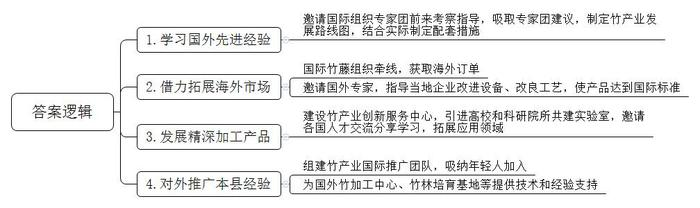
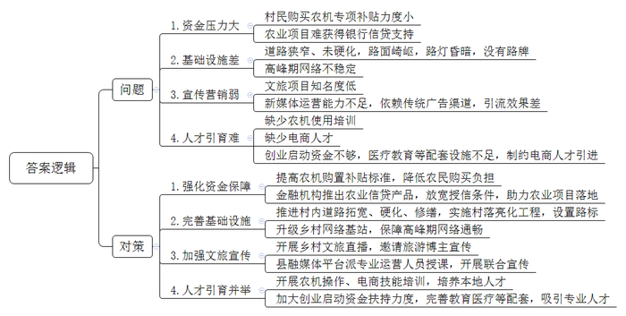
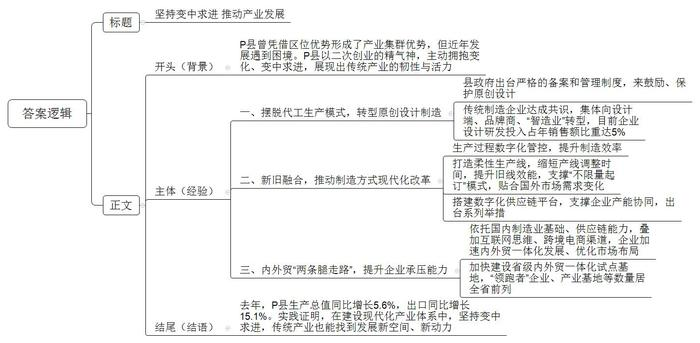
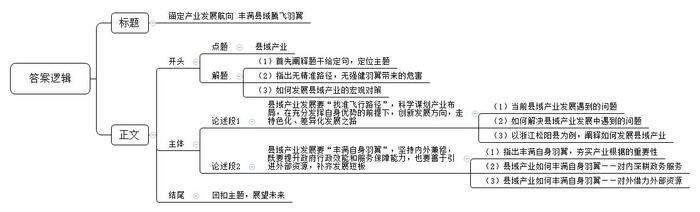

# 2026年公务员多省联考《申论》题（湖南县乡卷）

<!-- gwy:overview:start -->
> **湖南 · 2026 · 申论 · 县乡卷** ｜ 4 题 · 图片 4 处 · 答案随题折叠

导航：[题目](#题目) · [材料 1](#材料-1)
<!-- gwy:overview:end -->

> 候选采集稿。参考答案及解析来自粉笔页面，不代表官方答案或真实高分答卷；来源使用许可与原卷对应关系仍需人工核实。

## 给定材料

### 材料 1

Z省Y县坐拥全国十分之一的竹林资源，这里云雾缭绕、层峦叠翠，得天独厚的生态环境孕育出“壁厚、节长、径大、质优”的好竹子。而今，这一根根Y县竹正以更环保、更时尚、更高附加值的姿态漂洋过海，为世界讲述中国绿色发展的鲜活故事。

时间回到八年前，当时Y县的竹资源优势尚未得到充分发掘，存在有想法没办法、有产品没产业、有销售没市场的问题。“要么卖原竹，要么做成箩筐扁担卖，也就赚几十块辛苦钱。”竹农老高说。“当时县里确实也没捋清思路。”Y县林业局刘局长介绍，“经过多次调研，我们对如何走好‘两山’转化的路子进行了深入论证，最后决定，具体怎么办得取经。”

2019年，经过多番努力，Y县政府终于邀请到了国际竹藤组织专家团来县里考察指导，由此开启了竹产业国际化发展的历程。来自肯尼亚的卡玛乌是竹藤组织的林业专家，当时他站在竹海中，对随风摆动的阵阵“竹浪”惊叹不已：“这简直就是绿色的黄金！”卡玛乌告诉当地竹农，在他的家乡，木材资源短缺，很多地区不得不使用塑料制品，而竹子三到五年就能成材，是理想的木材替代品。

短短半个月时间，Y县政府带着专家团走遍了全县竹林。按照专家团的建议，在接下来的两年中，县政府制定了竹产业发展路线图，再由有关部门结合实际制定配套措施：推出“竹艺贷”“碳汇竹林保险”等创新金融产品，为相关企业发展注入金融“活水”；与职业院校合作开设竹工艺相关专业，培育新型“竹匠”，强化企业人才保障；拓宽改善林区道路，建设冷链仓储物流设施，降低运输损耗，不断推进基础设施改造提升。

在各方的努力下，Y县的原竹销售和初级加工产业逐步建立，2021年新增竹林5万亩，组建竹业合作经济组织16家，隆泰竹业就是其中一家以竹胶板为主要产品的公司。该公司和县林业局在竹山附近合作建设了一个竹材物理分解点，采伐队每日将新鲜竹材运至分解点进行初步的切割、干燥后再统一分拣装车，大大提升了效率。经粗加工后的竹材由专车运至工业园加工，通过国际竹藤组织的渠道销售至世界各地。公司成立不到2年，产值就突破了5000万元，成为了Y县的明星企业。

2023年，Y县物美价优的竹产品吸引了众多客户的关注，在国际竹藤组织的牵线下，Y县的竹产业接到了更多来自海外市场的订单。“第一次接到欧洲订单时，我们连客户需要的规格都很陌生。”Y县竹产业协会杜会长回忆道，“特别是对方要求的防霉处理标准，我们听都没听过。”为了帮助企业突破困境，Y县邀请了德国竹材处理专家汉斯博士。他在Y县待了整整三个月，手把手教当地企业改进设备、改良工艺，产品最终达到欧盟标准。

“我们确实和先进水平还有差距。”杜会长介绍，“他们的原材料其实不如我们，但经过精深加工后能得到更优良的产品。”由此，Y县下决心大力发展竹纤维、竹炭、竹基复合材料等精深加工产品，建设了竹产业创新服务中心，引进高校和科研院所共建实验室，邀请各国科研人员、设计师来交流、分享和学习，共同推动竹材在建筑材料、汽车内饰等高端领域的应用。如今，走进Y县竹产业创新服务中心，处处可见国际合作的景象：实验室里，来自巴西的研究员正在测试竹基复合材料的强度；设计中心里，意大利设计师正与Y县工匠热烈讨论着新款竹家具的细节；培训教室里，老师正向东南亚学员传授Y县的传统竹编和竹材加工技术。布迪是一位来自印尼的年轻竹艺师，他被Y县的传统竹编工艺所折服。“这次来培训，是想将这项技艺融入我的作品中，用国际化的思维进行设计。”布迪说，“竹子是世界的语言。”

2025年，老高的竹林里来了一群特殊的客人——来自国际竹藤组织的“竹海生态游”考察团。“那些外国朋友对我的砍竹方式特别感兴趣，还学着用传统工具编竹篮。”老高笑着说，“一位厄瓜多尔的专家告诉我，他们那也有大片竹林，但利用率远不如我们县。”这次交流让老高意识到，Y县的经验正在被世界所需要。今年，他的儿子大学毕业后选择回乡，加入了县里的竹产业国际推广团队。“年轻人脑子活，会说外语，正在把我们Y县的竹子故事讲给世界听。”老高语气中满是自豪。

在Y县竹产业示范园，一座现代化的竹材加工厂正在运转。这里生产的竹建材，正源源不断地运往“一带一路”沿线国家。在埃塞俄比亚，Y县技术支持建立的竹加工中心，已经能生产出符合当地需求的竹家具；在加纳，借鉴Y县模式的竹林培育基地初见成效。“国际合作不仅是把别人的好经验学回来，也要让我们的好技术、好产品走出去，大家在交流互鉴中发展。”杜会长说。

夕阳西下，竹影婆娑。Y县的根根翠竹，正以最朴素的方式，连接起Y县与世界，书写着国际合作助力绿色发展的生动篇章。

### 材料 2

随着乡村振兴战略的实施和城乡经济的融合，传统的农业生产和农村生活方式正在逐渐转变，农村职业经理人、民宿管家等新兴职业不断涌现。为进一步了解乡村新职业的发展状况及乡村振兴实施成果，S市开展了“乡村有我·共话未来”乡村新职业代表交流座谈会。以下是座谈会的部分发言记录。

农村职业经理人李先生：转眼间，我在这个岗位上已经干了五年。这些年，我带着团队和乡亲们一块儿干了许多事。我们开展了对土地、农作物和销售市场的调研；从农科院采购了新型种子，并采用间作模式；引进了水肥一体化管理系统和植保无人机等先进设备；上线了小程序，定期在各个平台直播销售……这五年的辛苦让我们的钱袋子鼓了，大家越干越有劲，规模也越做越大，但是规模的扩大意味着机械化自动化要求的提高。政府虽然有专项补贴，可就算是一台最普通的联合收割机，对村民来说负担还是比较重。而且村里的道路狭窄，很多地方还是沙石路，连机器的运输都是问题。村民们大多没有经过培训，也看不懂说明书，使用农机时遇到问题只能自己瞎琢磨，光靠我们村来解决实在是有点难。

民宿管家王女士：民宿不仅仅是一个提供住宿的地方，它更像是传承乡村文化的一个窗口，让游客们真正体验到乡村的魅力，感受来自乡村的宁静与美好，所以，我用三年的时间打造了“田园居”。每天，早餐前带着客人体验点心的古法制作流程，早餐后组织客人到村子周边赶大集。下午则会组织乡村体验官活动，带他们到村子里参观遗迹遗址，或者安排客人参与拓印、彩绘等文创体验活动。晚上，民宿还有一个固定项目“围炉夜话”。客人们围坐在茶炉边谈天说地，有的称赞我们村历史底蕴深厚，村俗文化独特；有的说我们村是“酒香也怕巷子深”，来之前完全没想到这里会这么美；有的建议我可以开直播，或者邀请一些旅游博主来打响知名度；还有的说我们村路窄灯暗，很多石板路崎岖不平，到了晚上出门容易摔跤，还找不到方向。客人们的建议都很实在，给了我很多启发。

乡村CEO赵先生：我们团队在入驻时进行了详尽的乡村资源调查，从土壤成分到气候条件，从历史文化到民俗风情，无一不细细考量。从调研结果来看，村里的资源是很丰富的。最后综合考虑，团队制定了“绿色生态+文化旅游”的双轮驱动发展策略。在农业发展方面，我们采取了生态循环的养殖模式，引入了智能化立体养殖技术，但投资大、周期长、回报慢，这使得我们难以获得充足的银行信贷支持，本想搭建的智慧农业系统也因为缺乏后续资金而暂停，要是能得到更有力的金融扶持就好了。在文旅宣传方面，我们通过挖掘乡村文化内涵，设计了一系列特色文旅活动，如采摘园、民俗体验课、“我的一亩田”认领等，但人气一直平平。后来发现主要是因为我们缺乏新媒体运营能力，过分依赖传统广告渠道进行宣传，引流效果就比较一般。后续我们想和县融媒体平台合作，请他们的专业运营人员来授课，开展一些联合宣传，让更多人能看到我们的好活动。

农产品电商运营师张女士：我自小在田间地头长大，对家乡的一草一木都充满了深厚的感情。大学毕业后，我选择回到家乡，利用所学的电子商务知识，帮助乡亲们开网店、做直播，教他们用手机拍摄农产品的照片、写产品描述、申请相关资质、做线上推广，让大家的农产品都能及时地卖出去、卖个好价钱。现在乡亲们的直播热情很高，但是到了晚上直播的高峰期，村里的网络就会变得不稳定，一卡顿大家都急得不行。此外，村里目前只有我一个人熟悉电子商务，实在是分身乏术。我试着邀请过几位大学时代的挚友和我一起到村里创业，结果却不尽如人意。他们有的觉得人生地不熟，对创业没有信心；有的认为村里给的创业启动资金不够，不敢冒险；还有的担心医疗、教育这些配套设施跟不上，未来的发展机会也有限。要解决这些问题，光靠我们的力量肯定是不够的，希望政府也能想想办法。

### 材料 3

走进P县中国服装城，熙熙攘攘的批发客商穿梭其间，店员们忙着开单、打包货品发往全国乃至世界各地。不产羽绒，却产出全国一半以上羽绒服；不产皮革，却成为全国三大箱包生产基地之一……P县“无中生有”，主动拥抱变化、变中求进，在变革中呈现“繁星满天”，发展成为中国服装制造名城、中国跨国服装采购产业基地、中国旅行箱包之都，展现出传统产业在建设现代化产业体系中的韧性与活力。

20世纪80年代，P县凭借区位优势兴起第一批服装、箱包加工厂，此后快速形成产业集群优势。“那时OEM（代工生产）订单接到手软。”P县杜县长说，“直到近些年，受贸易环境、用工成本、原料价格等因素影响，订单量经常不太稳定。苦等订单是没有出路的，必须拿出二次创业的精气神。”P县大量企业开始向门槛更高的细分行业寻找机会，尤其是向ODM（原创设计制造）进军。

“我想从中国传统文化中汲取灵感，融入羽绒服设计。”P县青年设计师沈先生带着自己原创的高级时装羽绒服品牌闯进了米兰时装周。“我们做过统计，2016年市场内具有原创设计的款式不超过200款，而2023年原创设计款式超过2万款。”P县中国服装城负责人介绍，为了鼓励、保护原创设计，县里出台了严格的备案和管理制度。另一家箱包公司负责人董女士说：“原创设计紧跟现代化趋势、紧扣市场化需求，让中国制造、中国智造的优势更加凸显，我们与十多个知名IP打造联名款箱包，站稳了中高端市场。”从单纯的生产商向设计端、品牌商、“智造业”转型，已经成为传统制造企业的共识，目前P县企业设计研发投入占年销售额的比重达到5%。

在一家服装企业中控室内，工序进度以及各车间产品完成数、计划达成率等实时呈现在大屏上。“影响服装企业生产效率的因素中，至少有30%是因为工序之间的无效等待和质量问题引起的返工。”P县服装行业协会崔会长介绍，当前，主流消费群体和电商平台、直播带货等新兴分销渠道对制造效率提出了更高要求，对企业而言，“效率就是生命”更加凸显，数字赋能转型升级是大势所趋。

“我们就是要在县域范围内形成产业集中、专业化极强，同时又具有明显本地特色的区域性产业群体。县里的箱包工业基础是很好的，现在要做的是转型升级，推动制造方式的现代化改革。这并不意味着另起炉灶，而是新旧融合，让传统制造插上现代化翅膀。”杜县长介绍。“我们打造了一条柔性生产线，从制造一种产品切换到另一种产品，产线调整时间只需半个小时。”P县箱包有限公司童经理说，“这很好地支撑了‘不限量起订’模式，让我们在适应小批量、个性化定制需求方面尽显优势，实现了旧有生产线的能效再提升。”

几年前，邱先生自创的羽绒服品牌受到欧美消费者热捧，销量跻身某海外购物平台服装畅销榜，甚至成为女式羽绒服“销冠”。“从大批量到‘小快灵’，服装外贸有新机会。”邱先生说，近些年国外市场消费能力、消费习惯等都有变化，中国企业贴合需求、小批量生产、快速迭代的能力更加凸显，这为P县新兴服装企业带来了竞争优势。

P县箱包产业数字化供应链平台在支撑企业产能协同中发挥了重要作用：大公司接到订单可以在平台发包，中小企业在线抢单，当地一大批箱包厂因此在细分环节找到了发展空间。近年来，P县还通过建设工业互联网平台、制定传统产业定制化转型实施意见等举措，驱动传统制造业生产方式变革。

依托国内强大的制造业基础、供应链能力，叠加互联网思维、跨境电商渠道，近些年P县企业内外贸一体化发展、市场布局优化明显加速。P县箱包有限公司不仅将海外客户从欧洲拓展到南美，还积极瞄准国内消费群体。“我们建立了500平方米的网络直播基地，线上线下协同打开国内销售市场。”公司负责人说，外贸、内贸“两条腿走路”，让企业承压能力更强。

立足当地特色传统产业，P县加快建设省级内外贸一体化试点基地，目前当地的省级内外贸一体化“领跑者”企业、一体化产业基地、高质量发展项目等数量均居全省前列。去年，P县实现生产总值555.08亿元，同比增长5.6%。同期，P县实现货物贸易进出口417.35亿元，其中出口273.19亿元，增长15.1%。

“传统与现代之间并没有断裂，而是连续的更新迭代。”杜县长表示，当地传统产业转型升级经受住市场考验，展现出韧性与活力，这表明在建设现代化产业体系中，变中求进的传统产业也能找到发展新空间、新动力。

### 材料 4

“现在办业务方便多了。”N县童新小提琴有限公司杨经理告诉记者，“原来办这项业务需要去三个窗口、交三套材料，现在到一个窗口交一套材料就都办好了。”

改变源自N县2020年开始的改革。“当时根据省委、市委部署，我县结合发展实际需要，推动职能相近的机构进行跨部门整合。”N县县委王书记向记者介绍，“我们按照地理位置、主导产业等在省内外寻找发展建设标杆，并组织县乡干部到先进发达地区跟班学习，针对性开展外训和专题学习研讨。根据外训学习的成果，县里重新规划梳理了各类审批制度、办事流程，有效提升了行政效能和服务保障能力。”

“过去县里的招商服务中心就只负责招商，招回来后还要经过好几个部门，最终能不能落地、落地效果如何，都没有很好保障。”县项目推进中心林主任说。合并后的N县项目推进中心主要负责招商引资、项目推进、省县重点工程推进等，将招商、签约、投产等一系列环节串联起来，为企业提供全周期服务。“招商也是有的放矢。我们在前期会进行大量的调研考察，新产业的发展、产业发展的新突破不能陷入与周边地区同质化的困局，要立足‘人无我有、人有我优’的原则。”

杨经理告诉记者，县里原本没有小提琴产业。“项目推进中心联系我的时候我心里还打着鼓，就我自己，从头开始，能行吗？后来他们告诉我，县里通过本地在外人才库发现了许多像我这样在外地从事小提琴制作的老乡，就主动上门讲解各种优惠政策，动员我们一起返乡创业。而且，县里不是‘一招了之’，补贴发放、厂房租赁、技能培训……我们遇到了什么问题县里都能及时帮我们解决，新出了优惠政策也会马上上门告知，真是太贴心了！”

“不仅要扶持企业‘站’起来、‘立’得住，更要鼓励企业‘走出去’。”N县曲县长对记者说。一方面，N县创新推行“两会一日”机制，通过“企业茶话会+项目督查会+现场办公日”的组合拳有效收集企业诉求，破解企业发展难题；另一方面，制定出台市场开拓扶持方案，提供资金支持企业参加国内外各类展会，定期组织赴外考察交流团，护航企业“破圈出海”。如今，N县拥有小提琴生产及配套企业100余家，产品销往全球多个国家和地区，企业的发展带动了超过1.5万人就业。

“<u>弱鸟要飞高飞远，既要找到适合的飞行轨迹，又要丰满自身的羽翼</u>。”王书记告诉记者，“我们在制定N县中长期发展规划时，强调要根据本县实际情况和特殊性，打好‘特色牌’，走好‘差异路’。”

“N县从前是农业管农业、科技管科技，研究提出的建议也没法很好落地。”C大学乡村振兴研究院汪研究员说，“改革后，N县围绕全县‘一盘棋’，群策群力开展科技攻关，取得了很好的效果。”N县经过调研发现，县里的碱性土壤和相对干旱的气候非常适合蜜瓜生长。之后，县政府与省农科院积极开展合作，培育出适合当地种植的多个蜜瓜品种。2025年，全县蜜瓜产业产值近6亿元，成为N县的另一支柱产业。

N县佳果农业有限公司负责人老段对此深有感触：“以前种粮食收成不好，大家日子过得苦哈哈的。现在种了蜜瓜，产量高，还不愁卖。我们县里和高新区签了合作协议，每年要供应一大批蜜瓜给那边的大企业，对方也会派专家来给我们做电商销售的培训，帮我们开网店。听说今年那边还要开我们县的特色农产品专卖店呢！”说起下一步的计划，老段干劲满满，“据说最近县里在组织去D省的参观交流团，那里有几个地方的蜜瓜也很不错。我打算报名，过去看一看、学一学，回来也和大家分享分享！”

“对县域而言，它的发展同时受到全局因素和自身问题的双重影响，破解县域发展的难题，要立足县域看县域，也要跳出县域看县域。”汪研究员表示。

“我们县自然资源禀赋有限，发展基础相较东部经济强县还是比较薄弱，要跟上大部队、保障发展成效，就只能在其他方面做文章。跨地区协作是一个很好的机会，但与此同时，我们也要做好服务，‘内外兼修’全面发展。”王书记坦言，“找准自身优势，大胆改革，勇于创新，选对赛道，N县才能发展得更稳、更好。”

## 题目

### 第 1 题

**根据“给定资料1”，请你谈谈Y县通过国际交流合作发展竹产业的主要做法。（15分）**

关联材料：材料 1

作答要求：

要求：全面、准确、有条理；不超过250字。

第 1 题 · 答案与解析

**参考答案（粉笔题库参考内容）**

1.学习国外先进经验。邀请国际组织专家团前来考察指导，吸取专家团建议，制定竹产业发展路线图，结合实际制定配套措施。

2.借力拓展海外市场。国际竹藤组织牵线，获取海外订单；邀请国外专家，指导当地企业改进设备、改良工艺，使产品达到国际标准。

3.发展精深加工产品。建设竹产业创新服务中心，引进高校和科研院所共建实验室，邀请各国人才交流分享学习，拓展应用领域。

4.对外推广本县经验。组建竹产业国际推广团队，吸纳年轻人加入；为国外竹加工中心、竹林培育基地等提供技术和经验支持。

**解析**

**参考答案说明：**本参考答案从“学习国外先进经验”“借力拓展海外市场”“发展精深加工产品”“对外推广本县经验”四个方面展开，各条答案要点之间在内容上相互并列，没有交叉。

**考点**：概括措施类

**来源**：2026年公务员多省联考《申论》题（湖南县乡卷）

### 第 2 题

**“给定资料2”反映了S市部分乡村新职业代表在工作中遇到的一些问题，请你对这些问题进行梳理，并提出解决建议。（20分）**

关联材料：材料 2

作答要求：

要求：

（1）问题梳理全面、准确；

（2）所提建议具体明确、切实可行；

（3）层次分明，有逻辑性；

（4）不超过400字。

第 2 题 · 答案与解析

**参考答案（粉笔题库参考内容）**

问题：1.资金压力大。村民购买农机专项补贴力度小；农业项目难获得银行信贷支持。2.基础设施差。道路狭窄、未硬化，路面崎岖，路灯昏暗，没有路牌；高峰期网络不稳定。3.宣传营销弱。文旅项目知名度低；新媒体运营能力不足，依赖传统广告渠道，引流效果差。4.人才引育难。缺少农机使用培训；缺少电商人才；创业启动资金不够，医疗教育等配套设施不足，制约电商人才引进。

对策：1.强化资金保障。提高农机购置补贴标准，降低农民购买负担；金融机构推出农业信贷产品，放宽授信条件，助力农业项目落地。2.完善基础设施。推进村内道路拓宽、硬化、修缮，实施村落亮化工程，设置路标；升级乡村网络基站，保障高峰期网络通畅。3.加强文旅宣传。开展乡村文旅直播，邀请旅游博主宣传；县融媒体平台派专业运营人员授课，开展联合宣传。4.人才引育并举。开展农机操作、电商技能培训，培养本地人才；加大创业启动资金扶持力度，完善教育医疗等配套，吸引专业人才。

**解析**

**参考答案说明：**本参考答案整体分为“问题”和“对策”两个部分，其中“问题”部分从“资金压力大”“基础设施差”“宣传营销弱”“人才引育难”这四个方面展开，“对策”部分从“强化资金保障”“完善基础设施”“加强文旅宣传”“人才引育并举”四个方面展开，且所提对策与问题相对应。各条答案要点之间在内容上相互并列，没有交叉。

**考点**：提出对策类

**来源**：2026年公务员多省联考《申论》题（湖南县乡卷）

### 第 3 题

**市里将举办传统产业转型升级经验交流会，P县杜县长将以“坚持变中求进 推动产业发展”为题作会议发言。请你根据“给定资料3”，为杜县长拟写一份发言提纲。（25分）**

关联材料：材料 3

作答要求：

要求：

（1）紧扣资料，内容全面；

（2）条理清晰，语言生动；

（3）不超过500字。

第 3 题 · 答案与解析

**参考答案（粉笔题库参考内容）**

坚持变中求进 推动产业发展

背景：P县曾凭借区位优势形成了产业集群优势，但近年发展遇到困境。P县以二次创业的精气神，主动拥抱变化、变中求进，展现出传统产业的韧性与活力。

经验：一、摆脱代工生产模式，转型原创设计制造。县政府出台严格的备案和管理制度，来鼓励、保护原创设计；传统制造企业达成共识，集体向设计端、品牌商、“智造业”转型，目前企业设计研发投入占年销售额比重达5%。二、新旧融合，推动制造方式现代化改革。生产过程数字化管控，提升制造效率；打造柔性生产线，缩短产线调整时间，提升旧线效能，支撑“不限量起订”模式，贴合国外市场需求变化；搭建数字化供应链平台，支撑企业产能协同，出台系列举措。三、内外贸“两条腿走路”，提升企业承压能力。依托国内制造业基础、供应链能力，叠加互联网思维、跨境电商渠道，企业加速内外贸一体化发展、优化市场布局；加快建设省级内外贸一体化试点基地，“领跑者”企业、产业基地等数量居全省前列。

结语：去年，P县生产总值同比增长5.6%，出口同比增长15.1%。实践证明，在建设现代化产业体系中，坚持变中求进，传统产业也能找到发展新空间、新动力！

**解析**

**参考答案说明：**（1）格式方面，本参考答案写到了“标题”“正文”两个部分。（2）正文部分，一方面从内容上来看，围绕“P县传统产业转型升级”这一主题，本参考答案的开头先写到了“P县传统产业的相关背景”；主体部分从“摆脱代工生产模式，转型原创设计制造”“新旧融合，推动制造方式现代化改革”“内外贸‘两条腿走路’，提升企业承压能力”等三个方面给出了具体的建设措施。最后，结尾对建设成效进行了总结并展望未来。另一方面，形式上，本参考答案做到了分段、分条撰写，整体上条理颇为清晰。

**考点**：总结类

**来源**：2026年公务员多省联考《申论》题（湖南县乡卷）

### 第 4 题

**“给定资料4”中提到“弱鸟要飞高飞远，既要找到适合的飞行轨迹，又要丰满自身的羽翼”，请你结合对这句话的理解，参考给定资料，联系实际，自选角度，自拟题目，写一篇文章。（40分）**

关联材料：材料 1、材料 2、材料 3、材料 4

作答要求：

要求：

（1）观点明确，见解深刻，内容充实；

（2）参考给定资料，但不拘泥于给定资料；

（3）思路清晰，语言流畅；

（4）字数800-1000字。

第 4 题 · 答案与解析

**参考答案（粉笔题库参考内容）**

**锚定产业发展航向 丰满县域腾飞羽翼**

“弱鸟要飞高飞远，既要找到适合的飞行轨迹，又要丰满自身的羽翼。”这句话深刻揭示了县域产业发展的内在逻辑。无精准轨迹则发展迷失方向，徒劳无功；无强健羽翼则难以御风前行，后劲匮乏。对于基础薄弱、资源有限的县域而言，想要突破发展桎梏，绝非盲目蛮干、跟风复刻所能实现。唯有锚定特色赛道规划发展航向，内外兼修补齐发展短板，方能让县域产业破局突围、长效发展。

**县域产业发展要“找准飞行轨迹”，科学谋划产业布局，在充分发挥自身优势的前提下，创新发展方向，走特色化、差异化发展之路。**当下不少县域急于追赶发展步伐，盲目照搬邻县产业模式、扎堆布局通用型产业，陷入产业雷同、恶性竞争、资源空耗的发展困局。破解这一困境，关键在于回归自身、深耕特色。浙江松阳县敏锐捕捉到境内拥有200平方公里山间平原及丰富公路场景的优势，结合本土交通新材料领域“小巨人”企业基础，果断摒弃同质化发展路径，将综合交通产业确立为发展新赛道。“历史上有基因、现实中有场景、产业上有前景”，松阳县的实践告诉我们，县域发展切忌随波逐流、跟风盲从，唯有立足自身特色资源禀赋，坚守“人无我有、人有我优”原则，方能开辟出一条不可替代的高质量发展航道。

选对特色发展轨迹解决了县域产业“往哪飞”的核心问题，但资源储备不足、发展基础薄弱等短板，依旧是束缚县域前行的枷锁。倘若仅有发展蓝图，没有“丰满羽翼”作为支撑，再好的规划也只是空中楼阁。

**县域产业发展要“丰满自身羽翼”，坚持内外兼修，既要提升政府行政效能和服务保障能力，也要善于引进外部资源，补齐发展短板。**羽翼强健，才可抵御疾风、奔赴远方；夯实根基，方可稳住产业、长效发展。对内深耕政务服务改革，破除部门壁垒、精简办事流程，为企业提供落地、经营、发展全周期服务，统筹县域资源实现全域一盘棋；对外跳出县域固有边界，借力外部资源弥补先天短板，比如联动毗邻县域分工补链、对接科研院所攻克产业瓶颈等。县域发展既要通过改革创新破解自身堵点，也要以开放姿态融入更大区域格局，在跨地区协作中补齐短板、借力腾飞。

弱鸟振翅，既要锚定航向，也要强翼蓄力。县域产业发展唯有选准特色发展航向、锤炼硬核发展实力，方能让弱鸟冲破桎梏、扶摇直上，书写县域高质量发展新篇章。

**解析**

**文章分析**

**锚定产业发展航向** **丰满县域腾飞羽翼**

【**标题的优点：**标题中含有主题词，使文章主题更突出、清晰。】

（1）“弱鸟要飞高飞远，既要找到适合的飞行轨迹，又要丰满自身的羽翼。”这句话深刻揭示了<u>县域产业发展的内在逻辑</u>。（2）<u>无精准轨迹</u>则发展迷失方向，徒劳无功；<u>无强健羽翼</u>则难以御风前行，后劲匮乏。（3）对于基础薄弱、资源有限的县域而言，想要突破发展桎梏，<u>绝非盲目蛮干、跟风复刻所能实现</u>。唯有<u>锚定特色赛道规划发展航向</u>，<u>内外兼修补齐发展短板</u>，方能让县域产业破局突围、长效发展。

【**开头的优点：**★内容方面。范文的开头是紧扣“县域产业”这一主题展开的。（1）首先阐释题干给定句，定位主题；（2）指出无精准轨迹，无强健羽翼带来的危害；（3）如何发展县域产业的宏观对策。★文字表达方面。使用了“揭示了”“唯有……方能……”等，使语言表达有逻辑性；长短句配合使用，使得语言表达有节奏感。】

**县域产业发展要“找准飞行轨迹”，科学谋划产业布局，在充分发挥自身优势的前提下，创新发展方向，走特色化、差异化发展之路。**（1）当下不少<u>县域急于追赶发展步伐</u>，盲目照搬邻县产业模式、<u>扎堆布局通用型产业</u>，陷入<u>产业雷同</u>、<u>恶性竞争</u>、<u>资源空耗</u>的发展困局。（2）破解这一困境，关键在于<u>回归自身</u>、<u>深耕特色</u>。（3）<u>浙江松阳县</u>敏锐捕捉到境内拥有200平方公里山间平原及丰富公路场景的优势，结合本土交通新材料领域“小巨人”企业基础，果断摒弃同质化发展路径，将综合交通产业确立为发展新赛道。“历史上有基因、现实中有场景、产业上有前景”，松阳县的实践告诉我们，县域发展切忌随波逐流、跟风盲从，唯有立足自身特色资源禀赋，坚守“人无我有、人有我优”原则，方能开辟出一条不可替代的高质量发展航道。

【**论述段1的优点：**★观点句：范文的观点句是紧扣“县域产业”这一文章主题提出的。形式上，它在段首处直接写出，位置突出，容易发现。内容上，关键词突出，内容要点明确，可以明显看出主要论述“县域产业发展要‘找准飞行轨迹’”。★论述内容：（1）当前县域产业发展遇到的问题；（2）如何解决县域产业发展中遇到的问题；（3）以浙江松阳县为例，阐释如何发展县域产业。注意：以上三个方面的内容都是紧扣“县域产业发展要‘找准飞行轨迹’，科学谋划产业布局，在充分发挥自身优势的前提下，创新发展方向，走特色化、差异化发展之路”这个观点句进行分析论述的，论述的针对性强，内容层次丰富。在论述方法上主要采用了讲道理、举例子相结合的方式，论述充实深刻。】

选对特色发展轨迹解决了县域产业“往哪飞”的核心问题，但<u>资源储备不足</u>、<u>发展基础薄弱</u>等短板，依旧是束缚县域前行的枷锁。倘若仅有发展蓝图，没有“丰满羽翼”作为支撑，<u>再好的规划也只是空中楼阁</u>。

【**过渡段的优点**：范文的过渡段分析了“县域产业”存在的问题。此外，还要注意过渡段末尾的“倘若仅有发展蓝图，没有“丰满羽翼”作为支撑，再好的规划也只是空中楼阁”是用来引起下文的过渡句。】

**县域产业发展要“丰满自身羽翼”，坚持内外兼修，既要提升政府行政效能和服务保障能力，也要善于引进外部资源，补齐发展短板**。（1）羽翼强健，才可抵御疾风、奔赴远方；<u>夯实根基</u>，方可<u>稳住产业、长效发展</u>。（2）<u>对内深耕政务服务改革</u>，<u>破除部门壁垒</u>、<u>精简办事流程</u>，为企业提供落地、经营、发展全周期服务，统筹县域资源实现全域一盘棋；（3）<u>对外跳出县域固有边界</u>，<u>借力外部资源弥补先天短板</u>，比如联动毗邻县域分工补链、对接科研院所攻克产业瓶颈等。县域发展既要通过改革创新破解自身堵点，也要以开放姿态融入更大区域格局，在跨地区协作中补齐短板、借力腾飞。

【**论述段2的优点：**★观点句：范文的观点句是紧扣“县域产业”这一文章主题提出的。形式上，它在段首处直接写出，位置突出，容易发现。内容上，关键词突出，内容要点明确，可以明显看出主要论述“县域产业发展要‘丰满自身羽翼’”。★论述内容：（1）指出丰满自身羽翼，夯实产业根据的重要性；（2）县域产业如何丰满自身羽翼——对内深耕政务服务；（3）县域产业如何丰满自身羽翼——对外借力外部资源。注意：以上三个方面的内容都是紧扣“县域产业发展要‘丰满自身羽翼’，坚持内外兼修，既要提升政府行政效能和服务保障能力，也要善于引进外部资源，补齐发展短板”这个观点句进行分析论述的，论述的针对性强，内容层次丰富。在论述方法上主要采用了讲道理、举例子相结合的方式，论述充实深刻。】

【**论述段之间的关系**：★内在逻辑上：文章先论述“县域产业发展要‘找准飞行轨迹’”，再论述“县域产业发展要‘丰满自身羽翼’”，并列逻辑清晰严谨。】

弱鸟振翅，既要锚定航向，也要强翼蓄力。<u>县域产业</u>发展唯有选准特色发展航向、锤炼硬核发展实力，方能让弱鸟冲破桎梏、扶摇直上，书写县域高质量发展新篇章。

【**结尾的优点：**范文的结尾回扣了“县域产业”这个主题，并且进行了展望，发出了号召。】

**考点**：文章写作题

**来源**：2026年公务员多省联考《申论》题（湖南县乡卷）

