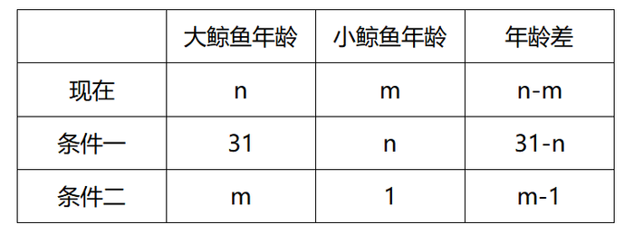
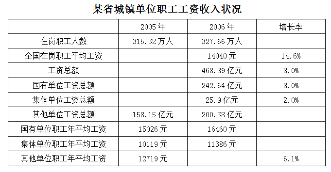

# 2009年甘肃省公务员录用考试《行测》题

<!-- gwy:overview:start -->
> **甘肃 · 2009 · 行测 · 统考** ｜ 100 题 · 图片 4 处 · 答案随题折叠

| 题型模块 | 题量 | 题号 |
| --- | ---: | ---: |
| 数量关系 | 15 | 1–15 |
| 言语理解与表达 | 30 | 16–45 |
| 常识判断 | 40 | 46–85 |
| 资料分析 | 15 | 86–100 |
| **合计** | **100** | |

导航：[题型与作答说明](#题型与作答说明) · [题目](#题目) · [材料 1](#材料-1)
<!-- gwy:overview:end -->

> 候选采集稿。参考答案及解析来自粉笔页面，不代表官方答案或真实高分答卷；来源使用许可与原卷对应关系仍需人工核实。

## 题型与作答说明

数量关系

（15题）

本部分包括数字推理与数学运算两种类型的试题。

言语理解与表达

（30题）

每道题包含一段短文，这之中有一个不完整的陈述，要求你从四个选项中选出一项来完成这一陈述。注意：供选择的答案有时可能是对短文内容的一个复述，有时则满足了陈述中其它方面的要求，你的选择应与所提要求最相符合。

常识判断

（40题）

根据题目要求，在四个选项中选出一个正确答案。

资料分析

（15题）

针对下列文字或图表资料回答问题。你应该根据资料提供的信息进行分析、比较、计算、处理。

## 题目

### 第 1 题

1，15，8，24，27，35，64，48，（    ），（    ）

A. 65，24

B. 125，80

C. 125，63

D. 65，124

第 1 题 · 答案与解析

**参考答案（粉笔题库参考内容）**

C

**解析**

数列中项数较多，大于等于7项，优先考虑多重数列。首先分奇偶项观察，发现所有奇数项1、8、27、64，分别为立方数1^3，2^3，3^3，4^3，下一个奇数项应为5^3=125。

偶数项15、24、35、48，没有明显规律，尝试作差后得到新数列9、11、13，是公差为2的等差数列，则新数列的下一项应为13+2=15。偶数项的下一项应为48+15=63。

故正确答案为C。

**来源**：2009年甘肃省公务员录用考试《行测》题第1题

### 第 2 题

1＋2，2＋4，3＋6，1＋8，2＋10，3＋12，…，（  ）

A. 1+24

B. 2+24

C. 3+26

D. 1+26

第 2 题 · 答案与解析

**参考答案（粉笔题库参考内容）**

D

**解析**

观察数列特征，有特殊符号“+”，考虑机械划分。前一个加数分别为1、2、3、1、2、3，是按照1、2、3的顺序循环出现在数列的第一个加数；后一个加数分别为2、4、6、8、10、12，是公差为2的等差数列。找到规律后观察选项，发现24、26的数据不大，可以采用枚举法将后续数据枚举出来，分别为：······、1+14、2+16、3+18、1+20、2+22、3+24、1+26、······

故正确答案为D。

**来源**：2009年甘肃省公务员录用考试《行测》题第2题

### 第 3 题

0.25，0.25，0.5，2，16，（  ）

A. 32

B. 64

C. 128

D. 256

第 3 题 · 答案与解析

**参考答案（粉笔题库参考内容）**

D

**解析**

观察数列发现有明显的倍数关系，且起伏较大，尝试作商。得到新数列为1、2、4、8，是公比为2的等比数列，则新数列下一项为8×2=16，原数列下一项应为16×16=256。

故正确答案为D。

**来源**：2009年甘肃省公务员录用考试《行测》题第3题

### 第 4 题

12，3，4，9，25，3，5，15，36，2，6，（  ）

A. 13

B. 12

C. 11

D. 10

第 4 题 · 答案与解析

**参考答案（粉笔题库参考内容）**

B

**解析**

数列无明显特征，但项数较多，共12项，优先考虑多重数列。首先尝试三三分组：（12、3、4）、（9、25、3）、（5、15、36）、\[2、6、（    ）\]，发现无规律；再尝试四四分组：（12、3、4、9）、（25、3、5、15）、\[36、2、6、（    ）\]，发现组内满足条件：12 × 3 = 4 × 9，25×3=5×15。则第三组同样应满足条件：36 × 2 = 6 × ( )，解得：下一项 = 36 × 2 ÷ 6 = 12。

故正确答案为B。

**来源**：2009年甘肃省公务员录用考试《行测》题第4题

### 第 5 题

0，3，26，255，（  ）

A. 479

B. 3124

C. 2600

D. 3104

第 5 题 · 答案与解析

**参考答案（粉笔题库参考内容）**

B

**解析**

数列无明显规律但起伏较大，优先考虑幂次数列。观察数列各项，并没有发现明显的幂次数，但都在幂次数附近，因此为幂次修正数列，可将原数列各项写成：

0 = 1^1 − 1；

3 = 2^2 − 1；

26=3^3−1；

255=4^4−1，

发现幂次数列的底数和指数都是自然数列，修正项为-1。则数列下一项应为5^5 − 1 = 3124。

故正确答案为B。

**来源**：2009年甘肃省公务员录用考试《行测》题第5题

### 第 6 题

125×567×32×25的值为（  ）。

A. 567000

B. 6870000

C. 56700000

D. 47500000

第 6 题 · 答案与解析

**参考答案（粉笔题库参考内容）**

C

**解析**

125 × 567 × 32 × 25 =125 × 567 × (8 × 4) × 25= (125 × 8) × (4 × 25) × 567= 1000 × 100 × 567 = 56700000。

故正确答案为C。

**来源**：2009年甘肃省公务员录用考试《行测》题第6题

### 第 7 题

0.0395×2400＋39.5×2.5＋51×3.95的值是（  ）。

A. 3.95

B. 39.5

C. 395

D. 3950

第 7 题 · 答案与解析

**参考答案（粉笔题库参考内容）**

C

**解析**

0.0395 × 2400 + 39.5 × 2.5 + 51 × 3.95 =3.95×24 + 3.95×25 + 3.95×51 =3.95×(24+25+51)= 3.95 × 100 = 395。

故正确答案为C。

**来源**：2009年甘肃省公务员录用考试《行测》题第7题

### 第 8 题

2004×（2.3×47+2.4）÷（2.4×47－2.3）的值为：

A. 2003

B. 2004

C. 2005

D. 2006

第 8 题 · 答案与解析

**参考答案（粉笔题库参考内容）**

B

**解析**

原式 = 2004×(2.3×47+2.4)/((2.3+0.1)×47-2.3)= (2004 × (2.3 × 47 + 2.4))/(2.3 × 47 + 4.7 - 2.3)= (2004 × (2.3 × 47 + 2.4))/(2.3 × 47 + 2.4) = 2004。

故正确答案为B。

**来源**：2009年甘肃省公务员录用考试《行测》题第8题

### 第 9 题

小鲸鱼说：“妈妈，我到您现在这么大时，您就31岁啦！”大鲸鱼说：“我像你这么大年龄时，你只有1岁。”请问小鲸鱼现在几岁？

A. 13

B. 12

C. 11

D. 10

第 9 题 · 答案与解析

**参考答案（粉笔题库参考内容）**

C

**解析**

设小鲸鱼现在m岁，大鲸鱼现在n岁，则有：

根据大鲸鱼与小鲸鱼间的年龄差始终不变，则有：n-m=31-n=m-1，解得m=11，故小鲸鱼现在11岁。

故正确答案为C。

**考点**：年龄问题

**来源**：2009年甘肃省公务员录用考试《行测》题第9题

### 第 10 题

将90分为a、b、c、d四个数之和，如果a数加上2，b数减去2，c数乘以2，d数除以2后得到的四个数相等，那么a、b、c、d四个数的值分别为（  ）。

A. 40，18，22，10

B. 18，22，10，40

C. 18，10，22，40

D. 22，10，40，18

第 10 题 · 答案与解析

**参考答案（粉笔题库参考内容）**

B

**解析**

根据题干已知a数加上2，b数减去2后相等，则a+2=b-2，解得a=b-4。代入选项发现只有B项符合。

故正确答案为B。

**考点**：和差倍比问题

**来源**：2009年甘肃省公务员录用考试《行测》题第10题

### 第 11 题

一条隧道，甲用20天时间可以挖完，乙用10天时间可以挖完，现在按照甲挖完一天，乙再接替一天，然后甲再接替乙挖一天······如此循环，挖完整个隧道需要多少天？

A. 16

B. 15

C. 14

D. 13

第 11 题 · 答案与解析

**参考答案（粉笔题库参考内容）**

C

**解析**

根据题意，赋值工作总量为20和10的最小公倍数20，则甲的效率为20/20=1，乙的效率为20/10=2。根据工作过程可知，甲乙循环挖隧道，每个循环周期（2天）的工作量为1+2=3，则20/3=6……2，即在6个循环周期后，剩余工作量为2，接下来还需甲、乙各挖1天，因此所需总天数= 2×6+2 = 14天。

故正确答案为C。

**考点**：周期余数问题、给完工时间型

**来源**：2009年甘肃省公务员录用考试《行测》题第11题

### 第 12 题

甲乙两人从同一起跑线上绕300米环形跑道跑步，甲每秒钟跑6米，乙每秒钟跑4米，问第二次追上乙时甲跑了几圈？

A. 9

B. 8

C. 7

D. 6

第 12 题 · 答案与解析

**参考答案（粉笔题库参考内容）**

D

**解析**

当甲第二次追上乙时，甲比乙多跑了2圈，设第二次追上乙时用时t秒。根据环形追及公式：S差 = (V1 − V2) × T，可得300 × 2 = (6 − 4) × t，解得t=300。根据公式：路程= 速度 × 时间，可得S_甲 = 6 × 300 = 1800米，因此甲跑了1800 ÷ 300 = 6圈。

故正确答案为D。

**考点**：相遇追及

**来源**：2009年甘肃省公务员录用考试《行测》题第12题

### 第 13 题

某超市采用促销的手段，凡购买价值200元以上的商品可以优惠20%，那么用320元钱在该超市最多可以买下价值（  ）元的商品。

A. 350

B. 384

C. 400

D. 420

第 13 题 · 答案与解析

**参考答案（粉笔题库参考内容）**

C

**解析**

设最多可以买到m元的商品，根据公式：折后价= 折前价 × 折扣，则可得320=m×(1−20%)，解得m=400。

故正确答案为C。

**考点**：经济利润问题

**来源**：2009年甘肃省公务员录用考试《行测》题第13题

### 第 14 题

某剧场共有100个座位，如果当票价为10元时，票能售完，当票价超过10元时，每升高2元，就会少卖出5张票，那么当总的售票收入为1360元时，票价为多少元？

A. 12

B. 14

C. 16

D. 18

第 14 题 · 答案与解析

**参考答案（粉笔题库参考内容）**

C

**解析**

方法一：设当总的售票收入为1360元时，票价升高了x次，根据公式：总收入=单价×销量，可得（10+2x）×（100-5x）=1360，化简得x^2 − 15x + 36 = 0，则（x-3）×（x-12）=0， 解得x_1=12，x_2=3。则对应的票价分别为：10+12×2=34元、10+3×2=16元，选项中仅有16元，故选C项。

方法二：结合选项，考虑代入排除法。代入A项，当票价为12元时，售出100 - (12 - 10)/2 × 5 = 95张，总的售票收入为12×95=1140元，不满足条件，排除；代入B项，当票价为14元时，售出100 − (14 − 10)/2 × 5 = 90张，总的售票收入为14×90=1260元，不满足条件，排除；代入C项，当票价为16元时，售出100-(16-10)/2×5=85张，总的售票收入为16×85=1360元，满足条件，当选，其余选项无需验证。

故正确答案为C。

**考点**：经济利润问题

**来源**：2009年甘肃省公务员录用考试《行测》题第14题

### 第 15 题

四人进行篮球接球练习，要求每人接球后再传给别人。开始由甲发球，并作为第一次传球，若第五次传球后，球又回到甲手中，则共有传球方式（  ）种。

A. 60

B. 65

C. 70

D. 75

第 15 题 · 答案与解析

**参考答案（粉笔题库参考内容）**

A

**解析**

方法一：根据已知，传球过程如下图所示：

可以将传球过程分为经过甲手中和不经过甲手中两种：

不经过甲手中时，A、B、C、D均不能为甲，共有3 × 2 × 2 × 2 = 24种方案；

经过甲手中时，只能在B或者C为甲，当B为甲时，共有方案3 × 1 × 3 × 2 = 18种方案；当C为甲时，共有方案3 × 2 × 1 × 3 = 18种方案。

综上，共有方案24+18+18=60种。

方法二：根据传球问题公式，M个人传N次球，则X = (M - 1)^N/M，与X最接近的整数为传给“非自己的某人”的方法数，与X第二接近的整数是最终传回自己手中的方法数。可得X=(4−1)^5/4=3^5/4=60.75，根据题干由甲发球，且球最终又回到甲手中，因此应取与X第二接近的整数，即60。

故正确答案为A。

**考点**：基础排列组合

**来源**：2009年甘肃省公务员录用考试《行测》题第15题

### 第 16 题

我们不能简单地认为词典的编纂者不对，他们对词典的用法做出改动不会是随意的，想必经过了认真的研究推敲。不过，词典编纂者不能忽视一个基本事实以及由此衍生的基本要求：语言文字是广大人民群众共同使用的，具有极为广泛的社会性，因此语言文字的规范工作不能在象牙塔里进行，而一定要走群众路线。

这段话的“基本要求”指的是（  ）。

A. 词典编纂者不能对词汇的用法随意改动

B. 词典编纂者应该熟悉词典编纂的具体过程

C. 语言文字的规范工作要为广大人民群众服务

D. 语言文字的规范工作应由广大人民群众来决定

第 16 题 · 答案与解析

**参考答案（粉笔题库参考内容）**

C

**解析**

本题考查词语理解题。

对于“基本要求”的理解关键在冒号之后的句子，因为冒号在其中起到的是解释说明的作用。

对尾句进行仔细分析，可知该句关键在于“而一定要走群众路线”这一句。所谓“走群众路线”就是语言文字的规范工作要为广大人民群众服务，C项表述正确。

A、B项均是针对文段中前几句话而谈的，予以排除。D项“由······决定”表述错误，显然不合题意。

故正确答案为C。

**考点**：实词

**来源**：2009年甘肃省公务员录用考试《行测》题第16题

### 第 17 题

尽管国际上对此存在很多争议，意大利文化部门还是决定用蒸馏水清洗米开朗基罗的旷世杰作——《大卫》雕像。这项工程的目的之一是除去这座高达4.5米的雕像上的尘土和油污。佛罗伦萨博物馆的负责人说：“这项工程并不是为了让雕像变得更好看。”意大利文化部长已经排除了干洗的可能性。

“国际上对此存在很多争议”的“此”指的是（    ）。

A. 《大卫》雕像是米开朗基罗的旷世杰作

B. 这项工程是为了让雕像变得更好看

C. 决定用蒸馏水清洗《大卫》雕像

D. 要除去这座高达4.5米的雕像上的尘土和油污

第 17 题 · 答案与解析

**参考答案（粉笔题库参考内容）**

C

**解析**

此题考查词语指代。

根据就近原则，我们在文段中出现“此”的附近寻找答案。分析“尽管国际上对此存在很多争议，意大利文化部门还是决定用蒸馏水清洗米开朗基罗的旷世杰作——《大卫》雕像”这句可得出答案，“此”指的就是用蒸馏水清洗米开朗基罗的《大卫》雕像这件事。

故正确答案为C。

**考点**：代词

**来源**：2009年甘肃省公务员录用考试《行测》题第17题

### 第 18 题

由于人为活动的破坏和自然因素的制约，多年得不到回补，水土流失日益严重。目前还没有找到合适的循环方法，土地的将来很值得人们持续的关注。改变农业长久以来形成的劳作习惯并非一日可成，况且主要的是要改变农业的生产模式，这需要生产力的提高，显然不可能一蹴而就。

文中的“这”指代的是（  ）。

A. 人们的持续关注

B. 改变农业长久以来形成的劳作习惯

C. 改变农业的生产模式

D. 找到适合的循环办法

第 18 题 · 答案与解析

**参考答案（粉笔题库参考内容）**

C

**解析**

此题考查词语指代。

根据就近原则，之前的句子，与“这”相关的是两个概念：“改变农业长久以来形成的劳作习惯”和“改变农业的生产模式”，根据关键词“况且主要的是”可知，句子强调的是“改变农业的生产模式”，且距离“这”更近。

故正确答案为C。

**考点**：代词

**来源**：2009年甘肃省公务员录用考试《行测》题第18题

### 第 19 题

文学家在克隆一个时代横断面风景线时，克隆了自己人生的风景线。品察他们的克隆有双重意义：一是品察在时代变幻中凸现的人文景观，二是品察他们在时代场景中自身的人格取向。

这段文字所表明的中心是（  ）。

A. 文学家肩负着反映时代和展示人生的双重任务

B. 表现时代和展示人生，是文学创作的双重目的

C. 欣赏文学作品可以使读者了解文学家们的社会人格

D. 欣赏文学作品有认识时代和文学家人格的双重意义

第 19 题 · 答案与解析

**参考答案（粉笔题库参考内容）**

D

**解析**

据提问知此题属于中心理解题。

文段中“品察他们的克隆”指的就是欣赏文学作品，谈的是其“双重意义”，此处的“双重意义”指文学作品有认识时代以及认识作者人格取向的双重作用，而不是强调文学家的任务或创作目的。

故D项正确。

A、B项错误；C项只提到了一种意义，不完整。

故正确答案为D。

**考点**：分述句特征-引入铺垫

**来源**：2009年甘肃省公务员录用考试《行测》题第19题

### 第 20 题

在公路发展的早期，它们的走势还很顺利，即沿河流或森林的边缘发展。可如今，公路已无所不在，狼、熊等原本可以自由游荡的动物群被分割得七零八落。与大型动物的种群相比，较小动物的种群在数量上具有更大的波动性，更容易发生杂居现象。

这段文字主要陈述的是（  ）。

A. 公路发展的趋势

B. 公路对动物的影响

C. 动物生存状态的变化

D. 不同动物的不同命运

第 20 题 · 答案与解析

**参考答案（粉笔题库参考内容）**

B

**解析**

根据提问知本题为中心理解题。

文段第一句陈述公路发展趋势，第二句由转折词“可如今”引导的句子是重点，可知文段重在谈论公路对动物的影响。

故正确答案为B。

**考点**：关联词-转折

**来源**：2009年甘肃省公务员录用考试《行测》题第20题

### 第 21 题

跟电影中创意是以导演为中心不同，电视行业创意的中心是编剧。编剧在电视行业中之所以重要，是因为小画框给视觉发挥的空间没那么大，语言艺术就显得特别重要。情景剧还有故事情节作为吸引力，而喜剧就完全是靠演员的表现和语言的魅力了；又都是在棚里拍，从拍摄上讲是纯技术活儿，创意都在于对话和表演。

对这段文字的主旨概括最准确的是（  ）。

A. 比较电视与电影行业创意上的差异

B. 强调语言魅力对电视行业的重要性

C. 分析电视行业各种构成要素之间的关系

D. 解释电视行业创意以编剧为中心的原因

第 21 题 · 答案与解析

**参考答案（粉笔题库参考内容）**

D

**解析**

根据提问知本题为中心理解题。

文段是总分结构，其中“总”是主旨句，“分”是解释说明。文段首句即提出“电视行业创意的中心是编剧”，后面的两句话都是在具体阐释这个论点。

故正确答案为D。

**考点**：分述句特征-其他

**来源**：2009年甘肃省公务员录用考试《行测》题第21题

### 第 22 题

书是读不尽的，即使读尽也没有用，许多书都没有读的价值，多读一本没有价值的书，便丧失了读一本有价值的书的时间和精力。

作者想要表达的观点是（  ）。

A. 读书要少而精

B. 读书要慎加选择

C. 读书多了无益处

D. 读书常会觉得得不偿失

第 22 题 · 答案与解析

**参考答案（粉笔题库参考内容）**

B

**解析**

由提问关键词“想”可知此题是中心理解题。

其中C、D两选项明显错误，首先予以排除。A、B两选项容易混淆。仔细阅读文段，提炼作者的观点，即读书要谨慎，切忌读没有价值的书，反而会浪费时间；A选项提到要少而精，但是文中没有提到“要少”，因此排除A选项。

故正确答案为B。

**考点**：关联词-对策

**来源**：2009年甘肃省公务员录用考试《行测》题第22题

### 第 23 题

有一种很流行的观点，即认为中国古典美学注重美与善的统一。言下之意是中国古典美学不那么重视美与真的统一。笔者认为，中国古典美学比西方美学更要看重美与真的统一。它给美既赋予善的品格，又赋予真的品格，而且真的品格大大高于善的品格。概而言之，中国古典美学在对美的认识上，是以善为灵魂而以真为最高境界的。

通过这段文字我们可以知道，作者的观点是（  ）。

A. 正确而不流行

B. 流行而不正确

C. 新颖而不流行

D. 流行而不新颖

第 23 题 · 答案与解析

**参考答案（粉笔题库参考内容）**

C

**解析**

此题是态度理解题。

文段首先引用一种流行的观点，接着用“笔者认为”引出作者不同的观点。由此可知作者的观点必然不是流行，从而排除B、D两个选项；然而单纯根据文段的表述我们并不能推断谁对谁错，因此A项“正确”无从得出，予以排除。

故正确答案为C。

**来源**：2009年甘肃省公务员录用考试《行测》题第23题

### 第 24 题

大袋鼠是一种奇特的动物，它们平时在原野、灌林丛和森林地带活动，靠吃草为生，它们过群居生活，但没有固定的集群，常因寻找食物而汇集成一个较大的群体。老鹰、蟒蛇和人们都要捕捉袋鼠，然而对袋鼠最大的危害莫过于干旱，幼小的袋鼠会死亡，母大袋鼠会停止孕育。

下面说法正确的是（  ）。

A. 有的大袋鼠会单独行动

B. 大袋鼠常聚集在一起寻找水和食物

C. 威胁大袋鼠最严重的是人们的捕捉

D. 遭到干旱，袋鼠都会死亡

第 24 题 · 答案与解析

**参考答案（粉笔题库参考内容）**

B

**解析**

此题是细节判断题。

文段指出大袋鼠常集群寻找食物，故B选项符合题意。

文段指出大袋鼠过群居生活，虽然没有固定的集群，但是没有提到是否会单独行动，故A选项不正确；文段指出对袋鼠最大的危害是干旱，故排除C选项；D项属于典型的以偏概全，由文段中“幼小的袋鼠会死亡，母大袋鼠会停止孕育”可知D项“袋鼠都会死亡”丢掉了“袋鼠”前的修饰词“幼小的”，将部分变成了整体，扩大了主体的范围。

故正确答案为B。

**考点**：细节判断题

**来源**：2009年甘肃省公务员录用考试《行测》题第24题

### 第 25 题

周庄旅游收入已连续多年超亿元大关。在苏南，与周庄媲美的文化古镇虽不在少数，但旅游收入却只能望周庄兴叹。当地的一位老人说，上世纪70年代陈逸飞画了这里的双桥，此画在美国展出时获奖并被当时的石油大亨哈默斥巨资收藏。1979年邓小平访美时，哈默将此画赠给了他，并说这是中国上海附近一个小镇。几经媒体推介，周庄便成为旅游热点，由此便带动了整个周庄的旅游。如今，浏览江南古镇，周庄已经成为首选。


对这段文字理解最正确的是（  ）。

A. 文化传播可以成为城镇发展的重要契机

B. 旅游是城镇经济快速发展的突破口

C. 文化交流是国际交流的重要内容

D. 文化是促进经济发展的重要力量

第 25 题 · 答案与解析

**参考答案（粉笔题库参考内容）**

A

**解析**

据提问知此题为细节判断题，考查的是材料的主要语意。

文段前两句论述周庄旅游的经济收益好，后面部分谈陈逸飞的画作的传播起到了重要作用，因此材料的主体有“城镇发展”和“文化传播”两者。

因此，结合选项应该选择A，谈及两者关系的只有A选项。

B项只看到城镇旅游发展一个面，未抓住其推动的原因“文化交流”；C项仅仅谈文化交流，未体现和城镇发展的关系；D项有一定的干扰，其说法过于笼统，并不是谈文化和经济的关系，而是谈文化传播和城镇经济发展的关系，故不选。

故正确答案为A。

**考点**：细节判断题

**来源**：2009年甘肃省公务员录用考试《行测》题第25题

### 第 26 题

以制度安排和政策导向方式表现出来的集体行为，不过是诸多个人意见与个人选择的综合表现。除非我们每一个人都关心环境，并采取具体的行动，否则，任何政府都不会有动力（或压力）推行环保政策。即使政府制定了完善的环保法规，但如果每个公民都不会主动遵守，再好的环保法规也达不到应有的效果。

这段文字主要支持的一个观点是（  ）。

A. 政府有责任提高公民的环保意识

B. 完善的保护法规是环保政策成败的关键

C. 政府制定的环保法规应该体现公民个人意愿

D. 每个公民都应提高自己的环保意识

第 26 题 · 答案与解析

**参考答案（粉笔题库参考内容）**

D

**解析**

据提问知此题是中心理解题。由文段“除非······否则······”可知，每个人都关心环境和采取行动是环保政策得以推行的必要条件，即文章强调的是公民对环保问题的自觉主动性。

因此，结合选项应该选择D，只有D选项符合文段的主要观点。

选项A、B、C均侧重于政府或法规的主体性。

故正确答案为D。

**考点**：主题词

**来源**：2009年甘肃省公务员录用考试《行测》题第26题

### 第 27 题

有关权威人士表示，13亿人口规模的到来，使我国的人口和计划生育工作面临新的严峻挑战。现在是人口低增长率、高增长量并存的时期，人口规模庞大的基本国情没有改变，目前的低生育水平并不稳定，出生人口性别比持续升高，流动人口、老龄人口将进入高峰期，劳动力人口剧增给充分就业增添了明显的压力。

根据这段话可以得出的结论是（  ）。

A. 近年来我国人口增长率持续升高

B. 近年来我国人口增长量持续升高

C. 我国老龄人口占总人口的比例将增加

D. 我国人口持续增长的趋势将得以改善

第 27 题 · 答案与解析

**参考答案（粉笔题库参考内容）**

C

**解析**

此题是细节判断题。

根据“老龄人口将进入高峰期”可推知我国老龄人口占总人口的比例将增加。

A、B两选项中的“近年来”均属对原文段“现在”概念的偷换，因此排除A、B两选项；从原文段中也无从得出“持续”的发展状态，而只是在陈述现在的情况，因此D选项“人口持续增长的趋势将得以改善”无法得出。

故正确答案为C。

**考点**：细节判断题

**来源**：2009年甘肃省公务员录用考试《行测》题第27题

### 第 28 题

一次，电台请了一位商界奇才做嘉宾主持讲成功之道，他说：“还是出一道题考考你们吧，某地发现了一处金矿，于是人们一窝蜂地拥去开采。然而，一条大河挡住了必经之路，如果是你，该如何是好？”有说绕道走的，也有说是游过去的，他却说：“为什么非得淘金，不可以买一条船营运吗？那样的情况下，你就是把渡客宰得精光，他们也会心甘情愿，因为前面有金矿啊！”

这段文字表明的道理不包括：

A. 干他人不想干的，做他人不曾想的，这就是成功之道

B. 困境在智者眼中往往意味着一个潜在的机遇，只是我们不曾想起

C. 正是这不经意的想法，会让你在不经意间解决了问题

D. 培养多元思维，学会从多种角度认识事物，你才能成功

第 28 题 · 答案与解析

**参考答案（粉笔题库参考内容）**

C

**解析**

文段中商界奇才的观点是克服定势思维，多元思维、不畏困境、在困境中寻找机遇的表现，包含了A、B、D三个选项体现的道理，只有C选项在谈“不经意的想法”，是偶然，而不是思维方式上的不同，不是文段体现出的道理。

本题为选非题，故正确答案为C。

**来源**：2009年甘肃省公务员录用考试《行测》题第28题

### 第 29 题

一家科研机构公布的调查结果显示，在图书阅读率持续下降的情况下，网上阅读率却逐年上升，从1999年的3.7％猛增到2008年的47.8％。在势不可挡的信息技术革命面前，传统图书馆欲守住阵地甚至有所拓展，确实不是一件轻而易举之事。

根据这段文字，表述不正确的一项是（  ）。

A. 传统图书馆需要与时俱进吸引读者

B. 人们越来越不喜欢看书了

C. 信息技术革命正在改变人们的阅读行为和阅读方式

D. 信息技术革命给传统图书馆带来了一定的压力

第 29 题 · 答案与解析

**参考答案（粉笔题库参考内容）**

B

**解析**

据提问知此题是细节判断题。

文段中科研机构的调查结果显示信息技术革命改变了人们的阅读行为和阅读方式，网上阅读率逐年上升，给图书馆带来一定压力，因此图书馆欲改变现状必须与时俱进，有所拓展。

文段虽然提到图书阅读率下降，但是这不等同于人们越来越不喜欢看书，B选项偷换概念。

选项A、C、D是正确的。

本题为选非题，故正确答案为B。

**考点**：细节判断题

**来源**：2009年甘肃省公务员录用考试《行测》题第29题

### 第 30 题

有两个因素对科学研究的成果产生巨大的不利影响：一个是科学研究中普遍存在的保密气氛，另一个是研究人员缺乏个人自由。

对这段话理解错误的是（  ）。

A. 科学研究的成果常常遭受人为的干扰

B. 科学研究人员需要个人自由

C. 科学研究中普遍存在的保密气氛决定了研究人员缺乏个人自由

D. 许多科学研究是在保密的气氛中进行的

第 30 题 · 答案与解析

**参考答案（粉笔题库参考内容）**

C

**解析**

此题是细节判断题。

文段中提到的两个影响科学研究成果的因素：科学研究中普遍存在的保密气氛和研究人员缺乏个人自由。

因此，结合选项应该选择C，这两个因素是并列关系，C选项认为前者决定后者是错误的。

B、D两个选项通过理解影响科学研究的两个因素即可得出；“保密”是人为要求，因此可以推断A项。

本题为选非题，故正确答案为C。

**考点**：细节判断题

**来源**：2009年甘肃省公务员录用考试《行测》题第30题

### 第 31 题

早发育的，身高增长开始得早，增长高峰出现得也早，增长停止也早，整个增长过程可能比较短，因此，早发育类型的孩子虽然开始时显得比同龄孩子高，但成年可能比晚发育的个子矮，而体重比同样身高而晚发育的孩子更重些。

由这段话可以推论（  ）。

A. 同龄孩子中，早发育的身高不一定比晚发育的高

B. 早发育类型的孩子的个子显得比同龄孩子高

C. 早发育类型的孩子的体重比同龄孩子要重些

D. 早发育类型的孩子比晚发育的更成熟

第 31 题 · 答案与解析

**参考答案（粉笔题库参考内容）**

A

**解析**

此题是细节判断题。

文段中提到“但成年可能比晚发育的个子矮，而体重比同样身高而晚发育的孩子更重些”，其中要注意“可能”二字，说明发育早晚对身高、体重的影响都不是完全确定的，大多数情况是早发育的孩子在开始时显得个子比同龄人高，而成年后可能比晚发育的个子矮，体重比同样身高晚发育的孩子重些。

因此，结合选项应该选择A。

B、C选项都太绝对、太片面了，是错误的；D项文段并未提及“成熟”问题，无法推出。只有“同龄孩子中，早发育的身高不一定比晚发育的高”符合题意。

故正确答案为A。

**考点**：细节判断题

**来源**：2009年甘肃省公务员录用考试《行测》题第31题

### 第 32 题

历史的发展，并不是刀斧劈式的，而是一个有机体。就像一个人，从少年到老年，他体内有一以贯之的东西，不是说到了一个阶段一切都要从头做起的。比如孝敬、诚实、守信等这些基础性的道德，是可以超越意识形态而存在的，我称之为“人文基因”，它不仅有继承性，在某种程度上还会有所遗传。

这段文字，表述不正确的一项是（  ）。

A. 历史的发展像一个有机体，可以超越意识形态而进行

B. 所谓“人文基因”，主要指那些可以超越意识形态而存在的基础性道德

C. 孝敬、诚实、守信等道德可以继承，甚至可以遗传

D. 历史的发展，离不开“人文基因”这种一以贯之的东西

第 32 题 · 答案与解析

**参考答案（粉笔题库参考内容）**

A

**解析**

此题是细节判断题。

文段中“可以超越意识形态而进行”的是“基础性的道德”，而非历史的发展，故A项错误。

根据“比如······我称之为······”可知，“人文基因”主要是指可以超越意识形态而存在的孝敬、诚实、守信等这些基础性的道德，故B选项正确；由于“人文基因”不仅具有继承性，甚至可以遗传，那么孝敬、诚实、守信等道德也可以继承甚至遗传，故C选项正确；历史的发展是一个有机体，和一个人一样离不开“人文基因”，故D选项正确。

本题为选非题，故正确答案为A。

**考点**：细节判断题

**来源**：2009年甘肃省公务员录用考试《行测》题第32题

### 第 33 题

假使我们打些比喻，那么短篇小说作者所应选择也是最适宜表现的是：可以证明地层结构的悬崖峭壁，可以泄露春意的梅萼柳芽，可以暗示秋讯的最先飘落的梧桐一叶，可以说明太古生活的北京人的一颗臼齿等等。

这段话支持了一个观点，即短篇小说（  ）。

A. 要采用多种描写方法，展现不同人物丰富多彩的思想感情

B. 最适宜表现社会和自然的重大主题中那些振奋人心的情节

C. 无法完成长篇或中篇的任务，它只能描写事物的关键部分

D. 应该选取最贴近主题，最有代表性的情节来塑造艺术形象

第 33 题 · 答案与解析

**参考答案（粉笔题库参考内容）**

D

**解析**

据提问知此题是中心理解题。

文段中的“证明”“泄露”“暗示”“说明”阐明了小说可以抓住最有代表性的事物来表达主题。

因此，结合选项应该选择D，D项符合文段观点。

文段并没有涉及到要展现人物的思想情感，排除A选项；所举的例子也不全是“重大主题”或“振奋人心的情节”，排除B选项；文段没有提及短篇小说作者无法完成长篇或中篇的任务，排除C选项。

故正确答案为D。

**考点**：主题词

**来源**：2009年甘肃省公务员录用考试《行测》题第33题

### 第 34 题

代替那存在着阶级和阶级对立的资产阶级旧社会的，将是这样一个联合体，在那里，每个人的自由发展是一切人的自由发展的条件。

这段文字中的“在那里”指代的是（  ）。

A. 每个人的自由发展

B. 一切人的自由发展

C. 这样一个联合体

D. 存在着阶级和阶级对立的社会

第 34 题 · 答案与解析

**参考答案（粉笔题库参考内容）**

C

**解析**

此题考查词语指代。

做此类题目要把握关键词的前后文，“在那里”的上文是“这样一个联合体”，下文是“每个人的自由发展是一切人的自由发展的条件”，也就是说在这样一个联合体里，每个人的自由发展是一切人的自由发展的条件。

故正确答案为C。

**考点**：代词

**来源**：2009年甘肃省公务员录用考试《行测》题第34题

### 第 35 题

我国书法，至晋而风韵标举，臻于化境。此后北朝雄健而南朝俊秀，至隋而渐合南北之两长，然法未大变。唐人始大变法度。

对这段话中“臻于化境”的理解，不准确的是（  ）。

A. 成就斐然

B. 登峰造极

C. 空灵无形

D. 垂范后世

第 35 题 · 答案与解析

**参考答案（粉笔题库参考内容）**

C

**解析**

本题属于词语理解题。本题考查同义词理解。文段中的“臻于化境”是用来形容书法的成就，成语的意思是指达到了出神入化的境界。

A项“成就斐然”是指成就突出或优秀的意思。

B项“登峰造极”比喻学问、技能等达到了最高的境界或成就。

C项“空灵无形”指的是一种艺术意境，常用作对诗歌的内容和形式的评价。

D项“垂范后世”是指为后世做范例，说明达到了很高的境界。

A、B、D项的成语与“臻于化境”均可以指艺术成就所达到的境界、高度。而C项“空灵无形”多用来形容诗歌，与文段的主体“书法”不一致。

本题为选非题，故正确答案为C。

**考点**：句子

**来源**：2009年甘肃省公务员录用考试《行测》题第35题

### 第 36 题

社会不仅因传递与传播而存在，更确切地说，它就存在于传递与传播中。

对这段话理解错误的是（  ）。

A. 传递与传播是社会存在的基础

B. 传递与传播独立于社会而存在

C. 传递与传播跟社会密不可分

D. 传递与传播因社会而有意义

第 36 题 · 答案与解析

**参考答案（粉笔题库参考内容）**

B

**解析**

此题是细节判断题。

文段讲的是社会、传递与传播的关系是相互依存的。

B选项割裂了传递与传播和社会的关系，认为传递与传播能独立于社会而存在，是错误的。

开头说到“社会不仅因传递与传播而存在”，说明传递与传播是社会的基础，A选项正确；接着更进一步说到“社会存在于传递与传播中”，可知C、D选项符合题意。

本题为选非题，故正确答案为B。

**考点**：细节判断题

**来源**：2009年甘肃省公务员录用考试《行测》题第36题

### 第 37 题

我们的知识分子是不是应该像雅各布斯那样挺身而出向权力讲授真理，勇敢地承担起知识分子的社会责任呢？

从这段话中，不可以推论出的是（    ）。

A. 雅各布斯是一个挺身而出向权力讲授真理的人

B. 雅各布斯是一个勇敢地承担起知识分子的社会责任的人

C. 我们的知识分子无法承担社会责任

D. 我们的知识分子缺乏承担相应的社会责任的勇气

第 37 题 · 答案与解析

**参考答案（粉笔题库参考内容）**

C

**解析**

本题属于细节判断题。可将各项与原文进行对应。

A、B项，文段介绍雅各布斯是一个具有“挺身而出向权力讲授真理，勇敢地承担起知识分子的社会责任”品质的人，A、B项分别对应两个分句，符合文意。

C项，文段本身是疑问句，讨论的是“应不应该”向雅各布斯学习，并没有就“能不能学成”这一问题表态，故不符合原文。

D项，文段通过疑问句的方式，表达出我们要向雅各布斯学习，学习他身上“挺身而出向权力讲授真理”和“勇敢地承担起知识分子的社会责任”的品质，暗含着我们的知识分子缺乏承担社会责任的勇气，符合文意。

本题为选非题，故正确答案为C。

**考点**：细节判断题

**来源**：2009年甘肃省公务员录用考试《行测》题第37题

### 第 38 题

信息时代，信息的存在形式与以往的信息形态不同，它是以声、光、电磁、代码等形态存在的。这使它具有“易转移性”，即容易被修改、窃取或非法传播和使用，加之信息技术应用日益广泛，信息技术产品所带来的各种社会效应也是人们始料未及的。在信息社会，人与人之间的直接交往大大减少，取而代之的是间接的、非对面的、非直接接触的新式交往。这种交往形式多样，信息相关人的行为难以用传统的伦理准则去约束。

作为一篇文章的引言，这段文字后面将要谈论的内容最可能是（  ）。

A. 信息存在形式的更新

B. 信息社会与信息伦理

C. 人际交往形式的多样化

D. 信息技术产品与生活方式

第 38 题 · 答案与解析

**参考答案（粉笔题库参考内容）**

B

**解析**

此题是接语选择题。

解决问题的关键点就在于材料的最后一句话。“信息相关人的行为难以用传统的伦理准则去约束”是承上启下的句子，在接下来要谈论的内容必定与信息社会下新的伦理准则有关。

因此，结合选项应该选择B，只有B选项涵盖了“信息伦理”的内容。

A项在文段开头就已经展开进行说明“信息的存在形式与以往的信息形态不同，它是以声、光、电磁、代码等形态存在的”，基本不可能在后文再加以论述，故排除A；C项在文段中间也有相应文字进行过描述“在信息社会，人与人之间的直接交往大大减少，取而代之的是间接的、非对面的、非直接接触的新式交往”，故排除C；文段并没有提到信息技术产品与生活方式，故排除D。

故正确答案为B。

**考点**：接语选择题

**来源**：2009年甘肃省公务员录用考试《行测》题第38题

### 第 39 题

专家在研究“威廉斯综合症”时意外地发现，有着音乐、数学天赋的人，他们的天赋其实是基因排列失常或缺失造成的，而且同样的基因失序也会导致精神分裂症等精神病，大多数一生下来就患有“威廉斯综合症”的孩子，他们体内的7号染色体错排了20个基因。在全球每两万人当中，就有一人出现这种情况。

作者接下来最有可能着重介绍的是（    ）。

A. 什么是“威廉斯综合症”

B. 7号染色体对人类的重要意义

C. “威廉斯综合症”的典型病例

D. 基因失序与天才

第 39 题 · 答案与解析

**参考答案（粉笔题库参考内容）**

D

**解析**

据提问可知此题是接语选择题。

文段首句“专家在研究‘威廉斯综合征’时意外地发现，有着音乐，数学天赋的人，他们的天赋其实是基因排列失常或缺失造成的”，由此考生就应推测，这个“意外”可能才是科学家想着重介绍的内容。文段第一句陈述了科学家的意外发现，然后分析基因排列失常的人会出现两种情况：获得天赋或者患精神病。文段第二句对基因失序致病的内容进行了介绍，那么下一步显然要介绍基因失序的另一个方面：基因失序与天才。

故正确答案为D。

文段出处《天才与疯子仅一线之隔：基因失常造就天才》

**考点**：接语选择题

**来源**：2009年甘肃省公务员录用考试《行测》题第39题

### 第 40 题

车轮卷起黄土，却见山野入秋，庄稼割过，静谧中含有着一些寂静，只有阳光在切割过的根茬上烁烁闪亮。＿＿＿＿＿＿＿＿＿＿＿。

填入横线上最恰当的是（    ）。

A. 这是一段颠簸的行程，一路上景色苍凉浑厚，寂静中裸露着贫瘠

B. 也许是久旱的缘故，这边的溪流也变成了涓涓细流，在盘踞的石缝间流动

C. 同绿色的南方相比，这里是荒凉的，乃至荒蛮

D. 偶见人迹，大都是荒村野店。时而会有一座小小的孤庙一闪而过

第 40 题 · 答案与解析

**参考答案（粉笔题库参考内容）**

D

**解析**

此题是语句填空题。

首先根据文段可知描述的是秋天，由“庄稼割过”“阳光在切割过的根茬上烁烁闪亮”可知，文段描写的是丰收后的景象。

因此，结合选项应该选择D，通过“车轮卷起黄土”可知，作者是在疾驰的车里看外面的景色，D选项中的“一闪而过”与此对应。

A选项“寂静中裸露着贫瘠”与上文中的“烁烁闪亮”的丰收景象不符；B选项中的“久旱”也与“丰收”不符；C选项中的“荒凉”“荒蛮”也与丰收的基调不符，故排除A、B、C三个选项。

故正确答案为D。

**考点**：横线在结尾

**来源**：2009年甘肃省公务员录用考试《行测》题第40题

### 第 41 题

风是地球上空的传送带，它将大陆的沙尘吹向海洋，又将海洋的水汽吹向大陆，沙尘和水汽相遇，便能结合为云，最终化作降水。可见，沙尘不仅在土壤的分布和补充上扮演着重要的角色，而且在全球的水循环上也扮演着重要角色。可以说，沙尘也是决定全球生态平衡的因子。

对“沙尘也是决定全球生态平衡的因子”这句话理解错误的是（  ）。

A. 沙尘这种天气现象古已有之，它在地球生态平衡中起着一定的作用

B. 沙尘逐渐积聚形成沙尘暴，在全球范围内起了保持生态平衡的作用

C. 沙尘含有碱性，能使大气中的酸性物质得到平衡，从而减缓酸雨的发生

D. 沙尘不仅在土壤的分布和补充上，而且在全球水循环上扮演着重要角色

第 41 题 · 答案与解析

**参考答案（粉笔题库参考内容）**

B

**解析**

此题是词句理解题。

利用排除法可以直接找到答案。文段都是围绕“沙尘是决定生态平衡的因子”展开，但是没有提到“沙尘暴”对生态平衡的作用。B选项混淆了“沙尘”和“沙尘暴”的概念，是错误的。

A、C、D三个选项可以通过分析文段得出。

本题为选非题，故正确答案为B。

**考点**：句子

**来源**：2009年甘肃省公务员录用考试《行测》题第41题

### 第 42 题

雇员如果在工作时间和工作地点中受伤或者工作造成疾病，就可以享受工伤保险。所谓工伤或者职业病，包括突发事故造成的伤害以及长期因工作积累下来的疾病。至于雇员本人或者其他雇员是否在事故或者致病中有责任，或者责任多大，一概与获得保险的资格无关。

这段话支持这样一个观点，即（  ）。

A. 要是雇员受伤或生病，就可以享受工伤保险

B. 如果是工伤或者职业病，雇员就有资格享受工伤保险

C. 能否享受工伤保险，与雇员本人是否承担事故责任有关

D. 雇员在事故中受伤，有责任的其他雇员应承担一部分责任

第 42 题 · 答案与解析

**参考答案（粉笔题库参考内容）**

B

**解析**

根据提问知此题是中心理解题。

首先工伤保险的前提是雇员在工作时间和工作地点中受伤或者工作造成疾病，B选项正确表达了文段的观点。

A选项没有对雇员生病的原因进行限制，是错误的，故排除A选项；文段最后一句说明获得工伤保险的资格和雇员本人以及其他雇员是否有责任都没有关系，故排除C选项；D选项在文段中没有提及，故排除D选项。

故正确答案为B。

**考点**：特殊问法

**来源**：2009年甘肃省公务员录用考试《行测》题第42题

### 第 43 题

人类社会作为一个大系统，它包括经济、政治、文化三个系统，其中经济系统为社会提供物质利益，优化资源配置；政治系统为社会提供法制、秩序和正义；文化系统则为社会生产和传播知识提供精神动力和道德凝聚力。三者相互交织，缺一不可。

从这段话可以推论的是（  ）。

A. 经济系统离不开文化系统而独立运行

B. 政治系统与经济系统互不相干

C. 文化系统也可以为社会提供物质利益

D. 经济系统可以被政治系统和文化系统所左右

第 43 题 · 答案与解析

**参考答案（粉笔题库参考内容）**

A

**解析**

此题为细节判断题。

文段描述了经济、政治、文化三个系统相互交织，缺一不可的关系。

因此，结合选项应该选择A，只有A选项的描述是符合题意的。

首先可以排除B选项，政治系统和经济系统是不可分离的；文段中提到“文化系统则为社会生产和传播知识提供精神动力和道德凝聚力”，而不是物质利益，故排除C选项；经济系统是社会发展的基础，决定了政治和文化的发展，D选项混淆了经济系统的地位，故排除D选项。

故正确答案为A。

**考点**：细节判断题

**来源**：2009年甘肃省公务员录用考试《行测》题第43题

### 第 44 题

有的依然把“发展是硬道理”简单地理解为“增长是硬道理”，有的依旧把“以经济建设为中心”视为“以速度为中心”，还有的不惜以牺牲资源、环境为代价追求产值，甚至弄虚作假，贪大求洋，热衷于大搞“政绩工程”、“形象工程”。更有甚者，一些地方借“统筹”之名搞新的形式主义，如有的打着“统筹城乡”和“城乡一体化”的幌子，动辄提出搞什么“国际一流”、“超一流”，歪曲和背离科学发展观的真正内涵；有的热衷于贴“标签”、炒概念，以口号代替对“五个统筹”的具体贯彻落实。这些情况表明，转变发展观念仍然十分艰巨。

这段话最贴切的小标题是（  ）。

A. “统筹”论

B. 贯彻落实科学发展观

C. 进一步转变发展观念

D. 科学发展观的真正内涵

第 44 题 · 答案与解析

**参考答案（粉笔题库参考内容）**

C

**解析**

此题是标题选择题。

由“有的······有的······还有的······更有甚者······这些情况表明······”可知，文段是典型的分总结构，关键要把握住文段的结尾总结部分——“这些情况表明，转变发展观念仍然十分艰巨”，转变发展观念是文段的中心。

因此，结合选项应该选择C。

A项只提到了科学发展观中“统筹”的部分，不够全面，排除；B项没有针对性，没有强调“转变”发展观念，排除；D项不是文段讨论的内容，文段举例了背离科学发展观真正内涵的一系列现象，用意在于说明“转变发展观念仍然十分艰巨”，而不是探讨科学发展观的内涵是何物，排除。

故正确答案为C。

**考点**：标题填入题

**来源**：2009年甘肃省公务员录用考试《行测》题第44题

### 第 45 题

职业技术教育的任务是为社会各种产业培养动力。学生接受完职业技术教育后就直接进入劳动队伍，因此职业技术教育和市场经济有直接关系，它应根据市场经济的发展和需要调剂专业设置、课程计划和培养方式等。当然，也有诸如师范、卫生、艺术、体育等与市场经济没有直接联系的专业，它们应该根据社会发展的需要，而不仅仅根据市场的需要来规划和发展。

对这段话的正确理解是（    ）。

A. 市场经济规律决定着职业技术教育

B. 发展职业技术教育，首先应强调社会需求

C. 师范、卫生、体育、艺术等个别专业与市场经济没有联系

D. 职业技术教育中的多数专业应根据市场的需求而调整、发展

第 45 题 · 答案与解析

**参考答案（粉笔题库参考内容）**

D

**解析**

此题是细节判断题。

文段是典型的总分结构。文段指出：职业技术教育的任务是为社会各种产业培养动力，接着分别阐述与市场经济有、无直接联系的专业的发展依据。

因此，结合选项应该选择D，只有D选项完整、准确地表达了文段的含义。

A选项明显错误，从文段最后一句中的“不仅仅”可以得出，故排除A；B选项只强调了社会需要，没有重视市场，也不合题意；C选项偷换概念，将文段中的“没有直接联系”偷换为“没有联系”。

故正确答案为D。

**考点**：细节判断题

**来源**：2009年甘肃省公务员录用考试《行测》题第45题

### 第 46 题

在我国，“公民”一词的含义是指（  ）。

A. 年满18周岁具有我国国籍的人

B. 具有我国国籍的人

C. 享有政治权力的人

D. 出生在我国的人

第 46 题 · 答案与解析

**参考答案（粉笔题库参考内容）**

B

**解析**

公民是一个法律概念，它指具有一个国家的国籍，根据该国的法律规范享有权利和承担义务的自然人。

故正确答案为B。

**考点**：宪法

**来源**：2009年甘肃省公务员录用考试《行测》题第46题

### 第 47 题

在我国，乡、民族乡、镇的人民政府与村民委员会、居民委员会的关系是（  ）。

A. 领导与被领导的关系

B. 委托与被委托关系

C. 监督与被监督关系

D. 指导与被指导关系

第 47 题 · 答案与解析

**参考答案（粉笔题库参考内容）**

D

**解析**

乡、民族乡、镇人民政府是基层国家政权机关，而村民委员会是基层群众性组织，它们之间的关系是：乡、民族乡、镇人民政府对村民委员会工作进行指导、支持和帮助，村民委员会对乡、民族乡、镇人民政府工作进行协助。

故正确答案为D。

**来源**：2009年甘肃省公务员录用考试《行测》题第47题

### 第 48 题

在全国人大闭会期间，全国人大常委会根据国务院总理的提名，有权决定的人选不包括：

A. 秘书长

B. 审计长

C. 财政部部长

D. 国务委员

第 48 题 · 答案与解析

**参考答案（粉笔题库参考内容）**

D

**解析**

A、B、C正确，《宪法》第六十七条第九款规定：“全国人民代表大会常务委员会在全国人民代表大会闭会期间，根据国务院总理的提名，决定部长、委员会主任、审计长、秘书长的人选。”

D项错误，《宪法》第六十二条第五款规定：“全国人民代表大会根据中华人民共和国主席的提名，决定国务院总理的人选；根据国务院总理的提名，决定国务院副总理、国务委员、各部部长、各委员会主任、审计长、秘书长的人选。”

本题为选非题，故正确答案为D。

**考点**：宪法

**来源**：2009年甘肃省公务员录用考试《行测》题第48题

### 第 49 题

我国宪法规定了公民的基本权利和义务，公民在法律面前一律平等。下列关于我国公民基本权利的表述，不正确的是（  ）。

A. 国家培养和选拔妇女干部，实行男女同工同酬

B. 年满18周岁，未被剥夺政治权利的中国公民享有选举权和被选举权

C. 社会、经济、文化教育方面的权利不包括年老、疾病、丧失劳动能力时的物质帮助权

D. 国家保护华侨的正当权益，保护归侨和侨眷的合法权益

第 49 题 · 答案与解析

**参考答案（粉笔题库参考内容）**

C

**解析**

A项正确，《中华人民共和国宪法》第四十八条规定：“中华人民共和国妇女在政治的、经济的、文化的、社会的和家庭的生活等各方面享有同男子平等的权利。国家保护妇女的权利和利益，实行男女同工同酬，培养和选拔妇女干部。”

B项正确，《中华人民共和国宪法》第三十四条规定：“中华人民共和国年满十八周岁的公民，不分民族、种族、性别、职业、家庭出身、宗教信仰、教育程度、财产状况、居住期限，都有选举权和被选举权。”

C项错误，《中华人民共和国宪法》第四十五条规定：“中华人民共和国公民在年老、疾病或者丧失劳动能力的情况下，有从国家和社会获得物质帮助的权利。国家发展为公民享受这些权利所需要的社会保险、社会救济和医疗卫生事业。”

D项正确，《中华人民共和国宪法》第五十条规定：“中华人民共和国保护华侨的正当的权利和利益，保护归侨和侨眷的合法的权利和利益。”

本题为选非题，故正确答案为C。

**考点**：宪法

**来源**：2009年甘肃省公务员录用考试《行测》题第49题

### 第 50 题

伏尔泰说：“本身自由，周围的人与自己平等——这才是真正的生活，人们的自然生活。”这句话是（  ）思想的反映。

A. 禁欲主义

B. 人文主义

C. 蒙昧主义

D. 空想社会主义

第 50 题 · 答案与解析

**参考答案（粉笔题库参考内容）**

B

**解析**

A选项，“禁欲主义”是要求人们严酷节制肉体欲望的一种道德理论；

B选项，材料中“本身自由，周围的人与自己平等”，可知是重视人的权利，是人文主义思想的反映；

C选项，“蒙昧主义”认为人类社会的种种罪恶都是文明和发展的结果，主张回到原始的蒙昧状态；

D选项，“空想社会主义”是企图在脱离现实的情况下，建立一个没有阶级对立的新社会。

ACD这几种思想在材料中都没有体现。

故正确答案为B。

本题相关知识点：

人文主义思想是一种基于理性和仁慈的哲学理论和世界观。作为一种生活哲学，人文主义思想从仁慈的人性获得启示，并通过理性推理来指导。

人文主义思想以理性推理为思想基础，以仁慈博爱为基本价值观。至于个人的兴趣、尊严、思想自由、人与人之间的容忍和无暴力相处等等，都是应有之义。

伏尔泰是法国启蒙时代的代表人物，被称为“法兰西思想之父”。他不仅在哲学上有卓越成就，也以捍卫公民自由，特别是信仰自由和司法公正而闻名。

**考点**：文化常识

**来源**：2009年甘肃省公务员录用考试《行测》题第50题

### 第 51 题

认为行政组织要创造各种机制使组织成员介入决策与管理过程，这是行政组织建立的（  ）。

A. 指挥统一原则

B. 参与、沟通原则

C. 组织目标原则

D. 开放原则

第 51 题 · 答案与解析

**参考答案（粉笔题库参考内容）**

B

**解析**

行政组织建立的参与、沟通原则要求组织要创造各种机制使组织成员介入决策与管理过程。

故正确答案为B。

此外组织内成员的沟通也是行政组织内部平行沟通的一环，这种平行沟通是指通过机关组织结构体系，在单位间或平行人员间互相交换讯息或意见的过程。如，科长与科长间、组织处与人事处间的沟通等。平行沟通可使单位和人员间互相了解，培养彼此间的友谊，增强彼此协调的机会。

**来源**：2009年甘肃省公务员录用考试《行测》题第51题

### 第 52 题

下列说法正确的是（    ）。

A. 需要加热的化学反应都是吸热反应

B. 中和反应都是放热反应

C. 原电池是将电能转化为化学能的一种装置

D. 水力发电是将化学能转化为电能的过程

第 52 题 · 答案与解析

**参考答案（粉笔题库参考内容）**

B

**解析**

A项以偏概全，有的放热反应也需要加热才能发生，如铝热反应需高温条件下发生，却属于放热反应；

B项表述正确；

C项前后颠倒，原电池是将化学能转化为电能的一种装置；

D项表述错误，水力发电是将水能转化为电能，而非将化学能转化为电能。

故正确答案为B。

**考点**：生活常识

**来源**：2009年甘肃省公务员录用考试《行测》题第52题

### 第 53 题

如果两个以上行政机关共同作出一个具体行政行为，当事人对该具体行政行为如何提起行政诉讼？

A. 必须以作出具体行政行为的行政机关的共同上级行政机关为被告

B. 可以以共同作出具体行政行为的任何一个行政机关为被告

C. 必须以共同做出具体行政行为的行政机关为共同被告

D. 可以以作出具体行政行为的行政机关的共同上级行政机关为被告

第 53 题 · 答案与解析

**参考答案（粉笔题库参考内容）**

C

**解析**

《行政诉讼法》第25条其中规定，两个以上行政机关作出同一具体行政行为的，共同作出具体行政行为的行政机关是共同被告。

故正确答案为C。

此外，第25条还规定：

公民、法人或者其他组织直接向人民法院提起诉讼的，作出具体行政行为的行政机关是被告。

经复议的案件，复议机关决定维持原具体行政行为的，作出原具体行政行为的行政机关是被告；复议机关改变原具体行政行为的，复议机关是被告。

由法律、法规授权的组织所作的具体行政行为，该组织是被告，由行政机关委托的组织所作的具体行政行为，委托的行政机关是被告。

行政机关被撤销的，继续行使其职权的行政机关是被告。

**考点**：行政法

**来源**：2009年甘肃省公务员录用考试《行测》题第53题

### 第 54 题

根据我国有关法律规定，下列哪一行为是不合法的？

A. 某乡人民代表大会选举产生乡长、副乡长

B. 国务院某部门制定规章设定行政许可

C. 国务院发布《关于加强市县政府依法行政的决定》

D. 全国人民代表大会常务委员会批准2009年中央预算调整方案

第 54 题 · 答案与解析

**参考答案（粉笔题库参考内容）**

B

**解析**

A项正确，根据《地方组织法》第九条的规定：“乡、民族乡、镇的人民代表大会行使的职权中包括选举乡长、副乡长，镇长、副镇长。”因此A项合法。

B项错误，根据《行政许可法》的规定：“法律、行政法规和地方性法规有权分别设定行政许可，规章可以在上位法设定的行政许可事项范围内，对实施该行政许可作出具体规定。”但无权设定行政许可，因此B项不合法。

C项正确，《宪法》第八十九条第一款规定：“国务院根据宪法和法律，规定行政措施，制定行政法规，发布决定和命令。”

D项正确，《宪法》第六十七条第五款规定：“在全国人民代表大会闭会期间，审查和批准国民经济和社会发展计划、国家预算在执行过程中所必须作的部分调整方案。”

本题为选非题，故正确答案为B。

**考点**：宪法、行政法

**来源**：2009年甘肃省公务员录用考试《行测》题第54题

### 第 55 题

卫生部和国家工商行政管理总局对某国有企业共同作出一项处罚，该企业不服，欲申请行政复议，下列表述正确的是（    ）。

A. 该企业应当向国务院申请行政复议，由国务院作出行政复议决定

B. 该企业可以同时向两个机构申请行政复议，由国务院作出行政复议决定

C. 该企业可以同时向这两个机构申请行政复议，由作出具体行政行为的国务院机构共同作出行政复议决定

D. 该企业可以向其中任何一个机构申请行政复议，由作出具体行政行为的国务院机构共同作出行政复议决定

第 55 题 · 答案与解析

**参考答案（粉笔题库参考内容）**

D

**解析**

《行政复议法》第二十五条规定：国务院部门管辖下列行政复议案件：（一）对本部门作出的行政行为不服的；（二）对本部门依法设立的派出机构依照法律、行政法规、部门规章规定，以派出机构的名义作出的行政行为不服的；（三）对本部门管理的法律、行政法规、部门规章授权的组织作出的行政行为不服的。

《行政复议法实施条例》第二十三条规定：“申请人对两个以上国务院部门共同作出的具体行政行为不服的，依照行政复议法第十四条的规定，可以向其中任何一个国务院部门提出行政复议申请，由作出具体行政行为的国务院部门共同作出行政复议决定。”

本题考查的是行政执法对象对国务院部门或者省、自治区、直辖市人民政府的具体行政处罚不服申请行政复议的受理范围。由于卫生部和国家工商行政管理总局对此国有企业共同作出了处罚，所以该企业可以同时向任何一个机构申请行政复议，由作出具体行政行为的国务院机构同时作出行政复议决定。

故正确答案为D。

**考点**：行政法

**来源**：2009年甘肃省公务员录用考试《行测》题第55题

### 第 56 题

根据法律，下列属于行政裁决的是（    ）。

A. 深圳仲裁委员会对民事纠纷的仲裁

B. 甘肃省人民政府对污染环境企业的限期治理决定

C. 某人事仲裁委员会对履行聘任合同争议的裁决

D. 国家知识产权局专利复审委员会根据利害关系人申请，宣告某专利无效

第 56 题 · 答案与解析

**参考答案（粉笔题库参考内容）**

D

**解析**

行政裁决指行政机关依法律、法规授权，对当事人之间发生的，与行政管理活动有关，与行政合同有关的民事纠纷进行审查，并作出裁决的行为。

A项“深圳仲裁委员会”不是行政机关；

B项“对污染环境企业的限期治理决定”不是行政管理活动，也不是与行政合同有关的民事纠纷；

C项“聘任合同”不是行政合同；

D项属于行政裁决。

故正确答案为D。

**考点**：行政法

**来源**：2009年甘肃省公务员录用考试《行测》题第56题

### 第 57 题

以下情况能成立共同犯罪的是（    ）。

A. 一方为故意而另一方为过失

B. 缺乏共同意识联络时的同时犯

C. 同时实施犯罪而故意内容不同

D. 事前通谋的事后窝藏、包庇行为

第 57 题 · 答案与解析

**参考答案（粉笔题库参考内容）**

D

**解析**

考查要点是共同犯罪的成立条件。

A选项错误，共同犯罪是两人以上的共同故意犯罪，所以一方为故意而另一方为过失的，不成立共同犯罪；

B、C选项错误，共同犯罪需要有共同犯罪的故意，所以缺乏共同意识联络的同时犯以及故意内容不同，都不成立共同犯罪；

D选项正确，事前通谋的事后窝藏、包庇行为，是在共同犯罪故意支配之下的共同犯罪的有机组成部分，所以成立共同犯罪。

故正确答案为D。

**考点**：刑法

**来源**：2009年甘肃省公务员录用考试《行测》题第57题

### 第 58 题

下列人员中，可暂予监外执行的是（    ）。

A. 张某被判处拘役，声称女儿正在读小学，需要其接送

B. 王某被判处无期徒刑，在狱中多次自杀未遂，致使生活不能自理

C. 李某被判处有期徒刑3年，服刑过程中患有严重疾病需要保外就医

D. 赵某被判处有期徒刑5年，声称其丈夫在外地工作，老母病重，儿子年幼，需要其照顾

第 58 题 · 答案与解析

**参考答案（粉笔题库参考内容）**

C

**解析**

《刑事诉讼法》第254条规定：“对于被判处有期徒刑或者拘役的罪犯，有下列情形之一的，可以暂予监外执行：（一）有严重疾病需要保外就医的；（二）怀孕或者正在哺乳自己婴儿的妇女。”C选项中李某患有严重疾病需要保外就医，符合监外执行的条件。

A选项“女儿读小学”、B选项“生活不能自理”、D选项“老母病重，儿子年幼”都不符合监外执行的条件。

故正确答案为C。

**考点**：诉讼法

**来源**：2009年甘肃省公务员录用考试《行测》题第58题

### 第 59 题

赵某与黄某2003年1月结婚，2005年10月协议离婚，但在财产分配上发生争议，下列不属于夫妻共同财产的是（  ）。

A. 2004年8月黄某出版一部小说所获得的稿费1万元

B. 2005年3月赵某因车祸受伤所得到的医疗费用赔偿2万元

C. 2003年6月赵某父母赠与赵某、黄某一幢房屋，价值25万元

D. 2004年12月，赵某与黄某共同购置的一套高档家具，价值4万元

第 59 题 · 答案与解析

**参考答案（粉笔题库参考内容）**

B

**解析**

依据2001年修正《婚姻法》第十七条，第一款为：

“夫妻在婚姻关系存续期间所得的下列财产，归夫妻共同所有：（一）工资、奖金；（二）生产、经营的收益；（三）知识产权的收益；（四）继承或赠与所得的财产，但本法第十八条第三项规定的除外；（五）其他应当归共同所有的财产。”

第十八条：“（三）遗嘱或赠与合同中确定只归夫或妻一方的财产。”

夫妻共同所有财产的题目中要看清其财产的获得时间是否在法定夫妻关系存续期间，不在此期间获得的财产只有获得方声明认可方为夫妻共同财产。

A项属于知识产权的收益；

B项的车祸所得医疗费用不在规定之内；

C项属于继承或赠与所得的财产；

D项属于其他应当归共同所有的财产。

本题为选非题，故正确答案为B。

**考点**：民法典

**来源**：2009年甘肃省公务员录用考试《行测》题第59题

### 第 60 题

马克思主义哲学与各门具体学科的关系是（  ）。

A. 无限与有限、绝对与相对的关系

B. 一般与个别、共性与个性的关系

C. 本质与现象、必须与偶然的关系

D. 理性认识与感性认识的关系

第 60 题 · 答案与解析

**参考答案（粉笔题库参考内容）**

B

**解析**

马克思主义哲学与其他学科的关系为：

（1）二者是共性和个性，一般和个别，普遍和特殊，抽象和具体，指导和被指导的关系。

（2）哲学以各门具体科学为基础，没有离开具体科学纯粹抽象的哲学。

（3）哲学是各门具体科学知识的概括和总结，为各门具体科学提供世界观和方法论，各门具体科学必须以哲学为指导。

只有B选项符合。

故正确答案为B。

**考点**：总论

**来源**：2009年甘肃省公务员录用考试《行测》题第60题

### 第 61 题

航空界有个关于飞行安全的“海恩法则”：每一起严重事故的背后，必然有29次轻微事故和300起未遂先兆及1000起事故隐患。“海恩法则”启示我们（  ）。

A. 规律是客观的，我们要善于发现和利用规律

B. 量变是质变的前提，质变是量变的必然结果

C. 矛盾是普遍的、客观的

D. 任何事物之间都存在联系

第 61 题 · 答案与解析

**参考答案（粉笔题库参考内容）**

B

**解析**

海恩法则告诉我们，事故案件的发生看似偶然，其实是各种因素积累到一定程度的必然结果。任何重大事故都是有端倪可查的，其发生都是经过萌芽、发展到发生这样一个过程。所以它启示我们，质变（重大事故）是由量变（隐患和细微事故）积累而成，量变是质变的前提，质变是量变的必然结果。

故正确答案为B。

**考点**：唯物辩证法

**来源**：2009年甘肃省公务员录用考试《行测》题第61题

### 第 62 题

下列表述错误的一项是（  ）。

A. 党的十七大报告明确提出，要更好地实施科学兴国战略、人才强国战略、可持续发展战略

B. 2008年5月12日发生的四川汶川特大地震是新中国成立以来破坏性最强、波及范围最广、救灾难度最大的一次地震

C. 神舟七号载人航天飞机圆满成功，标志着我国成为世界上第二个独立掌控空间出舱关键技术的国家

D. 科学发展观，第一要义是发展、核心是以人为本、基本要求是全面协调可持续发展

第 62 题 · 答案与解析

**参考答案（粉笔题库参考内容）**

C

**解析**

航天员翟志刚完成出舱活动后顺利返回神舟七号飞船轨道舱，使得中国成为第三个，而不是第二个独立掌握空间出舱活动关键技术的国家。另外两个掌握该项技术的国家分别是美国和俄罗斯（前苏联）。

本题为选非题，故正确答案为C。

**考点**：中国地理

**来源**：2009年甘肃省公务员录用考试《行测》题第62题

### 第 63 题

美国虽然是《京都议定书》的缔约国，但是却一直拒绝执行该议定书中减少二氧化碳排放量的规定，为此遭到欧洲、日本、俄罗斯、中国及联合国秘书长的批评。最近，几十个环保组织联手将10万封电子邮件抗议信投到了白宫美国总统的电子邮箱里，反映了世界公众舆论对它的谴责和抗议。这说明（  ）。

A. 世界各国在环境保护方面的态度是一致的

B. 美国在世界环境保护方面是言行不一的

C. 美国在国际社会已经成为众矢之的

D. 没有美国的支持，全世界保护环境的决心坚强，但力量弱小

第 63 题 · 答案与解析

**参考答案（粉笔题库参考内容）**

B

**解析**

为了减少温室气体排放，美国、欧盟和中国、日本等主要温室气体排放国达成协议并拟定了旨在减少温室气体排放的《京都议定书》。但另一方面，作为温室气体主要排放国家的美国，却迟迟拒绝履行减排规定，这反映出美国在环保上的言行不一。

故正确答案为B。

**考点**：其他

**来源**：2009年甘肃省公务员录用考试《行测》题第63题

### 第 64 题

小王参加公务员考试被某机关录用，在试用期间因违反公务员纪律被取消录用，小王不服，他可以采取的正确方法是（  ）。

A. 向人民法院申请行政复议

B. 向人民法院申请行政诉讼

C. 向公务员主管部门提出申诉

D. 向人事争议仲裁委员会申请仲裁

第 64 题 · 答案与解析

**参考答案（粉笔题库参考内容）**

C

**解析**

本题考查行政法。

A、B项错误，行政复议和行政诉讼是公民、法人或者其他组织认为行政机关和行政机关工作人员的行政行为侵犯其合法权益的救济途径，公务员对处分不服，不能提起行政复议和行政诉讼。

C项正确，根据《公务员法》第九十五条规定：“公务员对涉及本人的下列人事处理不服的，可以自知道该人事处理之日起三十日内向原处理机关申请复核；对复核结果不服的，可以自接到复核决定之日起十五日内，按照规定向同级公务员主管部门或者作出该人事处理的机关的上一级机关提出申诉；也可以不经复核，自知道该人事处理之日起三十日内直接提出申诉： （一）处分； （二）辞退或者取消录用； （三）降职； （四）定期考核定为不称职； （五）免职； （六）申请辞职、提前退休未予批准； （七）不按照规定确定或者扣减工资、福利、保险待遇； （八）法律、法规规定可以申诉的其他情形。 对省级以下机关作出的申诉处理决定不服的，可以向作出处理决定的上一级机关提出再申诉。 受理公务员申诉的机关应当组成公务员申诉公正委员会，负责受理和审理公务员的申诉案件。 公务员对监察机关作出的涉及本人的处理决定不服向监察机关申请复审、复核的，按照有关规定办理。”

D项错误，根据《公务员法》第一百零五条第一款的规定：“聘任制公务员与所在机关之间因履行聘任合同发生争议的，可以自争议发生之日起六十日内申请仲裁。省级以上公务员主管部门根据需要设立人事争议仲裁委员会，受理仲裁申请。”题干中小王不属于聘任制公务员，其不能提起人事争议仲裁。

故正确答案为C。

**考点**：行政法

**来源**：2009年甘肃省公务员录用考试《行测》题第64题

### 第 65 题

人每天都会眨眼无数次，有时是有意识的动作，有时则是“自动”进行的。这些“自动”进行的眨眼动作的主要目的是（    ）。

A. 阻挡灰尘等异物进入眼睛

B. 防止眼部肌肉僵直、疲劳

C. 习惯性动作，没有什么目的

D. 使眼泪均匀覆盖眼球，保持眼球湿润

第 65 题 · 答案与解析

**参考答案（粉笔题库参考内容）**

D

**解析**

本题考查自动眨眼的相关知识。自动眨眼动作实际上是一种保护性动作，它能使泪水均匀地分布在角膜和结膜上，以保持角膜和结膜的湿润，眨眼动作还可使视网膜和眼肌得到暂时休息。

A项，眨眼动作可以阻挡灰尘等异物进入眼睛，但这种眨眼通常都是有意识的，而不是“自动”进行的。该项应排除。

B项，眨眼动作可使视网膜和眼肌得到暂时休息，而非防止眼部肌肉疲劳。该项应排除。

C项，自动眨眼动作是保护性动作，它的目的是保护眼睛，而非没有任何目的。该项应排除。

D项，自动眨眼能使泪水均匀地分布在角膜和结膜上，以保持角膜和结膜的湿润。该项应选。

故正确答案为D。

**考点**：生物常识

**来源**：2009年甘肃省公务员录用考试《行测》题第65题

### 第 66 题

Ｊ市市镇两级政府每年拿出两亿元资金，逐步实施农村基本养老保险、农村居民基本医疗保险和农村最低生活保障三项工程，为农民构建起社会保障体系，实现了农民老有所养、病有所医和贫有所济。在这件事中，政府的角色是（  ）。

①经济建设的组织者

②公共服务的提供者

③经济活动的调控者

④公共权力的所有者

A. ①②③

B. ②③④

C. ①②④

D. ①③④

第 66 题 · 答案与解析

**参考答案（粉笔题库参考内容）**

A

**解析**

政府是公共权力的所有者，材料中未体现，并且这句话本身有误，政府不是公共权力的所有者而是执行者。只有A选项不含有④项。

故正确答案为A。

**来源**：2009年甘肃省公务员录用考试《行测》题第66题

### 第 67 题

下列有关剩余价值的几个说法中，不正确的一项是（  ）。

A. 剩余价值不是从流通过程产生的，而是在劳动力消费过程即资本主义生产过程中形成的

B. 超额剩余价值是由于商品的个别价值高于社会价值而产生的那部分剩余价值

C. 绝对剩余价值生产是在必要劳动时间不变的条件下，由于延长工作日的绝对量所产生的剩余价值

D. 相对剩余价值生产是在工作日不变的条件下，由于必要劳动时间缩短所产生的剩余价值

第 67 题 · 答案与解析

**参考答案（粉笔题库参考内容）**

B

**解析**

超额剩余价值是指企业由于提高劳动生产率而使商品个别价值低于社会价值的差额，而不是产生的剩余价值，B选项表述错误。

A、C、D选项都表述正确。

本题为选非题，故正确答案为B。

**考点**：资本主义制度

**来源**：2009年甘肃省公务员录用考试《行测》题第67题

### 第 68 题

以下对CPI（居民消费价格指数）的认识正确的是（  ）。

A. CPI反映一定时限内居民所购生活消费品的价格程度的绝对数

B. CPI用来分析消费品非零售价对居民生活费用支出的影响程度

C. CPI反映居民所购生活消费品的价值和服务项目价格变动趋势

D. CPI是采用指数商品价格加权平均的方法计算出来的

第 68 题 · 答案与解析

**参考答案（粉笔题库参考内容）**

D

**解析**

A项错误，CPI是在特定时段内度量一组代表性消费商品及服务项目的价格水平随时间而变动的相对数，绝对数的说法错误。

B项错误，CPI用来分析消费品零售价对居民生活费用支出的影响程度，非零售价说法错误。

C项错误，CPI反映居民所购生活消费品的价格和服务项目价格变动趋势，价值说法错误。

D项正确，CPI是采用指数商品价格加权平均的方法计算出来的，不同的商品有不同的权重。

故正确答案为D。

**考点**：宏观经济与调控政策

**来源**：2009年甘肃省公务员录用考试《行测》题第68题

### 第 69 题

香烟点燃后，冒出的烟雾看上去是蓝色的，这是因为（  ）。

A. 烟雾的颗粒本身是蓝色的

B. 烟雾将光线中其他色滤掉，只有蓝色投射出来

C. 烟雾的颗粒吸收光线后，发出蓝色荧光

D. 烟雾的颗粒对蓝色光散射强烈

第 69 题 · 答案与解析

**参考答案（粉笔题库参考内容）**

D

**解析**

香烟冒出的蓝色烟雾实际上是香烟的颗粒对蓝色光有较强的散射效应，跟颗粒本身无关，烟雾没有过滤作用，也不能吸收光线。

故正确答案为D。

**考点**：生活常识

**来源**：2009年甘肃省公务员录用考试《行测》题第69题

### 第 70 题

人类在太空活动中发展起来的技术可以为人类造福，但太空活动留下的大量航空器残骸等太空垃圾却可能给人类带来巨大的危害。这个事实印证了一个古老的哲学命题：“福兮，祸之所伏”。这个命题表明（  ）。

①矛盾双方逐渐融合趋向一个无差别的统一体

②矛盾双方是相互对立，相互分离的趋势

③矛盾双方相互贯通，在一定条件下相互转化

④矛盾双方相互依赖，共处于一个统一体中

A. ①②

B. ②③

C. ③④

D. ①④

第 70 题 · 答案与解析

**参考答案（粉笔题库参考内容）**

C

**解析**

太空技术造福人类，是人类之福，但却产生了太空垃圾，这里没有体现出二者走向统一体的趋势，排除①。这里矛盾双方并不相互对立，都是由太空技术而产生。太空技术的两面性相互转化，相互贯通，又相互依赖，缺一不可，所以选择③④。

故正确答案为C。

**考点**：唯物辩证法

**来源**：2009年甘肃省公务员录用考试《行测》题第70题

### 第 71 题

每年3月，我国都要召开全国人民代表大会和全国政治协商会议，全国人大代表和全国政协委员汇集北京，共商国是。以下关于“两会”代表、委员的表述，正确的是（    ）。

A. 代表的任务是参政议政，委员的任务是政治协商

B. 代表参加制定国家法律，委员协商国际重大事务

C. 人大是最高国家权力机关，政协是最高国家监督机关

D. 人大直接创建国家管理制度，政协间接创建国家管理制度

第 71 题 · 答案与解析

**参考答案（粉笔题库参考内容）**

B

**解析**

A项错误，政治协商、参政议政是政协委员的职能而非人大代表的任务；

C项错误，全国人民代表大会是最高国家权力机关，政协不是最高国家监督机关；

D项错误，政协是不能创建国家管理制度的。

故正确答案为B。

**考点**：宪法

**来源**：2009年甘肃省公务员录用考试《行测》题第71题

### 第 72 题

中华民族崇尚亲仁善邻，主张和而不同。孔子在两千多年前提出的“己所不欲，勿施于人”，被誉为处理国家间关系的“黄金法则”。在有关我国外交政策的阐述中，最能体现“黄金法则”的是（  ）。

A. 外交政策的基本立场

B. 外交政策的基本目标

C. 对外关系的基本准则

D. 对外关系的基本立足点

第 72 题 · 答案与解析

**参考答案（粉笔题库参考内容）**

C

**解析**

本题考查的是我国外交政策的基本准则，我国外交政策自建国以来将和平共处作为基本准则，而把“己所不欲，勿施于人”引申到国家间说的是和平共处。

A、B、D项在题中都没有体现。

故正确答案为C。

**考点**：其他建设

**来源**：2009年甘肃省公务员录用考试《行测》题第72题

### 第 73 题

盛水的烧杯里有一只盛水的试管，加热烧杯使水沸腾。继续加热，保持烧杯中水始终沸腾，试管中的水能否沸腾？

A. 不会沸腾

B. 可以沸腾

C. 用急火加热时，才能沸腾

D. 烧杯里液体的液面超过试管液体液面时，才可以沸腾

第 73 题 · 答案与解析

**参考答案（粉笔题库参考内容）**

A

**解析**

试管中的水要沸腾得满足两个条件：一是温度达到沸点，二是水能从外界吸收热量。虽然试管中的水与烧杯中的水温度相同而且都达到了沸点，但它不能从外界吸收热量，因此不能沸腾。

故正确答案为A。

**考点**：生活常识

**来源**：2009年甘肃省公务员录用考试《行测》题第73题

### 第 74 题

“仁者乐山，智者乐水。”下列与此有关的名句中蕴涵新事物代替旧事物哲理的是（  ）。

①无边落木萧萧下，不尽长江滚滚来

②春江潮水连海平，海上明月共潮生

③芳林新叶催陈叶，流水前波让后波

④飞流直下三千尺，疑是银河落九天

A. ①③

B. ②④

C. ②③

D. ①④

第 74 题 · 答案与解析

**参考答案（粉笔题库参考内容）**

A

**解析**

①中指秋日落叶，长江奔腾不息，体现出了新旧事物的更替。③与①类似，新叶代替旧叶，流水推波前行，都体现了新旧事物的交替。而②④都是反映事物的样貌，并没有趋势性的意义，所以选①③。

故正确答案为A。

**考点**：唯物辩证法

**来源**：2009年甘肃省公务员录用考试《行测》题第74题

### 第 75 题

奥运会是国际奥林匹克委员会组织的重大国际体育赛事，国际奥林匹克委员会是（  ）。

A. 区域性的、非政府间的国际组织

B. 专业性的、非政府间的国际组织

C. 专业性的、政府间的国际组织

D. 世界性的、政府间的国际组织

第 75 题 · 答案与解析

**参考答案（粉笔题库参考内容）**

B

**解析**

A选项错误，国际奥委会从创立之初，就是面对全世界的体育组织，所以它不是区域性的；

C、D选项错误，国际奥林匹克委员会建成国际奥委会，它是由法国人顾拜旦在1894年创立的非政府组织。

故正确答案为B。

**来源**：2009年甘肃省公务员录用考试《行测》题第75题

### 第 76 题

价值是人们生活中经常使用的概念。下列属于哲学价值判断的有（  ）。

①田野上的花儿开了

②这些花儿很漂亮

③山上的果树挂满了果实

④这些水果真香甜

A. ①③

B. ②④

C. ②③

D. ①④

第 76 题 · 答案与解析

**参考答案（粉笔题库参考内容）**

B

**解析**

①③只是陈述事实，不涉及对事实的判断，因此不属于价值判断。而②④中，对花、水果分别做了漂亮、香甜的定性判断，因此符合价值判断。

故正确答案为B。

**考点**：商品经济

**来源**：2009年甘肃省公务员录用考试《行测》题第76题

### 第 77 题

当遇到下列情况时，不正确的做法是（  ）。

A. 在野外遇到泥石流时，往旁边的山坡上跑

B. 遇地震时，若在高楼内，俯身躲在坚固的家具旁或狭小空间，等待救援

C. 陷入沼泽地时，用一根长竹竿插入泥潭，用力往上爬

D. 在野外遇到龙卷风时，就近寻找低洼地伏于地面

第 77 题 · 答案与解析

**参考答案（粉笔题库参考内容）**

C

**解析**

陷入沼泽地应该是要减小身体对下面泥的压强，方法是立即趴下然后慢慢向安全的地方移动，竹竿插入泥浆只会使得力量集中在竹竿剖面很小的一点上，无助于摆脱困境。

本题为选非题，故正确答案为C。

**考点**：生活常识

**来源**：2009年甘肃省公务员录用考试《行测》题第77题

### 第 78 题

我们不仅增进了了解，沟通了感情，也获得了启示，工作能力也得到了提高（    ）。

A. 这是一个递进句

B. 这是一个并列句

C. 这是一个因果句

D. 这是一个条件句

第 78 题 · 答案与解析

**参考答案（粉笔题库参考内容）**

B

**解析**

不仅······也······的句式中，前后呈现出的内容属于并列关系，因此该句式是并列句。递进句一般多为“不但······而且······”，因果句则强调前后有因果联系。条件句则是由假设条件和结果构成。材料中“增进了解、沟通感情”与“获得启示，提高工作能力”之间是并列的。

故正确答案为B。

**考点**：文学常识

**来源**：2009年甘肃省公务员录用考试《行测》题第78题

### 第 79 题

开幕词是一些大型会议开始时，由会议主持人或主要领导人所作的开宗明义的讲话，是大会的序曲，其重要任务是（    ）。

A. 安定与会者的心情

B. 制造会议的气氛

C. 调整各方面的关系

D. 为会议定基调

第 79 题 · 答案与解析

**参考答案（粉笔题库参考内容）**

D

**解析**

开幕词是一些大型会议开始时，由会议主持人或主要领导人所作的开宗明义的讲话，它是大会的序曲，其重要任务是为会议定基调的，所以具有宣告性、揭示性和指导性。

故正确答案为D。

**来源**：2009年甘肃省公务员录用考试《行测》题第79题

### 第 80 题

下列叙述正确的是（  ）。

A. 除公交车和轿车外，其他机动车辆白天一律不得进入市区

B. 车辆停放一律要在指定地点，途中临时停车不得超过5分钟

C. 严禁在道路两侧摆摊设点

D. 服从交通执勤人员管理

第 80 题 · 答案与解析

**参考答案（粉笔题库参考内容）**

D

**解析**

道路管理中并没有全国统一的细则规定，各地区会根据实际的交通状况，制定限行、停放制度，摆摊设点也需要根据各地不同的城市管理条例来确定，所以A、B、C选项都排除；

D选项“服从执勤人员管理”表述正确。

故正确答案为D。

**来源**：2009年甘肃省公务员录用考试《行测》题第80题

### 第 81 题

美国次贷危机中的“次”是指（  ）。

A. 贷款人的第二次贷款

B. 货款人的收入较低、信用等级较低

C. 贷款机构的实力和规模较小

D. 货款机构的信用等级较低

第 81 题 · 答案与解析

**参考答案（粉笔题库参考内容）**

B

**解析**

美国次贷危机主要是由于近年来许多美国一些贷款机构向信用程度较差和收入不高的借款人提供的贷款得不到偿还而造成的；而依照次级贷款的定义，这些所谓的借款人皆依照综合标准评量过，其能力不足以偿清贷款。因此次贷危机中的“次”主要是指收入较低、信用较低的贷款人。

故正确答案为B。

**考点**：国际经济及组织

**来源**：2009年甘肃省公务员录用考试《行测》题第81题

### 第 82 题

述职报告的写作要求（  ）。

A. 标题要清楚、内容要全面、语言要庄重、个性要鲜明、详略要得当

B. 标准要清楚、内容要客观、重点要突出、个性要鲜明、语言要庄重

C. 标准要清楚、内容要客观、重点要突出、个性要鲜明、语言要朴实

D. 标题要清楚、内容要客观、语言要庄重、个性要鲜明、详略要得当

第 82 题 · 答案与解析

**参考答案（粉笔题库参考内容）**

B

**解析**

述职报告的写作要求标准要清楚、内容要客观、重点要突出、个性要鲜明、语言要庄重。

故正确答案为B。

**来源**：2009年甘肃省公务员录用考试《行测》题第82题

### 第 83 题

中央气象台天气预报：广州11月1日的气温为15℃\-21℃。15℃是指一天中什么时候的气温（    ）。

A. 午夜

B. 日出前后

C. 日落前后

D. 早晨8时

第 83 题 · 答案与解析

**参考答案（粉笔题库参考内容）**

B

**解析**

日出前后的气温是一天中最低的。因为前一天晚上大地没有太阳辐射而降温，到日出前后地面逆辐射最低，所以气温也就最低。因此选择日出前后。

故正确答案为B。

**考点**：其他

**来源**：2009年甘肃省公务员录用考试《行测》题第83题

### 第 84 题

人们常说的“豆蔻女子”的年龄是指（    ）。

A. 10岁

B. 11岁

C. 12岁

D. 13岁

第 84 题 · 答案与解析

**参考答案（粉笔题库参考内容）**

D

**解析**

“豆蔻年华”出自唐代诗人杜牧的《赠别》诗：“娉娉袅袅十三余，豆蔻梢头二月初。”后来豆蔻主要指13、14岁的女子。

故正确答案为D。

此外形容女子年龄的词语还有：

及笄之年：女子15岁。古时女子满十五岁把头发绾起来，戴上簪子。古代未成年的小女孩是垂发的，到了十五岁左右，就要将头发盘起，用簪子插起来，即“加笄”，举行“加笄礼”，表示成年。

碧玉年华：女子16岁。女子16岁称为碧玉年华，又可称瓜字初分，风信之年，二八年纪，破瓜之年。（瓜：在隶书及南北朝魏碑体中可拆成两个八字。）

**考点**：文化常识

**来源**：2009年甘肃省公务员录用考试《行测》题第84题

### 第 85 题

王某和张某分别出资5000元和7000元合开一个饭馆，后因经营不善欠债2000元，对该债务双方应承担（    ）。

A. 无限连带责任

B. 无限按份责任

C. 有限连带责任

D. 有限按份责任

第 85 题 · 答案与解析

**参考答案（粉笔题库参考内容）**

A

**解析**

本题考查经济法。根据《合伙企业法》第三十九条规定：“合伙企业对其债务，应先以其全部财产进行清偿。合伙企业财产不足清偿到期债务的，各合伙人应当承担无限连带清偿责任。”

故正确答案为A。

**考点**：劳动法和经济法

**来源**：2009年甘肃省公务员录用考试《行测》题第85题

## 材料 1

2006年5月份北京市消费品市场较为活跃，实现社会消费品零售额272.2亿元，创今年历史第二高，据统计，1～5月份全市累计实现社会消费品零售额1312.7亿元，比去年同期增长12.5%。

        汽车销售继续支持北京消费品市场的繁荣。5月份，全市机动车类销售量为5.4万辆，同比增长23.9%，据对限额以上批发零售贸易企业统计，汽车类商品当月实现零售额32.3亿元，占限额以上批发零售贸易企业零售额比重的20.3%。

        据对限额以上批发零售贸易企业统计。5月份，家具类、建筑及装潢材料类销售延续了4月的高幅增长，持续旺销，零售额同比增长了50%，其中，家具类商品零售额同比增长了27.3%。建筑及装潢材料类商品零售额同比增长了60.8%。同时由于季节变换和节日商家促销的共同作用，家电销售大幅增长，限额以上批发零售家用电器和音像器材类商品零售额同比增长13.6%。

### 第 86 题

北京市2006年5月份限额以上批发零售贸易企业社会消费品零售额占社会消费品零售总额的百分比约为：

A. 50.5%

B. 58.5%

C. 66.5%

D. 74.5%

第 86 题 · 答案与解析

**参考答案（粉笔题库参考内容）**

B

**解析**

根据题干“······2006年5月······占······的百分比”，结合材料时间为2006年5月，可判定本题为现期比重问题。定位文字材料第一段可得：2006年5月份北京市实现社会消费品零售额272.2亿元；定位文字材料第二段可得：汽车类商品当月实现零售额32.3亿元，占限额以上批发零售贸易企业零售额比重的20.3%。根据公式：总量= 部分量/比重，则限额以上批发零售贸易企业零售额为32.3/20.3%。故限额以上批发零售贸易企业社会消费品零售额占社会消费品零售总额的百分比约为32.3/20.3% ÷ 272.2≈32/20%÷270= 160/270 ≈ 59%，与B项最接近。

故正确答案为B。

**考点**：文字资料、现期比重

**来源**：2009年甘肃省公务员录用考试《行测》题第86题

### 第 87 题

若保持同比增长不变，预计北京市2007年前5个月平均每月的社会消费品零售额：

A. 将接近255亿元

B. 将接近280亿元

C. 将接近300亿元

D. 将突破300亿元

第 87 题 · 答案与解析

**参考答案（粉笔题库参考内容）**

C

**解析**

根据题干“若保持同比增长不变，预计北京市2007年前5个月······”，结合材料时间为2006年1～5月份，可判定本题为现期计算问题。定位文字材料第一段可得：2006年1～5月份全市累计实现社会消费品零售额1312.7亿元，比去年同期增长12.5%。根据公式：现期量=基期量 × (1 + 增长率)，若保持同比增长不变，则2007年1-5月份北京市社会消费品零售额累计为1312.7 × (1 + 12.5%)= 1312.7 + 1312.7 × 1/8≈1313+164=1477亿元，平均每月的社会消费品零售额为1477/5 ≈ 295亿元，C项最符合。

故正确答案为C。

**考点**：文字资料、现期计算

**来源**：2009年甘肃省公务员录用考试《行测》题第87题

### 第 88 题

2006年5月份，限额以上批发零售贸易企业中，家具类商品零售额占家具类和建筑及装潢材料类商品零售额的比例是：

A. 27.4%

B. 29.9%

C. 32.2%

D. 34.6%

第 88 题 · 答案与解析

**参考答案（粉笔题库参考内容）**

A

**解析**

根据题干“2006年5月······占······的比例”，结合材料中给出家具类、建筑及装潢材料类零售额总的同比增速及分别的同比增速，可判定本题为混合增长率问题。定位文字材料第三段可得：2006年5月份家具类、建筑及装潢材料类零售额同比增长了50%。其中，家具类商品零售额同比增长了27.3%，建筑及装潢材料类商品零售额同比增长60.8%。根据线段法“距离和量（基期量）成反比”可得，2005年5月家具类零售额：建筑及装潢材料类零售额=（60.8%-50%）：（50%-27.3%）=108：227。赋值2005年5月家具类、建筑及装潢材料类零售额分别为108、227，根据现期量=基期量 × (1 + 增长率)可得，2006年5月份家具类商品零售额占比为(108 × (1 + 27.3%))/((108 + 227) × (1 + 50%))≈ 108/335 × 1.27/1.5≈32%×0.85≈27%，与A项最接近。

故正确答案为A。

**考点**：文字资料、混合增长率

**来源**：2009年甘肃省公务员录用考试《行测》题第88题

### 第 89 题

下列说法正确的是：

Ⅰ.2006年1－5月份北京市每月平均社会消费品零售额比去年同期增长12.5%

Ⅱ.2006年5月份家具类、建筑及装潢材料类、家电类限额以上批发零售贸易企业零售额的增长率相比较，建筑及装潢材料类增长最快

Ⅲ.2005年北京市机动车类销售量约为4.36万辆

A. 仅Ⅰ

B. 仅Ⅱ

C. Ⅰ和Ⅱ

D. Ⅱ和Ⅲ

第 89 题 · 答案与解析

**参考答案（粉笔题库参考内容）**

C

**解析**

Ⅰ项：定位文字材料第一段可得：2006年1～5月份北京市累计实现社会消费品零售额比去年同期增长12.5%。根据公式：增长率= (现期量−基期量)/基期量，月平均增长率(现期量/12-基期量/12)/(基期量/12)= (现期量−基期量)/基期量，故2006年1～5月的月平均增长率与累计增长率相同，即同比增长12.5%，正确；

Ⅱ项：定位文字材料第三段可得：2006年5月份家具类、建筑及装潢材料类、家电类限额以上批发零售贸易企业零售额的增长率分别为：27.3%、60.8%、13.6%，则增长最快的是建筑及装潢材料类，正确；

Ⅲ项：定位文字材料第二段可得：2006年5月份全市机动车类销售量为5.4万辆，同比增长23.9%，未给出2006年或2005年北京市机动车类销售量的信息，错误。

综上所述，说法正确的为Ⅰ和Ⅱ。

故正确答案为C。

注：Ⅱ表达不太严谨，其中增长率指同比增长率。

**考点**：文字资料、综合分析

**来源**：2009年甘肃省公务员录用考试《行测》题第89题

### 第 90 题

下列说法肯定正确的是：

A. 2006年前5个月中，5月份的社会消费品零售额最高

B. 2006年5月，几类商品的零售额都比前4个月高

C. 2006年5月，限额以上批发零售贸易企业零售额比前4个月都高

D. 至少存在一类商品，其2006年前5个月的零售额同比增长不高于12.5%

第 90 题 · 答案与解析

**参考答案（粉笔题库参考内容）**

D

**解析**

A项：定位文字材料第一段可得：2006年5月份北京市实现社会消费品零售额272.2亿元，创今年历史第二高，不是最高，错误；

B项：材料中没有给出几类商品前4个月的零售额，无法进行比较，错误；

C项：材料中没有给出限额以上批发零售贸易企业前4个月的零售额，无法进行比较，错误；

D项：定位文字材料第一段可得：2006年1～5月份全市累计实现社会消费品零售额比去年同期增长12.5%；定位文字材料第二、三段可得：2006年5月份，材料中给出的各类商品零售额的同比增长率都超过了12.5%。根据混合增长率混合居中的原则，至少存在一类商品，其2006年前5个月的零售额同比增长不高于12.5%，正确。

故正确答案为D。

**考点**：文字资料、综合分析

**来源**：2009年甘肃省公务员录用考试《行测》题第90题

## 材料 2

根据以下资料，完成各题。

2006 年全国农村外出从业劳动力流向及从业情况统计表（单位：%）

        2006 年，全国农村外出从业劳动力中，男性劳动力 8434 万人，占 64%。从年龄构成上看，20 岁以下占 16.1%；21～30 岁占 36.5%；31～40 岁占 29.5%；41～50 岁占 12.8%；51 岁以上占 5.1%。从文化程度看，文盲占 1.2%；小学文化程度占 18.7%；初中文化程度占 70.1%；高中文化程度占 8.7%；大专及以上文化程度占 1.3%。

### 第 91 题

全国农村外出从业的女性劳动力约有多少万人：

A. 4744

B. 5397

C. 9901

D. 13178

第 91 题 · 答案与解析

**参考答案（粉笔题库参考内容）**

A

**解析**

根据题干“全国农村外出从业的女性劳动力约有多少万人”，结合材料给出的2006年男性劳动力人数以及占总外出从业劳动力人数的比重，可判定本题为现期比重问题。定位文字材料可得：男性劳动力为8434万人，占总外出从业劳动力的64%，则女性占总外出从业劳动力的100%-64%=36%，根据公式：比重 = 部分量/总体量，则女性劳动力人数为8434/64% × 36% = (8434×36)/64= (4217 × 9)/8 ≈ 4200 × 1.1 = 4200 × (1 + 0.1) = 4620万人，与A项最接近。

故正确答案为A。

**考点**：现期比重、综合资料

**来源**：2009年国家公务员录用考试《行测》题第126题

### 第 92 题

表中“？”处的数值应为：

A. 41.6

B. 42.5

C. 51.5

D. 52.4

第 92 题 · 答案与解析

**参考答案（粉笔题库参考内容）**

C

**解析**

根据题干“表中‘？’处的数值应为”，结合材料从事第一产业、第二产业、第三产业的人相加起来应当恰好为100%，可判定本题为现期比重计算问题。定位表格材料，可知东北地区从事第一产业、第二产业的人为4.2%和44.3%，故从事第三产业的人为100%-4.2%-44.3%=51.5%。

故正确答案为C。

**考点**：现期比重、综合资料

**来源**：2009年国家公务员录用考试《行测》题第127题

### 第 93 题

假设不同性别劳动力会在三大产业间均匀分布，则全国男性农村外出从业劳动力从事第二产业的约有多少万人：

A. 3416

B. 3736

C. 4342

D. 4782

第 93 题 · 答案与解析

**参考答案（粉笔题库参考内容）**

D

**解析**

根据题干 “······全国男性农村外出从业劳动力从事第二产业的约有多少万人”，结合表格材料给出的所占比重，可判定本题为现期比重计算问题。定位文字材料可知，全国农村外出从业劳动力中，男性劳动力8434万人；根据不同性别的劳动力在三大产业间均匀分布，定位表格材料，可知全国从事第二产业的人数占男性总人数56.7%。根据公式：比重 = 部分量/总体量，则男性农村外出从业劳动力从事第二产业的人数为8434×56.7%≈8400×57%= (8000+400) × 57% = 8000 × 57% + 400 × 57%= 4560+228 = 4788万人，与D项最接近。

故正确答案为D。

**考点**：现期比重、综合资料

**来源**：2009年国家公务员录用考试《行测》题第128题

### 第 94 题

关于农村外出从业劳动力的描述，无法从上述资料中推出的是：

A. 外出劳动力大多从事第二产业

B. 东部和东北地区的劳动力大部分会留在省内

C. 各地区的劳动力流向主要取决于本地的生活习惯

D. 不同地区劳动力对从业地区选择的倾向性差异很大

第 94 题 · 答案与解析

**参考答案（粉笔题库参考内容）**

C

**解析**

A项：定位表格材料可知，2006年，全国农村第二产业外出从业劳动力占外出从业劳动力总数的56.7%，正确；

B项：定位表格材料可知，东部地区省外从业的外出劳动力仅占总数的18.6%，东北地区省外从业的外出劳动力仅占总数的17.4%，正确；

C项：各地区的劳动力流向主要取决于本地的生活习惯在材料中无任何支持，故无法得出，错误；

D项：定位表格材料可知，不同地区劳动力对从业地区选择的倾向性差异很大，正确。

本题为选非题，故正确答案为C。

**考点**：综合分析、综合资料

**来源**：2009年国家公务员录用考试《行测》题第129题

### 第 95 题

关于农村外出从业劳动力的描述，能够从上述资料中推出的是：

A. 东北地区劳动力对从业地的选择差异最小

B. 超过7500万男性劳动力为高中以下文化程度

C. 中西部地区劳动力大部分流向东部和东北地区

D. 大专及以上文化程度仅占1.3%，说明高学历的劳动力多数都在家从业

第 95 题 · 答案与解析

**参考答案（粉笔题库参考内容）**

A

**解析**

A项：定位表格材料可知，东北地区劳动力对从业地的选择比例在各地区比较时最为均衡，因此选择差异最小，正确；

B项：定位文字材料，高中及以上文化程度的劳动力有10% ，但这是针对男性、女性一起统计的结果，不能代表男性劳动力中高中及以上文化程度的劳动力百分比，错误；

C项：资料中并未涉及各地区劳动力的流向问题，因此该项无法知道，错误；

D项：定位文字材料，大专及以上文化程度的劳动力占1.3% ，与该部分劳动力的从业地之间没有任何关系，错误。

故正确答案为A。

**考点**：综合分析、综合资料

**来源**：2009年国家公务员录用考试《行测》题第130题

## 材料 3

### 第 96 题

2005年该省国有单位在岗职工人数约为（    ）。

A. 100万

B. 150万

C. 170万

D. 180万

第 96 题 · 答案与解析

**参考答案（粉笔题库参考内容）**

B

**解析**

根据“2005年······人数约为”，人数= 工资总额 ÷ 职工平均工资，结合材料中国有单位工资总额给的是2006年的数据，可判定本题为基期平均数问题。定位统计表，2005年该省国有单位工资总额为242.64/(1+8.0%)亿元，2005年该省国有单位职工平均工资为15026元，所以2005年该省国有单位在岗职工人数为242.64/((1+8.0%)×15026)≈ 243/(1.08 × 15000)=243/16200=0.015亿人=150万人。

故正确答案为B。

**考点**：基期平均数、统计表

**来源**：2009年甘肃省公务员录用考试《行测》题第96题

### 第 97 题

下列选项正确的是（    ）。

A. 该省2005年的在岗职工年平均工资低于全国平均工资

B. 该省2006年的在岗职工年平均工资高于全国平均工资

C. 由于在岗职工人数增加，该省2006年在岗职工年平均工资比2005年有所下降

D. 该省2006年的在岗职工年平均工资增长率高于14.6%

第 97 题 · 答案与解析

**参考答案（粉笔题库参考内容）**

B

**解析**

A项：定位统计表，2005年该省在岗职工年平均工资为468.89/((1+8.0%)×315.32)≈ 470/(315 + 315 × 0.08)≈ 470/340 ≈ 1.38万元，2005年全国在岗职工平均工资为14040/(1+14.6%)≈14040/1.15≈12208元=1.22万元＜1.38万元，错误；

B项：定位统计表，2006年该省在岗职工年平均工资为468.89/327.66 ≈ 468.89/330 ≈ 1.42万元，2006年全国平均工资为14040元＜14200元，正确；

C项：无法判定年均工资下降是由于人数增加，也有可能是工资调整等其他原因，无法推出；

D项：定位统计表，该省2006年的在岗职工年平均工资增长率为(1.4310 - 1.3768)/1.3768≈ 0.039 ＜ 14.6%，错误。

故正确答案为B。

**考点**：统计表、综合分析

**来源**：2009年甘肃省公务员录用考试《行测》题第97题

### 第 98 题

对于该省工资分析正确的一项是（    ）。

A. 2006年该省国有单位工资总额增长率居全省之首

B. 2006年该省国有单位年人均工资增长率居全省之首

C. 2005年该省国有单位工资总额占全省工资总额的1/2以上

D. 2006年该省国有单位年人均工资不及其他单位

第 98 题 · 答案与解析

**参考答案（粉笔题库参考内容）**

C

**解析**

A项：因为资料并没有给全所有工资相关数据，所以不能查看该增长率在全省的名次；

B项：因为资料并没有给全所有工资相关数据，所以不能查看该增长率在全省的名次；

C项：定位统计表，根据公式，基期比重= A/B × (1+b)/(1+a)= 242.64/468.89 × (1+8.0%)/(1+8.0%)=242.64/468.89＞242/484=1/2，正确；

D项：定位统计表，2006年其他单位职工年平均工资为12719 × (1 + 6.1%) ≈ 12720 × 1.06 = 13483.2元&lt;国有单位职工年平均工资16460元，错误。

故正确答案为C。

**考点**：统计表、综合分析

**来源**：2009年甘肃省公务员录用考试《行测》题第98题

### 第 99 题

对于该省在岗职工人数分析正确的一项是（    ）。

A. 国有单位在岗职工人数占在岗职工人数的一半以上

B. 集体单位在岗职工人数增加，但增幅较小

C. 其他单位在岗职工人数急剧增长

D. 随着在岗职工人数的增加，该省的就业率进一步提高

第 99 题 · 答案与解析

**参考答案（粉笔题库参考内容）**

C

**解析**

A项：定位统计表，2006年国有单位在岗职工人数为242.64 ÷ 16460 ≈ 0.0147亿=147万，占在岗职工人数比例为147/327.66＜1/2，错误；

B项：定位统计表，2006年集体单位在岗职工人数为25.9 ÷ 11386 ≈ 0.0023亿=23万，2005年集体单位在岗职工人数为25.9/((1+2.0%)×10119) ≈ 25.9/(10100+200)=25.9/10300≈0.0025亿=25万＞23万，因此集体单位在岗职工人数没有增加，错误；

C项：定位统计表，2005年其他单位在岗职工人数为158.15÷12719≈0.0124亿=124万，2006年其他单位在岗职工人数为200.38/(12719×(1+6.1%))≈200/(12800+12800×0.06)≈ 200/13600 ≈ 0.0147亿=147万，增长率为(147 − 124)/124 =23/124≈18.6%，涨幅较大，正确；

D项：定位统计表，没有求职人数数据，无法计算就业率，错误。

故正确答案为C。

**考点**：统计表、综合分析

**来源**：2009年甘肃省公务员录用考试《行测》题第99题

### 第 100 题

2005年该省集体单位工资总额为（    ）亿元。

A. 23.4

B. 24.4

C. 25.4

D. 26.4

第 100 题 · 答案与解析

**参考答案（粉笔题库参考内容）**

C

**解析**

根据表格，2005年该省集体单位工资总额为25.9/(1 + 2.0%) ≈ 25.9 × (1 − 2.0%)= 25.9 - 25.9 × 2% = 25.9 - 0.518 ≈ 25.4亿元。

故正确答案为C。

**考点**：基期计算、统计表

**来源**：2009年甘肃省公务员录用考试《行测》题第100题

