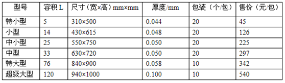
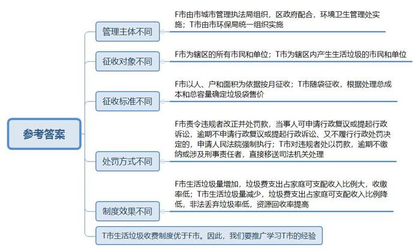
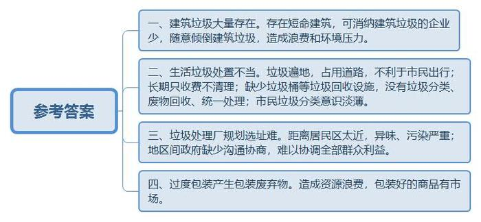
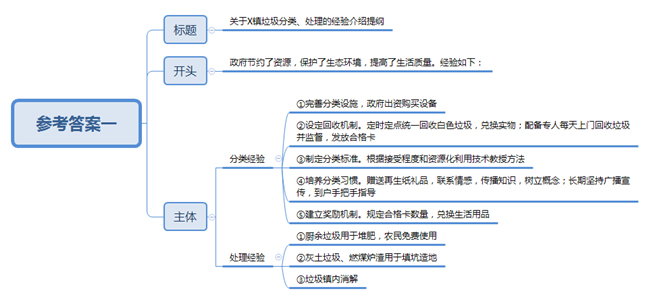
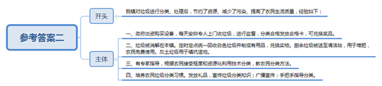
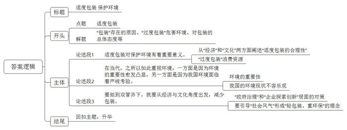

# 2014年河南、甘肃省公考《申论》题

<!-- gwy:overview:start -->
> **甘肃 · 2014 · 申论 · 统考** ｜ 4 题 · 图片 6 处 · 答案随题折叠

导航：[题目](#题目) · [材料 1](#材料-1)
<!-- gwy:overview:end -->

> 候选采集稿。参考答案及解析来自粉笔页面，不代表官方答案或真实高分答卷；来源使用许可与原卷对应关系仍需人工核实。

## 给定材料

### 材料 1

垃圾可分为生产性垃圾和生活性垃圾，生产性垃圾是各生产主体在生产活动中所产生的垃圾。生活性垃圾是老百姓在日常生活中所产生的垃圾。数据显示，我国县级以上城市有3200多个，城市人口约6.9亿，城市生活垃圾每年约3亿吨。生产垃圾的数量也很惊人，其中，占绝对份额的是建筑垃圾。我国垃圾处理手段主要是焚烧和填埋，目前，约2/3的城市处于垃圾包围之中，1/4的城市已无垃圾填埋场可选。

党的十八大报告首次提出“推进绿色发展、循环发展、低碳发展”和“建设美丽中国”，并指出，必须把生态文明建设放在突出位置，融入经济建设、政治建设、文化建设、社会建设各方面和全过程，实现中华民族永续发展。由此看来，解决“垃圾难题”意义重大。

### 材料 2

2013年9月，随着一声爆破巨响，昆明市老工人文化宫倒塌成一片废墟。这座建成于1985年、高70米的昆明市第一栋带电梯的建筑，其寿命没能熬过30年。事实上，昆明市工人文化宫只不过是不断拉长的“短命建筑”名单上新添的一个，而且远不是极端案例。耗资8亿元，使用寿命仅9年的辽宁沈阳绿岛体育中心；落成不满10年，耗资3000多万的海南海口“千年塔”；江西南昌著名地标——五湖大酒店；沈阳五里河体育场；浙江杭州西湖边上的最高楼——浙江大学湖滨校区3号楼……这些驰名一时的地标性建筑，都在爆炸声中轰然倒塌，寿命都不长。“短命建筑”一方面是使用时间短，浪费严重；另一方面是产生了大量的建筑垃圾，对环境造成压力。中国住房和城乡建设部一位官员三年前曾表示，中国是世界上每年新建建筑量最大的国家，每年新增建筑面积20亿平方米，建筑平均寿命却只能维持25至30年。而在英、法、美这三个国家，建筑统计平均使用寿命分别为132年、85年和80年。

北京某环保建材公司的厂房位于半地下，从外面看很不起眼，也听不到轰隆的机器声。可推开大门，浩大的声浪顿时席卷而来，靠近大门，一台机器正呼噜噜地往嘴里填大块的混凝土，一番轰隆隆的“咀嚼”后，吐出较小的混凝土渣块，通过传送带，送到另一台设备上进行筛选，筛选过后的混凝土渣块变成了小颗粒状，紧接着又送到另一台设备上进行筛选，在经过粗分选、粗筛、破碎、磁选、水洗等一道道工序后，建筑垃圾变成了再生粗、细骨料、粉尘等等，总经理吴先生介绍说，再生粗骨料可用于生产再生混凝土或再生混凝土制品。利用再生粗、细骨料，还可以加工再生普通砖和再生古建砖。该企业一年能消纳100万吨建筑垃圾，这样的企业在北京没有几个，全国其他地方也没有多少。

正在拆迁的XX村位于Z市北郊，该村占地1800多亩，有20个村民组，近1600户。拆迁现场，尘土飞扬，满眼都是建筑垃圾，一眼望不到头。村民李先生对记者说：“这些垃圾被个人承包了，一方20块钱，谁拉谁收益。按照规划，最近的垃圾掩埋场距此50公里，来回近百公里，拉一趟连油钱都顾不住。一到晚上9点以后，最少有五六十辆垃圾车排成队往附近的河滩里运，不信你们晚上过来看看。”在知情人的带领下，记者进行了实地探访。刚下大堤，西侧一鱼塘的北半部已被建筑垃圾填埋了一半，上面是刚覆盖的一层黄土。在南段西部，水中露出的全是建筑垃圾。在河边的巡井路边，不时会看到有整车倾倒的建筑垃圾。在附近停靠的渔船旁，也填埋着成堆的建筑垃圾，被水冲后裸露在外面。记者梳理相关报道发现，各地随意倾倒建筑垃圾的现象有一定的普遍性。

### 材料 3

2013年春节长假期间，北京、天津、山西等地的游客纷纷来到历史文化名城W县欣赏该县拜灯山、打树花等非物质文化遗产活动。

北京的郑先生与家人是大年初三上午来到W县的。刚一进入城区，街道上满眼的垃圾便让他感觉十分不舒服。下午在县城里转了一圈，他看到，县城东西向的一条主干道胜利东路路两边到处是垃圾堆。位于路北的汽车七队家属院门口垃圾遍地，到处是污水，严重影响居民出入。一位居民称，这里的垃圾已经半个月无人清理，“每年都交60多块钱的卫生费，都白交了”。

在W县汽车站，路两边同样是一个又一个大垃圾堆及黑糊糊的大雪堆。在州镇街、前进西路等街道，情况则更为严重。路两边的垃圾已经蔓延到了马路中央，将本来十分宽阔的街道挤得十分狭窄，有的垃圾堆索性就位于马路中间，成了一道隔离带，这几条街道甚至都被当地居民称为“垃圾街”。住在前进西路的居民告诉记者，这条路上的垃圾长时间无人问津，越往西越严重，最西段的垃圾已经两三年没有清理过了。

他还发现，除了为数不多的街道，众多街道都没有垃圾桶，当问到有没有进行垃圾分类、废物回收、统一处理这些问题时，一名退休干部说：“没有！没有！分类不分类都一样，别人哪里倒你也哪里倒。”

记者梳理近年来媒体的报道发现，W县的这种情况在许多地方都曾经出现过。

### 材料 4

“番禺事件”曾受到媒体广泛关注，其缘由是，广州市计划在番禺区大石镇建设一个日处理垃圾2000吨的垃圾焚烧厂，而距离焚烧厂选址两公里外，就是享誉广东地产界的番禺华南板块，分布在这里的楼盘，因为环境优美、品质高端而吸引了超过30万广州人来此定居。华南板块的居民担心，垃圾焚烧会释放二噁英等致癌物质，因而强烈反对政府规划。经过漫长的沟通与协商，政府与居民双方最终达成共识：垃圾焚烧厂暂停，但居民垃圾要减量。

2013年7月下旬，北京海淀、昌平的一些小区出现垃圾连续几天堆放在小区里的情况。小区物业解释称，该小区垃圾指定消纳点是北京昌平的阿苏卫垃圾填埋场，进入填埋场的垃圾清运车被附近村民扣下，导致垃圾无法正常清运。该垃圾填埋场邻近六环。附近邻着二德庄、阿苏卫、百善和牛房圈四个村子，最近的不过两三公里。附近村民说，垃圾场平时飘出恶臭，家里都不能开窗户。记者看到在垃圾填埋场东门外的路上，还停着大约十辆垃圾车，里面的垃圾发出腐臭味。

2013年10月，上海市青浦区的一座生活垃圾处理厂引起了媒体关注，这座垃圾处理厂选址于青浦与江苏昆山交界的一条河东岸，投产以后其恶臭殃及江苏昆山市两个镇的数十万居民。对此，某著名时评发表文章称，上海青浦区建垃圾厂对垃圾进行无害化处理，符合发展与环保相协调的理念，应该受到群众赞扬，也应该得到相关部门肯定。可是，上海青浦区将垃圾厂建在江苏昆山的人口密集区，让相邻群众受困，也让好事变了味。在两地交界处建垃圾厂虽然符合当地环保部门的相关规定，可是否考虑过对外地群众的影响？难道当地群众的利益高于外地群众？时评最后说，希望两地政府携起手来，协商解决问题，让昆山百姓早一天过上好日子、甜日子和幸福的日子。

### 材料 5

记者在某批发市场看到，500克极品西湖龙井、铁观音、碧螺春，用精美的檀木包装，配上高档的紫砂茶具，售价竟高达13000元到14000元。当地产的一些茶叶中，500克五星毛尖王，外包装为一只密码箱，内装10个50克的小金属罐，售价为650元每箱。茶叶商张先生告诉记者，那些售价上千上万的茶叶，其包装和附带品的价格可占到茶叶总价格的百分之七十左右。普通的中等茶叶，500克茶叶价格约为60元，加上20元的金属包装，30元的普通陶瓷茶杯后，就可以卖110元。

在某知名化妆品专柜处，记者发现有整盒成套销售的化妆品，礼品盒面一般都有16K纸的大小，其中化妆品占三分之一左右的空间，其余的部分都填上塑料泡沫和丝绸。在询问价格后发现按礼品盒购买的化妆品要比单买贵出100元左右，占整个价格的百分之十二点五左右。在衬衫专柜处，经过复杂包装的衬衫摆放得非常整齐，店老板说：“包装的好才能卖的好。”

### 材料 6

全国人大环境与资源保护委员会的调查表明，目前我国包装品废弃物约占城市家庭生活垃圾的百分之十以上，其体积要构成家庭生活垃圾的百分之三十以上，但大量的包装物最后都成了垃圾，有时甚至对环境构成了长久的影响（如被丢弃的塑料袋等）。环保专家毛先生叹道，美丽的代价，实在太昂贵了！得不偿失。

但也有人认为，包装既是一种经济现象，有需求就有生产，况且，包装也可以拉动经济发展。同时也是一种文化现象，中国是个人情社会，不少人都“想‘面子’多于想‘污染’”东西包装的好才能拿得出手。一个好东西包装的不好，还不如东西差点包装的好一些。

### 材料 7

F市城区现行的生活垃圾收费制度，是2003年5月1日开始实施的。生活垃圾处理费征收工作由市城市管理执法局负责组织协调，各区政府配合，市环境卫生管理处负责具体实施。

征收对象为辖区的所有市民和单位。征收标准为：常住人口6元/（户·3月）；集体宿舍、单身公寓和外来人员5元/（人·月）（家庭独立租住视同常住人口收取）；对上门收集生活垃圾的，另外缴纳有偿服务费2元/（户·月）。已缴纳物业管理服务费的，常住人口只缴纳3元/（户·月）；集体宿舍、单身宿舍和外来人员缴纳2元/（人·月）（家庭独立租住视同常住人口收取）。机关、事业单位及社会团体按在职职工人数（含固定工、临时工）2元/（人·月）（不含内部生活垃圾的清扫、运输费）；门前卫生责任区有偿服务费缴纳1元/（㎡·月），每月不足20元的按20元缴纳，超过1000元的按1000元缴纳。已缴纳物业管理费的，只收取前项垃圾处理费，等等。

制度规定，凡弄虚作假或拒不缴费的单位和个人，由环境卫生行政主管部门责令其改正并处以罚款。当事人对行政处罚决定不服的，可依法申请行政复议或提起行政诉讼。逾期不申请行政复议或提起行政诉讼、又不履行行政处罚决定的，由作出行政处罚决定的行政机关依法申请人民法院强制执行。

有资料显示，F市生活垃圾日产生量2001年为1400吨，2007年为1900吨。2006年，F市家庭垃圾费支出占家庭可支配收入的比例为0.17%。2007年，F市共征收垃圾处理费3085万元，但收缴率仅为79.1%。

### 材料 8

T市2000年7月开始实施垃圾费“随袋征收”政策，即垃圾处理费采用销售专用垃圾袋方式征收。专用垃圾袋售价内含垃圾费，凡以专用垃圾袋盛装的垃圾，清洁队才予以清理，但资源回收物可以免费交给清洁队回收。

该制度由市环卫局组织实施。市环卫局负责垃圾袋专用权及其规格、样式、容积公告；组织委托厂家生产；委托超市或商店销售专用垃圾袋；监测和惩处违规丢弃垃圾、非法生产和销售专用垃圾袋等行为。征收对象为辖区内产生生活垃圾的所有市民和单位。

政策规定：“环卫局应依据本市垃圾焚化炉正常营运时一般废弃物清除处理总成本及现有焚化炉处理总容量，计算随袋单位容积清理费收费标准，报请市政府核定公告后，订定专用垃圾袋售价”。经过复杂的程序以后，计算出每包专用垃圾袋的售价如下表：

政策强调，专用垃圾袋为清理费收费专用，未经环卫局同意不得擅自制作、销售，并不得使用袋上图样及文字。伪造、变造或擅自销售（包括擅自提价销售）专用垃圾袋者，都要处理罚款。逾期不缴纳罚款者或构成刑事责任者，依法移送司法机关处理。

有资料显示，T市生活垃圾日产生量1999年为3000吨，2005年为1400吨，资源回收率由1999年的2.4%提高到2005年的34.5%。T市家庭垃圾费支出占家庭可支配收入的比例1999年为0.15%，2004年为0.05%。2001年非法丢弃垃圾率仅为0.4%。

### 材料 9

央视曾经播放过X镇生活垃圾分类、处理的例子，以下是某期节目的文字节录。

解说：每天早上7点一过，X镇西马各庄村的徐大妈和另一位保洁员便开始挨家挨户收集垃圾。垃圾清运车是前些年村里开始做垃圾分类时上级出资购买的。

史某（村民）：那会儿我们都给发好几个桶，厨余垃圾一个桶，灰土垃圾一个桶，白色垃圾一个桶。桶都是政府给发的。天天都是到时候搁在门口，专门有人收，打声招呼就收走了，不合格就说你。

解说：所谓白色垃圾，指废弃纸张、塑料制品等可回收物，它们经过处理后，可以制成别的有用品。每个月的1号是西马各庄村村委会统一回收白色垃圾的日子，早上8点，村民就陆续把大包小包装满白色垃圾的编织袋送到村委会大院。库管员宋某说，以往，村民们每交3斤白色垃圾就可以换一袋1斤重的洗衣粉，现在洗衣粉改成了大包装，要30斤才能换一袋。2007年，村里共收集白色垃圾2082斤，2008年增长了200多斤，而到了2009年，全村收集的白色垃圾总量达到4314斤，去年，这一数字更是达到5500斤。

……

解说：早上，X镇实行垃圾分类的各村收集来的厨余垃圾，被送到X镇密闭式压装清洁站。在这里，厨余垃圾被留下用于堆肥。李副镇长介绍说：“就是过去农村那种堆肥方式，一层厨余垃圾，一层灰土覆盖，覆盖以后通过长时间的发酵，最后粉碎，这个周期应该有几个月的时间，然后就联系需要的农民。农民使用这些肥料完全是免费的。”

解说：厨余垃圾可以用来堆肥，灰土垃圾以及冬季产生的大量燃煤炉渣可以用作农村填坑造地的原料。抽样调查显示，农村生活垃圾中，灰土垃圾占到了六成，厨余垃圾约占三成左右，也就是说，X镇的大部分垃圾都被消解在本镇。

……

解说：冯教授是X镇垃圾分类试点的牵头人。

冯教授：我们的垃圾到底分多少类。这要根据农民可以接受的程度，以及能够资源化利用的技术；第二个就是教给农民怎么分，也就是方法。

解说：不少村民用“习惯了”来回答我们提出的“怎么不觉得垃圾分类麻烦”之类的问题，但如何养成习惯却正是我们好奇的地方。

史某（村民）：要想转变老百姓这种习惯，其实最开始也挺难的，当时冯老师给我们出了很多的主意。

冯教授：2007年的春节前，我们就用了一个星期的时间，赶制出一批挂历来发给各户，一是联系感情；二是挂历里面有垃圾分类的知识、做法、意义。而且还是用再生纸制作的，直接给农民一个概念，你看废纸就能做出这个来。另外，这半年，每天中午和晚上各20分钟广播，持续了半年。同时，还有村民骨干分片到户手把手指导分类。

……

冯教授：必须上门去收，交垃圾面对面。上门收等于是监督着你呢，你自己瞧着分好没分好，没分好你自己接着分，合格了发个价值等于三毛钱的合格卡。

解说：村民们将换来的“合格卡”积攒到一定数量后，就可以到村委会领取奖品。这些年，村里提供的奖品品种不断变化，有油盐酱醋，有卫生纸等。

冯教授：我们算一笔账，一户油盐酱醋卫生纸到底需要多少钱，这是一个参照物；第二个就是说，按照我们过去的村收集、镇运输、区处理的模式，X镇所产生的垃圾，如果运到这个填埋场去埋，中间得花多少运费，我们把这些运输费、垃圾场的填埋费省下来，提前奖励给农民，这样，既节省了汽柴油的使用，又节省了垃圾填埋用地，还不产生路上的二次污染。给农民兜里边装点钱，提高农民的生活质量，农民也高兴。

## 题目

### 第 1 题

**请结合“给定资料7～8”，分析比较F市、T市生活垃圾收费制度的不同之处。（20分）**

关联材料：材料 7、材料 8

作答要求：

要求：准确，深入，逻辑清晰。不超过400字。

第 1 题 · 答案与解析

**参考答案（粉笔题库参考内容）**

一、管理主体不同。F市由市城市管理执法局组织，区政府配合，环境卫生管理处实施；T市由市环保局统一组织实施。

二、征收对象不同。F市为辖区的所有市民和单位；T市为辖区内产生生活垃圾的市民和单位。

三、征收标准不同。F市以人、户和面积为依据按月征收；T市随袋征收，根据处理总成本和总容量确定垃圾袋售价。

四、处罚方式不同。F市责令违规者改正并处罚款，当事人可申请行政复议或提起行政诉讼，逾期不申请行政复议或提起行政诉讼、又不履行行政处罚决定的，申请人民法院强制执行；T市对违规者处以罚款，逾期不缴纳或涉及刑事责任者，直接移送司法机关处理。

五、制度效果不同。F市生活垃圾量增加，垃圾费支出占家庭可支配收入比例大，收缴率低；T市生活垃圾量减少，垃圾费支出占家庭可支配收入比例降低，非法丢弃垃圾率低，资源回收率提高。

T市生活垃圾收费制度优于F市。因此，我们要推广学习T市的经验。

**解析**

**参考答案说明：**答案分别从管理主体、征收对象、征收标准、处罚方式、制度效果等方面进行了比较，最终得出结论：我们要推广学习T市的经验。

**考点**：对比分析类

**来源**：2014年河南、甘肃省公考《申论》题

### 第 2 题

**请梳理概括“给定资料2～5”中显示的“垃圾难题”。（20分）**

关联材料：材料 2、材料 3、材料 4、材料 5

作答要求：

要求：内容全面，分条归纳，有概括性。不超过250字。

第 2 题 · 答案与解析

**参考答案（粉笔题库参考内容）**

一、建筑垃圾大量存在。存在短命建筑，可消纳建筑垃圾的企业少，随意倾倒建筑垃圾，造成浪费和环境压力。

二、生活垃圾处置不当。垃圾遍地，占用道路，不利于市民出行；长期只收费不清理；缺少垃圾桶等垃圾回收设施，没有垃圾分类、废物回收、统一处理；市民垃圾分类意识淡薄。

三、垃圾处理厂规划选址难。距离居民区太近，异味、污染严重；地区间政府缺少沟通协商，难以协调全部群众利益。

四、过度包装产生包装废弃物。造成资源浪费，包装好的商品有市场。

**解析**

**参考答案说明：**答案从1、2、3等不同的方面进行了分条撰写，且对每条要点提炼出了总括词并前置。每条要点之间内容上没有交叉。

**考点**：问题类

**来源**：2014年河南、甘肃省公考《申论》题

### 第 3 题

**假如你是X镇负责垃圾分类、处理工作的一名工作人员，请结合“给定资料9”，起草一个关于垃圾分类、处理的经验介绍提纲。（20分）**

关联材料：材料 9

作答要求：

要求：观点明确，层次清楚，不要求格式。不超过250字。

第 3 题 · 答案与解析

**参考答案（粉笔题库参考内容）**

**参考答案一：**

关于X镇垃圾分类、处理的经验介绍提纲

政府节约了资源，保护了生态环境，提高了生活质量。经验如下：

一、分类经验：1.完善分类设施，政府出资购买设备；2.设定回收机制。定时定点统一回收白色垃圾，兑换实物；配备专人每天上门回收垃圾并监督，发放合格卡；3.制定分类标准。根据接受程度和资源化利用技术教授方法；4.培养分类习惯。赠送再生纸礼品，联系情感，传播知识，树立概念；长期坚持广播宣传，到户手把手指导；5.建立奖励机制。规定合格卡数量，兑换生活用品。

二、处理经验：1.厨余垃圾用于堆肥，农民免费使用；2.灰土垃圾、燃煤炉渣用于填坑造地；3.垃圾镇内消解。

**解析**

**参考答案说明：**（1）本题主要写到了正文即可。其中正文分别按照开头（主要写到了垃圾分类、处理的意义）、主体（主要写到了如何进行垃圾分类、处理的对策）的结构展开。（2）为了体现公文题的逻辑性，还加上了“经验如下”等连接词承接上下文。

**参考答案二：**

我镇对垃圾进行分类、处理后，节约了资源、减少了污染、提高了农民生活质量，经验如下：

一、政府出资购买设备，每天安排专人上门收垃圾，进行监督，分类合格发放合格卡，可兑换奖品。二、垃圾被消解在本镇。定时定点统一回收白色垃圾并制成有用品，兑换实物。厨余垃圾被送至清洁站，用于堆肥，农民免费使用。灰土垃圾用于填坑造地。三、有专家指导，根据农民接受程度和资源化利用技术分类，教农民分类方法。四、培养农民垃圾分类习惯。发放礼品，宣传垃圾分类知识；广播宣传；手把手指导分类。

**考点**：总结类

**来源**：2014年河南、甘肃省公考《申论》题

### 第 4 题

**请深入理解“给定资料6”中的两种不同观点。并结合“给定资料”，联系实际，自拟题目，写一篇文章。（40分）**

关联材料：材料 1、材料 2、材料 3、材料 4、材料 5、材料 6、材料 7、材料 8、材料 9

作答要求：

要求：

（1）中心明确、认识深刻；

（2）内容充实、逻辑清晰；

（3）思维严谨、语言准确流畅；

（4）1000～1200字。

第 4 题 · 答案与解析

**参考答案（粉笔题库参考内容）**

**参考范文一**

**要包装，不要美丽“代价”**

曾经报道过“天价月饼”，一片哗然。一盒卖价几百元的月饼，一块月饼只要几元，高档的礼盒包装却要100多元。这无形中增加了很多成本，华而不实。在节后，这些包装更成为废品，回收价格仅仅是几毛钱，从而造成资源的严重浪费。而且数据显示，1公斤的包装会增加3.5公斤的排碳量，这与低碳生活背道而驰，对环境亦危害很大。包装让货物显得高档，让经销商从中获得暴利，让购买者有面子，带来的却是严重的后果。所以说，地球只有一个，我们要理性看待包装，拒绝美丽“代价”！

**生态文明，拒绝美丽“代价”。**美国有一个非常著名的摄影师用自己的镜头，以垃圾为背景，用积攒一周程度的垃圾设置成了沙滩、海洋、森林等。当时让众人非常震撼，意识到垃圾对生态环境造成的巨大危害，也意识到有些垃圾是不必要的，如过度包装品。放之于国内来说，数据显示，我国的垃圾中过度包装的废品占到20%，而且全国垃圾年产量正以每年8%～10%的速度增长，即城市过度包装产生的垃圾有0.52亿吨。不管是从数据的角度，还是从真实的案例来说，过度包装确实对生态造成了明显的负面影响。所以说，要生态文明，就要拒绝美丽“代价”。

**经济发展，拒绝美丽“代价”。**不管是在春节、端午、中秋等传统节日，还是在圣诞节、情人节、感恩节等西方节日，人们看到的再也不是“左手一只鸡，右手一只鸭”，而是大大小小包装精美的礼盒。按照多米诺骨牌效应，消费带动生产，生产带动发展，貌似是有利于经济的发展。但这实际上是增加了消费者的负担，浪费了资源，是一种病态的发展。如果再有商家为了盈利，错误地坚持“一类包装，二类价格，三类产品”，那就变成了对消费者的一种侵害，不利于循环经济的发展。所以说，要经济发展，拒绝美丽“代价”。

**人情社会，拒绝美丽“代价”。**中华文明上下五千年，在儒家文化的熏陶下，我们知道了礼义、忠信、孝悌、廉耻；我们更学会了中庸之道、人情冷暖、礼尚往来。这本是好事，但礼尚往来的物品越来越贵重，包装越来越“高大上”。某记者暗访中发现，在礼品中以茶、酒为代表，包装都非常豪华。除了质量上乘的纸质包装外，还有豪华木头盒子、金属盒子、瓷瓶、玻璃瓶等。这是因为，消费者说“包装太差，拿不出手”。“面子”固然重要，那“里子”呢？

我们不想要美丽“代价”，但很多时候又离不开包装，那该如何处理呢？

要包装，但不要美丽“代价”，需要我们以生态文明建设为重点，将奢华变朴实，尽可能使用可再生、可再用的原料，避免资源浪费；需要我们以经济建设为中心，遵循循环经济的发展原则，从产品利润最大化的市场需求主宰向遵循生态可持续发展能力永续建设的根本转变；需要我们树立正确的包装观念，不仅仅是消费者要有从简包装的心理，生产厂商更要树立以人为本的包装观念，正确看待包装对商品的促销功能。

美丽中国，不要美丽“代价”。要建设资源节约型、环境友好型社会，实现可持续发展，需要我们适度包装。

**参考范文二**

**适度包装 保护环境**

在商品经济快速发展的今天，企业为追求更多利润，都非常注重产品包装。与此同时，植根于农耕社会的中国，民众对人情世故、亲疏远近、礼尚往来有着独特的理解，因而送礼也就变成了一种独特的文化现象。在经济和文化的双重影响下，包装显得尤为重要。但包装最后都变成了我们随手一扔的废弃物，对环境构成长久压力。长此以往，我国环境、生态会急剧恶化。毋庸赘言，**适度包装对保护环境起着“一子落而满盘活”的意义。**

**适度包装对保护环境有着重要意**义。每每提及于此，不禁有民众会问：“如果这样，为什么不完完全全禁止包装，更好保护环境？”不完全禁止，不仅是因为中国文化有“执两用中”的观念，更是因为包装存在一定合理性。一方面，包装是一种经济现象，可以增加商品附加值，促进企业或店铺增收，进而拉动经济发展。另一方面，包装是一种文化现象。过度包装固然与爱“面子”有关，但不可否认，一个包装很好的商品通常表达着对某人、某事的重视，是一种情感的纽带。但令人痛心的，数量众多的包装最后都变成了民众随手一扔的废弃物，对环境构成长久压力。所以，提倡适度包装，是保护环境的题中之义。

**在当代，之所以如此重视环境，一方面是因为环境的重要性愈发凸显，另一方面是因为我国环境面临着严峻考验。**所谓的重要性，就如同习近平所说：“绿水青山就是金山银山。”环境，是经济发展的“宝库”，是民生建设的依托；环境，不仅关系到当代人的生活质量，更涉及下一代人的生存。因而才有“史上最严环保法”的颁布；才有中央巡视组到各地刮起的“环保风暴”；才有各地负责人被相继“约谈”。从另外一个角度说，重视环境，也是因我国环境现状不容乐观。近三分之二城市处于垃圾包围之中，很多城市已无垃圾填埋场可选。而更让人担心的是，包装垃圾愈发增多，似乎要变成压垮环境的最后一根“稻草”。从某种程度上说，包装垃圾对环境的影响越来越大。

从这个角度而言，适度包装，减少包装垃圾，既可以保护环境，也可以为解决其他环境污染问题提供有益借鉴。因此，社会各界应上下联动、各尽其责，践行环保理念，适度进行包装。

**要做到双管齐下，就要从经济与文化角度出发，减少包装。**一方面，我国政府应发挥“调和鼎鼐”的现代化治理水平，在“顶层设计”中对企业进行税收优惠，鼓励其少包装；与此同时，我国企业应顺势而为，探索使用各类可降解的包装材料。另一方面，政府、媒体、社会各界都应注重引导社会风气。公职人员要起到表率作用，重视廉政。民众要逐渐改变动辄“送礼请吃饭”的老习惯。媒体工作者广泛宣传社会正能量，慢慢让人们形成“轻包装、重环保”的理念。毋庸赘言，经济与文化方面的共同发力，会为保护环境，减少包装打上一剂“强心剂”。

古人云：“图垂成之功，如挽上滩之舟，莫少停一棹。”适度包装，保护环境，我们还在路上，仍需各方的不懈努力。

**文章分析**

**适度包装 保护环境**

【**标题的优点：**首先，范文的标题“适度包装 保护环境”突出了“适度包装”这一主题。其次，它在形式上采用对称式结构，前半句点出主题，后半句点出了意义，使标题更加完整、饱满。】

（1）在商品经济快速发展的今天，企业为追求更多利润，都非常注重产品包装。与此同时，植根于农耕社会的中国，民众对人情世故、亲疏远近、礼尚往来有着独特的理解，因而送礼也就变成了一种独特的文化现象。在经济和文化的双重影响下，包装显得尤为重要。（2）但包装最后都变成了我们随手一扔的废弃物，对环境构成长久压力。长此以往，我国环境、生态会急剧恶化。（3）毋庸赘言，**适度包装对保护环境起着“一子落而满盘活”的意义。**

【**开头的优点：**★内容方面。范文的开头是紧扣“适度包装”这一主题展开的。通过对“适度包装”这一主题进行了分析阐述，做到了准确解题。（1）首先指出了“过度包装”的原因；（2）接着写包装产生的废弃物对环境的危害；（3）最后提出实现“适度包装”有利于环境保护。】

**适度包装对保护环境有着重要意义**。每每提及于此，不禁有民众会问：“如果这样，为什么不完完全全禁止包装，更好保护环境？”（1）不完全禁止，不仅是因为中国文化有“执两用中”的观念，更是因为包装存在一定合理性。一方面，包装是一种经济现象，可以增加商品附加值，促进企业或店铺增收，进而拉动经济发展。另一方面，包装是一种文化现象。过度包装固然与爱“面子”有关，但不可否认，一个包装很好的商品通常表达着对某人、某事的重视，是一种情感的纽带。但令人痛心的，（2）数量众多的包装最后都变成了民众随手一扔的废弃物，对环境构成长久压力。所以，提倡适度包装，是保护环境的题中之义。

【**论述段1的优点：**★观点句：范文的观点句是紧扣“适度包装”这一主题提出的。形式上，它在段首处直接写出，位置突出，容易发现。内容上，关键词突出，内容要点明确，可以明显看出它是从“适度包装的合理性”和“过度包装的危害”这两方面进行展开的。★论述内容：（1）从“经济”和“文化”两方面阐述“适度包装的合理性”；（2）指出“过度包装”的危害。以上两个方面的内容都是紧扣“适度包装对保护环境有着重要意义”这个观点句进行分析论述的，论述的针对性强，内容层次丰富。最后，在论述方法和论据的选取上做到了讲道理、举例子相结合，正反对比论证，做到了丰富多样。】

**在当代，之所以如此重视环境，一方面是因为环境的重要性愈发凸显，另一方面是因为我国环境面临着严峻考验。**（1）所谓的重要性，就如同习近平所说：“绿水青山就是金山银山。”环境，是经济发展的“宝库”，是民生建设的依托；环境，不仅关系到当代人的生活质量，更涉及下一代人的生存。因而才有“史上最严环保法”的颁布；才有中央巡视组到各地刮起的“环保风暴”；才有各地负责人被相继“约谈”。从另外一个角度说，（2）重视环境，也是因我国环境现状不容乐观。近三分之二城市处于垃圾包围之中，很多城市已无垃圾填埋场可选。而更让人担心的是，包装垃圾愈发增多，似乎要变成压垮环境的最后一根“稻草”。从某种程度上说，包装垃圾对环境的影响越来越大。

【**论述段2的优点：**★观点句：范文的观点句是紧扣“适度包装”这一主题提出的。形式上，它在段首处直接写出，位置突出，容易发现。内容上，关键词突出，内容要点明确，可以明显看出它侧重于“重视环境”的原因。★论述内容：（1）介绍“环境的重要性”；（2）指出我国的环境现状不容乐观。以上几个方面的内容都是紧扣“在当代，之所以如此重视环境，一方面是因为环境的重要性愈发凸显，另一方面是因为我国环境面临着严峻考验”这个观点句进行分析论述的，论述的针对性强，内容层次丰富。最后，在论述方法和论据的选取上做到了讲道理、举例子相结合，做到了丰富多样；使用了“不仅……更……因而……”等关联词，使语言表达有逻辑性，长短句配合使用，使语言表达有节奏感。】

从这个角度而言，适度包装，减少包装垃圾，既可以保护环境，也可以为解决其他环境污染问题提供有益借鉴。因此，社会各界应上下联动、各尽其责，践行环保理念，适度进行包装。

【**过渡段的优点：**先是表明了“适度包装”的意义，接着提出了总括性较强的对策，引出下文的具体对策内容。】

**要做到双管齐下，就要从经济与文化角度出发，减少包装。**一方面，（1）我国政府应发挥“调和鼎鼐”的现代化治理水平，在“顶层设计”中对企业进行税收优惠，鼓励其少包装；与此同时，我国企业应顺势而为，探索使用各类可降解的包装材料。另一方面，（2）政府、媒体、社会各界都应注重引导社会风气。公职人员要起到表率作用，重视廉政。民众要逐渐改变动辄“送礼请吃饭”的老习惯。媒体工作者广泛宣传社会正能量，慢慢让人们形成“轻包装、重环保”的理念。毋庸赘言，经济与文化方面的共同发力，会为保护环境，减少包装打上一剂“强心剂”。

【**论述段3的优点：**★观点句：范文的观点句是紧扣“适度包装”这一主题提出的。形式上，它在段首处直接写出，位置突出，容易发现。内容上，关键词突出，内容要点明确，可以明显看出它是从“经济”“文化”这两方面入手，指出了“减少包装”的对策。★论述内容：（1）介绍了“政府治理”和“企业探索创新”层面的对策；（2）指出了要引导“社会风气”形成“轻包装、重环保”的理念。以上几个方面的内容都是紧扣“要做到双管齐下，就要从经济与文化角度出发，减少包装”这个观点句进行分析论述的，论述的针对性强，内容层次丰富。最后，在论述方法和论据的选取上做到了讲道理、举例子相结合，做到了丰富多样。】

【**论述段之间的关系**：★内在逻辑上：范文的论述段之间呈现出递进关系，按照“先说‘适度包装’对保护环境的意义，再说‘重视环境’的原因，最后说如何推进‘适度包装’”的逻辑展开。★外在衔接上：过渡段“适度包装，减少包装垃圾，既可以保护环境，也可以为解决其他环境污染问题提供有益借鉴。因此，社会各界应上下联动、各尽其责，践行环保理念，适度进行包装”承接上文“适度包装对保护环境的意义”，引出下文的“推进‘适度包装’的对策”。】

古人云：“图垂成之功，如挽上滩之舟，莫少停一棹。”适度包装，保护环境，我们还在路上，仍需各方的不懈努力。

【**结尾的优点**：范文的结尾回扣了“适度包装”这一主题，语言精悍，情感真挚。】

**解析状态：unknown（来源未提供）**

**考点**：文章写作题

**来源**：2014年河南、甘肃省公考《申论》题

