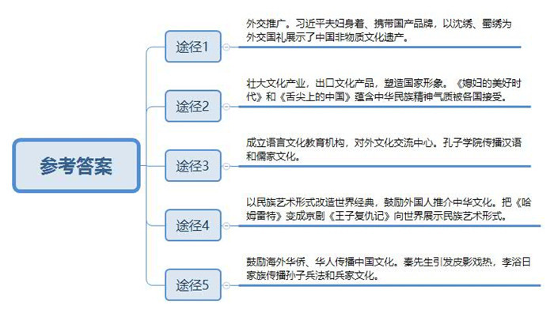
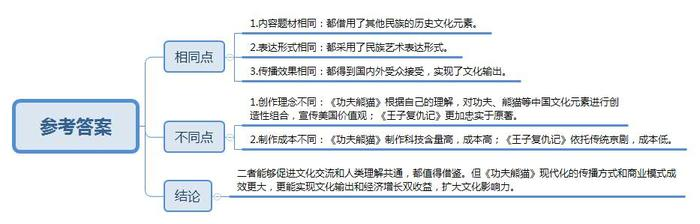
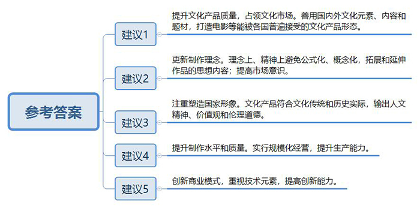
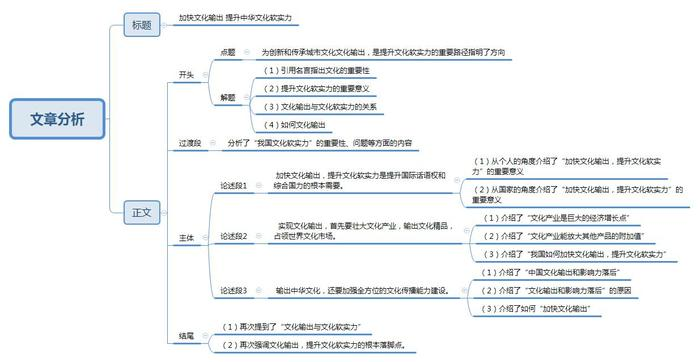

# 2015年甘肃公考《申论》题

<!-- gwy:overview:start -->
> **甘肃 · 2015 · 申论 · 统考** ｜ 4 题 · 图片 4 处 · 答案随题折叠

导航：[题目](#题目) · [材料 1](#材料-1)
<!-- gwy:overview:end -->

> 候选采集稿。参考答案及解析来自粉笔页面，不代表官方答案或真实高分答卷；来源使用许可与原卷对应关系仍需人工核实。

## 给定材料

### 材料 1

2013年3月，国家主席习近平出访，主席和夫人送什么礼物给外宾成为许多老百姓关注的话题。

在克里姆林宫，俄总统普京与习近平主席互赠国礼。随着红布拉开，习近平主席所赠国礼——国家级非物质文化遗产沈绣精品《普京总统肖像》出现在眼前，这件国礼由江苏南通沈寿艺术馆承担制造。“太传奇了，太美，太不可思议了！”俄总统普京端详着面前的这幅作品，赞不绝口。他甚至解开西装，拿出自己的领带，笑着说：“肖像中正是我的这条领带。”

在坦桑尼亚，“第一夫人”彭丽媛赠送的礼物是来自中国的品牌“阮仕珍珠”礼品盒和护肤品牌“百雀羚”。除此之外，还有中国四大名绣之一的蜀绣。

访问期间，习近平夫妇大方得体的着装赢得一片赞叹，并引发外界对服饰品牌的猜测。据报道，彭丽媛的服装，不是国外名牌，而是国内品牌，广州市质监局官方微博“广州质检”证实彭丽媛走出机舱时所穿的大衣及所拿手提包，均是广州市例外服饰有限公司为其定制，是实打实的国货。习近平所穿服装也是国内品牌，由大连“大连大杨创世股份有限公司”生产。信息传出后，国内股市整个服装股表现活跃，“大杨创世”大幅高升并立即封死涨停。

### 材料 2

斯瓦希里语版36集《媳妇的美好时代》，是国家广电总局“中国优秀电视剧走进东非”项目的开局之作。在坦桑尼亚开播后，不停地有观众通过电话、短信等方式，表现对这部电视剧的喜爱。很多观众看了《媳妇的美好时代》这部电视剧后，首先反应是：原来现在中国人的生活状态是这样的，他们很羡慕中国人的生活。虽然中坦两国在文化上存在差异，但婆媳之间、家庭之间的关系和矛盾有很多的共通性，因此《媳妇的美好时代》引起了观众们的强烈共鸣。婚姻与家庭这个共同主题，使坦桑尼亚观众跨越了文化差异，随剧情起伏而欢笑和感动，通过感受一家普通人的喜怒哀乐，体验到了对美好生活的追求。这种追求，在不同的文化之间都是相通的。据报道，现在很多周边的非洲国家都想要购买这部电视剧的版权，在他们的国家播放。

2012年5月，我国第一部高端美食电视纪录片《舌尖上的中国》亮相中央电视台，立即引起广泛而强烈的关注，被认为是“一次成功的文化传播事件”。这部拍摄精美，制作精良，具有非凡专业品味和文化品味的美食纪录片，不但让我们第一次领略到博大精深的中华美食文化，更让我们经历了一次难忘的仪式洗礼。片中凸显的对普通人的人生价值和生活信仰的礼赞，以及对中华民族独特精神气质及生存智慧的讴歌，让人感受到美食背后强大的人文力量和对共同体价值的强烈认同。而它的成功正是以美食为切入视角，以仪式为载体，以人的世俗生活为表现对象，从而使我们的日常生活有了美的升华、有了诗意的浸染，它既深深地感动了我们，也打动了世界。

有网友称，《舌尖上的中国》是“以欧美拍摄手法为骨骼，中国美食为皮肉，中国文化为精髓”的综合产物。在戛纳电视节上该片受到世界各国媒体的关注，不少主流媒体表达了购买意向。外国网友在看了影片片段后表示：“中国也并不那么难以理解。”《舌尖上的中国》之所以能够从“舌尖”走上“心头”，正是因其“真”，用文化的感染力带来一片真情，这正是当下中国纪录片走向国际所必备的要素。正如该片导演陈晓卿称：“饮食文化是中国可以通行世界的软实力。”

### 材料 3

2013年夏天，“汉字”成了最热门的词汇之一，由中央电视台和国家语委联合主办的大型电视文化节目“中国汉字听写大会”引发了关注热潮。

海口市第一中学5名同学组成的海南省代表队，一路披荆斩棘进入了复赛，一位14岁的同学在接受记者采访时坦言，参加比赛前，她对自己的实力还是很有信心的，但在“高手如云”的比赛场上，却感受到很大的压力，“经历了比赛的磨练，我比以前更喜欢阅读和积累汉字知识了，汉字之美使我的学习更有动力了”。“汉字是上古时期各大文字体系中唯一传承至今的表意文字，包含着丰富的文化内涵和审美意蕴，是中华文明最为绚烂的瑰宝之一，在人人习惯使用电脑的‘键盘时代’，汉字文明的传承尤为重要，这次比赛宣传的‘书写的文明传播，民族的未雨绸缪’这句话让我印象深刻……”老师说。

2013年12月7日至8日，第八届孔子学院大会在北京国家会议中心举行，来自110多个国家的400多所孔子学院所在大学的校长，孔子学院院长，以及中方承办高校代表等2200余人出席大会，围绕“回顾过去，展望未来”的主题，交流办学经验，共商孔子学院发展大计。

孔子学院开办以来，为很多外国学生打开了一扇意想不到的人生之门，中国驻南非大使馆教育组宋某表示，许多南非青少年希望学好汉语到中国做生意，并借此改变自己的生活和命运。

2014年9月24日，纪念孔子诞辰2656周年国际学术研讨会暨国际儒学联合会第五届会员大会在北京人民大会堂举行，习近平主席出席开幕式并发表了重要讲话。习主席在讲话中指出，中国优秀传统文化的丰富哲学思想，人文精神，教育思想，道德理念等，可以为人们认识和改造世界提供有益启迪，可以为治国理政提供有益启示，也可以为道德建设提供有益启发，希望中国和各国学者相互交流，相互切磋，让中国优秀传统文化同世界各国优秀文化一道造福人类。秘鲁前总统加西亚，坦桑尼亚前总统姆卡帕分别在开幕式上致辞，表示孔子和儒学不仅是中国的，也是世界的，孔子和儒学不仅对中国历史发展产生了巨大作用和重要影响，而且对世界历史发展和人类文明进步也产生了积极作用和影响，儒家思想和儒家文化不仅在历史上产生过积极作用，对于解决当今世界共同面临的许多问题和难题，仍能提供智慧，启示，借鉴。

### 材料 4

“功夫”和“熊猫”，“产地”都在中国。然而，《功夫熊猫》却是“美国造”，熊猫阿宝用他的美式语言和幽默，让我们捧腹的同时，也深深地刺痛着我们：为什么博大精深的中国文化，海量的中国传统故事，底蕴深邃的中国元素要经过外国“造梦工场”的加工才能形成如此这般的影响力？《功夫熊猫》在全球累计票房已近13亿美元，其导演也随之成为票房最高的女导演。影片在法国放映期间正值法国中小学校放假，不少观影人都是学生，还有许多家长带着孩子来看电影，孩子们很兴奋，迫不及待的想一睹为快。很多看过《功夫熊猫》的法国观众表示十分喜欢这部电影。影片中活泼的熊猫与之前印象中行动迟缓的熊猫大不相同。形象新颖让人眼前一亮，《功夫熊猫》虽然是美国影片，讲述的却是中国故事，里面有许多中国元素。一位名叫大卫的法国男孩在看过《功夫熊猫》后说，非常喜欢中国功夫，以后一定要去中国看看。

2014年2月2日，国产二维手绘动画电影《我是狼》首映，当日排片量仅为1.57%，而上剧率也只有14.57%，远远低于同期上映的《爸爸去哪儿》（40.61%），《西游记之大闹天宫》（34.8%）。次日，片方宣布“自2月4日起撤片下线，具体上映时间另行通知”。《我是狼》的这种境遇，在动画人身上屡有发生：近一些的有青春树的《魁拔》，润马动画的《超蛙战士》，彼岸天的《大鱼海棠》，追光动画关于门神的新作。早些的有2005年孙立军导演的《小兵张嘎》。

对此，中国国家画院院长龙先生认为：“美国是利用了我们的内容和题材，来传播他们的价值观，但他们对我们的东西作出了进一步的理解。美国有很强的动漫意识以及思想深度，也就是所谓的动漫精神。我国动漫片比较滞后，这不是技术上的短板，更非设备上的差距，而是理念上、精神上的。我们的创作往往被植入公式化、观念化的东西。这很不利于我们作品思想内容的拓展和延伸。”

在2014年召开的“中国电视剧排行榜颁奖礼暨电视剧制播年会”上，有关权威人士透露，“从2013年电视剧整个情况来看，75%的电视剧平均收视率低于0.5%的及格线。”除大量电视剧收视状况不容乐观之外，制作公司普遍规模小，生产能力有限也是目前中国电视剧行业的普遍特征。数据显示，70%—80%的制作公司每年只有一部电视剧能够通过审批发行，生产5部以上的制作公司屈指可数。而电视剧市场竞争激烈，保鲜度异常重要，一旦被雪藏，被延迟就难有出头之日。从数据看，电视剧被搁置的年头越长，被播出的几率越小。“保鲜期通常是制作完成后2年左右。2013年电视剧首播新剧55%是当年制作剧，33%是2012年制作剧，7%是2011年制作剧，5%是3年前制作的失鲜剧。”

全国政协委员许先生认为：“他山之石，可以攻玉。《来自星星的你》《大长今》等韩剧在我国掀起的热潮，值得我们好好研究和分析。韩剧火，因为他们的韩剧团队有先进的制作观念，有敏锐的市场观念，善于将剧情与韩国文化特色融为一体，他们输出的是文化产品，更是伦理道德，这是韩剧的高明之处。”其实，中国观众追看韩剧，不仅仅是因为其中的励志精神或纯洁爱情，更重要的是其中蕴含的自强自立自尊自爱的人文精神，仁义礼智信的儒家观念。这与我国的传统文化恰恰是一脉传承的。

### 材料 5

在电影人的语境中，“中国梦”的实现就是要把故事通过电影语言更好地讲给世界听，让世界充分认识中国文化和中国形象。

在中国走向海外的问题上，我们应该可以做得更好。自中国加入世界贸易组织以来，好莱坞电影每年从中国电影市场掠走全国电影票房的45%，这不仅仅是电影票房的流失问题，而是美国大片在席卷中国电影市场的同时，也在中国银幕上强势复制着美国形象，向中国观众推介了美国精神。2013年，由北师大B教授主持的“影视对未成年人的影响”的调查报告引起社会广泛关注。在对北京8个城区25所中小学，8至18岁青少年的问卷调查中，孩子中美国形象认同度高达73%。青少年对中国电影中的国家形象认同度给我们敲响了警钟，中国的文化安全已受到威胁。

中国电影缺什么？除了很多人都强调的技术因素，商业模式，创新能力外，N艺术学院的X教授认为：中国电影人普遍缺少塑造国家形象的意识。

西方有一句谚语“电影是装在铁盒子里的大使”，美国一直注重在电影当中塑造他的国家形象。早期的美国片塑造的美国形象是个世界警察的形象——全世界哪里有不平，哪里有问题，美国马上就以维持世界和平的名义，前往干涉。小布什以后，美国电影中的世界警察形象演变成了世界领袖的形象，每当彗星撞地球、山洪暴发、龙卷风私掠等大灾难来临之际，拯救世界的永远是美国人，而且里面的主角常常就是美国总统，随着美国大片在世界各地的热播，美国的国家形象和意识形态也在不断输出。

近年来，中国的荧幕上出现了大量的古装剧，由于能获得良好的收视率，跟风作品不断，有愈演愈烈之势。在这些宫廷剧中，最重要的戏码往往是后宫女人的争斗，权势的争夺。随着全球化趋势的加强，这些影片不断输出到世界各地，成为文化交流的工具。X教授认为，外国人对于中国的认识，很多时候是通过影视这个窗口，影视作品是国家形象的一张名片。在当今中国影视剧中，剧情和国家形象不统一的现象十分严重。一些胡编乱造的宫廷剧完全脱离了文化传统的内涵与历史实际，其着重描写的不是文化，而是人与人之间的勾心斗角，尔虞我诈。这样的作品传播到国外，必然会引起国外社会对中国文化的误读，有悖中国良好的国家形象的构建。

### 材料 6

在上海京剧院，有这样一台特殊的剧目，它用最传统最纯粹的京剧形式演绎了莎翁笔下《哈姆雷特》的故事。这就是新编京剧《王子复仇记》，京剧《王子复仇记》诞生已有十个年头，它已多次赴海外演出。

京剧《王子复仇记》刚开始在国内上演时曾颇受争议：“生存还是灭亡，这是个问题”，“半老徐娘还需要什么贞操”等经典台词被认为与京剧不搭。然而，让剧组没想到的是，它一走出国门，这种“夹生感”却变成了吸引国外观众的最大亮点。

丹麦、荷兰、德国、西班牙、法国、英国、墨西哥、智利、厄瓜多尔、哥伦比亚……10年来，京剧《王子复仇记》走过了10个国家。虽然每次班底都有调整。但“王子”的扮演者只有一个：青年老生演员傅希如。傅希如特别难忘在丹麦克隆堡的演出，那是唱京剧、念中文的哈姆雷特第一次站上外国舞台。在城堡外的露天广场，剧组原计划有一次走台，一次彩排和四场演出。但是，从走台开始便吸引了许多当地居民观看，四场演出票迅速售罄，最终彩排场也被要求进行售票演出。傅希如说：“观众买的是入场券，没有座位号。8点钟的演出，许多人五六点钟就坐在那里等候。当地的气候多雨。演出时，雨常常下十分钟停十分钟，但始终没有观众离席。”最终，在前来参演艺术节的世界各地的“哈姆雷特”里，京剧《王子复仇记》获得了32家媒体给予的五星级最高评价。

“10年前，我们预料到了京剧《王子复仇记》在国内市场的反响；却怎么也没想到这台成本仅9万元的京剧，在后来的10年里扮演起中国传统文化使者的角色，将京剧艺术推广到了世界许多角落。”上海京剧院院长单某介绍，“它的成功，让我们看到了文化交流的最好状态:在人类理解共通的基础上，不失去对民族艺术形式的自信，这为中国向世界展示自己提供了借鉴经验。”

### 材料 7

湖北云梦县的秦先生是一位皮影艺人，在法国探亲期间他给当地的华侨表演了皮影戏，没想到法国人非常喜欢，《武松打虎》、《大闹天目山》、《猪八戒背媳妇》、《鹤与龟》他们都能看得懂。每场演出谢幕后，现场观众久久不肯离开，他们问中国皮影戏的现状如何?中国有没有皮影戏学校？收不收法国徒弟？当地媒体还专门发表了一篇《中国皮影艺人和他们的影迷们》的报道。谈到这事，秦先生有点激动：“万万想不到，老祖宗传下来的东西外国人这么喜欢，我惊讶之余，又感动又自豪。”

李浴日先生被誉为民国时期“孙子研究第一人”。其旅居美国的五个子女，继承其遗志，成立了李浴日基金会，建立了李浴日著作网络版，出版《李浴日全集》，翻译李浴日兵学著作英文版，在美国传播中国兵家文化。像李家儿女这样热衷传播孙子文化，帮助美国研究《孙子兵法》的美籍华人和华侨，在美国有许许多多。美国孙子研究学者披露，洛克菲勒财团成功的一个重要原因是，运用其智囊团所提供的《孙了兵法》智慧谋略，财团中研究《孙子兵法》的智囊团人物，几乎全是华裔、华人。这些身处国外的炎黄子孙为中华文明在世界的传播做出了重要贡献。

### 材料 8

2013年12月30日，中共中央政治局就提高国家文化软实力研究进行第十二次集体学习。中共中央总书记习近平在主持学习时强调，提高国家文化软实力，关系“两个一百年”的奋斗目标和中华民族伟大复兴中国梦的实现。提高国家文化软实力，要努力提高国际话语权。要加强国际传播能力建设，精心构建对外话语体系，发挥好新兴媒体作用。要增强对外话语的创造力、感召力、公信力，讲好中国故事，传播好中国声音，阐释好中国特色。

2014年10月15日，习近平总书记在北京主持召开了文艺工作座谈会。习近平在讲话中指出，在他心目中，文艺可不是风花雪月事儿，而是实现中国梦的重要力量。历史上，中华民族之所以有地位有影响，不是穷兵黩武，不是对外扩张，而是中华文化具有强大感召力。近代以来，中国遭受了空前的民族危机，但无论如何艰难险阻，中国人都扛过来了。正是一代代中华儿女创造的中华文化为我们的民族提供了精神支撑。现在我们离中国梦越来越近了，但艰难险阻也更多了，要实现民族复兴的目标，就必须继续发挥文化的支撑作用。

### 材料 9

党的十八大进一步将增强文化软实力明确为“全面建设小康社会”的目标。文化软实力是综合国力和国际竞争力的重要组成部分。随着经济的发展，我国要想在国际社会上发挥更大的作用，发挥文化和意识形态的吸引力而使其他国家愿意追随，获得更多的国际话语权和主导力，就必须增强我国的文化软实力。也就是说，不仅要成为经济强国，更要成为文化强国。

但与我国的“硬实力”——经济、国防、科技——相比，无论从规模还是影响力上，我国的文化软实力都有较大的落差。这种落差突出反映在文化产业领域。我国文化产业在国内生产总值中所占的比例不足4%，西方发达国家已经平均达到10%以上，美国则达到25%。美国的文化产业在世界文化市场中占43%，欧盟占34%，而整个亚太地区只占19%，我国所占世界文化产业市场的份额低于3%。

另一方面，虽然中国拥有雄厚的文化资源，但在全球文化软实力格局中还处于弱势地位。中国在文化产品的进出口贸易中一直就存在着巨大的“逆差”，总体达10∶1。对欧美国家甚至超过100∶1。文化部的有关报告则显示，在国际文化市场的份额中，日本和韩国占有13%，而中国及亚洲其他国家仅有6%。

## 题目

### 第 1 题

**概括给定资料中向国外传播中华文化的主要途径，并举例说明。（25分）**

关联材料：材料 1、材料 2、材料 3、材料 4、材料 5、材料 6、材料 7、材料 8、材料 9

作答要求：

要求：准确全面、条理清楚。篇幅不超过250字。

第 1 题 · 答案与解析

**参考答案（粉笔题库参考内容）**

一、外交推广。习近平夫妇身着、携带国产品牌，以沈绣、蜀绣为外交国礼展示了中国非物质文化遗产。

二、壮大文化产业，出口文化产品，塑造国家形象。《媳妇的美好时代》和《舌尖上的中国》蕴含中华民族精神气质被各国接受。

三、成立语言文化教育机构，对外文化交流中心。孔子学院传播汉语和儒家文化。

四、以民族艺术形式改造世界经典，鼓励外国人推介中华文化。把《哈姆雷特》变成京剧《王子复仇记》向世界展示民族艺术形式。

五、鼓励海外华侨、华人传播中国文化。秦先生引发皮影戏热，李浴日家族传播孙子兵法和兵家文化。

**解析**

**参考答案说明**：答案从“外交传播”“文化产业传播”“教育传播”“民族艺术传播”“海外华人传播”等不同话题进行了分条撰写。每条要点以“对策+事例”的形式撰写，且各要点之间在内容上是并列关系，没有交叉。

**考点**：概括措施类

**来源**：2015年甘肃公考《申论》题

### 第 2 题

**“给定资料4”和“给定资料6”中，分别讲述了美国电影《功夫熊猫》风行世界和中国京剧《王子复仇记》在国外受到欢迎的情形。请对这两种不同的文化传播方式进行评价。（15分）**

关联材料：材料 4、材料 6

作答要求：

要求：分析透彻、观点明确。篇幅不超过300字。

第 2 题 · 答案与解析

**参考答案（粉笔题库参考内容）**

一、相同点：1.内容题材相同：都借用了其他民族的历史文化元素。2.表达形式相同：都采用了民族艺术表达形式。3.传播效果相同：都得到国内外受众接受，实现了文化输出。

二、不同点：1.创作理念不同：《功夫熊猫》根据自己的理解，对功夫、熊猫等中国文化元素进行创造性组合，宣传美国价值观；《王子复仇记》更加忠实于原著。2.制作成本不同：《功夫熊猫》制作科技含量高，成本高；《王子复仇记》依托传统京剧，成本低。

三、结论：二者能够促进文化交流和人类理解共通，都值得借鉴。但《功夫熊猫》现代化的传播方式和商业模式成效更大，更能实现文化输出和经济增长双收益，扩大文化影响力。

**解析**

**参考答案说明：**针对“美国电影《功夫熊猫》”和“中国京剧《王子复仇记》”这两种不同的文化传播方式，本参考答案先从“内容题材”“表达形式”“传播效果”三个角度对比分析了相同点；又从“创作理念”“制作成本”两个角度入手，对比了不同点。最后总结性地给出了结论。

**考点**：对比分析类

**来源**：2015年甘肃公考《申论》题

### 第 3 题

**如果你是某省文化管理部门的一名工作人员，请结合“给定材料4—5”，就我国电视电影作品应如何更好的传播中国文化，提出改进建议。（20分）**

关联材料：材料 4、材料 5

作答要求：

要求：紧扣材料，针对性强，条理清楚，措施得当。篇幅不超过200字。

第 3 题 · 答案与解析

**参考答案（粉笔题库参考内容）**

一、提升文化产品质量，占领文化市场。善用国内外文化元素、内容和题材，打造电影等能被各国普遍接受的文化产品形态。

二、更新制作理念。理念上、精神上避免公式化、概念化，拓展和延伸作品的思想内容；提高市场意识。

三、注重塑造国家形象。文化产品符合文化传统和历史实际，输出人文精神、价值观和伦理道德。

四、提升制作水平和质量。实行规模化经营，提升生产能力。

五、创新商业模式，重视技术元素，提高创新能力。

**解析**

**参考答案说明**：答案从“提升质量，占领市场”“更新制作理念”“塑造国家形象”“提升制作水平和质量”“创新商业模式”五个方面进行了分条撰写。各条要点之间的内容上是并列关系，没有交叉。

**考点**：提出对策类

**来源**：2015年甘肃公考《申论》题

### 第 4 题

**请结合给定材料，以“文化输出与文化软实力”为主题，自拟题目，写一篇议论文。（40分）**

关联材料：材料 1、材料 2、材料 3、材料 4、材料 5、材料 6、材料 7、材料 8、材料 9

作答要求：

要求：

（1）观点鲜明，事实充分；

（2）联系实际，不拘泥于“给定材料”；

（3）思路清晰，语言流畅；

（4）字数在1000-1200字之间。

第 4 题 · 答案与解析

**参考答案（粉笔题库参考内容）**

**加快文化输出** **提升中华文化软实力**

文化似水，成于无形，隐于其中，却力量无穷。提升国家文化软实力，不仅关系“两个一百年”的奋斗目标，更影响着中华民族伟大复兴的实现。文化输出，是提升文化软实力的重要路径，需要我们提高国际传播能力，增强对外话语的创造力、感召力、公信力，讲好中国故事，传播好中国声音。

历史上，由于中华文化的强大感召力，中华民族享有崇高的国际地位。然而今天，与我国不断壮大的经济、国防、科技等“硬实力”形成了鲜明的对比，无论从规模还是影响力上，我国的文化软实力都有较大的落差。尽管我们拥有雄厚的文化资源，但是在全球文化软实力格局中还处于弱势地位。为此，我们必须不遗余力地加强文化输出，大力提升中华文化的软实力。

**加快文化输出，提升文化软实力是提升国际话语权和综合国力的根本需要。**生活中，足智多谋，又善于辞令和写作的人往往成为团体领袖。他们凭的不是体魄之强力，而是能输出文化，能感召他人，就是具有文化软实力。对于国家而言，同样如此，美国的强大不是欠债累累的经济，也不是终有一朽的核弹和航母，而是美国文化——广布全球的英语和美国书籍、美国电影与美国故事、美国梦——它犹如深海漩涡，吸引着世界人才趋之若鹜。提升我国文化软实力，成为真正的文化大国和综合大国，眼下的办法，只能依靠中国政府和中国人民积极主动进行文化输出，传播中国文化。
**实现文化输出，首先要壮大文化产业，输出文化精品，占领世界文化市场。**文化产业的支柱地位，输出文化产品的重要性毋庸置疑。其一，文化产业本身就是一个巨大的经济增长点。美国文化产业占国内生产总值达25%，每年靠电影大片席卷全球43%以上票房近300亿美元，更不用论数倍于票房收入的衍生品收入。日本动漫产业的收入也超过了钢铁产业的收入。其二，文化产业能放大其他产品的附加值。美国电影《速度与激情》系列在全球吸引了数以亿计观众，不止作为文化产品本身赚了很多钱，而且推动了美国相关产业发展，传递了美国价值观，塑造了美国国家形象。我国文化产品的输出，亟需提升基于人类共同价值的文化内涵，亟需提高技术含量和制作水平，亟需创新的商业模式。
**输出中华文化，还要加强全方位的文化传播能力建设。**就中国来说，在人口和疆域，经济与军事等硬实力方面拥有大洲级的体量，在当今世界文化市场上却只占据区区3%的市场份额，在文化输出和影响力上落后于日本、德国、法国、英国、意大利等，更遑论美国了。这是为什么呢？是我们国家的文化底子薄吗？事实上，亘古至今，我们积累了异常浩瀚的汉字文化资源。那么我们缺什么呢？缺的是全方位的文化输出能力。对此，我们要精心构建对话宣传话语体系，提升新华社、中国国际广播电台等主流媒体的传播力；要充分发挥互联网和新媒体的影响力；要加强孔子学院等对外汉语文化机构建设。最后，要清楚人才是文化的载体。政府官员、社会名流等要带头推介中国文化和中国品牌，比如国家领导人对华为手机、腾讯微信和中国高铁的推介就值得效仿。
拿破仑说过，能征服世界的有两样东西，思想和利剑，而通常是思想战胜了利剑。在我看来，中华民族的伟大复兴，归根结底是文化的复兴，人的复兴。**文化输出，提升中华文化软实力，**当然要输出图书、音乐、影视剧等文化作品，但最终是落实于文化的终端——每个人及其智慧、修养和礼仪。

**文章分析：**

**加快文化输出** **提升中华文化软实力**

【**标题的优点**：首先，范文的标题突出了“文化输出与文化软实力”这一主题。其次，文字表达上具有号召这一倾向，使得标题更加形象生动，有吸引力。】
（1）<u>文化似水</u>，<u>成于无形</u>，<u>隐于其中</u>，<u>却力量无穷</u>。（2）<u>提升国家文化软实力</u>，<u>不仅关系“两个一百年”的奋斗目标</u>，<u>更影响着中华民族伟大复兴的实现</u>。（3）**文化输出**，<u>是提升**文化软实力**的重要路径</u>，（4）需要我们提高国际传播能力，增强对外话语的创造力、感召力、公信力，讲好中国故事，传播好中国声音。

【**开头的优点**：★内容方面。范文的开头是紧扣题目给定的“文化输出与文化软实力”这一主题展开的。首先，开头前三句点出了“文化输出与文化软实力”这一主题，做到了主题明确。其次，对“文化输出与文化软实力”这一主题进行了分析阐述，指出了：（1）引用名言指出文化的重要性；（2）提升文化软实力的重要意义；（3）文化输出与文化软实力的关系；（4）如何文化输出。注意，以上几个方面的论述按照“为什么-怎么办”的顺序展开。首先，提到文化软实力、文化输出的重要性；然后，提到如何输出文化。★文字表达方面。一方面使用了比喻的修辞手法，使文字表达更加形象、有力。另一方面使用了“而”“不仅……还……”等关联词，使语言表达有逻辑性。】

历史上，由于<u>中华文化的强大感召力</u>，<u>中华民族享有崇高的国际地位</u>。然而今天，<u>与我国不断壮大的经济</u>、<u>国防</u>、<u>科技等“硬实力”形成了鲜明的对比</u>，<u>无论从规模还是影响力上</u>，<u>我国的文化软实力都有较大的落差</u>。<u>尽管我们拥有雄厚的文化资源</u>，<u>但是在全球文化软实力格局中还处于弱势地位</u>。为此，我们必须不遗余力地加强文化输出，大力提升中华文化的软实力。

【**过渡段的优点：**范文过渡段分析了“我国文化软实力”的重要性、问题等方面的内容，此外，还要注意过渡段末尾的“不遗余力地加强文化输出，大力提升中华文化的软实力”是用来引起下文的过渡句。】

**加快文化输出，提升文化软实力是提升国际话语权和综合国力的根本需要。**（1）生活中，足智多谋，又善于辞令和写作的人往往成为团体领袖。他们凭的不是体魄之强力，而是能输出文化，能感召他人，就是具有文化软实力。（2）<u>对于国家而言</u>，同样如此，美国的强大不是欠债累累的经济，也不是终有一朽的核弹和航母，<u>而是美国文化——广布全球的英语和美国书籍</u>、<u>美国电影与美国故事</u>。<u>美国梦——它犹如深海漩涡</u>，<u>吸引着世界人才趋之若鹜</u>。提升我国文化软实力，成为真正的文化大国和综合大国，眼下的办法，只能依靠中国政府和中国人民积极主动进行文化输出，传播中国文化。

【**论述段1的优点**：★观点句：范文的观点句是紧扣“文化输出与文化软实力”这一文章主题提出的。形式上，它在段首处直接写出，位置突出，容易被发现；内容上，关键词突出，内容要点明确，可以明显看出它是从“提升国际话语权”和“提升综合国力”的角度，指出了“加快文化输出和提升文化软实力”的重要意义。★论述内容：（1）从个人的角度介绍了“加快文化输出，提升文化软实力”的重要意义；（2）从国家的角度介绍了“加快文化输出，提升文化软实力”的重要意义。注意：这两个方面的内容都是紧扣观点句“加快文化输出，提升文化软实力是提升国际话语权和综合国力的根本需要”进行分析论述的，针对性强、内容层次丰富。★论述方法：采用了讲道理和举例子相结合，做到了论述的丰富多样。】
**实现文化输出，首先要壮大文化产业，输出文化精品，占领世界文化市场。**（1）<u>文化产业的支柱地位</u>，<u>输出文化产品的重要性毋庸置疑</u>。其一，<u>文化产业本身就是一个巨大的经济增长点</u>。美国文化产业占国内生产总值达25%，每年靠电影大片席卷全球43%以上票房近300亿美元，更不用论数倍于票房收入的衍生品收入。日本动漫产业的收入也超过了钢铁产业的收入。（2）其二，<u>文化产业能放大其他产品的附加值</u>。美国电影《速度与激情》系列在全球吸引了数以亿计观众，不止作为文化产品本身赚了很多钱，而且推动了美国相关产业发展，传递了美国价值观，塑造了美国国家形象。（3）<u>我国文化产品的输出</u>，<u>亟需提升基于人类共同价值的文化内涵</u>，<u>亟需提高技术含量和制作水平</u>，<u>亟需创新的商业模式</u>。

【**论述段2的优点**：★观点句：范文的观点句是紧扣“文化输出与文化软实力”这一文章主题提出的。形式上，它在段首处直接写出，位置突出，容易被发现；内容上，关键词突出，内容要点明确，可以明显看出它是从“壮大文化产业”这一角度指出了“如何实现文化输出”。★论述内容：（1）介绍了“文化产业是巨大的经济增长点”；（2）介绍了“文化产业能放大其他产品的附加值”；（3）介绍了“我国如何壮大文化产业，输出文化，提升文化软实力”。注意：以上几个方面的内容都是紧扣观点句“实现文化输出，首先要壮大文化产业，输出文化精品，占领世界文化市场”进行分析论述的，针对性强、内容层次丰富。★论述方法：采用了讲道理和举例子相结合，做到了论述的丰富多样。】
**输出中华文化，还要加强全方位的文化传播能力建设。**就中国来说，在人口和疆域，经济与军事等硬实力方面拥有大洲级的体量，（1）<u>在当今世界文化市场上却只占据区区3%的市场份额</u>，<u>在文化输出和影响力上落后</u>于日本、德国、法国、英国、意大利等，更遑论美国了。（2）这是为什么呢？是我们国家的文化底子薄吗？事实上，亘古至今，<u>我们积累了异常浩瀚的汉字文化资源</u>。<u>那么我们缺什么呢</u>？<u>缺的是全方位的文化输出能力</u>。对此，（3）<u>我们要精心构建对话宣传话语体系</u>，<u>提升新华社</u>、<u>中国国际广播电台等主流媒体的传播力</u>；<u>要充分发挥互联网和新媒体的影响力</u>；<u>要加强孔子学院等对外汉语文化机构建设</u>。<u>最后</u>，<u>要清楚人才是文化的载体</u>。<u>政府官员</u>、<u>社会名流等要带头推介中国文化和中国品牌</u>，比如国家领导人对华为手机、腾讯微信和中国高铁的推介就值得效仿。

【**论述段3的优点**：★观点句：范文的观点句是紧扣“文化输出与文化软实力”这一文章主题提出的。形式上，它在段首处直接写出，位置突出，容易被发现；内容上，关键词突出，内容要点明确，可以明显看出它是从“全方位的文化传播能力”这一角度指出“如何加快文化输出”。★论述内容：（1）介绍了“中国文化输出和影响力落后”；（2）介绍了“文化输出和影响力落后”的原因；（3）介绍了如何“加快文化输出”。注意：以上三个方面的内容都是紧扣观点句“输出中华文化，还要加强全方位的文化传播能力建设。”进行分析论述的，针对性强、内容层次丰富。★论述方法：采用了讲道理和举例子相结合，做到了丰富多样。】

【**论述段之间的关系**：★内容的内在逻辑：范文的论述段之间是依照“为什么-怎么办”的逻辑展开的。论述段1先写了“意义”，论述段2、论述段3再写了“对策”。★段与段的外在衔接：论述段2和段3的段首处的“首先”和“还要”，突出了论述段之间并列与承接的关系。】

拿破仑说过，能征服世界的有两样东西，思想和利剑，而通常是思想战胜了利剑。在我看来，中华民族的伟大复兴，归根结底是文化的复兴，人的复兴。（1）**文化输出，提升中华文化软实力**，当然要输出图书、音乐、影视剧等文化作品，（2）<u>但最终是落实于文化的终端——每个人及其智慧、修养和礼仪</u>。

**【结尾的优点**：范文的结尾回扣了“文化输出与文化软实力”这一主题。（1）再次提到了“文化输出与文化软实力”；（2）再次强调文化输出，提升文化软实力的根本落脚点。**】**

**解析状态：unknown（来源未提供）**

**考点**：文章写作题

**来源**：2015年甘肃公考《申论》题

