# 2015年甘肃省公务员录用考试《行测》题

<!-- gwy:overview:start -->
> **甘肃 · 2015 · 行测 · 统考** ｜ 120 题 · 图片 86 处 · 答案随题折叠

| 题型模块 | 题量 | 题号 |
| --- | ---: | ---: |
| 常识判断 | 20 | 1–20 |
| 言语理解与表达 | 30 | 21–50 |
| 数量关系 | 15 | 51–65 |
| 判断推理 | 35 | 66–100 |
| 资料分析 | 20 | 101–120 |
| **合计** | **120** | |

导航：[题型与作答说明](#题型与作答说明) · [题目](#题目) · [材料 1](#材料-1)
<!-- gwy:overview:end -->

> 候选采集稿。参考答案及解析来自粉笔页面，不代表官方答案或真实高分答卷；来源使用许可与原卷对应关系仍需人工核实。

## 题型与作答说明

常识判断

（20题）

根据题目要求，在四个选项中选出一个最恰当的答案。

言语理解与表达

（30题）

本部分包括表达与理解两方面的内容。请根据题目要求，在四个选项中选出一个最恰当的答案。

数量关系

（15题）

在这部分试题中，每道题呈现一段表述数字关系的文字，要求你迅速，准确的计算出答案。

判断推理

（35题）

本部分包含图形推理、定义判断、类比推理和逻辑判断四个部分，根据题目的表述选择最佳选项。

资料分析

（20题）

所给出的图、表、文字或综合性资料均有若干个问题需要你回答。你应根据资料提供的信息进行分析、比较、计算和判断处理。

## 题目

### 第 1 题

2014年2月，国务院在总结过去经验的基础上发文将现行的两项社会基本保险制度合并，这一改革是指（）

A. 将城镇居民基本医疗保险制度和新型农村合作医疗制度合并为城乡居民基本医疗保险制度

B. 将城镇居民基本养老保险制度和新型农村养老保险制度合并为城乡居民基本养老保险制度

C. 将城镇职工基本医疗保险制度和城镇居民基本医疗保险制度合并为城镇基本医疗保险制度

D. 将城镇职工基本养老保险制度和城镇居民基本养老保险制度合并为城镇基本养老保险制度

第 1 题 · 答案与解析

**参考答案（粉笔题库参考内容）**

B

**解析**

本题考查政治常识。主要涉及城乡居民基本养老保险制度的相关内容。按照党的十八大精神和十八届三中全会关于整合城乡居民基本养老保险制度的要求，依据《中华人民共和国社会保险法》有关规定，在总结新型农村社会养老保险（新农保）和城镇居民社会养老保险（城居保）试点经验的基础上，国务院决定，将新农保和城居保两项制度合并实施，在全国范围内建立统一的城乡居民基本养老保险（城乡居民养老保险）制度。

故正确答案为B。

**考点**：社会建设、重要事件

**来源**：2015年甘肃省公务员录用考试《行测》题第1题

### 第 2 题

甲因绑架罪被判处有期徒刑十三年，入狱后，甲认真遵守监规，接受教育改造，确有悔改表现。根据我国刑法规定，对甲可以如何处理（）

A. 既可以假释也可以减刑

B. 可以减刑，但不能假释

C. 可以假释

D. 既不能减刑，也不能假释

第 2 题 · 答案与解析

**参考答案（粉笔题库参考内容）**

B

**解析**

本题考查法律常识。主要涉及假释和减刑的相关内容。

我国《刑法》第78条规定：“被判处管制、拘役、有期徒刑、无期徒刑的犯罪分子，在执行期间，如果认真遵守监规，接受教育改造，确有悔改表现的，或者有立功表现的，可以减刑。”

我国《刑法》第81条第2款规定：“对累犯以及因杀人、爆炸、抢劫、强奸、绑架等暴力性犯罪被判处10年以上有期徒刑、无期徒刑的犯罪分子，不得假释。”

A项错误，根据我国《刑法》第81条第2款的规定，甲因绑架罪被判处有期徒刑十三年，不得给予假释。

B项正确，根据我国《刑法》第78条和第81条第2款的规定，甲可以减刑但不能假释。

C项错误，根据我国《刑法》第81条第2款的规定，不得给予假释。

D项错误，我国《刑法》第78条的规定中，并未对犯罪分子因犯何罪而被判刑做出限制，甲符合该规定，可以减刑。

故正确答案为B。

**考点**：刑法

**来源**：2015年甘肃省公务员录用考试《行测》题第2题

### 第 3 题

在我国当前的国民经济中居于基础地位的产业是（）

A. 农业

B. 金融业

C. 信息产业

D. 制造业

第 3 题 · 答案与解析

**参考答案（粉笔题库参考内容）**

A

**解析**

本题考查农业在我国国民经济中的地位。农业是人类社会赖以生存的基本生活资料的来源，是社会分工和国民经济其他部门成为独立的生产部门的前提和进一步发展的基础，也是一切非生产部门存在和发展的基础。国民经济其他部门发展的规模和速度，都要受到农业生产力发展水平和农业劳动生产率高低的制约。从我国农业部门的发展来看，农业在整个经济系统中的地位是其他产业无法替代的。

故正确答案为A。

**考点**：宏观经济与调控政策

**来源**：2015年甘肃省公务员录用考试《行测》题第3题

### 第 4 题

中国古代官员回避制度经历了漫长的发展过程，细化出若干种类。下列哪种回避与其他三项体现的回避类型不一样（ ）

A. 明朝规定“南人官北，北人官南”

B. 《唐六典》规定“凡鞠狱管与被鞠狱人有亲属仇嫌者，皆听更之”

C. 宋朝规定武官与武官之间不得通婚

D. 东汉桓帝时规定“婚姻之家”不得“对相监临”

第 4 题 · 答案与解析

**参考答案（粉笔题库参考内容）**

A

**解析**

本题考查人文历史。

我国古代在对官员的选任和管理上实行人事回避制度，主要目的是防止官员因个人利益或亲属关系等因素对政治活动产生不良影响。这种人事回避制度源远流长，萌芽于春秋战国，正式确立于两汉，发展成熟于唐宋，完备于明清。它主要包括亲属回避、地域回避和职务回避三方面的内容。

A项错误，明朝规定“南人官北，北人官南”，只要想做官，就只能穿越半个中国，不能在自己的家乡附近任职，属于地域回避。

B项正确，《唐六典》规定：“凡鞠狱管与被鞠狱人有亲属仇嫌者，皆听更之”。其中的“亲”，指负责办案的官员与被告有五服内之亲，大功以上姻亲，或者是被告授业师长。属于亲属回避。

C项正确，宋朝规定武官与武官之间不得通婚，属于亲属回避。

D项正确，东汉桓帝时规定“婚姻之家”不得“对相监临”，亲家不能相互监督，属于亲属回避。

本题为选非题，故正确答案为A。

**考点**：中国历史

**来源**：2015年甘肃省公务员录用考试《行测》题第4题

### 第 5 题

随着电子商务的发展，近年来团购作为一种新型商务模式出现于大众视野并风靡全国，在国际上，团购属于下列哪种电子商务模式（    ）。

A. B2B

B. C2C

C. B2C

D. B2T

第 5 题 · 答案与解析

**参考答案（粉笔题库参考内容）**

D

**解析**

本题考查经济常识，主要涉及电子商务模式的相关内容。团购是指由个体自发组成的团队向生产厂家或者是销售商进行的购买活动。

A项错误，B2B是一种企业与企业之间通过互联网进行产品、服务及信息的交换的营销模式，与题意不符。

B项错误，C2C是指消费者与消费者通过互联网开展的一切商务活动，这些商务活动主要是个人交易，也包括其他的一些网络活动如信息搜索、社区交流等，与题意不符。

C项错误，B2C中文简称为“商对客”。“商对客”是电子商务的一种模式，也就是通常说的直接面向消费者销售产品和服务的商业零售模式，与题意不符。

D项正确，B2T模式，B是通常意义上的商家，而T则指的是团队（TEAM），简单的来说就是企业对团队的模式，符合题意。

故正确答案为D。

**考点**：微观经济

**来源**：2015年甘肃省公务员录用考试《行测》题第5题

### 第 6 题

关于中国古典诗歌，下列对应正确的是（    ）。

A. 《诗经》——饥者歌其食，劳者歌其事

B. 汉乐府——卖炭翁，伐薪烧炭南山中

C. 欧阳修——诗中有画，画中有诗

D. 曹操——清水出芙蓉，天然去雕饰

第 6 题 · 答案与解析

**参考答案（粉笔题库参考内容）**

A

**解析**

本题考查文学常识。下面对每一项进行解析：

A项正确，诗句出自东汉何休的《春秋公羊传解诂·宣公十五年》，诗句意思是：饥饿的人唱出的歌都是有关他所吃的食物的，劳累的人唱出的歌都是有关他所从事的劳动的。诗句描述的就是《诗经》中最精华、最有价值的部分。

B项错误，诗句出自白居易的《卖炭翁》，此诗是新乐府诗。新乐府诗是新题写时事的乐府诗，不再以入乐与否作标准。新乐府诗和汉乐府诗还是有很大的区别，故错误。

C项错误，诗句出自苏轼的《东坡题跋·书摩诘〈蓝田烟雨图〉》，是苏轼对王维的诗画作品的高度评价。苏轼认为，在王维的诗画作品中，诗中有画的境象，画中有诗的意味，诗与画皆达到情景交融。该句与欧阳修没有关系。

D项错误，诗句出自李白的《经乱离后天恩流夜郎忆旧游书怀赠江夏韦太守良宰》，主要回顾了李白的人生经历，抒发了他自己的政治感慨。故与曹操没有关系。

故正确答案为A。

**考点**：文学常识

**来源**：2015年甘肃省公务员录用考试《行测》题第6题

### 第 7 题

“封建亲戚，以藩屏周”中的“封建”指的是（    ）。

A. 设置郡县

B. 建监察制度

C. 嫡长子继承

D. 分封诸侯

第 7 题 · 答案与解析

**参考答案（粉笔题库参考内容）**

D

**解析**

本题考查历史常识。“封建亲戚，以藩屏周”的意思是：将亲属分封在各地为诸侯，用这样的藩属关系守护周朝。所以这里的“封建”指的就是分封诸侯。下面对每一项进行解析：

A项错误，郡县制成型于春秋战国，秦统一六国后郡县制在全国推行。

B项错误，战国时期的御史官就有一定的监察职能。从秦代开始正式形成了监察制度。

C项错误，嫡长子继承制于周代立国正式确立，是宗法制度最基本的原则，即王位和财产必须由嫡长子继承，嫡长子就是正妻所生的第一个儿子。

D项正确，这里“封建”指的就是分封诸侯。

故正确答案为D。

**考点**：中国历史

**来源**：2015年甘肃省公务员录用考试《行测》题第7题

### 第 8 题

在下面这幅图画所描绘的城市中，当时最不可能买到的物品是（    ）。

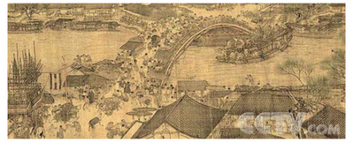

A. 黄酒

B. 旗袍

C. 围棋

D. 牡丹花

第 8 题 · 答案与解析

**参考答案（粉笔题库参考内容）**

B

**解析**

本题考查文化常识与中国历史。这幅画是宋代张择端的《清明上河图》，其中记录了北宋都城汴京的城市面貌和当时社会各阶层的生活状况。下面对每一项进行解析：

A项正确，商周时代利用复式发酵法就开始大量酿制黄酒，所以肯定可以在宋代买到。

B项错误，旗袍是民国时期的服装，不可能出现在宋代。

C项正确，围棋传说为帝尧所作，春秋战国时期都有相应的记载，所以肯定可以在宋代买到。

D项正确，唐代刘禹锡有诗曰：“唯有牡丹真国色，花开时节动京城”。可以看出牡丹花历史久远并被世人欣赏，所以肯定可以出现在宋代。

本题为选非题，故正确答案为B。

**考点**：中国历史

**来源**：2015年甘肃省公务员录用考试《行测》题第8题

### 第 9 题

下列朝代的帝王在位顺序正确的是（    ）。

A. 汉：文帝、景帝、武帝

B. 唐：玄宗、太宗、中宗

C. 宋：徽宗、神宗、钦宗

D. 明：成祖、太祖、英宗

第 9 题 · 答案与解析

**参考答案（粉笔题库参考内容）**

A

**解析**

本题考查历史常识。下面对每一项进行解析：

A项正确，排序正确，通过文景之治的休养生息，为汉武帝的千秋大业打下了基础。

B项错误，正确排序是：太宗（李世民）、中宗（李显）、玄宗（李隆基）。

C项错误，正确排序是：神宗、徽宗、钦宗。徽钦二帝被俘虏，北宋灭亡。

D项错误，正确排序是：太祖（朱元璋）、成祖（朱棣）、英宗（朱祁镇）。土木堡之变，英宗被俘，大明由盛转衰。

故正确答案为A。

**考点**：中国历史

**来源**：2015年甘肃省公务员录用考试《行测》题第9题

### 第 10 题

下列哪组人物均与中国古代的“礼乐文化”密切相关？

A. 周公、孔子

B. 伯夷、叔齐

C. 周武王、姜尚

D. 管仲、鲍叔牙

第 10 题 · 答案与解析

**参考答案（粉笔题库参考内容）**

A

**解析**

本题考查文化常识。下面对每一项进行解析：

A项正确，周公制定了周礼。孔子主张“为政以德”，是儒家的创始人，弘扬了“礼乐文化”。

B项错误，伯夷、叔齐是孤竹君的两个儿子。孤竹君死后，叔齐让位给伯夷，伯夷不接受，叔齐也不愿继位，二人共同逃亡。与“礼乐文化”无密切相关性。

C项错误，姜尚即姜子牙，他帮助周武王伐纣，建立了周朝。与“礼乐文化”无密切相关性。

D项错误，鲍叔牙推荐管仲为相，共同辅佐齐桓公成为霸主。与“礼乐文化”无密切相关性。

故正确答案为A。

**考点**：文化常识

**来源**：2015年甘肃省公务员录用考试《行测》题第10题

### 第 11 题

古代不少建筑因为名家名篇而驰名后世。下列历史名楼与名人对应不正确的是（   ）。

A. 岳阳楼——范仲淹

B. 滕王阁——王勃

C. 鹳雀楼——杜牧

D. 黄鹤楼——崔颢

第 11 题 · 答案与解析

**参考答案（粉笔题库参考内容）**

C

**解析**

本题主要考查文化常识，中国古代建筑之四大名楼。四大古楼，特指我国山西鹳雀楼、湖北武汉黄鹤楼、湖南岳阳岳阳楼和江西南昌滕王阁。

A项正确，范仲淹的千古名篇《岳阳楼记》使岳阳楼驰名后世。

B项正确，王勃曾在滕王阁写下脍炙人口的名篇《滕王阁序》。

C项错误，鹳雀楼因王之涣《登鹳雀楼》而闻名，杜牧没有关于鹳雀楼的名篇。

D项正确，黄鹤楼因崔颢的名诗《黄鹤楼》而闻名于世。

本题为选非题，故正确答案为C。

**考点**：文化常识

**来源**：2015年甘肃省公务员录用考试《行测》题第11题

### 第 12 题

关于书画产生年代与收藏情况，下列哪一说法绝对不可能是正确的（   ）。

A. 画家自称“仿黄公望”，则该画不可能早于元代

B. 曾被米芾收藏，则该画可能出自清人之手

C. 有“古希天子”印章，说明该书画曾是清代宫廷的藏品

D. 有“宣统御赏之宝”的印章，说明溥仪曾欣赏过该作品

第 12 题 · 答案与解析

**参考答案（粉笔题库参考内容）**

B

**解析**

本题主要考查文化常识。主要考查我国古代书画相关知识，需结合具体选项予以分析。

A项正确，黄公望（1269-1354年），元代画家，因此有人仿黄公望，不可能早于元代表述正确。

B项错误，米芾（1051-1107年），北宋书法家、画家，因此曾被米芾收藏的书画应当早于米芾生活的年代，而“出自清人之手”表述错误。

C项正确，“古希天子”，是清代乾隆皇帝的皇家印玺铭文，印文用于清代乾隆年间收藏的书画作品上。

D项正确，“宣统御赏之宝”是清代宣统皇帝皇家印玺铭文，“宣统”为清朝皇帝溥仪的年号，因此印有“宣统御赏之宝”的印章，说明溥仪曾欣赏过该作品。

本题为选非题，故正确答案为B。

**考点**：文化常识

**来源**：2015年甘肃省公务员录用考试《行测》题第12题

### 第 13 题

关于房产税，下列说法错误的是（   ）。

A. 我国最早在上海、重庆试点针对部分个人住房征收房产税

B. 房产税由产权所有人缴纳，产权属于全民所有的，由经营管理的单位缴纳

C. 房产税以交易增值部分为税基征收

D. 国家机关、人民团体、军队自用的房产免征房产税

第 13 题 · 答案与解析

**参考答案（粉笔题库参考内容）**

C

**解析**

本题主要考查法律常识。房产税是以房屋为征税对象，按房屋的计税余值或租金收入为计税依据，向产权所有人征收的一种财产税。

A项正确，2011年1月，国务院同意上海和重庆开始对个人住宅征收房产税实施试点。由此，上海、重庆成为我国最早试点房产税的地区。

B项正确，根据《房产税暂行条例》第2条规定，房产税由产权所有人缴纳。产权属于全民所有的，由经营管理的单位缴纳。

C项错误，根据《房产税暂行条例》第3条规定，房产税依照房产原值一次减除10%至30%后的余值计算缴纳。因此“以交易增值部分为税基征收”表述错误。

D项正确，根据《房产税暂行条例》第5条规定，下列房产免纳房产税：（一）国家机关、人民团体、军队自用的房产。

本题为选非题，故正确答案为C。

**考点**：行政法

**来源**：2015年甘肃省公务员录用考试《行测》题第13题

### 第 14 题

联合国安理会常任理事国派遣维和人员最多的国家是（   ）。

A. 中国

B. 美国

C. 俄罗斯

D. 英国

第 14 题 · 答案与解析

**参考答案（粉笔题库参考内容）**

A

**解析**

本题主要考查时事政治。2015年4月7日下午，中国军队参加联合国维和行动25周年暨首批维和步兵营出征情况介绍会在济南遥墙国际机场举行，据国防部介绍，中国已成为联合国安理会常任理事国中派出维和人员最多的国家，承担的维和摊款份额在发展中国家中居第一位。因此，B、C、D三项不符合题意。

故正确答案为A。

**考点**：时事政治-其他

**来源**：2015年甘肃省公务员录用考试《行测》题第14题

### 第 15 题

下列说法有误的是（   ）。

A. 最初的诺贝尔奖只包括物理学奖、化学奖、生理学或医学奖、文学奖、和平奖

B. 王选是我国第一个获得我国国家最高科学技术奖的科学家

C. 2012年王澍获得有“建筑界诺贝尔奖”之称的普利兹克建筑奖，这是该奖项首次授予中国人

D. 中国科学家屠呦呦因发现青蒿素而获得国际医学大奖——拉斯克奖

第 15 题 · 答案与解析

**参考答案（粉笔题库参考内容）**

B

**解析**

本题主要考查科技常识，需结合具体选项予以分析。

A项正确，诺贝尔奖是根据瑞典化学家诺贝尔的遗愿在1900年创立的，起初诺贝尔奖只有物理、化学、生理学或医学、文学和和平五个奖项，于1901年首次颁发。经济学奖并非诺贝尔的遗嘱所设立的，而是在1968年设立，1969年首次颁发；

B项错误，国家最高科学技术奖设立于2000年，并当年首次颁发国家最高科学奖，著名数学家吴文俊和杂交水稻之父袁隆平首次获得此奖，而王选是在2002年获得2001年度国家最高科学技术奖；

C项正确，2012年2月27日，王澍获得了普利兹克建筑奖，成为获得该奖项的第一个中国人；

D项正确，2011年9月23日，国际医学大奖美国拉斯克奖，将2011年临床研究奖颁发给屠呦呦，这是拉斯克奖设立65年来首次授予中国科学家。

本题为选非题，故正确答案为B。

**考点**：科技理论与成就

**来源**：2015年甘肃省公务员录用考试《行测》题第15题

### 第 16 题

下列生物及其生殖方式对应不正确的是（   ）。

A. 酵母菌——出芽生殖

B. 变形虫——分裂生殖

C. 蘑菇——孢子生殖

D. 大肠杆菌——营养生殖

第 16 题 · 答案与解析

**参考答案（粉笔题库参考内容）**

D

**解析**

本题主要考查生物常识——生物的生殖方式。生物体产生自己的后代的过程，叫做生物的生殖。生物分有性生殖和无性生殖两种。有性生殖：必须经过两性生殖细胞（精子，卵细胞）的结合形成受精卵再发育成新个体。无性生殖：不通过两性生殖细胞，由母体产生新个体，无性生殖方式主要有分裂生殖，出芽生殖，孢子生殖和营养生殖。

A项正确，出芽生殖又叫芽殖，其中“芽”是指在母体上长出的芽体，即芽基，芽基并不立即脱离母体，而与母体相连，继续接受母体提供养分，直到个体可独立生活才脱离母体，如珊瑚虫、水螅、酵母菌等；

B项正确，分裂生殖又叫裂殖，即母体分裂成两个或多个大小形状相同的新个体的生殖方式，如变形虫、草履虫、细菌等；

C项正确，孢子生殖是很多孢子植物和真菌等利用孢子进行的生殖方式。孢子是细菌、原生动物、真菌和植物等产生的一种有繁殖或休眠作用的生殖细胞，能直接发育成新个体，如蘑菇、青霉等；

D项错误，营养生殖是由高等植物的根、茎、叶等营养器官发育成新个体的生殖方式。例如，甘薯的块根繁殖、草莓的匍匐茎繁殖、马铃薯的块茎繁殖、百合和洋葱的鳞茎繁殖、水仙和芋的球茎繁殖及秋海棠的叶芽繁殖等。大肠杆菌属于细菌的一种，其生殖方式为分裂生殖，而不是营养生殖。

本题为选非题，故正确答案为D。

**考点**：生物常识

**来源**：2015年甘肃省公务员录用考试《行测》题第16题

### 第 17 题

可直接用于建筑建造的技术是（   ）。

A. 全息投影

B. 3D打印

C. 二维码

D. 激光照排

第 17 题 · 答案与解析

**参考答案（粉笔题库参考内容）**

B

**解析**

本题主要考查科技常识——3D打印技术。3D打印技术，是快速成型技术的一种，它是一种以数字模型文件为基础，运用粉末状金属或塑料等可粘合材料，通过逐层打印的方式来构造物体的技术。该技术在珠宝、鞋类、工业设计、建筑建造、工程和施工、汽车、航空航天、牙科和医疗产业、教育、地理信息系统、土木工程、枪支以及其他领域都有所应用。

A项错误，全息投影技术，也称虚拟成像技术，是利用干涉和衍射原理记录并再现物体真实的三维图像的技术。它成型的物体为“三维图像”，而不能直接用于建筑建造。

B项正确，3D打印技术现阶段已用于建筑建造。

C项错误，二维码，是在移动设备上一种储存信息的编码方式，与建筑建造无关。

D项错误，激光照排，是电子排版系统的大众化简称，它是将文字通过计算机分解为点阵，然后控制激光在感光底片上扫描，用曝光点的点阵组成文字和图像，与建筑建造无关。

故正确答案为B。

**考点**：科技理论与成就

**来源**：2015年甘肃省公务员录用考试《行测》题第17题

### 第 18 题

下列我国的世界遗产所在省（区）不属于黄河流域的是（   ）。

A. 莫高窟

B. 避暑山庄

C. 五台山

D. 孔庙、孔府以及孔林

第 18 题 · 答案与解析

**参考答案（粉笔题库参考内容）**

B

**解析**

本题主要考查地理常识。黄河，发源于我国青海省巴颜喀拉山脉，流经青海、四川、甘肃、宁夏、内蒙古、陕西、山西、河南、山东9个省区，最后于山东省东营市注入渤海。

A项正确，莫高窟，坐落在河西走廊西端的甘肃省敦煌市，属于黄河流域。

B项错误，承德避暑山庄，位于河北省承德市，属于海河流域，而不是黄河流域。

C项正确，五台山，中国佛教四大名山之首，位于山西省五台县，属于黄河流域。

D项正确，孔府、孔庙、孔林，统称“三孔”，位于山东省曲阜市，属于黄河流域。

本题为选非题，故正确答案为B。

**考点**：中国地理

**来源**：2015年甘肃省公务员录用考试《行测》题第18题

### 第 19 题

关于世界著名半岛，下列说法错误的是（   ）。

A. 印度半岛是世界上最大的半岛

B. 克里米亚半岛总体上属于地中海气候

C. 索马里半岛是红海通向印度洋的门户

D. 阿拉斯加半岛是爱斯基摩人的居住地之一

第 19 题 · 答案与解析

**参考答案（粉笔题库参考内容）**

A

**解析**

本题主要考查地理常识——世界著名半岛。需结合具体选项予以分析。

A项错误，世界上最大的半岛是阿拉伯半岛，而不是印度半岛。

B项正确，克里米亚半岛是位于欧洲东部、黑海北岸的半岛，半岛总体上属于地中海气候，而半岛南部属亚热带气候。

C项正确，索马里半岛，东濒阿拉伯海，北临亚丁湾（红海内），位于亚、非两大洲交界处，是红海通往印度洋的门户。

D项正确，阿拉斯加半岛，是美国阿拉斯加州向西南伸出的多山半岛，位于白令海的布里斯托尔湾与太平洋之间。爱斯基摩人，又称因纽特人，分布在从西伯利亚、阿拉斯加到格陵兰的北极圈内外。

本题为选非题，故正确答案为A。

**考点**：世界地理

**来源**：2015年甘肃省公务员录用考试《行测》题第19题

### 第 20 题

下列关于安全问题的说法正确的是（   ）。

A. 火灾发生时，如果所处楼层较低，应当立即跳楼逃生

B. 吃火锅时可以小心缓慢地向燃烧着的酒精炉里添加酒精

C. 面粉厂容易发生爆炸是因为面粉中含有大量食品添加剂

D. 夜间厨房发生煤气泄漏时，不能立即开灯检查

第 20 题 · 答案与解析

**参考答案（粉笔题库参考内容）**

D

**解析**

本题主要考查生活常识。需结合具体选项予以分析。

A项错误，火灾发生时，即使所处楼层较低，也应当选择正确的逃生方式逃生，而不应当立即跳楼逃生，因为即使在二楼跳楼，也极可能造成人员伤亡。

B项错误，酒精是易燃物质，即使缓慢向燃烧着的酒精炉里添加酒精，也极易引起酒精燃烧，烧伤人体或引起火灾，正确做法是先熄灭燃烧着的酒精炉，再添加酒精，或更换新的填满酒精的酒精炉。

C项错误，面粉厂容易发生爆炸是因为面粉厂存在大量面粉粉尘，当这些粉尘在空中摩擦时会碰撞出火花，爆炸就是因为粉尘在一个密封的空间中剧烈摩擦导致的。

D项正确，夜间厨房发生煤气泄漏时，应立即开窗通气和关闭煤气，这时不能立即开灯，因为开灯产生的电流（电火花）易点燃空气中的煤气，造成火灾或爆炸。

故正确答案为D。

**考点**：生活常识

**来源**：2015年甘肃省公务员录用考试《行测》题第20题

### 第 21 题

如今的辽河老街，新老建筑（），自然环境舒适宜人，戏院、茶馆、客栈、咖啡馆、古玩店应有尽有，成了营口对外展示形象的最亮丽的名片。

A. 相得益彰

B. 相辅相成

C. 相伴而生

D. 相差无几

第 21 题 · 答案与解析

**参考答案（粉笔题库参考内容）**

A

**解析**

由后文既有茶馆、古玩店，又有咖啡馆可知，现在的辽河老街应该是新老建筑一起将老街打造成营口亮丽的名片，所填词语强调两者的相互配合带来的良好的结果，对应A项，“相得益彰”指两个人或两件事物互相配合，双方的能力和作用更能显示出来，符合文意；

B项“相辅相成”指两件事物互相配合，互相辅助，缺一不可，无法对应文中二者互相配合给老街带来的积极作用，排除；

C项“相伴而生”指一起产生，新老建筑在时间上有明显的差别，不可能同时产生，与文意不符，排除；

D项“相差无几”指彼此没有多大差别，文段重点强调新老建筑互相配合带来的影响，而非两者差别，且由文段可知，新老建筑呈现出明显的不同，排除。

故正确答案为A。

【文段出处】《建新社区艺术团老街演出》

**考点**：对应关系-前后呼应、成语填空

**来源**：2015年甘肃省公务员录用考试《行测》题第21题

### 第 22 题

自然界中每种动物都有自己的独特之处，作为电影艺术中的动物更强调个性。正如电影一贯塑造典型人物形象一样，以动物为主角的影片在（ ）动物充满神秘色彩的生活的同时，格外注重突出不同种类中每个动物的性格特征，（   ）地刻画典型的动物形象。

A. 呈现 不遗余力

B. 展示 入木三分

C. 纪录 浓墨重彩

D. 描绘 活灵活现

第 22 题 · 答案与解析

**参考答案（粉笔题库参考内容）**

A

**解析**

第一空，填入的词与“生活”搭配，D选项“描绘”一词与“生活”无法搭配，常见搭配为“描写生活点滴”等，故排除D选项。

第二空，与前文“格外注重突出不同种类……”对应可知，文段想表达一种不惜一切努力与代价来表现出“动物形象”，所以第二空填入“不遗余力”更加符合语境。B项“入木三分”虽常与“刻画”搭配，但必须刻画的是能够“深入”的对象，如“人性”，而非文段中的“动物形象”；C项“浓墨重彩”意为浓重的笔墨和色彩。原为绘画的一种风格，现多形容着力描写刻画，但常见搭配是“浓墨重彩的一笔”“浓墨重彩的山水画”等，一般不与“动物形象”搭配。故排除B、C两项。

故正确答案为A。

【文段出处】《世界电影中的“动物之歌”》

**考点**：对应关系-前后呼应、对应关系-形象表达、混搭填空

**来源**：2015年甘肃省公务员录用考试《行测》题第22题

### 第 23 题

德国的现代工厂之前是作坊，而作坊之前是工匠。做鞋的工匠，他会在鞋上钉上一个本家族的姓氏标牌，（    ）就是最早的品牌意识。第二汽车制造厂曾经请过德国老师来培训徒工，十个小伙子站成一排，学钳工活，每人拿着锉刀，德国老师站在旁边，喊号子一、二、三、四，工人按号子做。动作不能有（    ）的差错。

A. 其实 一丝一毫

B. 反正 一点一滴

C. 无非 一差半错

D. 确实 一时半刻

第 23 题 · 答案与解析

**参考答案（粉笔题库参考内容）**

A

**解析**

第一空，B项“反正”意为无论如何，不管怎样，表示非常肯定的语气，用在此处程度过重，排除。

第二空，与“差错”搭配，A项“一丝一毫”形容一点点儿，极小或极少，在此用于强调工人工作不容差错，符合文意，当选。C项“一差半错”置于此处语义重复，排除；D项“一时半刻”指很短的时间，与“差错”搭配不当，排除。

故正确答案为A。

【文段出处】《缺乏诚信和认真，是中国质量问题的“癌症”》

**考点**：对应关系-前后呼应、混搭填空

**来源**：2015年甘肃省公务员录用考试《行测》题第23题

### 第 24 题

贺兰山岩画自发现以来，给人们的震撼和向人们提出的问题几乎同样多。有关岩画的内容、年限、创作族群等问题，专家们\_\_\_\_\_，贺兰山岩画上空的这些谜团至今依然烟云缭绕。考古界有句名言：“唯一能确定的就是不确定!”贺兰山岩画似乎\_\_\_\_\_了这句话，岩画研究中的诸多观点都陷入了一种不可确定中。

A. 唇枪舌剑 延伸

B. 莫衷一是 呼应

C. 不置可否 诠释

D. 各持己见 印证

第 24 题 · 答案与解析

**参考答案（粉笔题库参考内容）**

D

**解析**

第一空，根据“这些谜团至今依然烟云缭绕”可知，所填词语表达专家们持有不同的意见与看法，B项“莫衷一是”形容意见分歧，没有一致的看法，D项“各持己见”指每个人都坚持自己的意见，均可。A项“唇枪舌剑”形容辩论时言语锋利，争辩激烈，文段没有提及辩论，排除；C项“不置可否”是指没有表明态度，和文段“不同的意见和看法”的语义无关，排除。

第二空，根据后文“岩画研究中的诸多观点都陷入了一种不可确定中”可知，横线词语表达贺兰山岩画证明了这句话，D项“印证”指通过其他事物进一步证明，符合文意。B项“呼应”指文章前后相照应，和文意无关，排除。

故正确答案为D。

【文段出处】《岩画：贺兰山的文身》

**考点**：对应关系-前后呼应、混搭填空

**来源**：2015年甘肃省公务员录用考试《行测》题第24题

### 第 25 题

在古代，盐这种特殊的商品并非\_\_\_\_\_\_。那些产盐的地方，往往成为经济、文化和政治的中心。山西运城地区之所以成为华夏文明的发祥之地，就是得益于拥有烟波浩渺的大盐湖——解池。盐商，成了\_\_\_\_\_\_的代名词，普普通通的食盐造就了早期的晋商，成为了“黄土地上的白金”。

A. 俯拾皆是 地位

B. 家喻户晓 权利

C. 随处可得 富裕

D. 物美价廉 成功

第 25 题 · 答案与解析

**参考答案（粉笔题库参考内容）**

C

**解析**

第一空，根据文意可知，横线处表达盐这种商品不是在任何地方都有，只有在经济、文化和政治的中心才会有，A项“俯拾皆是”指只要低下头来捡取，到处都是，形容多而易得，C项“随处可得”指在任何地方都可以得到，均符合文意。B项“家喻户晓”形容人人皆知，文段并未提及人们是否知晓，排除；D项“物美价廉”形容东西价钱便宜，质量又好，与文意无关，排除。

第二空，根据后文可知，盐可以代表财富，C项“富裕”符合文意，A项“地位”与后文“黄土地上的白金”无法对应，排除。

故正确答案为C。

【文段出处】《镜头下的中国盐文化》

**考点**：对应关系-前后呼应、混搭填空

**来源**：2015年甘肃省公务员录用考试《行测》题第25题

### 第 26 题

这次“老北京”展览以《旧京环顾图》长卷为\_\_\_\_\_\_制作而成，以“胡同张”长100米的老北京立体微缩街景为主要内容，展示了\_\_\_\_\_\_的微缩老北京店铺景观。

A. 蓝图 琳琅满目

B. 蓝本 栩栩如生

C. 模范 多姿多彩

D. 模板 惟妙惟肖

第 26 题 · 答案与解析

**参考答案（粉笔题库参考内容）**

D

**解析**

第一空，根据文意可知，横线处表达按照《旧京环顾图》的固定格式制作，B项“蓝本”指著作所根据的底本，D项“模板”指作图或设计方案的固定格式，均符合文意，保留。A项“蓝图”借指建设计划，与文意不符，排除；C项“模范”指值得学习的、作为榜样的人，常用于形容人，与文意不符，排除。

第二空，搭配“店铺景观”，根据文意可知，横线处意在表达把店铺景观展现得像真的一样，D项“惟妙惟肖”形容描写或模仿得非常好，非常逼真，符合文意，当选。B项“栩栩如生”形容生动逼真，就像活的一样，多指文学、艺术形象塑造得生动传神，与“店铺景观”搭配不当，排除。

故正确答案为D。

【文段出处】《“老北京动起来”数字艺术展开展》

**考点**：对应关系-前后呼应、混搭填空、词的辨析-搭配对象

**来源**：2015年甘肃省公务员录用考试《行测》题第26题

### 第 27 题

在政府扩张性政策（    ）的前提下，各国政府不得不千方百计寻找新的增长动力，通过本币贬值或者逼迫竞争对手货币升值，来提高本国出口商品的国际竞争力，通过扩大贸易顺差或者缩小贸易赤字来带动经济增长，就成为（    ）的选择。

A. 难以为继 顺理成章

B. 遥遥无期 急中生智

C. 适得其反 无可奈何

D. 无济于事 委曲求全

第 27 题 · 答案与解析

**参考答案（粉笔题库参考内容）**

A

**解析**

第一空，根据“各国政府不得不千方百计寻找新的增长动力”可知，当前政府扩张性政策对于经济增长难以发挥重要作用，A项“难以为继”指难于继续下去，D项“无济于事”比喻解决不了问题，均符合文意，保留；B项“遥遥无期”形容时间还远得很，不知道哪一天，实现的可能性很小，C项“适得其反”指恰恰得到与预期相反的结果，文段未体现“政策”实现可能性小及得到预期相反的结果，与文意不相符，均排除。

第二空，根据“千方百计寻找新的增长动力”可知，在政府扩张性政策效果不佳的背景下，后文采取的对策应当是顺应需求自然而然形成的、相对合理的解决办法，A项“顺理成章”比喻某种情况合乎情理，自然产生某种结果，符合语境，当选；D项“委曲求全”指勉强迁就，以求保全，也指为了顾全大局而让步，文段未体现勉强迁就及顾全大局，与文意不相符，排除。

故正确答案为A。

【文段出处】《美国是否会将我列为汇率操纵国？》

**考点**：对应关系-前后呼应、成语填空

**来源**：2015年甘肃省公务员录用考试《行测》题第27题

### 第 28 题

对于宇航员从月球带回的样本，科学家们的（）工作可谓做到了家：专门兴建了一个月球物质回收和回归宇航员检疫实验室来接待这些“外星访客”。这样做的目的是为了（）科学家利用月壤做实验时不会有任何危险的污染物或者未知的外星生命形式“逃脱”，从而避免（）地球生态。

A. 防范 确保 危及

B. 保障 保证 影响

C. 预防 担保 破坏

D. 准备 保护 干扰

第 28 题 · 答案与解析

**参考答案（粉笔题库参考内容）**

A

**解析**

第一空，根据后文“不会有任何危险的污染物或者未知的外星生命形式‘逃脱’”可知，科学家们的工作是为了提前预防危险和危害，A项“防范”指防备，戒备，C项“预防”指预先做好防备，均符合文意，保留；B项“保障”指保护（权利、生命、财产等），使不受侵害，体现不出“提前预防”的意思，排除；D项“准备”指事先计划、筹备，文段强调的是提前预防，而非简单的准备，排除。

第二空，根据文意可知，横线词语表达确定使科学家做实验时不会出现问题，A项“确保”指切实保持或保证，符合文意，保留；C项“担保”表示负责，保证不出问题或一定办到，程度过重，此外也有为了保证债权实现而采取的法律措施之意，文段并未涉及“法律措施”，排除。

第三空，表示对地球生态造成危险，A项“危及”符合文意，当选。

故正确答案为A。

【文段出处】《派植物“矿工”去外星淘金》

**考点**：实词填空、对应关系-前后呼应

**来源**：2015年甘肃省公务员录用考试《行测》题第28题

### 第 29 题

柏拉图、卢梭、托尔斯泰和程伊川都曾怀疑到文学的影响，（）它是不道德的或是不健康的。世间有一部分文学作品确有这种毛病，本无可讳言，但是不能（），我们只能归咎于作品不完美，不能（）文学本身必有罪过。

A. 否定 因小失大 确认

B. 以为 因噎废食 断定

C. 提出 矫枉过正 忽视

D. 默认 顾此失彼 推定

第 29 题 · 答案与解析

**参考答案（粉笔题库参考内容）**

B

**解析**

第一空，根据“怀疑文学的影响”可知，后文为“柏拉图、卢梭、托尔斯泰和程伊川”的观点，故横线处填入“否定”“默认”与文意相悖，排除A、D两项。

第二空，根据“世间有一部分文学作品确有这种毛病”及“我们只能归咎于作品不完美”可知，横线处所表达的意思是因为一些小毛病而不接受所有，B项“因噎废食”比喻要做的事情由于出了点小毛病或怕出问题就索性不去干，契合文意，保留；C项“矫枉过正”比喻纠正错误超过了应有的限度，文段并未涉及需要纠正的错误，与文意不相符，排除。

第三空，代入验证，“不能断定文学本身必有罪过”，B项表述正确，符合文意，当选。

故正确答案为B。

【文段出处】《谈文学》

**考点**：对应关系-前后呼应、混搭填空

**来源**：2015年甘肃省公务员录用考试《行测》题第29题

### 第 30 题

在美国，从事学术著作写作的学者对《芝加哥手册》（），这本由芝加哥大学出版社资深编辑撰写的手册，内容涵盖了几乎所有学术写作、编辑和出版所涉及的各个（）。在中国，学术著作并无统一规范，学术书体例、格式千差万别，学术抄袭事件频频发生。如果能出台中国自己的学术著作写作出版规范，能在一定程度上完善相应的规章制度，让自己的作者、编辑（），对于严肃中国学风，意义非凡。

A. 顶礼膜拜 环节 规行矩步

B. 奉为圭臬 步骤 言之凿凿

C. 了如指掌 细节 有章可循

D. 烂熟于心 过程 按图索骥

第 30 题 · 答案与解析

**参考答案（粉笔题库参考内容）**

C

**解析**

第一空，根据文意可知，美国学者在写作时都遵循“《芝加哥手册》”，按照里面的要求进行写作，A项“顶礼膜拜”侧重于崇拜，文段并非表达学者们崇拜这本手册，且“顶礼膜拜”和“《芝加哥手册》”搭配不当，排除。

第三空，根据前文“在中国，学术著作并无统一规范”可知，出台中国自己的学术著作写作出版规范，目的在于让作者、编辑可以有参照的依据，遵循制度办事，C项“有章可循”指在做事的时候有一定的规章制度可以遵循、参照，保留。B项“言之凿凿”形容说话有真凭实据，和文段“遵循制度办事”的语义无关，排除；D项“按图索骥”指按照线索去寻找事物，文段表达的是“遵循制度办事”，而非“寻找事物”，排除。

第二空，代入验证，内容涵盖各个细节，符合文意，当选。

故正确答案为C。

【文段出处】《中国需要自己的&lt;芝加哥手册>》

**考点**：对应关系-前后呼应、混搭填空

**来源**：2015年甘肃省公务员录用考试《行测》题第30题

### 第 31 题

大气污染、水污染和废弃物污染等问题一般都比较直观。而土壤污染则不同,它往往要通过对土壤样品进行分析化验和农作物的残留检测,甚至通过研究对人畜健康状况的影响才能确定。

这段文字意在说明（    ）。

A. 土壤污染的可逆性

B. 土壤检测的艰难性

C. 土壤污染的隐蔽性

D. 土壤污染的欺骗性

第 31 题 · 答案与解析

**参考答案（粉笔题库参考内容）**

C

**解析**

文段首句介绍大气污染、水污染等问题比较直观，紧接着指出土壤污染不同，并进行具体解释说明，所以文段通过对比，意在说明土壤污染难以发现，不直观，对应C项“隐蔽性”。

A项“可逆性”、D项“欺骗性”均无中生有，文段没有提及，排除；B项“土壤检测”属于解释说明的内容，旨在说明土壤污染比较隐蔽，故“土壤检测”非重点，排除。

故正确答案为C。

【文段出处】《我国土壤污染的特点》

**考点**：关联词-转折

**来源**：2015年甘肃省公务员录用考试《行测》题第31题

### 第 32 题

上世纪50年代，爱因斯坦被邀请担任以色列总统。对于亿万人仰视的一国元首之位，他谢绝了，在信中说：“我整个一生，都在同客观物质打交道，因而既缺乏天生的才智，也缺乏经验来处理行政事务以及公正地对待别人。所以，本人不适合如此高官重任。”

爱因斯坦的经历告诉我们（    ）。

A. 人非圣贤，孰能无过

B. 富贵于我如浮云

C. 人贵有自知之明

D. 子非鱼，安知鱼之乐

第 32 题 · 答案与解析

**参考答案（粉笔题库参考内容）**

C

**解析**

根据文段“我整个一生，都在同客观物质打交道，因而既缺乏天生的才智，也缺乏经验来处理行政事务以及公正地对待别人。所以，本人不适合如此高官重任”可知，爱因斯坦很清楚自己的优势和劣势，自我认知很清晰，知道自己适合什么不适合什么，对应C项“人贵有自知之明”。

A项，“孰能无过”无中生有，文段没有提及爱因斯坦犯错，排除；

B项，“富贵”非重点，文段旨在说明爱因斯坦对自己认知很清晰，而非看不上“富贵”，排除；

D项，“子非鱼，安知鱼之乐”无中生有，文段并未提及快乐与否的话题，排除。

故正确答案为C。

【文段出处】《别把自己这块“宝贝”放错地方》

**考点**：关联词-因果

**来源**：2015年甘肃省公务员录用考试《行测》题第32题

### 第 33 题

在经济全球化背景下，信息革命正通过发挥跨国界、跨组织、跨领域的效力，使世界形势变得复杂。国家话语权和信息安全的现状堪忧。信息传播秩序不公平、信息安全被少数国家掌控是主要矛盾。全世界20%的人口占有80%的信息资源，80%的人口只享用到20%的信息资源。“信息富有国”和“信息贫穷国”的两极分化严重，“数字鸿沟”不但没有消除，反而在某些区域有加剧之势。

这段文字意在说明（    ）。

A. 信息资源分布不平衡

B. 主要信息流通不对等

C. 信息传播手段不安全

D. 信息传播渠道不畅通

第 33 题 · 答案与解析

**参考答案（粉笔题库参考内容）**

A

**解析**

文段开头提到信息革命发展的背景，接着提到了信息传播秩序不公平、信息安全被少数国家掌控的矛盾，后面指出“全世界20%的人口占有80%的信息资源，80%的人口只享用到20%的信息资源”，最后一句引出文段重点，“数字鸿沟”不但没有消除，反而在某些区域有加剧之势，“数字鸿沟”即信息资源分布不平衡，对应A项。B项“信息流通不对等”、C项“传播手段不安全”、D项“传播渠道不畅通”均为无中生有的表述，排除。

故正确答案为A。

【文段出处】《经济全球化背景下的国家话语权与信息安全》

**考点**：分述句特征-引入铺垫

**来源**：2015年甘肃省公务员录用考试《行测》题第33题

### 第 34 题

在文学史上，科幻文学是近期才出现的东西，它伴随着近代科学出现，随着世界的现代化而发展。在此之前，虽然也广泛存在幻想文学，但是但丁的《神曲》和玛丽·雪莱的《科学怪人》之间却存在着无法跨越的鸿沟。科幻文学的本质性要素是科学的内核，科学精神的核心一定是可知论，是反对蒙昧主义。栖身于科学的幻想作品，才能称之为科幻文学。

根据上文，科幻文学和幻想文学根本区别在于，科幻文学：

A. 是基于现实的想象

B. 以科学为依托

C. 出现时间较晚

D. 具有启发民智的作用

第 34 题 · 答案与解析

**参考答案（粉笔题库参考内容）**

B

**解析**

A项，文段并未提及科幻文学是“基于现实的想象”，无中生有，排除；

B项，根据“科幻文学的本质性要求是科学的内核”“栖身于科学的幻想作品，才能称之为科幻文学”可知，科幻文学与幻想文学的根本区别在于科幻文学以科学为依托，表述正确，当选；

C项，“出现时间较晚”仅是科幻文学的一个特征，并非其与幻想文学的“根本区别”，表述错误，排除；

D项，根据“科学精神的核心一定是可知论，是反对蒙昧主义”可知，文段仅提及科学精神的核心是反对蒙昧主义，并未提及科幻文学具有“启发民智的作用”，无中生有，排除。

故正确答案为B。

【文段出处】《很多莫言，为什么只有一个刘慈欣》

**考点**：细节判断题

**来源**：2015年甘肃省公务员录用考试《行测》题第34题

### 第 35 题

人们一般认为，诚信与否是个人品德问题，与他人无关。但是个人品德却不仅仅是个人问题，它还会通过外部性产生社会效果——个人道德的亏欠，最终可能会“报应”到整个社会头上。从制度经济学的角度来看，一个好的经济制度和治理机制应当能够抑制负外部性，否则经济秩序可能走向崩溃，要通过制度和机制使始作俑者承担应有的责任，而不是让他人或者整个市场为之埋单。

对这段文字的主旨概括最准确的是：

A. 个人品德缺失得由全社会埋单

B. 经济制度对经济秩序意义重大

C. 诚信既是社会问题又是经济问题

D. 需用制度抑制不诚信的负外部性

第 35 题 · 答案与解析

**参考答案（粉笔题库参考内容）**

D

**解析**

文段首句通过转折词“但”指出问题，个人品德会通过外部性产生社会效果，接下来从制度经济学的角度进行分析，尾句通过“要通过”提出对策，即“制度和机制”需发挥作用，从根本上预防不诚信者带来的外部性问题，结合选项可知，D项为文段中心的同义表述，当选。

A项，文段提出的对策是靠制度和机制，而非全社会埋单，排除；

B项，对应分析问题的表述，非重点，且没有提到“诚信”这一话题，排除；

C项，为提出问题的表述，非重点，排除。

故正确答案为D。

【文段出处】《不诚信的外部性》

**考点**：关联词-对策

**来源**：2015年黑龙江省公务员录用考试《行测》题（公检法卷）第39题

### 第 36 题

①甲午中日战争前后共举办15年，有七期毕业生

②最早兴办的新式军教育机构是1885年李鸿章于天津设立的武备学堂

③据史载，最早装备西洋式武器的大规模部队是太平天国末期的淮军

④但他们后来成为袁世凯编练新军的主要干部，也构成后来北洋系军阀的骨干

⑤该学堂的设立本是中法战争的结果之一，目的是培养下级军士和军官

⑥其毕业生在当时处于低位，在甲午等战事中发挥作用甚小

将以上6个句子重新排列，语序正确的是：

A. ②①⑤⑥④③

B. ③②⑥①④⑤

C. ②③⑥①⑤④

D. ③②⑤①⑥④

第 36 题 · 答案与解析

**参考答案（粉笔题库参考内容）**

D

**解析**

对比选项，确定首句，②句介绍了1885年设立的武备学堂，③句介绍了太平天国末期的淮军，两句话题不一致，不好确定首句。

观察可知，⑤句中“该学堂”即为②句中的“武备学堂”，故②⑤捆绑；⑥句中的毕业生即为①句中的“七期毕业生”，故①⑥捆绑，锁定D项。

验证D项，③句先点明最早装备西式武器的大规模部队是淮军，②句承接话题，介绍天津武备学堂。⑤句中“该学堂”指代②句的“武备学堂”，说明其设立背景与目的，①句介绍武备学堂的办学时间与毕业生情况。⑥句指出学堂毕业生当时地位低、作用小，④句通过“但”转折，指出这些毕业生后来成为新军的主要干部与北洋系军阀骨干，逻辑清晰。

故正确答案为D。

**考点**：确定捆绑

**来源**：2015年黑龙江省公务员录用考试《行测》题（公检法卷）第32题

### 第 37 题

在《天朝向左，世界向右：近代中西交锋的十字路口》这本书中，作者在具体的历史时空情景里，将近代中外名人还原为一个个多维复杂的人物形象，无论写到慈禧还是维多利亚女王，都不见我们惯性思维中穷奢极欲的暴戾和“欧洲的祖母”式的慈祥。从中你会看到一个多才多艺的慈禧，也会看到一个贪婪恋权的维多利亚女王；而同为博学多才的一代明君，当康熙大帝在“红墙深锁的宫廷完全出于个人兴趣沉醉西学的神奇”时，彼得大帝已远走天涯寻师问道，“他挥动野蛮的鞭子加速把俄罗斯赶向文明”。

这段文字强调该书具有下列哪一特色（    ）

A. 描写深入细致

B. 善于做对比分析

C. 多维全面地分析历史人物

D. 从小细节处看大关节

第 37 题 · 答案与解析

**参考答案（粉笔题库参考内容）**

C

**解析**

文段开篇指出该书的特点，即作者将近代中外名人还原为多维复杂的人物形象。随后以慈禧与维多利亚女王、康熙大帝与彼得大帝两组人物为例，具体阐述该书如何处理人物形象的特点，展现人物的多面特质。故整个文段重在强调该书的核心特色是对历史人物进行多维、全面的分析，对应C项。

A项“描写深入细致”强调描写的细腻度与具体性，偏离文段核心，排除；

B项“对比分析”对应文段中两组人物的举例内容，非重点，排除；

D项“从小细节处看大关节”无中生有，排除。

故正确答案为C。

【文段出处】《大国兴亡谁人定》

**考点**：分述句特征-举例子、分述句特征-多角度论述

**来源**：2015年甘肃省公务员录用考试《行测》题第37题

### 第 38 题

“9.11”事件之后（    ）。为了应对严重的种族集聚或者种族贫民窟的产生，很多国家的政府采取各种措施，使各地（特别是城市内部）的居民尽可能多样化，其中便包括住房的重新建设。为了增加不同种族居民之间和不同社会阶层之间的混合，在英国、荷兰和其他一些国家，战后的社会租赁住房单位都被取消，取而代之的则是新建的更贵的住房。

填入括号中最恰当的是：

A. 多国政府都在试图使房屋供给更加多元化

B. 很多国家的政府对于贫民窟的担忧增强了

C. 西方国家更加注重提升社区的异质性

D. 很多试图削减居住区之间经济隔离程度的项目都在进行着

第 38 题 · 答案与解析

**参考答案（粉笔题库参考内容）**

B

**解析**

文段首句空缺，后文介绍了很多国家政府为了应对严重的种族集聚或者种族贫民窟的产生而采取的对策，包括使居民多样化、住房的重新建设、取消社会租赁住房单位等。故文段结构应该是提出问题+解决对策，首句即是提出问题。根据后文可知，各国政府采取的对策，目的是为了应对“严重的种族集聚或者种族贫民窟的产生”，故问题的关键在于“种族集聚或者种族贫民窟”。B项“对于贫民窟的担忧增强了”即问题所在，当选。

A项，文段所述为使“居民”多样化，而非“房屋供给”多元化，排除；

C项，文段后面不仅仅论述了社区的异质性，还有重新建住房，表述片面，排除；

D项，根据尾句，可知政府要削减的包括“种族”隔离和“社会阶层”的隔离，“经济隔离程度”表述片面，排除。

故正确答案为B。

【文段出处】《流动人口的空间分布与犯罪问题研究——以流动人口聚集区与犯罪热点的相关性为视角》

**考点**：横线在开头

**来源**：2015年甘肃省公务员录用考试《行测》题第38题

### 第 39 题

①不锈钢罐的出现被认为是现代食品加工业发展中的里程碑

②最早的不锈钢主要用于军事工业

③在这一年，美国、英国和德国的研究者分别在抗腐蚀合金的研究上取得了关键性的进展

④它的结实耐用、抗腐蚀和易于清洁消毒的特殊性深受食品加工厂的欢迎

⑤1912年被认为是现代不锈钢诞生的年份

⑥直到20世纪30年代才开始以锅碗瓢盆的形式进入家庭

将以上语句排序正确的是：

A. ⑤③②⑥①④

B. ⑤①③②⑥④

C. ②⑤③⑥④①

D. ②⑥④⑤③①

第 39 题 · 答案与解析

**参考答案（粉笔题库参考内容）**

A

**解析**

对比选项，确定首句。②句介绍不锈钢最早的应用场景，⑤句引出不锈钢的话题，并介绍其诞生年份，按照逻辑循序可知，应先介绍不锈钢的诞生，再介绍其具体应用，⑤句更适合做首句，C、D两项排除，A、B两项保留。

对比选项，继续寻找其他线索。④句通过指代词“它”进行指代，并介绍其深受食品加工的欢迎，④句前应介绍与食品加工相关内容，①句介绍了不锈钢罐与现代食品加工业发展的关系，可以与④句构成指代词捆绑，⑤句引出不锈钢的话题，并介绍其诞生年份，但并未涉及食品加工业相关内容，无法与④句构成指代词捆绑，B项排除，A项当选。

故正确答案为A。

【文段出处】《让生活更美好的20项发明》

**考点**：确定捆绑、确定顺序

**来源**：2015年甘肃省公务员录用考试《行测》题第39题

### 第 40 题

报纸受出版时间的限制，广播电视受播出时间的限制，而互联网媒体没有发布时间的限制，加上制作、发布的简便，使得新媒体的时效性远远胜过传统媒体。原先新闻的定义是，新闻是新近发生的事实的报道；而现在，新闻是正在发生的事实的报道。经常见到的情况是，新闻的传播与事件的进程同步。

这段文字主要说明：

A. 互联网媒体新闻发布具有实时性

B. 新媒体重新诠释了“新闻”的定义

C. 新媒体与传统媒体存在较大差异

D. 新闻的传播应注重与事件同步

第 40 题 · 答案与解析

**参考答案（粉笔题库参考内容）**

B

**解析**

文段首句对比报纸、广播电视与互联网媒体，指出“新媒体的时效性远远胜过传统媒体”。也正因为此，现在的新闻与以往相比在时效性上有了质的提高，即“新闻的传播与事件的进程同步”，故文段重在说明，新媒体改变了新闻的含义，结合选项可知，B项为文段中心的同义替换。

A、C两项是文段开头介绍背景的内容，非文段重点，排除；D项中“应”与文意不符，新闻传播与事件同步已经是一个现实存在的结果，排除。

故正确答案为B。

**考点**：分述句特征-引入铺垫

**来源**：2015年黑龙江省公务员录用考试《行测》题（公检法卷）第40题

### 第 41 题

未来的旧金山将整个运转在一个被称之为“氢网”的系统上。按照设计师们的构想，在因海平面升高而被淹没的沿海地区，将建起新的水产资源开发区，在开发区内，一个个海藻池、一座座高层建筑林立而起。旧金山以多雾闻名，这个设计很好地利用了这一自然资源：新颖奇特的集雾装置“雾花”将从雾气和海藻中获取淡水并将其转变成氢气用作燃料。

关于未来的旧金山，下列说法与原文相符的是：

A. 新的水产资源开发区将随着海平面的升高而扩大

B. 可以通过集雾装置提供氢气来解决燃料能源问题

C. 城市运转将建立在海水淡化技术提升的基础上

D. 将全面使用“雾花”这种海水净化系统

第 41 题 · 答案与解析

**参考答案（粉笔题库参考内容）**

B

**解析**

A项“扩大”之意无从体现，为无中生有，排除；C项偷换概念，将文中的“从雾气和海藻中获取淡水”变成了“海水淡化”，排除；D项文中没有提到将全面使用这个系统，程度过重，排除；B项根据文段尾句可以得出，表述正确，当选 。

故正确答案为B。

【文段出处】《 100 年后我们住在这样的城市》

**考点**：细节判断题

**来源**：2015年甘肃省公务员录用考试《行测》题第41题

### 第 42 题

作家、艺术家作为最富有创造性的主体和最具活力的媒介，一旦投身于一项文化交流行为之中，就势必要承担双重的义务或双重的角色：把自身的文化传播到自身以外的文化中去，再把自身以外的文化引回自身。这样，我们在审视外国作家与中国文化关系时，就不可能，也不应该将中国文化、中国思想设想为一成不变的辐射中心，来进行单向度的观照和贸易往来式的清点，必须进行双向、互动的考察，具体地研究在接受彼此文化过程中，产生的新的想象和创造。

这段文字意在说明：

A. 文化交流不应是单向度的灌输而应是双向互动

B. 文化交流研究重点要集中在交流中创新的元素

C. 真正的学者是肩负双重义务扮演双重角色的人

D. 学者在文化交流中要扮演双向传播者才有活力

第 42 题 · 答案与解析

**参考答案（粉笔题库参考内容）**

A

**解析**

文段开篇指出作家、艺术家在文化交流中承担双重义务或角色，用冒号进行解释说明，接下来通过“这样”对前文进行总结，之后引出对策，我们在审视外国作家与中国文化关系时必须进行双向、互动的考察，即是强调文化交流应是双向互动的，对应A项，当选。B项没有体现“双向”“互动”的含义，排除；C项没有包含“文化交流”这个主题词，排除；D项对应首句的表述，非重点，且“学者”和首句的“作家、艺术家”并非同一概念，排除。

故正确答案为A。

**考点**：关联词-对策

**来源**：2015年黑龙江省公务员录用考试《行测》题（公检法卷）第42题

### 第 43 题

对于国家实力与国际话语权之间的关系，我们的舆论往往作片面的理解，认为国际话语权的大小根本取决于国家实力的大小。当然，这种观点似乎来自当今世界一个令人迷惑的现象，即最为强大的美国拥有最强的国际话语权，传统强国比较集中的欧洲也拥有很大的国际话语权。但是，美国和欧洲之所以拥有强大的国际话语权，并非仅仅因其实力强大，更是因为他们的话语中所包含的观念创新性引导着大多重要国际议题的设置，他们话语中的逻辑性和说服力较强等等。虽然不能否认实力强大对于话语权是一个积极性因素，但国际话语权从来不是按国家的实力大小来分配的，在某些问题或领域，一些实力小的国家比一些实力大的国家拥有更多话语权的情况比比皆是。

这段文字意在强调（）

A. 国家的实力决定了国际话语权的强弱

B. 强化话语质量对提升国际话语权至关重要

C. 国际话语权为个别实力强大的国家所掌控

D. 国家实力对话语权影响在不同领域中不同

第 43 题 · 答案与解析

**参考答案（粉笔题库参考内容）**

B

**解析**

文段开篇指出“国际话语权取决于国家实力”的观点片面，并分析其原因在于“强大的美国和欧洲拥有最强的话语权”，之后通过转折词“但是”指出文段重点，即“强大的话语权的原因是话语中包含观念创新，并且逻辑性、说服力强等”，即“话语的质量高”。尾句通过“实力小的国家比一些实力大的国家在某些领域拥有更多话语权”证明了前文观点，故B项正确。

文段首句即表明“国际话语权取决于国家实力”这一舆论观点片面，故A项与文意相悖，排除；

根据尾句“在某些问题或领域，实力小的国家比一些实力大的国家拥有更多话语权”可知，C项与文意相悖，排除；

D项，文段强调“国际话语权不是按国家的实力大小来分配”，故“在不同领域中不同”表述有误，排除。

故正确答案为B。

【文段出处】《话语质量：提升国际话语权的关键》

**考点**：关联词-转折

**来源**：2015年甘肃省公务员录用考试《行测》题第43题

### 第 44 题

有人说：“三百个齐白石，比不上一个鲁迅。”此言曾引起强烈争议，很多人对于这两位先贤的可比性提出质疑：文学和绘画怎么比呢？但是从社会功能讲来，如果没有鲁迅，我们这个民族的精神会大不相同。美术终究不能像文字那样直接用语言文字表达作者的思想意愿，并在读者心中刻下不可磨灭的深痕。例如鲁迅小说《呐喊》、《彷徨》的插图，虽然有助于读者对小说中的人物、内涵产生具象感，促进对思想内容的理解，但不能替代小说本身。齐白石的画，以独特的艺术笔触描绘了自然与人间的鲜活意象，也有对社会不平的尖锐讽刺，但终归不能像鲁迅的小说、杂文那样对社会施以巨大的冲击力。

这段文字意在说明（）

A. 文学和美术有不同的艺术价值

B. 美术是一种含蓄、间接的艺术表达形式

C. 文学对社会的影响力较美术更胜一筹

D. 鲁迅在民族性格的形成中有着不可动摇的地位

第 44 题 · 答案与解析

**参考答案（粉笔题库参考内容）**

C

**解析**

文段首先介绍将“鲁迅”与“齐白石”相比较的观点存在争议，随后通过转折词“但”表达“鲁迅”对“民族精神”的产生有着重要影响，并且提出观点“美术不能像文字一样直接表达作者思想和影响读者”，即“美术不如文学有影响力”。接着以“鲁迅小说”与“齐白石的画”进行举例论证，C项为中心句的同义表达，当选。

A项，文段重点论述文学与绘画的“社会功能”，而非“艺术价值”，排除；

B项，文段通过文学与美术的比较，重在强调文学的社会影响力，而非“美术”，排除；

D项，“鲁迅”为围绕例子的表述，非重点，排除。

故正确答案为C。

【文段出处】《吴冠中眼中的鲁迅》

**考点**：关联词-转折

**来源**：2015年甘肃省公务员录用考试《行测》题第44题

### 第 45 题

大学发展遇到的困难是可以理解的，如知识成倍增长，新学科不断出现，旧学科依然存在，学校的扩大趋势不可阻挡，因此大学变得更难管理，足以耗尽管理者的聪明才智。学校的性质决定了大多数管理者是从教育者中挑选出来的，由于缺乏管理方面的训练，很可能陷入可悲的境地。他们因学术经历而被任命，之后却再没有时间来思考学术问题。学校的扩大要求他们不遗余力地寻求资金等各种支持发展的资源，他们在为保持发展自己的研究中心而奋斗时，也越来越深深地卷入了筹集资金和事务的苦役。

这段文字意在说明:（    ）

A. 大学扩张的主客观因素

B. 大学管理者应具备的素质

C. 大学管理者陷入困境的原因

D. 选拔大学管理者的最佳途径

第 45 题 · 答案与解析

**参考答案（粉笔题库参考内容）**

C

**解析**

文段首先指出大学发展过程中可能遇到的种种困难因此使得大学更难管理，随后又从学校管理者的角度分析了管理大学的过程中可能陷入的种种困境。故文段重在强调导致大学管理困难的种种原因，C项为文段中心的同义表述。

A项主体为大学，文段重在论述“大学管理”，排除；

B项无中生有，文段只是在强调大学管理者遇到的困难，而非强调其自身应具备的素质，排除；

D项“选拔”一词无中生有，排除。

故正确答案为C。

**考点**：关联词-因果

**来源**：2015年甘肃省公务员录用考试《行测》题第45题

### 第 46 题

虽然知识产权本质上是程度不一的知识垄断，但是由知识产权引起的知识垄断情形中的“垄断”含义与传统的反垄断法中“垄断”的含义有很大区别。由知识产权引起的“知识垄断”，主要是指知识产权法授予的排他权；如果这种排他权导致了相应产品或服务的市场垄断，那么，“知识垄断”也包括这种市场垄断的后果。无论权利人对该种排他权“滥用”与否，都存在两种可能，一是权利人利用排他权逐渐控制相应的产品市场、造成反竞争的后果，二是并没有控制市场、没有造成反竞争的后果。而前一种正是反垄断法可能要予以制裁的情形。

下列说法与原文相符的是：（    ）

A. 排他权会导致知识垄断

B. 反竞争是由滥用知识产权引起的

C. 知识产权本质上就是知识市场垄断

D. 法律应对造成市场垄断的知识产权进行干预

第 46 题 · 答案与解析

**参考答案（粉笔题库参考内容）**

D

**解析**

A项，根据“由知识产权引起的‘知识垄断’，主要是指知识产权法授予的排他权；如果该种排他权导致了相应产品或服务的市场垄断，那么，‘知识垄断’也包括这种市场垄断的后果”可知，排他权只是可能会导致知识垄断，并非一定会导致，“会导致”表述过于绝对，排除；

B项，根据“无论权利人对该种排他权‘滥用’与否，都存在两种可能，一是权利人利用排他权逐渐控制相应的产品市场、造成反竞争的后果，二是并没有控制市场、没有造成反竞争的后果”可知，反竞争不一定是由滥用知识产权引起的，“由滥用知识产权引起的”表述过于绝对，排除；

C项，根据“虽然知识产权本质上是程度不一的知识垄断，但是由知识产权引起的知识垄断情形中的‘垄断’含义与传统的反垄断法中‘垄断’的含义有很大区别”可知，知识产权本质上是知识垄断，但不等同于知识市场垄断，“就是知识市场垄断”偷换概念，排除；

D项，根据“权利人利用排他权逐渐控制相应的产品市场、造成反竞争的后果······前一种正是反垄断法可能要予以制裁的情形”可知，法律应对造成市场垄断的知识产权进行干预，表述正确，当选。

故正确答案为D。

【文段出处】《中国社会科学报》2010年1月《“反知识垄断”：超越IT领域看》

**考点**：细节判断题

**来源**：2015年甘肃省公务员录用考试《行测》题第46题

### 第 47 题

端午节之所以物化为“粽子节”，从传统文化的角度看，固然是一种“删繁就简”，是一种退守；而从社会公众的角度看，却是一种无奈的、被动的选择。很简单，这些年来，我们在对待传统节日的问题上，往往习惯于依赖“刺激消费”这样的路径，而拙于补充一些新鲜的、健旺的文化元素，以替代那些日渐消逝的传统仪式和内容，久而久之，则只能任由那些看上去肤浅却实用的商业操作来填补“空白”。

这段文字意在强调：

A. 缺少文化元素的创新导致传统节日日渐物化

B. 传统节日融入公共文化生活才能更具生命力

C. 传统节日文化现状已偏离了原有的民俗意义

D. 端午节变为“粽子节”实属文化退守的无奈之举

第 47 题 · 答案与解析

**参考答案（粉笔题库参考内容）**

A

**解析**

文段以“粽子节”作为引子，引出我们对于传统节日的不当做法，即依赖“刺激消费”的路径，而很少补充新鲜的文化元素，导致以“肤浅却实用的商业操作”来填补空白这一后果。由此可知，文段强调“文化元素”的重要性。结合选项可知，只有A项包含这一主题词，“日渐物化”与文段中“刺激消费”“商业操作”等词对应得当。

其他三项均未出现“文化元素”这一概念，与文段中心不符，均排除。

故正确答案为A。

【文段出处】《新京报》2013年6月《让端午节多些文化元素的创想》

**考点**：主题词

**来源**：2015年黑龙江省公务员录用考试《行测》题（公检法卷）第51题

### 第 48 题

改革开放30多年来，中国经济显示出强大的造富功能：一跃成为世界经济大国，诸多经济指标名列世界前茅。与之相应，国人的财富观也发生了重大的历史变化，这就是从计划经济时期的拒斥财富、恐惧财富，到今天的追求财富和拥有财富。的确，贫穷不是社会主义，但不容忽视的是，在我们日益走向富裕的新的社会发展环境下，确立正确的财富观，对财富的价值和意义有一个清醒的认识，就变得越来越重要。

这段文字意在说明（）

A. 中国经济的飞速发展提高了国民物质生活水平

B. 社会主义的追求包括消除贫穷和贫富差异

C. 国人应认识财富的价值和意义

D. 国人的财富观发生了巨大变化

第 48 题 · 答案与解析

**参考答案（粉笔题库参考内容）**

C

**解析**

文段开篇铺垫背景，即改革开放30多年来，中国经济得到飞跃发展，国人财富观也变成了今天的追求财富和拥有财富，后文通过“但”表转折，引出文段重点，强调在当下富裕的社会环境下，对财富的价值和意义有清醒的认识的重要性，对应选项，C项为同义替换，当选。

A、D两项均为转折前的内容，非重点，排除；

B项，“社会主义的追求”，无中生有，排除。

故正确答案为C。

【文段出处】《暴富群体的硬伤》

**考点**：关联词-转折

**来源**：2015年甘肃省公务员录用考试《行测》题第48题

### 第 49 题

在欧洲，随着强悍的罗马帝国版图的扩大，拉丁语曾经成了通用的语言。但随着帝国的衰亡，各民族借用拉丁语又发展出了自己的语言体系。此后，欧洲战事不断，语言也相互渗透。诺曼公爵征服英国后，法语成了宫廷贵族的语言，讲法语也成了地位和身份的象征。直到二十世纪初，法语以其词义准确、不致发生歧义仍然在欧洲国际会议中受到推崇，正式外交文本也基本上都采用法语。但进入现代工业社会后，随着英美国家的崛起，英语又逐渐变得强势。第一次世界大战后，英语与法语同时成为了欧洲国际会议的工作语言。到二战后，由于美国在全球霸主地位的确立，英语逐渐超越了法语的地位，成为世界外交场合的最为广泛使用的语言。

这段文字意在说明：

A. 语言与政治之间存在着密切联系

B. 拉丁语对欧洲语言产生深远影响

C. 现代外交场合的工作语言之争早已产生

D. 英语在国际舞台上的地位已无可替代

第 49 题 · 答案与解析

**参考答案（粉笔题库参考内容）**

A

**解析**

文段开篇介绍随着罗马帝国版图的扩大，拉丁语成为通用语言，接着指出随着罗马帝国的衰亡，各民族发展了自己的语言体系，然后指出诺曼公爵征服英国后，法语成了宫廷贵族的语言，以及进入现代工业社会后，随着英美国家的崛起，英语又逐渐变得强势，最后又指出第一次世界大战后，英语与法语同时成为了欧洲国际会议的工作语言，而二战后，由于美国在全球霸主地位的确立，英语成为外交场合的最为广泛使用的语言。故整个文段是时间顺序引导的并列结构，主要论述国家发展对语言发展带来的影响，对应A项。

B项“拉丁语”、C项“现代外交场合”、D项“英语”均只对应文段的一部分内容，表述片面，排除。

故正确答案为A。

【文段出处】道客巴巴《欧盟为何也闹普通话之争》

**考点**：关联词-并列

**来源**：2015年甘肃省公务员录用考试《行测》题第49题

### 第 50 题

从表面上看，人们的汉字书写能力普遍退化，是源于键盘输入方式对手写传统的冲击；但从深层次分析，将“汉字危机”完全归罪于电脑技术并不合适。从最初的刀笔，到后来的软笔、硬笔以及如今的“机笔”，这种书写工具的进化是不可逆的，（）。汉字书写之所以表现出更明显的危机，最关键的原因还是在于我们已逐渐丧失了对汉字文化的敬畏之心。

填入括号中内容最恰当的是？

A. 总体来说也是有利于文明的记录与传承的

B. 物质文明的发展也对此起着推波助澜的作用

C. 汉字书写能力退化的形势也随之不可避免

D. 每一个汉字烙印着的文化内涵也逐渐暗淡

第 50 题 · 答案与解析

**参考答案（粉笔题库参考内容）**

A

**解析**

括号位于文段中间，由括号后的句号可知，括号与上文内容的衔接更为紧密，文段开篇提出汉字书写能力退化的表面原因，接着进行转折，指出从深层次看，将其退化归结为电脑并不合适，接着提出书写工具的进化不可逆，故括号处应继续阐述书写工具进化带来的影响，对应A项。

B项“物质文明”文段未提及，无中生有，排除；

C项“书写能力”、D项“汉字”均与括号前重点论述的话题“书写工具”不一致，衔接不当，排除。

故正确答案为A。

【文段出处】《丧失汉字文化 从书写能力退化开始》

**考点**：横线在中间

**来源**：2015年甘肃省公务员录用考试《行测》题第50题

### 第 51 题

已知自行车与摩托车的速度比是2:3，摩托车与汽车的速度比是2:5。已知汽车15分钟比自行车多走11公里，问自行车30分钟比摩托车少走多少公里？

A. 2

B. 4

C. 6

D. 8

第 51 题 · 答案与解析

**参考答案（粉笔题库参考内容）**

B

**解析**

根据题意可得，设摩托车速度为6vkm/min，则自行车的速度为4vkm/min，汽车的速度为15vkm/min。

已知“汽车15分钟比自行车多走11公里”，则汽车30分钟比自行车多走22公里，即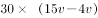=22······①。

而自行车30分钟比摩托车少走：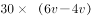······②。

联立①②式可得：(6v-4v)/(15v-4v)=4km。

故正确答案为B。

**考点**：普通行程

**来源**：2015年甘肃省公务员录用考试《行测》题第51题

### 第 52 题

从1、2、3、4、5中随机抽取3个数，问这3个数之和至少能被其中一个数整除的概率是多少？

A. 10%

B. 30%

C. 60%

D. 90%

第 52 题 · 答案与解析

**参考答案（粉笔题库参考内容）**

D

**解析**

根据题意可得，3个数求和的总的方法数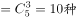；

抽取的三个数中只要含有1就能满足题干要求，共C_4^2=6种；

此时余下的4种分别为2，3，4；2，3，5；2，4，5；3，4，5，其中，2，3，5之和能被5整除，2，3，4之和能被3整除，3，4，5之和能被3整除，2，4，5之和不能被这三个数中的任意一个数整除，则余下的4种情况中符合题干条件的有3种，故符合要求的方法数=6+3=9种，

故抽取的3个数之和至少能被其中一个数整除的概率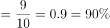。

故正确答案为D。

**考点**：给情况求概率

**来源**：2015年甘肃省公务员录用考试《行测》题第52题

### 第 53 题

某社区图书馆清点图书库存，发现拥有人文社科类图书数量是自然科学类图书的2倍，比儿童图书多15册，拥有的儿童图书是生活应用类图书的1/3，其他类图书76册，占所有图书的1/6，问该社区图书馆拥有自然科学图书多少册？

A. 32

B. 36

C. 40

D. 48

第 53 题 · 答案与解析

**参考答案（粉笔题库参考内容）**

C

**解析**

根据题意，假设人文社科类图书数量为2x册，则自然类为x册，儿童类为（2x－15）册，生活类为（6x-45）册，总的图书数量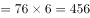册，故2x+x+2x-15+6x-45+76=456，解得x=40。

故正确答案为C。

**考点**：和差倍比问题

**来源**：2015年甘肃省公务员录用考试《行测》题第53题

### 第 54 题

杂货店打烊后，收银机中有1元、10元和100元的纸币共60张，问这些纸币的总面值可能为多少元？

A. 2100

B. 2400

C. 2700

D. 3000

第 54 题 · 答案与解析

**参考答案（粉笔题库参考内容）**

B

**解析**

方法一：假设100元为a张，10元为b张，则1元为60-a-b张。总面值=100a＋10b＋60－a－b=99a＋9b＋60=9(11a＋b)＋60元，即总面值－60=9(11a＋b)元，故总面值－60是9的倍数，代入选项，只有2400满足要求，B项当选。

方法二：根据四个选项的数值大小可知，100元的数量约为20~30张，“纸币共60张”，故30&lt;1元+10元的数量&lt;40。观察选项，尾数均为0，故1元的数量必须为10的倍数，才能满足尾数为0。假设1元有10张，10元有29张，则100元有21张，总面值=10+10×29+100×21=2400元，B项当选。

故正确答案为B。

**来源**：2015年甘肃省公务员录用考试《行测》题第54题

### 第 55 题

某班级有男生6名，女生4名，现以随机抽签的形式选取三人参加演讲比赛，问抽到一名男生两名女生的概率在以下哪个范围之内？

A. 25%-35%

B. 高于35%

C. 低于15%

D. 15%-25%

第 55 题 · 答案与解析

**参考答案（粉笔题库参考内容）**

A

**解析**

根据题意，班级总人数=6+4=10名，随机选三人参加比赛，。抽到一名男生两名女生的方法数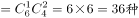，故抽到一名男生两名女生的概率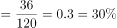，A项符合。

故正确答案为A。

**考点**：给情况求概率

**来源**：2015年甘肃省公务员录用考试《行测》题第55题

### 第 56 题

小张和小李两人一周共加工了195个零件，两人每天可以加工的零件数量分别是14个和16个，但如果两人一起工作，每天可以共完成33个，从周一到周日，每天两个人都至少有一人在工作，问这一周内有几天只有一个人在工作？

A. 1

B. 0

C. 3

D. 2

第 56 题 · 答案与解析

**参考答案（粉笔题库参考内容）**

D

**解析**

方法一：可以用盈亏的思路。假设一个星期7天，全部为两人合作，则可完成33×7=231个零件。但实际只完成195个，相差231－195=36个，即只有一人在工作所致。

若只有小张工作，每1天会相差33－14=19个；若只有小李工作，每1天会相差33－16=17个，36=19＋17，即恰好两人每人单独工作1天所致，故一周内有2天只有一人在工作。

方法二：由于合作的效率已知，且所求的单独工作的时间=7-合作天数，故可以从合作的天数入手采取代入排除法。

若合作7天，单独工作0天，则零件数=33×7=231>195个，排除；

若合作6天，单独工作1天，则零件数=33×6+单独工作零件数>198>195个，排除；

若合作5天，单独工作2天，则零件数=33×5+单独工作零件数=165+30=195个，而30恰好为14+16的和，即可推断出，小张和小李每人单独工作1天，共2天。

故正确答案为D。

**考点**：和差倍比问题

**来源**：2015年甘肃省公务员录用考试《行测》题第56题

### 第 57 题

A、B两地相距400米，早上8点小周和老王同时从A地出发在A、B两地间往返锻炼。小周每分钟跑200米，老王每分钟走80米，问8点11分，小周和老王之间的距离是多少米？

A. 0

B. 80

C. 120

D. 200

第 57 题 · 答案与解析

**参考答案（粉笔题库参考内容）**

C

**解析**

按照可得：小周的路程=200×11=2200米，A、B两地距离400米，，即共走了5个全程，余200米，故小周距离A、B两地都为200米；老王的路程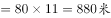，A、B两地距离400米，，即共走了2个全程，余80米，故老王距离A地80米。则两人之间的距离为200－80=120米。

故正确答案为C。

**考点**：普通行程

**来源**：2015年甘肃省公务员录用考试《行测》题第57题

### 第 58 题

某工厂新招了一百多名女工，为她们分配宿舍时发现若每间住6人则有一个房间少1人，若每间住7人则有一个房间只有1人住，问如果每个房间最多住4人的话，最少需要几个房间？

A. 26

B. 27

C. 28

D. 29

第 58 题 · 答案与解析

**参考答案（粉笔题库参考内容）**

D

**解析**

从提问入手根据，可得若要房间数最少，则每个房间人数尽量多，且总人数尽量少。

由“每个房间最多住4人”且每个房间人数尽量多，可得每个房间人数=4人。

由“每间住6人则有一个房间少1人”，可知总人数除以6余5；由“每间住7人则有一个房间只有1人住”，可知总人数除以7余1。可设总人数=6a+5=7b+1＞100人，且总人数需尽量小，故推出总人数=113人。

若每个房间住4人，共需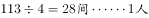，即共29间房。

故正确答案为D。

**考点**：非典型最值问题

**来源**：2015年甘肃省公务员录用考试《行测》题第58题

### 第 59 题

张大爷用20000元投资了一只股价为10元的股票，两周后股票价格跌到6元，此时张大爷又买入该股票若干，当股票价格涨到12元时张大爷卖出了所有股票。如不计税费的话，张大爷交易这只股票总计获利16000元，问张大爷第二次花了多少元买这只股票？

A. 6000

B. 9000

C. 12000

D. 18000

第 59 题 · 答案与解析

**参考答案（粉笔题库参考内容）**

C

**解析**

由题意可得：

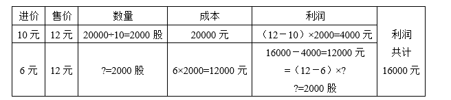

故正确答案为C。

**考点**：经济利润问题

**来源**：2015年甘肃省公务员录用考试《行测》题第59题

### 第 60 题

小王与父亲属相相同，小王的母亲比他父亲小4岁，某个蛇年小王的母亲年龄正好是小王的3倍（年龄按阴历年份计算，出生当年算0岁），则小王的属相可能是：

A. 蛇

B. 马

C. 羊

D. 猴

第 60 题 · 答案与解析

**参考答案（粉笔题库参考内容）**

C

**解析**

由题干“小王与父亲属相相同”可得两人年龄差为12X岁，由“小王的母亲比他父亲小4岁”可得，母亲与小王的年龄差为12X－4岁。又已知“某个蛇年小王的母亲年龄正好是小王的3倍”即两人年龄差：母－王=2王，由于两人年龄差不变，可得12X－4=2王，则小王在蛇年的年龄为6X－2岁，即4、10、16······小王对应的属相为牛、羊、牛，只有C项满足。

故正确答案为C。

注：①十二生肖的顺序为：鼠、牛、虎、兔、龙、蛇、马、羊、猴、鸡、狗、猪。

②也可按照最常见的情况考虑，小王和父亲的年龄差为12的倍数，即12、24、36······最常见的情况为相差24岁，代入计算即可。

**考点**：年龄问题

**来源**：2015年甘肃省公务员录用考试《行测》题第60题

### 第 61 题

甲乙丙丁戊己六个棋手进行单循环比赛（每人都与其他选手赛一场），已知第一轮甲的对手是丙，第二轮乙的对手是丁，第三轮丙的对手是戊，第四轮甲的对手是乙，那么第五轮己的对手是：

A. 甲

B. 乙

C. 丙

D. 戊

第 61 题 · 答案与解析

**参考答案（粉笔题库参考内容）**

A

**解析**

由题意可得，每人都与其他选手赛一场可以列出一个赛程表如下：数字表示第几轮两人比赛，且按照单循环的比赛规则，甲和其他五人比赛分别对应第1-5轮，故同一行和同一列的数字不能重复。按照题意：分别填入甲丙第一轮、乙丁第二轮、丙戊第三轮、甲乙第四轮。则可以推出乙丙不能等于1、3，也不能等于2、4，只能为5；丙丁不能为1、3、5和2，只能为4；依次类推，丙已=2；乙戊=1；乙己=3；甲己=5，则第五局己的对手为甲。

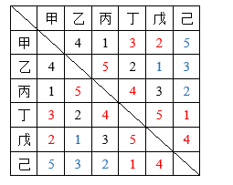

故正确答案为A。

**来源**：2015年甘肃省公务员录用考试《行测》题第61题

### 第 62 题

某班级共有50名学生，某次考试后发现，所考的三门课程得分优秀率分别为10%、20%和16%，三门不及格率分别为12%、18%和10%，问如果在该班任选一名学生，至少有一门课程得分优秀且至少有一门课程不及格的最大概率为多少？

A. 20%

B. 16%

C. 46%

D. 40%

第 62 题 · 答案与解析

**参考答案（粉笔题库参考内容）**

D

**解析**

方法一：设三门课程分别为A、B、C，总人数为50人，根据优秀率和不及格率可得，A、B、C三门课程为优秀的人数分别为5、10、8人；A、B、C三门课程为不及格的人数分别为6、9、5人；剩下的人为中等。

为了让所求概率最大，则让满足情况的人数最多，即优秀的人之间、不及格的人之间尽量不重复（避免出现一人多门课优秀的情况）。此时，优秀的人有5+10+8=23人，不及格的人有6+9+5=20人。

为让满足情况的可能性最大，则让不及格的学生每人都有一门科优秀，此时最多有20人能达到至少一门不及格且一门优秀情况，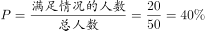。

方法二：至少有一门课程得分优秀的最大概率为：10%+20%+16%=46%，至少有一门课程不及格的最大概率为：12%+18%+10%=40%，故至少有一门课程优秀且至少有一门课程不及格的最大概率为：40%。

故正确答案为D。

**考点**：给情况求概率

**来源**：2015年甘肃省公务员录用考试《行测》题第62题

### 第 63 题

小张和小王从16楼下到1楼，小张走楼梯，每层楼有32级台阶，他每分钟能走80级。小王坐电梯，每上下1层用时10秒钟，每次开关门上下人共用时20秒钟，小张开始下楼的时候，小王乘坐的电梯刚下到16层，而在小王乘坐电梯下行的过程中，电梯又停下来上下人了5次。问小王坐的电梯到1层之后，还要等多长时间小张才能到1层？

A. 不到一分钟

B. 1-2分钟

C. 2-3分钟

D. 3-4分钟

第 63 题 · 答案与解析

**参考答案（粉笔题库参考内容）**

B

**解析**

由16楼下到1楼，共需下16－1=15层。所以小张用时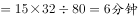；小王用时=15×10+20+5×20=270秒=4.5分钟，相差为1.5分钟。

故正确答案为B。

**来源**：2015年甘肃省公务员录用考试《行测》题第63题

### 第 64 题

有编号从1到5的5个箱子，将10个完全相同的小球放进5个箱子，要求每个箱子里必须有小球且数量不能超过箱子的编号，问符合要求的放小球的方法有多少种？

A. 21

B. 22

C. 23

D. 24

第 64 题 · 答案与解析

**参考答案（粉笔题库参考内容）**

B

**解析**

分情况讨论，由题意，每个箱子必须有小球且数量不能超过箱子编号，小球总数为10，可以推出以下几种情况：

小球数量组成为（1、1、1、2、5）：其中编号为1的箱子只能放1，5只能放在编号为5的箱子里，还剩（1、1、2），放入编号为2、3、4的箱子，有3种情况。

小球数量组成为（1、1、1、3、4）：其中编号为1的箱子只能放1，还剩（1、1、3、4）放在编号为2、3、4、5的箱子里，先放4，只能放入编号4和5，2种选择；再放3，只能放入编号3、4、5（其中编号4和5被占用一个），2种选择，共2×2=4种情况。

小球数量组成为（1、1、2、2、4）：其中编号为1的箱子只能放1，还剩（1、2、2、4）放入编号为2、3、4、5的箱子里，先放4，只能放入编号4和5，2种选择；再将（1、2、2）放入剩余的编号为2、3、4或者5的箱子里，3种选择，共2×3=6种情况。

小球数量组成为（1、1、2、3、3）：其中编号为1的箱子只能放1，还剩（1、2、3、3）放入编号为2、3、4、5的箱子里，先将（3、3）放入（3、4、5）中，即C_3^2=3种；再将（1、2）放入剩余2个箱子，2种，共3×2=6种情况。

小球数量组成为（1、2、2、2、3）其中编号为1的箱子只能放1，还剩（2、2、2、3）放入编号为2、3、4、5的箱子里，先将3放入（3、4、5）中，即C_3^1=3种；再将（2、2、2）放入剩余的箱子里，1种，共3种情况。

总计3+4+6+6+3=22种。

故正确答案为B。

**考点**：基础排列组合

**来源**：2015年甘肃省公务员录用考试《行测》题第64题

### 第 65 题

将2个棱长为30厘米的正方体木块的六面分别全涂成黑色后，都锯成棱长为10厘米的小正方体，问从这些小正方体中随机抽取出多少个，才能保证一定能够在取出的小立方体中挑出8个，拼成外表面全为黑色的，棱长为20厘米的正方体？

A. 27

B. 36

C. 40

D. 46

第 65 题 · 答案与解析

**参考答案（粉笔题库参考内容）**

D

**解析**

由题意，将1个棱长为30厘米的正方体木块的六面分别全涂成黑色后，都锯成棱长为10厘米的小正方体，共得到小正方体。其中在顶点的8个小正方体为三面黑、其余19个小正方体都不够三面黑。2个棱长为30厘米的正方体木块，即分成16个小正方体为三面黑、其余38个小正方体不够三面黑。而若拼成棱长为20厘米且外表面全为黑色的正方体，需要取出8个三面黑的小正方体，最不利的情况为：将38个不够三面黑的小正方体都取出后，再取出8个三面黑的小正方体，共46个。

故正确答案为D。

**考点**：几何公式类-立体图形、几何结论类-几何小题型、最不利构造

**来源**：2015年甘肃省公务员录用考试《行测》题第65题

### 第 66 题

从所给的四个选项中，选择最合适的一个填入问号处，使之呈现一定的规律性：

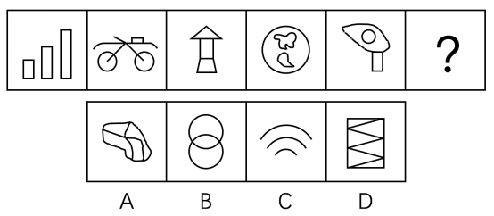

A. A

B. B

C. C

D. D

第 66 题 · 答案与解析

**参考答案（粉笔题库参考内容）**

B

**解析**

图形组成不同，且无明显的属性规律，优先考虑数量规律。题干中封闭空间较多，考虑数面，发现所有图形都是3个面，A项4个，B项3个，C项0个，D项6个。

故正确答案为B。

**考点**：数量规律-面

**来源**：2015年甘肃省公务员录用考试《行测》题第66题

### 第 67 题

从所给的四个选项中，选择最合适的一个填入问号处，使之呈现一定的规律性：

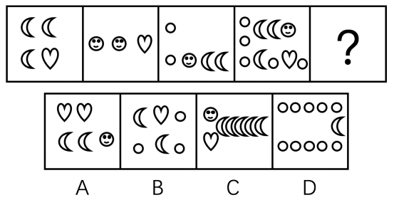

A. A

B. B

C. C

D. D

第 67 题 · 答案与解析

**参考答案（粉笔题库参考内容）**

C

**解析**

图形均由小元素构成，考虑数素。元素个数分别为4、3、5、10，各元素种类分别为2、2、3、4，个数和种类均没有规律。观察题干与选项发现，所有元素主要是按列排布，且列的数量逐渐增多，分别为2、3、4、5、？，故？处应为6列元素。

故正确答案为C。

**考点**：数量规律-素

**来源**：2015年甘肃省公务员录用考试《行测》题第67题

### 第 68 题

从所给的四个选项中，选择最合适的一个填入问号处，使之呈现一定的规律性：

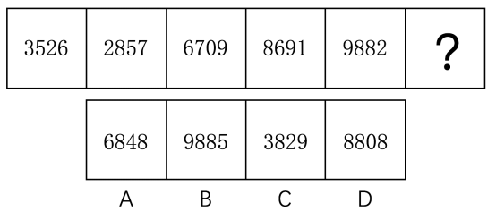

A. A

B. B

C. C

D. D

第 68 题 · 答案与解析

**参考答案（粉笔题库参考内容）**

A

**解析**

元素组成不同，且无明显属性规律，优先考虑数量规律。观察发现，题干图形均由数字组成，且6、8、9出现频率较多，均有封闭空间，可以优先考虑数面。题干每幅图中数字的面数量之和依次为1、2、3、4、5，故？处图形的面数量之和应为6，只有A项符合。

故正确答案为A。

**考点**：数量规律-面、文字/字母/数字类

**来源**：2015年甘肃省公务员录用考试《行测》题第68题

### 第 69 题

从所给的四个选项中，选择最合适的一个填入问号处，使之呈现一定的规律性：

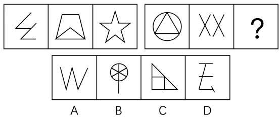

A. A

B. B

C. C

D. D

第 69 题 · 答案与解析

**参考答案（粉笔题库参考内容）**

D

**解析**

图形组成不同，属性无明显规律，考虑数量规律。前组图均为直线图形，优先考虑直线数，前组图的直线数为4、6、10，后组图的直线数为3、4、？，？处应选择直线数为7的图形，但选项无答案。再次观察发现，出现了很多构造角的图形，且锐角明显，考虑数锐角数，前组图锐角数为3、4、5，后组图锐角数为3、4、？，则？处应选择锐角数为5的图形。选项中的锐角数分别为：A项3个，B项6个，C项4个，D项5个。只有D项符合规律。

故正确答案为D。

**考点**：数量规律-角

**来源**：2015年甘肃省公务员录用考试《行测》题第69题

### 第 70 题

从所给的四个选项中，选择最合适的一个填入问号处，使之呈现一定的规律性：

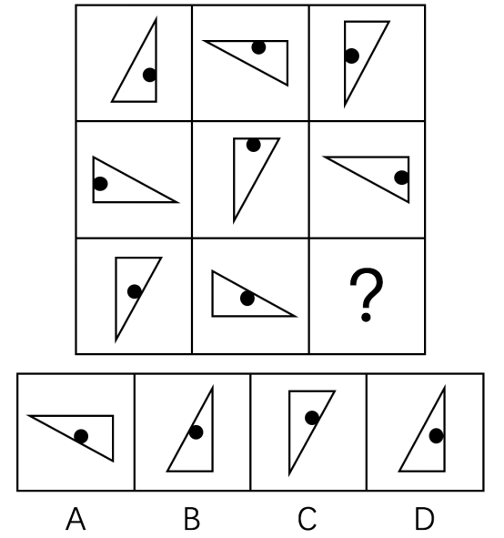

A. A

B. B

C. C

D. D

第 70 题 · 答案与解析

**参考答案（粉笔题库参考内容）**

B

**解析**

元素组成相同，考虑位置规律。观察题干发现，第一行的图形依次逆时针旋转90度得到下一个图形，第二行的图形依次顺时针旋转90度得到下一个图形，第三行的图形依次逆时针旋转90度得到下一个图形，因此？处图形应通过第三行的第二个图形逆时针旋转90度得到，只有B项符合规律。

故正确答案为B。

**考点**：位置规律-旋转

**来源**：2015年甘肃省公务员录用考试《行测》题第70题

### 第 71 题

从所给的四个选项中，选择最合适的一个填入问号处，使之呈现一定的规律性：

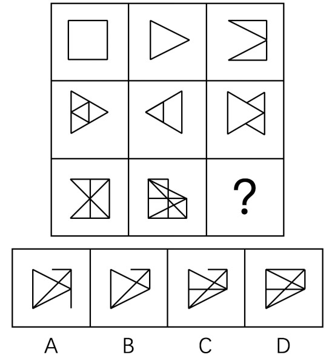

A. A

B. B

C. C

D. D

第 71 题 · 答案与解析

**参考答案（粉笔题库参考内容）**

C

**解析**

图形组成相似，线条重复出现，考虑样式规律中的运算。发现每一行的前两个图形去同存异得到第三个图形，则？处也应符合此规律，正方形顶边左半部分应去除，排除D项，正方形横向的中线应存在，排除A、B两项。

故正确答案为C。

**考点**：样式规律-加减同异

**来源**：2015年甘肃省公务员录用考试《行测》题第71题

### 第 72 题

以下去掉哪一项之后，剩下的图形呈现一定的规律性？

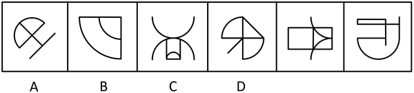

A. A

B. B

C. C

D. D

第 72 题 · 答案与解析

**参考答案（粉笔题库参考内容）**

A

**解析**

解法一：

图形组成不同，且题干中图形出现了单独的直线或曲线，优先考虑线数量。观察发现，题干中图形的直线数量分别为3、2、3、4、5、6，去掉A项后，剩余图形的直线数依次递增。

故正确答案为A。

解法二：

元素组成不同，优先考虑属性规律。观察发现，题干图形中，仅有图2为全封闭图形，其余图形则均为半开半闭图形，去掉B项后，剩余图形均为半开半闭图形。

故正确答案为B。

注：因为出现明显的单独线条，线数量的考频较高，且数依次递增的规律最为严谨，故小粉笔本题更倾向于解法一。

**考点**：属性规律-开闭性、数量规律-线

**来源**：2015年甘肃省公务员录用考试《行测》题第72题

### 第 73 题

以下4个立体图形，哪一个与另外3个不同？

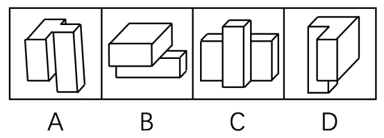

A. A

B. B

C. C

D. D

第 73 题 · 答案与解析

**参考答案（粉笔题库参考内容）**

D

**解析**

4个立体图形可以视为2个长方体拼合而成，A、B、C中，一个长方体在另一个长方体中间；D中，一个长方体在另一个长方体一侧。

故正确答案为D。

**来源**：2015年甘肃省公务员录用考试《行测》题第73题

### 第 74 题

把下面的六个图形分为两类，使每一类图形都有各自的共同特征或规律，分类正确的一项是：

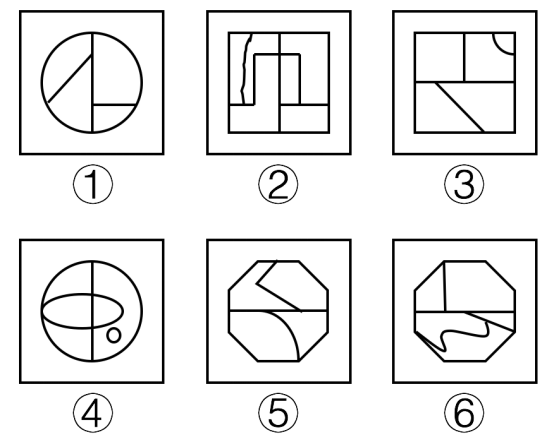

A. ①②③，④⑤⑥

B. ①②④，③⑤⑥

C. ①③⑥，②④⑤

D. ①④⑥，②③⑤

第 74 题 · 答案与解析

**参考答案（粉笔题库参考内容）**

B

**解析**

图形组成不同，且属性和数量均无明显规律，发现每个图形都存在一条中线将图形一分为二，考虑中线的规律，发现①②④的中线均为竖线，③⑤⑥的中线均为横线。

故正确答案为B。

**考点**：数量规律-线

**来源**：2015年甘肃省公务员录用考试《行测》题第74题

### 第 75 题

把下面的六个图形分为两类，使每一类图形都有各自的共同特征或规律，分类正确的一项是：

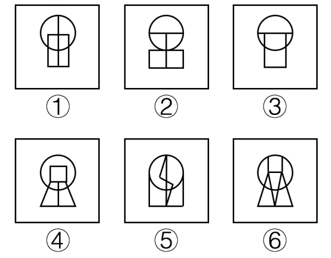

A. ①②③，④⑤⑥

B. ①④⑤，②③⑥

C. ①⑤⑥，②③④

D. ①③⑥，②④⑤

第 75 题 · 答案与解析

**参考答案（粉笔题库参考内容）**

C

**解析**

图形组成不同，且属性无明显规律，考虑数量规律。出现的直线数量较多，优先数直线，分别为5、6、4、8、7、8，没有规律，发现图1中有日字变形，考虑数笔画，奇点数分别为2、4、4、4、2、2，①⑤⑥为一组，为一笔画图形；②③④为一组，为两笔画图形。

故正确答案为C。

**考点**：数量规律-线

**来源**：2015年甘肃省公务员录用考试《行测》题第75题

### 第 76 题

“黑匣子”的学名叫做“航空飞行记录器”。之所以被称为“黑匣子”，并不是因为它是黑色的，而是因为它能帮助破解飞行事故的秘密。黑匣子里面装有飞行数据记录器和枪声录音器两套装置，能把飞机停止工作或失事航班前半个小时的有关技术参数和驾驶舱内的声音记录下来。需要时，它可以把所记录的参数重新放出来，供飞行试验和事故分析所用。

根据上述定义，下列装置属于“黑匣子”的是：

A. 飞机上某个黑色匣子，在发生事故的同时启动，并记录相关信息

B. 在火车上的某种黑色装置，能自动记录到列车运行的相关信息

C. 民用航空器中的一种红色装置，信息能单项输入，但无法解读或输出

D. 战斗机上的一种橘红色设备，能记录相关飞行数据并可进行分析还原

第 76 题 · 答案与解析

**参考答案（粉笔题库参考内容）**

D

**解析**

第一步：找出定义关键词。

关键词为“航空飞行记录器”、“飞机停止工作或失事航班前半个小时的有关技术参数和驾驶舱内的声音记录下来”、“记录的参数重新放出来，供飞行试验和事故分析所用”。

第二步：逐一分析选项。

A项：在发生事故的同时启动并记录与“飞机停止工作或失事前半小时”不同，不符合定义，排除；

B项：火车不能进行航空飞行，不符合定义关键词“航空飞行记录器”，不符合定义，排除；

C项：信息单向输入，无法解读或输出不符合定义关键词“记录的参数重新放出来，供飞行试验和事故分析所用”，不符合定义，排除；

D项：战斗机上的记录设备符合定义关键词“航空飞行记录器”，能记录相关飞行数据符合定义关键词“飞机停止工作或失事航班前半个小时的有关技术参数和驾驶舱内的声音记录下来”，进行分析还原符合定义关键词“记录的参数重新放出来，供飞行试验和事故分析所用”，符合定义，当选。

故正确答案为D。

**考点**：大前提

**来源**：2015年甘肃省公务员录用考试《行测》题第76题

### 第 77 题

地震预警，是指在地震发生后，利用地震波传播速度小于电波传播速度的特点，提前对地震波尚未到达的地方进行预警。地震预报则是对尚未发生但可能发生的地震进行事先推测。

根据上述定义，下列说法正确的是（    ）。

A. 地震之前动物的反常反应，如鸡飞狗叫等，可以作为地震预警

B. 甲地刚发生五级地震，地震预警机制可以提前通知相邻的乙地做撤散准备

C. 越是地面运动强烈的极震区，能提供预报的时间就越短，越依赖震前预报和震中预警

D. 地下水水位的涨落、水井翻花冒泡等异常现象是地震预报的信号

第 77 题 · 答案与解析

**参考答案（粉笔题库参考内容）**

D

**解析**

第一步：找出定义关键词。

地震预警关键词为“地震发生后”“提前对地震波尚未到达的地方进行预警”。

地震预报关键词为“尚未发生但可能发生的地震”。

第二步：逐一分析选项。

A项：地震之前对应地震预报的关键词“尚未发生但可能发生的地震”，属于地震预报，而非地震预警，排除；

B项：甲地与乙地相邻，甲地乙地大小地理位置等均未知，地震预警机制是否用了题干的速度差原理不明确，排除；

C项：越是地面运动强烈的极震区，极震区地震发生，考虑地震预警，选项中为能提供预报的时间就越短表述错误，是能提供预警的时间就越短，同时，此种地区较依赖震前预报，不太依赖震中预警，排除；

D项：地下水水位的涨落、水井翻花冒泡等异常现象均是发生在地震发生之前，符合地震预报的关键词“尚未发生但可能发生的地震”，属于地震预报，当选。

故正确答案为D。

**考点**：特殊问法

**来源**：2015年甘肃省公务员录用考试《行测》题第77题

### 第 78 题

商品商标是指由文字、图形或者其组合构成，使用于商品，用以区别不同经营者所生产或经营的同一类或类似商品的专利标记，其识别对象是一般商品。

根据上述定义，下列属于商品商标的是：

A. 中国民用航空局的CAAC标志

B. 中国银联的标志

C. 中国人保的PICC标志

D. 长虹电视上的“长虹”标志

第 78 题 · 答案与解析

**参考答案（粉笔题库参考内容）**

D

**解析**

第一步：找出定义关键词。

关键词为“一般商品”。

第二步：逐一分析选项。

A项：中国民用航空局是国务院主管民用航空事业的由部委管理的国家局，不是具体的一般物，不符合定义关键词“一般商品”，排除；

B项：中国银联是中国人民银行批准设立的中国银行卡联合组织，不是具体的一般物，不符合定义关键词“一般商品”，排除；

C项：中国人保是中国人民保险集团公司发起设立的财产保险公司，不是具体的一般物，不符合定义关键词“一般商品”，排除；

D项：长虹电视属于“一般商品”，因此其“长虹”标志属于商品商标，符合定义，当选。

故正确答案为D。

**考点**：拆词

**来源**：2015年甘肃省公务员录用考试《行测》题第78题

### 第 79 题

错觉是一种视觉误差，是人们观察物体时，由于物体受到形、光、色的干扰，加上人们生理、心理原因而误认物象，会产生与实际不符的判断。

根据上述定义，下列不属于错觉的是：

A. 一个突然失去儿子的母亲，有时觉得自己看到了儿子的身影

B. 坐在行驶的火车上看车窗外的树木时，会以为树木在移动

C. 身材偏胖的人穿竖条纹服装会显得苗条一些

D. 杯弓蛇影

第 79 题 · 答案与解析

**参考答案（粉笔题库参考内容）**

A

**解析**

第一步，找出定义关键词。

关键词为“人们观察物体时”，“受到干扰”，“误认物象”。

第二步，逐一分析选项。

A项：失去儿子的母亲有时觉得自己看到了儿子的身影，没有体现母亲是否在观察物体，不符合定义关键词“人们观察物体时”，不属于错觉，当选；

B项：看车窗外的树木符合定义关键词“人们观察物体时”，同时受火车行驶的影响符合关键词“受到干扰”，实际上树木没有在移动，而认为在动，符合关键词“误认物象”，属于错觉，排除；

C项：身材偏胖的人穿竖条纹服装会显得苗条一些是人们看到身材偏胖的人时候产生的，符合定义关键词“人们观察物体时”，偏胖之所以会显得苗条，是因为受到了衣服条纹的影响，符合关键词“受到干扰”，偏胖终究是偏胖，而显得苗条则符合关键词“误认物象”，属于错觉，排除；

D项：杯弓蛇影是一个典故，出自应劭《风俗通义·怪神》，应郴请杜宣饮酒，挂在墙上的弓映在酒杯里，杜宣以为杯中有蛇，疑心喝下了蛇，心忧而病，应郴听说杜宣生病后来看望杜宣，杜宣看到墙上的弓后病就好了，属于将弓误认为蛇，符合定义关键词“人们观察物体时”，“受到干扰”，“误认物象”，属于错觉，排除。

本题为选非题，故正确答案为A。

**考点**：拆词

**来源**：2015年甘肃省公务员录用考试《行测》题第79题

### 第 80 题

谷堆悖论是指一粒谷子不是谷堆，两粒谷子不能形成谷堆，再加一粒谷子也不能形成谷堆，如果每次只加一粒谷子，而每粒谷子都不能成为谷堆，以此类推，多少粒谷子都不能形成谷堆。

根据上述定义，下列不属于“谷堆悖论”的是：

A. 丢弃一粒米不算浪费，成年累月地丢弃也不算浪费

B. 一个人掉了一根头发不会秃头，一根根掉下去也不算秃

C. 捐给乞丐一元钱他不会成为富人，每天捐给他一元钱也不会成为富人

D. 一滴水滴在石头上，石头没有变化，一滴滴不断滴下去，石头也不会有变化

第 80 题 · 答案与解析

**参考答案（粉笔题库参考内容）**

C

**解析**

第一步：找出定义关键词。

关键词为“每粒谷子都不能成为谷堆，以此类推，多少粒谷子都不能形成谷堆”，意思是随着次数的增加，只存在量上的增加；但实际上谷子会形成谷堆，即量变最终会引起质变。

第二步：逐一分析选项。

A项：“成年累月”说明丢弃米的次数是一直增加的，“不算浪费”说明只存在量上的增加；但实际上丢掉的米多了就成了浪费，量变最终会引起质变，与定义关键词相符，符合定义，排除；

B项：“一根根掉下去”说明头发掉的次数是一直增加的，“不算秃”说明只存在量上的增加；但实际上头发掉完之后就成了秃头，量变最终会引起质变，与定义关键词相符，符合定义，排除；

C项：“每天给乞丐一元钱”说明钱的数量是一直增加的，“不会成为富人”说明只存在量上的增加；而根据人的寿命来说，乞丐一天得到一元钱并不足以成为富人，这里的量变不会引起质变，与定义关键词不相符，不符合定义，当选；

D项：“一滴滴不断滴下去”说明滴水的次数是一直增加的，“石头没有变化”说明只存在量上的增加；但实际上水滴石穿，量变最终会引起质变，与定义关键词相符，符合定义，排除。

本题为选非题，故正确答案为C。

**考点**：故事类

**来源**：2015年甘肃省公务员录用考试《行测》题第80题

### 第 81 题

赌徒谬论是指倾向于以为随机序列中一个事件发生的机率会与之前发生的事件有关，即其发生的机率会随着之前没有发生该事件的次数而上升。

根据上述定义，下列不属于赌徒谬论的是：

A. 多次抛出硬币反面朝上之后，会倾向于认为下一次出现正面的机会较大

B. 连续购买几期彩票均未中奖，就觉得下一次再买可能就会中了

C. 连着吃到几个坏瓜子之后，认为下一个吃到的很可能是个好瓜子

D. 古人常在干旱很久之后开始祭祀，祈祷接下来会很快下雨

第 81 题 · 答案与解析

**参考答案（粉笔题库参考内容）**

D

**解析**

第一步：找出定义关键词。

“随机序列中一个事件”、“发生的机率”、“随着之前没有发生该事件的次数而上升”。

第二步：逐一分析选项。

A项：之前抛硬币都是反面朝上，没有出现正面朝上，那么倾向于下次出现正面符合关键词“随着之前没有发生该事件的次数而上升”，符合定义，排除；

B项：之前买彩票都没有中奖，那么觉得下次可能会中奖符合关键词“随着之前没有发生该事件的次数而上升”，符合定义，排除；

C项：之前吃瓜子都是吃到坏的没有吃到好的，认为下一个吃到的很可能是个好瓜子符合关键词“随着之前没有发生该事件的次数而上升”，符合定义，排除；

D项：祭祀是一种希望，且祈祷行为与概率无关，显然不符合定义的关键词，不符合定义，当选。

本题为选非题，故正确答案为D。

**考点**：单定义-其他句式

**来源**：2015年甘肃省公务员录用考试《行测》题第81题

### 第 82 题

反对关系是两个概念之间的一种关系，指的是两个概念所反映的对象之间没有共同的分子。并且还存在一些对象在这两个概念所反映的对象之外。

根据上述定义，以下哪项中的两个概念是反对关系？

A. 合理，不合理

B. 物质文化遗产，非物质文化遗产

C. 红色，蓝色

D. 生物，非生物

第 82 题 · 答案与解析

**参考答案（粉笔题库参考内容）**

C

**解析**

第一步：找出定义关键词。

“反映的对象之间没有共同的分子”、“还存在一些对象在这两个概念所反映的对象之外”。

第二步：逐一分析选项。

A项：合理和不合理是矛盾关系，两个概念之外不存在其他对象，不符合关键词“还存在一些对象在这两个概念所反映的对象之外”，不符合定义，排除；

B项：物质文化遗产和非物质遗产是矛盾关系，两个概念之外不存在其他对象，不符合关键词“还存在一些对象在这两个概念所反映的对象之外”，不符合定义，排除；

C项：红色和蓝色之间没有共同的分子，这两个概念之外还存在其他的颜色，符合定义，当选；

D项：生物和非生物是矛盾关系，两个概念之外不存在其他对象，不符合关键词“还存在一些对象在这两个概念所反映的对象之外”，不符合定义，排除。

故正确答案为C。

**考点**：大前提

**来源**：2015年甘肃省公务员录用考试《行测》题第82题

### 第 83 题

规范性决策是指决策者在解决一般性问题时，依据长期处理此类问题的经验迅速做出决定的过程。

根据上述定义，以下哪项属于规范性决策：

A. 部门经理统一了大家关于绩效管理的意见，整理成可行性报告呈交给上级主管

B. 年终工作汇报时，张总按照几年来的惯例给不能回家过年的员工双倍加班费

C. 在考虑公司是否并购这一重大决定时，董事会借鉴了十年前的重组经验做出了决定

D. 新任的财务部部长开展工作时，沿袭了前任部长移交的管理总则和具体实施办法

第 83 题 · 答案与解析

**参考答案（粉笔题库参考内容）**

B

**解析**

第一步：找出定义关键词。

“解决一般性问题时依据长期处理此类问题的经验迅速做出决定”。

第二步：逐一分析选项。

A项：部门经理统一大家的意见后整理成可行性的报告不符合关键词“依据长期处理此类问题的经验做出决定”，不符合定义，排除；

B项：张总按照几年来的惯例给不能回家过年的员工双倍加班费，符合关键词“依据长期处理此类问题的经验做出决定”，符合定义，当选；

C项：董事会虽然是借鉴了十年前的重组经验做出了决定，但是并购不是一般性问题，属于重大决定，不符合定义，排除；

D项：新任部长是沿袭了前任部长移交的办法来开展工作，不符合关键词“依据长期处理此类问题的经验做出决定”，不符合定义，排除。

故正确答案为B。

**考点**：大前提

**来源**：2015年甘肃省公务员录用考试《行测》题第83题

### 第 84 题

强迫交易罪，是指以暴力、威胁手段强卖商品、强迫他人提供服务或者强迫他人接受服务，情节严重的行为。敲诈勒索罪是指以非法占有为目的，对被害人使用威胁或要挟的方法，强行索要公私财物的行为。

根据上述定义，下列最有可能构成敲诈勒索罪的是：

A. 李某为美容院老板，以免费美容的方式招揽顾客，但却要求顾客支付高价的美容师“服务费”，当顾客提出质疑或拒不支付时，即逼迫顾客押手机或身份证，或安排人跟着顾客去取钱

B. 黄某为酒吧经营者，赵某在酒吧消费时，黄某认为赵某是有钱人，就以高价向其出售假洋酒，赵某认为价格不合理，提出要报警，黄某对赵某实施了殴打，并强行索要钱财

C. 王某为某粮食加工企业负责人，雇佣了一批社会闲散人员，以暴力相恐吓，采用打白条的方式强行“收购”当地农民的粮食

D. 某水泥厂一直雇用当地村民从事装卸工作，后因劳务费问题与村民发生纠纷，重新雇用了一批外来装卸工。村民遂在水泥厂门口设卡，强行对进出大门运送货物的车辆进行装卸，并向驾驶员收取装卸费

第 84 题 · 答案与解析

**参考答案（粉笔题库参考内容）**

C

**解析**

第一步：找出定义关键词。

“以非法占有为目的，使用威胁或要挟的方法，强行索要公私财物的行为”。

第二步：逐一分析选项。

A项：李某的行为是强迫顾客支付高价的美容师“服务费”，并不是以非法占有为目的，不符合定义，排除；

B项：黄某对赵某实施殴打是因为赵某不支付酒钱要报警，其目的不是非法占有，不符合定义，排除；

C项：王某雇佣社会闲散人员以打白条的方式强行“收购”农民粮食，打白条其实是不付钱，属于非法占有，符合定义，当选；

D项：村民在水泥厂门口设卡，强行对货物进行装卸并收取装卸费，不属于非法占有，不符合定义，排除。

故正确答案为C。

**考点**：常规问法

**来源**：2015年甘肃省公务员录用考试《行测》题第84题

### 第 85 题

机会成本是指做一个选择后丧失的不做该选择而可能获得的最大利益。可以理解为把一定资源投入某一用途后所放弃的在其他用途中所能获得的最大利益。

根据上述定义，下列关于机会成本叙述正确的是：

A. 小张免费获得一张甲明星演唱会的门票，这张门票无法转售。同时，乙明星的演唱会也在同一时间举行，小张也很想去。乙明星演唱会售价80元。其他时候也可以去看乙的演唱会。而小张的心理承受价格为100元，如果去看甲演唱会，小张损失的机会成本是80元

B. 农民土地资源有限，只能养一种家禽或家畜，如果养猪可以获得9万元，养鸡可以获得7万元，养鸭可以获得8万元，那么养鸡的机会成本要比养猪和养鸭高

C. 投资者王某可以选择股票和储蓄存款两种投资方式。他于1999年9月1日用1万元购进某种股票，经过一年的操作，到2000年9月1日，投资股票的净收益为450元。如果当时他将这1万元存入银行，一年期定期储蓄存款的年利率为2.25%，扣除利息税，则有180元的实际利息净收益。若考虑机会成本，王某的实际收益为270元

D. 李某有一所海边的别墅，如果出租的话可以每月收入1万元，李某因为每年暑假都要去那居住两个月，所以一直没有出租，那么李某这么做的机会成本是12万元

第 85 题 · 答案与解析

**参考答案（粉笔题库参考内容）**

C

**解析**

第一步：找出定义关键词。

“一个选择后丧失的不做该选择而可能获得的最大利益”。

第二步：逐一分析选项。

A项：小张去看甲的演唱会，唯一必须牺牲的是不去看乙的演唱会，那么就会错失价值100元的表演，但同时也省下了买乙演唱会门票所需支付的80元。 因此如果去看甲的演唱会，小张损失的机会成本是100-80=20元，而不是该项中的80元，排除；

B项：农民养鸡的机会成本和养鸭的机会成本均为9万元（养猪的收益），农民养猪的机会成本为8万元（注：此处涉及常识，被舍弃选项中的最高价值是本次决策的机会成本），因此养鸡的机会成本并不比养鸭的机会成本高，排除；

C项：王某投资股票的净收益为450元，投资股票而放弃储蓄存款的机会成本为180元，若考虑机会成本，王某的实际收益应为450-180=270元，当选；

D项：李某因居住而不出租别墅，李某这么做每年的机会成本是12万元，但该项中并没有对于时间的限制，因此机会成本的具体金额不明确，排除。

故正确答案为C。

**考点**：大前提

**来源**：2015年甘肃省公务员录用考试《行测》题第85题

### 第 86 题

道德：行为

A. 制度：腐败

B. 价值：价格

C. 法律：权利

D. 合同：公正

第 86 题 · 答案与解析

**参考答案（粉笔题库参考内容）**

C

**解析**

第一步：判断题干词语间的逻辑关系。

道德的根本目的就是约束行为。

第二步：判断选项词语间的逻辑关系。

A项：制度的目的是防止腐败，但防止腐败不是制度的根本目的，与题干逻辑关系不一致，排除；

B项：价格是价值的货币表现，价格的变动不一定反映价值的变动，与题干逻辑关系不一致，排除；

C项：法律的根本目的是保障权利，与题干逻辑关系一致，当选；

D项：合同和公正没有必然的逻辑关系，与题干逻辑关系不一致，排除。

故正确答案为C。

**考点**：逻辑关系-对应关系

**来源**：2015年甘肃省公务员录用考试《行测》题第86题

### 第 87 题

鸿雁：书信

A. 江湖：社会

B. 汗青：史书

C. 同窗：朋友

D. 战争：烽烟

第 87 题 · 答案与解析

**参考答案（粉笔题库参考内容）**

B

**解析**

第一步：判断题干词语间的逻辑关系。

鸿雁是一种鸟类，在古代可以指代书信，二者为比喻象征关系。

第二步：判断选项词语间的逻辑关系。

A项：江湖的本意是指广阔的江河、湖泊，后衍生出与河流、湖泊并无关系，不是一个实际存在的场所，也泛指古时不接受当权控制指挥和法律约束而适性所为的社会环境；社会指在特定环境下形成的个体间的存在关系的总和，社会包含了江湖的衍生义，为包容关系，与题干逻辑关系不一致，排除；

B项：古时在竹简上记事，先以火烤青竹，使水分如汗渗出，再刮去青皮，便于书写，避免虫蛀，故称汗青，汗青可以指代史书，二者为比喻象征关系，与题干逻辑关系一致，当选；

C项：同窗指同学，与朋友不是比喻象征关系，与题干逻辑关系不一致，排除；

D项：烽烟在古代可以指代战争，但是二者顺序和题干相反，与题干逻辑关系不一致，排除。

故正确答案为B。

**考点**：逻辑关系-全同关系

**来源**：2015年甘肃省公务员录用考试《行测》题第87题

### 第 88 题

杂志：书刊：阅读

A. 铅笔：文具：书写

B. 轿车：火车：运输

C. 绘画：艺术：欣赏

D. 篮球：运动：投掷

第 88 题 · 答案与解析

**参考答案（粉笔题库参考内容）**

C

**解析**

第一步：判断题干词语间的逻辑关系。

杂志是书刊的一种，二者为包容关系中的种属关系，杂志的功能是被人阅读，二者为功能的对应关系。

第二步：判断选项词语间的逻辑关系。

A项：铅笔是文具的一种，二者为包容关系中的种属关系，铅笔的功能是书写，不是被书写，与题干逻辑关系不一致，排除；

B项：轿车和火车都是交通工具，二者为并列关系，与题干逻辑关系不一致，排除；

C项：绘画是艺术的一种，二者为包容关系中的种属关系，绘画可以被人欣赏，二者为功能的对应关系，与题干逻辑关系一致，当选；

D项：篮球是运动的一种，二者为包容关系中的种属关系，篮球的功能不是投掷，与题干逻辑关系不一致，排除。

故正确答案为C。

**考点**：逻辑关系-包容关系、逻辑关系-对应关系

**来源**：2015年甘肃省公务员录用考试《行测》题第88题

### 第 89 题

旅记对于（    ）相当于（    ）对于爱情

A. 古迹 历史

B. 景物 诗歌

C. 散文 感情

D. 旅行 传记

第 89 题 · 答案与解析

**参考答案（粉笔题库参考内容）**

B

**解析**

逐一代入选项。

A项：旅记中可能记录的有古迹，历史和爱情没有必然的逻辑关系，前后逻辑关系不一致，排除；

B项：旅记记录景物，诗歌记录爱情，二者均为对应关系，前后逻辑关系一致，当选；

C项：有的旅记是散文，有的旅记不是散文，二者为交叉关系；爱情是感情的一种，二者为包容关系中的种属关系，前后逻辑关系不一致，排除；

D项：旅记是对旅行的记录，传记和爱情没有必然的逻辑关系，前后逻辑关系不一致，排除。

故正确答案为B。

**考点**：逻辑关系-对应关系

**来源**：2015年甘肃省公务员录用考试《行测》题第89题

### 第 90 题

惜墨如金 对于（）相当于（）对于 安居乐业

A. 废话连篇 流离失所

B. 言简意赅 颠沛流离

C. 连篇累牍 颠沛流离

D. 拖泥带水 海晏河清

第 90 题 · 答案与解析

**参考答案（粉笔题库参考内容）**

C

**解析**

逐一代入选项。

A项：惜墨如金指爱惜墨就像金子一样，不轻易下笔，废话连篇形容文章或言谈中不必要的话太多，前者说的是篇幅精简，后者说的是内容多余，二者没有必然联系；流离失所指流转离散，没有安身的地方，安居乐业形容人民生活安定美满的样子，比喻安定地生活，愉快地工作，二者为反义关系，前后逻辑关系不一致，排除；

B项：言简意赅形容言语简练而意思完整，和惜墨如金是近义关系；颠沛流离指生活艰难，四处流浪，和安居乐业是反义关系，前后逻辑关系不一致，排除；

C项：连篇累牍形容篇幅过多，文辞冗长，和惜墨如金是反义关系；颠沛流离指生活艰难，四处流浪，和安居乐业是反义关系，前后逻辑关系一致，当选；

D项：拖泥带水形容在泥泞道路上行走的状貌，比喻办事拖沓不爽快或语言不简明扼要，和惜墨如金是反义关系；海晏河清，晏：平静，黄河水清了，大海没有浪了，比喻天下太平，和安居乐业是近义关系，前后逻辑关系不一致，排除。

故正确答案为C。

**考点**：语义关系-反义关系

**来源**：2015年甘肃省公务员录用考试《行测》题第90题

### 第 91 题

随着手机网络技术的发展，多数手机可以连接上网，其中一些手机可以进行交水电费、还信用卡、网上购物等网络交易。

由此可以推出：

A. 甲型号手机具有连接上网的功能，所以可以网上购物

B. 乙型号手机能够交水电费，所以具备联网功能

C. 丙型号手机不能进行网络交易，所以不具备联网功能

D. 丁型号手机能够进行网上购物，所以可以还信用卡

第 91 题 · 答案与解析

**参考答案（粉笔题库参考内容）**

B

**解析**

第一步：翻译题干。

题干可以翻译为：手机进行交水电费、还信用卡、网上购物等网络交易→手机可以连接上网（即具备联网功能）。

第二步：逐一分析选项。

A项：翻译为连接上网→网上购物，属于肯定后件，肯后得不到确定性的结论，排除；

B项：翻译为交水电费→具备联网功能，与题干相同，当选；

C项：翻译为—网络交易→—联网功能，属于否定前件，否前得不到确定性的结论，排除；

D项：翻译为网上购物→还信用卡，题干中二者是并列关系，没有前后的推导关系，推不出，排除。

故正确答案为B。

**考点**：集合推理

**来源**：2015年甘肃省公务员录用考试《行测》题第91题

### 第 92 题

下班骑自行车回来的妻子在门口对丈夫说：“已经是春天了，可是外面还是蛮冷的。”丈夫答道：“今天温度已经不是零下了，怎么还冷呢？”妻子说：“反正感觉比较冻脸。”

以下哪项是上述对话中丈夫所假设的？

A. 春天里人不应该感觉冷

B. 人的感觉是靠不住的，只有温度计是客观的

C. 春天到了，气温不应该在零度以下

D. 人是否感觉到冷是以零度为界限的

第 92 题 · 答案与解析

**参考答案（粉笔题库参考内容）**

D

**解析**

第一步：找出论点和论据。

论点：不会感觉冷。

论据：今天温度已经不是零下了。

论点强调不会感觉冷，论据强调温度不是零下，论点和论据之间存在跳跃，没有明显的因果关系，需要在二者间搭桥来加强论证。

第二步：逐一分析选项。

A项：选项论述季节与体感的关系，与丈夫的对话无关，不是对话中丈夫的假设条件，属于无关选项，排除；

B项：说明人的感觉不能说明温度，温度的来源只有温度计靠得住，选项只说明了温度的来源，没有提及到底冷不冷，属于无关选项，排除；

C项：选项只说明了春天的温度如何，没有提及到底冷不冷，属于无关选项，排除；

D项：在温度与感觉到冷之间进行搭桥，加强论证，当选。

故正确答案为D。

**考点**：搭桥

**来源**：2015年甘肃省公务员录用考试《行测》题第92题

### 第 93 题

澳大利亚研究者研制出一种计算机芯片，他们在一种失明者的大脑视觉皮层中植入该计算机芯片，并将芯片与一副眼镜建立无线连接，借助该眼镜，失明者可看到外界的事物。芯片处理信息需要持续的电量来提供动力，因而大脑中需要植入相当数量的电极。据此，研究者认为这种计算机芯片是能够帮助失明者恢复视觉能力的。

以下哪项是研究者作出上述判断所需的前提？

A. 已有研究表明，在失明者大脑中植入计算机芯片对人体无不良影响

B. 与植入眼睛的人造视网膜相比，植入大脑的芯片恢复视力的效果更好

C. 失明者大脑中植入芯片后，无需经过培训即可使用该眼镜片适应其视觉效果

D. 芯片处理信息的电能只能由电极提供，电极数量越多，提供的电量越足

第 93 题 · 答案与解析

**参考答案（粉笔题库参考内容）**

A

**解析**

第一步：找出论点和论据。

论点：这种计算机芯片是能够帮助失明者恢复视觉能力的。

论据：在一种失明者的大脑视觉皮层中植入该计算机芯片，并将芯片与一副眼镜建立无线连接，借助该眼镜，失明者可看到外界的事物。芯片处理信息需要持续的电量来提供动力，因而大脑中需要植入相当数量的电极。

论点强调能恢复视觉能力，论据强调恢复视力的原理，二者有明显的因果关系，提问为所需前提，则是考查必要条件。

第二步：逐一分析选项。

A项：通过否定代入的方法验证，如果植入计算机芯片对人体有不良影响，那么且不说是否可以帮助失明者恢复视觉能力，这项植入技术就已经被禁止使用了，还何谈恢复视觉能力。因此，否定代入之后结论不成立，属于必要条件，当选；

B项：在比较植入眼睛的人造视网膜和植入大脑的芯片两种方式对恢复视觉的效果优劣，与论点无关，属于无关选项，排除；

C项：无需经过培训说明在大脑视觉皮层中植入计算机芯片比较方便易操作，补充论据，可以加强，但是否定此选项后论点仍然成立，不是前提假设，排除；

D项：解释芯片的工作动力为何是电极，属于补充论据，但是否定此选项后论点仍然成立，不是前提假设，排除。

故正确答案为A。

**考点**：必要条件

**来源**：2015年甘肃省公务员录用考试《行测》题第93题

### 第 94 题

2003年10月1日，我国实施新的《婚姻登记条例》，婚检由“必须”变为“自愿”。不再强制婚检后，各类资料显示，人口出生缺陷率开始上升。因此，婚前医学检查是提高出生人口素质、降低新生儿缺陷、预防遗传性疾病的一道重要防线，它可以对存在健康障碍的人起到警示作用，使他们得到医生的专业指导，从而避免类似畸形儿的出生。

由此可以推出：

A. 新《婚姻登记条例》将强制婚检变为自愿婚检是我国人口出生缺陷率上升的主要原因

B. 只要恢复强制婚检，就能降低我国的出生缺陷率，提高人口素质

C. 进行婚检能够起到降低人口出生缺陷率，提高人口素质的作用

D. 只要进行婚检，就能避免畸形儿出生，降低出生缺陷率

第 94 题 · 答案与解析

**参考答案（粉笔题库参考内容）**

C

**解析**

日常结论题，根据题干信息逐一分析选项。

A项：题干只说了强制婚检变为自愿婚检之后人口出生缺陷率开始上升，但是不能推出这就是主要原因，属于无中生有，排除；

B项：只要……就……，属于绝对化表达，并且婚检与出生缺陷率没有必然因果关系，因此恢复强制婚检不一定就能降低出生缺陷率，属于无中生有，排除；

C项：是文段最后一句话的同义表述，当选；

D项：只要……就……，属于绝对化表达，并且婚检与出生缺陷率没有必然因果关系，因此即使进行婚检也不一定就能避免畸形儿出生，降低出生缺陷率，属于无中生有，排除。

故正确答案为C。

**考点**：日常结论

**来源**：2015年甘肃省公务员录用考试《行测》题第94题

### 第 95 题

每个人都渴望得到他人的尊重，但只有尊重他人才能赢得他人的尊重。尊重他人是一种高尚的美德，是个人内在修养的外在表现，尊重他人也是一种文明的社交方式，是个人建立良好社会关系的基础。

由此可以推出：

A. 尊重他人是个人自信的一种表现

B. 尊重他人就可以赢得他人的尊重

C. 每个人都需要尊重他人

D. 相互尊重是建立和谐社会的基本要求

第 95 题 · 答案与解析

**参考答案（粉笔题库参考内容）**

C

**解析**

第一步：翻译题干。

①赢得他人的尊重→尊重他人；

②个人建立良好社会关系→尊重他人；

第二步：逐一分析选项。

A项：无需翻译，没有涉及个人自信的问题，属于无中生有，无法推出，排除；

B项：翻译为尊重他人→赢得他人的尊重，肯定①的后件，肯后得不到确定性的结论，无法推出，排除；

C项：根据题干第一句话：每个人都渴望得到他人的尊重，即每个人都要赢得他人的尊重，是对条件①的肯前，根据肯前必肯后可得出，每个人都要尊重他人，可以推出，当选；

D项：无需翻译，题干没有涉及和谐社会的问题，属于无中生有，无法推出，排除。

故正确答案为C。

**考点**：常规翻译

**来源**：2015年甘肃省公务员录用考试《行测》题第95题

### 第 96 题

美国一项研究表明，二手烟雾对非烟民的危害远甚于烟民本人。吸烟的人在损害自身心血管系统的同时，系统可以进行自我调节以便于抵消吸烟造成的部分后果，而不吸烟的人的身体无法适应烟雾吸入后的变化。因此，被动吸烟对非烟民所产生的影响远远大于对烟民的影响。

以下哪项如果为真，可以支持上述研究结论？

A. 被动吸烟是位于主动吸烟、饮酒类疾病之后的第三类最可预防的死因

B. 肺癌患者85%以上是由吸烟导致的，癌症死亡总数的30%是由吸烟导致的

C. 烟民和非烟民结成夫妇，后者死于心脏病的风险比前者高30%

D. 日吸四包香烟的有20年烟龄的烟民，其配偶有可能死于肺癌

第 96 题 · 答案与解析

**参考答案（粉笔题库参考内容）**

C

**解析**

第一步：找出论点和论据。

论点：被动吸烟对非烟民所造成的影响远远大于对烟民的影响。

论据：二手烟雾对非烟民的危害远甚于烟民本人。吸烟的人在损害自身心血管系统的同时，系统可以进行自我调节以便于抵消吸烟造成的部分后果，而不吸烟的人的身体无法适应烟雾吸入后的变化。

第二步：逐一分析选项。

A项：可预防的死因与题干所述的被动吸烟对烟民和非烟民所产生的影响无关，无关选项，排除；

B项：仅说明吸烟对烟民的影响，并未说明对非烟民造成的影响，无关选项，排除；

C项：指出吸烟能够对非烟民造成更为严重的影响，即会使非烟民死于心脏病的风险高出30%，补充论据，加强了题干论点，当选；

D项：仅说明烟民的配偶可能会死于肺癌，但未提及烟民的情况，两者所受到的影响不明确，无关选项，排除。

故正确答案为C。

**考点**：补充论据

**来源**：2015年甘肃省公务员录用考试《行测》题第96题

### 第 97 题

大家只有同心协力，才能把事情办好。事情没有办好，因此，大家没有同心协力。

以下哪项中的推理形式与题干中的推理形式相同？

A. 若被害人身上发现王某的DNA，则王某是本案的重大犯罪嫌疑人。在被害人指甲中检验到王某的DNA，因此，王某是本案的重大犯罪嫌疑人

B. 张同学上场担任主辩手，实验中学辩论队就能赢。实验中学辩论队没有赢，因此，张同学没有上场担任主辩手

C. 薄荷只有在温暖的气候下才能很好地生长。薄荷生长得很好，因此，薄荷是在温暖的气候下生长的

D. 人不犯我，我不犯人。我未犯人，因此，人未犯我

第 97 题 · 答案与解析

**参考答案（粉笔题库参考内容）**

D

**解析**

第一步：分析题干的推理形式。

只有A才B，B→A，因为非B，所以非A。

第二步：逐一分析选项。

A项：如果A则B，A→B，因为A，所以B。与题干推理形式不同，排除；

B项：如果A则B，A→B，因为非B，所以非A。与题干推理形式不同，排除；

C项：只有A才B，B→A，因为B，所以A。与题干推理形式不同，排除；

D项：不A不B，B→A，因为非B，所以非A。与题干推理形式相同，当选。

故正确答案为D。

**考点**：推理形式

**来源**：2015年甘肃省公务员录用考试《行测》题第97题

### 第 98 题

家里有四个孩子，分别是甲、乙、丙和丁。一天，放在餐桌上的糖果少了几颗，母亲问是谁偷吃了糖果，四个孩子各有说辞：甲说：我们中有人偷吃了糖果；乙说：我们四个都没有偷吃糖果；丙说：乙和丁至少有一人没有偷吃糖果；丁说：我没有偷吃糖果。如果四个孩子中有两个说的是真话，有两个说的是假话，则说真话的是：

A. 说真话的是甲和丙

B. 说真话的是甲和丁

C. 说真话的是乙和丙

D. 说真话的是乙和丁

第 98 题 · 答案与解析

**参考答案（粉笔题库参考内容）**

A

**解析**

分析题干。

甲：有的偷了；

乙：所有都没偷；

丙：乙没偷或丁没偷；

丁：丁没偷。

对比可以发现，甲乙之间为矛盾命题，必有一真一假，故可推知丙丁之间必有一真一假。而如果丁的话为真，则丙的话也一定为真，故丁的话一定为假，丙的话一定为真，即：丁偷了，乙没偷。由于丁偷吃了糖果，可以得出有人偷吃了糖果，所以甲的话也一定为真，故说真话的为甲和丙。

故正确答案为A。

**考点**：两真两假

**来源**：2015年甘肃省公务员录用考试《行测》题第98题

### 第 99 题

面对能源危机，一些国家开始寻找替代能源，使用玉米加工车用乙醇汽油已不再是新鲜事了。因此不少人认为，使用玉米生产能源，既可以消化库存的陈化粮，又发展了石油替代能源，这将是未来能源发展的趋势之一，是利国利民的一项政策。

下列哪项如果为真，不能削弱上述结论？

A. 目前看来，生产车用乙醇汽油将消耗大量的水资源

B. 乙醇汽油会对车辆的发动机等关键部件造成严重腐蚀

C. 使用玉米作为生产能源，可以适当提高玉米价格，进而增加农民收入和农民种粮的积极性

D. 生产1吨乙醇要消耗3.3吨玉米，如此一来，每年就要消耗玉米近万吨，这将危及全国的粮食储备

第 99 题 · 答案与解析

**参考答案（粉笔题库参考内容）**

C

**解析**

第一步：找出论点和论据。

论点：使用玉米生产能源，将是未来能源发展的趋势之一，是利国利民的一项政策。

论据：使用玉米生产能源，既可以消化库存的陈化粮，又发展了石油替代能源。

要削弱论点就要指出，用玉米生产能源并不是一项利国利民的政策。

第二步：逐一分析选项。

A项：生产乙醇汽油将消耗大量水资源，证明使用乙醇汽油不好，能够削弱，排除；

B项：乙醇汽油会对关键部件造成严重腐蚀，证明使用乙醇汽油不好，能够削弱，排除；

C项：说明使用玉米作为生产能源的积极影响，加强了题干论证，不能削弱，当选；

D项：危及粮食储备，证明用玉米生产乙醇汽油会带来负面的影响，能够削弱，排除。

本题为选非题，故正确答案为C。

**考点**：削弱选非题

**来源**：2015年甘肃省公务员录用考试《行测》题第99题

### 第 100 题

精神病其实不是一个病理学的概念，而是一个社会学的概念，假如家属或权力机构强行把一个人送入精神病院，那么，这个人几乎只能被诊断成“精神病人”。家属和权力机构对他的“症状”的描述，成为判断他是否是精神病人的重要信息。而他如果说受到了迫害，并进行反抗，则恰恰符合精神病诊断标准中关于“妄想”“躁狂”之类的描述。他的自辩权利也被这个无敌的逻辑取消：你说自己不是精神病，那么，你恰恰在此时是，因为你拒绝承认自己有病——这正是精神病人的一种表现；而你承认了，你当然就是了。

以下哪项最可能从上述断定中推出？

A. 精神病的诊断标准仅仅是“精神病人”的家属或相关权力机构的指控

B. 家属或权力机构将某人送入精神病院，只是为了让他得到及时有效的治疗

C. 大多数在精神病院治疗的精神病人其实并没有精神病

D. 在自己是否患有精神病这一问题上，被强制关入精神病院的个人的表达是苍白无力的

第 100 题 · 答案与解析

**参考答案（粉笔题库参考内容）**

D

**解析**

日常结论题，根据题干信息逐一分析选项。

A项：题干为“家属和权力机构对他的‘症状’的描述，成为判断他是否是精神病人的重要信息”，并非“精神病的诊断标准仅仅是‘精神病人’的家属或相关权力机构的指控”，选项表述过于绝对，排除；

B项：题干中无任何关于家属将某人送进精神病院的目的描述，无中生有，排除；

C项：在精神病院治疗的病人有没有精神病无法得知，无中生有，排除；

D项：由题干的最后一句可以得知，“精神病人”对自辩的表达是没有效果的，都会被无敌的逻辑取消，可以推出，当选。

故正确答案为D。

**考点**：日常结论

**来源**：2015年甘肃省公务员录用考试《行测》题第100题

## 材料 1

“十一五”期间，我国货物进出口总额累计116806亿美元。其中，出口总额63997亿美元，比“十五”期间增长1.7倍，进口总额52809亿美元，比“十五”期间增长1.4倍。

        “十一五”前两年，我国货物进出口总额保持23%以上的快速增长，2007年货物出口总额突破1万亿美元，进出口总额迈上2万亿美元台阶。2009年我国货物出口总额跃居世界第一位，占全球出口比重由“十五”末的7.3%提高到9.6%，货物进口总额上升至世界第二位。2010年我国货物进出口再创历史新高，进出口总额接近3万亿美元，达到29728亿美元，增长34.7%。其中，出口15779亿美元，增长31.3%，进口13948亿美元，增长38.7%，进出口均比“十五”末增长1.1倍。

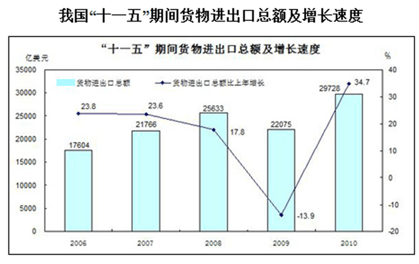

### 第 101 题

“十一五”期间，我国平均每年货物进口总额约为多少亿美元？

A. 2238

B. 10562

C. 12799

D. 23361

第 101 题 · 答案与解析

**参考答案（粉笔题库参考内容）**

B

**解析**

根据题干“‘十一五’期间······平均每年······多少亿美元”，结合材料数据为“十一五”期间，可判定本题为现期平均数问题。定位文字材料第一段可得：“‘十一五’期间，进口总额52809亿美元。”故“十一五”期间，亿美元，与B项最为接近。

故正确答案为B。

**考点**：现期平均数、综合资料

**来源**：2015年甘肃省公务员录用考试《行测》题第101题

### 第 102 题

“十五”期间，我国货物出口总额约为多少亿美元？

A. 23703

B. 37645

C. 41077

D. 73004

第 102 题 · 答案与解析

**参考答案（粉笔题库参考内容）**

A

**解析**

根据题干“‘十五’期······多少亿美元”，结合材料数据为“十一五”期间，可判定本题为基期计算问题。定位文字材料第一段可得：“‘十一五’期间，出口总额63997亿美元，比‘十五’期间增长1.7倍。”代入基期量公式：现期量/(1+r)，故“十五”期间，我国货物出口总额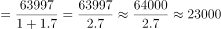亿美元，与A项最为接近。

故正确答案为A。

**考点**：基期计算、综合资料

**来源**：2015年甘肃省公务员录用考试《行测》题第102题

### 第 103 题

下列年份中，货物进出口总额同比增量最低的是：

A. 2006

B. 2007

C. 2008

D. 2009

第 103 题 · 答案与解析

**参考答案（粉笔题库参考内容）**

D

**解析**

根据题干“······同比增量最低”，可判定本题为增长量比较问题。定位图形材料可知：只有2009年进出口总额是同比下降的，为减少量。故货物进出口总额同比增量最低的是2009年。

故正确答案为D。

**考点**：增长量比较、综合资料

**来源**：2015年甘肃省公务员录用考试《行测》题第103题

### 第 104 题

2009年全球货物出口总额约为多少亿美元？

A. 104781

B. 125182

C. 164603

D. 229928

第 104 题 · 答案与解析

**参考答案（粉笔题库参考内容）**

B

**解析**

根据题干“2009年全球货物出口总额约为多少亿美元”，结合文字材料已知2009年货物出口总额占全球货物出口总额的比重，可判定本题为基期计算问题。定位文字材料第二段可得：“2009年我国货物出口总额占全球出口比重由‘十五’末的7.3%提高到9.6%。2010年我国货物进出口再创历史新高，其中，出口15779亿美元，增长31.3%”，代入基期量公式：现期量/(1+r)，则。故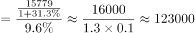亿美元，与B项最为接近。

故正确答案为B。

**考点**：基期计算、综合资料

**来源**：2015年甘肃省公务员录用考试《行测》题第104题

### 第 105 题

能够从资料中推出的是：

A. 2008年我国货物进口总额跃居世界第二

B. 2007年我国货物进口总额不超过1万亿美元

C. “十五”期间，我国货物进出口总额逐年上升

D. “十一五”期间，我国进口总额和出口总额的年均增长率基本相当

第 105 题 · 答案与解析

**参考答案（粉笔题库参考内容）**

D

**解析**

A项：定位材料第二段可得：“2009年我国货物进口总额上升至世界第二位。”故2008年我国货物进口总额不是世界第二，错误；

B项：定位材料第二段可得：“2007年货物出口总额突破1万亿美元，进出口总额迈上2万亿美元台阶。”故无法推出2007年我国货物进口总额是否不超过1万亿美元，错误；

C项：根据材料，无法推出“十五”期间，我国货物进出口总额是否逐年上升，错误；

D项：定位文字材料第二段“2010年······进出口均比‘十五’末增长1.1倍”，比较年均增长率只需比较现期/基期即可。“十一五”期间的现期是2010年，基期是2005年。根据材料可知进、出口的2010年/2005年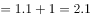，两者相等。即进口总额和出口总额的年均增长率基本相当，正确。

注：增长倍数=增长率

故正确答案为D。

**考点**：综合分析、综合资料

**来源**：2015年甘肃省公务员录用考试《行测》题第105题

## 材料 2

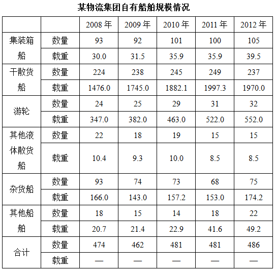

### 第 106 题

下列哪一年该集团游轮载重同比增速最快？

A. 2009

B. 2010

C. 2011

D. 2012

第 106 题 · 答案与解析

**参考答案（粉笔题库参考内容）**

B

**解析**

根据题干“······游轮载重同比增速最快”，可判定本题为一般增长率问题中的增长率比较。定位表格材料可得：“2008-2012年游轮载重量分别为347、382、463、522、552。”代入增长率公式：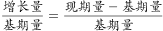，2009年：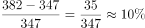；2010年：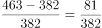；2011年：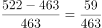；2012年：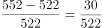，故该集团游轮载重同比增速最快的年份为2010年。

故正确答案为B。

**考点**：一般增长率、统计表

**来源**：2015年甘肃省公务员录用考试《行测》题第106题

### 第 107 题

与2008年相比，2012年平均每艘其他船舶的载重约增长了：

A. 22%

B. 94%

C. 124%

D. 138%

第 107 题 · 答案与解析

**参考答案（粉笔题库参考内容）**

B

**解析**

根据题干“······平均每艘其他船舶的载重约增长了”，结合选项均为百分数，可判定本题为平均数的增长率问题。定位表格材料可得：“2012年其他船舶载重和数量分别为49.2、22；2008年其他船舶载重和数量分别为20.7、18。”则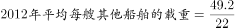，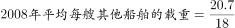，故与2008年相比，2012年平均每艘其他船舶的载重约增长了=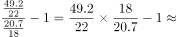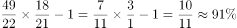，与B项最为接近。

故正确答案为B。

**考点**：平均数的增长率、统计表

**来源**：2015年甘肃省公务员录用考试《行测》题第107题

### 第 108 题

以下哪一年干散货船数量占该集团自有船舶总量的比重最高：

A. 2008

B. 2010

C. 2011

D. 2012

第 108 题 · 答案与解析

**参考答案（粉笔题库参考内容）**

C

**解析**

根据题干“以下哪一年······比重最高”，可判定本题为现期比重比较问题。定位表格材料可得：“2008年干散货船和集团自有船舶的数量为224、474，2010年干散货船和集团自有船舶的数量为245、481，2011年干散货船和集团自有船舶的数量为249、481，2012年干散货船和集团自有船舶的数量为237、486。”代入比重公式：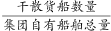，则2008年：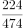；2010年：245/481249/481；2011年：249/481；2012年：237/486。故2011年干散货船数量占该集团自有船舶总量的比重最高。

故正确答案为C。

**考点**：现期比重、统计表

**来源**：2015年甘肃省公务员录用考试《行测》题第108题

### 第 109 题

下列折线图反映了2008年至2012年该集团哪一类船舶数量的变化？

A. 杂货船

B. 其他液体散货船

C. 集装箱船

D. 其他船舶

第 109 题 · 答案与解析

**参考答案（粉笔题库参考内容）**

A

**解析**

题干给出的折线图表示的船舶数量的变化为低-低-低-高。定位表格材料可得：

杂货船的数量分别为：93，74，73，68，75，数量变化为低-低-低-高；

其他液体散货船的数量分别为：22，18，19，15，15，数量变化为低-高-低-平；

集装箱船的数量分别为：93，92，101，100，105，数量变化为低-高-低-高；

其他船舶的数量分别为：18，15，14，18，22，数量变化为低-低-高-高；

故题干折线图反映了2008年至2012年该集团杂货船数量的变化。

故正确答案为A。

**考点**：直接找数、统计表

**来源**：2015年甘肃省公务员录用考试《行测》题第109题

### 第 110 题

以下关于2008年至2012年间该集团自有船舶规模的说法正确的是：

A. 该集团的船队中游轮数量一直多于集装箱船

B. 2012年平均每艘杂货船的载重超过5万吨

C. 该集团所有类型船舶的载重都在持续增加

D. 其他液体散货船的数量所占比重一直低于5%

第 110 题 · 答案与解析

**参考答案（粉笔题库参考内容）**

D

**解析**

A项：定位表格材料可得：“，游轮数量分别为24，25，29，31，32；集装箱船数量分别为93，92，101，100，105。”通过对比可知，该集团的船队中游轮数量一直少于集装箱船，错误；

B项：定位表格材料可得：“2012年杂货船载重为174.2，数量为75。”故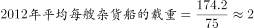，题干没有给出具体单位，无法判定2与5万吨之间的关系，错误；

C项：定位表格材料可知：只有游轮和其他船舶的载重一直在持续增加，并非所有，错误；

D项：定位表格材料可得：“2008-2012年其他液体散货船和集团自有船舶的数量分别为22和474、18和462、19和481、15和481、15和486。”故2008-2012年其他液体散货船的数量所占比重依次为：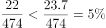、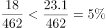、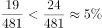、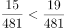、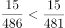。故其他液体散货船的数量所占比重一直低于5%，正确。

故正确答案为D。

**考点**：综合分析、综合资料

**来源**：2015年甘肃省公务员录用考试《行测》题第110题

## 材料 3

2014年1~2月份，我国房地产业土地购置面积4062万平方米，同比增长6.5%，土地成交价款1000亿元，同比增长8.9%。

**表1:2014年1~2月份房地产开发情况**

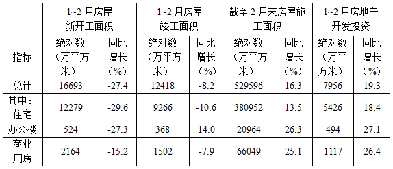

**表2：2014年1~2月商品房销售情况**

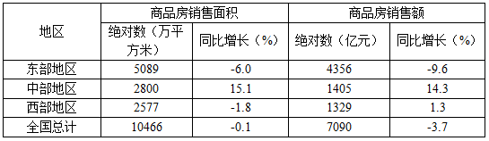

### 第 111 题

截至2013年2月末，住宅房屋施工面积约为多少亿平方米？

A. 33.6

B. 45.5

C. 1.1

D. 5.3

第 111 题 · 答案与解析

**参考答案（粉笔题库参考内容）**

A

**解析**

根据题干“截至2013年2月末······多少亿平方米”，结合表格材料1数据为截至2014年2月末，可判定本题为基期计算问题。定位表格材料1可得“截至2014年2月末住宅房屋施工面积为380952万平方米，增速为13.5%。”代入基期公式：现期量/(1+r)，故截至2013年2月末，住宅房屋施工面积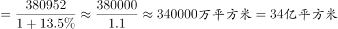，与A项最为接近。

故正确答案为A。

**考点**：基期计算、综合资料

**来源**：2015年甘肃省公务员录用考试《行测》题第111题

### 第 112 题

在东部、中部、西部地区中，2014年1~2月商品房平均销售价格高于上年同期水平的地区有几个？

A. 2

B. 3

C. 0

D. 1

第 112 题 · 答案与解析

**参考答案（粉笔题库参考内容）**

D

**解析**

根据题干“······2014年1~2月商品房平均销售价格高于上期······”，可判定本题为两期平均数比较问题。定位表格材料2可得：“东、中、西部商品房销售额增速a分别为-9.6% 、14.3%和1.3%；商品房销售面积增速b分别为-6.0%、15.1%、-1.8%。”根据两期平均数比较理论，当a＞b时，平均数增加，即2014年1~2月商品房平均销售价格高于上年同期水平。在三个地区中，满足a＞b的只有西部。

故正确答案为D。

**考点**：两期平均数比较、综合资料

**来源**：2015年甘肃省公务员录用考试《行测》题第112题

### 第 113 题

2013年1~2月我国房地产业土地购置单价约为每平方米多少元？

A. 2300

B. 2400

C. 2500

D. 2600

第 113 题 · 答案与解析

**参考答案（粉笔题库参考内容）**

B

**解析**

根据题干“2013年1~2月······每平方米多少元”，结合文字材料数据为2014年1~2月，可判定本题为基期平均数问题。定位文字材料可得：“2014年1~2月份，我国房地产业土地购置面积4062万平方米，同比增长6.5%；土地成交价款1000亿元，同比增长8.9%。”代入基期平均数公式：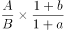，故2013年1~2月我国房地产业土地购置单价=，略小于2460，与B项最为接近。

故正确答案为B。

**考点**：基期平均数、综合资料

**来源**：2015年甘肃省公务员录用考试《行测》题第113题

### 第 114 题

2013年1~2月，商业营业用房竣工面积是办公楼的多少倍？

A. 3

B. 4

C. 5

D. 6

第 114 题 · 答案与解析

**参考答案（粉笔题库参考内容）**

C

**解析**

根据题干“2013年1~2月······多少倍”，结合表格材料1数据为2014年1~2月，可判定本题为基期倍数问题。定位表格材料1可得：“2014年1~2月商业营业用房竣工面积为1502万平方米，同比增长-7.9%；办公楼竣工面积为368万平方米，同比增长14%。”代入基期倍数公式：，故2013年1~2月，商业营业用房竣工面积是办公楼的倍，与C项最接近。

故正确答案为C。

**考点**：基期倍数、综合资料

**来源**：2015年甘肃省公务员录用考试《行测》题第114题

### 第 115 题

关于2014年1~2月房地产开发和销售情况，能够从上述资料中推出的是：

A. 住宅新开工面积占房屋新开工面积的八成以上

B. 各类型房屋竣工面积均低于上年同期水平

C. 东部地区商品房单价是西部地区的两倍以上

D. 中部地区商品房销售额占全国比重高于上年同期水平

第 115 题 · 答案与解析

**参考答案（粉笔题库参考内容）**

D

**解析**

A项：定位表格材料1可得：2014年1-2月，住宅新开工面积=12279万平方米，总计=16693万平方米，直除首位商7，不足八成，错误；

B项：定位表格材料1可知：各类型房屋竣工面积中，办公楼竣工面积增速为14.0%>0，故办公楼房屋竣工面积高于上年同期水平，错误；

C项：定位表格材料2可得：“ 东部商品房销售额=4356亿元， 销售面积=5089万平方米；西部商品房销售额=1329 亿元，销售面积=2577 万平方米。” 则；。故，错误；

D项：定位表格材料2可得：“中部地区商品房销售额增速a=14.3%；全国商品房销售额增速b=-3.7%。”根据两期比重比较理论，当a＞b时，比重上升，即中部地区商品房销售额占全国比重高于上年同期水平，正确。

故正确答案为D。

**考点**：综合分析、综合资料

**来源**：2015年甘肃省公务员录用考试《行测》题第115题

## 材料 4

2011年一季度我国人民币信贷增加2.24万亿元。3月末，广义货币（M2）余额75.81万亿元，同比增长16.6%，狭义货币（M1）余额26.63万亿元，同比增长15%，流通中货币（M0）余额4.48万亿元，同比增长14.8%。

### 第 116 题

与2010年同期相比2011年3月末流通中货币（M0）余额增加了约多少万亿元？

A. 0.2

B. 0.58

C. 0.88

D. 1.18

第 116 题 · 答案与解析

**参考答案（粉笔题库参考内容）**

B

**解析**

根据题干“······增加了多少万亿元”，可判定本题为增长量计算问题。定位文字材料可得：“2011年3月末流通中货币（M0）余额为4.48万亿元，同比增长14.8%。”故与2010年同期相比2011年3月末流通中货币（M0）余额增长量，与B项最为接近。

故正确答案为B。

**考点**：增长量计算、综合资料

**来源**：2015年甘肃省公务员录用考试《行测》题第116题

### 第 117 题

2011年3月末，外币贷款余额折合多少万亿人民币？

A. 3.09

B. 3.14

C. 3.19

D. 3.24

第 117 题 · 答案与解析

**参考答案（粉笔题库参考内容）**

B

**解析**

定位表格材料1可得：“2011年3月末本外币贷款余额为52.61万亿元，人民币贷款余额为49.47万亿元。”故外币贷款余额=52.61－49.47=3.14万亿元。

故正确答案为B。

**考点**：简单加减计算、综合资料

**来源**：2015年甘肃省公务员录用考试《行测》题第117题

### 第 118 题

以下比重最高的是？

A. 2010年3月末外币存款余额占本外币存款余额比重

B. 2011年3月末外币存款余额占本外币存款余额比重

C. 2010年3月末人民币存款余额占本外币存款余额比重

D. 2011年3月末人民币存款余额占本外币存款余额比重

第 118 题 · 答案与解析

**参考答案（粉笔题库参考内容）**

D

**解析**

根据题干“以下比重最高的是”，结合选项的时间为2010年3月末和2011年3月末，可判定本题为两期比重问题。定位表格材料1可得：“2011年3月末本外币存款余额为76.84万亿元，人民币存款余额为75.28万亿元。”则外币存款余额=76.84-75.28=1.56万亿元。由于总量一定，人民币绝对量远远大于外币，故人民币比重一定高于外币比重，排除A、B两项。定位表格材料1可得：“2011年3月末人民币存款余额增速a= 19.0%；本外币存款余额增速b=18.7%。”根据两期比重比较理论，当a＞b时，比重上升，即2011年3月末人民币存款余额占本外币存款余额比重高于2010年3月末。

故正确答案为D。

**考点**：两期比重、综合资料

**来源**：2015年甘肃省公务员录用考试《行测》题第118题

### 第 119 题

2011年2月末，人民币贷款余额约为多少万亿元？

A. 41.96

B. 47.23

C. 48.79

D. 49.47

第 119 题 · 答案与解析

**参考答案（粉笔题库参考内容）**

C

**解析**

定位表格材料1可得：“2011年3月末，人民币贷款余额为49.47万亿元。”定位表格材料2可得：“2011年3月当月人民币贷款增加为6794亿元。”故2011年2月末，万亿元。

故正确答案为C。

**考点**：简单加减计算、综合资料

**来源**：2015年甘肃省公务员录用考试《行测》题第119题

### 第 120 题

根据上述材料，以下说法正确的是：

A. 2010年3月份新增人民币存款约12万亿元

B. 2011年3月末本外币存款余额约为外币存款余额3倍

C. 2011年3月本外币存款余额同比下降4008亿元

D. 2011年3月末本外币广义货币超过狭义货币

第 120 题 · 答案与解析

**参考答案（粉笔题库参考内容）**

D

**解析**

A项：定位表格材料2可得：“2011年3月人民币存款增加为2.68万亿元，同比增长1.32万亿元。”故2010年3月新增人民币存款=2.68-1.32=1.36万亿元，错误；

B项：定位表格材料1可得：“2011年3月末，本外币存款余额为76.84万亿元，人民币存款余额为75.28万亿元。”则外币存款余额=76.84－75.28=1.56万亿元，故本外币存款余额比外币存款余额，远远大于3倍，错误；

C项：定位表格材料1可得：“2011年3月末本外币存款余额同比增长18.7%。”增长率＞0，故2011年3月本外币存款余额同比增长量不可能下降，错误；

D项：定位文字材料可得：“2011年3月末本外币广义货币为75.81万亿元；狭义货币为26.63万亿元。”故2011年3月末本外币广义货币超过狭义货币，正确。

故正确答案为D。

**考点**：综合分析、综合资料

**来源**：2015年甘肃省公务员录用考试《行测》题第120题

