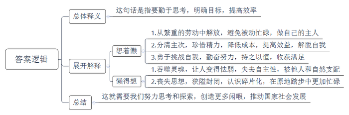
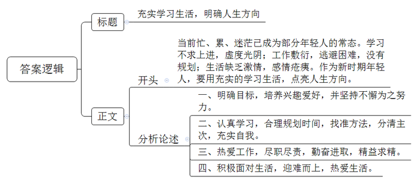
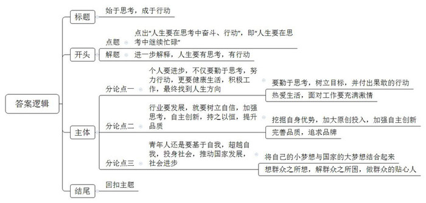

# 2017年公务员多省联考《申论》题（甘肃卷）

> 候选采集稿。参考答案及解析来自粉笔页面，不代表官方答案或真实高分答卷；来源使用许可与原卷对应关系仍需人工核实。

## 给定材料

### 材料 material-5a469f4923fcc350

勤能补拙似乎一直是至理名言，然而，一个著名咨询集团合伙人却不这样认为，他语出惊人：勤可致拙。我的很多同行失败就失败在太勤奋。因为太过勤奋，而没有时间和精力去思考。我总是想着懒，而不是懒得想。有时候这就是效率。毕竟，人生那么短，事情却这样多，不略过那些不打紧的事情，把好钢用在刀刃上，生活只会越忙越糟，越糟越忙，恶性循环。所以要养成一种好习惯，一种智慧，才能成为自己的主人。当然，这要注意区分躺在沙发上一动不动，抱怨沙发太硬的家伙和为了躺得更舒服而起身发明懒人沙发的人。

另一位网评家也表达了相同的看法：人勤于思考，才会分清事情主次轻重，珍惜自己的精力，做到低成本、高效益……总之，这样的人长于把握一切、不急不躁、有条不紊，善于从繁杂和忙乱中解脱自己，这是一种人生艺术。

有的人含着银钥匙长大，各方面都无比顺利，甚至可以用现在流行的一句话来形容——堪称人生赢家。而放弃大好前程和安逸生活不要，却选择了一条看上去无比折腾的人生道路，这不是自己找事做吗？从某种意义上来说，这确实是。然而，人生是越努力才会越幸运。每天给自己找一点事儿做，每天勤奋一点点，努力一点点，收获一点“小确幸”，终有一天会积累成人生的“大满足”。而天天不做事，最后可能会没事做，或者做不了、做不完。

不去思考必须思考的问题，不去做必须做的事情，如果这发生在我们身上，就是怯弱、狭隘和封闭，是最最消极的。我们的灵魂和心会被蚕食，我们的思想将被撕裂成碎片，而我们只能在其中跌跌撞撞，疲于拾掇缝补，苟且喘息。所以，我们会在碎片中生活，会在原地踏步中越来越忙碌。

别让脑袋停止思考。人和人，甚至人和动物在肉体上都没多大区别，差的就是灵魂。若不思索，甚至没有追求，随遇而安，你就必须接受所有后果，那就是被其他人或自然支配。

我们付出了巨大的努力才看清楚我们所在的这颗蓝色星球的模样，才弄清楚我们怎样进化成人，才变得有一点点的能力和空闲去利用、去支配自然获得片刻的闲暇以实现我们心中小小的偷懒的欲念。但现在的时刻，我们的文化、我们的民族、我们的国家，需要我们忙碌起来，而不是一直在缅怀过去、一直在不经过大脑地轻松娱乐。毕竟，在人类文明的长河里，我们总是历尽艰辛，万分努力，才让一切看起来不那么费劲。

### 材料 material-de7d2a6c72c8807e

对于经历了物质极度匮乏时期的人来说，不管是酯香浓郁的老酱油，还是质地厚重的雪花膏，各式各样的“中华老字号”都超越了本身功能性的意义，成为一个时代最温情的记忆。

新中国成立初期，我国大约拥有“中华老字号”16000家；1991年原国内贸易部的老牌企业全行业的认定中，有1600余家老牌企业被授牌；但到了2006年商务部重新认定时，第一批中华老字号的数量只剩434家。

由于以前保护意识不强，在城市市政建设中，部分老字号的原址被拆除，只能搬迁它地或仅能保留部分原址，经营空间不断萎缩。而对于老字号来说，这无疑是个大问题——老字号首先还得是那个老店啊！现在这年代不差好的商品、好的服务，经常光顾老店的顾客多是因为那份感情，在熟悉的地方逛一逛、坐一坐，要的是那份感觉。一旦搬迁，部分老字号就可能失去了原来空间中提供给自己生存发展必需的养分，从此一蹶不振。

同时，还有相当一部分的老字号因为遭受知识产权侵权和恶性商业竞争，逐渐退到了时代和市场的边缘，而经营良好的老字号更是深受其害。

“地价租金太贵，经营方式跟不上，还有不少其他历史包袱。我们是国企，启动改制之后老职工安置问题等等，都使得我们负担不起，无法迈开步子前进。要不就是我们真的太老了，老到思路打不开，脚步跟不上。我们不缺勤奋苦干，每天起早贪黑，两头见星星，可还是只能勉强保本。产品更新慢，老顾客留不住，年轻人不愿来。”一位老字号国企负责人无奈地表示，“我们也想过要改，可看到前段时间另外一个老字号就因为改制搞到管理权都没办法集中，没办法决策如何发展了，我们就怕了。这样改还不如老老实实守住自留地。”

随着保护老字号呼声的增多，各地政府也有所行动。在北京、上海、天津和江浙这些老字号聚集的地方，地方政府对老字号的补贴较多，也更加注重对传统老工艺的保护，还曾举办电子商务学习培训并组织老字号企业“走出去”，出境办展宣传。“老字号、老工艺是一个时代、一个国家的珍贵财富，不能因为我们的懈怠而消失。”一位工作人员说。

2017年1月，商务部、发改委等16个部门联合印发了《关于促进老字号改革创新发展的指导意见》，这对创新动力不足、业绩欠佳的部分老字号企业来说是一个重大利好。

在2016年，10余家老字号公司陆续登陆股市新三板。推进老字号核心优质资产证券化，支持符合条件的老字号上市首发股票或到全国中小企业股份转让系统挂牌，成为老字号利用多层次资本市场做大做强的契机。

“保护归保护，但关键还是要看自己。其实，老字号与普通企业一样，优胜劣汰。”一位企业家如是说。

扬州市某著名日化用品厂是最早在政府牵头下，与网络电商平台合作，发展官方旗舰店的老字号企业之一。面对自身电视传媒广告营销能力偏弱的实际，厂家充分利用电商平台巨大的客户流量，用细腻的文字、复古精致的网页装修，不仅唤起了老顾客对自己的记忆，也增加了年轻人对“祖母级”国货化妆品的了解和信任。简而不陋的包装，朴实温和的效果，亲民实惠的价格，带动了系列产品的热销，不仅使这家经历百年风雨的老字号重新焕发活力，更掀起了一股“国货热”。

而在某龙头饮料公司董事长看来，抓住机遇、求新求变将会带来更好的发展。是的，老字号不缺情怀，但不能一味消费情怀。在人们眼中，老字号是“品质”“怀旧”“工匠精神”等的代名词。在特定年代，老字号创造的商业辉煌，为发展工业、振兴经济、传承传统优秀文化、丰富人们物质精神生活、撑起民族复兴希望立下了汗马功劳。这些都是值得我们骄傲并永远铭记的。但再老的字号，也不是金字招牌，不能躺在历史的功劳簿上高枕无忧地睡大觉。身处这样一个“互联网+”时代，利用好它，你可以足不出户，不费周折地闻达于天下；脱离这个时代，哪怕就是皇帝的女儿也愁嫁。

### 材料 material-86b4f1cc04b926e9

当你年迈，步履蹒跚，你会选择怎样的生活方式？浙江的一对老夫妻选择了“一直在路上”，退休后开始自驾游。3年，1辆小汽车，走遍31个省市区。老人还把自驾游经历写成一本35万字的书。其实老人没接受过写作训练，没搞过文字，但他从小就很喜欢历史、地理。每次游玩，他都会把小本子带在身边。他每天都坚持到图书馆写4000多字，两个月就完成了25万字的初稿，接着对初稿修改、补充，大约花了半年时间完成全书。书稿都是手写的，他就让女儿打印装订，怕有别字病句，他就抱着打印稿找文联帮忙作最后的修改。最后，书终于出版了。在后记中，他说：“我跟他们说我驾车出游是因为我和老伴年纪不小了，趁现在还走得动，赶快走一走。我们是越走越想走啊。”现在他以自驾游西藏为主要内容的书稿，也已经完成了5万多字。

若你曾折翼，是否依然选择飞翔？15年前，安德鲁在登山中因被暴风雪所困而不幸截肢，但他并没有因此而消沉。装上义肢后，他每天都努力康复，不但适应了新的生活，还参加了铁人三项比赛，并在友人的帮助下，靠着绳索攀登了阿尔卑斯山脉中海拔高达4478米的马特宏峰。现在，以他为原型的纪录片《截肢登山家》已在英国播出。

如果你在一开始落后，是会奋起直追还是甘居下游？一个做同声传译的嘉宾在节目中大聊行业内幕：“忙、累、压力大！每20分钟就要休息一次，但收入确实丰厚。这行吃的不是青春饭，我有的同事都60岁了。”而对自己能胜任这份工作的秘诀，他也很直接地表示：“其实没什么秘诀，首先是热爱，其次是勤奋。坦白地说，我记忆力不好，语言天赋也不高，出生农村，直到初中才开始接触到外语。初中时每次期末考，英语都是倒数几名。关键是一步一步自己找方法，其实学习和生活一样，就是为了不那么辛苦而辛苦。”同时，他坦白自己也有觉得坚持不下去的时候，那怎么办呢？想想自己干这行的甜头呗：比如每年只需要工作一个月就能赚够这一年的钱，剩下的时间就可以当个懒汉，优哉游哉地充电学习、旅行、品美食、思考人生……

## 题目

### 第 1 题

**根据给定资料**1**，谈谈你对划线部分“想着懒，而不是懒得想”这句话的理解。（15分）**

关联材料：material-5a469f4923fcc350

作答要求：

要求：全面、准确、简明、有条理。不超过200字。

### 第 2 题

**根据“给定资料**2**～**4**”分析部分老字号发展面临的困境，并从政府角度提出有效帮扶措施。（20分）**

关联材料：material-de7d2a6c72c8807e

作答要求：

要求：针对性强，措施合理，操作可行。不超过250字。

### 第 3 题

**假如你是某大学校报的一名编辑，根据“给定材料**5**～**6**”，针对目前部分年轻人精神生活状况，以“充实学习生活，明确人生方向”为题，写一篇短评。（20分）**

关联材料：material-86b4f1cc04b926e9

作答要求：

要求：针对性强，语言准确、得体。不超过300字。

### 第 4 题

**根据你对“给定材料**7**”中划线部分，“我睡去，梦见生活就是享乐。我醒来，发现生活就是劳碌。我身体力行后领悟到，原来劳碌中充满快乐”的理解，自选角度，自拟题目，写一篇文章。（45分）**

关联材料：material-5a469f4923fcc350

作答要求：

要求：结合给定材料，但不拘泥于给定材料，联系实际；观点正确，内容充实；结构完整，思路清晰，语言流畅；字数1000字左右。

## 答案与解析

第 1 题

**参考答案（粉笔题库参考内容）**

这句话是指要勤于思考，明确目标，提高效率。

想着懒可以让我们：1.从繁重的劳动中解放，避免被动忙碌，做自己的主人；2.分清主次，珍惜精力，降低成本，提高效益，解脱自我；3.勇于挑战自我，勤奋努力，持之以恒，收获满足。

懒得想会带来问题：1.吞噬灵魂，让人变得怯弱，失去自主性，被他人和自然支配；2.丧失思想，狭隘封闭，认识碎片化，在原地踏步中更加忙碌。

这就需要我们努力思考和探索，创造更多闲暇，推动国家社会发展。

**解析**

**参考答案说明：**思路方面，本参考答案按照词句解释题“总体释义+展开解释+总结”的一般答题思路展开。内容方面，本参考答案先对“想着懒，而不是懒得想”的含义进行了解释；“展开解释”部分先分析了“‘想着懒’的意义”，接着分析了“‘懒得想’的问题”；最后提出了对策。每条答案标注序号，满足了题干中“有条理”这一要求。

**考点**：考点词句解释类

**来源**：来源2017年公务员多省联考《申论》题（甘肃卷）

粉笔申论页面对本题只提供「解析视频」入口，该入口是会员推广位，页面无视频地址与文字解析。

第 2 题

**参考答案（粉笔题库参考内容）**

困境：1.保护意识不强，原址被拆，经营空间萎缩。2.遭受知识产权侵权和恶性商业竞争，品牌受损。3.经营方式落后，地价租金贵，历史负担重，思想僵化，产品创新难。

措施：1.提升保护意识。出台规划保护原址，对传统工艺加强专利保护，依法保护老字号品牌。2.积极扶持。政府补贴，减轻负担；组织培训，提升经营水平。3.支持融资。资产证券化，发行股票，利用资本市场。4.政府牵头拓展销售渠道。与网络电商平台合作，办展宣传，拓展国际市场。5.引导企业产品创新，转型升级。深挖品牌价值，延伸产业链；提升品质，增强创意营销能力。

**解析**

**参考答案说明：**答案先分析了部分老字号发展面临的“困境”，接着从“提升保护意识”“积极扶持”“支持融资”“政府牵头拓展销售渠道”“引导企业产品创新，转型升级”五个不同的角度对措施进行了分条撰写。各条要点之间在内容上是并列的。

**考点**：考点提出对策类

**来源**：来源2017年公务员多省联考《申论》题（甘肃卷）

粉笔申论页面对本题只提供「解析视频」入口，该入口是会员推广位，页面无视频地址与文字解析。

第 3 题

**参考答案（粉笔题库参考内容）**

充实学习生活，明确人生方向

当前忙、累、迷茫已成为部分年轻人的常态。学习不求上进，虚度光阴；工作敷衍，逃避困难，没有规划；生活缺乏激情，感情疮痍。作为新时期年轻人，要用充实的学习生活，点亮人生方向。

一、明确目标，培养兴趣爱好，并坚持不懈为之努力。二、认真学习，合理规划时间，找准方法，分清主次，充实自我。三、热爱工作，尽职尽责，勤奋进取，精益求精。四、积极面对生活，迎难而上，热爱生活。

**解析**

**参考答案说明：**（1）格式方面，本参考答案写到了标题和正文。（2）正文部分，一方面从内容来看，围绕着“充实学习生活，明确人生方向”这一主题，本参考答案的开头先写到了“当前年轻人的人生态度消极所表现出来的问题”；主体部分从“明确目标”“认真学习”“热爱工作”“积极面对生活”等几个方面给出了具体的建议。另一方面，形式上，本参考答案做到了分段、分条撰写，整体上条理较为清晰。（3）本参考答案能够结合题目要求“语言准确、得体”，在语言表达上做到了准确、简洁、流畅。

**参考答案二**

充实学习生活，明确人生方向

当前年轻人普遍感到忙、累、迷茫，过得忙然又茫然。他们对学习不求上进，虚度光阴，缺乏方法，主次不分；对工作态度敷衍，缺少责任感，缺乏激情，逃避困难，拒绝思考和改变；生活中感情疮痍，缺少兴趣，对未来缺少规划，丧失斗志。对此，必须做出改变。

对待生活要热爱，珍惜时间，马上行动，培养兴趣爱好，并坚持不懈，精益求精。对待工作要认真，尽心尽力、尽职尽责。面对挫折不消沉，积极调整、适应，勇于挑战自我。落后时奋起直追，热爱学习工作，勤奋进取，找准方法，学会自我心理调适。

年轻人们，用充实的学习生活，点亮人生方向吧！

**考点**：考点评论类

**来源**：来源2017年公务员多省联考《申论》题（甘肃卷）

粉笔申论页面对本题只提供「解析视频」入口，该入口是会员推广位，页面无视频地址与文字解析。

第 4 题

**参考答案（粉笔题库参考内容）**

**始于思考，成于行动**

一首诗中写道，“我睡去，梦见生活就是享乐。我醒来，发现生活就是劳碌。我身体力行后领悟到，原来劳碌中充满快乐”。人生是个忙碌的舞台，忙碌的世界丰富多彩，但如果只一味地忙碌而不辅以思考，必将感到迷茫，身心俱疲。**因此，我们不仅要做行动上的巨人，还要做思想上的巨人，既要做守望者，也要做行动者，在思考中奋斗，在奋斗中有所成就！**

**个人要进步，不仅要勤于思考，努力行动，更要健康生活，积极工作，最终找到人生方向****。**当下，部分青年人缺乏人生的具体规划目标，思想懈怠，也缺乏行动的智慧和勇气，对待工作和生活浑浑噩噩，得过且过，这样的碎片式生活只会让灵魂干瘪、人生无序。青年人作为社会发展进步的中坚力量，就应该勤于思考，树立目标，分清主次，并付出积极果敢的行动。与此同时，更要培养积极阳光的心态，通过读书、健身等方式丰富生活，热爱生活，面对工作更要充满激情，迎难而上，主动思考，解决困难，不负国家、民族和时代的期望！

**行业要发展，就要树立自信，加强思考，自主创新，持之以恒，提升品质。**《非诚勿扰》等照搬国外模式的综艺节目充斥在各大卫视，原创匮乏，内容千篇一律。甚至用一些“宁可坐在宝马车里哭，也不愿意坐在自行车上笑”的拜金言论及荤段子、暧昧字眼等内容吸引观众，严重违背社会主义主流价值观，给青少年身心健康造成恶劣影响。而在抄袭和“毁三观”的夹击下，央视原创节目《朗读者》在以黑马之姿杀出重围。通过邀请嘉宾朗读一本书的方式，给观众带来文学享受以及文字以外的思考。因此，行业要发展，需要调整心态，挖掘自身优势，加大原创投入。同时，也要真正地了解消费者的需求，不急躁不退缩，坚持不懈，敢于坐“冷板凳”，打造卓越品牌。

**无论是小到个人，还是大到行业，要想长远发展，不断进步****，****思考与行动缺一不可。但最终青年人还是要基于自我，超越自我，投身社会，推动国家发展，社会进步。**我们要将个人的价值与时代的要求、人民的呼唤结合起来，将自己的小梦想融入到国家梦当中，最终实现个人价值。当下越来越多的年轻人投身基层，服务基层，用创新的精神，不断探索解决问题的新方法。只有在工作中，真正的想群众之所想，解群众之所困，才能做群众的贴心人，发展的开路人，才能真正实现个人价值，助力中国梦的实现。

为了个人进步、行业发展、国家繁荣，我们既要忙碌起来，还要勤于思考，提升素养，善于创新，不懈奋斗，在奋斗中体悟幸福，在劳碌中收获快乐。

**解析**

**文章分析**

**始于思考，成于行动**

【**标题的优点**：首先，范文的标题“始于思考，成于行动”突出了“在思考中忙碌”这一主题。其次，它在形式上采用对称式结构。】

一首诗中写道，“我睡去，梦见生活就是享乐。我醒来，发现生活就是劳碌。我身体力行后领悟到，原来劳碌中充满快乐”。（1）人生是个忙碌的舞台，忙碌的世界丰富多彩，但如果只一味地忙碌而不辅以思考，必将感到迷茫，身心俱疲。**因此，（****2****）****我们不仅****要做行动上的巨人****，还要****做思想上的巨人****，****既要做守望者****，****也要做行动者****，****在思考中奋斗****，****在奋斗中有所成就****！**

【**开头的优点：**★内容方面。范文的开头是紧扣题目给定的“我睡去，梦见生活就是享乐。我醒来，发现生活就是劳碌。我身体力行后领悟到，原来劳碌中充满快乐”这句话展开的。首先，开头开门见山点出主题，做到了主题明确。其次，对“在思考中忙碌”这一主题进行了分析阐述，（1）介绍了“人生需要忙碌”的重要性、必要性。（2）介绍了“人生需在思考中努力、奋斗”。★文字表达方面：使用了逻辑连接词，使文字表达更有逻辑性。】

**个人要进步，不仅要勤于思考，努力行动，更要健康生活，积极工作，最终找到人生方向。**当下，（1）部分青年人缺乏人生的具体规划目标，思想懈怠，也缺乏行动的智慧和勇气，对待工作和生活浑浑噩噩，得过且过，这样的碎片式生活只会让灵魂干瘪、人生无序。（2）青年人作为社会发展进步的中坚力量，就应该勤于思考，树立目标，分清主次，并付出积极果敢的行动。与此同时，（3）更要培养积极阳光的心态，通过读书、健身等方式丰富生活，热爱生活，面对工作更要充满激情，迎难而上，主动思考，解决困难，不负国家、民族和时代的期望！

【**论述段****1的优点：**★观点句：范文的观点句是紧扣“在思考中忙碌”这一文章主题提出的。形式上，它在段首处直接写出，位置突出，容易发现。内容上，关键词突出，内容要点明确，可以明显看出它是从“个人”这一角度入手，指出了如何“在思考中忙碌”。★论述内容：（1）介绍了“青年人缺乏思考、行动”的表现以及危害；（2）介绍了“青年人应勤于思考、敢于行动”；（3）介绍了“青年人应热爱生活、积极阳光”。以上几个方面的内容都是紧扣“个人要进步，不仅要勤于思考，努力行动，更要健康生活，积极工作，最终找到人生方向”这个观点句进行分析论述的，论述的针对性强，内容层次丰富。最后，在论述方法和论据的选取上做到了讲道理与摆事实相结合，论据丰富多样。】

**行业要发展，就要树立自信，加强思考，自主创新，持之以恒，提升品质。**（1）《非诚勿扰》等照搬国外模式的综艺节目充斥在各大卫视，原创匮乏，内容千篇一律。甚至用一些“宁可坐在宝马车里哭，也不愿意坐在自行车上笑”的拜金言论及荤段子、暧昧字眼等内容吸引观众，严重违背社会主义主流价值观，给青少年身心健康造成恶劣影响。而在抄袭和“毁三观”的夹击下，（2）央视原创节目《朗读者》在以黑马之姿杀出重围。通过邀请嘉宾朗读一本书的方式，给观众带来文学享受以及文字以外的思考。因此，行业要发展，（3）需要调整心态，挖掘自身优势，加大原创投入。同时，也要真正地了解消费者的需求，不急躁不退缩，坚持不懈，敢于坐“冷板凳”，打造卓越品牌。

【**论述段****2的优点：**★观点句：范文的观点句是紧扣“在思考中忙碌”这一文章主题提出的。形式上，它在段首处直接写出，位置突出，容易发现。内容上，关键词突出，内容要点明确，可以明显看出它是从“行业发展”这一角度入手，指出了如何“在思考中忙碌”。★论述内容：（1）介绍了“行业缺乏思考、创新”的表现以及危害；（2）介绍了“行业中具备创新能力的典型”；（3）介绍了“行业应如何创新”。以上几个方面的内容都是紧扣“行业要发展，就要树立自信，加强思考，自主创新，持之以恒，提升品质”这个观点句进行分析论述的，论述的针对性强，内容层次丰富。最后，在论述方法和论据的选取上做到了讲道理与摆事实相结合，论据丰富多样。】

**无论是小到个人，还是大到行业，要想长远发展，不断进步****，****思考与行动缺一不可。但最终****青年人还是要基于自我，超越自我，投身社会，推动国家发展，社会进步****。**（1）我们要将个人的价值与时代的要求、人民的呼唤结合起来，将自己的小梦想融入到国家梦当中，最终实现个人价值。（2）当下越来越多的年轻人投身基层，服务基层，用创新的精神，不断探索解决问题的新方法。只有在工作中，真正的想群众之所想，解群众之所困，才能做群众的贴心人，发展的开路人，才能真正实现个人价值，助力中国梦的实现。

【**论述段****3的优点：**★观点句：范文的观点句是紧扣“在思考中忙碌”这一文章主题提出的。形式上，它在段首处直接写出，位置突出，容易发现。内容上，关键词突出，内容要点明确，可以明显看出它是从“长远发展”入手，指出了如何“在思考中忙碌”。★论述内容：（1）介绍了“将自己的梦想与国家梦相结合”；（2）介绍了“超越自我需要想群众之所想、急群众之所急”。以上几个方面的内容都是紧扣“青年人还是要基于自我，超越自我，投身社会，推动国家发展，社会进步”这个观点句进行分析论述的，论述的针对性强，内容层次丰富。最后，在论述方法和论据的选取上做到了讲道理与摆事实相结合，论据丰富多样。】

【**论述段之间的关系：****★内容的内在逻辑：**范文的论述段之间是依照递进的逻辑展开的。论述段1先从“个人”角度阐述如何在思考中忙碌，论述段2再从“行业”角度阐述如何创新，论述段3最后从“长远”角度阐述如何在思考中忙碌，以实现自我价值。**★段与段的外在衔接：**论述段3首处的“无论是小到个人，还是大到行业，要想长远发展，不断进步，思考与行动缺一不可”，起到了承接论述段1、2，引出论述段3的作用。】

（1）为了个人进步、行业发展、国家繁荣，我们既要**忙碌**起来，还要勤于思考，提升素养，善于创新，不懈奋斗，（2）在奋斗中体悟幸福，在劳碌中收获快乐。

【**结尾的优点**：范文的结尾回扣了“在思考中忙碌”这一主题。（1）再次总结了“在思考中忙碌”；（2）进行了展望、号召。】

**考点**：考点文章写作题

**来源**：来源2017年公务员多省联考《申论》题（甘肃卷）

粉笔申论页面对本题只提供「解析视频」入口，该入口是会员推广位，页面无视频地址与文字解析。

