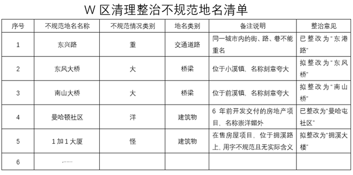
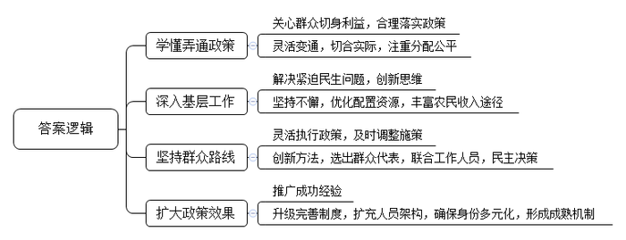
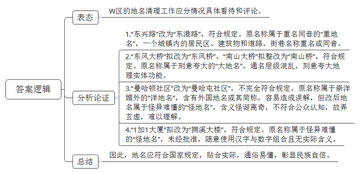
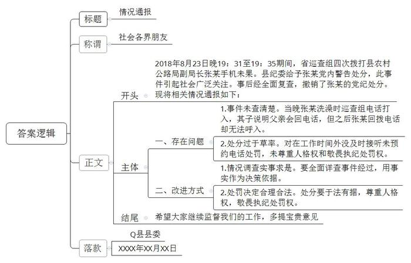
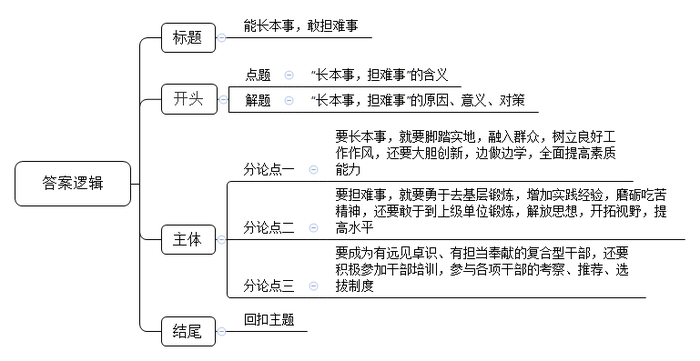

# 2019年甘肃省公考《申论》题

<!-- gwy:overview:start -->
> **甘肃 · 2019 · 申论 · 统考** ｜ 4 题 · 图片 5 处 · 答案随题折叠

导航：[题目](#题目) · [材料 1](#材料-1)
<!-- gwy:overview:end -->

> 候选采集稿。参考答案及解析来自粉笔页面，不代表官方答案或真实高分答卷；来源使用许可与原卷对应关系仍需人工核实。

## 给定材料

### 材料 1

“合抱之木，生于毫末；九层之台，起于累土。”基层，是整个社会的“地基”。这个“地基”，幅员最广、人数最多，是社会的主体，也是时代的主流。基层干部，是党和国家工作的“基石”。他们奋战在改革发展的主战场、服务群众的最前沿，承担着基层社区、农村稳定和发展的任务，是党和国家路线、方针、政策的具体执行者，其素质能力的高低、作风的好坏，直接决定着基层政府执行力的强弱、办事效率的高低、干群关系的好坏，关系到全面建成小康社会的成败。习近平总书记高度重视基层干部队伍建设，他指出：“在我们党的组织结构和国家政权结构中，县一级处在承上启下的关键环节，是发展经济、保障民生、维护稳定、促进国家长治久安的重要基础，也是干部干事创业、锻炼成长的基本功训练基地。”“基层是一切工作的落脚点。我们的各项政策措施落实了没有，落实得好不好，基层群众最有实际感受。落实得好、落实得快，群众就拥护，落实得不好、落实得慢，群众就会有反映。”

### 材料 2

“这5户，是当年响应上级政策才搬迁来的移民。这个方案，你们把人家排除在外显然不行！”拿到K村的农村集体资产产权制度改革和“三变”改革试点工作实施方案，G省S镇副镇长老姚一眼就看出了问题。

“三变”，是G省省委省政府在中央政策精神的指引下，在全省推行的农村“资源变资产、资金变股金、农民变股东”改革，主要目的是将农村的资产资源进行整合，增强集体经济实力，增加农民财产性收入。K村是S镇4个试点村之一。这个村集体资产多，每年收入有60多万元。那钱怎么分呢？村民代表投票制定的“分红”方案，把20世纪移民至此的5户人家排除在外。“这肯定不符合政策。”老姚找到K村党支部书记老吴，“要一视同仁，除了明显不能享受分红的，都要给。”

这件小事，虽然不起眼，但很典型。“上面的政策千万条，作为基层干部一定要注意学懂弄通政策，只有这样才不会在工作中走弯路、出岔子甚至犯错误。”老姚说。担任副镇长之前，老姚一直在S镇下面的Y村做基层工作。“我干的第一件事，就是带领村民进行危房改造。”老姚说，拿着信用社的贷款，Y村到2009年年底一共翻盖了135套房子。房子盖起来了，贷款怎么还？结合当时的土地确权工作，老姚有了想法。

S镇土地面积大，人均五六亩地。Y村按机井分地，一家20多亩地分散成十几块，多的甚至将近20块。地块分散，犁地、灌溉浪费时间、浪费劳力。“何不把土地集中起来？”老姚召集村民开会，现身说法，“我承包的农场，有300多亩地，浇地时水一开，流就是了，还能干其他活。”然而，田地有肥瘦之分，老百姓都觉得自己的地是宝贝。

不甘心的老姚继续做村民工作，摆事实、讲政策。终于，到了2010年年底，Y村把土地进行了重新分配和调整。土地集约之后，产业结构也进行了调整。2011年，Y村将全村土地流转给外地人种洋葱，一亩地1200块钱地租，还能帮人家打工。“一亩地需要8个工，一个工一天100块钱。老百姓流转出去一亩地，就能挣不少钱。”老姚说。2011年，老百姓收入就翻了一番，到2012年，修房的村民全部还清了贷款。

### 材料 3

根据政策要求，A省H市各区从2018年开始，对辖区沿街商户实行市容和环境卫生责任区制度管理，加大对居民占用公共空间、流动摊点等的整治，每个社区还要配备一名正式的城管队员定人定责。政策要求合情合理，可到基层执行时却遇了难。

H市B区和平路街道茂林路社区党委书记老唐回忆，当时街道城管中队进行了多次治理，但收效甚微，“检查人员一来，他们就往回收，人走了就又出摊。执法本是为群众打造舒适环境，但往往不被理解。”

执法人员因为不被理解而感到委屈，居民对街道管理现状也不满意。上级的政策规定要执行，但不能机械化、僵硬化，对执行过程中出现的问题，需要及时调整施策，老唐想出了成立“城管群众议事会”的办法。通过居民投票、自我推荐，茂林路社区选出了10名热心社区工作的议事会成员，包括社区网格员、街道城管网格员、物业工作人员、经营户代表和社区居民，由过去的城管单方执法，转变为“众人的事众人商量”。

2018年3月，茂林路社区某商业街占道经营、餐饮油烟污染等问题严重，城管没有硬性执法，而是由“城管群众议事会”召开了商讨会，商量解决办法。环保治污的红线不可破，占道经营影响安居的行为要停止，这两个原则得到各方认可，最终形成了新的经营规范6项标准和整治方案，得到大家的拥护和执行。

截至目前，茂林路社区“城管群众议事会”共召开会议26次，参加居民585人次，受理具体问题191项，完成181个项目，取得了较好效果。H市决定在全市有条件的社区也推广设立，这个在基层落实政策过程中形成的创新做法走向了更广泛的区域。如今，“城管群众议事会”在H市的不少街道社区扎根、创新，一些街道推出了“升级版”——党群议事会，人员架构采取“4+X”的形式，“4”即党代表、党员代表、群众代表和社区民警，“X”即人大代表、政协委员、辖区和驻地单位负责人等，巡访问事、民主议事、合力干事、群众监事，逐渐形成了基层处理问题的成熟机制。

### 材料 4

2018年12月，民政部、公安部、自然资源部、住房城乡建设部、交通运输部、国家市场监管总局联合印发《关于进一步清理整治不规范地名的通知》，对“大、洋、怪、重”等不规范地名的清理整治工作作出安排部署。为便于各地把握政策要求，通知还给出了不规范地名的认定原则和标准。摘录如下：

一、刻意夸大的“大地名”

1.未经批准，随意使用“宇宙、中央、天下、世界、环球、欧洲、澳洲、美洲、中国、中华、全国、万国”等词语的地名。如：未经批准，某居民区命名为“宇宙城”“中央首府”“天下城”“金科世界城”“欧洲花园”“澳洲阳光小区”“万国城”等。

2.未经批准，随意使用“特区、首府”等具有专属意义词语的地名。如：未经批准，某些不是特区的地区随意使用“特区”一词命名的居民区或建筑物，以求表达与众不同之意，让人产生歧义。

3.通名层级混乱，刻意夸大地理实体功能的地名。如：未经批准，某些规模、体量较小且空间狭窄的居民区或建筑物称之为“广场”，给公众造成误导。

二、崇洋媚外的“洋地名”

1.含有外国人名或其简称，容易造成误解的地名（历史上已经存在、具有纪念意义或反映中外人民友谊的地名除外）。如：“林肯公寓”“马可波罗大厦”“哥伦布广场”等（“白求恩国际和平医院”“列宁公园”等不属于此范围）。

2.含有外国地名或其简称，容易造成误解的地名（地名用词含义符合汉语用词习惯、符合有关规定的除外）。如：“曼哈顿社区”“威尼斯花园”“巴黎印象城”“夏威夷小区”等（“西安凯旋门”等不属于此范围）。

3.直接用外文命名的地名。如：某居民小区命名为“MOMOPARK”“Villa小区”等，群众不知如何称呼，也难以理解名称的含义。

4.用外语词汉字译写形式命名的地名（经有关部门批准的除外）。如：“帕提欧公馆”（帕提欧是patio的汉字译写形式）、“香榭丽舍小区”（香榭丽舍是Champs-Elysées的汉字译写形式）等（“希尔顿酒店”“西门子公司”等不属于此范围）。

三、怪异难懂的“怪地名”

（一）用字不规范的地名

1.纯粹用数字做专名且无特定含义的地名（经有关部门批准的企事业单位名称及其派生地名、桥梁道路等名称除外）。如：未经批准，某居民区命名为“99大厦”“1.1公寓”“1201小区”等。

2.未经批准，随意使用汉字与数字组合且无实际含义的地名。如：未经批准，某居民区命名为“加州1886”“1加1大厦”等。

3.未经批准，专名中使用“·”“-”等非文字符号的地名。如：未经批准，某居民区命名为“中骏·世界城”“M-3小区”。

（二）含义怪诞离奇的地名

1.含义不符合公众认知，故弄玄虚，难以理解的地名。如：未经批准，某居民区命名为“一瓶八斗”“24克拉”“8哩岛”“蔚澜香醍”等。

2.未经批准，随意使用具有特定含义的词语，容易产生歧义的地名。如：未经批准，某居民区命名为“公元99”，易使人理解为公元99年；“果岭100号院”易使人理解为该小区建在高尔夫球场上等。

3.未经批准，随意使用拼音字母且无实际含义的地名（有特定含义且广为熟知的外文缩写词除外）。如：未经批准，某居民区命名为“DADA的草地”“BOBO自由城”，难以理解（含义APEC、CBD、IT等缩写词的地名不属于此范围）。

（三）含义低级庸俗的地名

含义不健康，有悖公序良俗的地名。如“黄泉路”“土八路”“哑巴路”“杀人湾”“癞疙宝大山”等。

（四）带有浓重封建色彩的地名

未经批准，随意使用“皇帝、皇庭、御府、帝都、王府、相府”等古代帝王称谓以及历史上的官衔名、职位名等词语的地名（具有特定历史、宗教背景的除外）。如：未经批准，某居民区命名为“皇庭御景”“皇家府邸”“铂金御府”等。

四、重名同音的“重地名”

一个城镇内的居民区、建筑物和道路、街巷名称重名或同音。如：某城市内多处存在“建设路”“人民路”“公园路”“解放路”等重名道路现象。

为积极贯彻落实民政部等六部门《关于进一步清理整治不规范地名的通知》要求，加强和规范地名管理，南方某市W区对辖区内“大、洋、怪、重”的不规范地名开展了清理整治工作并给予公示：

但清理整治结果公示后，部分地名的整改引发了网友的热议。

### 材料 5

最近，一则源自Q县纪委监察委网站的通报引爆了网络。

关于张某在省脱贫攻坚巡查中不正确履职问题的通报

近期，县纪委监察委严肃查处了县农村公路局副局长张某在省脱贫攻坚巡查中不正确履职的问题，现将相关情况通报如下：

2018年8月，Q县扶贫办多次下发通知，要求全县帮扶责任人做好接受省脱贫攻坚巡查组电话访谈准备。8月23日晚19：31至19：35期间，省巡查组四次拨打张某手机，张某未接听电话，给我县脱贫攻坚工作造成严重不良影响。2018年10月8日，县纪委常委会研究决定，给予张某党内警告处分。

打赢脱贫攻坚战，是我们党对全国人民的庄严承诺，是一项必须完成的政治任务。2018年是脱贫攻坚作风建设年，全县广大党员干部特别是奋战在脱贫攻坚一线的党员干部，要从本案中汲取教训，引起高度警觉，进一步增强责任意识，坚决克服急躁、厌战、松劲情绪，坚决杜绝人浮于事、作风漂浮等形式主义和官僚主义问题，切实做到扶贫工作必须务实、脱贫过程必须扎实、脱贫结果必须真实。全县各级党组织要进一步提高政治站位，树牢“四个意识”，严肃扶贫工作纪律，积极主动作为，帮助群众解决实际问题。全县各级纪检监察机构要紧盯脱贫领域“四个意识”不强、责任落实不到位、工作措施不精准、资金管理使用不规范、工作作风不扎实等突出问题，加大监督审查调查力度，对贯彻中央脱贫攻坚政策部署不坚决、不到位及工作不严不实、弄虚作假等问题，严肃问责，绝不手软，以强有力的问责护航脱贫攻坚。

Q县纪委监察委

2018年10月8日

“4分钟未接电话被处分”事件经媒体报道后，引起社会广泛关注。当事人张某在接受采访时表示：“我吃完晚饭后有出去遛弯的习惯，8月23日晚饭后，我遛弯时出了一身汗，回家后就洗了个澡，这个时候就有电话打进来了，当时是我孩子接了电话，并表示等我洗完后给他们回电话，但是我洗完之后再打这个电话就怎么也打不进去了。”某网友说：“就算不是在洗澡，在八小时以外未接电话也不能动辄得咎，最多批评一下。除非经查明在干不法之事，或者提前约定了却未执行。说实话，现在手机经常接到大量的骚扰电话，如果不是认识或者显示特殊号段的，我根本不接。”“没能及时接听巡查组的电话，扶贫干部就受到党纪处分，是对人格权缺少尊重，也是对执纪处罚权缺乏敬畏。”国家行政学院竹教授接受采访时表示，Q县纪委如此处分一名扶贫干部，不仅草率，而且有些过分。最终，Q县县委责成县纪委对该问题进行了全面复查，根据复查情况，撤销了对张某的党纪处分。

### 材料 6

大学毕业后，小杨成为Z省N市的一名组织部门干部。2018年，小杨被选派到L村担任第一书记。L村位于N市M县东北部大石山区，地势低洼，易旱易涝，全村有5个自然屯在山上、8个屯在洪涝区，这两处也是全村最艰苦、最困难的区域。

来到L村，望着高高低低的村落，小杨有些无处下手，只能先用笨办法，一户一户去核实家庭基本信息，不在家的就打电话问询清楚。从最开始的焦头烂额、手忙脚乱到有条不紊，在和乡亲们频繁的交流互动中，小杨感受到了自己的变化，“与村民们打交道的能力强了，更能明白村民心里咋想的，我说的话也有人听。”小杨觉得，相比原来做组织工作，自己从说行内话变为说百家话，融入群众、为民服务的能力更强了，连气质也由文质彬彬变得有些“粗犷”。

通过摸底，小杨对如何扶贫有了自己的想法。“我把玉米、甘蔗、桑蚕、桑果等传统产业和特色产业进行数据分析和比对，制作产业收支明细表，形成直观效果，拿给大家看。”为了鼓励村民发展“桑叶养蚕+桑果采摘+桑枝养羊”的循环农业模式，小杨白天忙完，晚上就“开小灶”，学习农业技术、产品销售还有市场分析方面的知识。最终，在他的引导下，全村共发展桑园面积700亩，带动农户320户，其中贫困户210户，户均增收1万元。

说起现在的状态，小杨说他自己是一人分饰多角，要做知民情察民意的“调查员”，带团队谋发展、组织干部群众的“管理员”，拓市场找路子的“引导员”，以及解忧济困的“服务员”。“乡镇是最基层的行政机构，但麻雀虽小五脏俱全。产业发展、土地问题、安全生产、宗教信仰、安全维稳……能最深刻地了解中国农村，最全面地锻炼干部能力。”小杨说。

不同于小杨到基层锻炼，N市F区教育体育局干部小邓，去年3月份被选派到省教育厅体育卫生与艺术教育处挂职锻炼。从区里的具体教育督导工作转到全省教育系统的国防、体育工作，业务差别很大，小邓的收获更大。“挂职锻炼，让我增长了见识，丰富了阅历，充实了头脑。”小邓说。

“选派干部到镇进村锻炼成长，为的是增加干部的实践经验，磨砺干部的吃苦精神；让干部到省直机关挂职锻炼，则是为了让干部进一步解放思想，开拓视野，提高干部的境界水平。”N市F区区委常委、组织部部长介绍，“为加快地区经济社会发展，需要一批既有远见卓识又能担当奉献的复合型干部作支撑，我们要把培训干部和锻炼干部结合起来，互为补充和促进，从而让我们的干部成为具备多种能力、应对各种考验的复合型人才。”

为助力复合型干部成长，N市F区去年组织了“主体干部培训班”16次，培训干部3900余人；组织“专家高端讲堂”12次，培训干部3600余人；组织“高校拓展培训班”4次，培训干部200余人；选派30余名干部到省直、市直部门跟班学习，30余名干部到镇街、企业挂职；组织3200余名干部走访288个村、16万户家庭，了解社情民意。

为选好用好复合型干部，F区建立了专项考察制度，用定量分析与定性分析相结合的方式，对干部进行“画像”。组织部门通过采集800余名区管干部专业特长及熟悉领域、领导行为特征等信息，建立干部特质写实档案。同时，对科级干部采用实名推荐制度，具有推荐资格的领导干部可定向或不定向实名推荐科级干部人选，并遵循“谁推荐、谁负责”的原则，落实推荐主体责任。这既扩大了干部选拔的范围，又保障了干部选拔的质量。此外，F区还组织开展了“认真专业担当作为”年度好干部评选，在刚刚评出的28名2018年度好干部中已有13名得到提拔重用。

### 材料 7

大力开展“双基”公务员培训。继续实施基层公务员培训工程，坚持务实、管用原则，重点加强县（市、区）、乡镇、街道和公共服务部门基层公务员培训，不断提高其依法行政、政策执行、服务群众、应急处置和维护稳定等本领。

——摘自《“十三五”行政机关公务员培训纲要》

培养选拔优秀年轻干部是一件大事，关乎党的命运、国家的命运、民族的命运、人民的福祉，是百年大计。广大干部特别是年轻干部要在常学常新中加强理论修养，在真学真信中坚定理想信念，在学思践悟中牢记初心使命，在细照笃行中不断修炼自我，在知行合一中主动担当作为，保持对党的忠诚心、对人民的感恩心、对事业的进取心、对法纪的敬畏心，做到信念坚、政治强、本领高、作风硬。

——摘自中共中央总书记、国家主席、中央军委主席习近平在2019年春季学期中央党校（国家行政学院）中青年干部培训班上的讲话

## 题目

### 第 1 题

**请根据“给定资料2～3”，归纳概括老姚、老唐等基层干部能落实好上级政策规定的主要原因。（10分）**

关联材料：材料 2、材料 3

作答要求：

要求：全面、准确、简明，有条理，不超过200字。

第 1 题 · 答案与解析

**参考答案（粉笔题库参考内容）**

1.学懂弄通政策。关心群众切身利益，合理落实政策；灵活变通，切合实际，注重分配公平。

2.深入基层工作。解决紧迫民生问题，创新思维；坚持不懈，优化配置资源，丰富农民收入途径。

3.坚持群众路线。灵活执行政策，及时调整施策；创新方法，选出群众代表，联合工作人员，民主决策。

4.扩大政策效果。推广成功经验；升级完善制度，扩充人员架构，确保身份多元化，形成成熟机制。

**解析**

**参考答案说明**：答案从“学懂弄通政策”、“深入基层工作”、“坚持群众路线”、“扩大政策效果”四个方面进行分条撰写，各条要点在内容上是并列且无交叉的。

**考点**：原因类

**来源**：2019年甘肃省公考《申论》题

### 第 2 题

**根据“给定资料4”，对W区的不规范地名清理整治工作进行评析。（20分）**

关联材料：材料 4

作答要求：

要求：分析透彻，观点明确，350字左右。

第 2 题 · 答案与解析

**参考答案（粉笔题库参考内容）**

W区的地名清理工作应分情况具体看待和评论。

1.“东兴路”改为“东港路”，符合规定。原名称属于重名同音的“重地名”，一个城镇内的居民区、建筑物和道路、街巷名称重名或同音。

2.“东风大桥”拟改为“东风桥”、“南山大桥”拟整改为“南山桥”，符合规定。原名称属于刻意夸大的“大地名”，通名层级混乱，刻意夸大地理实体功能。

3.“曼哈顿社区”改为“曼哈屯社区”，不完全符合规定。原名称属于崇洋媚外的“洋地名”，含有外国地名或其简称，容易造成误解，但改后地名属于怪异难懂的“怪地名”，含义怪诞离奇，不符合公众认知，故弄玄虚，难以理解。

4.“1加1大厦”拟改为“拥溪大楼”，符合规定。原名称属于怪异难懂的“怪地名”，未经批准，随意使用汉字与数字组合且无实际含义。

因此，地名应符合国家规定，贴合实际，通俗易懂，彰显民族自信。

**解析**

**参考答案说明：**思路方面，本参考答案按照观点现象分析题“解释抽象的观点、现象（本题分析对象‘不规范地名清理整治工作’比较直白易懂，且资料中未涉及相关释义，可不写）+表态+分析论证+总结”的一般答题思路展开。内容方面，本参考答案先对“W区的地名清理整治工作”进行了表态；“分析论证”部分按照W区的地名清理整治工作清单先后分析了“重”、“大”、“洋”、“外”几个事例存在的问题；最后进行了总结。

**考点**：观点现象分析类

**来源**：2019年甘肃省公考《申论》题

### 第 3 题

**“给定资料5”中，Q县县委最终撤销对张某的党内处分，请以Q县县委的名义，拟定一份《情况通报》，回应社会关切。（20分）**

关联材料：材料 5

作答要求：

要求：内容具体，逻辑清晰，350字左右。

第 3 题 · 答案与解析

**参考答案（粉笔题库参考内容）**

情况通报

社会各界朋友：

2018年8月23日晚19：31至19：35期间，省巡查组四次拨打县农村公路局副局长张某手机未果。县纪委给予张某党内警告处分，此事件引起社会广泛关注。事后经全面复查，撤销了张某的党纪处分。现将相关情况通报如下：

一、存在问题：1.事件未查清楚。当晚张某洗澡时巡查组电话打入，其子说明父亲会回电话，但之后张某回拨电话却无法呼入。2.处分过于草率。对在工作时间外没及时接听未预约电话处罚，未尊重人格权和敬畏执纪处罚权。

二、改进方式：1.情况调查实事求是。要全面详查事件经过，用事实作为决策依据。2.处罚决定合理合法。处分要于法有据，尊重人格权，敬畏执纪处罚权。

希望大家继续监督我们的工作，多提宝贵意见。

Q县县委

XXXX年XX月XX日

**解析**

**参考答案说明：**（1）格式方面，本参考答案写到了“标题”“称谓”“正文”“落款”。（2）正文部分，一方面，从内容来看，围绕着“张某的党内处分”这一主题，本参考答案的开头先写到了“张某被撤销处分的背景”；主体部分从“事件未查清楚”“处分过于草率”两个方面给出了具体的问题和对策。另一方面，形式上，本参考答案做到了分段、分条撰写，整体上条理较为清晰。（3）本参考答案能够结合情况通报的特点，在语言表达上做到了简洁、流畅。

**考点**：总结类

**来源**：2019年甘肃省公考《申论》题

### 第 4 题

**请结合给定资料，从基层公务员的视角，以“长本事，担难事”为主题，自拟题目，写一篇文章。（50分）**

关联材料：材料 1、材料 2、材料 3、材料 4、材料 5、材料 6、材料 7

作答要求：

要求：

（1）联系实际，不拘泥于“给定资料”；

（2）立意明确，思路清晰，语言流畅；

（3）总字数1000～1200字。

第 4 题 · 答案与解析

**参考答案（粉笔题库参考内容）**

**能长本事，敢担难事**

“求木之长者，必固其根本；欲流之远者，必浚其泉源。”基层，是国家发展的根本。基层公务员就是要承担起基层社区、农村稳定和发展的任务，将党和国家的顶层设计落地实践。**这就要求大家“长本事，担难事”，既有远见卓识又能担当奉献。具体来说，应全面提高自身素质能力，改善作风，勇于担当，攻坚克难。**只有这样才能更好地服务群众，提高人民幸福感，促进国家长治久安与改革发展。

**要长本事，就要脚踏实地，融入群众，树立良好工作作风，还要大胆创新，边做边学，全面提高素质能力。**基层工作千头万绪，有其特殊性与复杂性，想要提高工作能力不能只依靠理论指导，更要真正到群众中去，俯下身、沉下心，在与人民群众的交流互动中了解群众所思、所想、所求，在实践工作中积累经验，以此提高业务能力。与此同时，也要在工作中积极发挥主动性、创造性，摒弃因循守旧、打破僵化思想、解除自我封闭，在不断创新和实践中发现自身问题，不断学习，补齐短板。因此，我们不仅要通过理论学习强化思想认识，更要贴近群众，在“笃行”中不断修炼自我，并在开拓创新中不断激发自身潜力。

**要担难事，就要勇于去基层锻炼，增加实践经验，磨砺吃苦精神，还要敢于到上级单位锻炼，解放思想，开拓视野，提高水平。**作为基层工作者，我们不仅要有想法有能力，更要勇于担当，敢于作为，攻坚克难，完成党和人民赋予我们的使命。一方面，我们要“向下看”，深入基层，主动承担基层中可能遇到的拆迁、信访、扶贫等难度较大的工作，在实践中磨炼意志，积累经验，提高担当能力。就如习近平总书记，也曾深入基层，为实现伟大事业打下了坚实基础。另一方面，也要“向上看”，敢于到上级单位挂职锻炼。首先，要紧跟上级指示，把握好政策要求，避免在工作中出现偏差；其次，要承担不同层次的工作任务，增长见识，丰富阅历，充实头脑，学习先进的思想与工作方法，真正做到“能担当”。

**要成为有远见卓识、有担当奉献的复合型干部，还要积极参加干部培训，参与各项干部的考察、推荐、选拔制度。**“才须学也，非学无以广才”，随着国家的飞速发展，基层工作也不断出现各种新挑战，我们只有通过不断的学习培训，提高自身能力与水平，才能确保工作能够顺利开展，更好地为人民群众服务。与此同时也要积极参与各项考察、推荐与选拔，主动接受检验，敢于发现问题、直面问题、解决问题，以更高标准严格要求自己。

习近平总书记曾说：“基础不牢，地动山摇”，所以基层工作者就必须要着力解决好联系服务群众的“最后一公里”问题，真正做到长本事、担难事，融入群众，全面提高素质能力，树立良好作风，不怕吃苦，不负韶华。

**文章分析**

**能长本事，敢担难事**

【**标题的优点：**首先，范文的标题“能长本事，敢担难事”突出了“长本事，担难事”这一主题。其次，形式上，文字简洁明快。】

（1）“求木之长者，必固其根本；欲流之远者，必浚其泉源。”基层，<u>是国家发展的根本</u>。<u>基层公务员就是要承担起基层社区</u>、<u>农村稳定和发展的任务</u>，<u>将党和国家的顶层设计落地实践</u>。（2）**这就要求大家“****长本事****，****担难事****”，****既有远见卓识又能担当奉献****。（3）具体来说，应全面****提高自身素质能力****，****改善作风****，****勇于担当****，****攻坚克难****。**（4）只有这样<u>才能更好地服务群众</u>，<u>提高人民幸福感</u>，<u>促进国家长治久安与改革发展</u>。

【**开头的优点：**★内容方面：范文的开头是紧扣题目给定的“长本事，担难事”这一主题展开的。首先，开头点出主题，做到了主题明确。其次，对“长本事，担难事”这一主题进行了分析阐述，指出了（1）“长本事，担难事”的原因。（2）“长本事，担难事”的含义。（3）“长本事，担难事”的对策。（4）“长本事，担难事”的意义。★文字表达方面：长短句配合使用，使语言表达有节奏感。】

**要长本事，就要脚踏实地，融入群众，树立良好工作作风，还要大胆创新，边做边学，全面提高素质能力。**（1）<u>基层工作千头万</u>绪，<u>有其特殊性与复杂性</u>，（2）想要提高工作能力不能只依靠理论指导，更<u>要真正到群众中去</u>，俯下身、沉下心，<u>在与人民群众的交流互动中了解群众所思</u>、<u>所想</u>、<u>所求</u>，在实践工作中<u>积累经验</u>，<u>以此提高业务能力</u>。（3）与此同时，也<u>要在工作中积极发挥主动性</u>、<u>创造性</u>，摒弃因循守旧、打破僵化思想、解除自我封闭，<u>在不断创新和实践中发现自身问题</u>，<u>不断学习</u>，<u>补齐短板</u>。因此，我们不仅要通过理论学习强化思想认识，更<u>要贴近群众</u>，在“笃行”中不断修炼自我，<u>并</u>在<u>开拓创新</u>中不断激发自身潜力。

【**论述段1的优点：**★观点句：范文的观点句是紧扣“长本事，担难事”这一文章主题提出的。形式上，它在段首处直接写出，位置突出，容易发现。内容上，关键词突出，内容要点明确，可以明显看出它是从“脚踏实地、融入群众，大胆创新、提高素质”入手，指出了“长本事”的对策。★论述内容：（1）先介绍了“融入群众的原因”；（2）接着介绍了“如何融入群众的对策”；（3）介绍了“如何创新创造的对策”。注意：以上几个方面的内容都是紧扣“要长本事，就要脚踏实地，融入群众，树立良好工作作风，还要大胆创新，边做边学，全面提高素质能力”这个观点句进行分析论述的，论述的针对性强，内容层次丰富。最后，在论述方法上采用了道理论证，做到了论述有力。】

**要担难事，就要勇于去基层锻炼，增加实践经验，磨砺吃苦精神，还要敢于到上级单位锻炼，解放思想，开拓视野，提高水平。**作为基层工作者，我们不仅要有想法有能力，更要勇于担当，敢于作为，攻坚克难，完成党和人民赋予我们的使命。（1）一方面，<u>我们要</u>“<u>向下看</u>”，<u>深入基层</u>，<u>主动承担基层中可能遇到的拆迁</u>、<u>信访</u>、<u>扶贫等难度较大的工作</u>，在实践中磨炼意志，积累经验，提高担当能力。<u>就如习近平总书记</u>，<u>也曾深入基层</u>，为实现伟大事业打下了坚实基础。（2）另一方面，也<u>要</u>“<u>向上看</u>”，<u>敢于到上级单位挂职锻炼</u>。首先，<u>要紧跟上级指示</u>，<u>把握好政策要求</u>，避免在工作中出现偏差；其次，<u>要承担不同层次的工作任务</u>，<u>增长见识</u>，丰富阅历，充实头脑，学习先进的思想与工作方法，真正做到“能担当”。

【**论述段2的优点：**★观点句：范文的观点句是紧扣“长本事，担难事”这一文章主题提出的。形式上，它在段首处直接写出，位置突出，容易发现。内容上，关键词突出，内容要点明确，可以明显看出它是从“到基层和上级单位锻炼”入手，指出了“担难事”的对策。★论述内容：（1）先介绍了“担难事”需要深入基层；（2）接着介绍了“担难事”需要到上级单位锻炼。注意：以上两个方面的内容都是紧扣“要担难事，就要勇于去基层锻炼，增加实践经验，磨砺吃苦精神，还要敢于到上级单位锻炼，解放思想，开拓视野，提高水平”这个观点句进行分析论述的，论述的针对性强，内容层次丰富。最后，在论述方法和论据的选取上做到了讲道理、举例子相结合，做到了丰富多样。】

**要成为有远见卓识、有担当奉献的复合型干部，还要积极参加干部培训，参与各项干部的考察、推荐、选拔制度。**（1）“才须学也，非学无以广才”，随着国家的飞速发展，<u>基层工作也不断出现各种新挑战</u>，我们只有<u>通过不断的学习培训</u>，<u>提高自身能力与水平</u>，才能确保<u>工作能够顺利开展</u>，更好地<u>为人民群众服务</u>。（2）与此同时<u>也要积极参与各项考察</u>、<u>推荐与选拔</u>，<u>主动接受检验</u>，敢于发现问题、直面问题、解决问题，以更高标准严格要求自己。

【**论述段3的优点：**★观点句：范文的观点句是紧扣“长本事，担难事”这一文章主题提出的。形式上，它在段首处直接写出，位置突出，容易发现。内容上，关键词突出，内容要点明确，可以明显看出它是从“参加干部培训，参与干部的考察、推荐和选拔”入手，指出了“长本事，担难事”的整体对策。★论述内容：（1）先介绍了“参加学习培训的原因”；（2）接着介绍了“如何参与干部考察、推荐和选拔的对策”。注意：以上两个方面的内容都是紧扣“要成为有远见卓识、有担当奉献的复合型干部，还要积极参加干部培训，参与各项干部的考察、推荐、选拔制度”这个观点句进行分析论述的，论述的针对性强，内容层次丰富。最后，在论述方法上采用了道理论证，做到了论述有力。】

习近平总书记曾说：“基础不牢，地动山摇”，所以基层工作者就必须要着力解决好联系服务群众的“最后一公里”问题，<u>真正做到长本事</u>、<u>担难事</u>，融入群众，<u>全面提高素质能力</u>，<u>树立良好作风</u>，<u>不怕吃苦</u>，<u>不负韶华</u>。

【**结尾的优点：**范文的结尾回扣了“长本事，担难事”这一主题，并发出了号召希望。】

**解析状态：unknown（来源未提供）**

**考点**：文章写作题

**来源**：2019年甘肃省公考《申论》题

