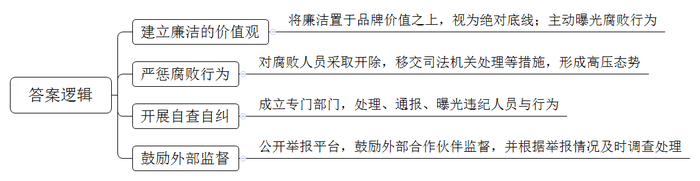
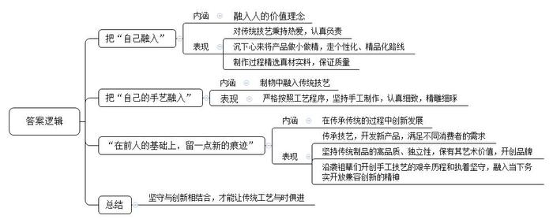
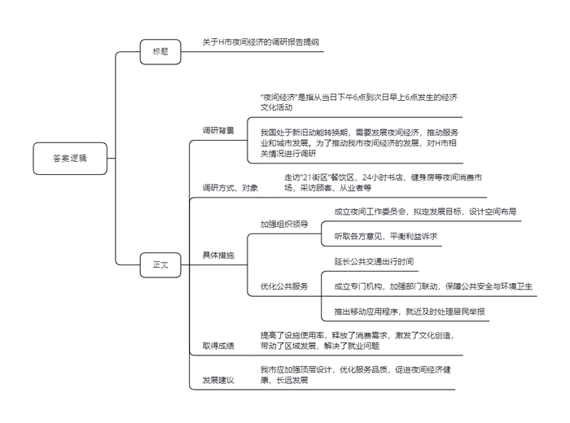
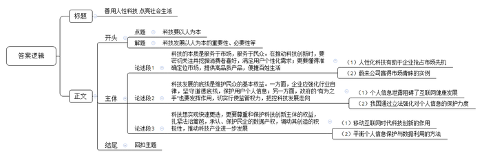

# 2020年0822公务员多省联考《申论》题（甘肃市县卷）

> 候选采集稿。参考答案及解析来自粉笔页面，不代表官方答案或真实高分答卷；来源使用许可与原卷对应关系仍需人工核实。

## 给定材料

### 材料 material-59a05d44f225d07c

7月17日凌晨，S公司总裁张总发了一条朋友圈，写道“公司里有些部门有了权力，不是为用户、客户服务，而是变成寻租的工具，这完全违背公司的基本价值观和文化，要用最锋利的刀子将这些腐烂的肉切掉。”伴随着民营企业高速发展的，是企业内部从未间断的腐败问题，就在同一天，另一家民营企业的三名高管因涉嫌非国家工作人员受贿罪，被警方刑事拘留。该公司还披露过一组反腐数据：2018年，公司内部共调查经济类刑事案件29起，移送公安机关查处89人。

提到企业反腐，人们往往会想到国企，而忽略了民企。有人以为，民企都是私人的钱财，因此不存在腐败问题，这是一种误解。虽然民企属于私人所有，但从没脱离社会，必然与企业外部的社会组织和个人发生各种各样的关系，因此企业的行为并不完全是私人性质的活动。特别是在规模较大的民营企业中，所有权往往与经营管理权处于分离状态，一些经营管理人员受个人私欲及社会不良风气影响，在工程建设、物资采购、业务外包等环节中，挪用资金、贪污钱款、收受贿赂等现象时有发生，既损害了企业利益，也败坏了社会风气。客观地说，中国的民营企业尚处于发展的初级阶段，内部的管理制度和监督机制还不够完善，经营管理人员的法制观念和自我约束能力在整体上也不如国家公务员，因此在面对诱惑时需要更强的辨析是非的能力、抵御诱惑的能力。事实上，如果对民营企业的腐败问题听之任之，其必将蔓延到其它领域，形成对社会环境的污染。

令人欣慰的是，越是处于行业领先、高速发展、且富有雄心的民营企业，越是在内部风险治理上毫不妥协、高调且干脆。这些企业不留余地地主动公开腐败行为，将廉政、清洁的价值观置于企业品牌价值之上，视为绝对底线。某著名的民营上市公司在2018年一口气开除了45个企业腐败人员，其中16人被移送司法机关。该公司内部通告：“今天，以公开信的方式晒我们内部光鲜亮丽外表下丑陋的一面。”考虑到“家丑不可外扬”的传统，企业融资、品牌管理等现实利益，一家公司能够对内公开说出这样的话，需要多大的勇气？另一家互联网公司也不含糊，在收到举报后迅速行动，55人被查。不得不说这种公开处理本身意味着底气，也是一种态度。当代中国，对权力的贪腐保持高压已是常态，反而是公司法人对内部寻租的反思与自我批判，显得更为稀缺。此外，强调依法自查自纠、强化内部审计与风险管理，提供相匹配的价值观与文化体系，已成为一批公司的先行之举。如某贸易公司，于2018年6月成立了审计部，内部干脆称之为“廉政公署”。这个“廉政公署”近一年来已多次处理、通报、曝光违纪人员。除了自查自纠，该公司甚至对外公开了举报平台，鼓励外部合作伙伴参与监督。

有关专家认为，反腐败正逐渐从个别民营企业的内部治理行为上升为行业共同准则，乃至所有民营企业的一种共识，这种共识是有可能带来行业治理，并推动整个社会风气转折的。企业人即社会人，人们历来倾向认为，投资、财务和管理相对自由的民企，处事更为“灵活”。至于这种“灵活”是否同样反映出企业内部权力寻租的可能性，人们很少予以深刻的反省，更谈不上应对和解决之道。然而，民营企业提供了80%的就业岗位，民企内部廉洁制度的建立和完善，就天然是社会治理的一部分，这与政府提倡的构建亲清新型政商关系相辅相成。在高压反腐态势下，民企的防腐不能只是“一阵风”，而应成为常态，要与国家反腐败体系形成联动，设立民营经济领域反腐败法律法规，将民营企业反腐败上升到法治层面。中国民营企业自我反腐准则的形成，其中的意义不言而喻。说到底，视廉洁为命的公司，才更有资格谈未来。

### 材料 material-3ca8002058e1fbf5

总面积不过八平方米的店铺，摆满货品之后，两人在店内走动都有些困难。但这家小店在当地却小有名气。69岁的店主老林是资深木雕艺人，更被称为“最后的手工酸枝筷子传人”。这些手工木筷取材自缅甸坤甸木、老挝大红酸枝、泰国乌梅木、印度小叶紫檀和海南黄花梨这五种木材。其中，缅甸坤甸木筷最实惠，乌梅木筷和酸枝木筷最受欢迎，而海南黄花梨木筷因为材料稀缺，必须提前预订，属于收藏品级别。老林家的店铺是他爷爷在1889年创立的，解放后曾一度关门歇业，到1991年又重新开业。到了老林这一代，各行各业飞速发展，市场化程度越来越高，但老林对这门家族生意和手艺有着自己的坚持，多年来一直拒绝大批量生产，执着地以手工制作每一双筷子。老林告诉记者，这些年来，不断有人想和他合作，希望形成规模生产，全部都被他一口回绝。对方取笑他不会赚钱，他却说自己知足常乐，虽无大富大贵，但也丰衣足食，守着家族生意无是无非，认真做好每一个作品。“钱多了就会想要更多，永远没有止境，这样下去最终结果如何？太多这样的例子了。”在老林看来，手工制筷工序复杂，没有捷径可走，每道工序都要求严格，稍有不慎，筷子就会走样。一双好筷，真正检验它的只有漫长的时间。做手艺，做生意，心术都要正，必须沉下心来，慢工出细活，而只要工艺精湛，总会有人来购买。正因如此，林家小店始终有一批熟客，“别人要做大做强，那是他们的事，我偏要做小做精，走个性化、精品化的路线。”

林家生产筷子的小作坊现在共有十多个工人，当中不少是跟随了他20多年的老师傅，每一双筷子经手工打磨，日均产量也难有标准数字，一天下来，大约能制成40多捆筷子。老林说：“本地早就没有人做手工筷子了，放眼全国，也没有人坚持手工制作一双小小的筷子，都是机械化生产。”对于自己制作的筷子，老林相当自豪。他说，普通筷子使用了几个月后就得更换，而他家的筷子真材实料、质量过硬，只要避免高温消毒损耗木质，基本上可以用一辈子。去年开始，家族生意已由他唯一的女儿小林接手。面对自家的木筷生意，小林有自己的想法。除了传承父辈制筷技艺，她还有意开发新产品，满足不同消费者的需求。她说：“人在制物的过程中，总是要把自己和自己的手艺融到里头去，在前人的基础上，留一点新的痕迹，这样这门手艺才能历久弥新。”

如今，在国家政策指引下，许多的老手艺又重现生机。它们还能再现昔日的辉煌吗？当今，工业产品已经占据了人类日常生活品的绝大部分，传统手工艺制品已经不大可能再重塑曾经为普罗大众制造日用品的历史。小林认为：“由于受原材料、制造技艺、生产工时等等各种主客观条件的限制，传统手工艺制品已经与奢侈品无异，就拿我家的筷子来说，其投入成本较高、产品独立性较强，并带有一定的艺术价值，这些都具备了开创品牌的条件。”在小林看来，“林家筷子”不只是他们家赚钱谋生的商品，也不只是手艺人技艺的表现，祖辈们开创手工木艺的艰辛历程，与当下务实开放兼容创新的精神是非常契合的。

两代人经营理念的对接，或许还需要一些时日，不过，坚守传统手艺的初心一致。时代变迁自有节奏，哪怕只是手中一双小小的筷子，也要一点点打磨制作，方对得起“工艺”二字。

### 材料 material-e10a3403f42c4759

八月的H市，已进入高温炙烤模式。夜，却未因此而平静。晚上十点，市区最大商场的主体部分已经打烊，人们陆续从商场大门走出。与此同时，另一批“意犹未尽”的顾客走进了地下一层和地下二层东侧的“21街区”。这片主营餐饮的区域营业时间一直会延长到凌晨两点，是名副其实的“深夜食堂”。人们在炸糕店前排队买着炸糕、在奶茶店外挑选着饮料、手捧着冰淇淋和炸鸡……街区内无论面条米饭、饺子煎包、中餐西餐种类都很丰富。

H市商务局的陈科长介绍说，所谓“夜间经济”，是指从当日下午6点到次日早上6点发生的经济文化活动。在不少人看来，夜间经济无非就是“啤酒烤串加唱歌”。事实上夜间经济的内涵远比“吃吃喝喝”丰富得多。它已经由早期的灯光夜市转变为包括“食、游、购、娱、体、展、演”等在内的多元夜间消费市场。

H市一家著名的24小时书店，就给人们的夜生活增加了一种新的方式。位于临窗位置的阅读区，摆放着一张长桌和七把圆形座椅，其中六把已被读者占用。年轻姑娘小赵戴着耳机，全神贯注地看手机播放的“中国会计网校”课程。休息间隙，小赵告诉记者，自己参加工作不到一年，打算自学考“注会”。合租环境比较吵闹，下班晚餐后就来书店学到10点多再回去，“这里环境好，手机用来听课，也没有电脑玩儿，效率还是很高的。”

“再来，加把劲儿！”听着一旁教练的口令，扎着马尾辫的女孩咬了下嘴唇，抹了下额头的汗珠，继续奋力向前推着沉重的杠铃。已是夜里九点半，位于H市南二环附近的一家健身工作室灯火通明。“每天人最多的时候是八点左右，现在好多人已经练完走了。”健身教练表示，“我们工作室成立近三年，明显感觉到健身的人在增多。来这里的大部分是附近的住户，下班之后过来健身。正常我们是晚上十点关门，但有的人下班晚，跟教练约了，过来练到十一点，十二点也没问题，我们都等。”

为了做好夜间经济这篇大文章，H市于2019年年初成立了由政府相关部门和行业协会组成的夜间工作委员会，拟定夜间经济发展目标，设计夜间经济空间布局，并通过与场地经营者、工作人员、夜间消费者以及周边居民对话的方式听取各方意见，平衡相关群体的利益诉求。同时，交通部门延长了地铁、公交夜间行车时间，为夜间经济的消费者和从业人员提供安全、便捷、舒适的交通工具。夜间经济的安全、噪音、垃圾等问题最为人们所诟病。H市成立专门机构，加强公安、消防、城市管理等多部门联动，确保了夜市附近的公共安全、环境卫生。此外还推出了移动应用程序，供居民举报夜间滋扰情况，可通过网络联系所在区域社区的负责人，直接对问题进行处理。

“夜间经济提高了设施使用率、释放了消费需求、激发了文化创造、带动了区域发展。此外，由于夜间具有与常规工作时间错位的优势，更多的潜在劳动力也能够通过在夜间上岗解决就业问题，缓解社会就业压力。如何让夜间经济健康有序的成长，政府的顶层设计尤为关键，政策质量高了，服务品质好了，投资者信心才更强，‘夜间经济’才会走得更好，走得更远。”陈科长感慨地说。

上海财经大学的张教授认为，当前，我国正处于新旧动能转换的关键时期，服务业具有吸引社会资本与居民消费的双重属性。以商务活动为主的夜间消费正好是服务业发展的最佳着力点。随着人民生活水平不断提高，对于消费的需求也更加多元化，在未来，夜间经济必将成为城市发展的重要源动力。

## 题目

### 第 1 题

**根据****“给定资料**1**”，概括民营企业处理贪腐问题的举措。（10分）**

关联材料：material-59a05d44f225d07c

作答要求：

要求：准确、全面、简明，不超过150字。

### 第 2 题

**“给定资料**2**”中划线句子写道“人在制物的过程中，总要把自己和自己的手艺融入到里头去，在前人的基础上，留一点新的痕迹，这样这门手艺才能历久弥新”，请根据“给定资料**2**”谈谈你对这句话的理解。（20分）**

关联材料：material-3ca8002058e1fbf5

作答要求：

要求：

（1）观点明确，分析全面；

（2）不超过300字。

### 第 3 题

**假如你随市商务考察团到****H市调研“夜间经济”发展情况，请结合“给定资料**4**”，写一份调研报告提纲。（20分）**

关联材料：material-e10a3403f42c4759

作答要求：

要求：

（1）紧扣材料，内容全面；

（2）层次分明，有逻辑性；

（3）不超过400字。

### 第 4 题

**“给定资料**5**”中提到，没有良心的科技必将造成社会失序。请你参考给定资料，以****“****以人为本，科技向善****”****为主题，联系实际，自拟题目，写一篇文章。（50分）**

关联材料：material-59a05d44f225d07c

作答要求：

要求：

（1）观点明确，逻辑清晰；

（2）层次分明，语言流畅；

（3）参考给定资料，但不拘泥于给定资料；

（4）总字数1000～1200字。

## 答案与解析

第 1 题

**参考答案（粉笔题库参考内容）**

1.建立廉洁的价值观。将廉洁置于品牌价值之上，视为绝对底线；主动曝光腐败行为。

2.严惩腐败行为。对腐败人员采取开除，移交司法机关处理等措施，形成高压态势。

3.开展自查自纠。成立专门部门，处理、通报、曝光违纪人员与行为。

4.鼓励外部监督。公开举报平台，鼓励外部合作伙伴监督，并根据举报情况及时调查处理。

**解析**

**参考答案说明：**本参考答案从“建立廉洁的价值观”“严惩腐败行为”“开展自查自纠”“鼓励外部监督”这四个方面展开；其次对每个经验进行概括时，将总结性的信息前置，要点更为清晰，明确。

**考点**：考点概括措施类

**来源**：来源2020年0822公务员多省联考《申论》题（甘肃市县卷）

粉笔申论页面对本题只提供「解析视频」入口，该入口是会员推广位，页面无视频地址与文字解析。

第 2 题

**参考答案（粉笔题库参考内容）**

一、把“自己融入”指融入人的价值理念：对传统技艺秉持热爱，认真负责；沉下心来将产品做小做精，走个性化、精品化路线；制作过程精选真材实料，保证质量。

二、把“自己的手艺融入”指制物中融入传统技艺：严格按照工艺程序，坚持手工制作，认真细致，精雕细琢。

三、“在前人的基础上，留一点新的痕迹”指的是在传承传统的过程中创新发展：传承技艺，开发新产品，满足不同消费者的需求；坚持传统制品的高品质、独立性，保有其艺术价值，开创品牌；沿袭祖辈们开创手工技艺的艰辛历程和执着坚守，融入当下务实开放兼容创新的精神。

四、因此，坚守与创新相结合，才能让传统工艺与时俱进。

**解析**

**参考答案说明：**（1）思路方面，本参考答案按照词句解释题“总体释义+展开解释+总结”的一般答题思路展开。（2）内容方面，本参考答案先分别解释了“把自己融入”“把自己的手艺融入”“在前人的基础上，留一点新的痕迹”的内涵，接着分别分析了其具体表现，最后在“总结”部分给出了对策。（3）词句表达方面，本参考答案加上了“因此”等连接词来承接上下文。

**考点**：考点词句解释类

**来源**：来源2020年0822公务员多省联考《申论》题（甘肃市县卷）

粉笔申论页面对本题只提供「解析视频」入口，该入口是会员推广位，页面无视频地址与文字解析。

第 3 题

**参考答案（粉笔题库参考内容）**

关于H市夜间经济的调研报告提纲

调研背景：“夜间经济”是指从当日下午6点到次日早上6点发生的经济文化活动。我国处于新旧动能转换期，需要发展夜间经济，推动服务业和城市发展。为了推动我市夜间经济的发展，对H市相关情况进行调研。

调研方式、对象：走访“21街区”餐饮区、24小时书店、健身房等夜间消费市场，采访顾客、从业者等。

具体措施：1.加强组织领导。成立夜间工作委员会，拟定发展目标，设计空间布局；听取各方意见，平衡利益诉求。2.优化公共服务。延长公共交通出行时间；成立专门机构，加强部门联动，保障公共安全与环境卫生；推出移动应用程序，就近及时处理居民举报。

取得成绩：提高了设施使用率，释放了消费需求，激发了文化创造，带动了区域发展，解决了就业问题。

发展建议：我市应加强顶层设计，优化服务品质，促进夜间经济健康、长远发展。

**解析**

**参考答案说明：**（1）一方面，内容上，正文部分从调研背景，调研方式、对象，具体措施，取得成绩，发展建议五个方面介绍了H市发展夜间经济的具体情况。（2）另一方面，形式上，本参考答案做到了分段、分条撰写，整体上条理较为清晰。

**考点**：考点总结类

**来源**：来源2020年0822公务员多省联考《申论》题（甘肃市县卷）

粉笔申论页面对本题只提供「解析视频」入口，该入口是会员推广位，页面无视频地址与文字解析。

第 4 题

**参考答案（粉笔题库参考内容）**

**善用人性科技 点亮社会生活**

科学技术是人类文明进步的标志，带领人们从信息化时代走向了智能化时代，不断改变着人们的生活方式。但如果一味地追求科技发展速度，而忽视了应有的人性关怀，就会背离科技发展的本质，甚至造成社会失序。科技创新应该牢牢把握科技本质，坚持以人为本，关注民众基本权益，坚决维护创新主体利益，才能推动科技良性发展，不断改善人民生活。

**科技的本质是服务于市场，服务于民众。在推动科技创新时，要密切关注并挖掘消费者喜好，满足用户个性化需求；更要懂得准确定位市场，提供高品质产品，便捷百姓生活。**在竞争日趋激烈的今天，运用人性化科技的企业，势必更好抢占市场先机。例如蔚来公司率先采用“车电分离”技术，使电动汽车可以在充电站快速更换电池，有效地解决了电动车充电慢的难题，不仅为群众提供更加便利的体验，也赢得了市场的青睐，使之成为国内市值第一的汽车企业。

科技是第一生产力，能服务社会、促进经济发展。但是，如果科技的研发者和使用者失去了良心，便会引发用户隐私泄露、企业数据被盗用等诸多问题，进而造成社会的失序。因此，需要企业、政府等多方发力，共同营造良好的科技创新氛围。

**科技发展的底线是维护民众的基本权益。一方面，企业应强化行业自律，坚守道德底线，保护用户个人信息；另一方面，政府的“有为之手”也要发挥作用，切实行使监管权力，把控科技发展走向。**从支付宝“年度账单事件”造成大量用户信息外泄，到Wi-Fi万能钥匙私自窃取用户隐私，再到AI换脸视频软件“Zao”用户协议风波，因企业规则意识缺失造成个人信息泄露事件屡屡发生，使得个人信息主体一度站在互联网服务提供者的对立面，严重阻碍互联网生态的良性发展。但我们也能够看到，对于科技的规范手段也在不断完善，在新颁布的民法典中，个人信息保护作为重要内容被编写进了人格权编中，彰显出我国对个人信息保护的重视和决心。

**科技想实现快速更迭，更要尊重和保护科技创新主体的权益，扎紧法治篱笆，承认、保护民企的数据产权，调动其创造的积极性，推动科技产业进一步发展。**在移动互联网全面普及的时代背景下，企业通过技术手段对海量数据进行深度分析、挖掘，开发出即时通讯、电子商务、短视频等互联网产品，极大程度地提高了社会生产效率，使民众生活高效化、便捷化，还催生了如外卖、网约车等新兴行业，培育出新的经济增长点。此类民企作为新的独立利益主体出现，敦促立法者加快实现个人信息保护和海量数据合理利用间的平衡。在保护用户信息安全的基础上，明确企业数据收集、使用的合法性边界，激励企业持续进行创新创造，营造行业公平合理竞争的环境，避免劣币驱逐良币的负面效应。

科技兴则民族兴，科技强则国家强。为了实现社会主义现代化的宏伟目标，还需政府和企业共同努力，激发科技创新发展动力，让人性化的科技创新不断推动社会发展！

**解析**

**文章分析**

**善用人性科技 点亮社会生活**

【**标题的优点****：**首先，范文的标题突出了“以人为本，科技向善”这一主题。其次，它在形式上采用了对称式结构，前半句点出了主题，后半句点出了意义，使标题更加完整、饱满。】

（1）科学技术是人类文明进步的标志，带领人们从信息化时代走向了智能化时代，不断改变着人们的生活方式。（2）但如果一味地追求科技发展速度，而忽视了应有的人性关怀，就会背离科技发展的本质，甚至造成社会失序。（3）科技创新应该牢牢把握科技本质，坚持以人为本，关注民众基本权益，坚决维护创新主体利益，才能推动科技良性发展，不断改善人民生活。

【**开头的优点：**★内容方面：范文的开头是紧扣题目给定的“以人为本，科技向善”这一主题展开的。首先，开头前两句话点出主题，做到了主题明确。其次，对“以人为本，科技向善”这一主题进行了分析阐述，指出了：（1）科技发展的重要性；（2）科技发展盲目求快造成的危害；（3）科技发展的方向。★文字表达方面：使用了“但”“而”“甚至”等关联词，使语言表达有逻辑性。】

**科技的本质是服务于市场，服务于民众。在推动科技创新时，要密切关注并挖掘消费者喜好，满足用户个性化需求；更要懂得准确定位市场，提供高品质产品，便捷百姓生活。**（1）在竞争日趋激烈的今天，运用人性化科技的企业，势必更好抢占市场先机。（2）例如蔚来公司率先采用“车电分离”技术，使电动汽车可以在充电站快速更换电池，有效地解决了电动车充电慢的难题，不仅为群众提供更加便利的体验，也赢得了市场的青睐，使之成为国内市值第一的汽车企业。

【**论述段****1的优点：**★观点句：范文的观点句是紧扣“以人为本，科技向善”这一文章主题提出的。形式上，它在段首处直接写出，位置突出，容易被发现；内容上，关键词突出，内容要点明确，可以明显看出它是从“满足个性化需求、准确定位市场”等角度入手，指出了“科技的本质是服务于民”。★论述内容：（1）指出人性化科技有助于企业抢占市场先机；（2）介绍蔚来公司赢得市场青睐的实例。注意：以上两个方面的内容都是紧扣观点句“科技的本质是服务于市场，服务于民众。在推动科技创新时，要密切关注并挖掘消费者喜好，满足用户个性化需求；更要懂得准确定位市场，提供高品质产品，便捷百姓生活”进行分析论述的，针对性强、内容层次丰富。最后，在论述方法和论据的选取上做到了讲道理、举例子相结合，让论述内容丰富多样。】

科技是第一生产力，能服务社会、促进经济发展。但是，如果科技的研发者和使用者失去了良心，便会引发用户隐私泄露、企业数据被盗用等诸多问题，进而造成社会的失序。因此，需要企业、政府等多方发力，共同营造良好的科技创新氛围。

【**过渡段的优点：**范文的过渡段分析了“科技”的重要意义，阐述了没有良心的科技造成的危害。此外，还要注意过渡段末尾的“需要企业、政府等多方发力，共同营造良好的科技创新氛围”是用来引起下文的过渡句。】

**科技发展的底线是维护民众的基本权益。一方面，企业应强化行业自律，坚守道德底线，保护用户个人信息；另一方面，政府的****“有为之手”也要发挥作用，切实行使监管权力，把控科技发展走向。**（1）从支付宝“年度账单事件”造成大量用户信息外泄，到Wi-Fi万能钥匙私自窃取用户隐私，再到AI换脸视频软件“Zao”用户协议风波，因企业规则意识缺失造成个人信息泄露事件屡屡发生，使得个人信息主体一度站在互联网服务提供者的对立面，严重阻碍互联网生态的良性发展。但我们也能够看到，（2）对于科技的规范手段也在不断完善，在新颁布的民法典中，个人信息保护作为重要内容被编写进了人格权编中，彰显出我国对个人信息保护的重视和决心。

【**论述段****2的优点：**★观点句：范文的观点句是紧扣“以人为本，科技向善”这一文章主题提出的。形式上，它在段首处直接写出，位置突出，容易被发现；内容上，关键词突出，内容要点明确，可以明显看出它是从“行业自律、政府监管”等角度入手，指出了“科技发展要维护民众权益”。★论述内容：（1）举例说明个人信息泄露阻碍了互联网健康发展；（2）指出我国通过立法强化对个人信息的保护力度。注意：以上两个方面的内容都是紧扣观点句“科技发展的底线是维护民众的基本权益。一方面，企业应强化行业自律，坚守道德底线，保护用户个人信息；另一方面，政府的‘有为之手’也要发挥作用，切实行使监管权力，把控科技发展走向”进行分析论述的，针对性强、内容层次丰富。最后，在论述方法和论据的选取上做到了讲道理、举例子相结合，让论述内容丰富多样。】

**科技想实现快速更迭，更要尊重和保护科技创新主体的权益，扎紧法治篱笆，承认、保护民企的数据产权，调动其创造的积极性，推动科技产业进一步发展。**（1）在移动互联网全面普及的时代背景下，企业通过技术手段对海量数据进行深度分析、挖掘，开发出即时通讯、电子商务、短视频等互联网产品，极大程度地提高了社会生产效率，使民众生活高效化、便捷化，还催生了如外卖、网约车等新兴行业，培育出新的经济增长点。此类民企作为新的独立利益主体出现，（2）敦促立法者加快实现个人信息保护和海量数据合理利用间的平衡。在保护用户信息安全的基础上，明确企业数据收集、使用的合法性边界，激励企业持续进行创新创造，营造行业公平合理竞争的环境，避免劣币驱逐良币的负面效应。

【**论述段****3的优点：**★观点句：范文的观点句是紧扣“以人为本，科技向善”这一文章主题提出的。形式上，它在段首处直接写出，位置突出，容易被发现；内容上，关键词突出，内容要点明确，可以明显看出它是从“加强法治、保护产权”等角度入手，指出了“科技发展要尊重和保护创新主体的权益”。★论述内容：（1）介绍了移动互联网时代科技创新的作用；（2）指出了平衡个人信息保护与数据利用的方法。注意：以上两个方面的内容都是紧扣观点句“科技想实现快速更迭，更要尊重和保护科技创新主体的权益，扎紧法治篱笆，承认、保护民企的数据产权，调动其创造的积极性，推动科技产业进一步发展”进行分析论述的，针对性强、内容层次丰富。最后，在论述方法和论据的选取上做到了讲道理、举例子相结合，让论述内容丰富多样。】

【**论述段之间的关系：**★内容的内在逻辑：范文的论述段之间是依照“并列”的逻辑展开的。论述段1先写了“科技的本质是服务于民”，论述段2再写了“科技发展要维护民众权益”，论述段3接着写了“科技发展要尊重和保护创新主体权益”。★段与段的外在衔接：论述段1之后的过渡段“科技是第一生产力，能服务社会、促进经济发展。但是，如果科技的研发者和使用者失去了良心，便会引发用户隐私泄露、企业数据被盗用等诸多问题，进而造成社会的失序。因此，需要企业、政府等多方发力，共同营造良好的科技创新氛围”，起到了承接论述段1、引出论述段2和论述段3的作用。】

科技兴则民族兴，科技强则国家强。为了实现社会主义现代化的宏伟目标，还需政府和企业共同努力，激发科技创新发展动力，让人性化的科技创新不断推动社会发展！

【**结尾的优点：**范文的结尾回扣了“以人为本，科技向善”这一主题，并发出了呼吁号召。】

**考点**：考点文章写作题

**来源**：来源2020年0822公务员多省联考《申论》题（甘肃市县卷）

粉笔申论页面对本题只提供「解析视频」入口，该入口是会员推广位，页面无视频地址与文字解析。

