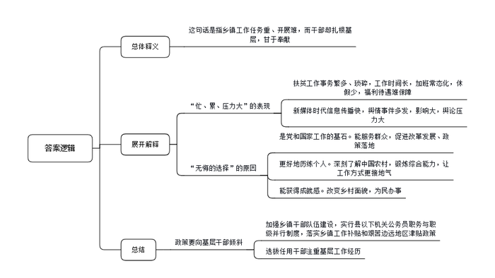
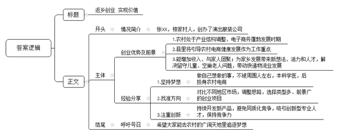
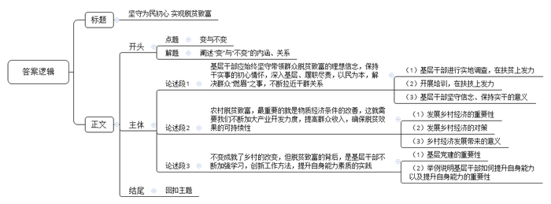

# 2020年0822公务员多省联考《申论》题（甘肃省级卷）

<!-- gwy:overview:start -->
> **甘肃 · 2020 · 申论 · 省级卷** ｜ 4 题 · 图片 4 处 · 答案随题折叠

导航：[题目](#题目) · [材料 1](#材料-1)
<!-- gwy:overview:end -->

> 候选采集稿。参考答案及解析来自粉笔页面，不代表官方答案或真实高分答卷；来源使用许可与原卷对应关系仍需人工核实。

## 给定材料

### 材料 1

“我们都在努力奔跑，我们都是追梦人。”是的，我们都是追梦人。追梦，我们收获满满；追梦，我们希望满满。

正如习近平总书记所说，中国人民具有伟大梦想精神。改革开放40多年的征程，就是一个追梦之旅。改革开放之初，我们党以非凡的胆略、坚定的自信设计了用70多年、分三步走，基本实现社会主义现代化的宏伟蓝图。改革开放40多年的追梦路上，我们咬定青山不放松，风雨无阻朝着这个伟大目标前进。

从站起来、富起来到强起来，这是奋斗的力量，也是梦想的力量。

党的十九大对我国发展提出了更高的奋斗目标，形成了从全面建成小康社会到基本实现现代化、再到全面建成社会主义现代化强国的战略安排，发出了实现中华民族伟大复兴中国梦的最强音。

但是，船到中流浪更急，人到半山路更陡，并且“愈进愈难、愈进愈险而又不进则退、非进不可”。在这样的关键时刻，我们要心怀梦想、奋勇拼搏，一步一个脚印，一棒接着一棒，在新时代创造中华民族新的更大奇迹！

梦想是拼出来的，奇迹是干出来的。改革开放的辉煌成就背后，是40多年的不懈努力。未来中国梦的实现，同样需要汗水的浇灌。没有人能随随便便成功。改革开放40多年的历程告诉我们：伟大事业都始于梦想，基于创新，成于实干。梦想是激发活力的源泉，只要有梦想，就会有力量。只要有梦想，则时光不弃，未来可期。

### 材料 2

T市新城，环湖公园已全景亮相，湖畔绿道成为健身爱好者的乐园，文化艺术中心正紧锣密鼓建设之中，国际秀场首秀在即……人居环境不断改善，城市功能不断优化，用高品质筑就生态宜居之城，这个新城规划时的梦想正在变成现实。

“今年六月份到年底，国家级和国际级的大型秀场活动都排满了。”国际秀场招商负责人的言语中透着自信与骄傲。国际秀场位于T市新城的时尚小镇内，是时尚小镇中的地标建筑，建设目标是成为中国时尚文化新窗口。目前，国际秀场已竣工，即将迎来“首秀”。

与国际秀场毗邻的是T市新城的文化艺术中心。这个拥有几何立面和斜面屋顶的建筑矗立在湖畔，自成姿态。T市人从此又多了一个看话剧、歌剧的好去处。“家门口就可以看戏、看话剧，梦寐以求的事情实现了。”小吴家住新城，以前看戏，他都要去主城区。“听说文化艺术中心的硬件设施是世界顶级的，”他充满了期待，“希望引进的剧种能多样化、多层次，既有经典又有流行。”

近两年，T市新城加速打造品质之城。人文是这座新城的“心”，沉淀着这个城市的故事，孕育出这个城市的灵气。

城心湖占地面积大，风景优美，历代文人墨客在此题咏。T市新城围绕城心湖而建，这座湖是新城的“肺”。如今，一条环湖的绿道已经建成。环湖绿道是T市新城打造的自然景观之一，全线滨水，视野开阔。从早上六点半到晚上八点半，环湖绿道上随处可见晨练、夜跑的人。中午时分，周边写字楼里的白领们也常常在绿道边漫步休闲，“听着鸟鸣，闻着花香，很舒服。”

未来，这条绿道将向整个新城延伸，设计有骑行道和步行道，还有VR体验馆，满足人们多样的需求。绿道不仅连接新城所有的公园和景点，还将城市与乡村紧密相连，走在绿道中，仿佛走在画中。绿道就像是新城的“脉”，通过绿道串起来的是一个大写的“融”字。绿道建设负责人说，“我们希望这条路连起所有新城人的梦想和记忆。”

城市如人，也要健康、好看。有心灵的跃动，脉搏的畅通，还要有肌肤的美丽。公园就是新城的肌肤。

藕花再现，湖泊复兴。新城将在环湖公园实现全域亮灯，呈现全线夜景灯光秀，一个“越夜越美丽”的环湖公园就要来到市民的生活中。环湖公园之美，靠的是技术和规划。环湖公园水生态养护的负责人说：“我们已经在湖中建成了一套成熟的水下生态系统。”水生态技术让这里的夏天再现“藕花满汀洲”的盛景。陆地上也有一套完整、科学的植被规划，以自然景观为基调形态，突出四季变化。春季赏花，夏季绿荫，秋季观叶，冬季葱郁，营造出充满活力的自然生态树林景观。

相较于环湖公园的自然与人文，体育公园的针对性更强。全民体育，乐跑体育，以运动促健康，是这里的主题。动与静、开放与私密、艺术与自然相结合的运动环境，满足了各年龄段人群健康、休闲、品质的运动需求。距离体育公园不远的花海公园则以“新城潮生活”为主题，怒放的花海让这里变得浪漫温馨。

公园让城市变得美丽光鲜，它为我们建造了一个“桃花源”，安放新城人生态宜居的梦想。

### 材料 3

“真希望自己是‘三头六臂’就好了！”M乡王乡长快人快语。王乡长正在负责完善贫困户档案，要了解家庭人员构成、住房改造前后照片对比、种植养殖种类及数量、扶持项目公示、会议记录、入户追访、满意度调查等内容。一方面，因为建档的需要，要填写大量的表格等资料。另一方面，“表格的内容很细致，不到贫困户家中实地调查那是不行的。看似简单的事情其实很繁琐，有时候要来回跑很多趟。”

基层工作千头万绪，事务繁多，而且某件事成为舆情热点，不仅会极大增加基层工作量，而且让基层干部倍感压力。经历过几次舆情热点事件，M乡宣传干事小陈已经略有心得：尽快披露事实，优先回应网友质疑......然而，小陈却坦言工作不易：“国家强调依法治国，事情处理起来都有程序，需要时间。但新媒体时代信息传播越来越快，造成舆论影响迅速放大。”一次该地出现旅游纠纷，消息在网上飞快传开，网友一边倒地批评景区，可是通过调查却发现，其实是游客挑衅。“虽然最后真相大白，可还是给我们造成了很大的压力。”小陈说。

基层，是整个社会的“地基”，这个“地基”是社会的主体，也是时代的主流。基层干部，是党和国家工作的“基石”，他们奋战在改革发展的主战场、服务群众的最前沿。目前绝大多数政策落地都在县乡，从脱贫攻坚到民生保障，再到招商引资、产业发展、入户做群众工作，都离不开基层干部。基层干部忙得脚打后脑勺，加班是常态，但干部们几乎都没有加班费。有关科研机构的调查显示，乡镇干部平均每天工作10到11个小时，不少乡镇干部五六年没休过假。

王乡长说：<u>“乡镇工作虽然忙、累、压力大，但也是我们无悔的选择。”</u>

C乡党委李书记至今已在5个乡镇工作过，乡镇的每个岗位几乎都干过。“乡镇是最基层的行政机构，但麻雀虽小五脏俱全。产业发展、土地问题、安全生产……能最深刻地了解中国农村，最全面地锻炼干部能力。”李书记说。基层工作经历让乡镇干部的综合能力得到迅速提升，工作方式也更接地气，他们也很感谢这样的历练。

2017年，中共中央办公厅发文，强调要加强乡镇干部队伍建设，实行县以下机关公务员职务与职级并行制度，落实乡镇工作补贴和艰苦边远地区津贴政策。“而且现在干部的选拔任用更加注重基层工作经历，相关政策也更多向基层干部倾斜。干部想更长远发展，基层工作其实也是一个重要的经历。”李书记说。

不过，在李书记看来，最重要的还是乡镇工作独特的成就感。“我们很多人都是农村出身，很多亲戚朋友都在农村。改变家乡面貌，帮助农民做点事，这是我们肩负的使命。”C乡地处贫困地区，李书记带领群众克服海拔高、交通条件差、缺工人缺材料等困难，在三个月内改造了71栋房子，“看着很多贫困户欢欢喜喜搬进新房，我忍不住流下眼泪。想到靠自己的努力能够改造一方水土，有一种梦想正在一点点地实现的感觉，那个时候，你就会觉得所有的付出都值得。”

### 材料 4

因为早就敏锐地发现了农村创业的机遇，2010年小张在大学一毕业就果断选择了返乡创业，投身农村电商业务。如今小张已成为村里的“创业榜样”，家里的奖状堆满了一箱。

小张的父亲做了30多年的乡村医生，希望他能接班，所以把他送进了一所医学院。但对自己的未来，小张有不一样的梦想，他觉得自己不适合做医生，应该做点和父亲不一样的事情，才能更好地实现自己的价值。他就想学电子商务专业，但被父亲阻止了。毕业后，没人能再反对他干自己想干的事儿，他决定开网店。

当时电子商务还没有那么火。小张的家乡是N县的楼家村，这是个传统意义上的农业村。当时整个村子接入宽带的都没有几户人家，也没有工业基础。90年代后期，村子里有人开始做起影楼服饰的生意，以家庭作坊居多，并未规模化。销售方式也都是在村里做好后，送到城里去卖，这种上门推销的手工作坊模式发展非常缓慢。

村子里有传统，小张最初想把这种影楼服饰搬到网上去卖。于是，他购买了几台缝纫机和一台电脑，租赁了门面进行服装加工，并在电商平台上注册了网店。刚开始，由于缺乏经验，生意并没有做起来。“我原来是学医的，专业离这个比较远。而且在学校也没学过如何创业，我对此非常陌生，完全是凭着一股热情闯进来的。”小张说，自己一开始并没有对影楼服饰的市场进行过调查，后来才发现影楼服饰市场很小，3个月下来，小张并没有赚到钱，还一度到了交不起房租的窘境。

不过，这个年轻人不服输，他决定去南方看看，了解不同地区的服装制造市场。经过考察，他发现相比于原先狭窄的影楼服饰市场，演出服装要好做得多，类型比较多样，市场能拓展开。就这样，小张调整思路，铆着一股劲，开始转做演出服装的生意。4年过去了，小张成立了自己的公司，建起了2000余平方米的车间，光各类服装设备就有106台。

小张带起的星星之火逐渐发展成了燎原之势。眼看着小张生意越做越好，同村的很多年轻人也陆续仿照着开起了网店。目前，全村300户家庭全都开有网店，年销售收入100万元的服饰加工户30多家，青年回乡创业，除了带来新想法，还有年轻人的生机和活力，留守儿童，空巢老人的问题不复存在。与电子商务相关的周边产业，配套设施也被带动起来，最大的改变是快递物流的出现。一家大型物流公司在村里设点，每天定时收发快件。这也给村里人生活带来了极大的便利。回首过去，小张觉得当初返乡创业是一个非常恰当的选择，顺应了农村产业结构调整和电子商务蓬勃发展的时代潮流。他认为农村为大学生提供了追逐梦想的广阔天地，大学生返乡创业不仅经济收入可观，还能和家人团聚，同时也为农村带来了活力和人才。

不过，返乡创业的大学生们享受着家乡电子商务“野蛮发展”带来的红利时，也有了新的烦恼。小张明显感觉生意没以前好做了。“前两年一件演出服装能赚20至30块钱，现在10块钱吧。”与其他村依山靠山卖土特产不同，楼家村的演出服装似乎没有那么接地气，而开服装网店成本低，一台电脑，再找到一家可靠的代加工厂商就可以“创业”了，很容易造成同质化竞争。小张认为目前保持竞争力的唯一方法就是不停地开发新品，让别人赶不上。“演出服装想创新难，你得自己设计、打板，抄袭成本却很低。”凑巧的是，小张的妻子是服装学院毕业的，妻子便成为家里创新的主力，但小张说：“这显然是不够的，我现在迫切需要专业的设计师过来帮助做创新。”

N县也在类似楼家村这样的村子带动下，发展出了很多“网店村”。这种飞快的发展速度也引起了县委县政府的关注，县委县政府明确提出把引导“网店村”健康发展作为政府服务增效的重要工作内容。“我们正在联系一家大型电商平台，争取双方在跨境电子商务、人才培训、云计算和大数据应用等方面早日开展深入合作。”县委负责人说。

### 材料 5

只因看了一眼岩山，从此她就与岩山结缘。她就是D市岩山驻村帮扶工作队队长、驻村第一书记小孙。几年前，小孙从一所名牌大学硕士研究生毕业，来到D市商务局工作，有一次，市委市政府组织机关干部下基层开展调查研究，她随着调研小组来到了岩山。

“太美了！”小孙被岩山美丽的风景深深震撼，花红柳绿，山清水秀，真是如诗如画。当地淳朴的民风，热情好客的村民更令她印象深刻。不过，令她同样印象深刻的还有岩山的贫困。岩山村共有1345户、4130口人，其中贫困户占60%，人均耕地不足0.8亩，村民收入主要依靠传统农业和外出务工，是国家级贫困村。脱贫是这里的村民一代又一代的梦想。如果能帮助岩山村这样长期贫困的地方摆脱贫困，人生该是多么有价值啊！小孙的心里涌起一个强烈的念头。

此时，D市正深入开展脱贫攻坚行动。巧合的是，岩山村正是商务局的对口扶贫村。小孙主动请缨，担任岩山驻村帮扶工作队队长。“作为名校研究生，有更好的机会，为什么选择到偏远乡村？”面对不解的目光，小孙没有回答，只是报以微笑。

从驻村工作开始的第一天起，帮助岩山这个贫困村脱贫致富的沉甸甸责任，便落在了小孙的肩上。刚入村时，小孙准备先找村民了解情况，但却听到了这样的风凉话：“咋还派个女干部？一个城里女人能干啥？”

为了开好头，获取村民的信任，她和工作队同事，到田间地头了解情况，走家串户查找穷根，入村不到两个月，就完成了对全村所有贫困户的走访，做到村里的“大事小情、家长里短”都了然于心。

随后，小孙与工作队同事组织村民参加手工纺织、月嫂服务等培训班。与此同时，他们筹集资金，在全村开工建设引水上山工程，彻底改变了村里几十年来山上缺水的落后状况。春节前，贫困户饲养的年猪还在愁销路，工作队全程参与推销，终于换来了80多万元沉甸甸的“过年钱”……一连串雪中送炭的实质性帮扶拉近了村民和工作队的距离，村民们被小孙这位“女干部”的真情付出深深打动。

“农村富不富，关键在支部。如何发挥基层党组织的战斗堡垒作用是驻村帮扶的首要工作。”小孙深有感触地说。为此，她和工作队同事带着村里的党员积极开展学习教育活动，提升党员的先锋模范意识。为了提高村干部、村民代表引领产业发展、带领群众致富的能力，小孙多次带领他们到县内外先进地区学习考察，“明显感觉到岩山的民心齐了，村干部的干劲足了、水平高了。”小孙帮助村民脱贫致富的信心更强了。

如何用工业化理念改变村民传统的生产生活方式，尽快引进增收产业项目，为村民创造具有长期稳定收益的就业岗位，实现更多人致富奔小康，是驻村帮扶工作队和村“两委”班子每天都要琢磨的“大事情”。工作队得知外省一家大型现代纺织企业老总是D市人，有回乡投资的想法，便第一时间与他取得联系，进行对接和项目考察。小孙在充分了解到该纺织项目是非常适合岩山村的好项目后，便积极与企业老总沟通招商想法。针对企业提出的十几个落实投资的实际问题，工作队到市、县、乡咨询政策、寻求支持。仅仅5个多月的时间，工作队就协助企业完成了项目选址、各项手续办理、厂房建设、员工培训等一系列重要工作。目前，一个依托“村集体+公司+农户”模式建立起的纺织产业园区，正在岩山渐渐成型。不久的将来，这里的村民不仅可以在家门口就业，而且可以实现既拿薪金又领股金还得租金的长效增收，岩山村的脱贫梦正在逐步实现。

“咱们岩山再也不是那个靠天吃饭的穷地方了，现在不少在外打工的年轻人都回来了。”村民喜滋滋地指着驻村工作队的办公室说，“变化就是从孙书记和她的队员到咱村来的那一天开始的。”

“我们的目标是成为北方最大的坯布集散地。”一个更大的梦想在小孙心中一点点描绘。环境越来越好，梦想越来越大，“但是，作为一名共产党员，我的信念和情怀不会变。”

## 题目

### 第 1 题

**根据给定资料2，总结T市新城生态宜居建设的主要理念和做法。（15分）**

关联材料：材料 2

作答要求：准确，全面，有条理，不超过200字。

第 1 题 · 答案与解析

**参考答案（粉笔题库参考内容）**

理念：改善人居环境，优化城市功能，提高新城品质。

做法：1.打造文化设施，优化文化服务。打造时尚小镇，建设国际秀场、文化艺术中心；举办大型活动，开展话剧、歌剧演出。2.打造环湖绿道，连接新城脉络。向新城延伸，设计骑行、步行道等，满足多样化需求；连接城内公园景点，串联城乡。3.建设城市公园，美化新城环境。环湖公园依靠技术、规划打造灯光秀及生态景观；主题公园营造运动环境，营造温馨浪漫生活氛围。

**解析**

**参考答案说明：**答案先指出了T市新城生态宜居建设的主要理念，又从“打造文化设施，优化文化服务”“打造环湖绿道，连接新城脉络”“建设城市公园，美化新城环境”三个方面对具体做法进行了分条撰写。各条要点之间在内容上是并列关系，无交叉。

**考点**：多要素组合类

**来源**：2020年0822公务员多省联考《申论》题（甘肃省级卷）

### 第 2 题

**请根据给定资料3，谈谈你对划线句子“乡镇工作虽然忙、累、压力大，但也是我们无悔的选择”的理解。（25分）**

关联材料：材料 3

作答要求：全面准确，条理清晰，分析透彻，不超过350字。

第 2 题 · 答案与解析

**参考答案（粉笔题库参考内容）**

这句话是指乡镇工作任务重、开展难，而干部却扎根基层，甘于奉献。

“忙、累、压力大”表现在：1.扶贫工作事务繁多、琐碎，工作时间长，加班常态化，休假少，福利待遇难保障；2.新媒体时代信息传播快，舆情事件多发，影响大，舆论压力大。

“无悔的选择”指基层工作意义重大：1.是党和国家工作的基石。能服务群众，促进改革发展、政策落地；2.更好地历练个人。深刻了解中国农村，锻炼综合能力，让工作方式更接地气；3.能获得成就感。改变乡村面貌，为民办事。

因此，政策要向基层干部倾斜，加强乡镇干部队伍建设，实行县以下机关公务员职务与职级并行制度，落实乡镇工作补贴和艰苦边远地区津贴政策；选拔任用干部注重基层工作经历。

**解析**

**参考答案说明：**思路方面，本参考答案按照词句解释题“总体释义+展开解释+总结”的一般答题思路展开。内容方面，本参考答案首先解释了“乡镇工作虽然忙、累、压力大，但也是我们无悔的选择”的含义；接着分别给出了“忙、累、压力大”的具体表现和“无悔的选择”体现的重大意义；最后给出了对策。词句表达方面，本参考答案加上了“因此”等连接词来承接上下文。

**考点**：词句解释类

**来源**：2020年0822公务员多省联考《申论》题（甘肃省级卷）

### 第 3 题

**根据给定资料4，假如小张的母校拟举办一场大学生返乡创业座谈会，邀请小张出席，请你为小张写一篇发言提纲。（20分）**

关联材料：材料 4

作答要求：

（1）紧扣材料，内容具体；

（2）语言准确，有逻辑性；

（3）不超过300字。

第 3 题 · 答案与解析

**参考答案（粉笔题库参考内容）**

返乡创业 实现价值

一、情况简介：张XX，楼家村人，创办了演出服装公司。

二、创业优势及前景：1.农村处于产业结构调整、电子商务蓬勃发展时期。2.县里将引导农村电商健康发展作为工作重点。3.能增加收入、与家人团聚；为家乡发展带来新想法、活力和人才，解决留守儿童、空巢老人问题，带动快递物流业发展。

三、经验分享：1.坚持梦想。做自己想做的事，不被周围人左右，本科学医，后投身农村电商。2.找准方向。对比不同地区市场，调整思路，选择类型多、前景广的创业项目。3.注重创新。持续开发新产品，避免同质化竞争，吸引创新型专业人才，保持竞争力。

四、呼吁号召：希望大家能去农村的广阔天地里追逐梦想。

**解析**

**参考答案说明：**（1）本题虽然是“提纲”，不必考虑格式，但是为了保险起见，建议加上标题。（2）正文部分，一方面从内容来看，围绕着“大学生返乡创业”这一主题，本参考答案从“情况简介”“创业优势及前景”“经验分享”“呼吁号召”四个方面展开。其中“经验分享”从“坚持梦想”“找准方向”“注重创新”三个层次进行说明。另一方面，形式上，本参考答案做到了分条撰写、标清了序号，整体上条理较为清晰。

**考点**：宣传类

**来源**：2020年0822公务员多省联考《申论》题（甘肃省级卷）

### 第 4 题

**给定资料5中提到村民眼中的变和小孙心中的不变，根据你对此的理解，围绕“变与不变”，联系实际，自拟题目，写一篇文章。（40分）**

关联材料：材料 1、材料 2、材料 3、材料 4、材料 5

作答要求：

（1）自选角度，立意明确；

（2）思路清晰，语言流畅；

（3）参考给定资料，但不拘泥于给定资料；

（4）总字数1000～1200字。

第 4 题 · 答案与解析

**参考答案（粉笔题库参考内容）**

**坚守为民初心 实现脱贫致富**

“草木蔓发，春山可望”，**从靠天吃饭到产业脱贫，变的不仅是农村的经济、农民的生活、农业的发展，也是听天由命向自力更生转变的观念**。这些“变化”的背后，则是“不变”的支撑。**这种“不变”就是共产党人服务为民的信念，是基层干部扎根一线的情怀，更是千千万追梦人的拼搏底色**。

**基层干部应始终坚守带领群众脱贫致富的理想信念，保持干实事的初心情怀，深入基层、履职尽责，以民为本，解决群众“燃眉”之事，不断拉近干群关系。**脱贫前，岩山村物质生活相对贫乏。面对村民的质疑与不信任，扶贫干部怀揣一颗真心，到田间地头了解情况，走家串户查找穷根。在了解了村里的“大事小情、家长里短”之后，因地制宜加强基础设施建设，完善生产条件，发展传统养殖业。与此同时，在扶贫中也重视扶技，根据当地产业特色，开设各种技能培训班，提升群众的生产发展水平。诸如此类，看似件件皆小事，可件件也都是群众心上事，一连串雪中送炭的实质性帮扶拉近了村民和工作队的距离，也带动了乡村经济发展，更是为村容村貌的改善和乡风文明的转变奠定了坚实的基础。

要想实现乡村的真正转变，实现脱贫致富梦，除了坚守初心，坚持实干导向，也需要坚持以增产增效增收，改变传统生产方式作为长远发展的目标。

**农村脱贫致富，最重要的就是物质经济条件的改善，这就需要我们不断加大产业开发力度，提高群众收入，确保脱贫效果的可持续性。**发展乡村产业是实现乡村发展的核心，亦是我们实现民族复兴的必由之路。但仅发展传统产业是远远不够的，我们还需要注重产业的融合发展，在依托当地特色产业的同时，招商引资，发展加工业，进行深加工，并将文化故事融入产品，提升产品附加值，开拓销路，提升收入。乡村经济的发展，不仅可以增加就业岗位，解决乡村人口流失的问题，还可以吸引更多人才返乡就业，反哺乡村自身，增加乡村的活力，从而真正找到穷根、治好穷病、摘掉穷帽。

**不变成就了乡村的改变，但脱贫致富的背后，是基层干部不断加强学习，创新工作方法，提升自身能力素质的实践。**“农村富不富，关键在支部”，发挥基层党组织的战斗堡垒作用是驻村帮扶的首要工作。在这一过程中，要积极开展学习教育活动，提升党员的先锋模范意识。正如“太行山愚公”李保国同志一样，他带领乡亲们脱贫致富的初心不动摇，带领村委班子不断开展学习先进农业知识，完成山区开发研究成果数十项，推广的林业技术更是极大地改善了当地生态环境。可以说，万亩荒地变绿洲，万千贫困人口变富裕，正是依靠李保国同志为首的基层干部们扎实的知识、先进的技术和坚持不懈的实践啊！

“船到中流浪更急，人到半山路更陡”。面对这迅猛变化的时代，我们需要主动求变以更好的适应时代，但更要坚持不变，坚守初心、坚定梦想、一心为民，才能够绘就出“全民奔小康”的蓝图，兑现“一个都不掉队”的誓言！

**解析**

**文章分析**

**坚守为民初心** **实现脱贫致富**

【**标题的优点**：首先，范文的标题“坚守为民初心”突出了“不变”这一主题词，“实现脱贫致富”体现了“变”这一主题词。其次，形式上，文字对称，具有美感。】

（1）“草木蔓发，春山可望”，**从靠天吃饭到产业脱贫，****变的不仅是农村的经济、农民的生活、农业的发展****，也是听天由命向自力更生转变的观念**。（2）这些<u>“变化”的背后</u>，则是<u>“不变”的支撑</u>。（3）**这种“不变”就是****共产党人服务为民的信念****，****是基层干部扎根一线的情怀****，****更是千千万追梦人的拼搏底色**。

【**开头的优点：**★内容方面。范文的开头是紧扣“变与不变”这一主题展开的。首先，开头第一句话解释了“变”的内涵；其次，指出了“变与不变”的关系，即“变是因为不变”；接着指出了“不变”的内涵。★文字表达方面：引用了“草木蔓发，春山可望”等古语，使文章开头显得较有文采，还使用了“也”“更”等并列和递进关联词，使语言表达有逻辑性。】

**基层干部应始终坚守带领群众脱贫致富的理想信念，保持干实事的初心情怀，深入基层、履职尽责，以民为本，解决群众“燃眉”之事，不断拉近干群关系。**（1）脱贫前，岩山村物质生活相对贫乏。面对村民的质疑与不信任，扶贫干部怀揣一颗真心，到田间地头了解情况，走家串户查找穷根。在了解了村里的“大事小情、家长里短”之后，<u>因地制宜加强基础设施建设</u>，<u>完善生产条件</u>，<u>发展传统养殖业</u>。（2）与此同时，<u>在扶贫中也重视扶技</u>，根据当地产业特色，<u>开设各种技能培训班</u>，<u>提升群众的生产发展水平</u>。（3）诸如此类，看似件件皆小事，可件件也都是群众心上事，<u>一连串雪中送炭的实质性帮扶拉近了村民和工作队的距离</u>，也<u>带动了乡村经济发展</u>，更是<u>为村容村貌的改善和乡风文明的转变奠定了坚实的基础</u>。

【**论述段1的优点**：★观点句：范文的观点句是紧扣“变与不变”这一文章主题提出的。形式上，它在段首处直接写出，位置突出，容易被发现；内容上，关键词突出，内容要点明确，可以明显看出它是从“基层干部坚守理想信念，保持干事初心”即“不变”这一角度展开论述。★论述内容：（1）基层干部进行实地调查，在扶贫上发力；（2）开展培训，在扶技上发力；（3）基层干部坚守信念、保持实干的意义。注意：以上三个方面的内容都是紧扣观点句“基层干部应始终坚守带领群众脱贫致富的理想信念，保持干实事的初心情怀，深入基层、履职尽责，以民为本，解决群众‘燃眉’之事，不断拉近干群关系”进行分析论述的，层次清晰、针对性强。在论证方法上采用了讲道理和举例子相结合的方式，使内容更加充实。】

要想实现乡村的真正转变，实现脱贫致富梦，除了坚守初心，坚持实干导向，也需要坚持以增产增效增收，改变传统生产方式作为长远发展的目标。

【**过渡段的优点：**过渡段承上启下，先通过“除了坚守初心，坚持实干导向”承接上文的“不变”，然后通过“也需要坚持以增产增效增收，改变传统生产方式作为长远发展的目标”引出“不变是为了更好的改变”，从而引出后文的主要观点。】

**农村脱贫致富，最重要的就是物质经济条件的改善，这就需要我们不断加大产业开发力度，提高群众收入，确保脱贫效果的可持续性。**（1）发展乡村产业<u>是实现乡村发展的核心</u>，亦是我们<u>实现民族复兴的必由之路</u>。（2）但仅发展传统产业是远远不够的，我们<u>还需要注重产业的融合发展</u>，在<u>依托当地特色产业的同时</u>，招商引资，<u>发展加工业</u>，进行深加工，<u>并将文化故事融入产品</u>，提升产品附加值，开拓销路，提升收入。（3）乡村经济的发展，不仅可以<u>增加就业岗位</u>，<u>解决乡村人口流失的问题</u>，<u>还可以吸引更多人才返乡就业</u>，<u>反哺乡村自身</u>，<u>增加乡村的活力</u>，从而真正找到穷根、治好穷病、摘掉穷帽。

【**论述段2的优点**：★观点句：范文的观点句是紧扣“变与不变”这一文章主题提出的。形式上，它在段首处直接写出，位置突出，容易被发现；内容上，关键词突出，内容要点明确，可以明显看出它是从如何实现经济上的“改变”这一角度展开论述。★论述内容：（1）发展乡村经济的重要性；（2）发展乡村经济的对策；（3）乡村经济发展带来的意义。注意：以上三个方面的内容都是紧扣观点句“农村脱贫致富，最重要的就是物质经济条件的改善，这就需要我们不断加大产业开发力度，提高群众收入，确保脱贫效果的可持续性”进行分析论述的，层次清晰、针对性强。在论证方法上以讲道理为主，增强了论证的说服力。】

**不变成就了乡村的改变，但脱贫致富的背后，是基层干部不断加强学习，创新工作方法，提升自身能力素质的实践。**（1）“农村富不富，关键在支部”，<u>发挥基层党组织的战斗堡垒作用是驻村帮扶的首要工作</u>。（2）在这一过程中，<u>要积极开展学习教育活动</u>，<u>提升党员的先锋模范意识</u>。正如“太行山愚公”李保国同志一样，<u>他带领乡亲们脱贫致富的初心不动摇</u>，<u>带领村委班子不断开展学习先进农业知识</u>，完成山区开发研究成果数十项，<u>推广的林业技术更是极大地改善了当地生态环境</u>。可以说，万亩荒地变绿洲，万千贫困人口变富裕，正是依靠李保国同志为首的基层干部们扎实的知识、先进的技术和坚持不懈的实践啊！

【**论述段3的优点**：★观点句：范文的观点句是紧扣“变与不变”这一文章主题提出的。形式上，它在段首处直接写出，位置突出，容易被发现；内容上，关键词突出，内容要点明确，可以明显看出它是从基层干部改变自身，即“不变”背后的“改变”这一角度展开论述。★论述内容：（1）基层党建的重要性；（2）举例说明基层干部如何提升自身能力以及提升自身能力的重要性。注意：以上两个方面的内容都是紧扣观点句“不变成就了乡村的改变，但脱贫致富的背后，是基层干部不断加强学习，创新工作方法，提升自身能力素质的实践”进行分析论述的，层次清晰、针对性强。在论证方法上采用了讲道理和举例子相结合的方式，使内容更加充实。】

【**论述段之间的关系**：★内在逻辑上：范文的论述段之间呈现递进关系，按照“先说基层干部坚守不变理念和实干，再说通过基层干部的‘不变’推进乡村经济的巨变，最后说基层干部‘不变’背后的‘改变’”的逻辑展开的。★外在衔接上：论述段1之后的过渡段“除了坚守初心，坚持实干导向，也需要坚持以增产增效增收，改变传统生产方式作为长远发展的目标”，起到了承接论述段1，引出论述段2的作用；论述段3开头处的“不变成就了乡村的改变，但脱贫致富的背后”，起到了承接论述段1、2的作用。】

“船到中流浪更急，人到半山路更陡”。面对这迅猛变化的时代，<u>我们需要主动求变以更好的适应时代</u>，但更要坚持不变，坚守初心、坚定梦想、一心为民，<u>才能够绘就出“全民奔小康”的蓝图</u>，兑现“一个都不掉队”的誓言！

【**结尾的优点：**范文的结尾回扣了“变与不变”这一主题，并发出了呼吁号召。结尾短小精悍，不拖沓。】

**考点**：文章写作题

**来源**：2020年0822公务员多省联考《申论》题（甘肃省级卷）

