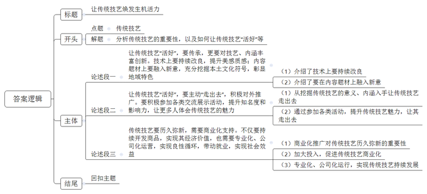

# 2021年甘肃公务员考试《申论》试题（联考市县级卷）

<!-- gwy:overview:start -->
> **甘肃 · 2021 · 申论 · 县级** ｜ 4 题 · 图片 1 处 · 答案随题折叠

导航：[题目](#题目) · [材料 1](#材料-1)
<!-- gwy:overview:end -->

> 本轮只补已有同题来源答案。题面、材料和原作答要求保持原文；尚未取得的答案逐题保留缺项。

<!-- R7 reading guide -->

## 参考作答与范文导读

> 小题看要点与文种，大作文看立意、结构和论证。机构、教师、考生的同题作答可作为不同版本对照；未经核实的实考得分不作高分承诺。

文内识别 4 道作答题；其中 4 题已有可读取的参考版本。该统计是收录与篇幅检查，不代表分数鉴定或原卷完整认证。

| 题号 | 阅读类型 | 当前收录情况 | 入口 |
|---|---|---|---|
| 1 | 小题参考作答 | 已有参考版本 | [查看第1题作答](#r7-reference-1) |
| 2 | 小题参考作答 | 已有参考版本 | [查看第2题作答](#r7-reference-2) |
| 3 | 小题参考作答 | 已有参考版本 | [查看第3题作答](#r7-reference-3) |
| 4 | 作文范文 | 已有参考版本 | [查看第4题作答](#r7-reference-4) |

**范文使用方式：** 先自行作答，再对照材料覆盖、论证展开与表达。来源中的参考例文不是唯一写法；原文附带的解析和其他版本一并保留。

<!-- /R7 reading guide -->

> 申论 · 4 题 · 甘肃 2021

## 给定材料

### 材料 1

　　近年来，长茂村围绕破解人、财、地三个难题，积极推进系列要素联动改革，逐步从一个发展落后的农业村蝶变为远近闻名的“明星村”。

　　以前的长茂村是一个传统的农业村，农作物一年两季，一季烤烟，一季稻谷，粗放式耕种方式抗风险能力弱，市场竞争力不强。“一旦遇上了台风，基本就是颗粒无收。”长茂村党支部书记刘振华说，“我们村地处世界长寿之乡，土壤富含‘长寿元素’硒，空气与水质好、温差大，但为何农业却成为‘跛脚’产业？”曾十余次到此走访的农业大学王教授直言，欠发达地区的资源禀赋优势本来就不明显，若是以分散的土地、少量的资金延续传统农业生产形态，收益自然一般。

　　32岁的黄波是长茂村的致富能手。去年上半年，他一口气向村里的股份合作经济联合社租下40亩地发展木耳种植，“这40亩地，涉及几十户人家，我现在不用一一去谈，只要找村里股份合作经济联合社就行，省去大量沟通成本。”去年以来，为解决承包地分散化、碎片化和低效使用等问题，长茂村建立村级土地合作社。“农民以承包经营权入股，以求将分散在每家每户的耕地经营权‘化零为整’，实现股权到人、股份合作、集体运营。”刘振华介绍，“村级土地合作社以合适的价格集约土地，并将集约后的土地以竞价方式承租出去。对于土地租金增值部分，土地合作社进行二次分配。50%返还给土地出租农户，50%归作集体，用于村里产业发展、关爱老人等公益事业。”

　　黑木耳产业园是长茂村近些年发展“一村一品”特色产业的缩影。该产业园由长茂村利用集体经济扶持资金与产业帮扶资金投资兴建，总投资约500万元，占地约10亩，实行生产、加工、销售一体化经营。记者在黑木耳产业园看到，几十个村民忙着栽培菌种、制作菌棒、养菌，柳琴就是其中一位。“在这上班，一个月有4000元左右的工资，也能照顾家里。”她笑言。据了解，在前期土地流转基础上，长茂村利用村集体经济建设厂房和种植基地，然后每年以20万元价格租赁给企业，探索“党支部+公司+基地+专业合作社+农户”形式，联手组建产业化联合体。同时，村党支部组织农户成立产业合作社，发展专业化生产，形成生产、供销、信用“三位一体”综合合作模式，有效解决农户传统种植模式风险大、竞争力较弱的问题，为村民提供内有技术、外有销路的产业链服务。

　　随着乡村振兴战略的推进，农村发展产业有资金需求，但金融机构有规避风险的责任，“钱从哪儿来，怎么才能用好”的问题愈发突出。为此，长茂村按照因地制宜、入社自愿的原则，探索成立长茂村资金互助社，并设立村级互助基金。“互助基金的资金来源为村民自筹、财政支持和社会捐赠三部分，我们实际筹款103万元。”刘振华说。之后，在互助基金中设置100万不动本基金，用于村集体、农业合作社及村民在银行担保贷款，担保贷款总额度为300万元。不动本基金的利息，一部分归村集体，一部分返还给资金互助社社员。“基金担保+村集体审核+银行授信”合作方式，为长茂村带来多渠道、多方式的融资服务，有助于满足农户短期种养、技术设备购买与更新、产业投资等方面的资金需求，也为长茂村股份合作经济联合社开展项目投资提供资金支持。

　　推进乡村振兴战略，如何释放沉淀资源、推动产业兴旺，是不少乡村遇到的现实难题。在王教授看来，只要思路和方法得当，就能找到适合本地的致富之路，就像把米、红豆、红枣等熬制成八宝粥，能得到更多附加值。长茂村走的正是这样一条路。

### 材料 2

　　材料二

　　下面是某报记者在“我为群众办实事”专题采访活动中收集到的几个小故事。

　　故事一：上班第一天，社区工作者小何就遇到了处理不了的“麻烦”。到社区走访时，一名听力障碍居民因为写不全名字，着急地比划着手势。看不懂手语的小何一头雾水，只能干着急。这次经历令她自责不已。虽然社区里听力障碍居民不多，但如果不能与他们有效沟通，连打招呼都困难，更别说主动提供服务了。想到这里，小何打定主意要学手语。看书、上网课、请教专业老师……刚学会几句简单用语，她便主动找听力障碍居民“聊天”，再帮他们做些小事。慢慢地，沟通的桥梁畅通了。去年初，小何创建了“无声服务室”，内设“调解室”“谈心角”等功能区，帮他们找工作，解决问题，无声的交流成了社区的一道风景。小何说，多数人的便利要考虑，困难群体的利益诉求也不能被忽视。

　　故事二：炭火烧起来，村民围坐在一起，西山村2020年第五十二次屋场会开起来了。屋场会请来了准备来村里投资的企业家，和大家讨论建民宿的事情。需要多少投资？村里人可以参与建设吗？以后能有多少就业岗位……一个个村民关心的问题，在大家的笑声中得到解答。去年的一次屋场会上，有村民提出用电泵引水上山，以解决人畜季节性缺水问题。但有村民质疑，电泵引水上山，尽管不用负担建设成本，但以后用电抽水，电费可能很高。为此，村民们争论不休。会后，扶贫工作队带着这些问题，在村里专门进行了走访调查，特别听取了一些熟悉山里情况老人的意见。一位老人提到村子的后山上有个废弃水库，漏水很多年，如果能把它修好，说不定能行。工作队实地考察后发现，利用旧水库投资小、维护易，的确可行。项目完工后，村民用水成本比原计划减少了一半，临近的村子也受益。

　　故事三：柳荫新区有不少群众是从高山地区易地搬迁来的，适应新环境还需要有个过程。“电梯怎么用？”“过马路为啥要看红绿灯？”入户走访过程中，柳荫新区管委会副主任老朱发现，大家的许多困难都是语言不通、生活不习惯带来的。找到了问题的关键，有人提出了办“夜校”的想法。“夜校”办起来后，老朱和同事们精心准备课程，大到法律法规、国家政策，小到城市生活常识、本地方言，凡是和搬迁群众生活密切相关的，都找人来讲。每次上课，都要下足功夫，做充分的准备。民警讲交通规则、防骗知识，社区工作人员关注易地搬迁移民的衣食住行、生活小事，随迁干部鼓励大家放下乡情、主动拥抱新生活。一年多来，40多期“夜校”真正融入了搬迁群众生活的一点一滴，照亮了“新城里人”融入城市生活的路，在干部和群众之间架起了一座连心桥。

### 材料 3

　　材料三

　　“把她的家粉刷一新，给独自生活的她更多支持。”

　　某公益平台上，为女孩儿小珊修缮房屋的公募计划得到不少爱心网友的参与。1元、10元、100元……不到一个月，爱心捐款就超过了修缮所需费用。

　　小珊的故事是C市社会救助综合改革的一个缩影。家住C市N区的小珊，唯一的亲人去世，自己又身患多种疾病，让她一度有轻生念头，是N区“社区救助顾问”团队把她从疾病与孤独中拉了出来。

　　“我们希望为她‘粉刷’的不仅是墙面，还有内心。”社区救助顾问小李说。为小珊修缮房屋正是为其定制的“救助组合拳”中的一步：修缮后的房屋腾出一间出租，能有效缓解其家庭债务。同时，提供专业心理咨询、继续教育、就业指导等服务，帮助她重拾生活信心。

　　近年来，尽管C市已建立较完备的现代社会救助体系，但因救助工作涉及部门较多、政策内容复杂，总有一些不愿主动求助、不知如何求助的“沉默”困难群众未得到应有的救助。2019年，N区组建了一支由社区事务受理中心人员、居民区救助人员和专业社工组成的300余人“社区救助顾问”团队。截至目前，N区已对7000多户居民进行了精准评估，梳理出高度困境家庭重点服务对象1300多户，其中不少属于“沉默”的困难人群。

　　“解决救助工作‘最后一公里’难题需要在思路上有转变。N区是全国社会救助综合改革试点区，我们想通过先试先行，为全市社会救助工作摸索出一条新路子来，所以，2019年9月，最先在N区实施了‘社区救助顾问’制度。”C市民政局负责人说。

　　新冠肺炎疫情下，那些本就脆弱的家庭是否面临更大的风险？N区红桥路街道救助顾问联合居民区开展主动走访。他们发现，来N区务工的苏先生所在公司因疫情无法开工，妻子无业在家，还有三胞胎女儿需要照顾，家庭基本生活难以维持。救助顾问以最快速度制定救助方案，除发放临时帮扶资金外，还主动对接外部资源，帮助苏先生的妻子找到了一份工作。

　　“我们给每名救助顾问一个‘政策包’和‘资源包’，‘政策包’里装着为困难群众申请救助的政策文件，‘资源包’里则有包括爱心企业、群团组织、基金会等在内的各种资源及联系方式。这就是救助顾问的‘工具包’，可以按需搭配。”N区民政局社会救助科科长说。

　　在N区华新路街道，近年来通过打通民政、人社、卫健、医保、残联等部门数据，形成了“可统计、可分析、可关联”的智慧救助大数据。街道办何主任举例说，救助顾问在比对居民医保与工会数据时，发现陈女士家庭医药费支出突然增大，上门走访后得知陈女士最近做了一场大手术，丈夫又生病在家，儿子也找不到工作。救助顾问随即为陈女士一家对接救助政策，不仅解决了大部分自费医药费，还帮助其儿子找到了临时工作，使这个家庭很快走出了困境。

　　“过去，我们只是物质救助，现在不仅是这些，还包括生活照料、精神慰藉、能力提升等综合性的。”N区民政局社会救助科科长说。

　　“精准救助首先要对象精准，确保‘应保尽保，不落一户’。我们区虽然初步建立了救助大数据信息服务平台，但是，做好低保家庭、低收入家庭、支出型贫困家庭和特殊困难家庭的分类动态信息收集、数据分析工作还有一段路要走。”N区民政局申局长说。

　　“社区救助顾问”制度在N区试点以来，越来越多的困难人群被救助顾问发现，并得到及时救助。数据显示，N区救助目标对象占全区户籍人口的比例已从1%升至约6%。

### 材料 4

　　材料四

　　青茂古镇有王陶然剪不断的情愫，她的童年就是在那里度过的。那时，她外公是镇里有名的陶匠，外婆则是造纸高手。外公外婆还经常教她做陶、造纸。

　　长大后，王陶然一直在外打拼，虽然事业发展得不错，但在青茂度过的童年，却成了她挥之不去的记忆。于是，她产生了回青茂发展的念头，“那么，回青茂，我应该做点什么呢？”王陶然反复问自己，好在王陶然有基础，加上她寻访到熟悉古法造纸传统技艺的老艺人，这项传统技艺很快就在青茂古镇复活了。2016年8月，王陶然的“青茂人家”作坊在青茂古镇正式开张，她以古法造纸创新体验和相关产品生产销售为主，致力传承青茂独具特色却濒临失传的构树皮造纸手工技艺。

　　可是，复活容易，活好难。如何添加新元素，让这项古老的传统技艺焕发出生机活力？于是，她去拜访一位有名的书画家，请他当“青茂人家”的顾问。依照他的指点，王陶然按创作山水画的布局，将南瓜叶剪成荷叶，玉米叶剪成月亮，压到纸上去，再淋上一层纸浆，一幅“小荷残月”便做成了。刚做出时，还是挺好看的，能看出南瓜叶和玉米叶。王陶然欣喜不已。可纸上的水干了后，就变成了只是有纹理的纸。正当王陶然心情沮丧的时候，她突然发现，纸上的“小荷残月”在灯光的照射下，散发出植物特有的光泽，整张纸也多了艺术的质感。

　　受此启发，王陶然又请了当地几位书画家进行创作。她还去省外参观学习，并买下比较好的作品，回来不断地进行技术改良，经过努力，“青茂人家”创作出来的作品更加精致、更有艺术感。王陶然还不满足，又带着作品四处参展，既展示自己的东西，又学习外面的经验。在学习中，王陶然更加深刻地认识到，要做到出类拔萃，创作上一定要有新意。有一次，她发现一位刚从国画专业毕业的大学生的作品很有创意，就找到他，让他把世界名画搬到纸上，小伙子爽快地答应了，不久就创作出一幅，效果出奇得好。在一次展览中，顾客争相购买，甚至出价到上万元。但王陶然没有卖，她觉得这样的作品应该留下去感染更多的人，让他们体会古法造纸创新的无穷魅力。

　　接下来，小伙子又把梵高的《星空》等世界名画搬到了王陶然的纸上。可“青茂人家”的其他顾问觉得，不能只是机械地临摹，要把梵高的星空，变成青茂的星空，星空的下面必须是青茂的大地，是青茂的山川河流、稻田民居……修改之后，大家再次品味，初一看，是梵高的画，但仔细一瞧，是青茂的风景，大家都拍案叫好。此时的纸，还是一张纸。此时的纸，不再是一张纸。此时的纸上，是青茂。此时的纸上，又不光是青茂。

　　近几年，来青茂古镇的游客越来越多，王陶然又想着把古法造纸技艺转化成青茂古镇的旅游商品。一方面，游客喜欢这种真花真叶的古纸艺术，另一方面，也能更好地宣传和推广古法造纸。她说：“古法造纸是非物质文化遗产，我们通过创新让它与现代人更加紧密地联系起来，让这个1000多年以前的传统技艺焕发新的生命力。”

　　经过3年多的努力，王陶然的“青茂人家”已从当年的个人作坊发展成拥有10多名员工的文创公司。公司也已经从2020年开始盈利，同时还带动了一批青茂本地居民参与文创产业。目前，古镇相关部门正在帮助“青茂人家”规划建设原料基地、生产区和体验区。王陶然正在把青茂的传统特色文化，通过多种方式传递出去。一张纸，为青茂带来了很多很多……

## 题目

　　作答要求

<!-- R4 question anchor 1 -->
### 第 1 题

问题一：根据“给定资料1”，分析长茂村由发展落后的乡村蝶变为远近闻名的“明星村”的原因。（15分）

　　要求：

　　（1）全面，准确，有条理；

　　（2）字数不超过200字。

<!-- R4 question anchor 2 -->

第 1 题 · 答案与解析

1.集中流转土地。建立土地合作社，农民以承包经营权入股，整合经营权，规模化、高效使用土地。

2.拓宽收入渠道。农民获得入股分红，二次分配增值租金；实现就业，获得工资收入；返还互助基金利息。

3.发展特色产业。建设厂房和种植基地，租赁给企业，组建产业化联合体；成立产业合作社，形成“三位一

体”合作模式。

4.解决资金难题。成立资金互助社，设立互助基金；形成“基金担保+村集体审核+银行授信”合作方式，多渠道

融资。

参考答案说明：本参考答案在内容上从“集中流转土地”“拓宽收入渠道”“发展特色产业”“解决资金难题”四个方

面分类概括要点；形式上，对要点按照四个分类进行了整合，并且将每类中具有总括性的要点前置，符合题干中“有

条理”这一要求。

> 来源说明：从本库固定版本的同年、同地区同题记录补入，按题干、相关材料及作答限制匹配，不按旧题号直接搬运。 原记录卷型标记为“省市县卷”，并非本卷的独立官方答案。

[本题既有来源记录](https://github.com/ProfessorZhi/gwy-zhenti/blob/3b2c9aa91813b97b80231f2055d5bfab7eb96173/%E7%9C%81%E8%80%83/%E7%94%98%E8%82%83/2021/%E7%94%B3%E8%AE%BA-%E7%9C%81%E5%B8%82%E5%8E%BF%E5%8D%B7.md#第-3-题)

### 第 2 题

问题二：某报准备刊发“我为群众办实事”系列报道，请你根据“给定资料2”，为这个系列报道写一则编者按。（20分）

　　要求：主题明确，层次清晰，语言流畅；不超过300字。

<!-- R4 question anchor 3 -->

第 2 题 · 答案与解析

编者按：近期，社会上涌现了许多基层工作者为民服务的事迹，本期“我为群众办实事”系列报道将聚焦以下典

型事迹：社区工作者小何主动学习手语，实现与听障居民顺利沟通，创建无声服务室，解决就业等难题，满足困难

群体利益诉求；西山村扶贫工作队组织屋场会，不但能现场解答村民关心的问题，面对争议，还通过走访调查，听

取群众意见，探寻成本更优、效益更好的方案；柳荫新区管委会副主任老朱帮助易地搬迁群众适应新环境，创办夜

校，邀请不同领域专业人士，讲解与群众生活密切相关的知识，帮助群众融入城市生活，拉近了干群关系。

接下来，本系列报道将持续关注、挖掘基层干部为民办实事、办好事的典型事迹，敬请垂注。

参考答案说明：（1）本题按照编者按的一般写法，写到了标题和正文。（2）本参考答案的内容方面，围绕

着“我为群众办实事”这一主题，先进行了背景介绍；接着又介绍了“社区工作者小何”“西山村扶贫工作队”“柳荫新区

管委会副主任老朱”三个具体案例；最后进行了总结。形式方面，本参考答案做到了分段、分条撰写，整体上条理较

为清晰。

> 来源说明：从本库固定版本的同年、同地区同题记录补入，按题干、相关材料及作答限制匹配，不按旧题号直接搬运。 原记录卷型标记为“省市县卷”，并非本卷的独立官方答案。

[本题既有来源记录](https://github.com/ProfessorZhi/gwy-zhenti/blob/3b2c9aa91813b97b80231f2055d5bfab7eb96173/%E7%9C%81%E8%80%83/%E7%94%98%E8%82%83/2021/%E7%94%B3%E8%AE%BA-%E7%9C%81%E5%B8%82%E5%8E%BF%E5%8D%B7.md#第-2-题)

### 第 3 题

问题三：C市准备召开社区救助工作经验交流座谈会，如果由你代表N区在座谈会上作简要发言，请根据“给定资料3”，拟写一份发言稿提纲。（25分）

　　要求：内容全面，有逻辑性，语言流畅，不超过350字。

<!-- R4 question anchor 4 -->

第 3 题 · 答案与解析

设立“社区救助顾问” 提高救助精准性

近年来，我区主动探索，组建“社区救助顾问”团队，包括社区事务受理中心人员、居民区救助人员和专业社

工，精准评估，梳理重点服务对象，使救助对象比例大幅提升。

一、提供综合性救助。给与物质帮助，缓解经济压力；提供生活照料、心理咨询、继续教育、就业指导等服

务。二、主动开展救助。联合居民区开展走访，确定困难人群，快速制定救助方案。三、提供“工具包”。包含申请

救助的政策文件、爱心企业在内的各种资源及联系方式，可按需搭配。四、利用大数据智慧救助。互通各部门数

据，建立大数据信息服务平台，对比分析数据，发现异常情况。

未来，我区会进一步做好分类动态信息收集、数据分析工作，提高救援精准性。谢谢大家！

参考答案说明：本参考答案包括标题+正文，标题为保险起见加上。内容上，开头先整体介绍了N区社会救助的

情况；主体部分从“提供综合性救助”“主动开展救助”“提供‘工具包’”“利用大数据智慧救助”四个方面介绍了具体做

法；结尾表明了未来的发展方向。各条答案要点之间在内容上相互并列，没有交叉。

第一题

C市准备召开社区救助工作经验交流座谈会，如果由你代表N区在座谈会上作简要发言，请根据“给定资料1”，拟写

一份发言稿提纲。（25分）

要求：内容全面，有逻辑性，语言流畅，不超过350字。

> 来源说明：从本库固定版本的同年、同地区同题记录补入，按题干、相关材料及作答限制匹配，不按旧题号直接搬运。 原记录卷型标记为“省市县卷”，并非本卷的独立官方答案。

[本题既有来源记录](https://github.com/ProfessorZhi/gwy-zhenti/blob/3b2c9aa91813b97b80231f2055d5bfab7eb96173/%E7%9C%81%E8%80%83/%E7%94%98%E8%82%83/2021/%E7%94%B3%E8%AE%BA-%E7%9C%81%E5%B8%82%E5%8E%BF%E5%8D%B7.md#第-1-题)

### 第 4 题

问题四：根据“给定资料4”中提到“复活容易，活好难”，请你深入思考这句话，联系实际展开联想，自选角度，自拟题目写一篇文章。（40分）

　　要求：

　　（1）观点正确，见解深刻；

　　（2）思路清晰，结构完整；

　　（3）语言流畅，书写工整；

　　（4）字数800-1000字。

第 4 题 · 答案与解析

> 本题参考作答转抄自同卷副本 `申论-省市县卷.md`（题干相似度 0.933，已逐句核对设问与分值一致）。

**参考答案（粉笔题库参考内容）**

**让传统技艺焕发生机活力**

习近平总书记指出，“要推动中华优秀传统文化创造性转化、创新性发展，以时代精神激活中华优秀传统文化的生命力。”传统技艺作为优秀文化的重要组成部分，也亟待振兴。但正所谓“复活容易，活好难”，我们不能沉湎于简单的传承，更要与时代接轨，让传统技艺焕发新的生命力。让传统技艺真正“活好”，我们要不断释放创造活力，创新技艺、丰富内涵，也要坚持对外推广，走出国门、走向世界，还要依靠商业化支持，走上市场化发展之路。

**让传统技艺“活好”，要传承，更要对技艺、内涵丰富创新。技术上要持续改良，提升美感质感；内容题材上要融入新意，充分挖掘本土文化符号，彰显地域特色**。既传承历史，又善于创新，才能不断巩固竞争力。要在技术上不断学习探索，结合新形势下行业的发展成果，借鉴新鲜技术、成熟经验，有机融合扬长避短，对现有技术有效改良，大力提升美感质感。要在内容题材上融入更多新意，既体现新格局时代要求、新潮流审美观念，也要体现当地自然风光、人文观念、规律习俗等独有特色，焕发强大的生命力、发展力。

**让传统技艺“活好”，要主动“走出去”，积极对外推广。要积极参加各类交流展示活动，提升知名度和影响力，让更多人体会传统技艺的魅力**。培育好生存土壤与空间，传统技艺才有存在的价值。要深度挖掘传统技艺的重要意义、丰富内涵，想方设法“走出去”，让其走得远、走得稳。要积极组织参加更大范围、更高层次的展示活动，通过电视、报刊、网络等方式开展宣传，利用各级商会、协会、研究会等提供的平台进行实物交流、技艺演示、推广宣传，吸引更多爱好者认可和关注，引起权威机构与专业人士重视，扩大知晓度、覆盖面、影响力，让更多的人体会传统技艺的魅力。

**传统技艺要历久弥新，需要商业化支持。不仅要持续开发商品，实现其经济价值，也需要专业化、公司化运营，实现良性循环，带动就业，实现社会效益**。商业化推广是让传统技艺历久弥新、永葆生机的重要途径。要加大投入，开发造纸、绘画纪念品等文化商品并扩大生产，加强专业化研究，把古老技艺变为现实需求，大力发展文化旅游，促进当地经济发展，释放经济价值。要实行专业化、公司化运营，通过市场化管理增强发展竞争力，持续营造浓厚文化氛围，提升传统文化价值，展现历史文化魅力，带动当地及周边劳动力就近就业，实现最大社会效益，实现良性循环，强化可持续发展。

时代呼唤创新，更呼唤像王陶然一样的创新型人才。坚持守正创新，保持开拓进取，必将不断激活优秀传统技艺的生命力，助推传统技艺绽放无比璀璨的光芒。

**解析**

**文章分析**

**让传统技艺焕发生机活力**

【**标题的优点：**标题中含有“传统技艺”这一主题，使文章主题更突出、清晰。】

习近平总书记指出，“要推动中华优秀传统文化创造性转化、创新性发展，以时代精神激活中华优秀传统文化的生命力。”（1）传统技艺作为优秀文化的重要组成部分，也亟待振兴。但正所谓“复活容易，活好难”，（2）我们不能沉湎于简单的传承，更<u>要与时代接轨</u>，<u>让传统技艺焕发新的生命力</u>。让传统技艺真正“活好”，我们要不断释放创造活力，创新技艺、丰富内涵，也要坚持对外推广，走出国门、走向世界，还要依靠商业化支持，走上市场化发展之路。

【**开头的优点：**★内容方面。范文的开头是紧扣题目中“传统技艺”这一主题展开的。首先，指出了传统技艺的重要性；其次通过分析当今时代的发展引出总观点。即指明让传统技艺“活好”要不断创新，要走出国门，要市场化发展等，为后文具体观点的论述做铺垫。★文字表达方面。使用了“然而”“更”等连接词，使语言表达有逻辑性。】

**让传统技艺“活好”，要传承，更要对技艺、内涵丰富创新。技术上要持续改良，提升美感质感；内容题材上要融入新意，充分挖掘本土文化符号，彰显地域特色**。既传承历史，又善于创新，才能不断巩固竞争力。（1）要在<u>技术上不断学习探索</u>，<u>结合新形势下行业的发展成果</u>，借鉴新鲜技术、成熟经验，有机融合扬长避短，对现有技术有效改良，<u>大力提升美感质感</u>。（2）要在<u>内容题材上融入更多新意</u>，<u>既体现新格局时代要求、新潮流审美观念</u>，也要<u>体现当地自然风光、人文观念、规律习俗等独有特色</u>，焕发强大的生命力、发展力。

【**论述段1的优点：**★观点句：范文的观点句是紧扣“传统技艺”这一文章主题提出的。形式上，它在段首处直接写出，位置突出，容易发现。内容上，关键词突出，内容要点明确，可以明显看出它从“丰富创新技艺、内涵”入手，让传统技艺“活好”。★论述内容：（1）介绍了技术上要持续改良；（2）介绍了要在内容题材上融入新意。注意：以上两个方面层次清晰，论述的针对性强。在论述方法上主要采用了讲道理的方式。】

**让传统技艺“活好”，要主动“走出去”，积极对外推广。要积极参加各类交流展示活动，提升知名度和影响力，让更多人体会传统技艺的魅力。**培育好生存土壤与空间，传统技艺才有存在的价值。（1）要深度<u>挖掘传统技艺的重要意义、丰富内涵</u>，想方设法“走出去”，让其走得远、走得稳。（2）要积极组织参加<u>更大范围、更高层次的展示活动</u>，通过电视、报刊、网络等方式<u>开展宣传</u>，利用各级商会、协会、研究会等提供的平台进行实物交流、技艺演示、推广宣传，吸引更多爱好者认可和关注，<u>引起权威机构与专业人士重视</u>，扩大知晓度、覆盖面、影响力，让更多的人体会传统技艺的魅力。

【**论述段2的优点：**★观点句：范文的观点句是紧扣“传统技艺”这一文章主题提出的。形式上，它在段首处直接写出，位置突出，容易发现。内容上，关键词突出，内容要点明确，可以明显看出它是从“主动‘走出去’”出发，让传统技艺“活好”。★论述内容：（1）从挖掘传统技艺的意义、内涵入手让传统技艺走出去；（2）通过参加各类活动，提升传统技艺魅力，让其走出去。注意：以上几个方面的内容都是紧扣观点句进行分析论述的，论述的针对性强，内容层次丰富。】

**传统技艺要历久弥新，需要商业化支持。不仅要持续开发商品，实现其经济价值，也需要专业化、公司化运营，实现良性循环，带动就业，实现社会效益。**（1）<u>商业化推广</u>是让<u>传统技艺历久弥新、永葆生机</u>的重要途径。（2）要<u>加大投入</u>，开发造纸、绘画纪念品等文化商品并扩大生产，加强<u>专业化研究</u>，把古老技艺变为现实需求，大力<u>发展文化旅游</u>，促进当地经济发展，释放经济价值。（3）要<u>实行专业化、公司化运营</u>，通过市场化管理增强发展竞争力，持续营造浓厚文化氛围，提升传统文化价值，展现历史文化魅力，带动当地及周边劳动力就近就业，实现最大社会效益，<u>实现良性循环</u>，强化可持续发展。

【**论述段3的优点：**★观点句：范文的观点句是紧扣“传统技艺”这一文章主题提出的。形式上，它在段首处直接写出，位置突出，容易发现。内容上，关键词突出，内容要点明确，可以明显看出它是从“商业化支持”入手，让传统技艺历久弥新。★论述内容：（1）商业化推广对传统技艺历久弥新的重要性。（2）加大投入，促进传统技艺商业化。（3）专业化、公司化运行，实现传统技艺持续发展。注意：以上几个方面的内容都是紧扣观点句进行分析论述的，论述的针对性强，内容层次丰富。在论述方法上采用了讲道理、举例子相结合，做到了丰富多样。】

【**论述段之间的关系：**★内容的内在逻辑：论述段1从技术、内容上创新的层面让传统技艺“活好”，论述段2从主动“走出去”层面让传统技艺“活好”，论述段3从商业化支持层面让传统技艺“活好”。三个论述段相互并列，逻辑清晰。】

时代呼唤创新，更呼唤像王陶然一样的创新型人才。坚持守正创新，保持开拓进取，必将不断激活优秀传统技艺的生命力，助推传统技艺绽放无比璀璨的光芒。

【**结尾的优点**：范文的结尾回扣了“传统技艺”这一主题，语言精悍，不拖沓。】

**考点**：文章写作题

**来源**：2021年公务员多省联考《申论》题（甘肃省市县卷）

