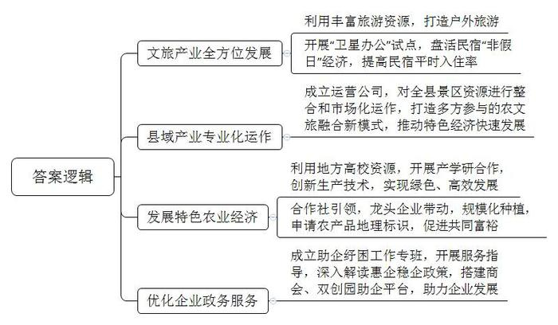
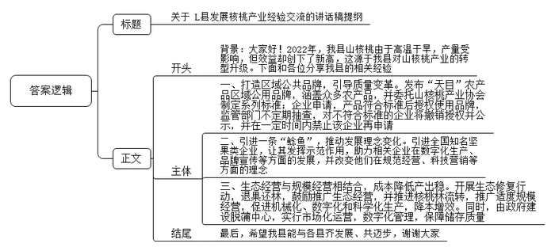
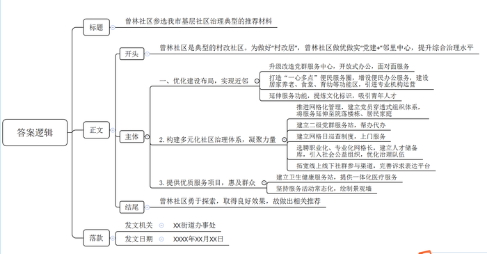
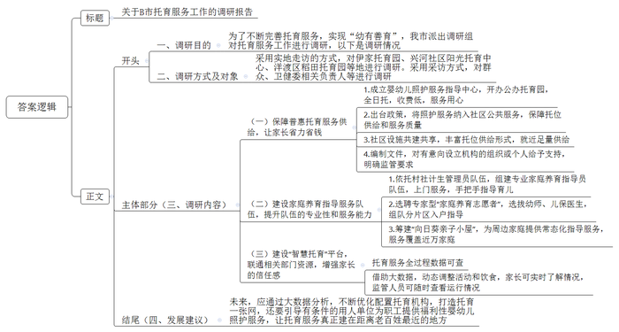

# 2023年公务员多省联考《申论》题（甘肃县乡卷）

<!-- gwy:overview:start -->
> **甘肃 · 2023 · 申论 · 县乡卷** ｜ 4 题 · 图片 4 处 · 答案随题折叠

导航：[题目](#题目) · [材料 1](#材料-1)
<!-- gwy:overview:end -->

> 候选采集稿。参考答案及解析来自粉笔页面，不代表官方答案或真实高分答卷；来源使用许可与原卷对应关系仍需人工核实。

## 给定材料

### 材料 1

在H市西北角，依山傍水的W县，是全市唯一没有工业园区的县。

“没选择，有时是最好的选择，对W县发展来说正是如此。”县委蓝书记对W县的情况有清醒认识，“土地资源的受限、空间发展的制约，决定了W县不能走‘工业兴县’的道路，只能另辟蹊径，一门心思探索‘绿水青山就是金山银山’的转化路径。”

近几年，W县根据省市发展规划，结合美丽城镇建设要求，扎实推进城乡风貌样板区试点建设。优美的生态环境吸引了大量游客，旅游产值年均超亿元，接待人次年均超100万，旅游过夜人次年均突破11.8万。W县获得“全国旅游百强县”等多项国字号荣誉。

在W县房车露营公园，深耕户外领域20多年的老徐见证了一次行业热潮。以2021年“五一”小长假为例，5天营业额近50万元，比2020年同期增长近5倍。“热潮”不是一夜之间出现的，而是来自长久的铺垫和布局。

W县拥有丰富的旅游资源，户外旅游是W县精心打造的金名片。2014年，W县引进了占地约800亩的“野天堂”项目。此后，山地摩托、滑翔伞等项目纷纷落地，最具代表性的是民宿的发展。W县是H市民宿起步最早、数量最多的县，民宿（农家乐）近千家，占H市近40%。2021年接待游客730余万人次，带动旅游消费30多亿元。

“盘活民宿的‘非假日’经济，是W县的重要探索。”蓝书记介绍，去年开始，时光信息科技有限公司等企业在W县试行“卫星办公”。这些企业依靠信息网络等技术手段，将设立在县里的办公点与位于城市的总部连接起来。县里首推136家精品特色民宿开展“卫星办公”试点。“卫星办公提高了我们平时的入住率，成了很多科技企业‘闭关’的选择。”“竹·窗”民宿刘老板说。

2021年，W县成立县域产业运营公司，对16个全域景区村镇实施资源整合和市场化运作，打造组织领航、镇企合作、群众参与的农文旅融合发展新模式，推动乡村旅游、生态农业、民宿农家乐等特色经济快速发展。截至2022年底，该公司已实现营收1900万元，带动农户营收超7500万元。

“蜜梨是我们县域发展的法宝。”山水果业陈总说。不久前，H市第十九届蜜梨生活节在W县举办，W县利用地方高校资源，与Z大学开展产学研合作的全省首个蜜梨科技小院发布成果：通过“梨——羊——草”种养结合模式、水肥一体化技术，不仅实现绿色生产，而且增产12%至23%。

W县近年来积极发挥果农合作社引领作用，打造共富工坊，在龙头企业带领下，2021年全县蜜梨栽培面积10多万亩，产量15万吨，产值28亿元，带动了3万多农户增收致富，蜜梨获评国家农产品地理标志。

“企业奋力腾飞，我们保驾护航。当好企业‘娘家人’，是W县做好产业服务的宗旨。”蓝书记介绍。“县里组织了留抵退税政策专场解读会，一对一回答问题，解了企业燃眉之急。”山水果业陈总每次参加“亲清”助企活动，都有新的收获。

今年以来，助企纾困工作专班开展服务指导70余次，帮助企业解决问题50余个；深入解读惠企稳企政策；搭建商会“老底子”助企平台、双创园“新主角”助企平台，护航新老企业齐飞。

在最近刚举行的“亲清”助企活动上，蓝书记说：“我们依山傍水，因地制宜，写好了绿色发展这篇大文章。”

### 材料 2

2022年本应是L县山核桃丰产的大年，但由于高温干旱，产量只是略有增加。虽然产量受影响，但效益却创下了新高，这背后是一颗山核桃的转型升级之路。

多年来，L县山核桃产业生产主体众多，很多是家庭作坊，质量参差不齐，以次充好并不鲜见。相关部门不断加强对山核桃销售市场的监管，但收效甚微。“为此，我们决定制定统一的标准，从而鼓励、引导、带动企业执行这个标准。”L县农业农村局古局长介绍。

2021年，L县发布“天目”农产品区域公用品牌，覆盖包括山核桃在内的众多农产品。县政府委托省山核桃产业协会牵头制定“天目”山核桃系列标准。9月，“天目”山核桃系列标准体系对外发布，包括炒制山核桃、手剥类山核桃和山核桃仁三个标准。标准起草人之一、省山核桃产业协会蔡秘书长说：“在山核桃领域20个标准中，我们这次制定的标准是最高的。”

“要获得‘天目’品牌使用授权，企业需要申请，产品要符合我们的标准。”古局长说。目前已有8家山核桃企业获得授权，L县太康炒货食品厂就是其中之一。“现在，我们有两款产品用了‘天目’品牌。”程厂长说，“这两款山核桃的品质是我们产品中最好的。”获得“天目”品牌使用授权后，程厂长感受最深的是品牌推广的力度大大提升。“‘天目’需要好的产品来支撑，我们也需要‘天目’这个公共品牌提升消费者的认可度。”

“市场监管部门会不定期抽查，如果授权企业的‘天目’产品不符合相关标准，将撤销授权并向社会公布，同时在一定时间内禁止该企业再申请。”古局长表示。

L县山核桃加工企业有280多家，年加工能力3万吨，光是龙水镇就集聚了170余家炒货食品加工产业链企业。但这些企业大多是给品牌企业代加工，尽管做自己品牌的也有，然而规模、名气都不大，没有一个家喻户晓的品牌。蔡秘书长说：“为品牌企业做代加工利润薄，只有更多品牌企业成长起来，L县山核桃的品牌价值才会更大，才能分享到山核桃产业带来的更多效益。”

2022年，天生记总部落户龙水镇，L县终于有了第一个具有全国知名度的坚果类品牌。天生记杨副总经理深耕坚果领域20多年，他说：“将总部从省城迁到L县，不仅有公司发展的考量，也有助力L县山核桃产业发展的情怀。”

透过玻璃，天生记山核桃加工生产的每一个环节都能看到，自动化、数字化程度很高。“没有什么不能看的，每一个环节都经得起检验。”杨副总经理说，数字工厂9月初投用，如果L县其他山核桃加工企业有打造数字工厂的需求，他们愿意提供帮助。

“看着都是山核桃，但其实有很多不同的地方，在企业文化、品牌宣传等方面，天生记更有优势。”在程厂长看来，大家可以合作，一起将山核桃产业做强做大，“如果整个市场能做得更大，效益进一步提升，大家都可以从中受益。”而在古局长眼里，天生记的到来，更为重要的是“带来理念的变化”，包括规范经营、现代化生产、市场营销、科技研发等。

几年前，因山核桃种植规模无序扩张，加之过度使用农药、化肥，导致山坡植被大面积破坏、水土流失严重，山核桃品质逐年下降。L县痛定思痛，于2019年9月起开展了一场生态修复行动，“退果还林”2万亩，退出后的山核桃林禁止除草、施肥、除虫、采打等经营活动，由村集体看管。正常经营的山核桃林，则鼓励生态经营，推广自然落果，不滥用农药、化肥，减少人为干预。L县农林技术推广中心李主任说：“生态经营逐步推广，山核桃林的产出更稳定，品质也更好。”

为了提升山核桃林的生产效益，L县近年还在推进山核桃林流转，推广适度规模经营。“近年来，由于种植成本上涨、分散经营等原因，山核桃林的投入产出比持续下降，年轻一辈经营山核桃林的意愿也持续下降。”李主任说，“规模经营更有利于农业机械和数字技术利用，能更好地实施科学种植与培育，降低生产成本、优化投入产出比。”

中间的加工储存环节，L县也在求变。山核桃脱蒲的汁液碱性很强，乱排放对环境有影响。晒干、存储环节没做好，山核桃品质就会受影响。“脱蒲中心可以实现山核桃脱蒲、晒干、存储、销售‘一条龙’服务。”古局长介绍，“这个中心由政府建设，实行市场化运营。农户将采收的山核桃送到中心脱蒲后，可以直接将山核桃存储在这里的仓库。仓库是数字化管理，精准地对温度、湿度等进行控制，山核桃存储在这里比存放在家里更妥当。”

还有很多变革也在进行中，比如水肥一体化、采收机器人等试点应用，山核桃产业大脑不断迭代升级，“山核桃黑芝麻丸”等深加工产品不断研发……

### 材料 3

曾林社区是典型的“村改社区”。为做好“村改居”后半篇文章，近年来，曾林社区以“近邻”为基、“聚邻”为要、“惠邻”为本，通过做优做实“党建+”邻里中心建设，提升社区综合治理水平。

走进曾林社区“党建+”邻里中心的党群服务中心，这里窗明几净、视野开阔。升级改造后，一改此前窗口办公的风格，开放式的办公区更加亲民，营造出面对面服务的温馨氛围。

在“党建+”邻里中心建设过程中，曾林社区按照“去形式化、去机关化、去办公化”的原则，打造“一心多点”便民服务圈。改造后，社区党群服务中心办公空间占比减少80%。党支部袁书记说：“虽然办公空间减少了，但便民服务却增加了，我们引进了政务服务自助一体机，编排印制社区便民服务联络卡，开设便民事项预约热线，为群众办事提供更多便利。”

居家养老服务照料中心是曾林社区“党建+”邻里中心建设的重要一环。今年74岁的谢阿姨一有空就会到照料中心同邻居们一起休闲娱乐、话家常。除了新建照料中心，还配备了社区食堂、儿童之家、亲子阅读室及早教托育中心等8个功能区域，并引进第三方专业机构运营。

曾林社区进一步延伸拓展服务功能，立足本土文化，设计提炼社区独具特色的文化标识，建成社区乡村记忆馆，推动社区大学生“反哺”基地、曾林茶产学研基地落地，增设人才驿站等阵地，推动青年人才走进曾林。

目前，曾林社区正全面推进“红色网格化”管理，推动党小组建立在网格上、党员沉到网格中、处置融入网格里，成立社区邻里先锋队，选聘32户党员中心户、8名党员楼栋长，按照每人挂钩联系10-20户群众，组织党员认领责任片区，建立“社区党组织-网格党小组-党员楼栋长-党员中心户”一贯到底的穿透式组织体系，将党组织的服务延伸至院落楼栋、居民家庭，实现邻里良性互动。党员中心每户家门口都挂有用于亮身份的责任牌。“看到这个红色的牌子，立刻就感受到自己作为一名党员的责任。”曾林社区党员梁女士说。

与此同时，曾林社区建成3个二级网格党群服务站，实现二级网格驻点办公，提供前移帮办代办便民服务，并建立网格日巡查制度，通过就近设、入户帮、上门办，将儿童之家、医疗护理等服务项目送到家。

为优化治理队伍，曾林社区坚持以职业化为基础、以专业化为方向，选聘一批网格长，通过“老带新”一对一帮带，加速提升网格员综合素养，同时建立社区人才储备库，引入致和社工、亿家社工等社会公益组织，着力提升社区治理能力。

在推深做实党建引领网格化管理的基础上，曾林“党建+”邻里中心拓宽社群参与渠道，完善诉求表达平台。在线下，设置居民意见箱，设立部门轮值室，主动对接“两代表一委员”、纪工委等部门，定期开放接访群众；还设置邻里会事厅，为民众议事解难题提供多元共商平台。在线上，依托社区公众号开通邻里会事留言板，利用“微监督”小程序及时公开居务情况，实时收集群众诉求和意见。

“不用到医院，在家门口的卫生健康服务站就能完成心电图、血常规、尿酸等一系列体检检查。”曾林社区“党建+”邻里中心卫生健康服务站李站长说。该卫生健康服务站由街道和社区共建，通过完善“病有所医”配套，推动优质卫生健康资源和服务人员“双下沉”，让社区居民在家门口就能享受到就诊、体检、取药、医保结算一体化的医疗卫生服务。

为进一步提升社区生活品质，增强群众幸福感与获得感，曾林“党建+”邻里中心坚持服务活动常态化，今年来累计开展了“粽叶飘香”“爱在重阳”等主题活动20余场，其他日常活动60余场，参与人数超4000人次。此外，社区以文化认同为切入点，绘制景观墙，既展示了“爱乡邻·爱曾林”的“聚邻”文化，又扮靓了村居颜值。

### 材料 4

上午8时30分，“伊家托育园”准时开园，不少送娃的家长已在门口等候，余先生一对两岁多的龙凤胎就托在这儿。“我和爱人都在上班，岳父母年纪大，照顾起来实在力不从心，若托到其它私立托育园，两个娃每月要6000元，负担实在太重！”余先生说。在B市北仑区，3岁以下婴幼儿有2万多人，托育需求着实不小。

去年，北仑区卫健委成立区级婴幼儿照护服务指导中心，并牵头开办首家公办托育园——“伊家托育园”。“这是全日托模式，完美匹配上下班时间，每月收费1700多元，在我们可负担范围内。”余先生“托”得很放心。园区内用心的小设计随处可见，比如墙上的护牙小玩具，能模拟牙刷的使用。再比如，宝宝吃过的食物都会留样48小时，方便后续追溯……“小家伙入托后，生活习惯变好了，自理能力也增强了！”

推广普惠托育服务，替年轻家长分担带娃时间和成本，这是B市在“幼有善育”这道民生考题上的突破口之一。为满足托育服务的硬需求，B市出台《关于促进3岁以下婴幼儿照护服务发展的实施意见》，将婴幼儿照护服务纳入城乡社区公共服务范围，加快普惠性托育供给，全市今年计划新增3岁以下婴幼儿托位7500个，其中普惠性托位5000个。

位于兴河社区的阳光托育中心，是B市第一家由社会资本和社区共建的民办普惠托育机构。该中心利用社区用房与个人自有商业用房合建而成，设置托位100个。创海社区服务中心二楼是B市首批社区婴幼儿照护服务站之一，配备了1名保育医生和1名育婴师，提供预约式临时托管等服务，居民步行15分钟便可放心托。这些形式多样的家门口托位，通过设施共建共享，实现了托位的显著增长。此外，市卫健委还牵头编制《托育机构设置指引》，对有意向设立托育机构的组织或个人给予引导和支持，并明确监管要求。

前段时间连续高温，高塘小区的李女士因2岁的宝宝暑热而发愁，幸好家庭养育指导员上门，为她开出“度夏指南”，并帮她梳理宝宝成长各阶段的照护技能。家庭养育指导员是去年B市组织培训的一支专业队伍，通过上门服务，手把手教年轻父母养娃。北仑区依托村（社区）计生管理员队伍就地转化了300多名家庭养育指导员，目前已累计入户指导3万余户次。区卫健委金主任表示，这批人原本就在村（社区）工作，人缘亲、情况熟，是婴幼儿照护入户服务快速落地的主力军。但金主任也坦言，婴幼儿照护未来将更趋向专业化，涉及营养学、教育心理、医护等多学科，现有计生管理员队伍的知识和技能很难在短期内完全补足，如何保障养育指导员的专业与多能，是今后亟待解决的问题。

去年，海平县试水在全县选聘专家型家庭养育志愿者，目前已有43名幼儿园老师和53名儿保医生正式入列。一个志愿者与N个家庭养育指导员组队，分片区入户指导。海平县妇幼保健院儿保科陈医生是首批家庭养育志愿者，她带着十几名养育指导员，服务着片区内1000多名婴幼儿。这些志愿者还是教育、卫生、妇联三部门联合筹建的“向日葵亲子小屋”的主力，每个小屋200多平方米，为周边社区家庭提供常态化指导服务。全县目前已有43个这样的小屋，近一年来举办了近2000场活动，近万个家庭参与。

洋渡区稻田托育园有110名婴幼儿，每个宝宝每天吃了多少食物、喝了多少水。一旁的保育老师都会记录下来并上传到“智慧托育”平台。包括安全检查、消毒卫生、课程活动、健康检查等托育服务的全过程被细化成200多项数据，在“智慧托育”平台上均有据可查。借助对平台的大数据分析，老师们还可动态调整孩子的活动和饮食，家长可实时了解孩子在园状况，监管人员可随时查看辖区内托育机构每日运行情况。“智慧托育”既联通了卫健、民政、市场监管和教育等部门资源，又增强了家长对婴幼儿照护服务机构的信任感。

日前，B市出台《家庭型托育质量评价标准》和《托育机构星级评定标准》，促进普惠托育服务质量有保障、更方便。“未来，全市各区县都将形成托育一张网，通过大数据分析优化配置托育机构。”B市苗副市长介绍，“我们还将引导有条件的用人单位为职工提供福利性婴幼儿照护服务，让托育服务真正建在距离老百姓最近的地方。”

## 题目

### 第 1 题

**请根据****“给定资料**1**”，谈谈W县是如何探索“绿水青山就是金山银山”的转化路径的。（10分）**

关联材料：材料 1、材料 2、材料 3、材料 4

作答要求：

要求：全面、准确、有条理。不超过300字。

第 1 题 · 答案与解析

**参考答案（粉笔题库参考内容）**

1.文旅产业全方位发展。利用丰富旅游资源，打造户外旅游；开展“卫星办公”试点，盘活民宿“非假日”经济，提高民宿平时入住率。

2.县域产业专业化运作。成立运营公司，对全县景区资源进行整合和市场化运作，打造多方参与的农文旅融合新模式，推动特色经济快速发展。

3.发展特色农业经济。利用地方高校资源，开展产学研合作，创新生产技术，实现绿色、高效发展；合作社引领，龙头企业带动，规模化种植，申请农产品地理标识，促进共同富裕。

4.优化企业政务服务。成立助企纾困工作专班，开展服务指导，深入解读惠企稳企政策，搭建商会、双创园助企平台，助力企业发展。

**解析**

**参考答案说明：**本参考答案从“文旅产业全方位发展”“县域产业专业化运作”“发展特色农业经济”“优化企业政务服务”四个方面展开，各条答案要点之间在内容上相互并列，没有交叉。

**考点**：考点概括措施类

**来源**：来源2023年公务员多省联考《申论》题（甘肃县乡卷）

粉笔申论页面对本题只提供「解析视频」入口，该入口是会员推广位，页面无视频地址与文字解析。

### 第 2 题

**上级部门将在****L县召开县域经济发展经验交流会，请根据“给定资料**2**”，为县领导起草一份会议发言稿提纲。（25分）**

关联材料：材料 1、材料 2、材料 3、材料 4

作答要求：

要求：

（1）紧扣资料，内容全面；

（2）准确简明，条理清晰；

（3）不超过500字。

第 2 题 · 答案与解析

**参考答案（粉笔题库参考内容）**

关于L县发展核桃产业经验交流的讲话稿提纲

背景：大家好！2022年，我县山核桃由于高温干旱，产量受影响，但效益却创下了新高，这源于我县对山核桃产业的转型升级。下面和各位分享我县的相关经验：

经验：一、打造区域公共品牌，引导质量变革。发布“天目”农产品区域公用品牌，涵盖众多农产品，并委托山核桃产业协会制定系列标准；企业申请，产品符合标准后授权使用品牌，监管部门不定期抽查，对不符合标准的企业将撤销授权并公示，并在一定时间内禁止该企业再申请。二、引进一条“鲶鱼”，推动发展理念变化。引进全国知名坚果类企业，让其发挥示范作用，助力相关企业在数字化生产、品牌宣传等方面的发展，并改变他们在规范经营、科技营销等方面的理念。三、生态经营与规模经营相结合，成本降低产出稳。开展生态修复行动，退果还林，鼓励推广生态经营，并推进核桃林流转，推广适度规模经营，促进机械化、数字化和科学化生产，降本增效。同时，由政府建设脱蒲中心，实行市场化运营，数字化管理，保障储存质量。

结语：最后，希望我县能与各县齐发展、共迈步，谢谢大家！

**解析**

**参考答案说明：**（1）格式方面，本参考答案写到了“标题”“正文”两个部分。（2）正文部分，一方面从内容上来看，围绕“L县召开县域经济发展经验交流会”这一主题，本参考答案的开头先写到了L县发展山核桃产业的相关背景；主体从“打造区域公共品牌，引导质量变革”“引进一条‘鲶鱼’，推动发展理念变化”“生态经营与规模经营相结合，成本降低产出稳”等三个方面介绍了L县发展山核桃产业的具体经验；结尾提出展望并致谢。另一方面，形式上，本参考答案做到了分段、分条撰写，整体上条理颇为清晰。

**考点**：考点总结类

**来源**：来源2023年公务员多省联考《申论》题（甘肃县乡卷）

粉笔申论页面对本题只提供「解析视频」入口，该入口是会员推广位，页面无视频地址与文字解析。

### 第 3 题

**近期市里将举办基层社区治理典型案例评选，****假如你是****曾林社区所在街道工作人员，请根据****“给定资料**3**”拟写一份参评推荐材料。（25分）**

关联材料：材料 1、材料 2、材料 3、材料 4

作答要求：

要求：

（1）紧扣资料，内容全面；

（2）准确简明，条理清晰；

（3）不超过500字。

第 3 题 · 答案与解析

**参考答案（粉笔题库参考内容）**

曾林社区参选我市基层社区治理典型的推荐材料

曾林社区是典型的村改社区。为做好“村改居”，曾林社区做优做实“党建+”邻里中心，提升综合治理水平。

一、优化建设布局，实现近邻。升级改造党群服务中心，开放式办公，面对面服务；打造“一心多点”便民服务圈，增设便民办公服务，建设居家养老、食堂、育幼等功能区，引进专业机构运营；延伸服务功能，提炼文化标识，吸引青年人才。二、构建多元化社区治理体系，凝聚力量。推进网格化管理，建立党员穿透式组织体系，将服务延伸至院落楼栋、居民家庭；建立二级党群服务站，帮办代办；建立网格日巡查制度，上门服务；选聘职业化、专业化网格长，建立人才储备库，引入社会公益组织，优化治理队伍；拓宽线上线下社群参与渠道，完善诉求表达平台。三、提供优质服务项目，惠及群众。建立卫生健康服务站，提供一体化医疗服务；坚持服务活动常态化，绘制景观墙。

曾林社区勇于探索，取得良好效果，故做出相关推荐。

XX街道办事处

XXXX年XX月XX日

**解析**

**参考答案说明：**（1）格式方面，本参考答案写到了“标题”“正文”“落款”三个部分。（2）正文部分：从内容来看，围绕着“曾林社区参加基层社区治理典型评选”这一主题，开头部分整体介绍了曾林社区社区治理情况；主体部分分别从“优化建设布局，实现近邻”“构建多元化社区治理体系，凝聚力量”“提供优质服务项目，惠及群众”这三个方面对曾林社区推进社区治理的具体做法进行了分条撰写；结尾部分再次进行了总结性推荐。从形式来看，本参考答案做到了分段、分条撰写，逻辑清晰。

**考点**：考点总结类

**来源**：来源2023年公务员多省联考《申论》题（甘肃县乡卷）

粉笔申论页面对本题只提供「解析视频」入口，该入口是会员推广位，页面无视频地址与文字解析。

### 第 4 题

**A市调研组日前赴B市调研托育服务工作，假如你是调研组工作人员，请根据“给定资料**4**”，拟写一份调研报告。（40分）**

关联材料：材料 1、材料 2、材料 3、材料 4

作答要求：

要求：

（1）紧扣资料，内容突出；

（2）有逻辑性，思路流畅；

（3）不超过800字。

第 4 题 · 答案与解析

**参考答案（粉笔题库参考内容）**

关于B市托育服务工作的调研报告

一、调研目的：为了不断完善托育服务，实现“幼有善育”，我市派出调研组对托育服务工作进行调研，以下是调研情况。

二、调研方式及对象：采用实地走访的方式，对伊家托育园、兴河社区阳光托育中心、洋渡区稻田托育园等地进行调研。采用采访方式，对群众、卫健委相关负责人等进行调研。

三、调研内容：

（一）保障普惠托育服务供给，让家长省力省钱。1.成立婴幼儿照护服务指导中心，开办公办托育园，全日托，收费低，服务用心。2.出台政策，将照护服务纳入社区公共服务，保障托位供给和服务质量。3.社区设施共建共享，丰富托位供给形式，就近足量供给。4.编制文件，对有意向设立机构的组织或个人给予支持，明确监管要求。

（二）建设家庭养育指导服务队伍，提升队伍的专业性和服务能力。1.依托村社计生管理员队伍，组建专业家庭养育指导员队伍，上门服务，手把手指导育儿。2.选聘专家型“家庭养育志愿者”，选拔幼师、儿保医生，组队分片区入户指导。3.筹建“向日葵亲子小屋”，为周边家庭提供常态化指导服务，服务覆盖近万家庭。

（三）建设“智慧托育”平台，联通相关部门资源，增强家长的信任感。托育服务全过程数据可查；借助大数据，动态调整活动和饮食，家长可实时了解情况，监管人员可随时查看运行情况。

四、发展建议：未来，应通过大数据分析，不断优化配置托育机构，打造托育一张网，还要引导有条件的用人单位为职工提供福利性婴幼儿照护服务，让托育服务真正建在距离老百姓最近的地方。

**解析**

**参考答案说明：**（1）格式方面，本参考答案写到了“标题”“正文”两个部分。（2）正文部分，一方面从内容上来看，围绕着B市发展托育服务这一主题，本参考答案的先介绍了本次调研的目的；然后介绍了本次调研的方式及对象；接着介绍了调研的内容，主要从“保障普惠托育服务供给，让家长省力省钱”“建设家庭养育指导服务队伍，提升队伍的专业性和服务能力”“建设‘智慧托育’平台，联通相关部门资源，增强家长的信任感”三个方面介绍了B市发展托育服务的经验、做法、意义等；最后，提出了发展建议。另一方面，形式上，本参考答案做到了分段分条撰写，整体上条理颇为清晰。

**考点**：考点总结类

**来源**：来源2023年公务员多省联考《申论》题（甘肃县乡卷）

粉笔申论页面对本题只提供「解析视频」入口，该入口是会员推广位，页面无视频地址与文字解析。

