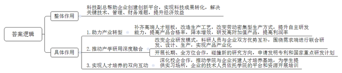
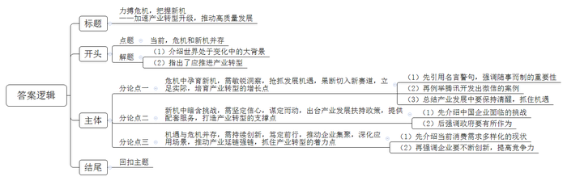

# 2024年公务员多省联考《申论》题（甘肃县乡卷）

<!-- gwy:overview:start -->
> **甘肃 · 2024 · 申论 · 县乡卷** ｜ 4 题 · 图片 4 处 · 答案随题折叠

导航：[题目](#题目) · [材料 1](#材料-1)
<!-- gwy:overview:end -->

> 候选采集稿。参考答案及解析来自粉笔页面，不代表官方答案或真实高分答卷；来源使用许可与原卷对应关系仍需人工核实。

## 给定材料

### 材料 1

F区有工业企业5000多家，规模以上企业588家，中小企业数量庞大。但由于规模小、资源少、实力弱、发展前景有限，大部分中小企业都面临高端人才匮乏的问题。

“200多名员工，本科学历专业人才仅15人。”尚志摩托张总感叹，尚志摩托一直无法对生产工艺进行改造，摆脱不了劳动密集型生产方式，更没有能力研发高端产品，长期处于低利润率甚至亏损状态。“再不转型迟早会被市场淘汰，但没有高端人才，我们转型难度也很大。”

2022年5月，F区委组织部牵头成立调研组，深入4个工业园区，广泛收集企业的创新难题和人才需求。7月，出台《F区“科技副总”进企业专项实施细则（试行）》，明确从高校院所引进专家教授到企业担任“科技副总”，补齐企业高端人才短板。

9月，张总收到区经信委发来的专家人才情况介绍清单。几乎同一时间，交通大学机电工程学院孙教授也收到了首批企业的用才需求。由于孙教授的研究方向与尚志摩托瞄准的转型目标非常契合，双方不约而同选择了对方。

孙教授很快就加入企业的技术攻关中。他和尚志摩托的技术人员花了两个月时间，自主研制出制动踏板性能测试平台。这一测试平台让尚志摩托具备了制动踏板智能检测能力，产品合格率提升到99.99%，生产效率提高20%，相较外包平台检测降低成本70%。孙教授的加入，让尚志摩托的转型升级多了底气和信心。目前，公司正在加速由生产传统的制动踏板、离合踏板等产品转向研发生产具有更高附加值的智能化产品。

F区建立“柔性借智、协同攻关”工作机制，由区经信委派出工作专班深入园区、企业精准摸排，和企业一起制订问题清单和需求清单，给予企业最大的自主选择权，帮助它们引进“科技副总”。同时，畅通“能进能出”通道，对“科技副总”建立优胜劣汰的考评管理机制。区经信委胡主任说：“两年任期内，每位‘科技副总’可享受区里提供的5万元人才基础津贴和不设上限的绩效津贴，支持他们与企业‘一事一议’商定薪酬，建立区领导日常联系机制，配备人才服务专员……”

“我曾和其他‘科技副总’交流过，大家都认为，‘科技副总’这个身份及其背后的政策支持，极大调动了我们的积极性。”孙教授说，许多“科技副总”已经把自己当作企业的一份子。

“我平均每周要到公司1至2次。适合山地丘陵地形的履带式无人农机动力平台，就是在这种交流碰撞中诞生的。”广田机械制造有限公司“科技副总”、中科院绿色智能技术研究院杨教授说，“该平台目前已经应用到多个地区的田间地头。高校院所科研人员擅长‘从0到1’的突破，企业擅长‘从1到100’的成果转化和应用。‘科技副总’正好将双方的优势结合了起来，互为对方补齐了短板。”

“‘科技副总’在一定程度上改变了企业的研发模式，过去企业单纯向高校院所购买专利，或与高校开展短期项目合作，现在双方实现了深度融合，围绕需求端进行联合研发、设计、生产，产品更容易落地，实现产业化。”广田机械王总经理说。

中建桥梁“科技副总”、工业大学刘教授的研究方向是大跨桥梁智能监测。“我之前与中建桥梁有过一些合作，但都是短期项目制的。”刘教授说，“科技副总”进企业专项行动启动后，双方再续前缘。“跟之前相比，最大的变化就是双方能开展长期、全方位的合作，进一步推动了‘产学研用’的深度融合。”再度牵手后，刘教授和中建桥梁不断碰撞出新的研究方向，并申请了两个发明专利，还为其成功申报了“政府间国际科技创新合作”国家重点研发计划。

为了进一步深化校企合作，刘教授还邀请同校的林教授到中建桥梁调研，希望促成更多的合作。一项工程会遇到很多问题，涉及许多细分领域，这需要更多专家参与其中。刘教授说，下一步，他们要借助“科技副总”这一模式，推动学院与企业兴建人才培养基地，让学生到中建桥梁实习，企业的技术人员可以依托学院的平台和资源开展培训，实现人才培养的双向互动。

“今年我们主动链接‘科技副总’的科研团队、专家人脉等人力资源，柔性引进工程院院士等专家到F区干事创业。”负责人说，“科技副总”进企业专项行动实施一年以来，已经有46名专家人才和行业精英受聘到企业任职，帮助企业创建创新平台25个，实现科技成果转化40项，解决关键技术、管理、财务难题85个，创造直接经济效益2.8亿元。

### 材料 2

“天气这么不好你们咋还来了？路滑不滑？吃饭了吗？快进屋喝口热水！”听到敲门声，光华街道老厂社区的独居老人郑阿姨打开房门，见是友好社会工作服务中心的工作人员，她先来了个“三连问”，话中带着“埋怨”，语气却异常亲切。

2023年10月的一天，郑阿姨突然病倒。社区了解到情况后，将她列入服务项目清单，请来这些“好孩子”为她送饭、陪她聊天，郑阿姨成了光华街道正在探索的“社区合伙人”制度的首批受益者。

“能不能针对老年人开展一些通俗易懂的反诈宣传？”“我们不在父母身边，有人帮老人理发吗？”“能否在社区组织大家一起下棋，玩一玩？”……

2023年9月，光华街道各社区在征集民意过程中发现，大家最关心的还是居民“身边那点事”。在光华街道辖区，有60岁以上老人占比超过50%的“银发社区”——老厂社区，也有成立2年多的“年轻社区”——乐天社区……街道党工委高书记坦言，各社区既面临缺钱、缺人、缺资源等现实困难，又存在居民参与自治的积极性不高、邻里关系疏远、矛盾纠纷多等突出问题。为此，光华街道创新社区治理模式，以党建统领为基础，发动多方力量共同参与社区管理与服务，在所辖8个社区探索推行“社区合伙人”制度。“所有愿意参与社区共建共治、愿意为社区发展作贡献的个人或群体，都可以成为‘合伙人’。”

“真没想到大家这么热情。”高书记激动地说。在她展示的一份“社区合伙人”名单中，既有退役运动员等“个人合伙人”，也有像友好社会工作服务中心这样的“社会组织合伙人”，更有包括老厂商会等在内的“商企合伙人”。

高书记介绍，各社区通过发放居民需求调查问卷，梳理社区内有特殊需求或共同需求较为强烈的事项，以项目化运作为主要方式，陆续开展包括公共服务、文化教育、矛盾调处以及助残扶困在内的十大服务项目。项目“张榜”后，老厂商会党支部率先“揭榜”。“既然‘揭榜’了，咱就得出实招。你看，我们把老厂商会的传达室改成了‘光华红’党建会客厅，现在这儿可热闹了！”老厂商会党支部负责人介绍说。昔日闲置的传达室，如今已成为政务便民快捷区、青年志愿活动区、金融助企惠民区。

这两年，乐天社区的“老漂族”越来越多。由于没有熟识的朋友，且方言不通，生活习惯不适应，他们逐渐成为社区的边缘人。如何让“老漂族”快乐起来？

借助“社区合伙人”的力量，乐天社区开展了形式多样的服务。例如，由社区出场地，爱宁养老服务公司入驻社区居家养老照料中心，为老年人提供居家照料等服务；市老年大学为“老漂族”开设了声乐、舞蹈、书画等课程，丰富老年人的业余生活。

周大妈是乐天社区的“老漂族”，曾经因为人生地不熟而感到孤独。自从加入声乐班，她不仅结交了一群老伙伴，心情变得开朗起来，还自荐当上了楼道小组长。因为热心社区公益，她报名成为了“社区合伙人”。前不久，周大妈又被社区推选为“最美乐天人”。

“对于‘社区合伙人’，我们出台了奖励机制，例如，对居民个人可优先评选为‘最美乐天人’，优先获得老年大学免费课程名额等。”高书记说。随着越来越多居民成为“社区合伙人”，社区治理“人人有责、人人尽责、人人享有”的氛围日渐浓厚。

“江春茗悦、风雅苑两个小区周边断头路多，需绕道才能到地铁站，上班族很不方便……”在一次小区楼道长会议上，有居民向社区反映。很快，在社区、业委会、物业以及居民“合伙人”等多方协调下，促成开通了公交地铁接驳线，将原先二十分钟的路程缩短到了三四分钟，居民出行更方便了。

“居民成为‘合伙人’后，开始关注社区事务，主动了解社区建设，成为了社情民意的收集者、协商议事的参与者。”高书记说，“凡是社区遇到重大决策，我们都会邀请居民‘合伙人’全程参与。”不仅如此，各社区每个月都会召开一次“社区合伙人”联席会议，制定需求项目清单，由“社区合伙人”认领。

区消防应急救援中心进驻老厂社区微型消防站，认领了“全家总动员”消防安全项目；超越运动中心运营百姓健身房，提供普惠性健身服务，年费仅需365元；在隆兴社区，省师范大学的学生组成志愿服务队伍，为辖区儿童开设书法、英语等兴趣班……如今，“社区合伙人”的队伍不断壮大，服务内容也在不断扩展。

看到“社区合伙人”个个给力，居民群众笑意盈盈，高书记对未来充满了信心。她说：“接下来，街道将通过购买服务、共建共享、资源共筹等多种途径，以街道这块‘磁石’吸引各类资源，变‘旁观者’为‘建设者’，引领更多‘社区合伙人’在小社区中发挥大作用，让基层治理更具活力、更可持续。”

### 材料 3

早上不到8点，庙坝村村民小刘已经开始忙碌了，只见他背着背篓穿梭在桑园中采桑叶，“桑叶太热，蚕就会不吃，所以一定要趁着早晨凉爽时采摘。”拥有三千余亩桑园，300余户蚕农，围绕“一只蚕”衍生出近1000万元产值……如今庙坝村的桑蚕产业已经成为B县十字乡的发展新标杆，但在过去，谁也没有想到一只蚕竟然能吐出乡村振兴新“思路”。

庙坝村历来有养蚕的传统，这里的温度和湿度非常适合种桑养蚕，几乎家家户户都在养蚕，“但在很长一段时间里，对于乡亲们而言，养蚕并不是一个‘划算’的买卖。”庙坝村党支部王书记坦言，“桑蚕产业属于劳动密集型产业，季节性强，劳动强度大，一户人家最多养两张蚕，一年卖三批，算下来大约有1.2万元的收入。如果外出打工，一年至少挣两三万元。”

近几年，村里动员村民们种植过茶叶、中药材，发展过养牛养羊产业，但都没有成功。眼见在家挣不到钱，越来越多的村民选择外出务工，庙坝村渐渐少了烟火气。

如何让庙坝村发展更好，让村民留在家里也能过上好日子？

2018年村支部理清发展思路，“经过调研，我们决定重走蚕桑路。”王书记说，“村子本就有养蚕的基础，只是以前各自为政，比较散乱，如果能统一起来，发展空间很大。”

于是王书记带领村干部走村入户，同乡亲们分析现状、权衡利弊，与村民一道研究种桑养蚕致富之路。为增强抗风险能力，村支部决定组建蚕桑专业合作社，拿出50万村集体经济资金入股。为提高蚕茧的存活率和蚕茧产量，村里邀请农业大学专家和市里的农技人员向村民传授新的种桑养蚕技术。“但收入是否能够达到预期目标，销售渠道有无保障，村民们依然有顾虑。”王书记回忆道。

如何打消村民的顾虑？经过调研，由村支部牵线，合作社决定与龙翔茧丝绸有限公司合作，“他们也在探索如何将桑蚕产业做大做强，这与我们的发展理念不谋而合。”王书记高兴地说。同时，村支部积极争取项目，在村里修建养蚕场所，安装智能化设备，支持合作社参与智能化养蚕经营。

2022年4月，由龙翔茧丝绸有限公司研发的智能蚕桑养殖系统正式投入使用。“这套系统，让养蚕从横向养殖变为立体养殖。”公司负责人称。

在传统养蚕业中，蚕筐通常被放置在地上，如果扩大养蚕规模，则需要扩大场地规模。但现在，通过这套系统，幼蚕搭乘“电梯”，住进了12层高的“楼房”，极大提高了场地的利用率。不仅如此，该系统还集互联网、自动控制、养蚕技术、人工智能于一体，有效保证了蚕茧的产量和质量。

“幼蚕的生长对环境要求很高，必须要控制好温度、湿度等，这套系统能为幼蚕调整到最适宜生长的环境，幼蚕成活率更高。”庙坝村智能蚕房车间技术工人老刘称，“目前，我们已经实现一年养殖10批次，是传统养蚕的3倍。”

除了带动本地的发展，庙坝村还带动了周边村（社区）发展桑产业。

“我们采取桑蚕种养分离的经营模式，针对有能力种植桑叶但没有能力养蚕的村民，我们会收购他们的桑叶。”王书记称，“这比种土豆的收入要高，老百姓也愿意种。”

“蚕子成熟以后就会吐丝，然后作茧自缚变成蛹，再破茧而出化为蛾，所以有句古诗叫‘春蚕到死丝方尽’。”蚕桑基地中，带队老师正向学员们讲述蚕桑历史、丝绸文化等知识，增进孩子们对中国养蚕抽丝历史的了解。随后，基地工作人员带领学员来到智能养蚕车间，近距离观察蚕宝宝和蚕茧，孩子们带着好奇和疑问，这里摸摸，那里嗅嗅，一边喂桑叶，一边七嘴八舌交流着自己研学的感受，“春蚕精神”润物无声地根植在了心间。合作社与种桑户、养蚕户合作，为中小学提供研学服务，受到了孩子、家长、学校的一致欢迎。

“只要天气好，每天下午来的游客最多，要到晚上八点多天黑了，人才走完……”4月初，桑葚园迎来了桑葚成熟期，红的、黑的桑葚密密麻麻地“趴”在壮硕的桑葚树上。天朗气清，前来采摘桑葚的游客越来越多，大家沉浸在采摘和品尝的喜悦中。

“走这边来，那边的没有这边的甜。”“快来这边，这里的桑葚是最多的。”“我们来比比哪个先摘满。”大家有说有笑，热闹非凡。去年有2万多名游客来庙坝村摘果，创造收入300万元，桑蚕产业的产业链也得以延长。

6月17日至19日，2023年蚕桑丝绸产业高质量发展大会在奉节县举行，专家们的建议让村支部看到了更多可能。

“今年，我们力争在2022年的规模上扩大一倍，带动更多村民增收致富。”对此，王书记信心满满。

### 材料 4

“总有一天，水可以被电解为氢和氧，并用作燃料……成为供暖和照明的无限能源。”经过一个半世纪，科幻小说《神秘岛》中描述的场景正在成为现实。

在A市兴嘉港，白、蓝、绿相间的“小清新”氢能重卡来回穿梭，排出的尾气变成了水蒸气……“与柴油车相比，氢能重卡每次加注氢气燃料最快只需5分钟，加满能跑400公里。”A市兴嘉港港务有限公司相关负责人说，一辆氢能重卡每年可减少碳排放量2600多吨，目前兴嘉港投入运行的氢能重卡有近百台，预计到2025年末将有近1000台氢能重卡物流车投入使用。

除了氢能重卡，A市已开通全市首条跨行政区域的氢能公交线路，氢能船舶正式投入内河运输……一个个搭载“氢能绿心”的应用场景正在A市不断拓展。

“我们发展氢能产业具有得天独厚的优势。”A市李副市长说。位于A市的国家级化工新材料园区，原本就集聚着化嘉能源、江三化工、泓华新材料等一大批化工企业，不仅塑造了聚碳酸酯、环氧乙烷、有机硅等5个走在国际前沿的特色产业板块，每年更是有近10万吨的工业副产氢产量。

“化工产业的资源环境约束不断加大，产业转型升级势在必行。”李副市长说，“‘氢’装前行，是立足全市实际的战略选择，更是高质量转型发展的大势所趋。”2018年，A市抢抓氢能发展窗口期，切入新赛道，打造产业转型升级的新增长点，先后出台氢能产业规划、氢能产业发展扶持政策，从多个方面为氢能产业项目招引、孵化提供整体配套服务。

对机会的把握就像拔河，一头是危机，一头是新机，用力才可能赢得新机，泄力就可能输给危机。

A市谋定而动，一连串行动让氢能产业开始落地生根。2021年初，完成1.4平方公里氢能产业园专项规划；4月，携手多家民营企业共同出资成立氢能产业发展平台公司；7月，成为全省氢能产业发展首批试点城市，参与起草氢能产业发展相关政策文件；9月，联合国家和省市有关单位组建5亿元氢能母投资基金和20亿元氢能产业培育基金，启动产业园一期氢能科技园建设；次年，与多所高校合作共建的氢能安全和运用研究中心在氢能科技园落地……

近几年，A市围绕产业链、创新链、应用链，全力抓好氢能项目招引和推进，推动氢能装备制造企业集聚，深化氢能应用场景。泓华新材料一期的丙烷脱氢项目是氢能产业链上游项目，每年可生产45万吨丙烯，还能产出1.6万吨工业副产氢。“在市氢能产业链党建联建机制的‘牵线搭桥’下，我们已和盛合硅业、谷岩气体等企业合作，每年通过管道输送氢气约2500吨，实现了氢能产业链的延链强链。”泓华新材料高总经理说，“我们也在积极开拓工业用氢装置、氢气发电、固态储氢、氢气充装等新市场。”

凭借深厚的产业优势、清晰的产业定位，A市目前已吸引了锦美氢能科技、盘动电气、沐优氢瓶、云量双极板在内的大批氢能产业项目落户，其中不乏全球行业龙头企业项目、高端制造业外资项目。目前，投资50亿元的锦美氢能科技氢动力总成车间已经正式投产，年产5000套燃料电池电堆和系统总成；氢能安全和运用研究中心与一批产业链上游企业开展了系列氢气综合利用项目……

日前，省发改委、省能源局、省住建厅联合制定全省加氢站发展规划，提出了加强氢源保障、推进加氢站和储运基础设施等多项重点建设任务。“接下来，我们将围绕氢燃料电池的上下游产业链，重点招引‘八大零部件’关键企业，孵化一批质子交换膜、催化剂、碳纸等氢能关键项目，培育一批优质的加氢、运氢、储氢装备配套企业。”李副市长表示，未来在龙头企业、核心平台引领带动下，A市将初步形成以氢燃料电池电堆——膜电极——双极板——质子交换膜为重点的氢燃料电池核心产业链，全力助推区域经济高质量转型发展。

## 题目

### 第 1 题

**“给定资料1”提到“从0到1”和“从1到100”，请谈谈“科技副总”在“从0到100”的过程中发挥了哪些作用。（15分）**

关联材料：材料 1

作答要求：

要求：全面、准确、有条理。不超过300字。

第 1 题 · 答案与解析

**参考答案（粉笔题库参考内容）**

科技副总帮助企业创建创新平台，实现科技成果转化，解决关键技术、管理、财务难题，提升经济效益，作用如下：

1.助力产业转型。补齐高端人才短板，改造生产工艺，改变劳动密集型生产方式，提升自主研发能力，提高产品合格率，降本增效，研发高附加值产品，提高利润率。

2.推动产学研用深度融合。改变企业研发模式，科研人员与企业双方优势互补，围绕需求端进行联合研发、设计、生产，实现产品产业化；开展长期、全方位合作，碰撞新的研究方向，申请发明专利和国家重点研发计划。

3.实现人才培养的双向互动。深化校企合作，推动学院与企业兴建人才培养基地，为学生提供实习场所，企业的技术人员依托学院的平台和资源开展培训。

**解析**

**参考答案说明**：本参考答案是“总分”逻辑，先指出科技副总在创新平台、成果转化、关键技术、管理等方面的整体作用，再从“助力产业转型”“推动产学研用深度融合”“实现人才培养的双向互动”这三个方面展开。各条答案要点之间在内容上相互并列，没有交叉。

**考点**：影响类

**来源**：2024年公务员多省联考《申论》题（甘肃县乡卷）

### 第 2 题

**请根据“给定资料2”谈谈光华街道是如何通过“社区合伙人”制度“变‘旁观者’为‘建设者’”的。（20分）**

关联材料：材料 2

作答要求：

要求：全面、准确、有条理。不超过300字。

第 2 题 · 答案与解析

**参考答案（粉笔题库参考内容）**

社区合伙人制度是创新社区治理模式，以党建统领为基础，发动多方力量共同参与社区管理与服务。具体做法有：

1.广泛吸纳合伙人，转变身份职责。动员个人、社会组织、商企等多方力量成为“合伙人”，开始关注社区事务，主动了解社区建设，参与社情民意的收集、协商及决策。

2.了解居民需求，开展多元服务。发放居民需求调查问卷，定期召开联席会议，梳理制定需求项目清单，合伙人认领，实行项目化运作；合伙人提供场地、人力等资源，开展形式多样的服务，提升居民生活质量。

3.开展评优激励，促进共治共建。出台奖励机制，对合伙人进行评优，激发更多居民参与社区建设的积极性，营造“人人有责、人人尽责、人人享有”的治理氛围。

**解析**

**参考答案说明：**本参考答案先对“‘社区合伙人’制度”进行了总体说明，接着具体介绍了“广泛吸纳合伙人，转变身份职责”“了解居民需求，开展多元服务”“开展评优激励，促进共治共建”三方面的做法。每条答案要点之间在内容上是并列关系，没有交叉。

**考点**：概括措施类

**来源**：2024年公务员多省联考《申论》题（甘肃县乡卷）

### 第 3 题

**假如你是刚入职乡党政办的工作人员，领导安排你去庙坝村了解桑蚕产业发展情况，请根据“给定资料3”，起草一份汇报材料提纲。（25分）**

关联材料：材料 3

作答要求：

要求：

（1）紧扣资料，内容全面；

（2）逻辑清晰，语言精炼；

（3）不超过500字。

第 3 题 · 答案与解析

**参考答案（粉笔题库参考内容）**

关于桑蚕产业发展情况的汇报材料

背景：庙坝村历来有养蚕的传统，过去生产方式传统、散乱，产出低，收入少，如今拥有三千余亩桑园，300余户蚕农，产值近千万元，已成为B县十字乡的发展新标杆。

情况介绍：

一、理清发展思路，做好准备工作。村干部走村入户，同乡亲们分析现状、权衡利弊，研究种桑养蚕致富之路；组建专业合作社，以村集体经济资金入股，增强抗风险能力；邀请专业人员传授新技术，提高蚕茧的存活率和蚕茧产量。

二、智慧化经营，打消村民的顾虑。村支部牵线，合作社与公司合作，积极争取项目，修建养蚕场所，安装智能化设备；引入智能蚕桑养殖系统，实现立体养殖，提高场地利用率；集互联网、自动控制、养蚕技术、人工智能于一体，保证蚕茧的产量和质量；调整幼蚕生长环境，提高成活率，增加养殖批次。

三、延长产业链，带动周边产业发展。采取桑蚕种养分离的经营模式；建设蚕桑基地，合作社与种桑户、养蚕户合作，为中小学提供研学服务，普及蚕桑历史、丝绸文化知识，根植“春蚕精神”；发展采摘旅游业，吸引游客，增加收入。

结语：庙坝村将持续扩大生产规模，带动更多村民增收致富。

**解析**

**参考答案说明：**（1）本题不需要考虑格式，只写正文即可，但为了保险起见，建议加上标题。（2）正文部分，一方面从内容来看，围绕着“庙坝村桑蚕产业发展情况”这一主题，本参考答案的开头先写到了庙坝村桑蚕产业发展的背景；主体部分从“理清发展思路，做好准备工作”“智慧化经营，打消村民的顾虑”“延长产业链，带动周边产业发展”等三个方面展开。另一方面，形式上，本参考答案做到了分段、分条撰写，整体上条理较为清晰。

**考点**：总结类

**来源**：2024年公务员多省联考《申论》题（甘肃县乡卷）

### 第 4 题

**“给定资料4”提到：“对机会的把握就像拔河，一头是危机，一头是新机，用力才可能赢得新机，泄力就可能输给危机。”请深入思考这句话，参考给定资料，联系实际，自选角度，自拟题目，写一篇文章。（40分）**

关联材料：材料 1、材料 2、材料 3、材料 4

作答要求：

要求：

（1）观点明确，见解深刻；

（2）参考给定资料，但不拘泥于给定资料；

（3）思路清晰，语言流畅；

（4）字数1000-1200字。

第 4 题 · 答案与解析

**参考答案（粉笔题库参考内容）**

**力搏危机，把握新机**

**——加速产业转型升级，推动高质量发展**

世界百年未有之大变局，危机如突如其来的风暴，带来了挑战与考验的同时，也悄然孕育着变革与重生的契机，正如古语云：“祸兮福之所倚，福兮祸之所伏”。产业，作为国民经济的支柱，其发展轨迹与时代的脉搏紧密相连，科技革命的加速推进、消费者需求的多元化变化，传统产业模式的难以为继，时时刻刻都在提示产业要寻找新的发展道路，要在危机中发现并把握机会，在机遇中应对危机，在波涛汹涌中不断转型升级。

**危机中孕育新机，需敏锐洞察，抢抓发展机遇，果断切入新赛道，立足实际，培育产业转型的增长点。**习近平主席曾在博鳌亚洲论坛开幕式上引用了《盐铁论》中的“明者因时而变，知者随事而制”。意在提示在发展中，要摒弃不合时宜的旧观念，冲破制约发展的旧框框。在智能手机普及初期，腾讯洞察到移动互联网的潜力，尤其是社交领域，迅速组建团队，开发了划时代的社交软件——微信，并依据社交生态与支付、电商等多领域融合，打造综合性的生活服务平台，成为行业龙头。所以说，在产业发展中首要任务是保持清醒的头脑，通过深入分析市场趋势、政策导向等多方面信息，敏锐地洞察到其中蕴含的机遇，并要果断行动，将机遇转化为实际成果，抢占市场先机。

**新机中暗含挑战，需坚定信心，谋定而动，出台产业发展扶持政策，提供配套服务，打造产业转型的支撑点**。中国企业不可能总在风平浪静中发展，当在某一领域取得突出成就时，西方的霸权主义、欺凌主义，就会随之而来，但放弃就意味着淘汰，注定只能在“深海里练就游泳能力”，在弄潮中不断成长。在这样的环境下，就需要政府的有为之手，制定明确的产业发展规划，通过税收优惠、资金补贴、土地供应等政策措施，引导社会资本向重点产业和领域倾斜，同时强化人才培养和引进工作，建立完善的人才激励机制，提供有力的人才保障，为中国企业的发展保驾护航。

**机遇与危机并存，需持续创新，笃定前行，推动企业集聚，深化应用场景，推动产业延链强链，抓住产业转型的着力点。**新机为产业提供了转型升级的契机，而挑战则促使产业不断自我革新，走创新发展之路。随着全球化深入发展，消费者需求多元化，新技术、新业态层出不穷……这些要求企业不断适应和创新，否则将面临被市场淘汰的风险。面对机遇与危机并存的局面，企业要持续创新，加大研发投入，不断优化产品、服务，响应市场变化，还要与上下游产业加强联动，推动企业集聚，延伸产业链，推动成果转化，提高产业竞争力。

云海荡朝日，春色任天涯。产业发展唯有在挑战中寻找转机，将压力转化为前进的动力，将不确定性塑造为发展的源泉，才能真正实现转型升级，迎来发展新起点！

**解析**

**文章分析**

**力搏危机，把握新机**

**——加速产业转型升级，推动高质量发展**

【**标题的优点：**标题含有主题词，使文章主题更突出、清晰。其次，采用主副标题的形式，明确文章观点。】

（1）<u>世界百年未有之大变局</u>，危机如突如其来的风暴，带来了挑战与考验的同时，也悄然孕育着变革与重生的契机，正如古语云：“祸兮福之所倚，福兮祸之所伏”。（2）<u>产业</u>，<u>作为国民经济的支柱</u>，<u>其发展轨迹与时代的脉搏紧密相连</u>，科技革命的加速推进、消费者需求的多元化变化，传统产业模式的难以为继，时时刻刻都在提示产业要寻找新的发展道路，要在危机中发现并把握机会，在机遇中应对危机，在波涛汹涌中不断转型升级。

【**开头的优点：**★内容方面。范文的开头是紧扣题目给定的“危机和新机（产业转型）”这一主题展开的。首先，介绍世界处于变化中的大背景；其次，指出了应推进产业转型，应对危机与新机。★文字表达方面。运用了引用法，使语言表达更有文采。】

**危机中孕育新机，需敏锐洞察，抢抓发展机遇，果断切入新赛道，立足实际，培育产业转型的增长点。**（1）习近平主席曾在博鳌亚洲论坛开幕式上引用了《盐铁论》中的“明者因时而变，知者随事而制”。意在提示在发展中，要摒弃不合时宜的旧观念，冲破制约发展的旧框框。（2）在<u>智能手机普及初期</u>，<u>腾讯洞察到移动互联网的潜力</u>，尤其是社交领域，迅速组建团队，开发了划时代的社交软件——<u>微信</u>，并依据社交生态与支付、电商等多领域融合，打造综合性的生活服务平台，成为行业龙头。（3）所以说，<u>在产业发展中首要任务是保持清醒的头脑</u>，通过深入分析市场趋势、政策导向等多方面信息，敏锐地洞察到其中蕴含的机遇，并要果断行动，<u>将机遇转化为实际成果</u>，抢占市场先机。

【**论述段1的优点：**★观点句：范文的观点句是紧扣“危机和新机（产业转型）”这一文章主题提出的。形式上，它在段首处直接写出，位置突出，容易发现。内容上，关键词突出，内容要点明确，可以明显看出主要论述从“抓住机遇，进入新赛道”方面入手。★论述内容：（1）先引用名言警句，强调随事而制的重要性；（2）再例举腾讯开发出微信的案例；（3）总结产业发展中要保持清醒，抓住机遇。注意：以上几个方面的内容都是紧扣“危机中孕育新机，需敏锐洞察，抢抓发展机遇，果断切入新赛道，立足实际，培育产业转型的增长点”这个观点句进行分析论述的，论述的针对性强，内容层次丰富。在论述方法上主要采用了讲道理与举例子结合，论述深刻透彻。】

**新机中暗含挑战，需坚定信心，谋定而动，出台产业发展扶持政策，提供配套服务，打造产业转型的支撑点。**（1）中国企业不可能总在风平浪静中发展，当在某一领域取得突出成就时，<u>西方的霸权主义</u>、<u>欺凌主义</u>，<u>就会随之而来</u>，但放弃就意味着淘汰，注定只能在“深海里练就游泳能力”，在弄潮中不断成长。（2）在这样的环境下，<u>就需要政府的有为之手</u>，<u>制定明确的产业发展规划</u>，通过税收优惠、资金补贴、土地供应等政策措施，引导社会资本向重点产业和领域倾斜，同时<u>强化人才培养和引进工作</u>，建立完善的人才激励机制，提供有力的人才保障，为中国企业的发展保驾护航。

【**论述段2的优点：**★观点句：范文的观点句是紧扣“危机和新机（产业转型）”这一文章主题提出的。形式上，它在段首处直接写出，位置突出，容易发现。内容上，关键词突出，内容要点明确，可以明显看出主要论述从“坚定信心，出台扶持政策，提供配套服务”方面入手。★论述内容：（1）先介绍中国企业面临的挑战；（2）后强调政府要有所作为。注意：以上几个方面的内容都是紧扣“新机中暗含挑战，需坚定信心，谋定而动，出台产业发展扶持政策，提供配套服务，打造产业转型的支撑点”这个观点句进行分析论述的，论述的针对性强，内容层次丰富。在论述方法上主要采用了讲道理的方式，论述清晰透彻。】

**机遇与危机并存，需持续创新，笃定前行，推动企业集聚，深化应用场景，推动产业延链强链，抓住产业转型的着力点。**新机为产业提供了转型升级的契机，而挑战则促使产业不断自我革新，走创新发展之路。（1）<u>随着全球化深入发展</u>，<u>消费者需求多元化</u>，新技术、新业态层出不穷……<u>这些要求企业不断适应和创新</u>，否则将面临被市场淘汰的风险。（2）面对机遇与危机并存的局面，<u>企业要持续创新</u>，<u>加大研发投入</u>，不断优化产品、服务，响应市场变化，还要与上下游产业加强联动，推动企业集聚，延伸产业链，推动成果转化，提高产业竞争力。

【**论述段3的优点：**★观点句：范文的观点句是紧扣“危机和新机（产业转型）”这一文章主题提出的。形式上，它在段首处直接写出，位置突出，容易发现。内容上，关键词突出，内容要点明确，可以明显看出主要论述从“持续创新，推进企业聚集，延链强链”方面入手。★论述内容：（1）先介绍当前消费需求多样化的现状；（2）再强调企业要不断创新，提高竞争力。注意：以上几个方面的内容都是紧扣“机遇与危机并存，需持续创新，笃定前行，推动企业集聚，深化应用场景，推动产业延链强链，抓住产业转型的着力点”这个观点句进行分析论述的，论述的针对性强，内容层次丰富。在论述方法上主要采用了讲道理与举例子结合，论述清晰透彻。】

云海荡朝日，春色任天涯。产业发展唯有在挑战中寻找转机，将压力转化为前进的动力，将不确定性塑造为发展的源泉，才能真正实现转型升级，迎来发展新起点！

【**结尾的优点：**范文的结尾回扣了“危机和新机（产业转型）”这个主题，并且进行了总结提升。】

**考点**：文章写作题

**来源**：2024年公务员多省联考《申论》题（甘肃县乡卷）

