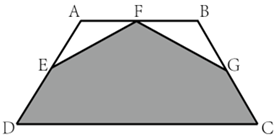
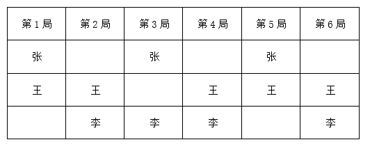
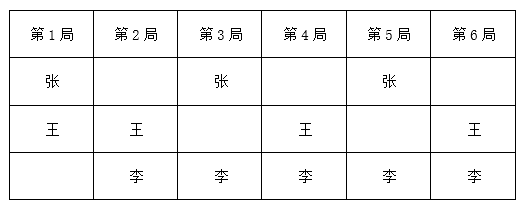
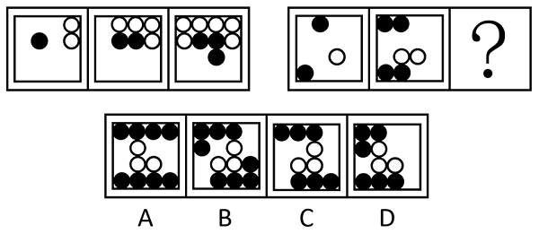
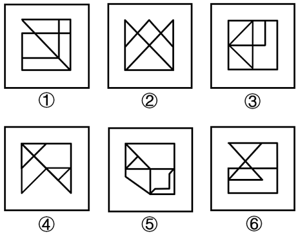
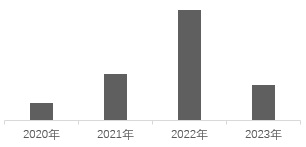

# 2025年甘肃公务员录用考试《行测》题（网友回忆版）

<!-- gwy:overview:start -->
> **甘肃 · 2025 · 行测 · 统考** ｜ 120 题 · 图片 176 处 · 答案随题折叠

| 题型模块 | 题量 | 题号 |
| --- | ---: | ---: |
| 政治理论 | 10 | 1–10 |
| 常识判断 | 10 | 11–20 |
| 言语理解与表达 | 35 | 21–55 |
| 数量关系 | 15 | 56–70 |
| 判断推理 | 35 | 71–105 |
| 资料分析 | 15 | 106–120 |
| **合计** | **120** | |

导航：[题型与作答说明](#题型与作答说明) · [题目](#题目) · [材料 1](#材料-1)
<!-- gwy:overview:end -->

> 候选采集稿。参考答案及解析来自粉笔页面，不代表官方答案或真实高分答卷；来源使用许可与原卷对应关系仍需人工核实。

## 题型与作答说明

政治理论

（10题）

根据题目要求，在四个选项中选出一个最恰当的答案。

常识判断

（10题）

根据题目要求，在四个选项中选出一个最恰当的答案。

言语理解与表达

（35题）

本部分包括表达与理解两方面的内容。请根据题目要求，在四个选项中选出一个最恰当的答案。

数量关系

（15题）

在这部分试题中，每道题呈现一段表述数字关系的文字，要求你迅速、准确地计算出答案。

判断推理

（35题）

本部分包括图形推理、定义判断、类比推理与逻辑判断四种类型的试题，在四个选项中选出一个最恰当的答案。

资料分析

（15题）

所给出的图、表、文字或综合性资料均有若干个问题要你回答。你应根据资料提供的信息进行分析、比较、计算和判断处理。

## 题目

### 第 1 题

习近平总书记强调，现代化产业体系是现代化国家的物质技术基础，必须把发展经济的着力点放在实体经济上，为实现第二个百年奋斗目标提供坚强物质支撑。下列与之相关说法正确的有几项？

①推进实施绿色发展战略，充分发挥绿色化赋能实体经济发展效应

②促进数字技术和实体经济深度融合，催生新产业新业态新模式替代传统产业

③重视现代服务业的发展，推动现代服务业与先进制造业、现代农业深度融合

④推动重点产业在国内外有序转移、促进国内外产业深度融合与实体经济发展相结合

A. 1

B. 2

C. 3

D. 4

第 1 题 · 答案与解析

**参考答案（粉笔题库参考内容）**

C

**解析**

本题考查理论与政策。

①正确，《新型工业化是发展新质生产力的主阵地》中指出，习近平总书记强调：“要充分认识形成绿色发展方式和生活方式的重要性、紧迫性、艰巨性。”······因此，要推动绿色发展与实体经济发展相融合，充分发挥绿色化赋能实体经济发展效应。

②错误，《中华人民共和国国民经济和社会发展第十四个五年规划和2035年远景目标纲要》中指出，促进数字技术与实体经济深度融合，赋能传统产业转型升级，催生新产业新业态新模式，壮大经济发展新引擎。

③正确，《中华人民共和国国民经济和社会发展第十四个五年规划和2035年远景目标纲要》中指出，重视现代服务业的发展，推动现代服务业与先进制造业、现代农业深度融合，深化业务关联、链条延伸、技术渗透，支持智能制造系统解决方案、流程再造等新型专业化服务机构发展。培育具有国际竞争力的服务企业。

④正确，习近平总书记在二十届中央政治局第二次集体学习时强调，优化生产力布局，推动重点产业在国内外有序转移，支持企业深度参与全球产业分工和合作，促进内外产业深度融合，打造自主可控、安全可靠、竞争力强的现代化产业体系。这要求我们发挥好超大规模市场优势和超大纵深空间优势，加快建设以实体经济为支撑的现代化产业体系，引导产业合理有序梯度转移。

故①③④表述正确，共3项。

故正确答案为C。

**考点**：经济建设、重要文件

**来源**：2025年河北省公务员录用考试《行测》题（网友回忆版）第5题

### 第 2 题

习近平总书记强调，铸牢中华民族共同体意识，推进新时代党的民族工作高质量发展。关于推进新时代党的民族工作高质量发展，下列说法正确的是：

①把改善民生、凝聚人心作为民族地区经济社会发展的出发点和落脚点

②构建块状集中式社会结构和社区环境，积极促进各民族交往交流交融

③中国共产党领导和社会主义制度是我国各民族共同发展进步的可靠保障

④铸牢中华民族共同体意识、推进新时代党的民族工作高质量发展，是全党全国各族人民的共同任务

A. ①③④

B. ①②④

C. ①②③

D. ②③④

第 2 题 · 答案与解析

**参考答案（粉笔题库参考内容）**

A

**解析**

本题考查理论与政策。

①正确，习近平总书记在中央第七次西藏工作座谈会上强调：“必须把改善民生、凝聚人心作为经济社会发展的出发点和落脚点。”党的民族工作始终强调以人民为中心的发展思想，改善民生、凝聚人心是民族地区经济社会发展的核心目标。通过提升民族地区的生活水平和社会福利，可以增强各族人民的幸福感和归属感，促进民族团结。

②错误，习近平总书记在全国民族团结进步表彰大会上强调：“构建互嵌式社会结构和社区环境，不断拓宽各民族全方位嵌入的实践路径，促进各民族像石榴籽一样紧紧抱在一起。”构建互嵌式社会结构和社区环境，是促进各民族广泛交往、全面交流、深度交融，铸牢中华民族共同体意识的重要途径。因此“块状集中式社会结构和社区环境”表述错误。

③正确，2024年2月《求是》杂志发表习近平的重要文章《铸牢中华民族共同体意识 推进新时代党的民族工作高质量发展》中指出：“创新涉民族宣传的传播方式，丰富传播内容，拓宽传播渠道，讲好中华民族共同体故事，讲清楚中国共产党领导和社会主义制度是我国各民族共同发展进步的可靠保障，讲清楚中华民族是具有强大认同度和凝聚力的命运共同体，讲清楚中国特色解决民族问题的正确道路所具有的明显优越性。”

④正确，习近平总书记在二十届中央政治局第九次集体学习时讲话指出：“铸牢中华民族共同体意识、推进新时代党的民族工作高质量发展，是全党全国各族人民的共同任务。各级党委和政府要坚持中国特色解决民族问题的正确道路，认真贯彻落实党的民族工作的各项方针政策，及时研究解决本地区本单位涉及民族工作的重大问题。”

故说法正确的是①③④。

故正确答案为A。

**考点**：政治建设、重要会议讲话

**来源**：2025年云南省公务员录用考试《行测》题（网友回忆版）第2题

### 第 3 题

党的二十大报告指出，构建全国统一大市场，深化要素市场化改革，建设高标准市场体系。关于构建全国统一大市场，下列与之相关说法错误的是：

A. 推动市场基础制度规则统一

B. 加强公平竞争审查柔性约束

C. 规范地方招商引资法规制度

D. 深化地方标准管理制度改革

第 3 题 · 答案与解析

**参考答案（粉笔题库参考内容）**

B

**解析**

本题考查理论与政策。

B项错误，A、C、D三项正确，《中共中央关于进一步全面深化改革 推进中国式现代化的决定》在“二、构建高水平社会主义市场经济体制”部分“（6）构建全国统一大市场”中指出：“推动市场基础制度规则统一、市场监管公平统一、市场设施高标准联通。加强公平竞争审查刚性约束，强化反垄断和反不正当竞争，清理和废除妨碍全国统一市场和公平竞争的各种规定和做法。规范地方招商引资法规制度，严禁违法违规给予政策优惠行为。建立健全统一规范、信息共享的招标投标和政府、事业单位、国有企业采购等公共资源交易平台体系，实现项目全流程公开管理。提升市场综合监管能力和水平。健全国家标准体系，深化地方标准管理制度改革。”故B项中“柔性约束”说法错误。

本题为选非题，故正确答案为B。

**考点**：经济建设、重要文件

**来源**：2025年云南省公务员录用考试《行测》题（网友回忆版）第4题

### 第 4 题

党的二十届三中全会指出，法治是中国式现代化的重要保障。下列不属于完善中国特色社会主义法治体系举措的是：

A. 健全基层民主制度

B. 深入推进依法行政

C. 深化立法领域改革

D. 加强涉外法治建设

第 4 题 · 答案与解析

**参考答案（粉笔题库参考内容）**

A

**解析**

本题考查理论与政策。

A项错误，中国共产党第二十届中央委员会第三次全体会议提出，发展全过程人民民主是中国式现代化的本质要求。必须坚定不移走中国特色社会主义政治发展道路，坚持和完善我国根本政治制度、基本政治制度、重要政治制度，丰富各层级民主形式，把人民当家作主具体、现实体现到国家政治生活和社会生活各方面。要加强人民当家作主制度建设，健全协商民主机制，健全基层民主制度，完善大统战工作格局。

B、C、D三项正确，中国共产党第二十届中央委员会第三次全体会议提出，法治是中国式现代化的重要保障。必须全面贯彻实施宪法，维护宪法权威，协同推进立法、执法、司法、守法各环节改革，健全法律面前人人平等保障机制，弘扬社会主义法治精神，维护社会公平正义，全面推进国家各方面工作法治化。要深化立法领域改革，深入推进依法行政，健全公正执法司法体制机制，完善推进法治社会建设机制，加强涉外法治建设。

本题为选非题，故正确答案为A。

**考点**：重要会议讲话、其他建设

**来源**：2025年云南省公务员录用考试《行测》题（网友回忆版）第6题

### 第 5 题

习近平总书记强调，纪检监察机关是推进党的自我革命的重要力量，党和人民对这支队伍充分信任、充满期待，下列与之相关说法正确的有几项？

①巩固拓展主题教育和教育整顿成果，坚持把思想教育放在首位

②强化严格管理监督，打造忠诚干净担当、敢于善于斗争的纪检监察铁军

③深化纪检监察体制改革，坚持授权和控权相结合，把权力关进制度的笼子

④着力加强纪检监察工作规范化法治化正规化建设，不断提高正风肃纪反腐能力

A. 1

B. 2

C. 3

D. 4

第 5 题 · 答案与解析

**参考答案（粉笔题库参考内容）**

C

**解析**

本题考查理论与政策。

①错误，②③④正确，2025年1月6日，习近平总书记在中国共产党第二十届中央纪律检查委员会第四次全体会议上发表重要讲话。习近平总书记在讲话中强调：“纪检监察机关是推进党的自我革命的重要力量，党和人民对这支队伍充分信任、充满期待。要深化纪检监察体制改革，坚持授权和控权相结合，把权力关进制度的笼子。要着力加强纪检监察工作规范化法治化正规化建设，不断提高正风肃纪反腐能力。要巩固拓展主题教育和教育整顿成果，坚持打铁必须自身硬，强化严格管理监督，打造忠诚干净担当、敢于善于斗争的纪检监察铁军。”

综上，②③④说法正确，共3项。

故正确答案为C。

**考点**：重要会议讲话、其他建设

**来源**：2025年甘肃公务员录用考试《行测》题（网友回忆版）第5题

### 第 6 题

确保粮食安全，耕地是关键。党的十八大以来，以习近平同志为核心的党中央采取一系列硬措施，坚守耕地保护红线。关于加强耕地保护，下列说法正确的是：

A. 抓好盐碱地综合改造利用，全面推进盐碱地后备资源开发

B. 完善耕地质量建设保护制度，加快耕地质量保护立法

C. 建立健全国家、省、市三级耕地质量监测网络体系

D. 优先把云贵地区的梯田和山间谷地建成高标准农田

第 6 题 · 答案与解析

**参考答案（粉笔题库参考内容）**

B

**解析**

本题考查理论与政策。

2024年2月5日，国务院办公厅发布了《关于加强耕地保护提升耕地质量完善占补平衡的意见》（以下简称《意见》）。

A项错误，《意见》在“三、全力提升耕地质量”部分指出：“（八）抓好盐碱地综合改造利用。全面摸清盐碱地资源状况，建立盐碱耕地质量监测体系。实施盐碱耕地治理工程，分区分类开展盐碱耕地治理改良，加强耕地盐碱化防治。梯次推进盐碱地等耕地后备资源开发······”

B项正确，C项错误，《意见》在“三、全力提升耕地质量”部分指出：“（十）完善耕地质量建设保护制度。加快耕地质量保护立法。完善耕地质量调查评价制度，建立统一的耕地质量评价方法、标准、指标······建立健全国家、省、市、县四级耕地质量监测网络体系。完善耕地质量保护与建设投入机制，中央和地方财政要为提升耕地质量提供资金保障。”

D项错误，《意见》在“三、全力提升耕地质量”部分指出：“（四）加强高标准农田建设。出台全国逐步把永久基本农田建成高标准农田的实施方案······优先把东北黑土地区、平原地区、具备水利灌溉条件地区的耕地建成高标准农田······”

故正确答案为B。

**考点**：经济建设、重要文件

**来源**：2025年甘肃公务员录用考试《行测》题（网友回忆版）第6题

### 第 7 题

2024年12月，中央农村工作会议在北京召开，会议对如何做好“三农”工作进行了具体部署，下列与之相关说法错误的是：

A. 加强新时代农村精神文明建设，积极开展移风易俗

B. 提高农村基本公共服务水平，持续改善农村人居环境

C. 推进农业科技力量协同攻关，因地制宜发展农业新质生产力

D. 完善农产品贸易与生产协调机制，推动粮食等农产品价格稳步提升

第 7 题 · 答案与解析

**参考答案（粉笔题库参考内容）**

D

**解析**

本题考查理论与政策。

D项错误，A、B、C三项正确，2024年中央农村工作会议强调，要聚焦学习运用“千万工程”经验、推进乡村全面振兴······推进农业科技力量协同攻关，加快科技成果大面积推广应用，因地制宜发展农业新质生产力······完善农产品贸易与生产协调机制，推动粮食等重要农产品价格保持在合理水平······推动基础设施向农村延伸，提高农村基本公共服务水平，持续改善农村人居环境，加强农村生态环境治理······实施文明乡风建设工程，加强新时代农村精神文明建设，积极开展移风易俗。

本题为选非题，故正确答案为D。

**考点**：经济建设、重要会议讲话

**来源**：2025年云南省公务员录用考试《行测》题（网友回忆版）第8题

### 第 8 题

加强普惠性、基础性、兜底性民生建设，解决好人民群众最关心最直接最现实的利益问题，才能不断满足人民对美好生活的向往。关于加强普惠性、基础性、兜底性民生建设，下列表述正确的有几项？

①出台完善青年创新人才发现、选拔、培养机制

②加强低收入人口动态监测，做好分层分类社会救助工作

③出台政策鼓励收养病残孤儿，政府为收养家庭提供适度补贴

④发展集中管理运营的社区养老服务网络，提升农村互助养老设施建设水平

A. 4项

B. 3项

C. 2项

D. 1项

第 8 题 · 答案与解析

**参考答案（粉笔题库参考内容）**

B

**解析**

本题考查理论与政策。

2024年7月18日，中国共产党第二十届中央委员会第三次全体会议通过《中共中央关于进一步全面深化改革 推进中国式现代化的决定》（以下简称《决定》）。

①错误，《决定》在“四、构建支持全面创新体制机制”部分“（15）深化人才发展体制机制改革”中指出：“实施更加积极、更加开放、更加有效的人才政策······完善青年创新人才发现、选拔、培养机制，更好保障青年科技人员待遇。健全保障科研人员专心科研制度。”该举措不属于民生建设。

②正确，《关于加强低收入人口动态监测做好分层分类社会救助工作的意见》中指出：“社会救助是社会保障体系中兜底性、基础性的制度安排。为健全分层分类的社会救助体系，加大低收入人口救助帮扶力度，进一步织密扎牢民生兜底保障安全网，现就加强低收入人口动态监测、做好分层分类社会救助工作提出以下意见。”

③正确，《关于进一步促进残疾孤儿回归家庭的通知》中指出：“三、延续享受救助政策。残疾孤儿被收养后，可继续纳入‘孤儿医疗康复明天计划’项目资助范围。符合条件的，也可按规定享受社会救助或残疾人保障相关待遇，但应做好各项政策衔接，避免重复享受······六、加强政策宣传引导。各地要充分利用报纸、电台、网络等媒体，积极开展鼓励收养残疾孤儿政策宣传工作。”

④正确，《决定》在“十一、健全保障和改善民生制度体系”部分“（46）健全人口发展支持和服务体系”中指出：“积极应对人口老龄化······优化基本养老服务供给，培育社区养老服务机构，健全公办养老机构运营机制，鼓励和引导企业等社会力量积极参与，推进互助性养老服务，促进医养结合。”

故②③④表述正确，共3项。

故正确答案为B。

**考点**：重要文件、社会建设

**来源**：2025年云南省公务员录用考试《行测》题（网友回忆版）第5题

### 第 9 题

实现中华民族伟大复兴的中国梦不可能一马平川，我们要居安思危、未雨绸缪，坚决战胜一切不确定难预料的风险挑战。任何困难都无法阻挡中国人民前进的步伐，我们要居安思危、未雨绸缪，是因为：

A. 人类社会历史发展是前进性与曲折性的辩证统一

B. 社会规律是在各种因素的相互作用过程中自发实现的

C. 通过充分发挥主观能动性，就能消除事物发展中的偶然方面

D. 本质与现象是相互依存的，所有现象都在一定程度上表现本质

第 9 题 · 答案与解析

**参考答案（粉笔题库参考内容）**

A

**解析**

本题考查马克思主义。

“居安思危”是指处于安全的环境下，也要预判可能出现的危险。“未雨绸缪”比喻事先做好准备工作，防止意外的发生。

A项正确，题干中强调“实现中华民族伟大复兴的中国梦不可能一马平川”，其中，实现中华民族伟大复兴的中国梦是历史发展的必然趋势，具有前进性，但中国梦的实现不是一帆风顺，有一定的曲折性。要居安思危、未雨绸缪，就是要正视前进性的曲折，做好准备工作，符合题意。

B项错误，社会规律是通过人们的自觉活动实现的，需要人的有意识、有目的的活动参与，不是在各种因素的相互作用过程中自发实现的。

C项错误，事物的发展是由必然性和偶然性共同决定的。必然性是指事物发展过程中不可避免、确定的因素，偶然性则是指事物发展过程中不确定、可能改变的因素。但是，偶然性往往是难以完全预见和控制的。因此，通过充分发挥主观能动性，并不能消除事物发展中的偶然方面。

D项错误，本质是事物的根本性质，是构成事物的诸要素之间的内在联系，是相对稳定的。现象是事物的外部联系和表面特征，是多变易逝的。本质总是通过一定的现象表现自己的存在。表述正确，但是和材料无关。

故正确答案为A。

**考点**：唯物辩证法

**来源**：2025年甘肃公务员录用考试《行测》题（网友回忆版）第9题

### 第 10 题

发展新质生产力，必须进一步全面深化改革，形成与之相适应的新型生产关系。要深化经济体制、科技体制等改革，着力打通束缚新质生产力发展的堵点卡点，建立高标准市场体系，创新生产要素配置方式，让各类先进优质生产要素向发展新质生产力顺畅流动，这最直接体现了马克思主义的哪些基本观点？

①生产关系必须与生产力发展要求相适应，才能促进生产力发展

②经济基础的变更必然引起上层建筑的变革，并决定其变革方向

③生产关系对生产力发展具有决定作用

④改革是社会主义社会发展的直接动力

A. ①②

B. ①④

C. ②③

D. ②④

第 10 题 · 答案与解析

**参考答案（粉笔题库参考内容）**

B

**解析**

本题考查马克思主义。

①正确，生产力和生产关系的相互作用构成了生产方式的矛盾运动，这一矛盾运动中，贯穿着生产关系一定要适应生产力发展状况的规律，这条规律是不以人的意志为转移的客观规律，是历史发展的根本规律。新质生产力作为生产力的新发展形态，需要与之相适应的新型生产关系。题干中“形成与之相适应的新型生产关系。要深化经济体制、科技体制等改革，着力打通束缚新质生产力发展的堵点卡点”体现了这一观点。

②错误，经济基础的性质决定上层建筑的性质，有什么样的经济基础就有什么样的上层建筑。经济基础的变更必然引起上层建筑的变革，并决定其变革的方向。选项表述正确，但题干中主要强调的是生产关系与生产力的关系以及改革对生产力发展的作用，并未涉及经济基础变更引起上层建筑变革的相关内容。

③错误，生产力决定生产关系，生产力的产生、性质、水平和发展要求决定生产关系的产生、性质和状况等。生产关系对生产力具有反作用，生产关系适合生产力发展要求，就会推动社会生产力的发展，当生产关系不适合生产力发展的要求时，它就会阻碍生产力的发展。故“生产关系对生产力发展具有决定作用”的说法错误。

④正确，恩格斯指出：“所谓‘社会主义社会’不是一种一成不变的东西，而应当和任何其他社会制度一样，把它看成是经常变化和改革的社会。”题干中“深化经济体制、科技体制等改革，着力打通束缚新质生产力发展的堵点卡点”体现了通过改革来推动新质生产力的发展，进而推动社会主义社会的发展。

故①④说法正确。

故正确答案为B。

**考点**：唯物史观

**来源**：2025年云南省公务员录用考试《行测》题（网友回忆版）第7题

### 第 11 题

关于生活生产实践中的化学现象，下列说法错误的是（ ）。

A. 中药熬煮过程中，多糖类和蛋白质类成分会发生水解

B. 火药点燃时迅速释放出大量气体和热量的物质是硫化氢

C. 木炭通常由木材不完全燃烧或者在隔绝空气的条件下热解得到

D. 琉璃的多彩颜色源于铜、铁、锰等金属的氧化物在高温下的化学反应

第 11 题 · 答案与解析

**参考答案（粉笔题库参考内容）**

B

**解析**

本题考查科技常识。

A项正确，在中药熬煮过程中，多糖类和蛋白质类成分会发生水解：多糖是由多个单糖分子通过糖苷键连接而成的高分子化合物，熬煮时，高温和水的作用会使糖苷键部分断裂，多糖逐步发生有限水解，生成更易溶出的低聚糖和少量单糖；蛋白质是由多种氨基酸通过肽键连接而成的生物大分子，熬煮时高温先使蛋白质变性，且中药本身含有的天然有机酸、矿物质等成分会形成弱催化环境，促进肽键部分断裂，使蛋白质逐步水解为多肽（部分可进一步生成氨基酸）。熬煮通过上述过程助力中药有效成分溶出，更好地发挥药效。

B项错误，火药是一种燃烧剂，主要由硝酸钾、炭和硫磺组成。当火药被点燃时，其中的硝酸钾迅速分解产生氧气，同时炭和硫磺燃烧释放出热量。这些反应会产生大量的气体，同时释放出巨大的能量。火药点燃后发生的反应主要是：。从反应方程式可以看出，产物是硫化钾、氮气和二氧化碳，没有硫化氢气体产生。

C项正确，在木材不完全燃烧时，由于氧气供应不充足，木材中的有机物不能完全氧化成二氧化碳和水，会有部分碳元素保留下来形成木炭。在隔绝空气条件下对木材进行热解，这是一个干馏过程。在高温作用下，木材中的水分和其他挥发性物质（如一些有机小分子）会被去除，同时木材中的纤维素、半纤维素和木质素等成分会发生分解和缩聚等化学反应，最终形成以碳为主要成分的木炭，同时还会得到木焦油、木煤气等副产物。

D项正确，琉璃是以各种颜色的人造水晶为原料，在高温下烧制而成的。在制作琉璃的过程中，加入含有铜、铁、锰等金属的氧化物作为着色剂，这些金属氧化物在高温下会发生化学反应，从而使琉璃呈现出丰富多彩的颜色。例如，氧化铜可使琉璃呈现出绿色或蓝色，氧化铁能让琉璃呈现出红色、黄色或棕色，氧化锰则可使琉璃呈现出紫色或黑色等。不同的金属氧化物以及它们的不同含量和组合，能够使琉璃产生各种各样绚丽的色彩效果。

本题为选非题，故正确答案为B。

**考点**：化学常识

**来源**：2025年甘肃公务员录用考试《行测》题（网友回忆版）第11题

### 第 12 题

关于急救知识，下列说法正确的是：

A. 伤者出现呕吐时，应对其采取仰卧姿势放置，以防止窒息

B. 踝关节扭伤后，应及时采取热疗加上按摩的方式来促进血液循环

C. 冻伤后应使用温水复温，直至冻伤区域的皮肤恢复正常颜色和感觉

D. 心肺复苏需按照“胸外按压10次、人工呼吸2次”的流程循环操作

第 12 题 · 答案与解析

**参考答案（粉笔题库参考内容）**

C

**解析**

本题考查科技常识。

A项错误，伤者出现呕吐时，应将其头部偏向一侧，可以使呕吐物自然流出，保持呼吸道通畅。而不是采取仰卧姿势，仰卧姿势可能会导致呕吐物堵塞气道，引起窒息。

B项错误，踝关节扭伤后，应在初期采取冷敷，而不是热疗和按摩。冷敷可以使局部血管收缩，减轻肿胀和疼痛。在扭伤初期进行热疗和按摩会加重局部出血和肿胀，不利于恢复。一般在扭伤48小时后，根据恢复情况可适当进行热疗等促进血液循环的措施。

C项正确，冻伤后使用温水复温是正确的处理方法，一般用至的温水浸泡冻伤部位，直至冻伤区域的皮肤恢复至正常颜色和感觉。复温过程中应避免使用过热的水或火烤等方式，以免造成二次损伤。

D项错误，心肺复苏的正确流程是胸外按压30次、人工呼吸2次，按照这样的流程循环操作，而不是胸外按压10次、人工呼吸2次。

故正确答案为C。

**考点**：生活常识

**来源**：2025年云南省公务员录用考试《行测》题（网友回忆版）第16题

### 第 13 题

关于秦始皇陵及兵马俑坑的开疆，下列场景最不可能出现的是：

A. 土坑内有项羽攻入关中地区后留下的焚烧痕迹

B. 坑内留下磐石、孔雀石等制作颜料的矿物

C. 兵俑中有骑兵的服饰为便于骑射的上襦下裤式

D. 兵俑上发现了工匠用来表示祖籍的“江宁”刻字

第 13 题 · 答案与解析

**参考答案（粉笔题库参考内容）**

D

**解析**

本题考查人文常识。

A项正确，据《史记》等文献记载，项羽率领军队进入关中，烧杀抢掠，对秦朝的宫殿、陵墓等建筑进行了大规模的破坏。在兵马俑坑的考古发掘中，确实发现了一些被焚烧的痕迹，包括陶俑、坑壁等部分有被火烧过的迹象，这与史料记载相呼应，说明项羽的破坏行为极有可能是导致这些焚烧痕迹出现的原因，所以该场景是有可能出现的。

B项正确，秦俑的色彩丰富多样，虽然历经千年，大部分色彩已经脱落，但通过现代科学技术的分析，发现秦俑原来的彩绘颜料中含有多种矿物成分。如朱砂作红色、孔雀石制绿色，‌磐石制作白色、灰白色等。这些矿物在当时是制作颜料的常见原料，所以坑内有制作颜料矿物是可能的。

C项正确，战国赵武灵王推行“胡服骑射”，骑兵服饰变为上襦下裤式，方便骑射。秦承战国军事传统，骑兵服饰延续此风格，兵马俑中骑兵着上襦下裤式服饰是可能的。

D项错误，“江宁”是南京的旧称，最早出现于西晋。在秦朝时期，南京被称为秣陵，而非“江宁”，所以兵马俑上不可能有工匠祖籍“江宁”的刻字，该场景最不可能出现。

本题为选非题，故正确答案为D。

**考点**：中国历史

**来源**：2025年云南省公务员录用考试《行测》题（网友回忆版）第14题

### 第 14 题

下列展览的标题与内容对应不恰当的是：

A. 黄金武士与富饶草原——哈萨克斯坦历史文物展

B. 浴火重生——巴黎圣母院增强现实沉浸式展览

C. 天下大白——中国建窑建盏文化展

D. 古波斯的荣耀——伊朗文物精华展

第 14 题 · 答案与解析

**参考答案（粉笔题库参考内容）**

C

**解析**

本题考查人文常识。

A项正确，哈萨克斯坦地处欧亚草原带，历史上是丝绸之路与游牧文明交汇处，其草原文明以黄金陪葬品（如斯基泰武士金饰）闻名。“黄金武士”对应其特色文物，“富饶草原”体现地理文化背景。2024年9月，题为“黄金武士与富饶草原——哈萨克斯坦国家博物馆藏哈萨克斯坦历史文物展”的展览在天津展出。

B项正确，“浴火重生”直指巴黎圣母院火灾后的修复主题，增强现实（AR）技术可通过数字化手段还原火灾前的建筑细节、修复过程或历史场景，符合“沉浸式”展览形式。2024年9月，题为“浴火重生——巴黎圣母院增强现实沉浸式展览”的展览在中国国家博物馆展出。

C项错误，建窑，位于今福建省南平市建阳区，以生产黑釉瓷器著称。建盏是土与火高难度结合的陶瓷艺术。“天下大白”易使人联想白瓷名窑（如定窑、德化窑）。标题与内容矛盾。2024年6月，题为“紫玉瓯心——中国建窑建盏文化展”的展览在中国国家博物馆展出。

D项正确，伊朗是古波斯文明核心区，其文物（如波斯波利斯浮雕、翼狮金器）能够体现波斯帝国在政治、艺术、宗教上的辉煌成就，彰显帝国荣耀。2024年6月，“古波斯的荣耀——伊朗文物精华展”在上海博物馆人民广场馆启幕。

本题为选非题，故正确答案为C。

**考点**：文化常识

**来源**：2025年甘肃公务员录用考试《行测》题（网友回忆版）第14题

### 第 15 题

关于常见植物，下列说法正确的是：

A. 香樟树抗旱耐盐碱，在北方地区更容易生长

B. 玉兰的花期在夏季，花朵有一定的药用价值

C. 银杏树现今已广泛种植，退出濒危植物名录

D. 侧柏四季常青，树形美观，常用作园林绿化

第 15 题 · 答案与解析

**参考答案（粉笔题库参考内容）**

D

**解析**

本题考查科技常识。

A项错误，香樟树为亚热带常绿乔木，喜温暖湿润气候，耐寒性弱且不耐盐碱。北方冬季寒冷、土壤偏盐碱，不适宜其生长，故更适合南方种植。

B项错误，玉兰为木兰科落叶乔木，不同种类兰花的花期不同，也因不同地区的温度不同而有区别，通常在春季，而非夏季。其花可入药，有祛风散寒、宣肺通鼻之效；主要分布于安徽、江西、浙江等地，现亦广泛栽培于城市园林。

C项错误，银杏树虽已大规模人工种植，但野生种群仍属濒危。根据世界自然保护联盟（IUCN）《红色名录》，银杏评级为濒危（EN），尚未退出名录。

D项正确，侧柏为柏科常绿乔木，四季常青、树形优美，兼具耐修剪、抗污染特性，是北方园林绿化中常见的行道树、绿篱及庭院景观树种。

故正确答案为D。

**考点**：生物常识

**来源**：2025年云南省公务员录用考试《行测》题（网友回忆版）第18题

### 第 16 题

关于视力问题，下列说法错误的是：

A. 青光眼是不可逆的致盲性眼病

B. 白内障的主要治疗方法是药物治疗

C. 在视觉发育关键时期的幼儿容易发生弱视

D. 色盲与色弱最主要的区别是对颜色的辨别能力

第 16 题 · 答案与解析

**参考答案（粉笔题库参考内容）**

B

**解析**

本题考查科技常识。

A项正确，青光眼是一种由于眼压升高导致视神经受损的眼病，会引起视野缺损、视力下降等症状，严重情况下可导致失明。而且青光眼造成的视神经损伤是不可逆的，所以它是不可逆的致盲性眼病。

B项错误，白内障是由于晶状体混浊导致的视觉障碍性疾病。目前，药物治疗白内障的效果并不确切，主要的治疗方法是手术治疗，通过摘除混浊的晶状体并植入人工晶状体来恢复视力。

C项正确，弱视是在视觉发育关键期内，由于异常视觉经验引起的单眼或双眼最佳矫正视力下降，眼部检查无器质性病变。幼儿正处于视觉发育的关键时期，若存在斜视、屈光不正、屈光参差等问题，容易发生弱视。

D项正确，色盲是指完全不能辨别某些颜色，而色弱是对颜色的辨别能力比正常人稍差。所以色盲与色弱最主要的区别是对颜色的辨别能力。

本题为选非题，故正确答案为B。

**考点**：生活常识

**来源**：2025年甘肃公务员录用考试《行测》题（网友回忆版）第16题

### 第 17 题

根据《中华人民共和国民事诉讼法》，下列说法错误的是：

A. 调解维持收养关系的案件可以不制作调解书

B. 陪审员在执行陪审职务时，与审判员有同等的权利义务

C. 当事人王某对先予执行的裁定不服，可以申请复议一次

D. 采取对妨害民事诉讼的强制措施可以由司法行政部门决定

第 17 题 · 答案与解析

**参考答案（粉笔题库参考内容）**

D

**解析**

本题考查法律常识。

A项正确，根据《中华人民共和国民事诉讼法》第一百零一条第一款第二项规定：“下列案件调解达成协议，人民法院可以不制作调解书：（二）调解维持收养关系的案件；”

B项正确，根据《中华人民共和国民事诉讼法》第四十条第三款规定：“人民陪审员在参加审判活动时，除法律另有规定外，与审判员有同等的权利义务。”

C项正确，根据《中华人民共和国民事诉讼法》第一百一十一条规定：“当事人对保全或者先予执行的裁定不服的，可以申请复议一次。复议期间不停止裁定的执行。”

D项错误，根据《中华人民共和国民事诉讼法》第一百二十条规定：“采取对妨害民事诉讼的强制措施必须由人民法院决定。任何单位和个人采取非法拘禁他人或者非法私自扣押他人财产追索债务的，应当依法追究刑事责任，或者予以拘留、罚款。”因此，采取对妨害民事诉讼的强制措施必须由人民法院决定，不可以由司法行政部门决定。

本题为选非题，故正确答案为D。

**考点**：诉讼法

**来源**：2025年云南省公务员录用考试《行测》题（网友回忆版）第11题

### 第 18 题

下列诗句与其所描述的乐器对应正确的是：

A. 昆山玉碎凤凰叫，芙蓉泣露香兰笑——二胡

B. 锦瑟无端五十弦，一弦一柱思华年——古筝

C. 曲终收拨当心画，四弦一声如裂帛——箜篌

D. 几年调弄七条丝，元化分功十指知——古琴

第 18 题 · 答案与解析

**参考答案（粉笔题库参考内容）**

D

**解析**

本题考查人文常识。

A项错误，“昆山玉碎凤凰叫，芙蓉泣露香兰笑”出自唐代李贺的《李凭箜篌引》，意思是乐声清脆得就像昆仑山的美玉被击碎，凤凰在鸣叫；时而又像芙蓉在露水中饮泣，像兰花迎风开放笑语轻柔。通过“玉碎”“凤凰叫”等意象描述箜篌的清脆音色和奇幻音效，诗句所描述的乐器是箜篌，而非二胡。

B项错误，“锦瑟无端五十弦，一弦一柱思华年”出自唐代李商隐的《锦瑟》，意思是精美的瑟为什么有五十根弦，一弦一柱都叫我追忆青春年华。“瑟”是中国传统弹拨乐器，早期有五十弦，后演变为二十五弦，而古筝通常为二十一弦，两者形制不同。诗句明确指向瑟，而非古筝。

C项错误，“曲终收拨当心画，四弦一声如裂帛”出自唐代白居易的《琵琶行》，意思是一曲终了拨子从弦索中间划过四弦，一声轰鸣好像撕裂了布帛。“四弦”直接点明诗句所描述的乐器为琵琶，而非箜篌。

D项正确，“几年调弄七条丝，元化分功十指知”出自唐代方干的《听段处士弹琴》，意思是弹琴者花费了数年时间来调弄琴弦，深知通过十指的巧妙运用，能够将自然的变化和美妙融入到音乐之中。“七条丝”明确指出了所弹乐器为古琴，古琴以七弦为基本形制，且诗句强调“十指”拨弄的技法，符合古琴演奏特点。

故正确答案为D。

**考点**：文学常识

**来源**：2025年甘肃公务员录用考试《行测》题（网友回忆版）第18题

### 第 19 题

关于少数民族特色民居，下列说法错误的是：

A. 侗族居住的村寨一般具有依山傍水的特点

B. 蒙古包的结构简单，由木骨架和外覆的羊毛毡组成

C. 彝族民居中的炕，集床、椅子、客厅等多种功能于一身

D. 藏族碉房多用石头和土坯建造，屋顶平坦，便于晾晒粮食

第 19 题 · 答案与解析

**参考答案（粉笔题库参考内容）**

C

**解析**

本题考查人文常识。

A项正确，侗族聚居地的村寨常沿河或山麓而建，既便于取水又利于防御。因此一般具有依山傍水的特点，通常是聚族而居，大寨三、四百户，小寨三、五十户，极少单家独户。

B项正确，蒙古包是草原游牧民族使用的民居形式，因大多为蒙古族使用而得名。蒙古包主要由骨架和毛毡两部分构成，结构比较简单。骨架通常是木质，毛毡通常是羊毛毡。

C项错误，彝族主要分布于西南地区，传统民居以火塘为核心，用于取暖、照明、烹饪等，而非“炕”。炕多见于东北汉族、满族等民族住宅，与彝族无关。

D项正确，碉房是中国西南部的青藏高原以及内蒙部分地区常见的居住建筑形式。为了适应青藏高原上的气候和环境，传统藏族民居大多采用石头和土坯建造，形如碉堡。碉房屋顶为平顶，草泥面用石磙压光，可供打麦、晾晒粮食及做户外活动之用。

本题为选非题，故正确答案为C。

**考点**：文化常识

**来源**：2025年云南省公务员录用考试《行测》题（网友回忆版）第20题

### 第 20 题

关于文房四宝，下列说法错误的是：

A. 相较于生宣，熟宣更不易泅水

B. 端砚的材料取于江西省婺源县

C. 墨的主要原料是煤烟、松烟、胶等

D. 湖笔制作技艺入选了国家级非物质文化遗产名录

第 20 题 · 答案与解析

**参考答案（粉笔题库参考内容）**

B

**解析**

本题考查人文常识。

文房四宝之名，起源于南北朝时期，是中国独有的书法绘画工具，即笔、墨、纸、砚。

A项正确，宣纸，因产于古宣州（今安徽宣城）而得名，因质地细薄、绵韧、洁白、紧密而著称于世。生宣和熟宣是宣纸的两种主要类型，生宣未加明矾胶矾处理，纸张纤维疏松，吸水性极强，墨汁易晕染扩散，适用于写意画、书法创作；熟宣经明矾胶矾涂布处理，纸质较硬，吸水性弱，墨色不易渗透，适合工笔画、楷书等需精细控墨的场景。

B项错误，砚，古代又写作“研”，是调色研墨之器。端砚是中国四大名砚之一，与洮砚、歙砚、澄泥砚齐名，因产于古端州（今广东肇庆端溪）而得名，石质细腻，为四大名砚之首；而歙砚（龙尾砚）主要是用安徽歙县、江西婺源县所产石料制成。

C项正确，墨，文房四宝之一，在书写和绘画中起着重要作用。传统墨锭的制作，通常以松烟（松木燃烧烟灰）、油烟（桐油等植物油烟灰）和胶为主；现代工业墨则可能使用煤烟衍生物（如炭黑）作为原料。

D项正确，湖笔，因产于古湖州（今浙江湖州善琏镇）而得名，素有“笔中之冠”美誉，工艺以“尖、齐、圆、健”四德为质量标准。2006年，湖笔制作技艺入选首批国家级非物质文化遗产名录。

本题为选非题，故正确答案为B。

**考点**：文化常识

**来源**：2025年甘肃公务员录用考试《行测》题（网友回忆版）第20题

### 第 21 题

很多短视频不会提供更多的、有助于消除不确定性的信息，标题几乎就是其内容的全部。在标题的暗示下，网友被误导从而更容易相信某个被放大的碎片就是完整真相，所以短视频时代的“标题党”可能带来的破坏力就更加          。

填入画横线部分最恰当的一项是：

A. 昭然若揭

B. 难以名状

C. 显而易见

D. 不容小觑

第 21 题 · 答案与解析

**参考答案（粉笔题库参考内容）**

D

**解析**

根据“网友被误导从而更容易相信某个被放大的碎片就是完整真相”可知，横线处所填成语需表达出短视频时代“标题党”可能带来的破坏力会很大、不能忽视之意。D项“不容小觑”指不能小看，不能轻视，符合文意，当选。

A项“昭然若揭”指含义非常明显或真相完全暴露，侧重坏事被揭露，与文意不符，排除；B项“难以名状”指难以形容、描述，侧重无法形容，文意明确指出破坏力不能忽视之意，与文意不符，排除；C项“显而易见”指事情或道理很明显，极容易看清，侧重事情本身较明显，文段侧重“标题党”所带来的消极影响很大，与文意不符，排除。

故正确答案为D。

【文段出处】《浙江宣传|别让“标题党”在短视频上蔓延》

**考点**：成语填空、关联关系-因果关系

**来源**：2025年甘肃公务员录用考试《行测》题（网友回忆版）第21题

### 第 22 题

面对疑难杂症，临床医学上很多时候只能摸着石头过河。在这方面，AI可以发挥很大作用。它能        影像、病理、基因等多模态数据，提供多尺度综合分析，帮助我们构建更        的肿瘤画像。肿瘤是一个由复杂癌细胞组成的生态系统，对其画像勾勒得越        ，就越能发现以往忽视的肿瘤行为和潜在治疗靶点，为前端治疗提供新思路。

依次填入画横线部分最恰当的一项是：

A. 整合 完整 准确

B. 收集 稳定 详尽

C. 模拟 具象 立体

D. 回溯 精细 透彻

第 22 题 · 答案与解析

**参考答案（粉笔题库参考内容）**

A

**解析**

第一空，根据“提供多尺度综合分析”可知，此处体现AI能获取多种数据，对多种数据进行处理，从而提供多尺度综合分析之意，A项“整合”指把零散的东西彼此衔接，从而实现信息系统的资源共享和协同工作，形成有价值有效率的一个整体，B项“收集”指使聚集在一起，均可体现获取或处理多种数据之意，保留。C项“模拟”指对真实事物或者过程的虚拟，侧重于模仿虚拟，D项“回溯”指上溯，向上推导，向内推导，侧重于推导，回忆，均不符获取或处理多种数据之意，排除。

第二空，搭配“肿瘤画像”，结合“提供多尺度综合分析”可知，此处体现构建更为全面的肿瘤画像之意，A项“完整”指具有或保持着应有的部分，没有损坏或残缺，可与“肿瘤画像“搭配，且可体现较为全面的肿瘤画像之意，保留。B项“稳定”指稳恒固定；没有变动；使稳定，与“肿瘤画像”搭配不当，且意思为稳定不变，不符合文意，排除。

第三空，代入A项验证，“准确”指行动的结果完全符合实际或预期，可对应后文“就越能发现以往忽视的肿瘤行为和潜在治疗靶点”，可体现对画像勾勒的正确性，当选。

故正确答案为A。

【文段出处】《AI如何助力重塑肿瘤诊疗模式》

**考点**：词的辨析-词义侧重、词的辨析-搭配对象、实词填空

**来源**：2025年云南省公务员录用考试《行测》题（网友回忆版）第33题

### 第 23 题

食品数字标签，相当于电子“身份证”，通过二维码等形式展示食品的标签信息，消费者可以扫描食品标签上的二维码，通过页面放大、语音识读、视频讲解等多种功能，        地获取食品的相关信息。比如，食品的名称、配料表、生产日期和保质期、营养成分表等信息，消费者            。

依次填入画横线部分最恰当的一项是：

A. 持续 一览无遗

B. 实时 一清二楚

C. 详尽 一举两得

D. 便捷 一目了然

第 23 题 · 答案与解析

**参考答案（粉笔题库参考内容）**

D

**解析**

第一空，根据“消费者可以扫描食品标签上的二维码”“比如，食品的名称、配料表、生产日期和保质期、营养成分表等信息”可知，文段强调通过食品数字标签，消费者获取食品相关信息非常便利，且获取的信息全面，故横线处所填词语要体现便利、全面之意，C项“详尽”指详细全面，没有遗漏，D项“便捷”指方便快捷，均符合文意，保留。A项“持续”指连续不断，与“扫码”这一动作不匹配，排除；B项“实时”指在某事发生、发展的实际时间同步做某事，与文段“比如”之后列举的内容不符，排除。

第二空，根据“消费者可以扫描食品标签上的二维码······获取食品的相关信息”“比如，食品的名称、配料表、生产日期和保质期、营养成分表等信息”可知，文段强调消费者对于食品相关信息清楚了解，故横线处所填成语要体现清楚之意，D项“一目了然”形容事物、事情原委很清晰，一看就知道是怎么回事，符合文意，当选。C项“一举两得”指做一件事，同时收获两方面的好处，文段未提及两方面好处，排除。

故正确答案为D。

【文段出处】红网《食品数字标签保护“舌尖上的安全”》

**考点**：对应关系-前后呼应、混搭填空、对应关系-解释说明

**来源**：2025年云南省公务员录用考试《行测》题（网友回忆版）第22题

### 第 24 题

山西的珍贵古建筑为现代艺术创作提供了无尽的        。《黑神话：悟空》游戏开发者们深入挖掘山西古建筑中的艺术瑰宝，巧妙地将27处极具代表性的古建筑融入游戏设计中。游戏场景中，“亢金龙”“虚日鼠”等藏于晋城玉皇庙里的二十八星宿塑像被复刻得            ，使越来越多的人体验到中国的古建之美和文化之韵。

依次填入画横线部分最恰当的一项是：

A. 巧思 跃然纸上

B. 灵感 栩栩如生

C. 参考 惟妙惟肖

D. 想象 绘声绘色

第 24 题 · 答案与解析

**参考答案（粉笔题库参考内容）**

B

**解析**

第一空，搭配“无尽”，根据“《黑神话：悟空》游戏开发者们深入挖掘山西古建筑中的艺术瑰宝，巧妙地将27处极具代表性的古建筑融入游戏设计中”可知，现代艺术创作者从古建筑中获取到了设计游戏的思路。A项“巧思”指灵巧的心思或巧妙的构思，B项“灵感”指在文学、艺术、科学、技术等活动中，突然产生的富有创造性的思路，均符合文意，保留。C项“参考”指在处理事物时借鉴、利用有关材料，与“无尽”搭配不当，排除；D项“想象”指人类在头脑中对已有的表象进行加工改造，创造出新形象的心理过程，而文段强调的是从真实存在的山西古建筑中获取创作元素，与文意相悖，排除。

第二空，搭配“二十八星宿塑像”，且根据“使越来越多的人体验到中国的古建之美和文化之韵”可知，横线处成语与后文构成因果关系，应体现复刻效果极具真实感之意。B项“栩栩如生”指艺术形象非常逼真，如同活的一样，符合文意且搭配恰当，当选。A项“跃然纸上”形容描写或刻画得十分生动逼真，多用于文学或绘画领域，“纸上”这一表述显然与“二十八星宿塑像”搭配不当，排除。

故正确答案为B。

【文段出处】光明日报《山西：数智助力 古建出圈》

**考点**：词的辨析-搭配对象、对应关系-前后呼应、混搭填空、关联关系-因果关系

**来源**：2025年甘肃公务员录用考试《行测》题（网友回忆版）第24题

### 第 25 题

品牌建设是一项长期性、战略性任务，也是一项系统工程。要抓住机遇，直面挑战，用好物质基础雄厚、人力资源丰富、市场空间广阔等        ，坚决解决部分产品质量和性能欠佳的“硬伤”，做细做精做强，不断提升品牌的内在价值，让有竞争力的品牌            。

依次填入画横线部分最恰当的一项是：

A. 要素 崭露头角

B. 资本 声名鹊起

C. 优势 脱颖而出

D. 条件 百尺竿头

第 25 题 · 答案与解析

**参考答案（粉笔题库参考内容）**

C

**解析**

第一空，与“物质基础雄厚、人力资源丰富、市场空间广阔等”搭配，且根据文意可知，横线处所填词语应表达品牌建设需要利用好这些资源之意。A项“要素”指构成事物的必要因素，C项“优势”指能超过对方的有利形势，D项“条件”指影响事物发生、存在或发展的因素，均符合文意，保留。B项“资本”比喻牟取利益的凭借，与“市场空间广阔”搭配不当，排除。

第二空，根据横线前“品牌建设······要抓住机遇，直面挑战”以及“做细做精做强，不断提升品牌的内在价值”可知，横线处所填成语应体现让有竞争力的品牌得到充分发展的意思。C项“脱颖而出”比喻人的才能全部显示出来，多用于竞争的语境当中，与“有竞争力的品牌”搭配恰当，当选。A项“崭露头角”比喻突出地显露出才能和本领，多用于形容事物发展初期或起步阶段，与文意不符，排除；D项“百尺竿头”比喻学问、成绩等达到了很高的程度以后仍继续努力，与文意不符，排除。

故正确答案为C。

【文段出处】《以品牌建设助推高质量发展》

**考点**：词的辨析-搭配对象、对应关系-前后呼应、混搭填空

**来源**：2025年甘肃公务员录用考试《行测》题（网友回忆版）第25题

### 第 26 题

党员干部必须拧紧世界观、人生观、价值观这个“总开关”，既避免“月黑风高无人见”的            、提防“你知我知天知地知”的花言巧语，也杜绝“富贵险中求”的        心理、纠正“法不责众”的错误认识。

依次填入画横线部分最恰当的一项是：

A. 欲盖弥彰 犯罪

B. 别有用心 赌徒

C. 心怀叵测 激进

D. 自欺欺人 侥幸

第 26 题 · 答案与解析

**参考答案（粉笔题库参考内容）**

D

**解析**

本题可从第二空入手，搭配“心理”，且根据“富贵险中求”可知，横线处应体现为追求富贵而敢于冒险的心理，B项“赌徒”心理指个体在面临未知与风险时，表现出过度乐观与冒险行为的倾向，常伴随着对潜在损失的轻视以及对可能收益的过度乐观估计，D项“侥幸”心理指妄图通过偶然的原因去取得成功或避免灾害，均与“心理”搭配恰当且符合文意，保留。A项“犯罪”心理指行为人形成犯罪决意并支配犯罪行为实施的各种心理因素的总和，冒险并不意味着一定犯罪，与文意不符，排除；C项“激进”心理指一种倾向于采取极端或激进的行动和观点的心理状态，侧重于强调急切与超前，与文意不符，排除。

第一空，根据“党员干部必须拧紧世界观、人生观、价值观这个‘总开关’”和“避免‘月黑风高无人见’”可知，横线处应体现自以为自己的行为在黑夜里无人知晓的心理，D项“自欺欺人”指自己欺骗自己，也欺骗别人，符合文意，当选。B项“别有用心”指言论或行动另有不可告人的企图，与文意不符，排除。

故正确答案为D。

【文段出处】人民日报《让清风正气不断充盈》

**考点**：词的辨析-搭配对象、对应关系-前后呼应、混搭填空

**来源**：2025年云南省公务员录用考试《行测》题（网友回忆版）第24题

### 第 27 题

通过迁地保护、建立常态化监测体系、保护和修复野生动植物赖以生存的生态家园等一系列举措，云南许多珍稀动植物的命运正在被        。滇金丝猴数量增长到3300余只，西黑冠长臂猿、绿孔雀等20多种野生动物种群数量也大幅上升；漾濞槭、华盖木等30种极小种群野生植物        灭绝威胁。

依次填入画横线部分最恰当的一项是：

A. 改编 挣脱

B. 改写 脱离

C. 改变 面临

D. 修改 受到

第 27 题 · 答案与解析

**参考答案（粉笔题库参考内容）**

B

**解析**

第一空，搭配“命运”，根据前文可知，横线处表达一系列举措对云南许多动植物命运产生积极影响，B项“改写”指变换另一种写法，C项“改变”指使发生变化，均与“命运”搭配恰当，且符合文意，保留。A项“改编”指根据原著重新编写，D项“修改”指改正文章、计划等里面的错误、缺点，均与“命运”搭配不当，排除。

第二空，根据前文可知，一系列举措对云南许多珍稀动植物起到积极作用，横线处应表达不再面临灭绝威胁之意。B项“脱离”指离开（某种环境或情况），符合文意，当选。C项“面临”指面前遇到（问题、形势等），与文意相悖，排除。

故正确答案为B。

【文段出处】光明日报《解码生物多样性保护的云南经验》

**考点**：词的辨析-词义侧重、词的辨析-搭配对象、实词填空、对应关系-前后呼应

**来源**：2025年云南省公务员录用考试《行测》题（网友回忆版）第23题

### 第 28 题

发展新质生产力需要传统产业的支撑与贡献。发展好传统产业，可以稳住经济的基本盘，避免            ，为产业转型提供回旋空间，为新产业培育积累产业基础。因此，发展新质生产力不能不立先破、盲目放弃或忽视传统产业，也不能            ，盲目上马所谓的高新技术产业。

依次填入画横线部分最恰当的一项是:

A. 随波逐流 人云亦云

B. 大开大合 瞎子摸象

C. 无的放矢 朝秦暮楚

D. 大起大落 一哄而上

第 28 题 · 答案与解析

**参考答案（粉笔题库参考内容）**

D

**解析**

第一空，根据“发展好传统产业，可以稳住经济的基本盘，避免······”可知，横线处所填成语应与“稳住”意思相反，体现不稳定、波动大之意，D项“大起大落”指大幅度的起与落，形容变化大，可体现“不稳定”之意，符合文意，保留。A项“随波逐流”比喻自己没有立场和主见，只是随着潮流走，B项“大开大合”形容文思跌荡，放得开，收得拢，C项“无的放矢”比喻说话做事没有明确目的，或不切合实际，均与文意不符，排除。

第二空，代入验证。根据“盲目上马所谓的高新技术产业”可知，横线处所填成语应形容“盲目上马”这一行为，D项“一哄而上”比喻做事没有计划、没有组织，大家乱糟糟地开始上马，符合文意，当选。

故正确答案为D。

【文段出处】光明网-文摘报《全国统一大市场建设有助于处理好三对关系》

**考点**：对应关系-前后呼应、成语填空

**来源**：2025年云南省公务员录用考试《行测》题（网友回忆版）第25题

### 第 29 题

学以致用，是知识的实用化；学以致思，是知识的        化，是追求知识的本源，是在哲学、思维学层面认识人类知识本身。学以致思，能帮助人们更恰当地运用知识，也能帮助人们从知识的实践中总结、归纳规律性的东西，反哺学以致用。所以，自觉学以致用与学以致思两者都不能        。

依次填入画横线部分最恰当的一项是：

A. 具体 偏爱

B. 概括 偏颇

C. 抽象 偏废

D. 具象 偏执

第 29 题 · 答案与解析

**参考答案（粉笔题库参考内容）**

C

**解析**

第一空，根据“是追求知识的本源，是在哲学、思维学层面认识人类知识本身”可知，横线处所填词语应体现出把知识理论化、深入化，从具体实践中提炼知识的本质，C项“抽象”指从许多事物中，舍弃个别的、非本质的属性，抽出共同的、本质的属性，符合文意，保留。A项“具体”指细节方面很明确的、不抽象的，与文意不符，排除；B项“概括”指总括，把事物的共同特点往一起归结，侧重于归纳总结，无法体现出从具体知识向理论化、深入化的转变。若无法确定，可在第二空继续对比。D项“具象”指具体的、不抽象的，与文意不符，排除。

第二空，根据“学以致思······反哺学以致用”可知，横线处所填词语应体现学以致用和学以致思两者都很重要，不能忽视任何一方，C项“偏废”指因过于重视几件事情中的某一件而忽视、荒废其它，符合文意，当选。B项“偏颇”指偏向一方，不公正，侧重不公平，与文意不符，排除。

故正确答案为C。

【文段出处】钱江晚报《术业有专攻 知识有边界》

**考点**：实词填空、对应关系-前后呼应

**来源**：2025年云南省公务员录用考试《行测》题（网友回忆版）第26题

### 第 30 题

生活中，            的例子很多，但事与愿违的情况时有发生。譬如初涉职场的人总希望得到提拔重用，将注意力和心思用在讨好领导上；从事科研的人希望能找到捷径一举成名，等等。这些偏离航向的努力，即使偶有收获，也会            。希望是动力，没有什么不好，但必须走在正确的路径上。

依次填入画横线部分最恰当的一项是:

A. 急于求成 得不偿失

B. 循规蹈矩 贪小失大

C. 急功近利 事倍功半

D. 拔苗助长 一损俱损

第 30 题 · 答案与解析

**参考答案（粉笔题库参考内容）**

A

**解析**

第一空，根据“譬如初涉职场的人总希望得到提拔重用，将注意力和心思用在讨好领导上；从事科研的人希望能找到捷径一举成名”可知，这些例子体现出人们急切想要获得成功的心态，A项“急于求成”指急着要取得成功，C项“急功近利”指急于追求眼前的成效和利益，均符合文意，保留。B项“循规蹈矩”原指遵守规矩，不敢违反，现也指拘守旧准则，不敢稍做变动，无法体现出后文表达的急切心理，排除；D项“拔苗助长”比喻违反事物发展的客观规律，急于求成，反而坏事，横线处并无“反而坏事”的含义，排除。

第二空，前文提到“事与愿违的情况时有发生”以及“这些偏离航向的努力”，说明即使偶有收获，但是相比付出，收获也是很少的，A项“得不偿失”意思是所得的利益抵偿不了所受的损失，符合文意，当选。C项“事倍功半”形容做事的方法费力大，收效小，强调的是方法不对导致效率低，而文段强调的是收获与付出不成正比，排除。

故正确答案为A。

【文段出处】光明网-文摘报《追马与种草》

**考点**：词的辨析-词义侧重、对应关系-前后呼应、成语填空

**来源**：2025年云南省公务员录用考试《行测》题（网友回忆版）第27题

### 第 31 题

近年来，“打卡无人区”成为一些人的时髦选择，诸如青海可可西里、新疆罗布泊等人迹罕至的自然保护区，成了不少人            的人间秘境。但是，“无人区”及自然生态保护区，远没有外界想象得那么浪漫和神秘。每个游客及旅行团都要深刻认识到这类地区的极端危险性，切莫仅凭一腔热血与        ，就盲目进发。

依次填入画横线部分最恰当的一项是：

A. 念兹在兹 臆想

B. 念念不忘 激情

C. 心驰神往 好奇

D. 心醉神迷 勇气

第 31 题 · 答案与解析

**参考答案（粉笔题库参考内容）**

C

**解析**

第一空，横线处搭配“人间秘境”，且根据“时髦选择”可知，文段表达人迹罕至的自然保护区成为很多人向往的地方，C项“心驰神往”形容思想集中在追求和向往的事情或地方上，一心向往，搭配恰当，符合文意，保留。A项“念兹在兹”指念念不忘某一件事情，与“人间秘境”搭配不当，排除；B项“念念不忘”指牢记于心，时刻不忘，搭配地点时多搭配去过的地方，文段中并没有去过，与文意不符，排除；D项“心醉神迷”形容佩服爱慕到极点，程度过重，排除。

第二空，代入验证，根据“每个游客及旅行团都要深刻认识到这类地区的极端危险”可知，文段表达这类地区很危险，不能盲目出发，C项“好奇”指对自己不了解的事物觉得新奇而感兴趣，能体现促使人们盲目进发的情绪，与文意相符，当选。

故正确答案为C。

【文段出处】《不得擅自进入“无人区”，青海这个提醒为何必要？|新京报快评》

**考点**：词的辨析-搭配对象、词的辨析-程度轻重、对应关系-前后呼应、混搭填空

**来源**：2025年云南省公务员录用考试《行测》题（网友回忆版）第28题

### 第 32 题

我们要看到，如果对诱骗直播打赏不加遏制，一些主播会生出效仿之心，加剧网络直播的乱象，影响行业的长远发展。而被害人巨额打赏背后往往伴随网贷，个人生活很可能陷入            。因此，对诱骗直播打赏，需要认真思索刑法介入的可能性。唯其如此，直播行业的发展才可能            。

依次填入画横线部分最恰当的一项是：

A. 万劫不复 行稳致远

B. 债台高筑 繁荣昌盛

C. 左支右绌 正本清源

D. 困境重重 拨乱反正

第 32 题 · 答案与解析

**参考答案（粉笔题库参考内容）**

A

**解析**

从第二空入手，搭配“发展”，根据“对诱骗直播打赏，需要认真思索刑法介入的可能性”可知，横线处所填成语应体现刑法介入后对直播行业发展所带来的意义、效果，A项“行稳致远”指稳中求进，能够走得长远，填入可以体现刑法介入后对直播行业的意义，符合文意且搭配恰当，保留。B项“繁荣昌盛”指国家兴旺发达，欣欣向荣，与“直播行业发展”搭配不当，排除；C项“正本清源”比喻从根源上加以整顿清理，D项“拨乱反正”指消除混乱局面，恢复正常秩序，两项均为提对策表述，无法体现对策的意义，且搭配对象通常为具有主观能动性的主体，与“发展”搭配不当，均排除。

第一空，代入验证，根据“被害人巨额打赏背后往往伴随网贷”可知，横线处应体现背负巨额债务的状态，A项“万劫不复”指永远不能恢复，受影响极大，符合文意，当选。

故正确答案为A。

【文段出处】《李怀胜：诱骗直播打赏构成诈骗罪吗》

**考点**：词的辨析-搭配对象、对应关系-前后呼应、成语填空

**来源**：2025年甘肃公务员录用考试《行测》题（网友回忆版）第32题

### 第 33 题

作为一种求助手段，大病网络众筹发挥了互联网快速、灵活、高效的特点，解了一些困难家庭的            ，给患者带来了希望，不失为社会医疗保障之外的有益补充。但是，平台对善款的抽成也广受        ，最近又有媒体报道，除了平台之外，部分工作人员也在协助筹集善款的过程中抽取佣金，再次引发了网民对众筹平台的信任危机。

依次填入画横线部分最恰当的一项是：

A. 燃眉之急 诟病

B. 当务之急 争议

C. 不时之需 责难

D. 无米之炊 非议

第 33 题 · 答案与解析

**参考答案（粉笔题库参考内容）**

A

**解析**

第一空，根据“给患者带来了希望”可知，横线处应表达大病网络众筹能够帮助困难家庭解决难题之意。A项“燃眉之急”形容事情像火烧眉毛那样紧急，多指事情非常急迫，B项“当务之急”指当前任务中最急切要办的事，均符合文意，保留。C项“不时之需”指说不定什么时候会出现的需要，强调意外的需求，文段中困难家庭的需求已经产生，并非意外之需，排除；D项“无米之炊”比喻缺少必要条件而无法办成的事，与文意不符，排除。

第二空，根据“但是”可知，横线前后构成转折关系，且根据“再次引发了网民对众筹平台的信任危机”可知，横线处应表达出人们对平台抽成行为的不满。A项“诟病”指指责或嘲骂，与文意相符，当选。B项“争议”指尚有争论，未达成一致结论，文段体现的是人们对于抽取佣金的行为都是不支持的，并没有产生不一致的看法，与文意不符，排除。

故正确答案为A。

【文段出处】经济日报《莫把善意当生意》

**考点**：对应关系-前后呼应、混搭填空、关联关系-转折关系

**来源**：2025年甘肃公务员录用考试《行测》题（网友回忆版）第33题

### 第 34 题

达尔文的思想创新，尤其是自然选择和生命树的理念，不仅挑战了当时的科学认知，更为后来的生物学研究奠定了坚实的基础。然而，达尔文的进化论并非            ，遗传学的空白和古生物证据的缺乏，使得他的理论在某些方面显得            。正是这些不足，激发了我和无数古生物学家们的探索热情。

依次填入画横线部分最恰当的一项是：

A. 完美无缺 捉襟见肘

B. 无懈可击 力薄才疏

C. 无可挑剔 力不从心

D. 尽善尽美 厚积薄发

第 34 题 · 答案与解析

**参考答案（粉笔题库参考内容）**

A

**解析**

本题可从第二空入手，横线处搭配“理论”，且根据“使得”可知，横线处与前文构成因果关系，即“遗传学的空白和古生物证据的缺乏”导致他的理论在某些方面存在不足，A项“捉襟见肘”指拉一拉衣襟，就露出臂肘，形容衣服破烂，比喻顾此失彼，穷于应付，能体现出因证据缺乏等导致理论在某些方面存在不足之处，符合文意，保留；B项“力薄才疏”形容力量和才能都有限，多用来形容人，与“理论”搭配不当，排除；C项“力不从心”指心里想做某事，但是力量不够，侧重做不到，但文段强调的是理论在某些方面是不足的，与文意不符，排除；D项“厚积薄发”指多多积蓄，慢慢放出，形容只有准备充分才能办好事情，与文意不符，排除。

第一空，代入验证，根据“然而”可知，横线处与前文存在转折关系，前文说达尔文的思想创新有重大意义，故横线处所在句子要表达出达尔文的进化论是有缺点的，存在问题的。A项“完美无缺”意思是完善美好，没有缺点，填入横线处可体现达尔文的进化论不是毫无瑕疵、完善美好的，与文意相符，当选。

故正确答案为A。

【文段出处】光明网《舒德干：培养更多古生物学研究的新生力量》

**考点**：词的辨析-搭配对象、成语填空、关联关系-因果关系

**来源**：2025年甘肃公务员录用考试《行测》题（网友回忆版）第34题

### 第 35 题

欣赏现场古典音乐表演时，往往有以下            的规矩：手机调成静音，安静就座，保持肃静，            地聆听，等一首作品表演完毕才鼓掌······然而，这些看似        的欣赏古典音乐表演的方式只是现代社会的独有现象，在这些音乐作品诞生的那个年代，欣赏方式并非如此。

依次填入画横线部分最恰当的一项是：

A. 一丝不苟 心无旁骛 规范

B. 郑重其事 正襟危坐 科学

C. 众所周知 目不转睛 标准

D. 约定俗成 全神贯注 正确

第 35 题 · 答案与解析

**参考答案（粉笔题库参考内容）**

D

**解析**

第一空，横线处搭配“规矩”，且根据后文“手机调成静音，安静就座，保持肃静”“······欣赏古典音乐表演的方式只是现代社会的独有现象”可知，这些行为并非明文规定，而是现代社会逐渐形成的普遍认可的共同习惯。C项“众所周知”侧重于大家都知道，D项“约定俗成”指事物的名称或社会习惯往往是由人民群众经过长期社会实践而确定或形成的。二者均可和“规矩”搭配，且符合文意，保留。A项“一丝不苟”指做事认真细致，B项“郑重其事”指态度严肃认真，二者均与“规矩”搭配不当，排除。

第二空，横线处与“聆听”搭配，形容聆听的状态。D项“全神贯注”形容注意力高度集中，可以形容专注于音乐聆听的状态，保留。C项“目不转睛”指眼球一动不动地盯着看，形容注意力高度集中，“聆听”主要是用耳朵而非眼睛，搭配不当，排除。

第三空，代入验证。根据“这些看似······只是现代社会的独有现象，在这些音乐作品诞生的那个年代，欣赏方式并非如此”可知，在现代社会的认知中，“手机调成静音，安静就座，保持肃静”这些欣赏方式是符合当下的特有的礼仪规范的，被当下人们普遍认可的。D项“正确”指符合事实、道理或某种公认的标准，符合文意，当选。

故正确答案为D。

【文段出处】中国社会科学网《古典音乐表演聆听规范的历史演变》

**考点**：词的辨析-搭配对象、对应关系-前后呼应、混搭填空

**来源**：2025年云南省公务员录用考试《行测》题（网友回忆版）第34题

### 第 36 题

武器因人类生存需要而产生，最初的武器来自自然的        。参照蚌壳边缘、石块边棱等尖锐、锋利的存在，人类学会了制作第一批原始武器。基于对弹性、惯性、杠杆原理等概念的        认识，人类学会了制作弓弩、抛石机等弹射武器，极大地扩展了武器的攻击        。

依次填入画横线部分最恰当的一项是：

A. 馈赠 粗浅 手段

B. 启发 模糊 距离

C. 效法 初步 范围

D. 模仿 清醒 强度

第 36 题 · 答案与解析

**参考答案（粉笔题库参考内容）**

B

**解析**

第一空，根据“参照蚌壳边缘、石块边棱等尖锐、锋利的存在”可知，横线处所填词语应体现因为自然而学会制作武器之意，B项“启发”指用事例引起对方联想并有所了解、领悟，符合文意，保留。A项“馈赠”指赠送，文段强调人类从自然现象中主动学习制作武器，而非被动给予，与文意不符，排除；C项“效法”指仿照别人的做法去做，学习别人的长处，D项“模仿”指照某种现成的样子学着做，置于此处应表述为“对自然的效法/模仿”，用法均错误，排除。

第二空，代入验证，根据“人类学会了制作弓弩、抛石机等弹射武器”可知，人类处于制作弹射武器的阶段，横线处要表达人类对科学原理的认知不深入之意，B项“模糊”指不清楚、不分明，与文意相符，保留。

第三空，代入验证，搭配“扩展”，且根据“弓弩、抛石机等弹射武器”可知，横线处要表达出弹射武器可以攻击更远的目标，B项“距离”指事物在空间或时间上相隔，符合文意，且搭配恰当，当选。

故正确答案为B。

【文段出处】物理《古代武器中的物理学》

**考点**：词的辨析-搭配对象、实词填空、对应关系-前后呼应

**来源**：2025年云南省公务员录用考试《行测》题（网友回忆版）第32题

### 第 37 题

在发展流变中，汉语的表达效率不断提升。比如，“枯藤老树昏鸦，小桥流水人家，古道西风瘦马”，三个短句，省去了一切连接、修饰，全由名词并列而成。高度        的表达下，九种景物看似独立存在，实则互相        、有机相融，构建出一幅萧瑟秋景，游子离家、悲秋之情            。

依次填入画横线部分最恰当的一项是：

A. 简练 叠加 呼之欲出

B. 简约 呼应 显而易见

C. 概括 关联 不言而喻

D. 凝练 照应 溢于言表

第 37 题 · 答案与解析

**参考答案（粉笔题库参考内容）**

D

**解析**

第一空，根据“省去了一切连接、修饰”可知，横线处所填词语应体现表达方式非常精炼，没有多余内容之意。A项“简练”指简明精练，B项“简约”指简略，D项“凝练”指紧凑简练，均符合文意，保留。C项“概括”指把事物的共同特点归结在一起加以简明地叙述，侧重对复杂内容进行归纳总结，与文意不符，排除。

第二空，根据“有机相融，构建出一幅萧瑟秋景”可知，横线处所填词语应表明景物之间彼此联系，形成一个有机的整体，B项“呼应”指互相照应，D项“照应”指对照呼应，均可体现互相存在联系，符合文意，保留。A项“叠加”指的是使预先成并存储的图形、属性特征等被调用并叠合在一个基本图形上的过程或方法，强调物理性的机械堆砌，无法体现出景物之间的内在联系，与文意不符，排除。

第三空，搭配“游子离家、悲秋之情”，且根据“构建出一幅萧瑟秋景，游子离家、悲秋之情”可知，横线处所填成语应体现出文字所想表达的情感非常深切之意，D项“溢于言表”意为超出言语以外，指某种思想感情虽未说明却能使人体会出来，符合文意，当选。B项“显而易见”意为事情或道理很明显，极容易看清，一般用来形容事情、道理等比较直观，容易被察觉，与“游子离家、悲秋之情”搭配不当，且“游子离家、悲秋之情”是通过对景物的描写委婉地表达出来的，并非是那种一眼就能看清楚的，置于此处不如D项更符合文意，排除。

故正确答案为D。

【文段出处】人民日报《汉语的魅力从何而来》

**考点**：词的辨析-搭配对象、对应关系-前后呼应、混搭填空

**来源**：2025年云南省公务员录用考试《行测》题（网友回忆版）第31题

### 第 38 题

人类文明史是一部不断克服灾难、危机和挑战，探寻人类生存和发展之路的历史。            是人类共同应对挑战、跨越逆境、取得突破和进步的出路。当前，人类面对着复杂交织的传统和非传统安全问题，各类问题呈现出联动性、跨国性等特征。同处一个地球村，没有一个国家能凭一己之力谋求自身的绝对安全，也没有一个国家可以从别国的动荡中收获稳定。

填入画横线部分最恰当的一项是：

A. 海纳百川

B. 和衷共济

C. 惺惺相惜

D. 安危与共

第 38 题 · 答案与解析

**参考答案（粉笔题库参考内容）**

B

**解析**

根据后文“人类共同应对挑战、跨越逆境、取得突破和进步的出路”以及“各类问题呈现出联动性、跨国性等特征”“没有一个国家能凭一己之力谋求自身的绝对安全，也没有一个国家可以从别国的动荡中收获稳定”可知，横线处所填成语强调人类应携手合作、共同努力。B项“和衷共济”比喻同心协力，共同克服困难，符合文意，当选。

A项“海纳百川”比喻包容的东西非常广泛，而且数量很大，侧重包容性，C项“惺惺相惜”指性格、志趣、境遇相同的人互相爱护、同情、支持，侧重互相欣赏、情感共鸣，均无法体现合作、共同努力之意，排除。

D项“安危与共”意思是共同享受安乐，共同承担危难，形容关系密切，利害相连，侧重关系密切的状态而非主动团结合作的对策， 排除。

故正确答案为B。

【文段出处】人民日报《坚持人类文明发展的正确道路》

**考点**：对应关系-前后呼应、成语填空

**来源**：2025年甘肃公务员录用考试《行测》题（网友回忆版）第38题

### 第 39 题

近年来，相关地区依托长城保护修复实践基地，将长城保护工作重心由一般性保护工程向研究性修缮项目转变。与以往修缮过程中各专业技术人员作业相对分离不同，研究性修缮从工程启动便形成协同模式：以考古挖掘为开端，多学科研究为手段，数字化跟踪记录为保障，考古、设计、勘察、施工等人员在前期研究与勘察、设计方案制定、施工执行、成果整理等各环节协同配合，形成全专业全周期的合作。

最适合做这段文字标题的是：

A. 研究性修缮：考古保护新范式

B. 研究性修缮如何进行多学科协同

C. 长城保护：研究性修缮的协同新模式

D. 研究性修缮揭开长城科学保护的细节

第 39 题 · 答案与解析

**参考答案（粉笔题库参考内容）**

C

**解析**

文段开篇介绍长城保护工作重心由一般性保护工程向研究性修缮项目转变，接着指出与以往的修缮过程不同，研究性修缮项目注重形成协同模式，后文具体描述协同的各个环节，故文段重在强调研究性修缮项目注重以协同模式开展长城保护工作，对应C项。

A项，“考古保护”范围扩大，文段强调的是“长城保护”，排除；

B项，未包含主题词“长城保护”，排除；

D项，偏离文段核心话题“协同模式”，且“长城科学保护的细节”无中生有，排除。

故正确答案为C。

【文段出处】人民日报《研究性修缮助力长城保护（新知）》

**考点**：标题填入题

**来源**：2025年甘肃公务员录用考试《行测》题（网友回忆版）第39题

### 第 40 题

①地球科学在寻找、开发和利用自然资源中起着巨大作用

②还可以帮助人类与自然环境和谐共处

③从应用性上来看，它为人类如何利用、保护自然提供了科学的方法论

④并通过掌握自然灾害的规律与其作斗争

⑤从理论性上来说，它承担着揭示自然界奥秘与规律的使命

⑥地球科学是一门理论性、应用性都很强的自然科学

将以上6个句子重新排列，语序正确的一项是：

A. ⑥⑤③①②④

B. ⑥③⑤①④②

C. ①②④⑥③⑤

D. ①④②⑥③⑤

第 40 题 · 答案与解析

**参考答案（粉笔题库参考内容）**

A

**解析**

对比选项，确定首句。⑥句通过下定义的方式引出“地球科学”的话题，①句介绍地球科学的巨大作用，根据行文逻辑，应先下定义引出话题再描述具体作用，因此⑥句更适合作首句，排除C、D两项。

对比A、B两项，⑥句后所接句子分别为⑤句和③句。③句从“应用性”的角度对地球科学进行解释，⑤句从“理论性”的角度对地球科学进行解释，根据⑥句中“地球科学是一门理论性、应用性都很强的自然科学”可知，应先说“理论性”，再介绍“应用性”，故⑤句应在③句之前，排除B项，锁定A项。

故正确答案为A。

**考点**：确定首句-首句特征、确定顺序

**来源**：2025年云南省公务员录用考试《行测》题（网友回忆版）第49题

### 第 41 题

随着天气越来越冷，早晨起床也变得越来越难，睡醒了总想赖一会儿床，有人觉得这就是因为懒。其实，                   。作为恒温动物，人类有最适宜的温度区间，一夜的睡眠让被窝里温暖又舒适，但被窝外却是寒气袭人。寒冷意味着需要消耗更多的能量，但如果继续躺在床上就可以保持体温，这时，刻进基因里的节能机制让人倾向于选择待在温暖的被窝里，这种机制来自住在山洞中恐惧饥寒的祖先们的经验，即尽可能地保存能量，并保护身体免受寒冷的伤害。

填入画横线部分最恰当的一项是：

A. 这还是人类祖先留下的保命本领

B. 苏醒的过程也会受到环境温度的影响

C. 不妨耐心等一会儿再起床，让身体先“开机”

D. 适当赖床可以给身体足够的时间适应室内外的温度差异

第 41 题 · 答案与解析

**参考答案（粉笔题库参考内容）**

A

**解析**

横线位于文段中间，需结合前后文分析。横线前提到有人认为早晨赖床是因为懒，接着通过“其实”进行转折，横线后具体解释了赖床是因为人类的节能机制，这种机制来自于祖先们住在山洞中恐惧饥寒的经验，是为了保存能量和保护身体免受寒冷伤害，故横线处应体现赖床源自祖先为保存能量、抵御寒冷而形成的生存策略，对应A项。

B项，“苏醒的过程”前后文均未提及，无中生有，且前文已经强调“睡醒了”，而非“苏醒的过程”，衔接不当，排除；

C项“耐心等一会儿再起床”及D项“适当赖床”均为给出的具体建议，而后文着重分析赖床的原因，与后文衔接不当，排除。

故正确答案为A。

【文段出处】科普中国《“天冷想赖床”不是懒，而是人类祖先留下的保命本领？》

**考点**：横线在中间

**来源**：2025年云南省公务员录用考试《行测》题（网友回忆版）第39题

### 第 42 题

水墨作为民族文化的重要象征，是历代国人观察和表现世界的一种独特方式。有别于传统绘画，当代水墨更为贴近这个时代，有着对艺术更为深入的思考。当代水墨艺术家更注重反映当下人的生存状态和精神指向，他们既了悟中国传统文化的艺术灵蕴，又深谙西方先锋艺术语言，同时兼具人文关怀和独立品格，其作品往往能够从传统中汲取精华，又能在西方美学中吸收养分，进而创造出一种新的当代语言，形成自己特有的笔墨方式来表达艺术理想，具有鲜活的时代特征和生命力量。

这段文字主要介绍了：

A. 传统水墨与当代水墨之间的差异

B. 水墨作为民族文化象征的重要地位

C. 当代水墨艺术家及其作品的独特造诣

D. 水墨艺术折射出的人文关怀和文化精华

第 42 题 · 答案与解析

**参考答案（粉笔题库参考内容）**

C

**解析**

文段开篇引出“水墨”的话题，接着指出“当代水墨”更贴近时代且有更深入的艺术思考。随后阐述“当代水墨艺术家”更注重反映当下人的生存状态与精神指向，他们有其自身的优势，进而强调他们的作品能从传统和西方美学中汲取养分，创造新语言、形成独特笔墨方式来表达艺术理想，具有鲜活时代特征和生命力量。故文段主题词为“当代水墨艺术家”，重点讨论当代水墨艺术家及其作品的特点，对应C项。

A项，“传统水墨”为引出主题词“当代水墨艺术家”的铺垫，非重点，排除；

B项，“水墨的重要地位”为开篇引入部分，非重点，排除；

D项，“水墨艺术折射出的人文关怀和文化精华”为当代水墨艺术家及其作品的具体特点，未重点突出“当代水墨艺术家”，偏离文段重点，排除。

故正确答案为C。

【文段出处】雅昌新闻《贾廷峰：当代水墨是未来艺术投资的潜力股》

**考点**：主题词

**来源**：2025年云南省公务员录用考试《行测》题（网友回忆版）第38题

### 第 43 题

枯木是自然界中凋枯衰朽之木的总称，宋诗中展现出各种枯木之姿，不仅丰富了诗歌的审美内蕴，还折射出宋人独特的精神追求。                    。宋代社会掀起一股尚“枯”趣味的审美潮流。在日常生活领域，“三苏”开创了清供枯木假山的潮流，枯态花卉、寒山枯林受到士人们的欣赏；在艺术创作领域，士人们在书画创作中运用枯笔技法、追崇枯瘦书体，开创了枯木题材的绘画；在诗歌批评领域，宋代出现了“枯淡”“枯劲”等一系列含“枯”的诗论概念。从日常生活到文学艺术，“枯”成为宋人的重要美学命题。

填入画横线部分最恰当的一项是：

A. 枯木意象寄托了宋人丰富的情思意蕴

B. 对枯木的思考映现出艺术家的创作情感

C. 枯木意象与宋代社会的审美文化息息相关

D. 诗歌中的枯木意象具有深邃的思想文化内涵

第 43 题 · 答案与解析

**参考答案（粉笔题库参考内容）**

C

**解析**

横线出现在文段中间，需结合前后文进行分析。横线前通过下定义的方式引出“枯木”的话题，并指出宋诗中的枯木之姿丰富了诗歌的审美内蕴，折射出宋人的精神追求。横线后从日常生活、艺术创作和诗歌批评三个角度阐述宋代社会掀起尚“枯”趣味的审美潮流，强调“枯”成为宋人重要的美学命题，故横线处应承上启下，体现“枯木”意象与宋代社会审美潮流之间的关系，对应C项。

A项，“情思意蕴”指情感内涵，与横线后体现的宋代尚“枯”审美潮流话题不一致，无法构成衔接，排除；

B项，“艺术家的创作情感”仅能对应后文的艺术创作领域，表述片面，排除；

D项，“具有深邃的思想文化内涵”无法体现“枯”的意象与宋代社会审美文化的关联，与后文衔接不当，排除。

故正确答案为C。

【文段出处】掌桥科研《宋诗枯木意象研究》

**考点**：横线在中间

**来源**：2025年甘肃公务员录用考试《行测》题（网友回忆版）第43题

### 第 44 题

从传播史上来讲，人类的传播形式经历过人际交往的口头传播。在这个阶段，由于传播主体的时空局限，文化传播特别缓慢，其中的文化是歌乐舞一体的，人可以说是“混沌的人”。文字发明之后的书写传播，扩大了空间范围、延伸了时间长度，随之诞生了一种具有反思精神和思想反刍意味的“深度的人”。古登堡革命之后是大规模印刷时代的到来，新闻报刊与20世纪以来的广播、电影视等共同将人类带入了大众传播时代。这种传播模式下，它的受众是一种“无个性的人”。这是一个由小众到大众的发展历程，也是一种人的演变过程。

这段文字主要介绍了：

A. 人类传播形式的演变历史

B. 技术进步对人类传播形式的影响

C. 人从“混沌”变为“深度”的过程

D. 人类感知世界和认识社会方式的进化

第 44 题 · 答案与解析

**参考答案（粉笔题库参考内容）**

D

**解析**

文段开篇从传播史视角切入，详细阐述了人类传播形式演变对人类自身感知的影响，即口头传播时期，受时空局限，人类处于“混沌的人”；书写传播时期，因时空扩展，使人们反思和思想反刍成为可能，认知方式得以深化，成为“深度的人”；大众传播时代，人们成为“无个性的人”。尾句通过指代词“这”对前文内容进行了总结，即人类在传播形式发展过程中，自身的认知也在演变。故文段重点强调人类自身感知的演变，对应D项。

A项，仅提及传播形式的改变，而未提及人自身的演变，偏离文段结论的重点，排除；

B项，文段并非强调“技术进步的影响”，而是“人类自身感知的演变”，偏离文段重点，排除；

C项，从“混沌”变为“深度”，仅涉及“从口头传播到书写传播”过程中的部分内容，未包括大众传播时代这些“无个性的人”，概括的不够全面，排除。

故正确答案为D。

【文段出处】光明日报《网络生态下对文学走向的展望》

**考点**：分述句特征-多角度论述

**来源**：2025年云南省公务员录用考试《行测》题（网友回忆版）第37题

### 第 45 题

免疫系统包含三大防线，皮肤、黏膜作为免疫系统的第一道防线，会阻止所有病毒或细菌的进入。当病毒或细菌已经侵入到人的身体时，巨噬细胞率先开始发挥作用。巨噬细胞能把外来异物如病毒或细菌吞入，靠内部的酶和各种活性物质杀死它们或者使其降解。当侵入人体的病毒或细菌数量过大时，巨噬细胞会释放化学信号，这时免疫系统的“保安”——白细胞能通过变形而穿过毛细血管壁，聚集到病菌入侵部位，将其包围、吞噬。

这段文字意在说明：

A. 巨噬细胞的工作机制

B. 免疫系统如何抵御病菌

C. 白细胞具有包围、吞噬病菌的作用

D. 皮肤、黏膜是免疫系统的第一道防线

第 45 题 · 答案与解析

**参考答案（粉笔题库参考内容）**

B

**解析**

文段开篇介绍免疫系统有三大防线，接着论述第一道防线会阻止所有病毒或细菌的进入，之后指出当病毒或细菌侵入人体后，巨噬细胞先开始发挥作用，最后论述当侵入人体的病毒或细菌数量过大时，白细胞会将病菌包围和吞噬，故文段为三方面的并列结构，详细介绍了免疫系统抵御病菌的三道防线，对应B项。

A项“巨噬细胞”、C项“白细胞”和D项“皮肤、黏膜”均为文段并列的一部分内容，表述片面，排除。

故正确答案为B。

【文段出处】光明日报《免疫系统是如何抵御病毒的》

**考点**：关联词-并列

**来源**：2025年云南省公务员录用考试《行测》题（网友回忆版）第43题

### 第 46 题

创造力与想象相关联，背后隐含着丰富的想象，而想象又与人的情感、人对环境的感官体验密切关联。比如以宋诗“海棠不惜胭脂色，独立蒙蒙细雨中”为题，让人工智能在图像库中找出与之语意表达一致的图片，它给的是蒙蒙细雨中盛开着海棠。但人类在思考时，大脑中的想象可能是在一条幽静小道上，亭亭玉立的少女行走在雾雨中——人类可能会将这位少女看作海棠，这就是想象。想象是介于感性与理性之间的中介性能力，是创作与创造力的基础。人类拥有内心世界的心理体验，并由此产生情感和想象，这使得人工智能无法替代人类的灵感和独创性。

这段文字意在：

A. 揭示想象的心理机制

B. 说明文学的魅力来自想象

C. 强调想象是人类独有的能力

D. 分析人工智能的优势与局限性

第 46 题 · 答案与解析

**参考答案（粉笔题库参考内容）**

C

**解析**

文段开篇介绍创造力与想象相关，而想象与人的情感、人对环境的感官体验密切关联，引出“想象”这一话题，并以宋诗“海棠不惜胭脂色，独立蒙蒙细雨中”为题，体现想象使得人在描绘宋诗时比人工智能更有意境，随后指出想象是创作与创造力的基础，再次强调想象的重要性。文段尾句通过“这使得”强调正是因为想象使人工智能无法替代人类，故文段围绕想象展开论述，强调想象使得人类在一些能力上具有无法替代性，对应C项。

A项，“想象的心理机制”为结论前的内容，非重点，排除；

B项，对应文段宋诗的例子，非重点，排除；

D项，文段围绕“想象”展开论述，选项偏离文段核心话题，且“人工智能的优势”文段并未提及，无中生有，排除。

故正确答案为C。

【文段出处】光明日报《当教育插上人工智能的翅膀》

**考点**：分述句特征-举例子、关联词-因果

**来源**：2025年甘肃公务员录用考试《行测》题（网友回忆版）第46题

### 第 47 题

在实践中，金融协同发力要敢于弃老路走新路，在规则上保持政策一致化，才有望打破金融区域职能界限，实现金融市场互联互通。现阶段由于各地发展程度不一，金融机构在支持区域一体化发展过程中依然面临诸多挑战。比如，不同地区市场主体的信用评级认定、信贷需求信息不对称等，无不制约着金融机构的跨区域发展。为此，有关部门在政策协同、市场准入、法治建设方面要逐步完善，有必要统一具体细则和执行标准。

这段文字意在说明：

A. 有关部门应完善金融制度强化风险管控

B. 金融机构区域一体化存在不少现实困境

C. 金融政策需保持一致化以实现市场互通

D. 金融协同需统一规则以促进区域一体化

第 47 题 · 答案与解析

**参考答案（粉笔题库参考内容）**

D

**解析**

文段首句强调金融协同发力要敢于创新，在规则上保持政策一致化，接下来指出现阶段金融机构在实现区域一体化中存在的问题，之后通过举例论证这一问题，尾句根据前文问题提出对策，指出区域间金融协同发力需要统一的具体细则和执行标准，故文段重点为尾句的对策，对应D项。

A项，“风险管控”文段并未提及，无中生有，排除；

B项，“现实困境”对应问题表述，非重点，排除；

C项，对比D项，未体现“金融协同”“区域一体化”这一整体目标，且“市场互通”表述不够精准，文段中强调的是“金融市场的互联互通”，因此整体表述不及D项更为准确，排除。

故正确答案为D。

【文段出处】中国经济网、经济日报《区域一体化需强化金融协同》

**考点**：分述句特征-举例子、关联词-对策、主题词

**来源**：2025年甘肃公务员录用考试《行测》题（网友回忆版）第47题

### 第 48 题

西北太平洋台风主要形成于菲律宾以东的西北太平洋海域。这片海域全年温暖湿润，尤其是在夏季和秋季，海水温度升高，空气湿度加大，为台风的生成提供了充足能量。因此，西北太平洋成为全球台风生成最为活跃的区域之一。通常情况下，西北太平洋台风生成后沿西北方向移动，逐步影响中国、菲律宾、日本等国家。相比之下，南海被众多岛屿和大陆环抱，为台风活动提供了一个独特的舞台。由于位于热带和副热带气候带之间，南海夏季海温同样较高，这为台风的生成提供了充足的能量。而季风活动对南海台风的生成和发展有重要影响，使其具有明显的季节性和区域性特点。

这段文字未提及的是：

A. 西北太平洋台风的影响范围

B. 南海台风与季风活动的关系

C. 南海台风的路径变化特点

D. 地形在台风形成中的作用

第 48 题 · 答案与解析

**参考答案（粉笔题库参考内容）**

C

**解析**

A项，根据“通常情况下，西北太平洋台风生成后沿西北方向移动，逐步影响中国、菲律宾、日本等国家”可知，“影响范围”有所提及，排除；

B项，根据“而季风活动对南海台风的生成和发展有重要影响，使其具有明显的季节性和区域性特点”可知，“南海台风与季风活动的关系”有所提及，排除；

C项，文段中并未提及南海台风的路径变化特点，无中生有，当选；

D项，根据“南海被众多岛屿和大陆环抱，为台风活动提供了一个独特的舞台”可知，“地形在台风形成中的作用”有所提及，排除。

本题为选非题，故正确答案为C。

【文段出处】中国气象报社《生于海上，几多风雨？——谈谈台风的认知误区》

**考点**：细节判断题

**来源**：2025年云南省公务员录用考试《行测》题（网友回忆版）第48题

### 第 49 题

传统文博展示方式受场地空间、展览时间、文物特性等因素影响，限制了传播力与影响力的进一步提升，很难满足海量游人参观体验的需求。为此，可善用人工智能、虚拟现实等先进技术，推动文博展陈与文创产品数字化、沉浸式转化。比如，近期成立的全国博物馆文创联盟、博物馆策展联盟等平台，正以创新方式探索文博行业发展的新路径，带动中小型博物馆深度挖掘文物背后的故事，并运用新技术打破时空壁垒，以数字化方式让万千文博展品走进大众生活。

这段文字意在说明，文博展陈应：

A. 拓展多空间，善用新技术

B. 活化老文物，挖掘新共鸣

C. 传承古智慧，融合新媒体

D. 展现历史美，利用新视角

第 49 题 · 答案与解析

**参考答案（粉笔题库参考内容）**

A

**解析**

文段首先指出传统文博展示方式难以满足游人参观体验需求的问题，接着通过“为此”提出善用先进技术推动文博展陈与文创产品数字化、沉浸式转化这一对策，最后通过“比如”进行举例论证，故文段重点强调“为此”之后的对策，即善用先进技术推动文博展陈的发展，A项能够体现文段重点“善用先进技术”，当选。

B项“新共鸣”、C项“新媒体”、D项“新视角”均偏离主题词“先进技术”，排除。

故正确答案为A。

【文段出处】中国经济网《展创结合让文物活起来》

**考点**：分述句特征-举例子、关联词-对策、主题词、分述句特征-引入铺垫

**来源**：2025年云南省公务员录用考试《行测》题（网友回忆版）第45题

### 第 50 题

我国农业中最富特色的资源，是基于特定区域生态与文化内涵的地理标志农产品。围绕地理标志专用标志、区域公用品牌创建与管理的理论研究成果数量日增，例如，以农业品牌、农产品区域公用品牌为关键词的论文数量不断增多，农业品牌建设的理论支撑体系不断构建。各高校相关团队的理论研究推动了我国农业品牌发展，特别是优质土特产的品牌化进程，也推动了相关支持政策的出台。

最适合做这段文字标题的是：

A. 理论研究助力农业品牌化发展

B. 农业品牌理论研究迈上新台阶

C. 高校研究驱动农业产业提档升级

D. 加强地理标志农产品建设与保护

第 50 题 · 答案与解析

**参考答案（粉笔题库参考内容）**

A

**解析**

文段开篇通过介绍我国农业中最富特色的资源，引出“地理标志农产品”这一话题，随后指出围绕地理标志专用标志、区域公用品牌创建与管理的理论研究成果数量日益增多，后文通过“例如”进行举例，展开论述这些研究成果对农业品牌建设提供了理论支撑。尾句进一步强调相关理论研究对农业品牌发展及相关政策出台的正向作用。故文段重点强调地理标志农产品相关的理论研究在农业品牌化中的关键作用，对应A项。

B项，“迈上新台阶”仅强调农业品牌理论研究自身的发展，未提及其对农业品牌化发展的推动作用，偏离文段重点，排除；

C项，“驱动农业产业提档升级”并未体现理论研究对农业品牌化发展的推动作用，偏离文段重点，排除；

D项，“地理标志农产品”仅为理论研究的对象，概念过窄，排除。

故正确答案为A。

【文段出处】经济日报《聚焦土特产打造区域发展金名片》

**考点**：标题填入题

**来源**：2025年云南省公务员录用考试《行测》题（网友回忆版）第46题

### 第 51 题

①与回收和利用废物相比，采矿对生态的破坏性更大

②它们代表着稀有金属和材料的丰富来源

③电子垃圾被丢弃的同时也造成了资源的浪费

④智能手机几乎含有元素周期表中的所有元素

⑤如果这些产品被扔掉，将需要开采新原料来满足需求

⑥例如电池通常含有钴、锂，所有电缆都含有铜

将以上6个句子重新排列，语序正确的一项是（ ）。

A. ④⑥③①②⑤

B. ④①②⑥③⑤

C. ③②④①⑤⑥

D. ③②⑥④⑤①

第 51 题 · 答案与解析

**参考答案（粉笔题库参考内容）**

D

**解析**

观察选项，对比首句。③句指出电子垃圾被丢弃会造成资源浪费，④句介绍智能手机含有元素周期表中的大部分元素，两者话题不一致，均可作为首句，不好排除。

继续观察发现，⑤句出现指代词“这些产品”，并说明如果这些产品被扔掉，将需要开采新原料来满足需求，⑤句前分别是①②③④句，①句介绍采矿对生态的破坏性更大，②句指出它们代表着稀有金属和材料的来源，③句说明电子垃圾被丢弃会造成资源浪费，三句中均未提及“产品”，无法与⑤句构成指代词捆绑，④句论述智能手机含有元素周期表中的大部分元素，故⑤句中的“这些产品”指代的就是④句中的“智能手机”，并且④句中“元素周期表中的元素”可以和⑤句中“开采新原料”构成对应，故④⑤两句构成指代词捆绑，锁定D项。

故正确答案为D。

【文段出处】科技日报《百亿美元价值被忽视，“隐形”电子垃圾成焦点》

**考点**：确定捆绑

**来源**：2025年甘肃公务员录用考试《行测》题（网友回忆版）第51题

### 第 52 题

①研究方法是指在研究中发现新现象、新事物，或提出新理论、新观点，揭示事物内在规律的工具和手段，是论文中不可或缺的部分

②学习了一种方法就相当于掌握了解决某一特定问题的一件工具，掌握的工具越多，解决问题的方法越多，研究能力也就越强

③“工欲善其事，必先利其器”，如果“事”属于学术研究，“器”便是研究方法

④在论文写作过程中，研究方法是十分重要的部分，撰写论文不仅要规范格式，写好综述，尤其还要掌握常用的研究方法

⑤能否做好学术研究，取决于是否使用了正确的、合适的研究方法

⑥它解释了研究如何进行以及数据来源、数据收集技术的使用等问题

将以上6个句子重新排列，语序正确的一项是：

A. ①③⑤②④⑥

B. ②③①⑤⑥④

C. ③①④⑥②⑤

D. ④⑤①⑥③②

第 52 题 · 答案与解析

**参考答案（粉笔题库参考内容）**

D

**解析**

观察选项，判断首句。①句介绍研究方法是什么，并指出其对论文的重要性，②句介绍学习、掌握研究方法后带来的意义，③句指出“器”是研究方法，④句通过“尤其”强调研究方法对论文的重要性，①句、③句和④句均可以引出“研究方法”这一话题，按照逻辑顺序，应先引出“研究方法”的话题，再介绍掌握研究方法之后的意义，故②句应该放在①③④三句之后，排除A、B两项。

继续观察发现，⑥句出现指代词“它”，可以考虑通过指代词捆绑解题。对比④⑥句、①⑥句，①句具体介绍研究方法的定义，指出研究方法是发现新现象，揭示事物内在规律的工具，⑥句中“研究如何进行以及数据来源、数据收集技术的使用”是对研究方法是论文写作工具的进一步说明，话题一致且内容衔接得当，④句指出在论文写作过程中要掌握常用的研究方法，与⑥句内容无法衔接，排除C项。

故正确答案为D。

【文段出处】微信公众号北体新传《2023年体育新闻传播研究方法与论文写作工作坊》

**考点**：确定捆绑、确定顺序

**来源**：2025年云南省公务员录用考试《行测》题（网友回忆版）第50题

### 第 53 题

早期地球是缺氧环境，大气中氧气含量很低。而在大约24亿年前，大气中的氧气含量急剧增加，促进了生物的繁衍，这被称为大氧化事件。但是大氧化事件的形成原因存在广泛争议，主流观点认为地球早期生物产氧和氧气的消耗处于平衡状态，导致氧气含量长期处于很低水平。而随着时间的推移，氧气的产生逐渐超过了消耗，导致氧气积累，并最终诱导发生大氧化事件。然而，目前对氧气积累的机制还缺乏明确认知。

这段文字接下来最可能讲的是：

A. 早期地球氧气含量的变化状况

B. 大氧化事件对地球生态的影响

C. 大氧化前氧气积累机制的相关研究

D. 诱导大氧化事件发生的其他可能原因

第 53 题 · 答案与解析

**参考答案（粉笔题库参考内容）**

C

**解析**

根据提问方式可知，本题为接语选择题，应在通读全文的基础上，重点关注文段最后论述的核心话题。文段开篇指出早期地球是缺氧环境，而在约24亿年前发生大氧化事件，氧气含量急剧增加，接着指出关于大氧化事件的成因存在争议，主流观点认为地球早期生物产氧和耗氧平衡使氧气含量低，后来氧气产生超过消耗导致氧气积累并引发大氧化事件，最后指出目前人们对氧气积累的机制缺乏明确认知。故文段最后重在阐述人们对氧气积累的机制还没有明确认知，根据话题保持一致性与连贯性的原则，文段接下来应围绕“氧气积累机制”展开论述，对应C项。

A项，文段已经阐述了早期地球氧气含量从低到高的变化情况，故为前文论述过内容，后文不会再次论述，排除；

B、D两项，均缺少文段尾句核心话题“氧气积累机制”，排除。

故正确答案为C。

【文段出处】中国科学院《二氧化硫光解是地球早期大气产氧的重要途径》

**考点**：接语选择题

**来源**：2025年云南省公务员录用考试《行测》题（网友回忆版）第47题

### 第 54 题

在机场过安检时，有时会遇到这样的情景：安检人员用一张白色的小纸片在你的手提行李、电子设备，甚至你的衣服上擦拭一遍，再将试纸放入一旁的仪器中。这张白色的小纸片其实是一种专门设计的爆炸物痕量检测纸，用于探测行李或物品表面是否残留有爆炸物的痕迹。它的使用起源于对航空安全的严格要求，尤其是在现代航空业面对的恐怖主义威胁日益增多的背景下，痕量检测技术已成为机场安检系统中的重要组成部分。

这段文字接下来最不可能谈及的是：

A. 爆炸物痕量检测纸的工作原理

B. 安检中使用痕量检测纸的利弊

C. 机场采用痕量检测技术的背景

D. 候机楼发现爆炸物的处置程序

第 54 题 · 答案与解析

**参考答案（粉笔题库参考内容）**

D

**解析**

本题为接语选择题，需通读全文，重点把握文段最后讨论的核心话题。文段开篇描述机场安检人员使用爆炸物痕量检测纸的情景，接着介绍其用途、使用起源，最后强调痕量检测技术在机场安检系统的重要性。故文段接下来应重点围绕痕量检测技术在安检中的相关内容展开。

A项，文段描述了痕量检测纸的用途，但并未深入解释其工作原理，此项与文段话题紧密相关，排除；

B项，文段探讨了痕量检测技术的重要性，但并未提及其弊端，探讨其利弊是合理延伸，排除；

C项，“机场采用痕量检测技术的背景”与尾句“背景”相关，接下来有可能展开探讨，排除；

D项，与文段最后谈论的核心话题不符，接下来最不可能谈及，当选。

本题为选非题，故正确答案为D。

【文段出处】科普中国《坐飞机过安检时擦的小纸片是什么？》

**考点**：接语选择题

**来源**：2025年云南省公务员录用考试《行测》题（网友回忆版）第36题

### 第 55 题

大数据资源是来自于全社会的数据信息，在搜集数据信息的同时，社会的偏见也毫无意外地跟随着大数据。数据的偏见也造成了行政决策存在偏见。数据是算法运作的基础，人们通过大量的数据训练和计算得出行政决策的结论。可见，大数据的质量决定了行政决策的质量，如果采用不完全的天生有缺陷的大数据资源，比如带有歧视性的问答学习数据，那么算法产生偏见的概率将大大增加。

这段文字意在说明：

A. 算法偏见带来的决策偏见难以避免

B. 避免算法偏见的关键在于数据搜集

C. 数据的质量和行政决策的质量息息相关

D. 基于数据训练的行政决策需要进一步评估

第 55 题 · 答案与解析

**参考答案（粉笔题库参考内容）**

C

**解析**

文段开篇指出大数据资源来自全社会，社会偏见会跟随大数据，进而导致行政决策存在偏见。接着指出数据是算法运作的基础，人们依据数据训练和计算得出行政决策的结论。随后通过“可见”进行总结，强调大数据的质量决定了行政决策的质量，并表示如果采用有缺陷的大数据资源，算法产生偏见的概率会增加。故文段重在指出大数据的质量会影响行政决策的质量，对应C项。

A项，“难以避免”无中生有，且未提及文段主题词“行政决策”，排除；

B项，未提及文段主题词“行政决策”，排除；

D项，文段并未提及行政决策需要“进一步评估”，无中生有，且症结在于数据上，评估行政决策属于无关对策，排除。

故正确答案为C。

【文段出处】《行政决策中算法决策的风险识别与规制路径》

**考点**：关联词-因果、主题词、分述句特征-引入铺垫

**来源**：2025年云南省公务员录用考试《行测》题（网友回忆版）第42题

### 第 56 题

甲、乙、丙合作完成一项工程。如甲8天、乙6天、丙4天依次工作刚好可完工。现甲、乙合作6天后，剩下的工程丙恰好单独5天完工。已知甲的效率是乙的1.5倍，问丙单独完成需要多少天？

A. 10

B. 15

C. 20

D. 30

第 56 题 · 答案与解析

**参考答案（粉笔题库参考内容）**

A

**解析**

由“甲的效率是乙的1.5倍”，可赋值甲的效率为3，则乙的效率为2。设丙的效率为a，根据题意可列式：8×3+6×2+4a=6×（3+2）+5a，解得a=6，即丙的效率为6，这项工程总量为6×（3+2）+5×6=60，则丙单独完成这项工程需要60÷6=10天。

故正确答案为A。

**考点**：给效率比例型

**来源**：2025年甘肃公务员录用考试《行测》题（网友回忆版）第56题

### 第 57 题

一场大学生机器人预选赛中，某高校A专业有5名学生备赛，B专业有7名学生备赛，C专业有8名学生备赛。问至少派出多少名备赛学生，才能保证一定有3名学生的专业相同？

A. 5

B. 6

C. 7

D. 8

第 57 题 · 答案与解析

**参考答案（粉笔题库参考内容）**

C

**解析**

根据题干“至少······保证一定有”，可判定本题为最不利构造问题。要保证一定有3名学生专业相同，则每个专业先最少派出2个人，则A、B、C三个专业共派出3×2=6人。此时再多1人，则必然有一个专业达到3人，因此所求最少人数为6+1=7人。

故正确答案为C。

**考点**：最不利构造

**来源**：2025年甘肃公务员录用考试《行测》题（网友回忆版）第57题

### 第 58 题

某购物平台推出每消费600元立减50元的活动，钟先生在该平台准备购买单价为500元的某款商品不超过10件，问他购买几件时平均每件的购买成本最低？

A. 5

B. 6

C. 8

D. 9

第 58 题 · 答案与解析

**参考答案（粉笔题库参考内容）**

B

**解析**

方法一：根据题意，由于“每消费600元立减50元”，故要想平均每件的购买成本最低，则应让购买总价刚好为600的倍数。因为购买商品单价为500元，因此购买总价也应为500的倍数。故购买总价既是600的倍数又是500的倍数，则其应为600和500最小公倍数（3000）的倍数。因为购买件数不超过10件，所以购买总价不超过500×10=5000元，则当购买总价为3000元时，即购买件商品时，此时平均每件成本最低。

方法二：根据每消费600元立减50元，代入选项进行分析：

代入A项：若购买5件，则总价为500×5=2500元，······100，故可享受优惠50×4=200元，平均每件商品享受优惠元；

代入B项：若购买6件，则总价为500×6=3000元，，故可享受优惠50×5=250元，平均每件商品享受优惠元；

代入C项：若购买8件，则总价为500×8=4000元，······400，故可享受优惠50×6=300元，平均每件商品享受优惠元；

代入D项：若购买9件，则总价为500×9=4500元，······300，故可享受优惠50×7=350元，平均每件商品享受优惠元。

综上，当购买6件时，平均每件商品享受优惠最大，此时平均每件的购买成本最低。

故正确答案为B。

**考点**：经济利润问题、公倍数与公约数问题

**来源**：2025年甘肃公务员录用考试《行测》题（网友回忆版）第58题

### 第 59 题

某产品甲、乙两个经销商第一季度销售总额为200万元。第二季度，甲、乙的销售额比第一季度分别高20%、25%，且甲的销售额比乙高44万元。问上半年甲的销售额比乙高多少万元？

A. 72

B. 76

C. 80

D. 84

第 59 题 · 答案与解析

**参考答案（粉笔题库参考内容）**

D

**解析**

设甲第一季度销售额为a万元，则乙第一季度销售额为（200-a）万元，甲第二季度销售额为1.2a万元，乙第二季度销售额为1.25×（200-a）万元。根据题意可列式：1.2a-1.25×（200-a）=44，解得a=120，则甲第一季度销售额为120万元，乙第一季度销售额为200-120=80万元。故甲第一季度销售额比乙高120-80=40万元，根据题干甲第二季度销售额比乙高44万元，因此上半年甲的销售额比乙高40+44=84万元。

故正确答案为D。

**考点**：和差倍比问题

**来源**：2025年云南省公务员录用考试《行测》题（网友回忆版）第51题

### 第 60 题

5年后小田父亲的年龄将是小田年龄的2倍，10年前小田祖父的年龄是小田年龄的6倍。已知小田祖父比小田父亲大25岁，问小田今年多少岁？

A. 20

B. 22

C. 25

D. 26

第 60 题 · 答案与解析

**参考答案（粉笔题库参考内容）**

A

**解析**

方法1：设小田今年x岁，根据题干信息可得5年后小田父亲年龄为2（x+5）岁、今年年龄为2（x+5）-5=2x+5岁；10年前小田祖父的年龄为6（x-10）岁、今年年龄为6（x-10）+10=6x-50岁。根据小田祖父比小田父亲大25岁可列方程：（6x-50）-（2x+5）=25，解得x=20。则小田今年20岁。

故正确答案为A。

方法2：年龄问题考虑代入排除法。

代入A项，若小田今年年龄为20岁，则5年后小田父亲年龄为2×（20+5）=50岁、今年为50-5=45岁；10年前小田祖父年龄为6×（20-10）=60岁、今年为60+10=70岁。祖父年龄-父亲年龄=70-45=25岁，满足题干所有条件。

故正确答案为A。

**考点**：年龄问题

**来源**：2025年甘肃公务员录用考试《行测》题（网友回忆版）第60题

### 第 61 题

某种农作物一年一熟，每次种植均有0.2的概率歉收，有0.3的概率丰产。问该农作物连续3年丰产的概率是连续3年歉收概率的多少倍？

A. 2.5以下

B. 2.5~3之间

C. 3~4.5之间

D. 4.5以上

第 61 题 · 答案与解析

**参考答案（粉笔题库参考内容）**

C

**解析**

根据题意，连续3年丰产的概率为0.3×0.3×0.3=0.027；连续3年歉收的概率为0.2×0.2×0.2=0.008。则该农作物连续3年丰产的概率是连续3年歉收概率的倍。

故正确答案为C。

**考点**：给概率求概率

**来源**：2025年云南省公务员录用考试《行测》题（网友回忆版）第55题

### 第 62 题

某公司搬家需打包运走电脑主机和显示器各n台。有两种打包方式：一种是一箱装入6台主机和4台显示器，另一种是一箱装入3台主机和8台显示器。已知公司所有的电脑主机和显示器正好装满若干箱，问n可能的最小值为：

A. 18

B. 24

C. 30

D. 36

第 62 题 · 答案与解析

**参考答案（粉笔题库参考内容）**

D

**解析**

设第一种打包方式装满a箱，第二种打包方式装满b箱。根据电脑主机和显示器各有n台，可得：n=6a+3b=4a+8b，解得a=2.5b，代入可得n=18b。因为a、b均为箱子的数量，必须为正整数，故b取最小值2时，n取最小值为36。

故正确答案为D。

**考点**：和差倍比问题

**来源**：2025年云南省公务员录用考试《行测》题（网友回忆版）第52题

### 第 63 题

甲、乙、丙三个科室分别有3名、5名和2名党员。现有4个去党校学习的名额，要求至少分配给2个科室。问有多少种不同的名额分配方式？

A. 9

B. 10

C. 11

D. 12

第 63 题 · 答案与解析

**参考答案（粉笔题库参考内容）**

B

**解析**

根据题意，只需将4个名额分给三个科室即可，可用枚举法列表如下：

共有10种分配方式。

故正确答案为B。

**考点**：基础排列组合

**来源**：2025年甘肃公务员录用考试《行测》题（网友回忆版）第63题

### 第 64 题

小王、小李参加某项知识竞赛答题，小王每题答对的概率相等，且均为小李的1.5倍。已知小王连续答对2题的概率比小李高0.2，问小王前2题全对且小李前2题全错的概率在以下哪个范围内？

A. 不到0.05

B. 0.05~0.08

C. 0.08~0.11

D. 0.11以上

第 64 题 · 答案与解析

**参考答案（粉笔题库参考内容）**

D

**解析**

设小李答对每道题的概率为p，小王答对每道题的概率为1.5p，则小李连续答对2道题的概率为，小王连续答对2道题的概率为。

根据题干“小王连续答对2题的概率比小李高0.2”，则，解得p=0.4。

小王答对每道题的概率为1.5×0.4=0.6，前2题全对的概率为0.6×0.6=0.36；小李答对每道题的概率为0.4，前2题全错的概率为（1-0.4）×（1-0.4）=0.36，因此小王前2题全对且小李前2题全错的概率为0.36×0.36=0.1296，在D项范围内。

故正确答案为D。

**考点**：给概率求概率

**来源**：2025年甘肃公务员录用考试《行测》题（网友回忆版）第64题

### 第 65 题

某梯形区域ABCD的俯视图如下图所示，AB、BC、AD长度相等，且为CD长度的一半，E、F、G分别为所在边的中点。现打算在阴影区域建艺术广场，如果梯形ABCD的总面积为120亩，问艺术广场的面积为多少亩？

A. 80

B. 

C. 

D. 100

第 65 题 · 答案与解析

**参考答案（粉笔题库参考内容）**

D

**解析**

如图所示，连接EG，过F向DC作垂线，垂足为H，与EG交于点M，根据题意可知，E、F、G分别为所在边的中点，则梯形ABCD为等腰梯形，EG为等腰梯形ABCD的中位线，FH为等腰梯形ABCD的高，FM为的高，，，由图可知，设AF长度为a，FH长度为2h，则AB=2a、CD=4a、FM=h，根据梯形面积公式：，可得；根据三角形面积公式：，可得，则，即亩，因此亩。

故正确答案为D。

**考点**：几何公式类-平面图形

**来源**：2025年云南省公务员录用考试《行测》题（网友回忆版）第58题

### 第 66 题

甲和乙两条生产线的效率比为1：x，现共同生产一批设备12天后正好完成一半。此时甲的效率提升为原来的2x倍，乙的效率提升为原来的y倍后，又用了6天正好完成生产任务。问x和y的关系为：

A. xy=1

B. xy=2

C. x=2y

D. x=3y

第 66 题 · 答案与解析

**参考答案（粉笔题库参考内容）**

B

**解析**

设甲和乙两条生产线的效率分别为1和x，根据“共同生产一批设备12天后正好完成一半”，可得：。根据“甲的效率提升为原来的2x倍，乙的效率提升为原来的y倍”，则甲生产线的效率变为2x，乙生产线的效率变为xy，根据“又用了6天正好完成生产任务”，可得：。联立①②，可得：（1+x）×12=（2x+xy）×6，化简得：xy=2。

故正确答案为B。

**考点**：给效率比例型

**来源**：2025年甘肃公务员录用考试《行测》题（网友回忆版）第66题

### 第 67 题

甲、乙、丙3名研究生本学期已阅读了159篇本专业的学术论文。已知甲的阅读量比乙的一半多28篇，丙的阅读量比甲和乙的平均阅读量多18篇。问乙本学期至少还要再阅读多少篇，阅读量才能比丙多50%以上？

A. 42

B. 48

C. 54

D. 60

第 67 题 · 答案与解析

**参考答案（粉笔题库参考内容）**

C

**解析**

根据题意，设乙本学期已阅读2x篇，则甲本学期已阅读（x+28）篇，丙本学期已阅读篇。根据题意可列式：x+28+2x+1.5x+32=159，解得x=22，则乙本学期已阅读44篇，丙本学期已阅读65篇。设乙本学期还要阅读y篇即可比丙多50%以上，根据题意可列式：，解得y>53.5，y最少为54。

故正确答案为C。

**考点**：和差倍比问题

**来源**：2025年云南省公务员录用考试《行测》题（网友回忆版）第59题

### 第 68 题

五边形公园ABCDE的面积为4万平方米，其中ABCD为长方形，AB=0.75BC，且ADE为等腰直角三角形（为直角）。小张从D点出发在公园中慢跑，沿箭头所示方向先后经过B点、AE中点和DE中点后到达C点。问小张全程跑了多少米?

A. 

B. 

C. 

D. 

第 68 题 · 答案与解析

**参考答案（粉笔题库参考内容）**

C

**解析**

连接AD，设长方形长BC、AD为4x米，则宽AB、DC为3x米，则根据勾股定理可得长方形对角线BD米；根据为等腰直角三角形，三边比例关系为，可得米；则；解得x=50米，那么AB=CD=150米，AD=BC=200米，BD=250米。

由题意可得F、G分别为AE、DE中点，故米；过E点做AD垂线相交于H点，过G点做AD、BC垂线分别相交于I、J点，则EH=HD=100米，GI为的中位线，故米；那么在直角中，CJ=DI=50米，JG=IJ+GI=150+50=200米，根据勾股定理可得：米，同理可得：米；则所求距离米。

故正确答案为C。

**考点**：几何结论类-三角形相关、几何公式类-平面图形

**来源**：2025年甘肃公务员录用考试《行测》题（网友回忆版）第68题

### 第 69 题

甲生产线的效率是乙生产线的2倍，是丙生产线的3倍。某日8：00甲生产线先开始生产，此后乙、丙生产线也依次开始生产，9：00时甲的当日产量是乙的6倍，10：00时乙的当日产量是丙的4倍。问丙是几点开始生产的？

A. 9：30

B. 9：20

C. 9：15

D. 9：10

第 69 题 · 答案与解析

**参考答案（粉笔题库参考内容）**

A

**解析**

根据题意，赋值甲生产线每小时的效率为6，则乙的效率为3，丙的效率为2。某日8：00甲生产线开始生产，9：00时其当日产量=1×6=6，根据“9：00时甲的当日产量是乙的6倍”，可知9：00时乙的当日产量=6÷6=1，10：00时乙的当日产量为1+3×1=4。根据“10：00时乙的当日产量是丙的4倍”，可知10：00时丙的当日产量=4÷4=1，即已用时小时=30分钟，则丙是从9：30开始生产的。

故正确答案为A。

**考点**：给效率比例型

**来源**：2025年云南省公务员录用考试《行测》题（网友回忆版）第57题

### 第 70 题

小张、小王、小李练习乒乓球，第一局小张对小王，往后每一局都由上一局轮空的人对上一局的胜者。已知一共打了6局比赛，其中小张打了3局，且第3局的参赛人组合与第一局不同。问各局比赛可能的不同组合一共有多少种（任一局参赛人不同或胜负关系不同，都算不同的组合）？

A. 2

B. 4

C. 6

D. 12

第 70 题 · 答案与解析

**参考答案（粉笔题库参考内容）**

B

**解析**

根据题干“往后每一局都由上一局轮空的人对上一局的胜者”，可推出上一局轮空的人下一局必定参赛，不存在一个人连续轮空两局。已知小张打了3局可推出小张轮空6-3=3局，且第一局小张对小王，故小张轮空的3局一定是第2、4、6局，即这3局都是小王对小李。而小张参与的分别是第1、3、5局。根据题干“第3局的参赛人组合与第一局不同”且第1局为小张对小王可推出第3局情况确定为小张对小李。所以，只有第5局的参赛人员不确定。

则可能出现的比赛情况如下：

情况一：

情况二：

以上两种情况中，第6局比赛，小王对小李的胜负各有两种可能性（分别是小王胜或小李胜），根据题意不同的胜负关系对应不同组合，故最终各局比赛可能的不同组合一共有2×2=4种。

故正确答案为B。

**考点**：基础排列组合、比赛问题

**来源**：2025年甘肃公务员录用考试《行测》题（网友回忆版）第70题

### 第 71 题

从所给的四个选项中，选择最合适的一个填入问号处，使之呈现一定规律性。

A. A

B. B

C. C

D. D

第 71 题 · 答案与解析

**参考答案（粉笔题库参考内容）**

A

**解析**

元素组成相同，优先考虑位置规律。观察发现，图1与图2下侧两个白球位置没有发生变化，图2与图3左侧两个白球位置没有发生变化，图3与图4上侧两个白球位置没有发生变化，图4与图5右侧两个白球位置没有发生变化，按照此规律，图5与？处图形下侧两个白球位置应该没有发生变化，排除C、D两项；继续观察发现，每个图形中位置发生变化的两个白球在各自的框内顺时针平移1步，排除B项，只有A项符合。

故正确答案为A。

**考点**：位置规律-平移

**来源**：2025年云南省公务员录用考试《行测》题（网友回忆版）第63题

### 第 72 题

从所给的四个选项中，选择最合适的一个填入问号处，使之呈现一定规律性：

A. A

B. B

C. C

D. D

第 72 题 · 答案与解析

**参考答案（粉笔题库参考内容）**

D

**解析**

解析一：元素组成不同，且无明显属性规律，考虑数量规律。观察发现，图形线条交叉明显，且每幅图均出现明显的弧线，考虑数曲直交点。曲直交点数均为1，排除B项；继续观察发现，题干图形曲直交点的特征依次为：曲线的端点与直线交叉、曲线的中段与直线“十字交叉”、曲线的端点与直线交叉、曲线的中段与直线“十字交叉”、曲线的端点与直线交叉，故？处图形的曲直交点应为曲线的中段与直线“十字交叉”，只有D项符合。

故正确答案为D。

解析二：

元素组成不同，且无明显属性规律，考虑数量规律。观察发现，图形线条交叉明显，且每幅图均出现明显的弧线，考虑曲直交点。曲直交点数均为1，排除B项；继续观察发现，题干图形曲直交点的特征为：曲线与直线（横线或竖线）相交、曲线与斜线相交、曲线与直线（横线或竖线）相交、曲线与斜线相交、曲线与直线（横线或竖线）相交，故？处图形的曲直交点应为曲线与斜线相交，只有A项符合。

故正确答案为A。

注：本题粉笔倾向于解析一。因为题干图形均只有一条曲线，曲线的端点或中段与直线相交的特征更明确；另外，解析二中图1为曲线与竖线相交，图3和图5为曲线与横线相交，其直线方向不完全一样。

**考点**：数量规律-点

**来源**：2025年云南省公务员录用考试《行测》题（网友回忆版）第62题

### 第 73 题

把下面的六个图形分为两类，使每一类图形都有各自的共同特征或规律，分类正确的一项是：

A. ①③④，②⑤⑥

B. ①②④，③⑤⑥

C. ①⑤⑥，②③④

D. ①②⑥，③④⑤

第 73 题 · 答案与解析

**参考答案（粉笔题库参考内容）**

C

**解析**

本题为分组分类题目。元素组成相同，但无位置规律和属性规律，考虑数量规律。观察发现，题干图形黑球和白球分堆明显，考虑部分数。图①⑤⑥中黑球部分数均为1，白球部分数均为4，图②③④中黑球部分数均为2，白球部分数均为3，故图①⑤⑥为一组，图②③④为一组。

故正确答案为C。

**考点**：数量规律-素

**来源**：2025年甘肃公务员录用考试《行测》题（网友回忆版）第73题

### 第 74 题

下图为给定的多面体，将其沿a、b、c三个顶点所在的平面切开，其截面是（ ）。

A. A

B. B

C. C

D. D

第 74 题 · 答案与解析

**参考答案（粉笔题库参考内容）**

B

**解析**

本题考查截面图。根据平面公理“过不在一条直线上的三点，有且只有一个平面”可以得出，经过a、b、c三点可以确定唯一的平面，即所得截面为B项，如下图所示：

故正确答案为B。

**考点**：空间类-截面图

**来源**：2025年甘肃公务员录用考试《行测》题（网友回忆版）第74题

### 第 75 题

下面为15个白色块和3个黑色块立体图的左视图和主视图，那么俯视图应该是（ ）。

A. A

B. B

C. C

D. D

第 75 题 · 答案与解析

**参考答案（粉笔题库参考内容）**

A

**解析**

本题考查三视图。左视图最右列上方有1个黑色正方形，且该黑色正方形正上方为空白，则对应俯视图最下方一行中必有小黑色正方形，排除B、D两项。左视图、主视图结合选项俯视图可以确定立体图形，逐一分析A、C选项。

A项：结合题干两个视图和A项，确定立体图形如下图所示（注意底层是7个白色块），立体图形有15个白色块和3个黑色块，符合题干要求；

C项：结合题干两个视图和C项，确定立体图形如下图所示（注意底层是7个白色块），立体图形有14个白色块和3个黑色块，不符合题干要求。

故正确答案为A。

**考点**：空间类-三视图

**来源**：2025年甘肃公务员录用考试《行测》题（网友回忆版）第75题

### 第 76 题

从所给的四个选项中，选择最合适的一个填入问号处，使之呈现一定规律性：

A. A

B. B

C. C

D. D

第 76 题 · 答案与解析

**参考答案（粉笔题库参考内容）**

D

**解析**

元素组成不同，且无明显属性规律，考虑数量规律。观察发现，题干图形均由黑白球组成，第一组图形黑球每次增加1个，白球每次增加2个；第二组图形黑球每次增加2个，白球每次增加1个，故？处图形应该包含6个黑球、3个白球，排除A、B两项；再次观察发现，题干图形都是由不同颜色的球组成，且明显分为内外两圈，考虑分开看。第一组图中，内圈的黑球依次顺时针增加1个，外圈的白球依次逆时针增加2个；第二组图中，前两幅图内圈的白球依次顺时针增加1个，外圈的两部分黑球各依次逆时针增加1个，？处图形应用此规律，只有D项符合。

故正确答案为D。

**考点**：位置规律-平移、数量规律-素

**来源**：2025年云南省公务员录用考试《行测》题（网友回忆版）第64题

### 第 77 题

左下图为15个白色和3个灰色正方体组合而成的多面体，其可以由以下4项中除哪项外的3个小多面体组合而成？

A. A

B. B

C. C

D. D

第 77 题 · 答案与解析

**参考答案（粉笔题库参考内容）**

D

**解析**

本题考查立体拼合。题干多面体可以由A、B、C中的小多面体（A、C 两项中的小多面体需要先旋转）拼合而成，具体拼合过程如下图所示。

本题为选非题，故正确答案为D。

**考点**：空间类-立体拼合

**来源**：2025年云南省公务员录用考试《行测》题（网友回忆版）第66题

### 第 78 题

把下面的六个图形分为两类，使每一类图形都有各自的共同特征或规律，分类正确的一项是：

A. ①③④，②⑤⑥

B. ①②④，③⑤⑥

C. ①②⑤，③④⑥

D. ①④⑥，②③⑤

第 78 题 · 答案与解析

**参考答案（粉笔题库参考内容）**

B

**解析**

本题为分组分类题目。元素组成不同，且无明显属性规律，考虑数量规律。观察发现，题干图形被分割，考虑面数量，但面数量无规律，且框内有明显一笔构成的线条，考虑笔画数。图①②④均为两笔画图形，图③⑤⑥均为一笔画图形，即图①②④为一组，图③⑤⑥为一组。

故正确答案为B。

**考点**：数量规律-线

**来源**：2025年云南省公务员录用考试《行测》题（网友回忆版）第65题

### 第 79 题

情绪爆发策略是指在谈判过程中，当双方在某一个问题上相持不下，或者对方的态度、行为欠妥，要求不太合理时，通过情绪爆发、大发脾气等手段有意制造僵局逼迫对方，从而使对方被迫让步的谈判策略。

根据上述定义，下列符合情绪爆发策略的是：

A. 小强脾气很是暴躁，做事没有耐心，经常一遇到不顺心的事就生气发火，家里人都不敢和他亲近

B. 老王作为公司负责人经常出去谈判，有时遇到对方提出无理要求，他总会大发脾气直接离席，不再与对方谈判

C. 谈判时，双方在某原则性问题上讨论了两天毫无进展，老周率领代表团临时离席表达自己的不满，最终对方作出了让步

D. 多多与父母沟通，要求买新手机，但被父母拒绝了，多多以离家出走要挟父母必须给他买，父母坚决不同意并对他进行了批评教育

第 79 题 · 答案与解析

**参考答案（粉笔题库参考内容）**

C

**解析**

第一步：找出定义关键词。

“在谈判过程中”、“双方在某一个问题上相持不下，或者对方的态度、行为欠妥，要求不太合理”、“通过情绪爆发、大发脾气等手段有意制造僵局逼迫对方”、“使对方被迫让步”。

第二步：逐一分析选项。

A项：小强脾气很是暴躁，做事没有耐心，遇到不顺心的事就生气发火，是日常做事的态度和行为，不符合“在谈判过程中”，家里人都不敢和他亲近，不符合“使对方被迫让步”，不符合定义，排除；

B项：老王在谈判过程中，遇到对方提出无理要求，不再与对方谈判，直接终止谈判而不是在继续的谈判中迫使对方让步，不符合“使对方被迫让步”，不符合定义，排除；

C项：谈判时，双方在某原则性问题上讨论了两天毫无进展，符合“在谈判过程中”、“双方在某一个问题上相持不下”，老周率领代表团临时离席表达自己的不满，最终对方作出了让步，符合“通过情绪爆发、大发脾气等手段有意制造僵局逼迫对方”、“使对方被迫让步”，符合定义，当选；

D项：多多以离家出走要挟父母必须给他买手机，但父母坚决不同意并对他进行了批评教育，证明父母没有让步，不符合“使对方被迫让步”，不符合定义，排除。

故正确答案为C。

**考点**：大前提

**来源**：2025年云南省公务员录用考试《行测》题（网友回忆版）第68题

### 第 80 题

文化再生产是指文化模式、信仰、价值观、习俗、语言和其他社会行为在时间上的持续性和在不同社会成员之间的传递，通常通过教育系统、家庭、媒体、宗教机构和其他社会机构来实现。这些机构通过传授知识、规范和行为模式，帮助新一代成员学习并内化其文化。

根据上述定义，下列一定属于文化再生产的是：

A. 小王在单亲家庭长大，从小养成了独立的性格

B. 在公司聚会上，小李向同事介绍自己的女朋友

C. 某小学开设了具有当地特色的民俗课，深受学生喜爱

D. 电视上不断滚动播放着某品牌家用饮水设备的广告语

第 80 题 · 答案与解析

**参考答案（粉笔题库参考内容）**

C

**解析**

第一步：找出定义关键词。

“文化模式、信仰、价值观、习俗、语言和其他社会行为”、“时间上的持续性”、“不同社会成员之间的传递”。

第二步：逐一分析选项。

A项：单亲家庭中长大的小王，养成了独立的性格，性格是一个人对现实的相对稳定的态度，不符合“文化模式、信仰、价值观、习俗、语言和其他社会行为”，养成独立的性格也不符合“不同社会成员之间的传递”，不符合定义，排除；

B项：小李在公司聚会上向同事们介绍自己的女朋友，传递给同事的信息是关于女朋友的基本情况，不符合“文化模式、信仰、价值观、习俗、语言和其他社会行为”，不符合定义，排除；

C项：某小学开设了具有当地特色的民俗课，民俗课可以将当地特色的民间文化通过课程的形式传递给同学们，符合“文化模式、信仰、价值观、习俗、语言和其他社会行为”、“不同社会成员之间的传递”，课程深受学生喜爱，同学们通过学习逐渐了解并认同这些民俗，有利于把当地特色民俗传承下去，符合“时间上的持续性”，符合定义，当选；

D项：某品牌家用饮水设备的广告语不断在电视上滚动播放，电视广告传递的是饮水设备的产品信息，不符合“文化模式、信仰、价值观、习俗、语言和其他社会行为”，不符合定义，排除。

故正确答案为C。

**考点**：拆词

**来源**：2025年云南省公务员录用考试《行测》题（网友回忆版）第69题

### 第 81 题

主动收入就是用时间来换取金钱，它最大的特点就是必须花费时间和精力去获得，它是一种临时性收入，做一次工作得到一次回报。被动收入是不需要花费多少时间和精力，也不需要照看，就可以自动获得的收入。

根据上述定义，下列各项收入中不属于被动收入的是：

A. 银行存款的收益

B. 授权专利的许可费

C. 每月固定的兼职工资

D. 退休后每月领到的退休金

第 81 题 · 答案与解析

**参考答案（粉笔题库参考内容）**

C

**解析**

第一步：找出定义关键词。

主动收入：“用时间来换取金钱”、“最大的特点就是必须花费时间和精力去获得”、“一种临时性收入，做一次工作得到一次回报”；

被动收入：“不需要花费多少时间和精力，也不需要照看，就可以自动获得的收入”。

第二步：逐一分析选项。

A项：银行存款的收益无需花费额外的时间和精力，就可自动获得利息，符合“不需要花费多少时间和精力，也不需要照看，就可以自动获得的收入”，符合“被动收入”定义，排除；

B项：授权专利的许可费无需花费额外的时间和精力，只要有人使用专利，就可获得许可费用，符合“不需要花费多少时间和精力，也不需要照看，就可以自动获得的收入”，符合“被动收入”定义，排除；

C项：每月固定的兼职工资是需要花费时间和精力的，也是做一次工作得到一次回报，符合“用时间来换取金钱”、“最大的特点就是必须花费时间和精力去获得”、“一种临时性收入，做一次工作得到一次回报”，符合“主动收入”定义，不符合“被动收入”定义，当选；

D项：退休后每月领到的退休金无需花费额外的时间和精力，是按照当前的相关制度，每月自动发放的，符合“不需要花费多少时间和精力，也不需要照看，就可以自动获得的收入”，符合“被动收入”定义，排除。

本题为选非题，故正确答案为C。

**考点**：常规问法

**来源**：2025年云南省公务员录用考试《行测》题（网友回忆版）第70题

### 第 82 题

生理性购买动机是指消费者为满足由保持和延续生命而引起的各种需要所产生的购买动机，社会性购买动机是指由社会性因素引起的消费者购买商品的动机。消费者的社会性购买动机是在后天社会因素的影响下形成的，一般可分为基本的社会性动机和高级的社会性动机。由社会交往、归属、自主等意念引起的购买动机，属于基本的社会性购买动机；由成就、威望等意念引起的购买动机，属于高级的社会性购买动机。

根据上述定义，下列属于社会性购买动机的是：

A. 小乔每周都会和朋友出去约饭喝茶

B. 小华每周都会购买必要的生活物资

C. 小吴每周都会去社区参加义工活动

D. 小曼每个季度会购买刚需换季衣物

第 82 题 · 答案与解析

**参考答案（粉笔题库参考内容）**

A

**解析**

第一步：找出定义关键词。

生理性购买动机：“消费者为满足由保持和延续生命而引起的各种需要所产生的购买动机”；

社会性购买动机：“由社会性因素引起的消费者购买商品的动机”、“分为基本的社会性动机和高级的社会性动机”；

基本的社会性购买动机：“由社会交往、归属、自主等意念引起的购买动机”；

高级的社会性购买动机：“由成就、威望等意念引起的购买动机”。

第二步：逐一分析选项。

A项：小乔每周都会和朋友出去约饭喝茶，符合“由社会交往、归属、自主等意念引起的购买动机”，符合“基本的社会性购买动机”定义，也符合“社会性购买动机”定义，当选；

B项：小华每周都会购买必要的生活物资，符合“消费者为满足由保持和延续生命而引起的各种需要所产生的购买动机”，符合“生理性购买动机”定义，不符合“社会性购买动机”定义，排除；

C项：小吴每周都会去社区参加义工活动，参加义工活动不涉及购买商品，不符合“由社会性因素引起的消费者购买商品的动机”，不符合“社会性购买动机”定义，排除；

D项：小曼每个季度会购买刚需换季衣物，符合“消费者为满足由保持和延续生命而引起的各种需要所产生的购买动机”，符合“生理性购买动机”定义，不符合“社会性购买动机”定义，排除。

故正确答案为A。

**考点**：常规问法

**来源**：2025年云南省公务员录用考试《行测》题（网友回忆版）第71题

### 第 83 题

通常把公开出版发行的文献称为白色文献，把涉及机密无法公开出版发行的文献称为黑色文献。灰色文献是指采用访问、会议、报告、通信等非正式科学交流方式传播的、尚未正式出版的文献。灰色文献介于白色和黑色文献之间，已经发行但不易通过一般销售渠道购得。

根据上述定义，下列不属于灰色文献的是：

A. 某行业协会印刷的提供给协会会员使用的技术规范

B. 某高校文学院为召开某次学术会议印刷的会议论文集

C. 某考古学杂志社每期印刷的受众极小的专业类学术期刊

D. 某企业印刷的在其内部流通的塑造企业文化的内部刊物

第 83 题 · 答案与解析

**参考答案（粉笔题库参考内容）**

C

**解析**

第一步：找出定义关键词。

白色文献：“公开出版发行的文献”；

黑色文献：“涉及机密无法公开出版发行的文献”；

灰色文献：“采用访问、会议、报告、通信等非正式科学交流方式传播的、尚未正式出版的文献”、“已经发行但不易通过一般销售渠道购得”。

第二步：逐一分析选项。

A项：行业协会印刷的提供给协会会员使用的技术规范，是在协会的内部传播，不易通过一般销售渠道购得，符合“采用访问、会议、报告、通信等非正式科学交流方式传播的、尚未正式出版的文献”、“已经发行但不易通过一般销售渠道购得”，符合灰色文献的定义，排除；

B项：高校文学院为学术会议印刷的会议论文集，只适用在学术会议这一特定场合，尚未正式出版，也不能通过一般销售渠道购得，符合“采用访问、会议、报告、通信等非正式科学交流方式传播的、尚未正式出版的文献”、“已经发行但不易通过一般销售渠道购得”，符合灰色文献的定义，排除；

C项：考古学杂志社每期印刷的受众极小的学术期刊，虽然受众小，但也属于正式出版发行的文献，符合“公开出版发行的文献”，不符合“采用访问、会议、报告、通信等非正式科学交流方式传播的、尚未正式出版的文献”，符合白色文献的定义，不符合灰色文献的定义，当选；

D项：企业印刷的内部刊物只在其内部流通，并未正式出版，也不能通过一般销售渠道购得，符合“采用访问、会议、报告、通信等非正式科学交流方式传播的、尚未正式出版的文献”、“已经发行但不易通过一般销售渠道购得”，符合灰色文献的定义，排除。

本题为选非题，故正确答案为C。

**考点**：常规问法

**来源**：2025年云南省公务员录用考试《行测》题（网友回忆版）第72题

### 第 84 题

非组织公众就是在公共关系对象中，处于无组织状态的个体的总和，非组织公众一般包括流散型公众、聚散型公众、周期型公众和固定型公众。①流散型公众：极为分散的最不稳定的公众；②聚散型公众：因某一临时事件、活动或某一共同问题临时聚集在一起的公众；③周期型公众：按一定的规律聚集在一起的公众；④固定型公众：由于兴趣、爱好、习惯的影响，比较集中地与某些组织、社团、商店、杂志社或某种商品生产厂家保持稳定联系的公众。

根据上述定义，下列对应正确的是：

A. 乘坐北京开往上海高铁的旅客——④

B. 定期来某学校上课的函授班学员——③

C. 经常来社区棋牌室打牌的退休人员——②

D. 奥运会期间来田径体育场观看比赛的观众——①

第 84 题 · 答案与解析

**参考答案（粉笔题库参考内容）**

B

**解析**

第一步：找出定义关键词。

①流散型公众：“极为分散”、“不稳定”；

②聚散型公众：“因某一临时事件、活动或某一共同问题”、“临时聚集”；

③周期型公众：“按一定的规律聚集在一起”；

④固定型公众：“由于兴趣、爱好、习惯的影响”、“与某些组织、社团、商店、杂志社或某种商品生产厂家保持稳定联系”。

第二步：逐一分析选项。

A项：乘坐北京开往上海高铁的旅客，“乘坐高铁”不符合“由于兴趣、爱好、习惯的影响”、“与某些组织、社团、商店、杂志社或某种商品生产厂家保持稳定联系”，不符合“固定型公众”定义，对应错误，排除；

B项：定期来某学校上课的函授班学员，“定期”符合“按一定的规律聚集在一起”，符合“周期型公众”定义，对应正确，当选；

C项：经常来社区棋牌室打牌的退休人员，“打牌”符合“由于兴趣、爱好、习惯的影响”，“经常来社区棋牌室”符合“与某些组织、社团、商店、杂志社或某种商品生产厂家保持稳定联系”，符合“固定型公众”定义，不符合“聚散型公众”定义，对应错误，排除；

D项：奥运会期间来田径体育场观看比赛的观众，“奥运会期间”“看比赛”符合“因某一临时事件、活动或某一共同问题”、“临时聚集”，符合“聚散型公众”定义，不符合“流散型公众”定义，对应错误，排除。

故正确答案为B。

**考点**：特殊问法

**来源**：2025年云南省公务员录用考试《行测》题（网友回忆版）第73题

### 第 85 题

组合是指把多项看似不相关的事物通过想象加以联接，从而使之变成新的整体。按照组合方式不同，组合可分为三种：同类组合是指若干相同事物的组合；异类组合是指两种或两种以上不同事物的组合；重组组合是指分解事物的原来组合，再按照新的目标重新组合。

根据上述定义，下列属于重组组合的是：

A. 在手机壳背后安一个钢圈，制成带支架的手机壳

B. 用100根雪糕棍制作成房子、坦克等手工艺制品

C. 在台灯底座安装紫外线灭蚊装置，设计出灭蚊灯

D. 将原来拼装成大风车的积木拆开，再拼装成飞机

第 85 题 · 答案与解析

**参考答案（粉笔题库参考内容）**

D

**解析**

第一步：找出定义关键词。

组合：“把多项看似不相关的事物”、“通过想象加以联接”；

同类组合：“若干相同事物的组合”；

异类组合：“两种或两种以上不同事物的组合”；

重组组合：“分解事物的原来组合，再按照新的目标重新组合”。

第二步：逐一分析选项。

A项：在手机壳背后安装一个钢圈，是在原有的基础上加上一个东西，并未分解事物的原来组合，不符合“分解事物的原来组合，再按照新的目标重新组合”，不符合“重组组合”定义，排除；

B项：用100根雪糕棍制作成房子等手工艺制品，是同一种事物的组合，符合“若干相同事物的组合”，符合“同类组合”定义，不符合“重组组合”定义，排除；

C项：在台灯底座安装紫外线灭蚊装置，是在台灯底座原有的基础上安装，并未分解事物的原来组合，不符合“分解事物的原来组合，再按照新的目标重新组合”，不符合“重组组合”定义，排除；

D项：将原来拼装成大风车的积木拆开，符合“分解事物的原来组合”，再拼装成飞机，符合“再按照新的目标重新组合”，符合“重组组合”定义，当选。

故正确答案为D。

**考点**：常规问法

**来源**：2025年云南省公务员录用考试《行测》题（网友回忆版）第74题

### 第 86 题

在经济学当中，运动防御是指企业不仅要坚守原有市场阵地，还要将业务范围扩展到新的有潜力的领域，以作为将来防御和进攻的中心。

根据上述定义，下列不属于运动防御的是：

A. 某石油公司转型为能源公司，市场范围扩展到煤炭、核能、水利和化学等多方面

B. 某饮料公司发现许多人都在控制糖类摄入，于是推出了不少低糖饮料，以此来稳固市场

C. 某手机公司除了钻研提升手机性能以外，近几年还推出了智能穿戴、新能源汽车等多类产品

D. 某白酒公司认识到年轻人对白酒的消费意愿不强，于是拓展进入了冷冻食品等其他行业，实行多元化经营

第 86 题 · 答案与解析

**参考答案（粉笔题库参考内容）**

B

**解析**

第一步：找出定义关键词。

“企业不仅要坚守原有市场阵地，还要将业务范围扩展到新的有潜力的领域”。

第二步：逐一分析选项。

A项：石油公司将业务扩展至煤炭、核能、水利和化学等新的领域，符合“企业不仅要坚守原有市场阵地，还要将业务范围扩展到新的有潜力的领域”，符合定义，排除；

B项：低糖饮料属于饮料行业的细分产品，饮料公司并未向新的领域扩展业务，不符合“企业不仅要坚守原有市场阵地，还要将业务范围扩展到新的有潜力的领域”，不符合定义，当选；

C项：手机公司将业务扩展至智能穿戴、新能源汽车等新的领域，符合“企业不仅要坚守原有市场阵地，还要将业务范围扩展到新的有潜力的领域”，符合定义，排除；

D项：白酒公司将业务扩展至冷冻食品等新的领域，符合“企业不仅要坚守原有市场阵地，还要将业务范围扩展到新的有潜力的领域”，符合定义，排除。

本题为选非题，故正确答案为B。

**考点**：方式目的

**来源**：2025年云南省公务员录用考试《行测》题（网友回忆版）第75题

### 第 87 题

在管理心理学中，人们把在不记姓名或相互不了解的情况下个体独立性、自主性得到充分体现的现象，称之为匿名效应。

根据上述定义，下列属于匿名效应的是：

A. 小刘到了一个新成立的公司，大家互相不了解，因此他尽量收敛自己的锋芒

B. 小方只想在现在的岗位上工作，没有长远规划，常常以不会为理由推脱各项工作

C. 学校要求匿名对教师进行评价，小林虽然不喜欢张老师，但还是给她的评价写了“优”

D. 小丁随便报了个旅行团到陌生城市旅行，在旅行中大胆尝试不同的穿衣风格，释放真实的自己

第 87 题 · 答案与解析

**参考答案（粉笔题库参考内容）**

D

**解析**

第一步：找出定义关键词。

“不记姓名或相互不了解的情况”、“个体独立性、自主性得到充分体现”。

第二步：逐一分析选项。

A项：小刘到了新成立的公司，符合“不记姓名或相互不了解的情况”，但小刘收敛自己的锋芒，没有真正地展现自己，不符合“个体独立性、自主性得到充分体现”，不符合定义，排除；

B项：小方在现在的岗位上工作，不清楚是否是“相互不了解的情况”，常常以不会为理由推脱各项工作，不清楚是否真的不会，不符合“个体独立性、自主性得到充分体现”，不符合定义，排除；

C项：小林不喜欢张老师，但还是评价了“优”，并没有展现自主性，不符合“个体独立性、自主性得到充分体现”，不符合定义，排除；

D项：小丁到陌生城市旅行，符合“不记姓名或相互不了解的情况”，在旅行中释放真实的自己，符合“个体独立性、自主性得到充分体现”，符合定义，当选。

故正确答案为D。

**考点**：单定义-其他句式

**来源**：2025年甘肃公务员录用考试《行测》题（网友回忆版）第87题

### 第 88 题

加大培训：稳定就业：扩充岗位

A. 预防流感：接种疫苗：增强体质

B. 增加营收：提高利润：降低成本

C. 建立信任：有效沟通：促成合作

D. 浸泡催芽：翻土播种：浇水追肥

第 88 题 · 答案与解析

**参考答案（粉笔题库参考内容）**

B

**解析**

第一步：判断题干词语间逻辑关系。

加大培训和扩充岗位都是为了稳定就业，第一词和第三词都与第二词构成方式目的对应关系。

第二步：判断选项词语间逻辑关系。

A项：接种疫苗和增强体质都是为了预防流感，第二词和第三词都与第一词构成方式目的对应关系，与题干逻辑关系不一致，排除；

B项：增加营收和降低成本都是为了提高利润，第一词和第三词都与第二词构成方式目的对应关系，与题干逻辑关系一致，当选；

C项：建立信任和有效沟通都是为了促成合作，第一词和第二词都与第三词构成方式目的对应关系，与题干逻辑关系不一致，排除；

D项：先浸泡催芽，然后翻土播种，最后浇水追肥，三者为动作先后的对应关系，与题干逻辑关系不一致，排除。

故正确答案为B。

**考点**：逻辑关系-对应关系

**来源**：2025年云南省公务员录用考试《行测》题（网友回忆版）第82题

### 第 89 题

（ ） 对于 泄洪 相当于 挂号 对于 （ ）

A. 水库；问诊

B. 开闸；看病

C. 防溃坝；查病历

D. 减水压；开药方

第 89 题 · 答案与解析

**参考答案（粉笔题库参考内容）**

B

**解析**

逐一代入选项。

A项：水库有泄洪的功能，二者为功能对应关系；先挂号，再问诊，二者为时间先后顺序对应关系，前后逻辑关系不一致，排除；

B项：开闸是为了泄洪，二者为方式目的对应关系；挂号是为了看病，二者为方式目的对应关系，前后逻辑关系一致，当选；

C项：泄洪是为了防溃坝，二者为方式目的对应关系；查病历与挂号无明显逻辑关系，前后逻辑关系不一致，排除；

D项：泄洪有减水压的作用，二者为功能对应关系；先挂号，再开药方，二者为时间先后顺序对应关系，前后逻辑关系不一致，排除。

故正确答案为B。

**考点**：逻辑关系-对应关系

**来源**：2025年云南省公务员录用考试《行测》题（网友回忆版）第84题

### 第 90 题

欲穷千里目：更上一层楼

A. 为唤春来争艳朵：甘将香化育花泥

B. 不经一番寒彻骨：怎得梅花扑鼻香

C. 欲上高楼去避愁：愁还随我上高楼

D. 抛开俗事陪山坐：才得闲心听水歌

第 90 题 · 答案与解析

**参考答案（粉笔题库参考内容）**

A

**解析**

第一步：判断题干词语间逻辑关系。

“欲穷千里目，更上一层楼”的意思是想要看到千里之外的风光，那就要再登上更高的一层城楼，其中“欲穷千里目”是目的，“更上一层楼”是方式，二者为方式目的的对应关系。

第二步：判断选项词语间逻辑关系。

A项：“为唤春来争艳朵，甘将香化育花泥”的意思是为了春天的花朵绽放，甘愿化作花泥，其中“为唤春来争艳朵”是目的，“甘将香化育花泥”是方式，二者为方式目的的对应关系，与题干逻辑关系一致，当选；

B项：“不经一番寒彻骨，怎得梅花扑鼻香”的意思是只有经历艰苦（寒彻骨），才能获得美好的结果（梅花香），二者不是方式目的的对应关系，与题干逻辑关系不一致，排除；

C项：“欲上高楼去避愁，愁还随我上高楼”的意思是心想到高楼上观看美景躲避忧愁，忧愁还是跟着我上了高楼，二者不是方式目的的对应关系，与题干逻辑关系不一致，排除；

D项：“抛开俗事陪山坐，才得闲心听水歌”的意思是放下世俗的琐事、烦恼和欲望，与山为伴，亲近自然，才能获得内心的闲适与安宁，聆听流水的声音，感受自然的美好，二者为条件结果的对应关系，不是方式目的的对应关系，与题干逻辑关系不一致，排除。

故正确答案为A。

**考点**：逻辑关系-对应关系

**来源**：2025年甘肃公务员录用考试《行测》题（网友回忆版）第90题

### 第 91 题

发炎：发烧

A. 饥饿：烧烤

B. 学习：考试

C. 祭祀：缅怀

D. 缺铁：贫血

第 91 题 · 答案与解析

**参考答案（粉笔题库参考内容）**

D

**解析**

第一步：判断题干词语间逻辑关系。

发炎表现为红、肿、热、痛和功能障碍，所以发炎可以导致发烧，二者为因果对应关系。

第二步：判断选项词语间逻辑关系。

A项：饥饿会导致胃肠疾病或者低血糖等，不会导致烧烤，二者不是因果对应关系，与题干逻辑关系不一致，排除；

B项：学习是为了准备考试，二者为方式目的的对应关系，与题干逻辑关系不一致，排除；

C项：祭祀是一种缅怀的方式，二者为方式目的的对应关系，与题干逻辑关系不一致，排除；

D项：缺铁可以导致贫血，二者为因果对应关系，与题干逻辑关系一致，当选。

故正确答案为D。

**考点**：逻辑关系-对应关系

**来源**：2025年云南省公务员录用考试《行测》题（网友回忆版）第77题

### 第 92 题

覆：盖：覆盖

A. 寒：酸：寒酸

B. 厚：重：厚重

C. 喉：舌：喉舌

D. 抚：摸：抚摸

第 92 题 · 答案与解析

**参考答案（粉笔题库参考内容）**

D

**解析**

第一步：判断题干词语间逻辑关系。

“覆”、“盖”、“覆盖”均指遮盖，三者是近义关系。

第二步：判断选项词语间逻辑关系。

A项：“寒”指冷、穷困，“酸”指像醋的气味或味道，二者不是近义关系，与题干逻辑关系不一致，排除；

B项：“厚”指扁平物体上下两个面的距离大，“重”指分量较大、程度深，二者不是近义关系，与题干逻辑关系不一致，排除；

C项：“喉”指介于咽和气管之间的部分，“舌”指舌头，二者不是近义关系，与题干逻辑关系不一致，排除；

D项：“抚”、“摸”、“抚摸”均指用手指轻轻触摸，三者是近义关系，与题干逻辑关系一致，当选。

故正确答案为D。

**考点**：语义关系-近义关系、拆分思维

**来源**：2025年云南省公务员录用考试《行测》题（网友回忆版）第78题

### 第 93 题

公文：公告：通告

A. 湿地：水松：水杉

B. 信息：图像：文字

C. 卷纸：卫生纸：餐巾纸

D. 运动器材：动感单车：引体向上

第 93 题 · 答案与解析

**参考答案（粉笔题库参考内容）**

B

**解析**

第一步：判断题干词语间逻辑关系。

公文是法定机关与组织在公务活动中，按照特定的体式、经过一定的处理程序形成和使用的书面材料；公告和通告都是公文的一种类型。公告和通告是并列关系，二者分别和公文构成种属关系。

第二步：判断选项词语间逻辑关系。

A项：湿地是一种生态系统，水松和水杉是湿地中的两种植物。水松和水杉是并列关系，二者分别和湿地是地点对应关系，与题干逻辑关系不一致，排除；

B项：图像和文字是两种不同的信息。图像和文字是并列关系，二者分别和信息构成种属关系，与题干逻辑关系一致，当选；

C项：卷纸通常指的是一种用于卫生、清洁等目的的长条形、可卷曲的纸张；卫生纸和餐巾纸是不同用途的两种生活用纸。卫生纸和餐巾纸是并列关系，二者分别和卷纸构成交叉关系，与题干逻辑关系不一致，排除；

D项：动感单车是一种运动器材，但引体向上是一种动作，与题干逻辑关系不一致，排除。

故正确答案为B。

**考点**：逻辑关系-并列关系、逻辑关系-包容关系

**来源**：2025年云南省公务员录用考试《行测》题（网友回忆版）第79题

### 第 94 题

刑罚：改造罪犯：处罚

A. 格言：指导言行：语句

B. 审计：收入分配：监督

C. 比喻：生动描写：借喻

D. 科研：本质规律：活动

第 94 题 · 答案与解析

**参考答案（粉笔题库参考内容）**

A

**解析**

第一步：判断题干词语间逻辑关系。

刑罚是指审判机关依据刑事法律对罪犯所施行的法律制裁。刑罚是处罚的一种，二者为种属关系；刑罚的功能是改造罪犯，二者为功能的对应关系。

第二步：判断选项词语间逻辑关系。

A项：格言是指含有劝诫和教育意义的话。格言是语句的一种，二者为种属关系；格言的功能是指导言行，二者为功能的对应关系，与题干逻辑关系一致，当选；

B项：审计是指由专设机关依照法律对国家各级政府及金融机构、企业事业组织的重大项目和财务收支进行事前和事后的监督、检查。审计是监督的一种具体形式，二者为种属关系；但审计的功能是监督和检查收入分配，收入分配是审计的对象，二者为作用对象的对应关系，与题干逻辑关系不一致，排除；

C项：借喻是比喻的一种，直接借比喻的事物来代替被比喻的事物，被比喻的事物和比喻词都不出现。借喻和比喻是种属关系，但词语顺序与题干相反；比喻的功能是生动描写，二者为功能的对应关系，与题干逻辑关系不一致，排除；

D项：科研是活动的一种，二者为种属关系；但科研的功能是探索本质规律，本质规律是科研的对象，二者为作用对象的对应关系，与题干逻辑关系不一致，排除。

故正确答案为A。

**考点**：逻辑关系-包容关系、逻辑关系-对应关系

**来源**：2025年云南省公务员录用考试《行测》题（网友回忆版）第81题

### 第 95 题

大天白日 对于 （ ） 相当于 （ ） 对于 月黑风高

A. 昼伏夜行；光天化日

B. 更深露重；日上三竿

C. 月明星稀；夜深人静

D. 白日当空；夙兴夜寐

第 95 题 · 答案与解析

**参考答案（粉笔题库参考内容）**

B

**解析**

逐一代入选项。

A项：“大天白日”指白天，“昼伏夜行”指白天隐藏起来，晚上出来赶路，为避免被敌人发现所采取的秘密活动，二者无明显逻辑关系；“光天化日”指大家看得很清楚的地方，“月黑风高”比喻没有月光风也很大的夜晚，二者无明显逻辑关系，前后逻辑关系不一致，排除；

B项：“大天白日”指白天，“更深露重”指夜深后，外面很冷，开始有露水，二者形容的时间相反；“日上三竿”形容太阳升得很高，天已大亮，“月黑风高”比喻没有月光风也很大的夜晚，二者形容的时间相反，前后逻辑关系一致，当选；

C项：“大天白日”指白天，“月明星稀”指月亮明亮时，星星就显得稀疏了，二者形容的时间相反；“夜深人静”指深夜没有人声，非常寂静，“月黑风高”比喻没有月光风也很大的夜晚，二者形容的时间相近，前后逻辑关系不一致，排除；

D项：“大天白日”指白天，“白日当空”指太阳高悬天空，二者形容的时间相近；“夙兴夜寐”指早起晚睡，形容勤劳，“月黑风高”比喻没有月光风也很大的夜晚，二者无明显逻辑关系，前后逻辑关系不一致，排除。

故正确答案为B。

**考点**：逻辑关系-对应关系

**来源**：2025年甘肃公务员录用考试《行测》题（网友回忆版）第95题

### 第 96 题

自己烧水喝与直接喝包装水，哪一种更健康？一种观点认为，包装水中含有大量的微塑料，直接喝包装水会使微塑料进入体内，危害健康，因此自己烧水喝比直接喝包装水健康，另一种观点则认为，当前微塑料污染无处不在，海洋、污水、淡水、饮用水中均含有微塑料，因此自己烧水喝与直接喝包装水对健康的影响是一样的。

以下哪项如果为真，最能削弱第二种观点？

A. 在日常饮食中应尽量减少微塑料进入体内

B. 把水烧开后，可以除去高达84%的微塑料

C. 自然水域中的微塑料已危害到野生动物健康

D. 微塑料可以进入血液，甚至抵达心脏和大脑

第 96 题 · 答案与解析

**参考答案（粉笔题库参考内容）**

B

**解析**

第一步：找出论点和论据。

论点：自己烧水喝与直接喝包装水对健康的影响是一样的。

论据：当前微塑料污染无处不在，海洋、污水、淡水、饮用水中均含有微塑料。

本题论点讨论是自己烧水喝与直接喝包装水对健康的影响相同，论据讨论的是所有水中都含有微塑料，二者话题一致，削弱优先考虑削弱论点。

第二步：逐一分析选项。

A项：指出日常饮食中应该减少微塑料的摄入，与论点讨论的自己烧水喝与直接喝包装水对健康的影响相同无关，话题不一致，无法削弱，排除；

B项：指出水烧开后可以除去84%的微塑料，说明自己烧水喝比直接喝包装水摄入的微塑料少，因此自己烧水喝与直接喝包装水对健康的影响不一样，削弱论点，可以削弱，当选；

C项：指出自然水域中的微塑料危害到“野生动物”的健康，与论点讨论的“人体健康”无关，话题不一致，无法削弱，排除；

D项：指出微塑料的危害，但不清楚自己烧的水与直接饮用包装水中的微塑料含量是否相同，为不明确项，无法削弱，排除。

故正确答案为B。

**考点**：削弱论点

**来源**：2025年云南省公务员录用考试《行测》题（网友回忆版）第87题

### 第 97 题

某商场发生了一起电梯坠落事故，对于事故发生的原因，甲、乙二人展开了讨论。甲说：此次电梯坠落事故的责任在于电梯维保单位，事故电梯维保单位没有严格按照安全技术规范要求对电梯进行实质性维保。乙说：此次电梯坠落事故的发生与事故电梯维保单位没有关系，事故电梯向下运行过程中，对重反绳轮滚动轴承因疲劳剥落失效，出现了卡死现象，这才是导致事故发生的原因。

以下哪项如果为真，最能削弱乙的意见？

A. 事故电梯维保单位负责保养的其他电梯并没有出现类似事故，目前都在正常运行

B. 由于安全监管等相关部门的重视，对所有电梯元件的生产、安装、维保都有严格的规定，由此导致的事故数量呈现逐年下降趋势

C. 当前出现的电梯事故的主要原因是人的不安全行为，如超载、反复开关梯门、在电梯运行过程中蹦跳等，而非电梯本身的不安全状态

D. 事故电梯维保单位没有严格按照安全技术规范要求对电梯进行实质性维保，导致对重反绳轮滚动轴承老化，出现卡死现象

第 97 题 · 答案与解析

**参考答案（粉笔题库参考内容）**

D

**解析**

第一步：找出论点和论据。

论点：此次电梯坠落事故的发生与事故电梯维保单位没有关系，事故电梯向下运行过程中，对重反绳轮滚动轴承因疲劳剥落失效，出现了卡死现象，这才是导致事故发生的原因。

论据：无。

本题只有论点没有论据，削弱优先考虑削弱论点。

第二步：逐一分析选项。

A项：该项说的是事故电梯维保单位负责保养的“其他电梯”正常运行，但不能说明题干商场发生事故的电梯问题与维保单位无关，无法削弱，排除；

B项：该项说的是安全监管等相关部门对电梯元件的规定及事故数量下降趋势，与论点讨论的此次电梯坠落事故发生的原因无关，为无关项，无法削弱，排除；

C项：该项说的是电梯事故的主要原因是人的不安全行为，而非电梯本身的不安全状态，但不明确人的不安全行为与论点讨论的原因之间的关系，为不明确项，无法削弱，排除；

D项：该项说的是事故电梯维保单位没有严格按照要求对电梯进行实质性维保，导致对重反绳轮滚动轴承老化，出现卡死现象，说明从根本上来说，是电梯维保单位没有严格按照要求对电梯进行实质性维保导致了事故的发生，直接削弱了乙的观点，可以削弱，当选。

故正确答案为D。

**考点**：削弱论点

**来源**：2025年甘肃公务员录用考试《行测》题（网友回忆版）第97题

### 第 98 题

汉朝建立后，在秦咸阳故都的基础上建立了长安城。经过西汉末年、东汉末年和魏晋南北朝期间的长期战乱，长安城日益凋敝。城门、宫殿、武库及城南的礼制建筑等都在战火中被毁，唐朝建立后，虽然汉都长安已破败不堪，但是唐长安城仍与其关联密切。有学者认为，汉长安城实际上成为了唐长安城的一部分。

以下哪项如果为真，最能支持上述学者的观点？

A. 汉长安城的渭南内城被划入了唐长安城西北角的禁苑，成为专供皇室游猎的场所

B. 唐朝政府设有专门的机构管理汉长安城的主要遗迹，还曾对汉未央宫进行过修葺扩建

C. 至唐朝时，汉长安城的城墙城门、部分宫殿、武库、官署和角楼等建筑及道路都还保留完好

D. 隋朝建立都城时，曾从汉长安城的宫室建筑拆取了一些大型建材，这些都为后世的唐朝所继承

第 98 题 · 答案与解析

**参考答案（粉笔题库参考内容）**

A

**解析**

第一步：找出论点和论据。

论点：汉长安城实际上成为了唐长安城的一部分。

论据：无。

本题只有论点，没有论据，加强优先考虑补充论据。

第二步：逐一分析选项。

A项：汉长安城的渭南内城被划入了唐长安城西北角的禁苑，说明汉长安城确实成为了唐长安城的一部分，补充论据，可以加强，当选；

B项：唐朝政府会管理汉长安城的主要遗迹并修葺扩建过汉未央宫，但汉长安城的主要遗迹和汉未央宫是否被纳入了唐长安城并不清楚，为不明确项，无法加强，排除；

C项：汉长安城的部分建筑及道路至唐朝时仍保留完好，但其是否被纳入了唐长安城并不清楚，为不明确项，无法加强，排除；

D项：唐朝部分建筑的“建材”来自汉长安城的宫室建筑，而论点讨论的是汉长安“城”实际上成为了唐长安城的一部分，建材无法代表城池，话题不一致，无法加强，排除。

故正确答案为A。

**考点**：补充论据

**来源**：2025年云南省公务员录用考试《行测》题（网友回忆版）第86题

### 第 99 题

紫外线照射会使黑色素过度积累，早前使用的一些抑制黑色素合成的化合物，如对苯二酚，对人类皮肤有毒性，已不再推荐作为美白剂使用，为此研究人员纷纷寻找应用在化妆品行业中更安全的美白剂。近日，研究人员从一种常见的寄居于人类皮肤上的细菌——结核硬脂酸棒状杆菌中，发现了酪氨酸酶抑制剂。实验证实，酪氨酸酶对人体细胞无毒，适合用于对抗色素沉着。研究人员认为，酪氨酸酶是一种安全有效的美白剂。

以下哪项如果为真，最能支持上述结论？

A. 除了酪氨酸酶，在天然细菌中暂时还没找到其他能替代对苯二酚的物质

B. 酪氨酸酶具有抗菌、抗癌等有益特性，进一步增强了其在各种治疗应用中的潜力

C. 结核硬脂酸棒状杆菌是寄居在皮肤上的细菌，通常会成为与人体共生的细菌，其衍生产物毒性低

D. 结核硬脂酸棒状杆菌是人类皮肤表面的正常菌群，在一般情况下并不致病，即使致病也可使用抗生素治疗

第 99 题 · 答案与解析

**参考答案（粉笔题库参考内容）**

C

**解析**

第一步：找出论点和论据。

论点：酪氨酸酶是一种安全有效的美白剂。

论据：研究人员从一种常见的寄居于人类皮肤上的细菌——结核硬脂酸棒状杆菌中，发现了酪氨酸酶抑制剂。实验证实，酪氨酸酶对人体细胞无毒，适合用于对抗色素沉着。

本题论据说的是“酪氨酸酶对人体细胞无毒，适合用于对抗色素沉着”，进而得出论点“酪氨酸酶是一种安全有效的美白剂”，二者话题一致，加强优先考虑补充论据。

第二步：逐一分析选项。

A项：指出在天然细菌中暂时还没找到其他能替代对苯二酚的物质，但论点讨论的是酪氨酸酶是否是安全有效的美白剂，话题不一致，无法加强，排除；

B项：指出酪氨酸酶具有抗菌、抗癌等有益特性，但论点讨论的是酪氨酸酶是否是安全有效的美白剂，抗菌、抗癌等特性与美白剂的安全性和有效性没有直接关联，无法加强，排除；

C项：指出结核硬脂酸棒状杆菌是寄居在皮肤上的细菌，通常会成为与人体共生的细菌，其衍生产物毒性低，而酪氨酸酶是从结核硬脂酸棒状杆菌中发现的，说明酪氨酸酶具有安全性，补充论据，可以加强，当选；

D项：指出结核硬脂酸棒状杆菌在一般情况下并不致病，即使致病也可使用抗生素治疗，但并没有提到结核硬脂酸棒状杆菌中的酪氨酸酶是否可以作为安全有效的美白剂，话题不一致，无法加强，排除。

故正确答案为C。

特别说明：

本题文段用词不够精准，混淆了“酪氨酸酶”和“酪氨酸酶抑制剂”，文段想表达的意思是“酪氨酸酶”会催化黑色素合成，而“酪氨酸酶抑制剂”可以抑制黑色素合成，从而美白。

所以最后论点讨论“酪氨酸酶抑制剂”美白是否安全有效。只有C项说结核硬脂酸棒状杆菌的“衍生产物”（即“酪氨酸酶抑制剂”）毒性低，即相对来说是安全的，择优选择C项。

**考点**：补充论据

**来源**：2025年云南省公务员录用考试《行测》题（网友回忆版）第89题

### 第 100 题

研究人员比较了过去几年自动驾驶车辆和人类驾驶车辆的相关数据发现，一般情况下，与人类驾驶相比，自动驾驶车辆在执行常规驾驶任务，如保持车道位置和根据车流调整位置时更安全，研究人员认为，以自动驾驶车辆代替人类驾驶车辆上路可以大大减少交通事故。

上述结论需要补充以下哪项作为前提？

A. 当前交通事故主要发生在常规驾驶任务中

B. 过去几年自动驾驶车辆技术水平发展迅速

C. 自动驾驶车辆可以为道路交通提供精准导航

D. 自动驾驶车辆和人类驾驶车辆存在风险差异

第 100 题 · 答案与解析

**参考答案（粉笔题库参考内容）**

A

**解析**

第一步：找出论点和论据。

论点：以自动驾驶车辆代替人类驾驶车辆上路可以大大减少交通事故。

论据：一般情况下，与人类驾驶相比，自动驾驶车辆在执行常规驾驶任务，如保持车道位置和根据车流调整位置时更安全。

论据和论点都在说自动驾驶车辆比人类驾驶更安全，二者话题一致，且提问方式为“前提”，加强优先考虑补充必要条件。

第二步：逐一分析选项。

A项：选项表明当前交通事故主要发生在常规驾驶任务中，如果该项不成立，即交通事故大多都不是发生在常规驾驶任务中，那么就无法根据论据“在执行常规驾驶任务时，自动驾驶车辆比人类驾驶更安全”得出论点，因此该项是论点成立的必要条件，可以加强，当选；

B项：选项表明过去几年自动驾驶车辆技术水平发展迅速，但不明确以自动驾驶车辆代替人类驾驶车辆上路是否可以减少交通事故，无法加强，排除；

C项：选项表明自动驾驶车辆可以为道路交通提供精准导航，说的是自动驾驶车辆的导航能力，而论点说的是自动驾驶车辆的安全性，话题不一致，无法加强，排除；

D项：选项表明自动驾驶车辆和人类驾驶车辆存在风险差异，但不明确以自动驾驶车辆代替人类驾驶车辆上路是否可以减少交通事故，无法加强，排除。

故正确答案为A。

**考点**：必要条件

**来源**：2025年云南省公务员录用考试《行测》题（网友回忆版）第88题

### 第 101 题

为研究雄性小鼠肠道微生物组对后代健康的影响，研究人员给雄性小鼠注射了6周抗生素，导致它们肠道微生物多样性和丰富度下降，结果发现这些小鼠的后代出生时体重较轻、生长严重受限以及过早死亡的概率更高，研究人员认为，这一效应与雄性生殖系统对微生物组失衡的反应有关，这种反应可能会增加胎盘功能不全的风险，因此，雄性小鼠肠道微生物组紊乱可能会影响后代健康。

以下哪项如果为真，最能支持上述结论？

A. 在雌性小鼠受孕前，若紊乱的雄性小鼠肠道微生物组得到恢复，则能降低后代不健康的风险

B. 研究中雄性小鼠生殖系统对微生物组失衡的反应包括激素信号受损和睾丸代谢物特征改变

C. 导致雄性小鼠肠道微生物组紊乱的环境因素会引发宿主的生理和疾病反应

D. 对哺乳动物而言，雄性的健康状况很有可能会遗传给后代

第 101 题 · 答案与解析

**参考答案（粉笔题库参考内容）**

A

**解析**

第一步：找出论点和论据。

论点：雄性小鼠肠道微生物组紊乱可能会影响后代健康。

论据：研究人员给雄性小鼠注射了6周抗生素，导致它们肠道微生物多样性和丰富度下降，结果发现这些小鼠的后代出生时体重较轻、生长严重受限以及过早死亡的概率更高，研究人员认为，这一效应与雄性生殖系统对微生物组失衡的反应有关，这种反应可能会增加胎盘功能不全的风险。

本题论点和论据均在讨论雄性小鼠肠道微生物对后代健康的影响，论点论据话题一致，加强优先考虑补充论据。

第二步：逐一分析选项。

A项：选项说在雌性小鼠受孕前，紊乱的雄性小鼠肠道微生物组如果恢复，则能降低后代不健康的风险，补充反面论据说明雄性小鼠肠道微生物组紊乱确实会影响后代健康，补充论据，可以加强，当选；

B项：选项说研究中雄性小鼠生殖系统对微生物组失衡的反应包括哪些特征改变，但论点讨论的是雄性小鼠肠道微生物组紊乱是否会影响后代健康，话题不一致，无法加强，排除；

C项：选项说导致雄性小鼠肠道微生物组紊乱的环境因素会引发宿主的生理和疾病反应，但论点讨论的是雄性小鼠肠道微生物组紊乱是否会影响后代健康，话题不一致，无法加强，排除；

D项：选项说哺乳动物雄性的健康状况很有可能会遗传给后代，但是不确定雄性小鼠肠道微生物组紊乱是否会影响后代健康，为不明确选项，无法加强，排除。

故正确答案为A。

**考点**：补充论据、加强-实验类

**来源**：2025年云南省公务员录用考试《行测》题（网友回忆版）第90题

### 第 102 题

研究人员调查了负面情绪（包括愤怒、焦虑和悲伤）是否会对人体产生不利影响。研究中，280名成年人被随机分配4项情绪任务之一，包括回忆让他们愤怒的个人经历；回忆令自己感到焦虑的事件；阅读一系列引发悲伤的令人沮丧的句子；或者反复从1数到100以诱发中性情绪状态。研究发现，从任务完成后的0分钟到40分钟，回忆愤怒经历会导致血管舒张能力受损。40分钟后，这种状况才消失，而相较于愤怒，焦虑和悲伤情绪并没有引发血管内壁功能的显著变化。研究人员据此认为，愤怒会增加患动脉粥样硬化的风险。

上述论证的成立需要补充以下哪项作为前提？

A. 血管舒张能力受损引发血管内壁功能的显著变化

B. 回忆愤怒的经历与心血管疾病之间存在显著关联

C. 血管舒张能力受损会增加患动脉粥样硬化的风险

D. 研究开始前，受试者都未检出血管舒张能力受损

第 102 题 · 答案与解析

**参考答案（粉笔题库参考内容）**

C

**解析**

第一步：找出论点和论据。

论点：愤怒会增加患动脉粥样硬化的风险。

论据：回忆愤怒经历会导致血管舒张能力受损，而焦虑和悲伤情绪并没有引发血管内壁功能的显著变化。

本题论点说的是“愤怒”与“患动脉粥样硬化的风险”之间的关系，论据说的是“愤怒”与“血管舒张能力受损”之间的关系，二者话题不一致，且提问方式为“前提”，加强优先考虑搭桥，即在“血管舒张能力受损”与“患动脉粥样硬化的风险”之间建立联系。

第二步：逐一分析选项。

A项：指出血管舒张能力受损引发血管内壁功能的显著变化，但不明确是否会增加患动脉粥样硬化的风险，不明确选项，无法加强，排除；

B项：指出回忆愤怒经历与心血管疾病之间存在关联，但不明确是否会增加患动脉粥样硬化的风险，不明确选项，无法加强，排除；

C项：指出血管舒张能力受损会增加患动脉粥样硬化的风险，在“血管舒张能力受损”与“患动脉粥样硬化的风险”之间建立了联系，搭桥选项，是论证成立的前提，当选；

D项：指出实验前受试者都未检出血管舒张能力受损，说明实验具有科学性，但论点讨论的是患动脉粥样硬化的风险，所以不是论证成立的前提，排除。

故正确答案为C。

**考点**：搭桥

**来源**：2025年云南省公务员录用考试《行测》题（网友回忆版）第91题

### 第 103 题

金鹃是具有巢寄生习性的一种鸟类，它们不会自己筑巢孵卵，而是把蛋产在其他种类鸟类（寄主）的巢中，由寄主代孵和育雏，但金鹃雏鸟一旦孵出，会将寄主的蛋从巢中清除出去。在研究金鹃与其非巢寄生的近亲物种后发现，金鹃在基因上分化的速度更快，形成了更多的物种群类。可见，巢寄生有助于促进具有这一习性鸟类的多样性。

以下哪项如果为真，最能支持上述结论？

A. 与金鹃相比，金鹃的近亲鸟类物种大多进化缓慢，对环境的适应力较弱

B. 寄主的雏鸟比金鹃的雏鸟出壳晚，金鹃雏鸟破壳后便本能地将寄主的蛋拱出巢外

C. 在金鹃产蛋的过程中，某些寄主鸟类无法有效应对金鹃的巢寄生行为，数量出现锐减

D. 金鹃雏鸟影响寄主自身的繁殖，为此寄主要识别并排除金鹃，促使金鹃不断进化出与寄主雏鸟更接近的能力

第 103 题 · 答案与解析

**参考答案（粉笔题库参考内容）**

D

**解析**

第一步：找出论点和论据。

论点：巢寄生有助于促进具有这一习性鸟类的多样性。

论据：在研究金鹃与其非巢寄生的近亲物种后发现，金鹃在基因上分化的速度更快，形成了更多的物种群类。

本题论点和论据都在讨论“巢寄生有助于这一习性鸟类的多样性”，二者话题一致，加强优先考虑补充论据。

第二步：逐一分析选项。

A项：指出金鹃的近亲鸟类物种大多进化缓慢，但未提及这些鸟类是否为巢寄生，也未明确提及这些鸟类的基因分化速度，为不明确项，无法加强，排除；

B项：指出金鹃雏鸟会将寄主的蛋拱出巢外，但论点讨论的是“巢寄生有助于这一习性鸟类的多样性”，话题不一致，无法加强，排除；

C项：指出金鹃的某些寄主因无法有效应对金鹃的巢寄生行为而数量锐减，但论点讨论的是“巢寄生有助于这一习性鸟类的多样性”，话题不一致，无法加强，排除；

D项：指出寄主的识别促使金鹃不断进化出与寄主雏鸟更接近的能力，解释了为什么金鹃会在基因上分化的速度变快，补充论据，可以加强，当选。

故正确答案为D。

**考点**：补充论据

**来源**：2025年云南省公务员录用考试《行测》题（网友回忆版）第92题

### 第 104 题

深度睡眠阶段，人体会从大脑中移除不想要的或可能有害的物质，包括阿尔茨海默病中聚集的主要蛋白质，如Tau蛋白。阿尔茨海默病患者的一种病理变化是脑内Tau蛋白过度磷酸化，在细胞内堆积形成神经原纤维缠结。因此有研究者认为，深度睡眠不足会增加罹患阿尔茨海默病的风险。

以下哪项如果为真，最能削弱上述结论?

A. 神经原纤维缠结与神经细胞死亡和认知功能障碍密切相关

B. 携带阿尔茨海默病高风险基因的人更可能出现深度睡眠不足

C. 精神刺激、创伤、神经系统疾病等因素都可诱发阿尔茨海默病

D. 年轻人的深度睡眠占睡眠时间的20%~25%，老年人只占5%~7%

第 104 题 · 答案与解析

**参考答案（粉笔题库参考内容）**

B

**解析**

第一步：找出论点和论据。

论点：深度睡眠不足会增加罹患阿尔茨海默病的风险。

论据：深度睡眠阶段，人体会从大脑中移除不想要的或可能有害的物质，包括阿尔茨海默病中聚集的主要蛋白质，如Tau蛋白。阿尔茨海默病患者的一种病理变化是脑内Tau蛋白过度磷酸化，在细胞内堆积形成神经原纤维缠结。

本题论点和论据讨论的都是深度睡眠和患阿尔茨海默病的风险之间的关系，二者话题一致，优先考虑削弱论点，且论点包含因果关系，还可以考虑因果倒置或他因削弱。

第二步：逐一分析选项。

A项：该项指出神经原纤维缠结与神经细胞死亡和认知功能障碍密切相关，但是，由于认知功能障碍包含的疾病类型诸多，不一定只有阿尔茨海默病，因此选项不明确，无法削弱，排除；

B项：该项指出携带阿尔茨海默病高风险基因的人更可能出现深度睡眠不足，说明深度睡眠不足可能是由阿尔茨海默病的遗传风险（高风险基因）引起的，而不是深度睡眠不足导致了阿尔茨海默病，因此选项为因果倒置，可以削弱，当选；

C项：该项说明精神刺激、创伤、神经系统疾病等因素都可诱发阿尔茨海默病，提出了其他可能的阿尔茨海默病的风险因素，但并未说明这些因素与深度睡眠的关系，因此无法削弱深度睡眠不足和阿尔茨海默病之间的关系，话题不一致，无法削弱，排除；

D项：该项指出年轻人和老年人深度睡眠在睡眠时间中的占比，说明深度睡眠的比例随着年龄的增长而减少，但它并没有说明年轻人和老年人中患阿尔茨海默病的占比，因此无法直接削弱深度睡眠不足和阿尔茨海默病之间的关系，话题不一致，无法削弱，排除。

故正确答案为B。

**考点**：因果倒置

**来源**：2025年云南省公务员录用考试《行测》题（网友回忆版）第93题

### 第 105 题

某公司举办年会，所有表演街舞的员工都表演了民族舞，所有表演民族舞的员工都表演了唱歌，有些表演吉他演奏的员工表演了诗朗诵，所有表演吉他演奏的员工都没有表演唱歌。

根据上述陈述，不能推出以下哪项？

A. 所有表演街舞的员工都表演了唱歌

B. 有些表演街舞的员工表演了吉他演奏

C. 有的表演诗朗诵的员工没有表演唱歌

D. 所有表演吉他演奏的员工都没有表演民族舞

第 105 题 · 答案与解析

**参考答案（粉笔题库参考内容）**

B

**解析**

第一步：翻译题干。

①表演街舞表演民族舞；

②表演民族舞表演唱歌；

③有的表演吉他演奏表演诗朗诵；

④表演吉他演奏表演唱歌；

条件③可换位为：⑤有的表演诗朗诵表演吉他演奏；

可将条件①②逆否后和条件④⑤串联推出：⑥有的表演诗朗诵表演吉他演奏表演唱歌表演民族舞表演街舞。

第二步：逐一分析选项。

A项：翻译为表演街舞表演唱歌，“表演街舞”是对条件⑥的否后，否后必否前，可以推出，排除；

B项：翻译为有的表演街舞表演吉他演奏，根据条件⑥可知，表演吉他演奏表演街舞，将其逆否后为，表演街舞表演吉他演奏，“所有A不是B”与“有的A是B”互为矛盾关系，无法推出，当选；

C项：翻译为有的表演诗朗诵表演唱歌，根据条件⑥可以推出，排除；

D项：翻译为表演吉他演奏表演民族舞，“表演吉他演奏”是对条件⑥的肯前，肯前必肯后，可以推出，排除。

本题为选非题，故正确答案为B。

**考点**：集合推理

**来源**：2025年云南省公务员录用考试《行测》题（网友回忆版）第95题

## 材料 1

### 第 106 题

2023年全球发明专利授权量约为多少万件？

A. 200

B. 184

C. 39

D. 20

第 106 题 · 答案与解析

**参考答案（粉笔题库参考内容）**

A

**解析**

根据题干“2023年全球发明专利······多少万件”，结合材料给出2023年数字经济核心产业全球发明专利授权量及占全球发明专利授权总量比重，可判定本题为现期比重问题。定位统计图可得：2023年数字经济核心产业全球发明专利授权量为88.79万件，占全球发明专利授权总量比重为44.4%。 根据公式：整体，可得所求万件。

故正确答案为A。

**考点**：现期比重、综合资料

**来源**：2025年云南省公务员录用考试《行测》题（网友回忆版）第96题

### 第 107 题

2017-2023年间，数字经济核心产业全球发明专利授权量同比增速不到5%的年份有几个？

A. 0

B. 1

C. 2

D. 3

第 107 题 · 答案与解析

**参考答案（粉笔题库参考内容）**

B

**解析**

根据题干“2017-2023年······同比增速不到5%的年份有几个”，可判定本题为一般增长率问题。定位统计图可得2016-2023年每年数字经济核心产业全球发明专利授权量。根据公式：增长率，则2017-2023年，每年数字经济核心产业全球发明专利授权量的同比增速分别为：

2017年：，不符合；

2018年：，符合；

2019年：，不符合；

2020年：，不符合；

2021年：，不符合；

2022年：，不符合；

2023年：，不符合。

综上，2017-2023年间，数字经济核心产业全球发明专利授权量同比增速不到5%的年份有2018年，共1个。

故正确答案为B。

**考点**：一般增长率、综合资料

**来源**：2025年云南省公务员录用考试《行测》题（网友回忆版）第97题

### 第 108 题

2023年数字产品制造业全球发明专利授权量占该年全球发明专利授权量的比重约为：

A. 51.2%

B. 44.4%

C. 31.6%

D. 22.7%

第 108 题 · 答案与解析

**参考答案（粉笔题库参考内容）**

D

**解析**

根据题干“2023年······占该年······的比重约为”，结合材料时间为2023年，可判定本题为现期比重问题。定位统计图可知：2023年数字经济核心产业全球发明专利授权量为88.79万件，占全球发明专利授权总量比重为44.4%；定位统计表可知：2023年数字产品制造业全球发明专利授权量为454221件。根据公式：比重，可得题干所求比重为，与D项最接近。

故正确答案为D。

**考点**：现期比重、综合资料

**来源**：2025年云南省公务员录用考试《行测》题（网友回忆版）第98题

### 第 109 题

2022年，数字要素驱动业全球发明专利授权量约比数字技术应用业全球发明专利授权量多多少万件？

A. 21.7

B. 19.5

C. 8.4

D. 6.1

第 109 题 · 答案与解析

**参考答案（粉笔题库参考内容）**

D

**解析**

根据题干“2022年······比······多多少万件”，结合材料时间为2023年，可判定本题为基期和差问题。定位表格材料可得：2023年数字要素驱动业全球发明专利授权量为258489件，同比增长21.5%；数字技术应用业全球发明专利授权量为174852件，同比增长15.1%。根据公式：基期量，则所求为万件，与D项最接近。

故正确答案为D。

**考点**：基期和差、综合资料

**来源**：2025年云南省公务员录用考试《行测》题（网友回忆版）第99题

### 第 110 题

以下折线图反映了哪一时间段内，数字经济核心产业全球发明专利授权量同比增速的变化趋势？

A. 2016-2018年

B. 2017-2019年

C. 2018-2020年

D. 2020-2022年

第 110 题 · 答案与解析

**参考答案（粉笔题库参考内容）**

B

**解析**

根据题干“······同比增速的变化趋势”，可判定本题为一般增长率问题。定位统计图可知2016-2022年数字经济核心产业全球发明专利授权量。由于材料未给出2015年相关数据，故2016年数字经济核心产业全球发明专利授权量同比增速无法计算，排除A项。根据公式：，则2017-2022年数字经济核心产业全球发明专利授权量同比增速分别为：

2017年：；

2018年：；

2019年：；

2020年：；

2021年：；

2022年：。

观察发现，折线图先下降再上升，且第3个点高于第1个点，只有2017-2019年满足该变化趋势。

故正确答案为B。

**考点**：一般增长率、综合资料

**来源**：2025年云南省公务员录用考试《行测》题（网友回忆版）第100题

## 材料 2

截至2023年底，全国现有海水淡化工程156个，同比增加了6个。其中，万吨级及以上海水淡化工程55个，工程规模2300723吨/日，千吨及以上万吨级以下海水淡化工程51个，工程规模208266吨/日，千吨级以下海水淡化工程50个，全国海水淡化工程分布点10个省级行政区。

### 第 111 题

2020-2023年间，全国年底海水淡化工程规模同比增速最快的年份是：

A. 2020年

B. 2021年

C. 2022年

D. 2023年

第 111 题 · 答案与解析

**参考答案（粉笔题库参考内容）**

C

**解析**

根据题干“······同比增速最快的年份是”，可判定本题为一般增长率问题。定位统计图可知2019-2023年每年全国年底海水淡化工程规模。根据公式：增长率，可得2020-2023年间，全国年底海水淡化工程规模同比增速依次为：

2020年；

2021年；

2022年；

2023年。

比较可得，2022年同比增速最快。

故正确答案为C。

**考点**：一般增长率、综合资料

**来源**：2025年云南省公务员录用考试《行测》题（网友回忆版）第101题

### 第 112 题

2022年底，我国平均每个海水淡化工程规模约在以下哪个范围内？

A. 不到1.5万吨/日

B. 1.5-1.6万吨/日之间

C. 1.6-1.7万吨/日之间

D. 超过1.7万吨/日

第 112 题 · 答案与解析

**参考答案（粉笔题库参考内容）**

B

**解析**

根据题干“2022年底······平均每个·····”，结合材料时间为2023年，可判定本题为基期平均数问题。定位文字材料可得，2023年底全国现有海水淡化工程156个，同比增加了6个；定位统计图可得，2022年底全国海水淡化工程规模为2357048吨/日。则所求平均数吨/日=1.57万吨/日，在B项范围内。

故正确答案为B。

**考点**：基期平均数、综合资料

**来源**：2025年云南省公务员录用考试《行测》题（网友回忆版）第102题

### 第 113 题

2023年底，我国平均每个千吨级以下海水淡化工程规模约为多少吨/日？

A. 279

B. 285

C. 296

D. 324

第 113 题 · 答案与解析

**参考答案（粉笔题库参考内容）**

A

**解析**

根据题干“2023年底······平均每个······”，结合材料时间为2023年底，可判定本题为现期平均数问题。定位文字材料可得：截至2023年底，全国万吨级及以上海水淡化工程规模为2300723吨每日，千吨及以上万吨级以下海水淡化工程规模为208266吨/日，千吨级以下海水淡化工程50个；定位统计图可得：2023年底全国海水淡化工程规模为2522956吨/日。2023年底，千吨级以下海水淡化工程规模=全国海水淡化工程规模-万吨级及以上海水淡化工程规模-千吨及以上万吨级以下海水淡化工程规模=2522956-2300723-208266=13967吨/日，则所求平均数吨/日。

故正确答案为A。

**考点**：现期平均数、综合资料

**来源**：2025年云南省公务员录用考试《行测》题（网友回忆版）第103题

### 第 114 题

以下饼图中，最能准确反应2023年底浙江（黑色），山东（灰色）和其他省级行政区（白色）海水淡化工程规模占全国比重的是：

A. 

B. 

C. 

D. 

第 114 题 · 答案与解析

**参考答案（粉笔题库参考内容）**

D

**解析**

根据题干“以下饼图中，最能准确反应2023年底······占全国比重的是”，结合材料时间为2023年底，可判定本题为现期比重问题。定位统计图可得：2023年底全国海水淡化工程规模2522956吨/日；定位统计表可得：2023年底浙江、山东海水淡化工程规模分别为801473吨/日、713209吨/日，则，即黑色区域约是灰色区域的1.1倍，排除A、B两项。根据公式：比重，则2023年浙江、山东海水淡化工程规模之和占全国比重，即黑色区域和灰色区域占比之和超过，排除C项。

故正确答案为D。

**考点**：现期比重、综合资料

**来源**：2025年云南省公务员录用考试《行测》题（网友回忆版）第104题

### 第 115 题

以下柱状图中，最能准确反映2020~2023年间，全国年底海水淡化工程规模同比增量变化趋势的是（横轴位置代表增量为0）：

A. 

B. 

C. 

D. 

第 115 题 · 答案与解析

**参考答案（粉笔题库参考内容）**

A

**解析**

根据题干“······最能准确反映······同比增量变化趋势的是”，可判定本题为增长量比较问题。定位统计图可知2019-2023年每年全国年底海水淡化工程规模。根据公式：增长量=现期量-基期量，可得2020-2023年间，全国年底海水淡化工程规模同比增量依次为：

2020年吨/日；

2021年吨/日；

2022年吨/日；

2023年吨/日。

比较可知，2020年同比增量最小，排除C、D两项；2022年同比增量最大，排除B项。只有A项符合。

故正确答案为A。

**考点**：增长量比较、综合资料

**来源**：2025年云南省公务员录用考试《行测》题（网友回忆版）第105题

## 材料 3

### 第 116 题

2023年，中国新增光伏装机规模占全球的比重比2019年增加了：

A. 不到15个百分点

B. 15-20个百分点之间

C. 20-25个百分点之间

D. 25个百分点以上

第 116 题 · 答案与解析

**参考答案（粉笔题库参考内容）**

D

**解析**

根据题干“2023年······占······的比重比2019年增加了”，可判定本题为两期比重问题。定位统计表可得：2019年、2023年中国新增光伏装机规模分别为30.1GW、216.9GW，全球新增光伏装机规模分别为115.0GW、408.7GW。根据公式：比重，则所求为，即增加了25个百分点以上，在D项范围内。

故正确答案为D。

**考点**：两期比重、统计表

**来源**：2025年甘肃公务员录用考试《行测》题（网友回忆版）第116题

### 第 117 题

以下国家和地区中，2014-2023年新增光伏装机规模平均增速（以2014年为基准）最快的是：

A. 欧洲

B. 美国

C. 拉美

D. 中东及北非

第 117 题 · 答案与解析

**参考答案（粉笔题库参考内容）**

D

**解析**

根据题干“······2014-2023年······平均增速（以2014年为基准）最快的是”，可判定本题为年均增长率问题。定位统计表可得：2014年欧洲、美国、拉美、中东及北非新增光伏装机规模分别为7.2GW、6.7GW、0.5GW、0.3GW；2023年欧洲、美国、拉美、中东及北非新增光伏装机规模分别为61.2GW、31.1GW、25.4GW、18.2GW。根据年均增长率公式：，年份差n相同，比较年均增速只需比较的大小。欧洲：；美国：；拉美：；中东及北非：，比较可得2014-2023年新增光伏装机规模平均增速最快的是中东及北非。

故正确答案为D。

**考点**：年均增长率、统计表

**来源**：2025年甘肃公务员录用考试《行测》题（网友回忆版）第117题

### 第 118 题

2014-2023年间东南亚新增光伏装机规模最高的一年，当年其新增光伏装机规模占全球的比重比欧洲低：

A. 不到7个百分点

B. 7-11个百分点之间

C. 11-15个百分点之间

D. 15个百分点以上

第 118 题 · 答案与解析

**参考答案（粉笔题库参考内容）**

A

**解析**

根据题干“2014-2023年间······占······的比重比······低”，结合材料时间为2014-2023年，可判定本题为现期比重问题。定位统计表可知2014-2023年间东南亚新增光伏装机规模，进而可得2014-2023年间，2020年东南亚新增光伏装机规模最高（15.0GW）。定位统计表可知：2020年，全球新增光伏装机规模为137.0GW，欧洲为22.5GW。根据公式：比重，则所求为，即约低5个百分点，则2020年东南亚新增光伏装机规模占全球的比重比欧洲低不到7个百分点。

故正确答案为A。

**考点**：现期比重、统计表

**来源**：2025年甘肃公务员录用考试《行测》题（网友回忆版）第118题

### 第 119 题

如持续保持2023年同比增量不变，则2021-2025年间中国新增光伏装机总规模将在以下哪个范围内？

A. 不到1100GW

B. 1100-1150GW

C. 1150-1200GW

D. 超过1200GW

第 119 题 · 答案与解析

**参考答案（粉笔题库参考内容）**

C

**解析**

根据题干“如持续保持2023年同比增量不变，则2021-2025年间······将在以下哪个范围内”，结合材料时间为2014-2023年，可判定本题为现期计算问题。定位表格材料可得：2021-2023年，中国新增光伏装机规模分别为54.9GW、87.4GW、216.9GW。如持续保持2023年同比增量不变，根据公式：增长量=现期量-基期量，则2023年中国新增光伏装机规模同比增量=216.9-87.4=129.5GW。根据公式：现期量=基期量+增长量，则2024年中国新增光伏装机规模=216.9+129.5=346.4GW，2025年新增光伏装机规模=346.4+129.5=475.9GW，2021-2025年间中国新增光伏装机总规模GW，在C项范围内。

故正确答案为C。

**考点**：现期计算、统计表

**来源**：2025年甘肃公务员录用考试《行测》题（网友回忆版）第119题

### 第 120 题

以下柱状图反映了哪一时间段内，中国新增光伏装机规模同比增量的变化趋势（横轴位置代表增量为0）？

A. 2015-2018年

B. 2017-2020年

C. 2018-2021年

D. 2019-2022年

第 120 题 · 答案与解析

**参考答案（粉笔题库参考内容）**

D

**解析**

根据题干“······同比增量的变化趋势······”，可判定本题为增长量比较问题。定位统计表可得2014-2022年中国新增光伏装机规模。根据公式：增长量=现期量-基期量，可得选项中各指标同比增量如下：

A项，2015年，15.1-10.6=4.5GW，同比增量＞0，而柱状图（横轴位置代表增量为0）中第一年的同比增量＜0，不符合柱状图变化趋势，排除；

B项，2017年，53.1-34.5=18.6GW，同比增量＞0，而柱状图（横轴位置代表增量为0）中第一年的同比增量＜0，不符合柱状图变化趋势，排除；

C项，2018年，44.3-53.1=-8.8 GW；2019年，30.1-44.3=-14.2GW，同比增量＜0，而柱状图（横轴位置代表增量为0）中第二年的同比增量＞0，不符合柱状图变化趋势，排除；

D项,2019年，30.1-44.3=-14.2GW；2020年，48.2-30.1=18.1GW；2021年，54.9-48.2=6.7GW；2022年，87.4-54.9=32.5GW。符合柱状图变化趋势，当选。

故正确答案为D。

**考点**：增长量比较、统计表

**来源**：2025年甘肃公务员录用考试《行测》题（网友回忆版）第120题

