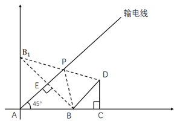
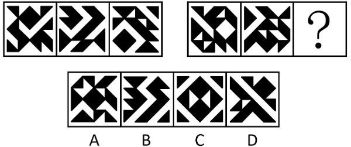
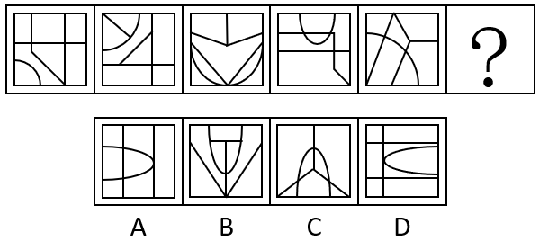
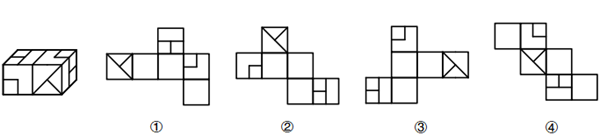
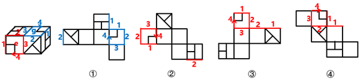
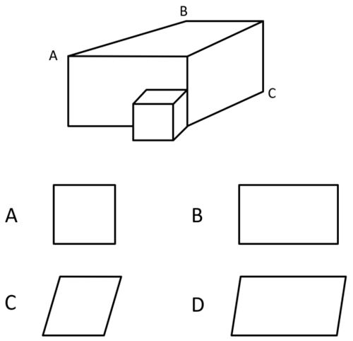
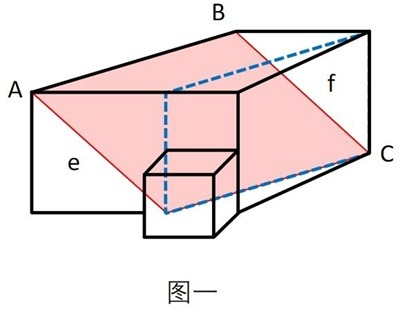

# 2026年甘肃公务员录用考试《行测》题（网友回忆版）

<!-- gwy:overview:start -->
> **甘肃 · 2026 · 行测 · 统考** ｜ 120 题 · 图片 200 处 · 答案随题折叠

| 题型模块 | 题量 | 题号 |
| --- | ---: | ---: |
| 政治理论 | 10 | 1–10 |
| 常识判断 | 10 | 11–20 |
| 言语理解与表达 | 35 | 21–55 |
| 数量关系 | 15 | 56–70 |
| 判断推理 | 35 | 71–105 |
| 资料分析 | 15 | 106–120 |
| **合计** | **120** | |

导航：[题型与作答说明](#题型与作答说明) · [题目](#题目) · [材料 1](#材料-1)
<!-- gwy:overview:end -->

> 候选采集稿。参考答案及解析来自粉笔页面，不代表官方答案或真实高分答卷；来源使用许可与原卷对应关系仍需人工核实。

## 题型与作答说明

政治理论

（10题）

根据题目要求，在四个选项中选出一个最恰当的答案。

常识判断

（10题）

根据题目要求，在四个选项中选出一个最恰当的答案。

言语理解与表达

（35题）

本部分包括表达与理解两方面的内容。请根据题目要求，在四个选项中选出一个最恰当的答案。

数量关系

（15题）

在这部分试题中，每道题呈现一段表述数字关系的文字，要求你迅速、准确地计算出答案。

判断推理

（35题）

本部分包括图形推理、定义判断、类比推理与逻辑判断四种类型的试题，在四个选项中选出一个最恰当的答案。

资料分析

（15题）

所给出的图、表、文字或综合性资料均有若干个问题要你回答。你应根据资料提供的信息进行分析、比较、计算和判断处理。

## 题目

### 第 1 题

习近平总书记指出，要提高政治判断力、政治领悟力、政治执行力，主动识变求变应变，强化全局视野和系统思维，加强改革政策统筹、进度统筹、效果统筹，发挥改革整体效应。这一论述最能体现马克思主义的哪些基本观点？

①实践是检验真理的唯一标准

②系统的存在依赖于要素之间的相关性中产生的有机统一体

③质变是量变的必然结果，量变达到一定程度必然引起质变

④尊重客观规律是正确发挥主观能动性的前提

A. ①②

B. ②④

C. ①③

D. ③④

第 1 题 · 答案与解析

**参考答案（粉笔题库参考内容）**

B

**解析**

本题考查马克思主义。

①错误，“实践是检验真理的唯一标准”强调的是实践作为检验真理标准的绝对性、确定性，即认识是否是真理，只有通过实践来检验，此外再无别的检验真理的办法。题干强调的是“提高政治能力”“主动识变求变应变”“强化全局视野和系统思维”以及“加强改革政策统筹”，并未直接提及实践作为检验真理的标准。

②正确，“系统的存在依赖于要素之间的相关性中产生的有机统一体”强调的是整体性和各要素之间的相互关联，即系统思维。题干中“强化全局视野和系统思维”“加强改革政策统筹、进度统筹、效果统筹”“发挥改革整体效应”体现的是系统思维，即系统是由相互关联的要素组成的有机整体，统筹协调才能发挥整体效应。

③错误，“质变是量变的必然结果，量变达到一定程度必然引起质变”讨论的是量变与质变的关系。题干强调的是“强化全局视野和系统思维”“发挥改革整体效应”等系统思维，并未涉及量变和质变相关哲学原理。

④正确，“尊重客观规律是正确发挥主观能动性的前提”是指只有从客观实际出发，尊重客观规律，按客观规律办事，才能正确地发挥人的主观能动性，最终实现人们预期的目的。题干中“主动识变求变应变”中的“识变”意味着尊重和认识客观规律和变化，“求变应变”是在尊重规律基础上发挥主观能动性。同时，“提高政治能力”都需要在尊重规律的前提下发挥主观能动性。

综上，②④正确。

故正确答案为B。

**考点**：唯物论

### 第 2 题

习近平总书记指出，加快构建全国统一大市场，着力整治一些领域的“内卷式”竞争。关于深刻认识和综合整治“内卷式”竞争，下列说法正确的是（ ）。

A. “内卷式”竞争的根源是我国的人口基数过大

B. “内卷式”竞争是市场经济发展的必然现象

C. “内卷式”竞争会带来资源耗损、无序竞争

D. 整治“内卷式”竞争要从严从实从快

第 2 题 · 答案与解析

**参考答案（粉笔题库参考内容）**

C

**解析**

本题考查新思想。

2025年7月，《求是》杂志发表《深刻认识和综合整治“内卷式”竞争》（以下简称文章）。

A项错误，文章指出，作为当前经济发展中的突出现象，“内卷式”竞争的形成原因具有多维性和复杂性，涉及企业、行业、政府多个方面，既有经济发展和技术进步等规律性因素，也有深层次体制机制问题，还有经济主体的路径依赖等原因，是多种因素综合形成的。由此可见，“内卷式”竞争与人口基数无直接关联。

B项错误，文章指出，市场配置资源是最有效率的形式，竞争是市场经济运行的重要机制。通过竞争优化资源配置、实现优胜劣汰，倒逼企业不断创新技术、改善经营管理，进而提高经济运行效率，促进经济发展、技术进步，这是市场经济的优势所在······市场竞争有利于提高资源配置效率，可一旦竞争过了头、越了界，演变成无序“内卷”，就会扭曲市场机制、破坏市场公平，造成诸多负面影响。因此，竞争过度是市场经济演进中的阶段性问题，并非“必然现象”。

C项正确，文章指出，现实中，“内卷式”竞争表现不同、特征各异，主要涉及企业和地方政府两类行为主体······从地方政府行为看，“内卷式”竞争主要表现为：一是为招引企业、培育产业，人为制造政策洼地，违规实施税费、补贴、用地等不公平非普惠的优惠政策，导致无序竞争；二是不顾地方产业基础和资源禀赋情况，盲目上马新兴产业、重点产业，造成行业内大量重复建设和生产过剩；三是为保护本地市场、扶持本地企业，设置或明或暗的市场壁垒，区别对待各类企业，破坏公平竞争秩序。故“内卷式”竞争会带来资源耗损、无序竞争说法正确。

D项错误，文章指出，整治“内卷式”竞争是一项复杂的系统性工程，不可能一蹴而就、一招制胜，需要遵循经济规律，汇集各方力量，多管齐下，综合整治。故“从快”表述错误。

故正确答案为C。

**考点**：经济建设

### 第 3 题

2025年12月，中央经济工作会议在北京举行，部署了2026年经济工作。下列与之相关说法正确的是（ ）。

A. 增强中央转移支付力度，帮助地方政府积极有序化解债务风险

B. 加强财政科学管理，逐步降低财政赤字、债务总规模和支出总量

C. 继续实施适度宽松的货币政策，把物价合理回升作为货币政策重要考量

D. 持续深化资本市场投融资综合改革，扩大中小金融机构增量，优化存量

第 3 题 · 答案与解析

**参考答案（粉笔题库参考内容）**

C

**解析**

本题考查新思想。

2025年12月10日至11日，中央经济工作会议在北京举行。中共中央总书记、国家主席、中央军委主席习近平出席会议并发表重要讲话。

A项错误，会议指出：“坚持守牢底线，积极稳妥化解重点领域风险。着力稳定房地产市场，因城施策控增量、去库存、优供给，鼓励收购存量商品房重点用于保障性住房等。深化住房公积金制度改革，有序推动‘好房子’建设。加快构建房地产发展新模式。积极有序化解地方政府债务风险，督促各地主动化债，不得违规新增隐性债务。优化债务重组和置换办法，多措并举化解地方政府融资平台经营性债务风险。”故“增强中央转移支付力度”表述错误，化解地方债务风险的核心责任一般在地方政府。

B项错误，C项正确，会议指出：“明年经济工作在政策取向上，要坚持稳中求进、提质增效，发挥存量政策和增量政策集成效应，加大逆周期和跨周期调节力度，提升宏观经济治理效能。要继续实施更加积极的财政政策。保持必要的财政赤字、债务总规模和支出总量，加强财政科学管理，优化财政支出结构，规范税收优惠、财政补贴政策······要继续实施适度宽松的货币政策。把促进经济稳定增长、物价合理回升作为货币政策的重要考量，灵活高效运用降准降息等多种政策工具，保持流动性充裕，畅通货币政策传导机制······”故B项中“逐步降低财政赤字、债务总规模和支出总量”表述错误，应为“保持必要的财政赤字、债务总规模和支出总量”。

D项错误，会议指出：“坚持改革攻坚，增强高质量发展动力活力。制定全国统一大市场建设条例，深入整治‘内卷式’竞争。制定和实施进一步深化国资国企改革方案，完善民营经济促进法配套法规政策。加紧清理拖欠企业账款。推动平台企业和平台内经营者、劳动者共赢发展。拓展要素市场化改革试点。健全地方税体系。深入推进中小金融机构减量提质，持续深化资本市场投融资综合改革。”故“扩大中小金融机构增量，优化存量”表述错误，应为“深入推进中小金融机构减量提质”。

故正确答案为C。

**考点**：经济建设、重要会议讲话

### 第 4 题

2025年底，中共中央政治局召开民主生活会强调，锲而不舍落实中央八项规定精神，以优良作风凝心聚力真抓实干。关于作风问题，下列说法不准确的是（ ）。

A. 作风问题核心是党同人民群众的关系问题

B. 党强大的人格力量集中体现为党的优良作风

C. 透过党性看作风，在解决党性问题的基础上解决好作风问题

D. 抓作风建设，重点突出坚定理想信念、践行根本宗旨、加强道德修养

第 4 题 · 答案与解析

**参考答案（粉笔题库参考内容）**

C

**解析**

本题考查新思想。

2025年3月，中共中央党史和文献研究院编辑的《习近平关于加强党的作风建设论述摘编》出版发行，以下简称《论述摘编》。

A项正确，《论述摘编》中“三、作风问题核心是党同人民群众的关系问题”部分指出：“作风问题核心是党同人民群众的关系问题。马克思主义政党执政后特别是长期执政后的最大危险是脱离群众。”

B项正确，《论述摘编》中“一、党的作风关系人心向背，决定党和国家事业成败”部分指出：“我们党作为马克思主义执政党，不但要有强大的真理力量，而且要有强大的人格力量。真理力量集中体现为我们党的正确理论，人格力量集中体现为我们党的优良作风。”

C项错误，《论述摘编》中“二、作风问题本质上是党性问题”部分指出：“我们改进作风，不能简单就事论事，以为把眼前存在的作风问题从面上解决了就万事大吉了，而是要举一反三，透过作风看党性，在解决作风问题的基础上解决好党性问题。”故“透过党性看作风”说法错误，应为“透过作风看党性”。

D项正确，《论述摘编》中“二、作风问题本质上是党性问题”部分指出：“作风问题本质上是党性问题。抓作风建设，就要返璞归真、固本培元，重点突出坚定理想信念、践行根本宗旨、加强道德修养。”

本题为选非题，故正确答案为C。

**考点**：其他建设

### 第 5 题

《中共中央关于制定国民经济和社会发展第十五个五年规划的建议》提出，要如期实现建军一百年奋斗目标，高质量推进国防和军队现代化。下列举措不属于高质量推进国防和军队现代化的是（ ）。

A. 壮大战略威慑力量，维护全球战略平衡和稳定

B. 全面落实勤俭建军方针，走高效益、低成本、可持续发展路子

C. 建设先进国防科技工业体系，优化国防科技工业布局，推进军民标准通用化

D. 完善涉外国家安全机制，构建海外安全保障体系，加强反制裁、反干预、反“长臂管辖”斗争

第 5 题 · 答案与解析

**参考答案（粉笔题库参考内容）**

D

**解析**

本题考查新思想。

2025年10月23日，中国共产党第二十届中央委员会第四次全体会议通过《中共中央关于制定国民经济和社会发展第十五个五年规划的建议》（以下简称《建议》）。

A项正确，《建议》在“十四、如期实现建军一百年奋斗目标，高质量推进国防和军队现代化”部分指出：“（53）加快先进战斗力建设。壮大战略威慑力量，维护全球战略平衡和稳定。推进新域新质作战力量规模化、实战化、体系化发展，加快无人智能作战力量及反制能力建设，加强传统作战力量升级改造。”

B项正确，《建议》在“十四、如期实现建军一百年奋斗目标，高质量推进国防和军队现代化”部分指出：“（54）推进军事治理现代化······加强重大决策咨询评估和重大项目监管，推进军费预算管理改革，改进军事采购制度，完善军队建设统计评估体系，全面落实勤俭建军方针，走高效益、低成本、可持续发展路子。持续深化政治整训，弘扬优良传统，加强重点行业和领域整肃治理。”

C项正确，《建议》在“十四、如期实现建军一百年奋斗目标，高质量推进国防和军队现代化”部分指出：“（55）巩固提高一体化国家战略体系和能力。深化跨军地改革，构建各司其职、紧密协作、规范有序的跨军地工作格局。加快新兴领域战略能力建设，推动新质生产力同新质战斗力高效融合、双向拉动。建设先进国防科技工业体系，优化国防科技工业布局，推进军民标准通用化。”

D项错误，《建议》在“十三、推进国家安全体系和能力现代化，建设更高水平平安中国”部分指出：“（49）健全国家安全体系······落实国家安全责任制，促进全链条全要素协同联动，形成体系合力。完善涉外国家安全机制，构建海外安全保障体系，加强反制裁、反干预、反‘长臂管辖’斗争，深化国际执法安全合作，推动完善全球安全治理。强化国家安全教育，筑牢人民防线。”故该项不属于“高质量推进国防和军队现代化”举措。

本题为选非题，故正确答案为D。

**考点**：其他建设

### 第 6 题

党的二十届四中全会指出，“十五五”时期是基本实现社会主义现代化夯实基础、全面发力的关键时期，在基本实现社会主义现代化进程中具有承前启后的重要地位。关于“十五五”规划，下列说法正确的是：

A. 加强原始创新和关键核心技术攻关，推动科技创新和产业创新深度融合

B. 把发展经济的着力点向传统实体产业转移，巩固壮大传统实体产业根基

C. 积极稳妥推进和实现碳达峰，发展集中式能源，逐步缩减全国碳排放权交易市场

D. 发挥积极财政政策作用，适当加强地方事权、提高地方财政支出比重，增加地方自主财力

第 6 题 · 答案与解析

**参考答案（粉笔题库参考内容）**

A

**解析**

本题考查新思想。

2025年10月23日，中国共产党第二十届中央委员会第四次全体会议通过《中共中央关于制定国民经济和社会发展第十五个五年规划的建议》（以下简称《建议》）。

A项正确，《建议》在“四、加快高水平科技自立自强，引领发展新质生产力”部分指出：“（11）加强原始创新和关键核心技术攻关。完善新型举国体制，采取超常规措施，全链条推动集成电路、工业母机、高端仪器、基础软件、先进材料、生物制造等重点领域关键核心技术攻关取得决定性突破······（12）推动科技创新和产业创新深度融合。统筹国家战略科技力量建设，增强体系化攻关能力。强化科技基础条件自主保障，统筹科技创新平台基地建设。完善区域创新体系，布局建设区域科技创新中心和产业科技创新高地，强化国际科技创新中心策源功能······”

B项错误，《建议》在“三、建设现代化产业体系，巩固壮大实体经济根基”部分指出：“现代化产业体系是中国式现代化的物质技术基础。坚持把发展经济的着力点放在实体经济上，坚持智能化、绿色化、融合化方向，加快建设制造强国、质量强国、航天强国、交通强国、网络强国，保持制造业合理比重，构建以先进制造业为骨干的现代化产业体系。”故“把发展经济的着力点向传统实体产业转移，巩固壮大传统实体产业根基”表述错误，应为“坚持把发展经济的着力点放在实体经济上，巩固壮大实体经济根基”。

C项错误，《建议》在“十二、加快经济社会发展全面绿色转型，建设美丽中国”部分指出：“（47）积极稳妥推进和实现碳达峰。实施碳排放总量和强度双控制度。深入实施节能降碳改造。推动煤炭和石油消费达峰。完善碳排放统计核算体系，稳步实施地方碳考核、行业碳管控、企业碳管理、项目碳评价、产品碳足迹等政策制度。发展分布式能源，建设零碳工厂和园区。扩大全国碳排放权交易市场覆盖范围，加快温室气体自愿减排交易市场建设······”故“发展集中式能源，逐步缩减全国碳排放权交易市场”表述错误，应为“发展分布式能源，扩大全国碳排放权交易市场覆盖范围”。

D项错误，《建议》在“六、加快构建高水平社会主义市场经济体制，增强高质量发展动力”部分指出：“（20）提升宏观经济治理效能。发挥积极财政政策作用，增强财政可持续性······适当加强中央事权、提高中央财政支出比重。增加地方自主财力。加强财会监督。加快构建同高质量发展相适应的政府债务管理长效机制。”故“适当加强地方事权、提高地方财政支出比重”表述错误，应为“适当加强中央事权、提高中央财政支出比重”。

故正确答案为A。

**考点**：经济建设、重要文件

### 第 7 题

党的二十届四中全会提出，加快农业农村现代化，扎实推进乡村全面振兴。下列与之相关说法正确的是（ ）。

①坚持把解决好“三农”问题作为全党工作重中之重

②统筹发展科技农业、绿色农业、质量农业、品牌农业

③稳定土地承包关系，稳步推进三轮承包到期后再延长三十年试点

④因地制宜完善乡村建设实施机制，分类有序、一体化推进乡村振兴

⑤健全财政优先保障、金融重点倾斜、社会积极参与的多元投入格局，确保乡村振兴投入力度不断增强

A. ①②③

B. ①②⑤

C. ①②④⑤

D. ②③④⑤

第 7 题 · 答案与解析

**参考答案（粉笔题库参考内容）**

B

**解析**

本题考查新思想。

2025年10月23日，《中共中央关于制定国民经济和社会发展第十五个五年规划的建议》发布，以下简称《建议》。

①正确，《建议》在“八、加快农业农村现代化，扎实推进乡村全面振兴”部分指出：“坚持把解决好‘三农’问题作为全党工作重中之重，促进城乡融合发展，持续巩固拓展脱贫攻坚成果，推动农村基本具备现代生活条件，加快建设农业强国。”

②正确，③错误，《建议》在“八、加快农业农村现代化，扎实推进乡村全面振兴”部分指出：“（25）提升农业综合生产能力和质量效益。坚持产量产能、生产生态、增产增收一起抓，统筹发展科技农业、绿色农业、质量农业、品牌农业，把农业建成现代化大产业······稳定土地承包关系，稳步推进二轮承包到期后再延长三十年试点。”故③中“三轮承包”表述错误，应为“二轮承包”。

④错误，《建议》在“八、加快农业农村现代化，扎实推进乡村全面振兴”部分指出：“（26）推进宜居宜业和美乡村建设。学习运用‘千万工程’经验，因地制宜完善乡村建设实施机制，分类有序、片区化推进乡村振兴，逐步提高农村基础设施完备度、公共服务便利度、人居环境舒适度。”故“一体化”表述错误，应为“片区化”。

⑤正确，《建议》在“八、加快农业农村现代化，扎实推进乡村全面振兴”部分指出：“（27）提高强农惠农富农政策效能。健全财政优先保障、金融重点倾斜、社会积极参与的多元投入格局，确保乡村振兴投入力度不断增强。保护和调动农民务农种粮积极性，强化价格、补贴、保险等政策支持和协同。”

故①②⑤表述正确。

故正确答案为B。

**考点**：经济建设、重要文件

### 第 8 题

习近平总书记强调，学习好贯彻好党的二十届四中全会精神，是当前和今后一个时期全党全国的一项重大政治任务。关于党的二十届四中全会精神，下列表述正确的是（ ）。

A. 把捍卫经济安全摆在首位，加强重点领域国家安全能力建设，突出保障事关国家长治久安、经济健康稳定、人民安居乐业的重大安全

B. 坚定不移推动高质量发展，构建以新兴产业和未来产业为骨干的现代化产业体系

C. 坚定不移扩大高水平对外开放，做强国内国际大循环，加快构建新发展格局

D. 加强普惠性、基础性、兜底性民生建设，稳步推进基本公共服务均等化

第 8 题 · 答案与解析

**参考答案（粉笔题库参考内容）**

D

**解析**

本题考查新思想。

2025年10月23日，党的二十届四中全会审议通过了《中共中央关于制定国民经济和社会发展第十五个五年规划的建议》（以下简称《建议》）。

A项错误，《建议》在：“十三、推进国家安全体系和能力现代化，建设更高水平平安中国”部分指出：“（50）加强重点领域国家安全能力建设。锻造实战实用的国家安全能力，突出保障事关国家长治久安、经济健康稳定、人民安居乐业的重大安全，把捍卫政治安全摆在首位······”故“把捍卫经济安全摆在首位”表述错误，应为“把捍卫政治安全摆在首位”。

B项错误，《建议》在“三、建设现代化产业体系，巩固壮大实体经济根基”部分指出：“······坚持把发展经济的着力点放在实体经济上，坚持智能化、绿色化、融合化方向，加快建设制造强国、质量强国、航天强国、交通强国、网络强国，保持制造业合理比重，构建以先进制造业为骨干的现代化产业体系。故“以新兴产业和未来产业为骨干”表述错误，应为“以先进制造业为骨干”。

C项错误，2026年1月1日出版的第1期《求是》杂志发表了习近平总书记的重要文章《学习好贯彻好党的二十届四中全会精神》。文章指出：“第二，加快构建新发展格局。做强国内大循环、畅通国内国际双循环，是我们把握发展主动权、塑造国际合作和竞争新优势的战略举措······坚定不移扩大高水平对外开放，维护多边贸易体制······”故“做强国内国际大循环”表述错误，应为“做强国内大循环”。

D项正确，《建议》在“十一、加大保障和改善民生力度，扎实推进全体人民共同富裕”部分指出：“实现人民对美好生活的向往是中国式现代化的出发点和落脚点。坚持尽力而为、量力而行，加强普惠性、基础性、兜底性民生建设······（44）稳步推进基本公共服务均等化。建立基本公共服务均等化评价标准，完善基本公共服务范围和内容，制定实现基本公共服务均等化的目标、路径、措施······”

故正确答案为D。

**考点**：经济建设、重要文件

### 第 9 题

高质量发展是全面建设社会主义现代化国家的首要任务。下列对高质量发展核心要求的理解，正确的有几项？

①高质量发展当然要做大蛋糕，但它同时要求分好蛋糕

②高质量发展意味着可以暂时容忍一定程度的环境污染以换取发展空间

③高质量发展不仅仅是对经济领域的要求，也包括社会、文化、生态等各个领域

④推动经济社会发展绿色化、低碳化是实现高质量发展的关键环节

A. 1项

B. 2项

C. 3项

D. 4项

第 9 题 · 答案与解析

**参考答案（粉笔题库参考内容）**

C

**解析**

本题考查新思想。

①正确，2022年1月17日，习近平总书记在2022年世界经济论坛视频会议上发表题为《坚定信心 勇毅前行 共创后疫情时代美好世界》的演讲中指出：“中国要实现共同富裕，但不是搞平均主义，而是要先把‘蛋糕’做大，然后通过合理的制度安排把‘蛋糕’分好，水涨船高、各得其所，让发展成果更多更公平惠及全体人民。”

②错误，2013年5月24日，中共中央政治局就大力推进生态文明建设进行第六次集体学习，习近平总书记强调：“要正确处理好经济发展同生态环境保护的关系，牢固树立保护生态环境就是保护生产力、改善生态环境就是发展生产力的理念，更加自觉地推动绿色发展、循环发展、低碳发展，决不以牺牲环境为代价去换取一时的经济增长。”故“可以暂时容忍一定程度的环境污染以换取发展空间”说法错误，应为“决不以牺牲环境为代价去换取一时的经济增长”。

③正确，2021年，习近平总书记参加十三届全国人大四次会议青海代表团审议时强调：“高质量发展不只是一个经济要求，而是对经济社会发展方方面面的总要求；不是只对经济发达地区的要求，而是所有地区发展都必须贯彻的要求；不是一时一事的要求，而是必须长期坚持的要求。”

④正确，党的二十大报告中“十、推动绿色发展，促进人与自然和谐共生”部分指出：“（一）加快发展方式绿色转型。推动经济社会发展绿色化、低碳化是实现高质量发展的关键环节。”

综上，①③④表述正确，共3项。

故正确答案为C。

**考点**：经济建设

### 第 10 题

习近平总书记强调，要牢固树立和践行绿水青山就是金山银山的理念，坚定不移走生态优先、绿色发展之路。关于绿色发展，下列表述正确的有几项?

①坚持绿色发展是发展观的一场深刻革命

②要坚持经济优先、技术优先、人工恢复为主的方针，像保护眼睛一样保护自然和生态环境

③应暂缓绿色发展领域的多边合作平台建设，以应对现有国际环境治理合作存在的诸多风险与挑战

④不仅要从政策上加强管理和保护，而且要从全球变化、碳循环机理等方面加深认识，依靠科技创新破解绿色发展难题

A. 1项

B. 2项

C. 3项

D. 4项

第 10 题 · 答案与解析

**参考答案（粉笔题库参考内容）**

B

**解析**

本题考查新思想。

①正确，2017年6月21日至23日，习近平总书记在山西考察工作时强调：“坚持绿色发展是发展观的一场深刻革命。要从转变经济发展方式、环境污染综合治理、自然生态保护修复、资源节约集约利用、完善生态文明制度体系等方面采取超常举措，全方位、全地域、全过程开展生态环境保护。”

②错误，2018年5月18日至19日，全国生态环境保护大会在北京召开，习近平总书记出席会议并发表重要讲话，他指出：“新时代推进生态文明建设，必须坚持好以下原则。一是坚持人与自然和谐共生，坚持节约优先、保护优先、自然恢复为主的方针，像保护眼睛一样保护生态环境，像对待生命一样对待生态环境，让自然生态美景永驻人间······”故“要坚持经济优先、技术优先、人工恢复为主的方针”表述有误，应为“坚持节约优先、保护优先、自然恢复为主的方针”。

③错误，2024年7月18日，二十届三中全会通过的《中共中央关于进一步全面深化改革 推进中国式现代化的决定》在“七、完善高水平对外开放体制机制”中指出：“（28）完善推进高质量共建‘一带一路’机制。继续实施‘一带一路’科技创新行动计划，加强绿色发展、数字经济、人工智能、能源、税收、金融、减灾等领域的多边合作平台建设······”故“应暂缓绿色发展领域的多边合作平台建设”表述错误，应为“加强绿色发展······等领域的多边合作平台建设”。

④正确，2016年5月30日，习近平总书记在全国科技创新大会、两院院士大会、中国科协第九次全国代表大会上强调：“绿色发展是生态文明建设的必然要求，代表了当今科技和产业变革方向，是最有前途的发展领域······不仅要研究生态恢复治理防护的措施，而且要加深对生物多样性等科学规律的认识；不仅要从政策上加强管理和保护，而且要从全球变化、碳循环机理等方面加深认识，依靠科技创新破解绿色发展难题，形成人与自然和谐发展新格局。”

综上，①④表述正确，共2项。

故正确答案为B。

**考点**：重要会议讲话、生态文明建设

### 第 11 题

根据《中华人民共和国村民委员会组织法》，下列说法错误的是（ ）。

A. 需由村民会议或者村民代表会议决定的重要事项，应当先经村党组织研究讨论

B. 村民委员会具有基层群众性自治组织法人资格，村民委员会主任为法定代表人

C. 村民委员会成员实行近亲属回避，根据具体情况吸纳妇女成员

D. 村民委员会应当设立村务公开栏，公布的期限不得少于十五日

第 11 题 · 答案与解析

**参考答案（粉笔题库参考内容）**

C

**解析**

本题考查法律常识。

A项正确，根据《中华人民共和国村民委员会组织法》第二十八第三款规定：“需由村民会议或者村民代表会议决定的重要事项，应当先经村党组织研究讨论。”

B项正确，根据《中华人民共和国村民委员会组织法》第十三条规定：“村民委员会具有基层群众性自治组织法人资格，村民委员会主任为法定代表人。村民委员会可以从事为履行职能所需要的民事活动，但是不得提供担保。”

C项错误，根据《中华人民共和国村民委员会组织法》第八条第二款规定：“村民委员会成员中，应当有妇女成员。村民委员会成员实行近亲属回避。”因此，村民委员会成员中应当有妇女成员，并非根据具体情况吸纳妇女成员。

D项正确，根据《中华人民共和国村民委员会组织法》第三十五条第四款规定：“村民委员会应当设立村务公开栏，可以采用现代信息技术进行村务公开。公布的期限不得少于十五日。村民委员会应当保证公布事项的真实性，并接受村民的查询。”

本题为选非题，故正确答案为C。

**考点**：其他法律法规

### 第 12 题

下列与电有关说法正确的是（ ）。

A. 风力发电利用了电磁感应原理，水力发电没有

B. 电动机是能够把电能转换成机械能的一种装置

C. 微波炉加热食品是电流的热效应在生活中的应用

D. “摩擦生电”是因为在两个物体间产生了新的电荷

第 12 题 · 答案与解析

**参考答案（粉笔题库参考内容）**

B

**解析**

本题考查科技常识。

A项错误，风力发电是利用风机叶片转动带动发电机转子切割磁力线，从而产生感应电流，其基本原理是电磁感应；水力发电同样是利用水流推动水轮机转动，带动发电机转子切割磁力线产生感应电流，同样基于电磁感应原理。因此，风力发电和水力发电都利用了电磁感应原理。

B项正确，电动机是一种能够将电能转化为机械能的装置，其工作原理是通电导体在磁场中受到力的作用而运动，从而输出机械能。

C项错误，微波炉加热食品是利用微波（一种电磁波）使食物中的水分子和脂肪分子高速振动、相互摩擦而产生热量，这属于电磁能向热能的转化；电流的热效应是指电流通过导体时使导体发热的现象（如电炉、电热毯），微波炉不属于电流的热效应在生活中的应用。

D项错误，“摩擦生电”的本质是两种不同材料相互摩擦时，电子从一个物体转移到另一个物体，使一个物体带正电、另一个物体带负电，这是电荷的转移过程，而非“产生了新的电荷”。电荷既不能创造也不能消灭，只能从一个物体转移到另一个物体。

故正确答案为B。

**考点**：物理常识

### 第 13 题

水是生命之源、生态之基、生产之要，更是文明之本，在中华民族的文明发展史上，水始终占据着特殊的地位。下列与水有关的说法错误的是：

A. 《尚书·禹贡》是与河流密切相关的著作

B. “兵无常势，水无常形”是孙武论兵的名言

C. “坎坎伐檀兮，置之河之干兮”出自《诗经》

D. 最早提出“水能载舟、亦能覆舟”的是唐太宗

第 13 题 · 答案与解析

**参考答案（粉笔题库参考内容）**

D

**解析**

本题考查人文常识。

A项正确，《尚书·禹贡》是中国古代地理学的重要文献，被认为是第一篇具有系统性地理观念的著作，《禹贡》以自然地理实体（山脉、河流等）为标志，将全国划分为9个区（即九州），并对每区（州）的疆域、山脉、河流、植被、土壤、物产、贡赋、少数民族、交通等自然和人文地理现象作了简要描述。此外，《禹贡》还分述了导山、导水、水功和以京都为中心的五服制度，其内容与河流密切相关。

B项正确，“兵无常势，水无常形”出自《孙子·虚实篇》，意思是用兵作战要根据敌情的变化来采取灵活机动的战略战术，不能墨守某种作战方法。

C项正确，“坎坎伐檀兮，置之河之干兮”出自《诗经·伐檀》，意思是砍伐檀树声坎坎啊，把砍到的檀树一棵棵堆放在河边。

D项错误，“水能载舟、亦能覆舟”最早出自于战国时期荀子及其弟子所著的《荀子·王制》，内容是：“《传》曰：‘君者，舟也；庶人者，水也。水则载舟，水则覆舟’。”后世据此典故引申出成语“水能载舟，亦能覆舟”。贞观六年，唐太宗与群臣论治国之道，提出：“天子者，有道则人推而为主，无道则人弃而不用，诚可畏也。”魏征接着说道：“臣又闻古语云：君，舟也；人，水也。水能载舟，亦能覆舟。陛下以为可畏，诚如圣旨。”

本题为选非题，故正确答案为D。

**考点**：文学常识

### 第 14 题

甲因琐事纠纷将乙打伤，经当地人民调解委员会调解，双方达成调解协议，约定甲向乙支付医疗费等共计5000元。事后甲拒绝履行该协议。对此，下列相关说法正确的是（ ）。

A. 乙可依据该调解协议直接向人民法院申请强制执行

B. 乙只能就原人身损害事实另行提起侵权损害赔偿诉讼

C. 乙有权依据该调解协议向人民法院提起诉讼，请求判令甲履行协议

D. 甲有权主张该调解协议内容显失公平，向人民法院申请撤销该协议

第 14 题 · 答案与解析

**参考答案（粉笔题库参考内容）**

C

**解析**

本题考查法律常识。

A项错误，根据《中华人民共和国人民调解法》第三十三条第一、二款规定：“经人民调解委员会调解达成调解协议后，双方当事人认为有必要的，可以自调解协议生效之日起三十日内共同向人民法院申请司法确认，人民法院应当及时对调解协议进行审查，依法确认调解协议的效力。人民法院依法确认调解协议有效，一方当事人拒绝履行或者未全部履行的，对方当事人可以向人民法院申请强制执行。”题中，该调解协议未经过司法确认，不具有强制执行力，乙不能直接申请强制执行。

B项错误，C项正确，根据《中华人民共和国人民调解法》第三十二条规定：“经人民调解委员会调解达成调解协议后，当事人之间就调解协议的履行或者调解协议的内容发生争议的，一方当事人可以向人民法院提起诉讼。”题中，乙既可以就原人身损害提起侵权损害赔偿诉讼，也可针对调解协议提起诉讼，请求判令甲履行协议。

D项错误，根据《中华人民共和国民法典》第一百五十一条规定：“一方利用对方处于危困状态、缺乏判断能力等情形，致使民事法律行为成立时显失公平的，受损害方有权请求人民法院或者仲裁机构予以撤销。”题中，案件涉及甲事后拒绝履行调解协议，未表明存在显失公平的情形，因此，甲无权主张撤销该协议。

故正确答案为C。

**考点**：其他法律法规

### 第 15 题

下列关于亚洲的地理知识说法错误的是（ ）。

A. 东亚地区没有内陆国家

B. 东南亚跨南、北两个半球

C. 中亚地区以大陆性气候为主

D. 古巴比伦文明产生在西亚地区

第 15 题 · 答案与解析

**参考答案（粉笔题库参考内容）**

A

**解析**

本题考查地理国情。

A项错误，东亚包括中国、日本、韩国、朝鲜、蒙古五个国家，其中蒙古是无出海口、完全被陆地包围的内陆国家（被中国与俄罗斯包围），同时蒙古国也是世界上第二大的内陆国。

B项正确，东南亚由中南半岛和马来群岛两大部分组成，赤道横穿马来群岛中部，因此东南亚地跨南、北两个半球，该区域同时还地跨太平洋与印度洋两大核心大洋，是亚洲海上交通的关键枢纽。

C项正确，中亚深居亚欧大陆内部，远离海洋，海洋湿润气流难以抵达，区域内以温带大陆性气候为主，核心气候特征为干旱少雨、气温年较差与日较差大，也造就了区域内以内流河、内流湖为主的水文特征。

D项正确，古巴比伦文明是世界四大古文明之一，发源于西亚的两河流域（幼发拉底河、底格里斯河）之间的冲积平原（美索不达米亚），该区域核心在今伊拉克境内，属于西亚核心地带。

本题为选非题，故正确答案为A。

**考点**：世界地理

### 第 16 题

下列关于鸦片战争和第二次鸦片战争说法错误的是：

A. 鸦片战争是英、法两国联合发动的侵略战争

B. 电影《火烧圆明园》以第二次鸦片战争为背景

C. 第二次鸦片战争迫使清政府签订了《天津条约》

D. “三元里前声若雷，千众万众同时来”与鸦片战争有关

第 16 题 · 答案与解析

**参考答案（粉笔题库参考内容）**

A

**解析**

本题考查人文常识。

A项错误，1840年，英国为扭转对华贸易逆差，向中国走私鸦片，林则徐虎门销烟成为战争借口，英国发动鸦片战争；1856-1860年，英法等国为进一步打开中国市场、扩大侵略权益，以“修约”被拒为借口，发动第二次鸦片战争。故英、法两国联合发动鸦片战争表述错误，鸦片战争（第一次鸦片战争）是英国单独发动的。

B项正确，火烧圆明园发生在第二次鸦片战争期间，1860年，英法联军攻占北京，抢劫并焚毁圆明园。电影《火烧圆明园》正是以第二次鸦片战争为背景。

C项正确，第二次鸦片战争中，清政府被迫与英、法、俄、美四国签订《天津条约》；与英国、法国、俄国签订《北京条约》等。

D项正确，选项诗句出自清代爱国诗人张维屏的七言古诗《三元里》，写于1841年，歌颂三元里抗英斗争。诗句意思为：“三元里村前，民众呐喊声如雷鸣，成千上万的人从各处一同赶来，奋起反抗英国侵略者。”第一次鸦片战争期间，英军在广州三元里一带骚扰作恶，激起民众反抗，三元里人民自发组织起来围歼英军，是近代中国第一次大规模民间反侵略斗争。

本题为选非题，故正确答案为A。

**考点**：中国历史

### 第 17 题

在春秋战国时期，今天的河南省分别被燕国和赵国占据，因此也被称为“燕赵之地”。由于受武侠文化影响颇深，再加上地处军事重地，这一地区自古就英雄频出，以“燕赵多慷慨悲歌之士”著称，其中就包括知名典故“将相和”的主角廉颇和蔺相如、三国蜀汉政权建立者刘备、唐朝名相魏征等。在文化领域，这一地区同样贡献了大量人才，如名列“元曲四大家”之首的关汉卿、世界上第一个将圆周率计算到小数点后七位的南北朝时期数学家祖冲之、制订出极为精确天文历法的唐代天文学家郭守敬、写有不朽地理名著的北魏地理学家郦道元，等等。

这段文字画横线部分表述错误的有几处？

A. 1

B. 2

C. 3

D. 4

第 17 题 · 答案与解析

**参考答案（粉笔题库参考内容）**

B

**解析**

本题考查人文常识。

①错误，燕国与赵国是春秋战国时期北方重要诸侯国，其核心统治区域主要位于今天的河北省、北京市、天津市以及山西省北部一带，因此这一地区历史上被称为“燕赵之地”。而今天的河南省在春秋战国时期主要隶属于晋国、郑国、宋国、魏国、韩国等国，与燕、赵两国并无直接的隶属关系。因此“今天的河南省分别被燕国和赵国占据”表述有误。

②正确，“将相和”是战国时期赵国著名的历史典故，主要人物是廉颇与蔺相如。廉颇是赵国战功卓著的武将，蔺相如凭借智慧与胆识在外交上为赵国立下大功，被封为上卿，位居廉颇之上。廉颇起初心生不满，后来得知蔺相如以国家大局为重，主动负荆请罪，二人最终成为刎颈之交，共同辅佐赵国。

③正确，关汉卿是元代最杰出的杂剧作家，籍贯有解州（今山西省运城）、大都（今北京市）和祁州（今河北省安国市）等说，终其一生，长期活动于大都（今北京市）一带。关汉卿与白朴、马致远、郑光祖并称为“元曲四大家”，居四大家之首。他一生创作杂剧数量众多，题材广泛，风格泼辣深刻，代表作《窦娥冤》更是中国古代戏曲史上的巅峰之作，对后世戏曲发展影响深远。因此“名列‘元曲四大家’之首的关汉卿”属于燕赵之地的文化人才，表述正确。（该选项存在争议，但有争议的三种说法里，两个都属于燕赵之地的这个范围，故我们认为该选项正确。）

④错误，郭守敬，邢州邢台县（今河北省邢台市信都区）人，是元代著名的天文学家、数学家、水利工程专家。他在天文观测、历法编制、仪器制造等方面都取得了极高成就，主持编制的《授时历》是中国古代最精密的历法之一，其精度在当时世界上处于领先水平。因此郭守敬属于燕赵之地的文化人才，但他是元代的天文学家而非唐代，表述有误。

⑤正确，郦道元，北魏范阳涿县人（今河北省涿州市），是北魏时期著名地理学家，他以《水经》为底本，广泛搜集资料并结合实地考察，撰写了《水经注》这一古代地理学名著。该书详细记载了全国一千多条河流的源流、流经区域、地理风貌、历史典故与人文传说，内容丰富、考证严谨，既是地理学巨著，也具有极高的文学价值。因此“北魏地理学家郦道元”属于燕赵之地的文化人才，表述正确。

综上，①④表述错误，共2处。

本题为选非题，故正确答案为B。

**考点**：中国历史

### 第 18 题

下列诗句与其所描述的花卉对应错误的是：

A. 暗淡轻黄体性柔，情疏迹远只香留——桂花

B. 直须看尽洛城花，始共春风容易别——牡丹

C. 飒飒西风满院栽，蕊寒香冷蝶难来——菊花

D. 东风袅袅泛崇光，香雾空蒙月转廊——樱花

第 18 题 · 答案与解析

**参考答案（粉笔题库参考内容）**

D

**解析**

本题考查人文常识。

A项正确，“暗淡轻黄体性柔，情疏迹远只香留”出自李清照的《鹧鸪天·桂花》，意思是花色浅淡、体态轻柔，不刻意亲近人，只把香气长久留下。该项描述的是桂花。

B项正确，“直须看尽洛城花，始共春风容易别”出自欧阳修的《玉楼春》，意思是一定要把洛阳城的牡丹花看遍，才好和春风告别。洛阳牡丹甲天下，“洛城花”代指牡丹。

C项正确，“飒飒西风满院栽，蕊寒香冷蝶难来”出自黄巢的《题菊花》，意思是秋风萧瑟里满院栽种菊花，花蕊寒冷、香气清冷，蝴蝶都难飞来。“蕊寒香冷”指的是菊花耐寒的特点。

D项错误，“东风袅袅泛崇光，香雾空蒙月转廊”出自苏轼的《海棠》，意思是春风吹动了淡淡的云彩，露出了月亮，月光也是淡淡的，花朵的香气融在朦胧的雾里，月亮已移过了院中的回廊。全诗后两句“只恐夜深花睡去，故烧高烛照红妆”是写海棠的千古名句。故该项描述的是海棠，而非樱花。

本题为选非题，故正确答案为D。

**考点**：文学常识

### 第 19 题

下列关于物态变化的说法，错误的是（ ）。

A. 夏天往饮料中加冰是因其熔化吸热

B. 东北雾凇的形成是由于发生了凝华

C. 冬天凝结在车窗上的雾气是液态的

D. 沸腾和蒸发涉及的物态变化不一样

第 19 题 · 答案与解析

**参考答案（粉笔题库参考内容）**

D

**解析**

本题考查科技常识。

A项正确，熔化是物质从固态变为液态的过程，根据物态变化规律，熔化过程需要吸收热量。冰块从周围环境（包括饮料）吸收热量，使饮料温度降低，符合熔化的物理规律。

B项正确，凝华是指物质从气态直接变成固态的过程。雾凇俗称树挂，是指过冷却雾滴直接冻结在物体迎风面上，或空气中的饱和水汽直接凝华而形成的乳白色不透明的冰晶物，属于凝华现象。

‌C项正确，冬天车窗上的“雾气”，是因为车内温暖潮湿的水蒸气遇到冰冷的车窗玻璃后，放热液化成雾状小水珠附着在玻璃上，这些呈雾状的小水珠是液态的。

D项错误，蒸发和沸腾是汽化的两种不同方式。蒸发是在液体表面发生的汽化过程，沸腾则是在液体内部和表面上同时发生的剧烈的汽化现象。二者都是物质由液态变为气态，本质都属于汽化这一物态变化，只是发生条件、剧烈程度不同。

本题为选非题，故正确答案为D。

**考点**：物理常识

### 第 20 题

下列与肥料有关的说法错误的是（ ）。

A. 钾肥具有抗倒伏的功效

B. 尿素是一种常见的氮肥

C. “化作春泥”体现了腐殖化作用

D. 复合肥料可为农作物提供有机质

第 20 题 · 答案与解析

**参考答案（粉笔题库参考内容）**

D

**解析**

本题考查科技常识。

A项正确，钾肥能促进作物茎秆细胞壁木质素合成，主要作用是增强作物茎秆的机械强度和韧性，促进作物根系发达、茎秆健壮，从而显著提升作物的抗倒伏、抗病虫害等抗逆能力，因此钾肥具有抗倒伏的功效。

B项正确，尿素是人体蛋白质代谢的主要终产物，化学式为，含氮量为40%以上，是目前使用最广泛、含氮量最高的固体氮肥之一，适用于各类土壤和作物，肥效较高且相对温和。

C项正确，“化作春泥”描述的是植物残体、枯枝落叶等有机物质在土壤中经过微生物分解、转化，逐渐形成腐殖质的过程，这一过程体现了腐殖化作用，腐殖质能改善土壤结构、提升土壤肥力。

D项错误，复合肥料是指同时含有氮、磷、钾中两种或两种以上大量营养元素的化学肥料，其核心作用是为农作物提供氮、磷、钾等矿质养分，并不含有机质；有机质主要来源于农家肥、堆肥、绿肥、腐殖质等有机肥，因此复合肥料不能为农作物提供有机质。

本题为选非题，故正确答案为D。

**考点**：生物常识

### 第 21 题

“比上有余，比下不足”这八个字大致概括了宋史史料的数量特征。由于“比上有余”，治宋史者无“巧妇无米”、“            ”之感；因为“比下不足”，治宋史者无“老虎吃天，无处下手”之叹。

填入画横线部分最恰当的一项是：

A. 黔驴技穷

B. 山穷水尽

C. 顾此失彼

D. 青黄不接

第 21 题 · 答案与解析

**参考答案（粉笔题库参考内容）**

B

**解析**

分析文意可知，文段以“比上有余，比下不足”形容宋史史料的数量特征，这意味着与比它更好、更多的朝代比，宋史史料是够多、够用的；而与比它更差、更少的朝代比，宋史史料又没多到泛滥，也就是说既不会太少，没材料可用，也不会太多，多到看不完、无从下手。横线处位于“由于‘比上有余’”引导的分句中且通过顿号与“巧妇无米”构成近义并列，用以描述因史料严重缺乏而导致的困境。B项“山穷水尽”指山和水都到了尽头，前面再没有路可走了，比喻陷入绝境，置于此处可形容因史料不足而产生的极端困窘感，符合文意，当选。

A项“黔驴技穷”比喻有限的一点本领已经用完，再没有别的办法了，侧重于“本领、技能用尽”，而非“材料、条件缺乏”，与文意不符，排除；

C项“顾此失彼”指顾了这个，丢了那个，形容忙乱或慌张的情景，无法全面照顾，侧重于处理多项事务时的忙乱和失衡，与“史料匮乏的困境”的语义无关，排除；

D项“青黄不接”指庄稼还没有成熟，陈粮已经吃完，比喻人力或物力等暂时缺乏，接续不上，侧重新旧资源衔接不上的暂时困境，而非文段“巧妇无米”所强调的史料根本性的缺乏，不合文意，排除。

故正确答案为B。

【文段出处】史学月刊《书中自有问题在》

**考点**：成语填空、关联关系-并列关系

### 第 22 题

为适应不同地域和气候条件，昆虫需要        的季节性适应策略以及合理的年度生活史，以应对低温、短光照、食物匮乏等不利环境。滞育是昆虫在特定时期或特定季节性信号（如光变化、温度等）的        下发生的发育停滞行为，可以帮助昆虫应对不利环境并显著延长昆虫的世代周期，因此也是造成昆虫不同年度生活史的生理基础。

依次填入画横线部分最恰当的一项是：

A. 有效 诱导

B. 灵活 推动

C. 复杂 调控

D. 适宜 影响

第 22 题 · 答案与解析

**参考答案（粉笔题库参考内容）**

A

**解析**

第一空，根据前文“为适应不同地域和气候条件”可知，横线处应体现昆虫的策略能适配多样的环境。A项“有效”指有成效，有效果，符合文意，保留。B项“灵活”指不拘泥于固有模式，善于变通，呼应前文“适应不同地域和气候条件”，符合文意，保留。C项“复杂”指事物的种类、头绪等多而杂，感情色彩偏消极，排除；D项“适宜”指合适、相宜，与“适应”表意重复，排除。

第二空，根据“滞育是昆虫在特定时期······发生的发育停滞行为”可知，横线处应体现“特定时期或特定季节性信号”引发滞育行为之意。A项“诱导”指劝诱，引导，常用于生物行为由外部信号引发的语境，符合文意，当选。B项“推动”指使事物前进，适用于积极主动的语境，而文段昆虫滞育是一种由外部信号触发内部生理程序的被动适应策略，语意不符，排除。

故正确答案为A。

【文段出处】中国科学院《昆虫滞育研究取得重要进展》

**考点**：词的辨析-感情色彩、实词填空、对应关系-前后呼应

### 第 23 题

大杜鹃（俗称布谷鸟）不筑巢，而是将卵产在其他鸟类的巢中，幼鸟出生后会将宿主的蛋或幼鸟挤出巢外，        宿主的喂养，其繁殖方式十分独特。2024年，有两只大杜鹃在云南新平县金山丫口鸟类监测环志站被标上环志，先是飞往非洲过冬，后又在俄罗斯的堪察加半岛度夏，        展现出跨越洲际的强大迁徙能力。

依次填入画横线部分最恰当的一项是：

A. 攫取 客观

B. 独占 清晰

C. 骗取 直观

D. 独享 完整

第 23 题 · 答案与解析

**参考答案（粉笔题库参考内容）**

B

**解析**

第一空，搭配“宿主的喂养”，结合前文“幼鸟出生后会将宿主的蛋或幼鸟挤出巢外”可知，大杜鹃幼鸟将宿主的后代清除后，会独自获得宿主的喂养。B项“独占”指独自占有，D项“独享”指独自享受，均符合文意，保留。A项“攫取”指强行夺取，文段中宿主为主动喂养，并非喂养资源被强行夺取，不符合文意，排除；C项“骗取”指用欺骗的手段取得，文段侧重幼鸟排挤宿主后代后独自占有喂养资源，而非强调“欺骗”，不符合文意，排除。

第二空，搭配“迁徙能力”，横线处需体现通过环志监测信息，明确大杜鹃迁徙轨迹，让这种能力得到充分印证。B项“清晰”指清楚、明确，借助具体轨迹让抽象的能力一目了然，符合文意，当选。D项“完整”侧重没有残缺、全面齐全，文段仅提及非洲和堪察加半岛两个迁徙节点，并未呈现迁徙路线的全貌，排除。

故正确答案为B。

【文段出处】央视网《候鸟“打卡”哀牢山迁徙通道 鸟类环志工作启动》

**考点**：词的辨析-搭配对象、实词填空、对应关系-前后呼应

### 第 24 题

以往在医疗机构中出现过“我院节后手术量创新高”“开门大吉”等宣传标语，甚至有民营医院打出“手术室里全是钱”的横幅，都曾引发舆论关注和质疑。这并非公众敏感或者            ，公共服务机构的宣传表达，本质是与公众的沟通对话，必须坚守“同理心”原则，每一句标语都应体现对患者的        与关怀。

依次填入画横线部分最恰当的一项是：

A. 小题大做 尊重

B. 吹毛求疵 体谅

C. 捕风捉影 理解

D. 不依不饶 体恤

第 24 题 · 答案与解析

**参考答案（粉笔题库参考内容）**

A

**解析**

第一空，根据“······都曾引发舆论关注和质疑。这并非公众敏感或者······”可知，横线处成语应与“敏感”构成并列，体现过度较真、无端挑剔之意。A项“小题大做”指把小事当作大事来办，B项“吹毛求疵”指故意挑剔毛病，寻找差错，均符合文意，保留。C项“捕风捉影”指说话做事没有确切的事实根据，无事生非，文段中宣传标语及横幅是切实存在的，而非“没有确切的事实根据”，与文意不符，排除；D项“不依不饶”指要求不得到满足就不肯罢休，无法与“敏感”构成并列，且与文意不符，排除。

第二空，根据“必须坚守‘同理心’原则”可知，横线处词语应体现医疗机构站在患者角度、顾及患者感受的基本态度，A项“尊重”指尊敬、重视，符合公共服务机构面对服务对象最核心、最基础的价值理念，当选。B项“体谅”侧重设身处地谅解、包容他人的难处与过失，侧重人与人之间的情感体谅，文段并非强调个人间的情感体谅，而是公共服务机构官方标语对服务对象应具备的态度，排除。

故正确答案为A。

【文段出处】新京报《“把病人留住是艺术”，卫生院不需要这般话术》

**考点**：对应关系-前后呼应、混搭填空、关联关系-并列关系

### 第 25 题

草原生态脆弱，游客却漫天抛撒纸屑，无论是纸片可降解，抑或是其他“无害声明”，都不该成为“放肆”的理由。户外运动中有“无痕山林七原则”，其中之一是“勿留下任何人类的影响”。这是一种对自然的        。人们既然无法完全预知自身行为对环境的影响，那么还是“少做为妙”，        将相关风险降到最低。

依次填入画横线部分最恰当的一项是（ ）。

A. 信仰 力争

B. 敬畏 主动

C. 尊重 率先

D. 庇护 自觉

第 25 题 · 答案与解析

**参考答案（粉笔题库参考内容）**

B

**解析**

第一空，根据“户外运动中有······‘勿留下任何人类的影响’”“人们既然无法完全预知自身行为对环境的影响，那么还是‘少做为妙’”可知，横线处所填词语应体现人类对自然重视、崇敬的态度。B项“敬畏”指又敬重又畏惧，C项“尊重”指重视并严肃对待，均符合文意，且与“自然”搭配恰当，保留。A项“信仰”指相信并奉为准则或指南的某种主张、主义、宗教等，强调内心的信念，与文意不符，排除；D项“庇护”指袒护、保护，文段并非强调自然是需要人类庇护的弱者，而是要降低对自然环境的影响，排除。

第二空，根据“人们既然无法完全预知自身行为对环境的影响，那么还是‘少做为妙’”可知，横线处所填词语应体现人类积极采取措施，将风险降到最低之意，B项“主动”指自觉、自发去做，符合文意，当选。C项“率先”指带头、首先，文段并未体现与他人对比，带头做某事的语境，排除。

故正确答案为B。

【文段出处】新京报《在呼伦贝尔大草原狂撒纸片，生态保护不容“放肆”|新京报快评》

**考点**：词的辨析-搭配对象、实词填空、对应关系-前后呼应

### 第 26 题

唐代画家几乎不会用“行旅”“早行”等对山水画进行        命名。随着宋代绘画著述的兴盛，在北宋后期，“行旅图”成为普遍接受的概念。这也与山水画的理论与实践相呼应。北宋后期的《林泉高致集》和《山水纯全集》是最全面的山水画“教科书”，均与重要宫廷画家的艺术实践密切相关，            地阐释了山水画的基本图像因素。

依次填入画横线部分最恰当的一项是：

A. 直观 分门别类

B. 直接 深入浅出

C. 准确 身体力行

D. 明确 条分缕析

第 26 题 · 答案与解析

**参考答案（粉笔题库参考内容）**

D

**解析**

第一空，搭配“命名”，B项“直接”指不经过中间事物，直截了当，D项“明确”指清晰明白，均与“命名”搭配恰当，保留。A项“直观”强调感官直接感知，与“命名”搭配不当，排除；C项“准确”强调正确性，文段未涉及命名的对错，排除。

第二空，根据“北宋后期的《林泉高致集》和《山水纯全集》是最全面的山水画‘教科书’”可知，这些作品具有“教科书”的特点，教科书往往是内容全面、分析细致的书籍。D项“条分缕析”指分析得细致有条理，符合“教科书”全面、系统阐释的特点，当选。B项“深入浅出”侧重表达浅显易懂，文段并未提及这些作品的表达是否浅显易懂，排除。

故正确答案为D。

【文段出处】书艺公社《宋代的交通、旅行与山水画的图像体系》

**考点**：词的辨析-词义侧重、词的辨析-搭配对象、混搭填空、对应关系-形象表达

### 第 27 题

今天，人们出游已不再满足于            、拍照留念，而是希望体验风土人情、感受人文精神。            的“城市伴手礼”，能满足游客“带走一座城记忆”的情感需求，更能提供独特的审美体验和精神享受，创造新的消费场景、业态和模式。

依次填入画横线部分最恰当的一项是：

A. 蜻蜓点水 花样翻新

B. 走马观花 别具一格

C. 囫囵吞枣 独出心裁

D. 浅尝辄止 特立独行

第 27 题 · 答案与解析

**参考答案（粉笔题库参考内容）**

B

**解析**

第一空，根据“不再······而是······”可知，横线处成语应与“体验风土人情、感受人文精神”的含义相反，表达不再满足不深入、走过场式的旅游。A项“蜻蜓点水”意为做事肤浅不深入，B项“走马观花”比喻匆忙地不深入细致地观察事物，均符合文意，保留。C项“囫囵吞枣”指读书等不加分析地笼统接受，通常用于学习或理解事物，D项“浅尝辄止”指做事不深入钻研或学习不求甚解，多用于读书、研究学习的语境，均不适合描述出游观光，排除。

第二空，搭配“城市伴手礼”，根据“能满足游客‘带走一座城记忆’的情感需求，更能提供独特的审美体验和精神享受”可知，横线处成语应表达独特、有当地特色之意。B项“别具一格”意为具有独特的风格，与“城市伴手礼”搭配恰当，且符合文意，当选。A项“花样翻新”意为通过改变形式或手法实现创新，侧重形式、样式不断更新，不强调独特、特色，与文意不符，排除。

故正确答案为B。

【文段出处】人民网《“城市伴手礼”中的人文经济学》

**考点**：对应关系-前后呼应、成语填空、关联关系-并列关系

### 第 28 题

岭南盆景注重自然美与人工美的和谐统一，通过修剪、蟠扎、嫁接等多种技法，将树木、山石、水景等自然元素巧妙地融入盆中，创造出“            ”的艺术效果。

填入画横线部分最恰当的一项是：

A. 一叶知秋

B. 管中窥豹

C. 一日千里

D. 咫尺千里

第 28 题 · 答案与解析

**参考答案（粉笔题库参考内容）**

D

**解析**

横线处形容“艺术效果”，根据“岭南盆景注重自然美与人工美的和谐统一······将树木、山石、水景等自然元素巧妙地融入盆中”可知，横线处所填成语意在指出盆景可将自然界的树木、山水等景色浓缩于方寸之中，达到“以小见大、缩景于盆”的艺术效果。D项“咫尺千里”指距离虽近，却像远在千里之外，在艺术创作中常用来形容在狭小的空间内展现出辽阔深远的意境，符合文意，当选。

A项“一叶知秋”比喻通过个别的细微的迹象，可以看到整个形势的发展趋向，侧重于推理和预见，与文意不符，排除；

B项“管中窥豹”指从竹管的小孔里看豹，只看到豹身上的一块斑纹，比喻所见不全面，只看到事物的一部分，与盆景追求的“小中见大”之意不符，并且“从小孔里看”的方式与“盆景”这一主题词无法对应，排除；

C项“一日千里”原形容马跑得很快，后比喻进展极快，侧重于速度，与盆景的艺术效果无关，与文意不符，排除。

故正确答案为D。

【文段出处】广州日报《一盆一景一世界 广州市文化馆“岭南盆景艺术传承推广季”启动》

**考点**：对应关系-前后呼应、成语填空、对应关系-主题词

### 第 29 题

说起某地的地理情况，它既可以指这一地区的山川水文、地形走势、气候等自然要素，也可能涉及行政区划、人口分布、风俗习惯等看似和地理关系不大，却又            地决定了一个地方发展模式的人文要素。正是因为这门学科的外延如此        ，地理的学习才成了一项复杂的系统性工作。

依次填入画横线部分最恰当的一项是：

A. 不言而喻 宽广

B. 不容置疑 抽象

C. 潜移默化 模糊

D. 实实在在 丰富

第 29 题 · 答案与解析

**参考答案（粉笔题库参考内容）**

D

**解析**

第一空，根据“却”可知，横线处与前文构成转折关系，转折前指出诸多要素“看似和地理关系不大”，横线处则应体现这些要素对地方发展模式的决定作用是明确的，这些要素和地方发展模式是有较大关联的。D项“实实在在”形容真实存在、不夸张的事物，能体现人文要素对发展模式的决定作用是真切存在的，符合文意，保留。A项“不言而喻”指不用说就可以明白，也形容道理很浅显，通常放在句子最后使用，如“······的重要性不言而喻”“······的分量不言而喻”，置于此处用法不当，排除；B项“不容置疑”指不允许有什么怀疑，侧重于权威性、不可质疑，文段未体现对人文要素作用的质疑，而是强调其“切实影响”，排除；C项“潜移默化”指人的思想或性格不知不觉受到感染、影响而发生了变化，文段并无不知不觉受到影响之意，与文意不符，排除。

第二空，代入验证。根据前文“既可以指这一地区的山川水文、地形走势、气候等自然要素，也可能涉及行政区划、人口分布、风俗习惯等·····人文要素”可知，横线处表达地理这门学科的外延包含内容很多。D项“丰富”指种类多或数量大，符合文意，当选。

故正确答案为D。

【文段出处】公众号地球知识局《地图上的全景中国地理，性价比很高，仅3.1折！》

**考点**：对应关系-前后呼应、混搭填空、关联关系-转折关系

### 第 30 题

粉笔暂未收录本题（来源缺题，题位保留）

第 30 题 · 答案与解析

**答案状态：unknown（来源未提供）**

**解析状态：unknown（来源未提供）**

### 第 31 题

鲁迅十八岁考入矿务铁路学堂，到日本留学后，依然对矿物            ，记录了大量笔记，手抄、临摹过许多海外矿业的专著。鲁迅读书的时代，地质学仍被称为“地学”，矿物学则被称为“金石学”。            的人或许会以为，这两门功课探讨的仍是舆地和钟鼎碑版这些古老的学问。

依次填入画横线部分最恰当的一项是：

A. 情有独钟 不明就里

B. 爱不释手 张冠李戴

C. 乐此不疲 抱残守缺

D. 念念不忘 浅尝辄止

第 31 题 · 答案与解析

**参考答案（粉笔题库参考内容）**

A

**解析**

第一空，搭配“矿物”，且根据“记录了大量笔记，手抄、临摹过许多海外矿业的专著”可知，横线处应体现出鲁迅对矿物的喜爱。A项“情有独钟”指对某一事物特别喜爱、专注，符合文意，保留。B项“爱不释手”指喜爱，舍不得放下，侧重“拿在手里舍不得放”的动作和状态，而此处“矿物”指的是与矿物相关的学科领域，并非矿物实物，与“矿物”搭配不当，排除；C项“乐此不疲”形容对某事特别爱好，沉浸其中，强调做事的状态，与“矿物”搭配不当，排除；D项“念念不忘”侧重思念、记挂在心里不忘记，与文段想要表达的喜爱之情不符，排除。

第二空，代入验证。根据“或许会以为，这两门功课探讨的仍是舆地和钟鼎碑版这些古老的学问”可知，横线处应表达一些人对“地学”“金石学”的研究内容不清楚、不明确之意。A项“不明就里”指不明白内情、不了解真实情况，符合文意，当选。

故正确答案为A。

【文段出处】《荒野上的大师：中国考古百年纪》

**考点**：词的辨析-词义侧重、词的辨析-搭配对象、对应关系-前后呼应、成语填空

### 第 32 题

声音权与肖像权一样，都是每个人不容侵犯的合法权益。在日常生活中，肖像权因肖像直观可见而更易被理解和        ，比如明星头像被盗用，大家一眼就能看出不妥。但声音无形，一些人便误以为其中有“操作空间 ”，这也成了部分商家            通过AI 训练生成“仿制声音 ”的心理诱因。

依次填入画横线部分最恰当的一项是：

A. 感知 巧立名目

B. 识别 明目张胆

C. 维系 投机取巧

D. 重视 堂而皇之

第 32 题 · 答案与解析

**参考答案（粉笔题库参考内容）**

D

**解析**

第一空，横线处搭配“肖像权”，且根据“肖像直观可见······比如明星头像被盗用，大家一眼就能看出不妥” 可知，横线处表达肖像权容易被识别，能引起大家重视之意。A项“感知”指感觉，D项“重视”指认为重要而认真对待，均符合文意，保留。B项“识别”指辨别、辨认，“肖像”可以“识别”，而“肖像权”通常不与“识别”搭配使用， C项“维系”指维持联系，亦与“肖像权”搭配不当，均排除。

第二空，横线处修饰商家通过 AI训练生成“仿制声音 ”的行为，根据 “一些人便误以为其中有‘操作空间’” 可知，横线处表达商家自认为有理而不加掩饰地做此事。D项“堂而皇之”指公开、不加掩饰且表面正当，契合商家的心理与行为，当选。 A项“巧立名目”指虚构名义以达到不正当目的的行为，文中无“虚构名义”之意，排除。

故正确答案为D。

【文段出处】劳动报《“声音被偷”，这样滥用AI要不得》

**考点**：词的辨析-搭配对象、混搭填空、关联关系-转折关系、对应关系-解释说明

### 第 33 题

火灾救援本就应该            ，耽误时间损失的不仅是财产，也可能会是生命。因此，道路交通安全法对包括消防车在内的特种车辆，赋予其执行紧急任务时的优先通行权，其他车辆和行人应当让行。对一般公众而言，区分是不是紧急任务，最        的方式就是听警报器是否发出警报，看标志灯具是否亮起。

依次填入画横线部分最恰当的一项是：

A. 刻不容缓 理想

B. 迫在眉睫 便捷

C. 争分夺秒 简单

D. 急不可待 常规

第 33 题 · 答案与解析

**参考答案（粉笔题库参考内容）**

C

**解析**

第一空，根据“火灾救援”及“耽误时间损失的不仅是财产，也可能会是生命”可知，横线处成语应体现抓紧时间，不耽误之意，A项“刻不容缓”形容形势紧迫，一刻也不允许拖延，C项“争分夺秒”指不放过一分一秒，形容对时间抓得很紧，充分利用时间，均符合文意，保留。B项“迫在眉睫”形容事情已到眼前，情势十分紧迫，侧重事情马上要发生，与救援行动抢时间、不耽误的语境不符，排除；D项“急不可待”指急得不能等待，形容心怀急切或形势紧迫，常用于形容人的心情，与“火灾救援”搭配不当，排除。

第二空，根据“对一般公众而言”以及“听警报器是否发出警报，看标志灯具是否亮起”可知，横线处应体现方式是最直接的、无需技术含量之意，C项“简单”形容事物不复杂，符合文意，当选。A项“理想”指符合希望的，使人满意的，与文意不符，排除。

故正确答案为C。

【文段出处】新京报快评《大货车蛇形走位阻挡消防车，如此嚣张该罚》

**考点**：词的辨析-搭配对象、对应关系-前后呼应、混搭填空

### 第 34 题

在文旅热的当下，依托名人资源、打造驰名IP、凸显地方特色，是在日益激烈的竞争中            的捷径。但同样不可否认的是，争夺名人故里是企图以“四两拨千斤”的“巧劲”回避文化建设的漫长与艰苦。我们必须警惕争夺名人故里背后所体现出的急功近利的浮躁心态。这种浮躁心态与文化建设规律            ，不利于文旅事业高质量发展。

依次填入画横线部分最恰当的一项是：

A. 出类拔萃 南辕北辙

B. 一鸣惊人 适得其所

C. 脱颖而出 背道而驰

D. 崭露头角 分道扬镳

第 34 题 · 答案与解析

**参考答案（粉笔题库参考内容）**

C

**解析**

第一空，搭配“捷径”，且根据“依托名人资源、打造驰名IP、凸显地方特色”可知，所填成语应体现在文旅行业竞争中成功胜出、显现出来之意。A项“出类拔萃”形容超出同类，C项“脱颖而出”比喻有才能者的才能终能显露出来，D项“崭露头角”比喻突出地显露出才能和本领，均符合文意，保留。B项“一鸣惊人”比喻平时没有什么特殊的表现而突然做出惊人的举动或成就，文段并未体现“突然”之意，排除。

第二空，根据“必须警惕争夺名人故里背后所体现出的急功近利的浮躁心态”以及“不利于文旅事业高质量发展”可知，所填成语应体现这种浮躁心态与文化建设规律是相背离的，C项“背道而驰”比喻背离正确的目标，方向与目标完全相反，符合文意，当选。A项“南辕北辙”比喻行动跟目的相反，通常形容同一主体，不用于形容两个事物的对比，且“浮躁心态”并非“行动”，排除；D项“分道扬镳”比喻目标不同，各走各的路或各干各的事，多用于形容人与人的志向不同，不用于形容“心态与规律”的关系，不如“背道而驰”恰当，排除。

故正确答案为C。

【文段出处】人民日报《争夺名人故里为哪般？（人文茶座）》

**考点**：词的辨析-搭配对象、对应关系-前后呼应、成语填空

### 第 35 题

粉笔暂未收录本题（来源缺题，题位保留）

第 35 题 · 答案与解析

**答案状态：unknown（来源未提供）**

**解析状态：unknown（来源未提供）**

### 第 36 题

奶皮子与糖葫芦的组合，精准        了年轻人“怀旧+猎奇”的双重心理，因此迅速风靡各地。对这些消费者而言，在快节奏的现代生活中，排队3小时的等待不再是        ，而是为热爱付出的仪式感；为此花费数十元也不再是        的消费支出，而是犒劳自己的“小确幸”。

依次填入画横线部分最恰当的一项是：

A. 契合 负累 轻率

B. 击中 煎熬 单纯

C. 捕捉 浪费 奢侈

D. 匹配 虚耗 高昂

第 36 题 · 答案与解析

**参考答案（粉笔题库参考内容）**

B

**解析**

本题从第二空入手，根据“不再是······而是······”可知，横线处与“为热爱付出的仪式感”语义相反，应体现等待是消极的、令人不快的体验。A项“负累”指负担，B项“煎熬”比喻折磨，D项“虚耗”指白白地消耗，均符合文意，保留。C项“浪费”指不充分利用，不合理，不珍惜，不必要地废弃，与文意无关，排除。

第三空，搭配“消费支出”，且根据“不再是······而是······”可知，横线处与“犒劳自己的‘小确幸’”语义相反，“小确幸”指日常生活中微小而确实的幸福与满足，故横线处应体现消费支出仅仅是花钱，无法带来其他的附属价值。B项“单纯”指单一，符合文意，保留。A项“轻率”指随随便便，不慎重，与“消费支出”搭配不当，排除；D项“高昂”指昂贵或激昂高扬，与文段“花费数十元”的语境不符，排除。

第一空，代入验证，搭配“双重心理”，且根据后文“迅速风靡各地”可知，奶皮子与糖葫芦的组合与年轻人的心理相符合，B项“击中”比喻触及，切中，符合文意，当选。

故正确答案为B。

【文段出处】新京报快评《98元一串糖葫芦，何以被年轻人捧成“顶流”》

**考点**：词的辨析-搭配对象、实词填空、关联关系-并列关系

### 第 37 题

中国人对地域文化的执着，或许从对“籍贯”的强调中            。每个人一出生，就要标记出“籍贯”，从此它成为伴随人一生的身份信息。籍贯，不仅是简单的地理坐标，更是家族历史、文化基因的        。陌生人初次见面，“你是哪里人”的询问，本质上是对地域文化背后情感联结与身份认同的        。

依次填入画横线部分最恰当的一项是：

A. 见微知著 传承 探讨

B. 可见一斑 承载 探寻

C. 略知一二 延续 追究

D. 以偏概全 印记 追寻

第 37 题 · 答案与解析

**参考答案（粉笔题库参考内容）**

B

**解析**

第一空，根据“中国人对地域文化的执着，或许从对‘籍贯’的强调中······”可知，横线处应表达通过“籍贯”这一具体表现，能了解到中国人对地域文化的执着之意。B项“可见一斑”比喻见到事物的一小部分就能推知整体，C项“略知一二”指稍微知道一些，均符合文意，保留。A项“见微知著”指见到事物的一点苗头就能知晓其发展趋势或问题的实质，文段并非强调知晓发展趋势或问题的实质，与文意不符，排除；D项“以偏概全”指用片面的观点看待整体问题，感情色彩偏消极，与文段感情色彩不符，排除。

第二空，形容籍贯对家族历史、文化基因的作用。B项“承载”指托着物体，承受它的重量，C项“延续”指照原来的样子持续下去，均可形容籍贯对家族历史、文化基因的作用，保留。

第三空，搭配“情感联结与身份认同”，且根据“陌生人初次见面，‘你是哪里人’的询问”可知，横线处应表达对情感联结与身份认同的探求之意。B项“探寻”指探求、寻找，与“情感联结与身份认同”搭配恰当，且符合文意，当选。C项“追究”指追问根由，追查原因、责任等，与“情感联结与身份认同”搭配不当，排除。

故正确答案为B。

【文段出处】光明网《“苏超”文化梗：超越胜负的地域文化叙事》

**考点**：词的辨析-搭配对象、词的辨析-感情色彩、对应关系-前后呼应、混搭填空

### 第 38 题

眼睛是十分        的人体器官，对它“动刀”需要万分谨慎，因为任何一个环节的        都可能造成严重后果。互联网时代，千万不能通过网上的            ，就选择一家医院去做近视手术。

依次填入画横线部分最恰当的一项是:

A. 复杂 松懈 流言蜚语

B. 关键 差池 一面之词

C. 精密 疏漏 只言片语

D. 独特 失误 不经之谈

第 38 题 · 答案与解析

**参考答案（粉笔题库参考内容）**

C

**解析**

第一空，描述眼睛作为人体器官的特点，根据后文“对它‘动刀’需要万分谨慎” “任何一个环节······都可能造成严重后果”可知，横线处所填词语应突出眼睛结构精细、重要的特性， A项“复杂”指事物的种类、头绪等多而杂，B项“关键”指事物最紧要的部分，C项“精密”指精确细密，均符合文意，保留。D项“独特”指特有的，特别的，独一无二、与众不同的，文段并未将眼睛与其他器官对比，且与后文无法对应，排除。

第二空，与“环节”搭配，且根据“造成严重后果”可知，横线处应体现手术过程中任何一个环节出现的小问题都可能造成严重后果。B项“差池”指差错、意外的事，C项“疏漏”指疏忽遗漏，强调因疏忽而造成的错漏缺失，均符合文意，且与“环节”搭配恰当，保留。A项“松懈”指放松懈怠，多指态度、纪律松散，与“环节”搭配不当，排除。

第三空，形容“网上的”信息，根据“千万不能通过网上的······，就选择一家医院去做近视手术”可知，横线处应体现网络信息的特性。C项“只言片语”指个别的词句或片段的话，契合互联网时代信息碎片化的特征，符合语境，当选。B项“一面之词”指争执中一方的话，通常用于纠纷场景，与语境不符，排除。

故正确答案为C。

【文段出处】读者——《第一批做近视手术的人，现在后悔了吗？》

**考点**：词的辨析-搭配对象、对应关系-前后呼应、混搭填空、对应关系-解释说明

### 第 39 题

当前，世界各国普遍存在高压竞争、情感压抑、社群疏离、环境恶化、数字过载等损害身心健康的社会状况，却被普遍认可为“正常”的生活方式。这种“正常”背后是一种隐蔽而有害的“有毒文化”，即由社会结构、信念体系、假设和价值观构成的整体环境。它像空气一样无处不在，甚至全球化本身也构成了一种渗透性的生理环境，让我们不知不觉地被侵蚀。许多慢性疾病并非来自神秘莫测的个体厄运或单纯的基因缺陷，而是来自特定社会文化及其制造的巨大压力，通过心理创伤这一中介，在个体身心上产生的“功能性”结果。

这段文字意在：

A. 证明心理创伤是身心疾病的主要根源

B. 强调全球化对环境健康造成直接冲击

C. 揭示有害的社会文化是慢性疾病的潜在诱因

D. 呼吁个体积极改变生活方式以应对健康威胁

第 39 题 · 答案与解析

**参考答案（粉笔题库参考内容）**

C

**解析**

文段开篇介绍世界各国普遍存在的一系列负面的社会状况会损害身心健康，而这些社会状况却被认为是“正常”的生活方式，随后指出该“正常”认知背后是一种有毒的社会文化，并介绍其让人不知不觉地受到侵蚀。据此，尾句得出结论，许多慢性疾病来自特定社会文化及其制造的压力。文段重在强调有毒的社会文化对慢性疾病的影响，对应C项。

A项，缺少核心话题“有毒的社会文化”，且“主要根源”无中生有，排除；

B项，对应文段引入铺垫部分，非重点，排除；

D项，“改变生活方式以应对健康威胁”无中生有，排除。

故正确答案为C。

【文段出处】中国科学报《我们为何会走向健康的反面？》

**考点**：主题词、分述句特征-引入铺垫

### 第 40 题

气溶胶和悬浮颗粒爆发式喷出月表后快速冷却，形成火山玻璃珠。这些火山玻璃珠一般只有几十到几百微米，由于质量和体积都很小，其飞行距离可以非常远。同时，月球上广泛存在的陨石撞击会使其更容易被运移到更远的地方。这使月壤样品中发现火山玻璃珠，尤其是远距离搬运的火山玻璃珠的可能性更大，如果发现了火山玻璃珠，就可以进一步对月球岩浆活动历史进行质疑。

根据这段文字，发现月球上的火山玻璃珠对月球研究的意义是（ ）。

A. 证明了月球火山活动的活跃性

B. 明确了月球火山活动的时间线

C. 体现了陨石撞击对月球的影响

D. 引发了月球地质活动史新探索

第 40 题 · 答案与解析

**参考答案（粉笔题库参考内容）**

B

**解析**

文段首先介绍了火山玻璃珠的形成，接着以“同时”为标志，从两个方面指出火山玻璃珠可以飞到或者被运移到很远的地方，随后通过“这”指代前文，指出在月壤样品中发现火山玻璃珠的可能性很大，最后明确指出发现火山玻璃珠可进一步质疑月球岩浆活动历史，即能够进一步确认月球哪个时间段有岩浆活动，哪个时间段没有岩浆活动，即明确月球火山活动的时间线，对应B项。

A项，“月球火山活动的活跃性”虽然通过火山玻璃珠可以证明，但是相较于B项，无法体现文段表达的火山玻璃珠对岩浆活动历史的质疑，排除；

C项，陨石撞击是火山玻璃珠被远距离搬运的原因，并非发现火山玻璃珠的意义，排除；

D项，“地质活动”范围扩大，文段强调的意义是针对岩浆活动，即火山活动的，排除。

故正确答案为B。

【文段出处】地球科普网《嫦娥五号火山玻璃珠揭示月球1.2亿年前仍存在火山活动》

**考点**：特殊问法

### 第 41 题

人类已探测到的100多次引力波事件中，绝大多数来自双黑洞并合，双黑洞是如何形成和演化的？目前学术界尚无定论。中国科学家首次提出新颖的三体系统“极端质量比旋近双星”理论设想，即双黑洞是被一个超大质量致密天体抓住，形成“三人组”。双黑洞在这个致密天体附近“跳舞”，进而辐射多频段的引力波。为证实该设想，他们深入研究已探测到的引力波事件，最终将目标锁定在GW190814。该事件中的两个黑洞质量相差近10倍，如此悬殊的组合，很可能就是因为它们背后存在一个致密天体，让它们在彼此引力拉扯下越靠越近。

最适合做这段文字标题的是（ ）。

A. 双黑洞并合之谜已被破解

B. 引力波的探测历程与突破

C. 双黑洞“三人组”理论亮相

D. GW190814事件独特性解析

第 41 题 · 答案与解析

**参考答案（粉笔题库参考内容）**

C

**解析**

文段开篇介绍引力波绝大多数来自双黑洞并合，而双黑洞如何形成和演化尚无定论，接着指出中国科学家首次提出三体系统“极端质量比旋近双星”理论设想，即双黑洞与超大质量致密天体形成“三人组”，进而辐射多频段的引力波。后文详细介绍了科学家为证实该设想的具体研究过程。故文段重点介绍的是中国科学家提出的双黑洞“三人组”理论设想，对应C项。

A项，“双黑洞并合之谜已被破解”无中生有，科学家只是提出理论设想，并非已经破解谜团，排除；

B项，“引力波”偏离文段重点，且“探测历程”无中生有，排除；

D项，“GW190814事件”为解释说明部分，非文段重点，排除。

故正确答案为C。

【文段出处】新华网《星空有约丨我国科研人员首次发现：双黑洞背后可能隐藏第三个致密天体》

**考点**：标题填入题

### 第 42 题

人工智能的算法主要关注在训练数据中频繁出现的信息，而不够普遍或统计上不够强大的数据往往会被忽视和排除，从而无法得到算法的充分理解和适当响应。依赖于统计频率的算法设计构成了一种特定的“认知盲从”，进而导致部分群体的声音被系统性边缘化。这种设计上的缺陷不仅限制了算法的认知能力，也加剧了社会中的不平等和认知压迫，破坏了认知正义。

根据这段文字，“认知盲从”会导致认知正义被破坏的原因不包括（ ）。

A. 算法的设计加剧了社会中的不平等现象

B. 算法过于关注训练数据中频繁出现的信息

C. 算法依赖统计频率而忽视了部分群体的声音

D. 算法不能充分理解和适当响应非频繁信息数据

第 42 题 · 答案与解析

**参考答案（粉笔题库参考内容）**

A

**解析**

根据“人工智能的算法主要关注在训练数据中频繁出现的信息，而不够普遍或统计上不够强大的数据往往会被忽视和排除，从而无法得到算法的充分理解和适当响应。依赖于统计频率的算法设计构成了一种特定的‘认知盲从’，进而导致······破坏了认知正义”可知，文段前三个分句即为“‘认知盲从’会导致认知正义被破坏”的原因，故B、C、D三项均属于原因，排除；

A项，根据“依赖于统计频率的算法设计构成了一种特定的‘认知盲从’，进而导致······也加剧了社会中的不平等和认知压迫，破坏了认知正义”可知，“加剧了社会中的不平等现象”是结果，而非原因，当选。

本题为选非题，故正确答案为A。

【文段出处】光明日报《如何让人工智能实现认知正义》

**考点**：细节判断题

### 第 43 题

科学启蒙是需要良器的。市面上能买到的儿童科学实验套装琳琅满目，但多数停留在“好玩”层面，对科学原理的通俗讲解相对较少。以科普、百科为旗号的立体书、翻翻书、洞洞书，也多停留在现象描绘、现实陈述层面。诸如悬索桥如何受力、电能如何产生、火箭为什么能冲出地球之类的“原理之问”，也有童书涉及，但数量占比就少得多了。科学启蒙光“好玩”还不够，还要“能懂”。“好玩”可以更好激发科学好奇心，“能懂”则可以更好满足科学求知欲。好奇心爆棚、求知欲强烈，青少年才能从小打牢科学素养的根基。

这段文字意在强调（ ）。

A. 科普读物的质量良莠不齐

B. 科普图书应注重原理讲解

C. 科学启蒙需要兼顾“能懂”

D. “好玩”激发科学好奇心

第 43 题 · 答案与解析

**参考答案（粉笔题库参考内容）**

C

**解析**

文段开篇指出科学启蒙需要良器，随后介绍市面上儿童科学实验套装及科普童书存在对科学原理讲解较少的问题，并以“悬索桥如何受力”等“原理之问”为例，紧接着提出对策，科学启蒙不仅要“好玩”，还要“能懂”，最后通过论述“好玩”及“能懂”的作用进一步说明两者兼顾对打牢青少年科学素养根基的重要性。故文段重在强调科学启蒙在“好玩”的同时还要兼顾“能懂”，对应C项。

A项，“质量良莠不齐”文段并未提及，无中生有，排除；

B项，“科普图书”范围缩小，文段重点为“科学启蒙”，排除；

D项，“激发科学好奇心”对应解释说明，非重点，且缺少文段主题词“能懂”，排除。

故正确答案为C。

【文段出处】人民日报《从稚童送“芯片”说起（金台随笔）》

**考点**：关联词-对策、主题词

### 第 44 题

地球大气和海洋中的氧气，从几乎为零逐步增长至接近现代水平，是地球宜居环境形成和生命演化的重要基础。如何准确重建地质历史时期海洋与大气的氧气含量，是地球科学前沿课题之一。钼作为一种对氧化还原条件敏感的元素，其同位素组成被广泛用于追溯古海洋的氧化还原历史。然而，要准确解读这一“地球化学密码”，必须首先厘清现代海洋中钼的来源、去向及其同位素平衡机制。

这段文字未提及（ ）。

A. 氧气增长对宜居环境形成的作用

B. 钼同位素在古海洋研究中的价值

C. 古海洋时期钼与其同位素的关系

D. 厘清现代海洋中钼来源的必要性

第 44 题 · 答案与解析

**参考答案（粉笔题库参考内容）**

C

**解析**

A项，根据“地球大气和海洋中的氧气，从几乎为零逐步增长至接近现代水平，是地球宜居环境形成和生命演化的重要基础”可知，文段有提及，排除；

B项，根据“钼作为一种对氧化还原条件敏感的元素，其同位素组成被广泛用于追溯古海洋的氧化还原历史”可知，文段有提及，排除；

C项，“古海洋时期钼与其同位素的关系”文段并未提及，无中生有，当选；

D项，根据“要准确解读这一‘地球化学密码’，必须首先厘清现代海洋中钼的来源、去向及其同位素平衡机制”可知，文段有提及，排除。

本题为选非题，故正确答案为C。

【文段出处】中国能源报《解读“地球化学密码”，我国科研人员有了新发现！》

**考点**：细节判断题

### 第 45 题

唐代名医孙思邈认为：“天下物类皆是灵药，万物之中，无一物而非药者。”换言之，只要运用得当，任何东西都有可能是药物。事实上，传统中药种类繁多，包括草木类、矿物类、动物类和食物类药物。例如，药物学专著《本草纲目》收载药物近1900种，其中包含水、尘土、纺织品等千奇百怪的物质。因此，传统中药学的核心是透过治疗的镜头探察整个物质世界。

下列说法中不符合作者观点的是：

A. 整个世界本就是一个巨大的药材库

B. 传统中药学通过观察世界进行治疗

C. 药物的种类超出了人们的一般认知

D. 药物与非药物之间并没有本质区别

第 45 题 · 答案与解析

**参考答案（粉笔题库参考内容）**

B

**解析**

A项，根据“天下物类皆是灵药，万物之中，无一物而非药者”以及“只要运用得当，任何东西都有可能是药物”可知，整个世界都可视为药材库，与文意相符，排除；

B项，根据“传统中药学的核心是透过治疗的镜头探察整个物质世界”可知，文段指出以治疗为视角去探察万物，而非“通过观察世界进行治疗”，逻辑颠倒，与原文不符，当选；

C项，根据“药物学专著《本草纲目》收载药物近1900种，其中包含水、尘土、纺织品等千奇百怪的物质”可知，药物种类繁多且千奇百怪，超出了人们的一般认知，与文意相符，排除；

D项，根据“天下物类皆是灵药，万物之中，无一物而非药者”“换言之，只要运用得当，任何东西都有可能是药物”可知，药物与非药物之间并没有本质区别，与文意相符，排除。

本题为选非题，故正确答案为B。

【文段出处】北京日报客户端《毒药能治病？这本书揭秘中古时期丰富的中药文化》

**考点**：细节判断题

### 第 46 题

棉花花朵的子房包含着未来会发育成棉籽的胚珠。棉花开花授粉后，胚珠的表皮细胞开始分化，一部分向外突起、伸长，发育成棉纤维，胚珠本身受精后发育成种子（棉籽）。棉纤维是主产品，广泛应用于纺织工业；棉籽传统上被视为副产品，实则浑身是宝——棉籽仁可以榨油，残渣（棉籽粕）是优质的蛋白质饲料原料。棉纤维和种子的发育同时进行，共享母体植株供给的营养与能量。前期大量研究表明，许多影响纤维和种子最终表型的基因均在胚珠发育早期集中表达，此时代谢活动也极为旺盛，决定了后续纤维的产量、品质和种子的营养价值。

这段文字接下来最可能讲的是（ ）。

A. 棉籽仁及棉籽粕的加工技术

B. 棉纤维以及棉籽的经济价值

C. 棉花种子的品质以及营养价值判断

D. 胚珠发育早期的基因表达与代谢调控机制

第 46 题 · 答案与解析

**参考答案（粉笔题库参考内容）**

D

**解析**

本题为接语选择题，通读全文，重点关注文段最后论述的核心话题。文段开篇引出棉花胚珠，然后介绍胚珠发育成棉纤维和棉籽，并论述了棉纤维和棉籽的用途。接着指出棉纤维和种子发育同时进行且共享营养与能量，尾句指出影响纤维和种子最终表型的基因在胚珠发育早期集中表达，此时代谢活动极为旺盛，决定了后续纤维和种子的相关情况。所以文段最后论述的核心话题为“胚珠发育早期的基因表达和代谢活动”，根据话题一致原则，文段接下来应继续围绕“胚珠发育早期的基因表达和代谢活动”展开论述，对应D项。

A项“棉籽仁及棉籽粕的加工技术”、C项“品质以及营养价值判断”均与文段最后论述的核心话题不一致，衔接不当，排除；

B项，“经济价值”前文已有详细论述，后文不会再阐述，排除。

故正确答案为D。

【文段出处】中国科学报《打开棉花“总开关”：从经验育种到多元化品种设计》

**考点**：接语选择题

### 第 47 题

太空水资源的发现，有助于人类更好地认识地球上的水到底从何而来。科研人员也可以通过后续研究，寻找与地球环境类似的宜居星球。外太空的水或许并不能帮科学家探寻到地外生命，但足以为人类实现星际旅行和外星定居带来新的希望和可能性。

这段文字意在说明太空水资源的（ ）。

A. 研究意义

B. 具体构成

C. 可能来源

D. 发现过程

第 47 题 · 答案与解析

**参考答案（粉笔题库参考内容）**

A

**解析**

文段开篇表明太空水资源的发现有助于人类认识地球上水的来源，接着通过“也”引导并列结构，指出科研人员能借此寻找宜居星球，最后说明外太空的水还为人类星际旅行和外星定居带来新希望与可能性。故整个文段为并列结构，重点讨论太空水资源的研究意义，对应A项。

B项“具体构成”、C项“可能来源”、D项“发现过程”文段均未提及，无中生有，排除。

故正确答案为A。

【文段出处】科普时报《太空找水，人类为何如此执着》

**考点**：关联词-并列

### 第 48 题

人脑中的IPN神经元接受来自MHb和前脑、中脑各区的信息，再通过内部微环路将信息进一步整合，最终传递给其下游NI。IPN-NI环路不仅可以放大恐惧反应，增强回避行为，还参与药物戒断相关的厌恶反应。与杏仁核这个情绪生产者不同，IPN-NI环路并不直接产生厌恶情绪，而是作为厌恶反应的放大器，能够灵活而精确地对外部刺激做出适应性调节，为治疗精神疾病以及药物戒断提供了新的潜在治疗靶点。

根据这段文字，下列说法错误的是：

A. 杏仁核与人的情感情绪反应相关

B. 恐惧情绪会让人类对某些事物产生回避

C. IPN-NI环路能参与药物戒断相关的厌恶反应

D. 可利用IPN-NI环路研制缓解恐惧情绪的药物

第 48 题 · 答案与解析

**参考答案（粉笔题库参考内容）**

D

**解析**

A项，根据“与杏仁核这个情绪生产者不同······”可知，表述正确，排除；

B项，根据“IPN-NI环路不仅可以放大恐惧反应，增强回避行为······”可知，表述正确，排除；

C项，根据“IPN-NI环路不仅可以······还参与药物戒断相关的厌恶反应”可知，表述正确，排除；

D项，根据“IPN-NI环路并不直接产生厌恶情绪，而是作为厌恶反应的放大器······为治疗精神疾病以及药物戒断提供了新的潜在治疗靶点”可知，IPN-NI环路是厌恶反应的放大器，而非缓解恐惧情绪，且文段只说它是潜在治疗靶点，不等于能直接用来研制缓解恐惧的药物，表述与文段不符，当选。

本题为选非题，故正确答案为D。

【文段出处】生命科学联合中心《生命中心罗敏敏团队首次发现大脑中放大厌恶反应的神经环路和调控机制》

**考点**：细节判断题

### 第 49 题

明代中国，传统经济向市场经济转型，在需求供给经济规律指引下，本土内生原发型变革推动了中国走向海外。中国是当时世界上最大的经济体，也是最大的白银需求国，白银在世界贸易中是国际通用结算方式。这种国际交换关系，一端联系中国商品，另一端联系海外白银。围绕中国的三条海上主干线，跨越三大洲，构建全球贸易网络，形成了市场网络的全球性链接。

根据这段文字，明代中国走向海外的主要驱动力是（ ）。

A. 中国需要大量的白银以供消费

B. 跨越三大洲的全球贸易网络的形成

C. 中国作为当时世界最大经济体的影响力

D. 需求供给经济规律指引下的市场经济转型

第 49 题 · 答案与解析

**参考答案（粉笔题库参考内容）**

D

**解析**

由提问方式可知，本题重点是寻找明代中国走向海外的主要驱动力，因此阅读文段时需重点锁定“推动中国走向海外的核心因素”，排除背景、条件、结果等无关信息。

文段开篇指出明代中国传统经济向市场经济转型，在需求供给经济规律指引下，本土内生原发型变革推动中国走向海外，直接对应题干要求寻找的“主要驱动力”。随后具体阐述中国在当时国际贸易中的地位以及白银在贸易中的作用，是对核心驱动力的补充说明，解释了中国能够走向海外、参与国际贸易的客观条件和物质基础。接着阐述这种围绕中国的国际交换关系，最终形成了市场网络的全球性链接，即介绍中国走向海外后产生的具体成果。故明代中国走向海外的主要驱动力应为在需求供给经济规律指引下，本土内生原发型变革，对应D项。

A项，根据“中国是当时世界上最大的经济体，也是最大的白银需求国，白银在世界贸易中是国际通用结算方式”可知，“中国需要大量的白银以供消费”是中国走向海外的具体背景与表现，并非主要驱动力，排除；

B项，根据“围绕中国的三条海上主干线，跨越三大洲，构建全球贸易网络，形成了市场网络的全球性链接”可知，“全球贸易网络的形成”是中国走向海外后产生的结果，而非主要驱动力，排除；

C项，根据“中国是当时世界上最大的经济体”可知，其经济地位是客观背景，是后文补充的参与国际贸易的条件，文段未提及该地位的“影响力”是走向海外的主要驱动力，排除。

故正确答案为D。

【文段出处】中国社会科学网《何以全球化：明代中国与世界》

**考点**：特殊问法

### 第 50 题

西方传统海洋政治叙事往往基于一国利益的考量，主张通过控制海洋、战胜敌国进而实现“制海”的战略目标，但这种依托个体理性构建的海洋治理观无视海洋治理的全球公共性和整体关联性，给国际社会带来的是大国争霸海洋和海洋治理赤字，因而亟须代之以新的海洋治理理念和叙事。新型海洋命运共同体叙事遵循关系理性，以构建关系共同体和命运共同体为长远目标，主张关系治理和合作治理，促进国家间关系和谐及“人海和谐”，进而推动全球海洋治理和善治，真正实现人类的“治海”理想。

假如这是一篇论文的摘要，那么最适合作为论文标题的是（ ）。

A. 大变局下的全球海洋治理与中国

B. 对新时期中国参与全球海洋治理的思考

C. 从“制海”到“治海”：构建海洋命运共同体

D. 海洋命运共同体：海洋治理体系变革的中国贡献

第 50 题 · 答案与解析

**参考答案（粉笔题库参考内容）**

C

**解析**

文段开篇指出西方传统海洋政治叙事主张通过控制海洋、战胜敌国实现“制海”目标，但存在无视海洋治理的全球公共性和整体关联性，引发争霸与治理赤字的弊端。随后提出亟须新的海洋治理理念，引出新型海洋命运共同体叙事，其遵循关系理性，主张关系治理和合作治理，目标是实现“治海”理想。故文段围绕海洋治理理念从“制海”到“治海”的转变展开论述，核心话题为构建海洋命运共同体，对应C项。

A、B两项，均未提及文段主题词“海洋命运共同体”，排除；

D项，未体现从“制海”到“治海”的转变过程，重点强调“中国贡献”，偏离了文段核心，排除。

故正确答案为C。

【文段出处】人民论坛网·国家治理网《从“制海”到“治海”：构建海洋命运共同体》

**考点**：标题填入题

### 第 51 题

只有交通大发展，主产粮区和经济中心分开才成为可能。古代最大规模的粮食转移，就是大运河漕运。北京北枕燕山，西倚太行，南领平原，东望渤海，处于内蒙古高原、华北平原和东北平原联结带。明清时大运河一头连到北京，另一头是钱粮税赋的来源地江南。正是运河上往来如梭的船只，保障了京师朝廷的正常运转，也让北京成为东北亚的十字路口。相比于大运河的南粮北运，今天的北粮南运，其实与中国一千年来的整体经验相反。但是如果纵观中国历史，就会发现粮食转移的变化远不止这一次。

这段文字摘自某篇文章，该文章的主题最可能是（ ）。

A. 大运河对中国历史的影响

B. 中国粮食生产的时空格局

C. 首都北京的自然地理特征

D. 古代内陆交通的发展历程

第 51 题 · 答案与解析

**参考答案（粉笔题库参考内容）**

B

**解析**

文段开篇说明交通大发展可以将主产粮区的粮食运往经济中心。随后列举古代粮食转移的案例进行论证，古代通过大运河将产粮区江南的粮食运往北京，并说明这一举措对北京的意义。接着文段强调今天的“北粮南运”与历史上大运河的“南粮北运”是相反的，由此可知历史上粮食的主产地是南方地区，而今天粮食的主产地是北方地区，粮食产地的变化引发了粮食转运路线的改变。文段末尾通过转折词“但是”强调在中国历史上，粮食转移的变化较多。故文段围绕核心话题“粮食”展开，并强调从古至今粮食产地发生多次变化，对应B项。

A项“对中国历史的影响”、D项“古代内陆交通的发展历程”文段均未提及，无中生有，且缺少主题词“粮食”，排除；

C项，“首都北京的自然地理特征”为举例内容，非重点，且缺少主题词“粮食”，排除。

故正确答案为B。

【文段出处】北粮南运时代，中国北方在供养南方？

**考点**：主题词、关联词-转折

### 第 52 题

中国整体位于中纬度，大部分地区四季分明，由夏季到冬季的冷热转换是由于太阳直射点移动造成的风带和气压带的季节移动。①在冬季，西北风将西伯利亚的强冷空气带进并横扫中国，造成大幅度降温和大风天气。②在北半球冬季，由于接收到的太阳辐射较少，北极近地面形成冷性高压，高空则对应低压，在地转偏向力和山地地形的作用下形成极地涡旋，这就是冷空气的“仓库”。③在涡旋变弱时，来自低纬度的气团就会挤压北部冷空气使其向南移动。④据统计，欧亚大陆95%的冷空气都要经过西伯利亚中部地区，并在那里积累加强，我们称其为“寒潮关键区”。

下面这段文字应该放在文中哪个位置？（ ）

与大多数人所想的不同，冷空气真正的“老窝”并非西伯利亚，而是在北极。

A. ①处

B. ②处

C. ③处

D. ④处

第 52 题 · 答案与解析

**参考答案（粉笔题库参考内容）**

B

**解析**

所填句子应与前后文话题衔接得当，所给句子指出冷空气的来源并非西伯利亚，而是北极，故所填位置的前后文话题应与之保持一致。B项，②处前文介绍西北风将西伯利亚的强冷空气带进中国，造成降温和大风天气，后文介绍因太阳辐射较少，北极形成极地涡旋，即冷空气的“仓库”，填入此处前后文衔接恰当，当选。

A项，①处前文介绍中国大部分地区四季分明的原因，后文介绍冷空气的来源是西伯利亚，放入此处衔接不当，排除；

C项，③处前文介绍北极形成极地涡旋，是冷空气的“仓库”，后文介绍极地涡旋变弱的情况，内容衔接紧密，无法插入所给句子，排除；

D项，④处前文介绍极地涡旋变弱的情况，后文介绍“寒潮关键区”，放入此处衔接不当，排除。

故正确答案为B。

【文段出处】科学与中国《我们会迎来一个最冷的冬天吗？》

**考点**：特殊题型-问语句在文中的位置

### 第 53 题

我们常说的“视听盛宴”是一种联觉反应，它是视觉和听觉的感官联合。我们在观看表演时，看到了宏伟的场面，听到了振奋人心的音乐，就会产生震撼感；如果我们看到的是舞者翩翩起舞，听到的是优美的音乐，就会觉得心旷神怡。                    。如《梁山伯与祝英台》“十八相送”中的双人舞，非常轻曼、凄美，可如果伴奏音乐是美国西部牛仔音乐，就会使人产生很不舒服的撕裂感。

填入画横线部分最恰当的一项是（ ）。

A. 如果表演和音乐搭配不当，就会让产生的感觉大打折扣

B. 人们看到冲击性较大的图片时，会引发听觉区域的兴奋

C. 当视觉与听觉配合失衡时，舞蹈的美感会严重受损

D. 我们在观看电影时，需要视觉和听觉的共同作用

第 53 题 · 答案与解析

**参考答案（粉笔题库参考内容）**

A

**解析**

横线位于文段中间，需结合前后文进行分析。横线前指出“视听盛宴”是视觉和听觉的感官联合，接着指出当看到的表演和听到的音乐相契合时，会给人带来很好的感受。横线后又通过举例说明，当看到的表演和听到的音乐配合不当时，会给人带来很不舒服的撕裂感。故横线处所填内容应承上启下，体现表演和音乐搭配不当会产生不良感觉之意，对应A项。

B项，“图片”无中生有，与后文“如”中的例子无法衔接，排除；

C项，“舞蹈”虽与后文例子衔接得当，但前文长句为并列结构，“舞蹈”仅对应分号之后，因此有概念范围缩小之嫌，不及A项更为准确，排除；

D项，“电影”无中生有，且“需要共同作用”表述不当，文段表达的是表演和音乐需搭配得当，而非只是共同作用，无法与前后文衔接，排除。

故正确答案为A。

【文段出处】大科技微信公众号《你能听到GIF的声音吗？》

**考点**：横线在中间

### 第 54 题

我国《宪法》明确了劳动权是公民的基本权利之一，                    。按照《就业促进法》的规定，用人单位、人力资源服务机构不得基于法律禁止的归类因素对劳动者实施差别对待，这些法律禁止的归类因素通常都是个人通过主观努力而无法改变的因素，包括民族、种族、性别等。如果在招录时无正当理由对劳动者差别对待，就构成违法的就业歧视行为。

填入画横线部分最恰当的一项是（ ）。

A. 这就要求用人单位秉持公平原则

B. 而平等就业是劳动权的重要内容

C. 但在现实中，就业歧视普遍存在

D. 任何单位均需在用工环节遵守《宪法》

第 54 题 · 答案与解析

**参考答案（粉笔题库参考内容）**

B

**解析**

横线出现在文段首句，且为首句中的分句，需结合前后文内容进行分析。横线前提出“劳动权”的话题，指出劳动权是公民的基本权利之一，横线后指出用人单位、人力资源服务机构不得基于法律禁止的归类因素对劳动者实施差别对待，否则就构成就业歧视，强调应注重平等就业，故横线处既要承接前文“劳动权”的话题，又要引出后文“平等就业”的话题，对应B项。

A项，“秉持公平原则”表述较为笼统，后文重点强调“平等就业”，且“用人单位”表述片面，后文还提及了“人力资源服务机构”，与后文衔接不当，排除；

C项，“就业歧视普遍存在”文段并未提及，无中生有，排除；

D项，未提及“劳动权”“平等就业”，与前后文衔接不当，排除。

故正确答案为B。

【文段出处】经济观察网《携带地贫基因被解聘，体检“国标”该修了》

**考点**：横线在开头

### 第 55 题

①所以，经典的意义不仅仅在于为我们提供某种现实的启示

②不仅仅是对文章的解读，更有观念上的激荡

③我们对于经典的关注，并不是为了获取某种特定的知识

④在阅读经典的过程中，我们一方面领略了以往思想家的心路历程，另一方面又可以和历史上的思想家展开某种独特的对话，形成一种思想上的互动

⑤在与以往思想家的沟通、互动中，我们可以不断深入社会，并由此推动对世界和人本身的理解

⑥更多的是要回溯前人所经历的思想智慧的历程

将以上6个句子重新排列，语序正确的一项是：

A. ③②①④⑥⑤

B. ⑤④②③⑥①

C. ③⑥①④②⑤

D. ⑤④③⑥②①

第 55 题 · 答案与解析

**参考答案（粉笔题库参考内容）**

C

**解析**

本题可从尾句入手。⑤句“我们可以······，并由此推动对世界和人本身的理解”是对前文经典意义的总结，属于结论性尾句；①句指出“所以，经典的意义不仅仅在于······”未完整点明经典的意义何在，不适合做尾句，因此排除B、D两项，保留A、C两项。

对比A、C两项，③句后所接句子分别为②句和⑥句。⑥句“更多的是”作为肯定表述，可与③句的“并不是······”构成反义并列，两句衔接恰当，C项当选。②句“不仅仅······”无法与③句的“并不是······”对应，两句逻辑上无法衔接，排除A项。

故正确答案为C。

【文段出处】搜狐《宣讲家文稿：历史中的经典及其意义》

**考点**：确定尾句、确定捆绑

### 第 56 题

某市低空经济示范区要为8个无人机起降点设计航线网络。若任意两个起降点之间最多1条航线，且每个起降点至少连接3条航线，问最少需要设计多少条航线？

A. 12

B. 22

C. 28

D. 56

第 56 题 · 答案与解析

**参考答案（粉笔题库参考内容）**

A

**解析**

把题干中提到的8个无人机起降点理解为平面几何图形的8个顶点，航线为点与点之间的连线，即为该几何图形的边。题目要求“每个起降点至少连接3条航线，且要使航线数最少”，可以判断出每个起降点只需连接三条航线可使总航线数最少，即构成的图形中每个顶点的度数为3（一个顶点的度数指的是与该顶点相连的边的数量）。由此这个题目可以理解为：有8个顶点的平面几何图形（无重复边），每个顶点的度数为3，求图形的边数。这类题型可以根据“握手定理”解决：所有顶点度数之和=边数×2。该题目共8个顶点，每个顶点的度数为3，8个顶点度数之和=8×3=24，根据“握手定理”的公式可以求得：边数，因此该图形最少的边数为12条，即最少需要设计12条航线。

故正确答案为A。

备注：关于“握手定理”的理解，可以把每个顶点都想象成一个参加会议的人，他们之间相互握手，每一次握手构成一条“边”，每个人握手的次数就是顶点的度数。每一次握手都会涉及两个人，所以一次握手事件会分别被双方记录一次，次数计入到自己的握手次数中，算成自己的度数。所以可得：总握手次数（总度数）=2×握手事件发生的次数（边的数量）。

**考点**：几何公式类-平面图形

### 第 57 题

某新能源汽车充电站有快充桩和慢充桩，比例为3：1，快充桩每车充电不超过30分钟，慢充桩每车充电不超过120分钟。若某日共服务车辆312辆，且每个充电桩均满负荷运行，则该充电站的充电桩个数最多有多少个？

A. 8

B. 16

C. 20

D. 24

第 57 题 · 答案与解析

**参考答案（粉笔题库参考内容）**

A

**解析**

设该充电站的慢充桩有x个，则快充桩有3x个。根据题意，快充桩每车充电不超过30分钟即0.5小时，则当天（24小时）快充桩服务车辆共辆，慢充桩每车充电不超过120分钟即2小时，则当天慢充桩服务车辆共辆。根据题意，可列式：，解得x=2，则该充电站的充电桩个数最多有2+3×2=8个。

故正确答案为A。

**考点**：和差倍比问题

### 第 58 题

某AI训练任务需完成X亿次浮点运算。若使用云服务器单独计算，A型需12小时，B型需15小时。实际先由A型工作3小时后，加入B型共同工作。但因任务负载变化，共同工作时效率均下降20%。问完成全部任务需多少小时？

A. 6.25

B. 7.5

C. 9.25

D. 10.5

第 58 题 · 答案与解析

**参考答案（粉笔题库参考内容）**

C

**解析**

赋值工作总量为60，则A型云服务器的效率为，B型云服务器的效率为。根据“共同工作时效率均下降20%”，可知效率下降后A型的效率变为5×（1-20%）=4，B型的效率变为4×（1-20%）=3.2。设B型云服务器加入后又工作了x小时，根据题意可列式：3×5+(4+3.2)×x=60，解得x=6.25。故完成全部任务需6.25+3=9.25小时。

故正确答案为C。

**考点**：给完工时间型

### 第 59 题

某光伏电站使用正方形太阳能板构成一正方形阵列，总面积为576平方米。若将板间距再扩大1米，总阵列面积变为784平方米。则正方形太阳能板的边长可能是：

A. 4.6米

B. 5.1米

C. 5.6米

D. 6.1米

第 59 题 · 答案与解析

**参考答案（粉笔题库参考内容）**

A

**解析**

设正方形阵列每边有N块太阳能板，则每边中间有（N-1）个间隔，设每段间隔长y米，每块太阳能板边长为x米。根据正方形面积等于边长的平方，，，可知正方形阵列的边长增加了28-24=4米。正方形阵列的边长扩大是由于板间距扩大，可得：，解得N=5。根据题意，原正方形阵列边长=太阳能板总长+间隔总长，即24=5x+4y，由于间隔长，则，即米，只有A项满足。

故正确答案为A。

**考点**：植树问题、几何公式类-平面图形

### 第 60 题

某科技企业用a台智能机器人组装产品，原定20天完成。工作5天后，企业又增加了效率翻倍的b台新型机器人，最终提前4天完成。则a：b的范围是：

A. 不足3

B. 3~5

C. 5~7

D. 超过7

第 60 题 · 答案与解析

**参考答案（粉笔题库参考内容）**

C

**解析**

赋值每台智能机器人工作效率为1，则每台新型机器人工作效率为1×2=2。根据题意可列式：1×a×20=1×a×5+（1×a+2×b）×（20-5-4），整理得4a=22b，则，在C项范围内。

故正确答案为C。

**考点**：给效率比例型

### 第 61 题

一架无人机配送货物到5千米外的站点，无人机载重时速30千米/小时、空载时速45千米/小时。每次装卸时间合计5分钟，且最多载货3件。则连续配送60件货物到站点的最短时间在以下哪个范围？（单位：分钟）

A. 不到420

B. 420~430

C. 430~440

D. 超过440

第 61 题 · 答案与解析

**参考答案（粉笔题库参考内容）**

B

**解析**

每次最多载货3件，配送60件货物，至少需次。载货运送单程需要小时分钟=10分钟，空载返回单程需要小时分钟分钟，每次装卸时间合计5分钟。题干所求为配送货物到站点的最短时间，则最后一次配送后不需要返回，用时总计为分钟，在B项范围内。

故正确答案为B。

**考点**：行程问题-其他

### 第 62 题

人形机器人企业有甲、乙、丙3个研发团队。甲的人数是乙的，乙的人数是丙的。甲团队招聘5人、丙团队招聘若干人后，3个团队的人数比为3：4：6。问3个研发团队原来共有多少人？

A. 165

B. 175

C. 185

D. 210

第 62 题 · 答案与解析

**参考答案（粉笔题库参考内容）**

B

**解析**

根据“甲的人数是乙的，乙的人数是丙的”，可得：，，则3个研发团队原来人数之比为8：12：15。

方法一：设3个研发团队原来人数分别为8x、12x、15x人，根据“甲团队招聘5人、丙团队招聘若干人后，3个团队的人数比为3：4：6”，可列式：，解得x=5。因此，3个研发团队原来共有8x+12x+15x=35x=35×5=175人。

方法二：总人数为8+12+15＝35的倍数，排除A、C两项。代入D项，则甲团队原来的人数为人，招聘5人后甲的人数为48+5＝53人，并非3的倍数，不符合题意，排除。

故正确答案为B。

**考点**：和差倍比问题

### 第 63 题

一架飞机有如下图所示的8个公务舱座位，本次航程共售出5张公务舱机票（包括一对夫妻）。如每名公务舱旅客都随机选座，且夫妻选择坐在相邻的2个座位上（夫妻先选座且隔过道不算相邻），则只有1人坐在第2排的概率为：

A. 

B. 

C. 

D. 

第 63 题 · 答案与解析

**参考答案（粉笔题库参考内容）**

A

**解析**

根据题意，共售出5张公务舱机票，且夫妻选择坐在相邻的2个座位，则可从两排座位中选取最左边或最右边的两个座位给这对夫妻，有种情况，夫妻两人入座时有种情况，剩余3人安排在其余座位，有种情况。分步用乘法，则总情况数有种。

根据题意，若只有1人坐在第2排，则有4人坐在第1排。夫妻只能坐在第1排，从第1排选取最左边或最右边的两个座位给这对夫妻，有种情况，夫妻两人入座时有种情况，从第2排选一个座位，有种情况，剩余3人安排在第1排剩余2个座位与第2排选出的座位上，有种情况。分步用乘法，则满足条件的情况数有种。

根据公式：概率，则题干所求为。

故正确答案为A。

**考点**：相邻问题、给情况求概率

### 第 64 题

某商店第1天销售m件商品，从第2天开始，每天都比前一天多卖n件，其前10天售出的商品是前5天的2.5倍。问m是n的多少倍？

A. 5

B. 6

C. 7

D. 8

第 64 题 · 答案与解析

**参考答案（粉笔题库参考内容）**

D

**解析**

根据题意，设商店每天销售商品的销量为首项、公差d=n的等差数列。根据等差数列求和公式：，该商店前10天的销量为：；前5天的销量为：。又根据：前10天售出的商品是前5天的2.5倍，则10m+45n=2.5×（5m+10n），解得：。即m是n的8倍。

故正确答案为D。

**考点**：数列问题

### 第 65 题

甲和乙从全长n米的环形跑道上某一点同时匀速出发，如两人同向跑步，则甲第一次追上乙的用时是两人反向跑步第一次相遇用时的8倍。如两人反向跑步，那么第一次相遇时乙跑了多少米？

A. 

B. 

C. 

D. 

第 65 题 · 答案与解析

**参考答案（粉笔题库参考内容）**

D

**解析**

根据题意，设两人反向跑步第一次相遇时所用时间为t，甲的速度为，乙的速度为，根据环形相遇公式，可得······①；则两人同向追及时间为8t，根据环形追及公式，······②；将①-②可得，故两人反向跑步，第一次相遇时乙跑了米。

故正确答案为D。

**考点**：相遇追及

### 第 66 题

某企业每周从下属8个门店中随机选择6个进行巡查。问下周巡查的门店正好有5个与本周相同的概率为：

A. 

B. 

C. 

D. 

第 66 题 · 答案与解析

**参考答案（粉笔题库参考内容）**

C

**解析**

根据题意，下周巡查门店的情况为从8个门店中随机选择6个进行巡查，总情况数种；满足条件的情况为“下周巡查的门店正好有5个与本周相同”，先从本周巡查的6个门店中选择5个与下周相同，情况数为种；再从本周没选的2个门店里选1个，情况数为种，则满足条件的情况数=6×2=12种。根据公式：概率，则题干所求概率。

故正确答案为C。

**考点**：给情况求概率

### 第 67 题

某容器下部分是一个圆柱，上部分是一个圆台，圆台底面刚好与圆柱重合。已知圆台上面半径的2倍等于圆台底面半径，圆台的高和圆柱相等。现匀速向容器内注水，3秒装满了圆柱部分的一半，那么还需要多长时间才能装满整个容器（容器壁厚忽略不计）？

A. 6秒

B. 6.5秒

C. 7秒

D. 7.5秒

第 67 题 · 答案与解析

**参考答案（粉笔题库参考内容）**

B

**解析**

设圆台上面半径为r，高为h，则圆台下面半径与圆柱半径均为2r，圆柱的高度为h。

方法一：下方圆柱体积为，将上方圆台母线延长相交于一点（如图所示），所求圆台体积可看做一个大圆锥体积与上方小圆锥体积之差。大圆锥底面为圆台下底面，半径为2r；小圆锥底面为圆台上底面，半径为r，大圆锥与小圆锥相似，底面半径之比为2r：r=2：1，即相似比为2：1，大圆锥与小圆锥高度之比也为2：1，圆台高为h，则大圆锥高为2h，小圆锥高为h。故小圆锥体积，大圆锥体积，圆台体积=大圆锥体积-小圆锥体积。该容器总体积。目前容器内注水体积为下方圆柱部分的一半，即注水体积，注水时间为3秒，注水速度不变，则注水体积与注水时间成正比，设还需注水时间为t秒，则，解得t=6.5秒。

方法二：下方圆柱体积为，上方圆台体积，该容器总体积。目前容器内注水体积为下方圆柱部分的一半，即注水体积，注水时间为3秒，注水速度不变，则注水体积与注水时间成正比，设还需注水时间为t秒，则，解得t=6.5秒。

故正确答案为B。

粉笔备注：圆台体积公式

R—圆台底面半径

r—圆台顶面半径

h—圆台高度

**考点**：几何公式类-立体图形

### 第 68 题

某农学院在一块正方形试验田中划出4块尽可能大、且彼此相切的等大圆形土地，并计划在灰色、黑色区域分别种植小麦和玉米（如下图所示）。问小麦和玉米的种植面积之比为：

A. 

B. 2：1

C. 

D. 

第 68 题 · 答案与解析

**参考答案（粉笔题库参考内容）**

A

**解析**

赋值每个圆的半径为1，则正方形边长为4。过AB、AD中点分别作平行于边长的直线EF、GH，相交于O点。因为4个圆大小相等，则把中间灰色区域分成4个面积大小相等的部分MON，那么小麦的种植面积=一个圆的面积+4个MON的面积=正方形AEOG的面积。根据圆的面积公式：，可得玉米的种植面积为。则小麦和玉米的种植面积之比为。

故正确答案为A。

**考点**：几何公式类-平面图形

### 第 69 题

一条输电线沿着A地的东北方向（）布设，B地、C地均在A地正东方向，距离A地分别为4公里、6公里，D地在C地正北方向2公里处。现从输电线的某处P点分别搭建两条电缆至B、D两地，则这两条电缆长度之和最小为多少公里？

A. 

B. 

C. 

D. 

第 69 题 · 答案与解析

**参考答案（粉笔题库参考内容）**

D

**解析**

根据几何最短路径问题的结论，选择点B作输电线的镜像对称点，连接点和点D，并与输电线交于点P。则点P为搭建两条电缆长度之和最小的位置。

根据题意可得：，且，则为等腰直角三角形。因为AB=4公里，故。因此。又因为BC=CD=2公里，且，则为等腰直角三角形。故公里。且，则，根据勾股定理公里。

故正确答案为D。

**考点**：几何结论类-几何小题型

### 第 70 题

某电脑设有6位开机密码，且每一位密码都是字母a、b、c、d中的一个。若密码必须包含a、b字母至少各1个，且首尾字母相同，问符合要求的密码有多少种？

A. 320

B. 450

C. 570

D. 960

第 70 题 · 答案与解析

**参考答案（粉笔题库参考内容）**

C

**解析**

根据题意，出现至少······，正面考虑较为复杂，可以从反面考虑。

即：正面情况数=总情况数-反面情况数。

总情况数即首尾字母相同，中间位置字母任选：

第一步：确定首尾字母，有a、b、c、d共种选择；

第二步：确定中间4个位置，每个位置都可从4个字母中任选，共种选择；

总情况数=4×256=1024种情况。

反面情况数可分类讨论：

根据两集合容斥原理，反面情况数=不含a的情况数+不含b的情况数-既不含a也不含b的情况数（重复计算部分）

①不含a的情况：即所有位置只有b、c、d共3个字母可供选择。

第一步：确定首尾字母，有b、c、d共种选择；

第二步：确定中间4个位置，每个位置都可从3个字母中任选，共种选择；

不含a的情况数=3×81=243种情况；

②不含b的情况：即所有位置只有a、c、d共3个字母可供选择。

第一步：确定首尾字母，有a、c、d共种选择；

第二步：确定中间4个位置，每个位置都可从3个字母中任选，共种选择；

不含b的情况数=3×81=243种情况；

③既不含a也不含b的情况：即所有位置只有c、d共2个字母可供选择。

第一步：确定首尾字母，有c、d共种选择；

第二步：确定中间4个位置，每个位置都可从2个字母中任选，共种选择；

既不含a也不含b的情况数=2×16=32种情况；

所以，反面情况数=243+243−32=454种。

因此，正面情况数=总情况数-反面情况数=1024−454=570种。

故正确答案为C。

**考点**：基础排列组合、两集合

### 第 71 题

从所给的四个选项中，选择最合适的一个填入问号处，使之呈现一定规律性：

A. A

B. B

C. C

D. D

第 71 题 · 答案与解析

**参考答案（粉笔题库参考内容）**

C

**解析**

元素组成不同，且无明显属性规律，优先考虑数量规律。观察发现，题干图形封闭区域明显，考虑面数量。题干图形的面数量均为3，无法得出答案，继续观察发现，题干图形中面的大小差异明显，均可分为最大面、中间面和最小面，且出现等腰元素，考虑对称性。第一组图形中，图1的最大面为轴对称图形，图2的中间面为轴对称图形，图3的最小面为轴对称图形，第二组图形中，图1的最大面为轴对称图形，图2的中间面为轴对称图形，故？处图形的最小面应为轴对称图形，只有C项符合。

故正确答案为C。

**考点**：数量规律-面

### 第 72 题

从所给的四个选项中，选择最合适的一个填入问号处，使之呈现一定规律性：

A. A

B. B

C. C

D. D

第 72 题 · 答案与解析

**参考答案（粉笔题库参考内容）**

B

**解析**

元素组成相同，但无明显位置规律，也无明显属性规律，考虑数量规律。观察发现，题干图形均存在大面积黑块，且黑块有明显分堆，优先考虑黑白块的部分数。第一组图形中，黑块部分数依次为1、2、3，第二组前两幅图形的黑块部分数依次为1、2，故“？”处图形的黑块部分数应为3，只有B项符合。

故正确答案为B。

**考点**：黑白块类、数量规律-素

### 第 73 题

从所给的四个选项中，选择最合适的一个填入问号处，使之呈现一定规律性：

A. A

B. B

C. C

D. D

第 73 题 · 答案与解析

**参考答案（粉笔题库参考内容）**

C

**解析**

元素组成不同，且无明显属性规律，考虑数量规律。观察发现，题干图形封闭面明显，优先考虑面数量。题干图形的面数量均为7，因此“？”处图形的面数量应为7，D项图形的面数量为8，排除。继续观察发现，题干图形内部均由直线和曲线构成，其中全直线面数量依次为5、4、3、2、1，呈递减规律，故“？”处图形的全直线面数量应为0，只有C项符合。

故正确答案为C。

**考点**：数量规律-面

### 第 74 题

左图为两个正方体组合而成的长方体，则这两个正方体的外表面展开图分别是：

A. ①和②

B. ③和④

C. ①和④

D. ②和③

第 74 题 · 答案与解析

**参考答案（粉笔题库参考内容）**

A

**解析**

将题干两个正方体的面标上字母序号，并在立体图形和外表面展开图的“小正方形”面（面e和面g）中以“小正方形”与外框的公共顶点为起始点，顺时针画边标号，如下图所示：

图①中，标出“小正方形”面中对应的边1和边2后发现，二者与题干右侧正方体中面g的边1和边2对应一致，故图①可能是题干右侧正方体的外表面展开图；

图②中，标出“小正方形”面中对应的边2后发现，该公共边与题干左侧正方体中面e的边2对应一致，故图②可能是题干左侧正方体的外表面展开图；

图③中，标出“小正方形”面中对应的边1和边2后发现，二者与题干右侧正方体中面g的边1和边2对应不一致，故图③不可能是题干右侧正方体的外表面展开图，且与题干左侧正方体中面e的边2也对应不一致，故图③不可能是题干左侧正方体的外表面展开图；

图④中，标出“小正方形”面中对应的边1和边2后发现，二者与题干右侧正方体中面g的边1和边2对应不一致，故图④不可能是题干右侧正方体的外表面展开图，且与题干左侧正方体中面e的边2也对应不一致，故图④不可能是题干左侧正方体的外表面展开图。

综上，两个正方体的外表面展开图可能是①和②，对应A项。

故正确答案为A。

**考点**：空间类-空间重构-六面体

### 第 75 题

把下面的六个图形分为两类，使每一类图形都有各自的共同特征或规律，分类正确的一项是：

A. ①②③，④⑤⑥

B. ①③④，②⑤⑥

C. ①②⑥，③④⑤

D. ①④⑤，②③⑥

第 75 题 · 答案与解析

**参考答案（粉笔题库参考内容）**

B

**解析**

本题为分组分类题目。元素组成不同，且无明显属性规律，考虑数量规律。观察发现，题干每幅图形均出现灰色多边形，考虑数灰色多边形的边数量。题干图形的灰色多边形的边数量依次为3、4、3、4、5、5，单独数边数无法分为两组。继续观察发现，题干每幅图形中白色面较多，考虑白色面的数量。题干图形中白色面的数量依次为4、3、4、5、4、4，单独看白色面的数量无规律，考虑灰色图形的边数与白色面的数量之间做运算。图①③④的白色面的数量比灰色多边形的边数多1，图②⑤⑥的白色面的数量比灰色多边形的边数少1，即图①③④为一组，图②⑤⑥为一组。

故正确答案为B。

**考点**：数量规律-复合

### 第 76 题

以下哪两个图形交换位置之后，整个图形序列将呈现一定的规律性？

A. ②和③

B. ③和④

C. ④和⑤

D. ⑤和⑥

第 76 题 · 答案与解析

**参考答案（粉笔题库参考内容）**

D

**解析**

解析一：元素组成不同，且无明显属性规律，考虑数量规律。观察发现，题干每幅图形的内部线条均与外框相交，且内部线条与外框的交点数均为3。继续观察发现，图①到图④的3个框上交点每次沿顺时针方向移动一个边，交换图⑤和图⑥后，六个图形交点移动规律连贯，对应D项。

解析二：元素组成不同，且无明显属性规律，考虑数量规律。观察发现，题干每幅图都是一个六边形被内部线条分割成3个面，其中有且只有一个面与外边框有3条边重合，观察这3条重合边，图①到图④的3条重合边每次沿顺时针方向移动一个边，交换图⑤和图⑥后，六个图形的3条重合边移动规律连贯，对应D项。

故正确答案为D。

**考点**：位置规律-平移、数量规律-面、数量规律-点

### 第 77 题

经过A、B、C三点所截出的图形为：

A. A

B. B

C. C

D. D

第 77 题 · 答案与解析

**参考答案（粉笔题库参考内容）**

D

**解析**

本题考查截面图。根据小正方体与大多面体的接触方式可发现，大多面体的e、f面的夹角为钝角，所以经过A、B、C三点不能截出矩形面，排除A、B项，再根据边的比例关系排除C项(截面如图1所示)。

故正确答案为D。

**考点**：空间类-截面图

### 第 78 题

左下图为14个白色、2个灰色和2个黑色正方体组成的多面体的左视图和主视图，问哪一项可能是其正确的俯视图？（ ）

A. A

B. B

C. C

D. D

第 78 题 · 答案与解析

**参考答案（粉笔题库参考内容）**

A

**解析**

本题考查三视图。根据主视图可知，该多面体的右上方没有正方体；根据左视图可知，该多面体的中后方没有正方体；根据所有选项俯视图可知，该多面体的左前方没有正方体，此时对于3×3×3形式的大立方体来说，该多面体应缺失9个小正方体。又已知该多面体有14个白色、2个灰色和2个黑色共计18个小正方体，故该多面体的其他位置均应存在小正方体。

结合左视图、主视图，可以确定符合要求的立体图形如下图所示。

立体图形对应的俯视图如下图所示，对应A项。

故正确答案为A。

**考点**：空间类-三视图

### 第 79 题

情绪方言是特定文化或亚文化群体中形成的社会性情绪表达系统，其通过共享的符号规则、行为模式及认知框架，在群体内部传递、识别并规范情绪体验，具有地域性、传承性，且能与其他文化群体的情绪表达模式形成显著区分。

根据上述定义，下列不属于情绪方言的是（ ）。

A. 北极圈某游牧部落的成员通过凝视积雪反光角度的细微变化，传递对猎物的敬畏等复杂情绪

B. 某沙漠贸易群体在扎营时，用靴尖绘制族群特定沙纹图案表达情绪，如螺旋表交易诚意，折线表怀疑等

C. 某海岛社群在集体捕鱼前吟唱特定旋律，代表对海洋风险的集体忧虑，而外来者常误以为是普通劳作号子

D. 某公司业务分淡季、旺季，公司员工也逐渐形成了喝浓缩咖啡代表旺季工作压力大，喝奶茶代表淡季工作舒心的职场亚文化默契

第 79 题 · 答案与解析

**参考答案（粉笔题库参考内容）**

D

**解析**

第一步：找出定义关键词。

“特定文化或亚文化群体中形成的社会性情绪表达系统”、“通过共享的符号规则、行为模式及认知框架，在群体内部传递、识别并规范情绪体验”、“具有地域性、传承性，且能与其他文化群体的情绪表达模式形成显著区分”。

第二步：逐一分析选项。

A项：北极圈某游牧部落的成员通过凝视积雪反光角度的细微变化传递复杂情绪，属于特定地域文化群体的符号化情绪表达，具有鲜明传承性和文化区分性，符合“特定文化或亚文化群体中形成的社会性情绪表达系统”、“通过共享的符号规则、行为模式及认知框架，在群体内部传递、识别并规范情绪体验”、“具有地域性、传承性，且能与其他文化群体的情绪表达模式形成显著区分”，符合定义，排除；

B项：某沙漠贸易群体用特定沙纹图案表达情绪，是群体内部共享的符号系统，具有地域性、传承性和文化特异性，符合“特定文化或亚文化群体中形成的社会性情绪表达系统”、“通过共享的符号规则、行为模式及认知框架，在群体内部传递、识别并规范情绪体验”、“具有地域性、传承性，且能与其他文化群体的情绪表达模式形成显著区分”，符合定义，排除；

C项：某海岛社群以吟唱特定旋律传递集体忧虑，是群体内部传承的情绪表达模式，外来者难以理解，体现文化区分性，符合“特定文化或亚文化群体中形成的社会性情绪表达系统”、“通过共享的符号规则、行为模式及认知框架，在群体内部传递、识别并规范情绪体验”、“具有地域性、传承性，且能与其他文化群体的情绪表达模式形成显著区分”，符合定义，排除；

D项：某公司员工以饮品习惯隐喻工作压力，虽是职场亚文化中的情绪默契，但缺乏地域性、传承性及显著的文化区分特征，更接近临时性、情境化的职场习惯，不符合“具有地域性、传承性，且能与其他文化群体的情绪表达模式形成显著区分”，不符合定义，当选。

本题为选非题，故正确答案为D。

**考点**：方式目的

### 第 80 题

环境福利绩效是衡量经济活动主体在实现经济目标过程中，对生态环境带来积极影响程度的综合指标。它涵盖资源利用效率、污染减排成效、生态系统保护成果等多个维度，评估在获取经济收益的同时，为生态环境创造的福利增值，旨在全面反映经济活动对环境改善的贡献，以推动可持续发展模式的构建。

根据上述定义，下列不属于环境福利绩效的是（ ）。

A. 某大型企业在塌陷区铺设光伏板，年发电4.8亿度，与此同时还雇佣了300名失业矿工担任运维人员

B. 某企业车队将车辆全部更换为纯电动车，虽然因购车支出挤占培训经费3亿元，但同时可降低碳排放15%

C. 某市划拨经费改造透水路面等生态设施，大大降低了内涝发生率，同时减少排水管网维修支出1.2亿元/年

D. 某钢铁厂将余热接入市政供暖，替代燃煤锅炉，减少PM2.5排放41%，覆盖区域冬季呼吸道疾病就诊量下降29%

第 80 题 · 答案与解析

**参考答案（粉笔题库参考内容）**

C

**解析**

第一步：找出定义关键词。

“在实现经济目标过程中”、“对生态环境带来积极影响”。

第二步：逐一分析选项。

A项：某大型企业在塌陷区铺设光伏板以此发电，符合“在实现经济目标过程中”，光伏是清洁能源，减少了化石能源的使用，同时塌陷区得到开发利用，符合“对生态环境带来积极影响”，符合定义，排除；

B项：某企业车队将车辆全部更换为纯电动车，符合“在实现经济目标过程中”，降低碳排放15%，符合“对生态环境带来积极影响”，符合定义，排除；

C项：某市划拨经费改造透水路面等生态设施，属于城市公共基础设施与生态治理工程，并非经济活动主体追求经济目标的行为，不符合“在实现经济目标过程中”，不符合定义，当选；

D项：某钢铁厂将余热接入市政供暖，符合“在实现经济目标过程中”，减少PM2.5排放41%，符合“对生态环境带来积极影响”，符合定义，排除。

本题为选非题，故正确答案为C。

**考点**：大前提

### 第 81 题

差错导向是指个体对错误本身以及应对错误方式的主观看法，差错掩盖导向指个体出于自我形象或短期利益的维护而产生对负面评价或惩罚的恐惧，倾向于通过否认、隐藏或推卸责任等方式掩盖错误，避免他人察觉。差错学习导向指个体以开放的心态将错误视为改进机会，主动反思错误原因、总结经验并积极调整行为以实现自我提升。

根据上述定义，下列属于差错学习导向的是（ ）。

A. 某餐厅食材变质导致多名顾客食物中毒，餐厅经理把原因归结为“厨师与采购沟通不足，导致食材新鲜度不达标”

B. 某三甲医院建立“无惩罚差错上报系统”，医护人员可匿名分享失误案例以供全院学习

C. 小赵在考试失利后大量刷题，但拒绝分析错题原因导致相同知识点反复出错

D. 某企业宣称“已从用户数据泄露事件中汲取教训”，但并未升级安全系统

第 81 题 · 答案与解析

**参考答案（粉笔题库参考内容）**

B

**解析**

第一步：找出定义关键词。

差错导向：“个体对错误本身以及应对错误方式”、“主观看法”；

差错掩盖导向：“个体出于自我形象或短期利益的维护”、“对负面评价或惩罚的恐惧”、“通过否认、隐藏或推卸责任等方式掩盖错误”、“避免他人察觉”；

差错学习导向：“个体以开放的心态将错误视为改进机会”、“主动反思并积极调整行为”、“以实现自我提升”。

第二步：逐一分析选项。

A项：餐厅经理将中毒事件简单归咎于沟通不足，未主动反思问题根源、未总结经验、未采取改进措施，不符合“主动反思并积极调整行为”、“以实现自我提升”，不符合“差错学习导向”定义，排除；

B项：医院建立无惩罚差错上报系统，医护人员可匿名分享失误案例以供学习，符合“个体以开放的心态将错误视为改进机会”、“主动反思并积极调整行为”、“以实现自我提升”，符合“差错学习导向”定义，当选；

C项：小赵拒绝分析错题原因，不符合“主动反思并积极调整行为”，不符合“差错学习导向”定义，排除；

D项：企业未升级安全系统，不符合“主动反思并积极调整行为”，不符合“差错学习导向”定义，排除。

故正确答案为B。

**考点**：常规问法

### 第 82 题

敌对型自恋是以持久敌意和系统性贬低他人为核心特征的人格特质，个体在防御性动机和工具性动机的双重驱动下通过主动否定或压制他人来维护自我优越感。

根据上述定义，下列不属于敌对型自恋的是：

A. 小周因为同事指出其科研成果存在重大缺陷，情绪一时崩溃，对同事大发脾气

B. 部门主管老周因对下属提案所涉领域不熟悉，在会议上频繁打断下属发言，并公开嘲讽其“缺乏专业素养”

C. 小赵在小组讨论中，只要有人提出不同意见，他就立刻反驳，认为别人的想法都很愚蠢，只有自己的才是正确的

D. 小刘本以为自己是当之无愧的项目负责人，但领导却让小王负责该项目，小刘为此多次在关键环节设置障碍，导致小王无法按时完成项目

第 82 题 · 答案与解析

**参考答案（粉笔题库参考内容）**

A

**解析**

第一步：找出定义关键词。

“通过主动否定或压制他人来维护自我优越感”。

第二步：逐一分析选项。

A项：该项中小周因为同事指出其研究的问题而对同事大发脾气，是被他人否定后的情绪反应，不符合“通过主动否定或压制他人来维护自我优越感”，不符合定义，当选；

B项：该项中老周因对下属提案所涉领域不熟悉，在会议上频繁打断下属发言，并公开嘲讽，说明老周主动否定下属来维护其作为主管的优越感，符合“通过主动否定或压制他人来维护自我优越感”，符合定义，排除；

C项：该项中小赵对他人提出的问题均进行反驳，认为只有自己是正确的，说明小赵主动压制他人来维护自身优越感，符合“通过主动否定或压制他人来维护自我优越感”，符合定义，排除；

D项：该项中小刘因领导让小王负责项目，便多次设置障碍，导致小王无法按时完成项目，说明小刘通过压制小王来维护自己本该是负责人的优越感，符合“通过主动否定或压制他人来维护自我优越感”，符合定义，排除。

本题为选非题，故正确答案为A。

**考点**：方式目的

### 第 83 题

人口粘性是以人口迁移惰性与地理空间稳定性为核心特征的社会地理现象，指特定区域内居民因资源依赖、社会交往、文化认同或制度约束等因素，形成对原居地的长期驻留倾向，抑制人口外迁动力，从而维持或强化区域人口规模与结构稳定性。

根据上述定义，下列属于人口粘性的是（ ）。

A. 老刘退休后搬迁至深圳和子女一起生活，但每年清明节都会返乡扫墓

B. 在上海打工的赵某十年来一直租住在房租低廉的城中村，虽然日均通勤3小时，但仍不打算迁离

C. 山东农户李某每年冬季赴海南种植反季瓜菜，春季返乡务农，虽然每年往返，但多了一份额外收入

D. 煤矿工人孙某因国企改制获得矿区住房产权，子女教育依托企业附属学校，尽管薪资偏低仍拒绝南下务工

第 83 题 · 答案与解析

**参考答案（粉笔题库参考内容）**

D

**解析**

第一步：找出定义关键词。

“资源依赖、社会交往、文化认同或制度约束”、“对原居地的长期驻留倾向”。

第二步：逐一分析选项。

A项：老刘退休后搬去深圳，每年清明节返乡扫墓，说明老刘已经搬走、定居外地，只是偶尔回去，不符合“对原居地的长期驻留倾向”，不符合定义，排除；

B项：赵某在上海城中村租房，说明赵某并非长期驻留原居地，不符合“对原居地的长期驻留倾向”，不符合定义，排除；

C项：李某冬季去海南，春季回山东务农，说明李某并非长期驻留原居地，不符合“对原居地的长期驻留倾向”，不符合定义，排除；

D项：孙某有矿区住房产权、子女在企业附属学校上学，薪资低也不南下，说明是对矿区住房产权及子女企业附属学校有资源依赖，符合“资源依赖、社会交往、文化认同或制度约束”，且薪资偏低也拒绝南下，说明确实存在长期驻留倾向，符合“对原居地的长期驻留倾向”，符合定义，当选。

故正确答案为D。

**考点**：原因结果

### 第 84 题

种间互作是一种以跨物种直接或间接影响为核心特征的生态学现象，不同物种通过竞争、捕食、互利共生等关系，在资源利用、空间分配或生理功能上产生动态关联，驱动群落结构演化、物种适应性分化及生态系统功能维持，其作用机制可表现为促进、抑制或协同进化。

根据上述定义，下列属于种间互作的是（ ）。

A. 一西伯利亚狼群中的两只公狼因争夺头狼地位发生争斗，导致群体内部等级重构

B. 酸雨导致土壤pH值下降，间接影响蚯蚓与植物根系之间通过养分循环的共生关系

C. 旱季来临，持续的干旱导致塞伦盖蒂草原的羚羊与斑马同时向植物茂盛的水源地迁徙

D. 兔子感染某类寄生虫后行动迟缓更易被郊狼捕食，郊狼继而成为了寄生虫的新宿主，该类寄生虫由此提高了传播效率

第 84 题 · 答案与解析

**参考答案（粉笔题库参考内容）**

D

**解析**

第一步：找出定义关键词。

“跨物种直接或间接影响”、“不同物种”、“竞争、捕食、互利共生等关系”、“资源利用、空间分配或生理功能上产生动态关联”、“驱动群落结构演化、物种适应性分化及生态系统功能维持”。

第二步：逐一分析选项。

A项：西伯利亚狼群中的两只公狼属于同一物种，不符合“不同物种”，不符合定义，排除；

B项：酸雨导致土壤pH值下降，间接影响蚯蚓与植物的共生关系，是外在环境因素对这两个物种的关系产生了影响，并非物种之间的直接或间接相互作用，不符合“跨物种直接或间接影响”、“资源利用、空间分配或生理功能上产生动态关联”、“驱动群落结构演化、物种适应性分化及生态系统功能维持”，不符合定义，排除；

C项：羚羊与斑马同时向植物茂盛的水源地迁徙，是受干旱环境影响的被动行为，并非物种之间的直接或间接相互作用，不符合“跨物种直接或间接影响”、“资源利用、空间分配或生理功能上产生动态关联”、“驱动群落结构演化、物种适应性分化及生态系统功能维持”，不符合定义，排除；

D项：兔子、寄生虫、郊狼，符合“不同物种”，寄生虫感染兔子使得兔子更易被郊狼捕食，郊狼捕食兔子后成为寄生虫新宿主提升了寄生虫的传播效率，符合“跨物种直接或间接影响”、“竞争、捕食、互利共生等关系”、“资源利用、空间分配或生理功能上产生动态关联”、“驱动群落结构演化、物种适应性分化及生态系统功能维持”，符合定义，当选。

故正确答案为D。

**考点**：方式目的

### 第 85 题

粉笔暂未收录本题（来源缺题，题位保留）

第 85 题 · 答案与解析

**答案状态：unknown（来源未提供）**

**解析状态：unknown（来源未提供）**

### 第 86 题

推理句是基于已知信息、知识或前提，通过逻辑推导得出结论的语句，属于逻辑思维在语言中的体现，它凭借合理的推理规则，从给定条件推导出可能性或必然性的结果，其结论的成立依赖于前提的真实性及逻辑有效性，核心功能在于论证观点或预测可能性，因果句是指通过显性逻辑连接词或隐性语义关联，明确表达一个事件导致另一个事件的发生，前后分句间存在客观的事理关联，其核心功能在于解释现象成因或行为动机。

根据上述定义，下列属于因果句的有几项？

①因为合同明确约定违约条款，所以甲方就应承担赔偿责任

②因为玉米价格持续下跌，所以农民明年可能改种大豆

③因为服务器散热系统故障，所以网站瘫痪3小时

④因为听到外面雨声很大，所以地面肯定湿了

A. 1

B. 2

C. 3

D. 4

第 86 题 · 答案与解析

**参考答案（粉笔题库参考内容）**

A

**解析**

第一步：找出定义关键词。

推理句：“基于已知信息、知识或前提”、“通过逻辑推导得出结论的语句”、“它凭借合理的推理规则，从给定条件推导出可能性或必然性的结果”、“其结论的成立依赖于前提的真实性及逻辑有效性，核心功能在于论证观点或预测可能性”；

因果句：“通过显性逻辑连接词或隐性语义关联，明确表达一个事件导致另一个事件的发生”、“前后分句间存在客观的事理关联”、“其核心功能在于解释现象成因或行为动机”。

第二步：逐一进行分析。

①因为合同明确约定违约条款，所以甲方就应承担赔偿责任，“就应”表示“应该”出现某个结果，符合“它凭借合理的推理规则，从给定条件推导出可能性或必然性的结果”，属于推理句，不符合“明确表达一个事件导致另一个事件的发生”，也不符合“前后分句间存在客观的事理关联”，符合推理句定义，不符合因果句定义；

②因为玉米价格持续下跌，所以农民明年可能改种大豆，是基于经验的预测，符合“它凭借合理的推理规则，从给定条件推导出可能性或必然性的结果”、“其结论的成立依赖于前提的真实性及逻辑有效性，核心功能在于论证观点或预测可能性”，符合推理句定义，不符合因果句定义；

③因为服务器散热系统故障，所以网站瘫痪3小时，“服务器散热系统故障”直接导致“网站瘫痪3小时”的发生，符合“通过显性逻辑连接词或隐性语义关联，明确表达一个事件导致另一个事件的发生”、“前后分句间存在客观的事理关联”、“其核心功能在于解释现象成因或行为动机”，符合因果句定义；

④因为听到外面雨声很大，所以地面肯定湿了，是基于经验的预测，符合“它凭借合理的推理规则，从给定条件推导出可能性或必然性的结果”、“其结论的成立依赖于前提的真实性及逻辑有效性，核心功能在于论证观点或预测可能性”，符合推理句定义，不符合因果句定义。

综上，属于因果句的只有③，共1项。

故正确答案为A。

**考点**：常规问法

### 第 87 题

分权时序是指政府或组织在权力分配过程中，依据特定逻辑，分阶段、按顺序逐步下放权力的策略，其核心逻辑是通过“时序规划”降低分权风险，确保权力下放与承接能力、管理成熟度相匹配。

根据上述定义，下列属于分权时序的是：

A. 某企业市场部根据产品推广计划安排不同地区的促销活动时间

B. 某政府部门在公共设施建设中，根据项目进度和资金安排分阶段推进不同区域的设施建设

C. 某公司研发团队在产品研发过程中，根据项目进度安排团队不同成员的工作任务和时间顺序

D. 某矿区开展生态修复项目时，地方政府优先赋予矿区环境监管权，但未同步下放排污费征收权

第 87 题 · 答案与解析

**参考答案（粉笔题库参考内容）**

D

**解析**

第一步：找出定义关键词。

“政府或组织在权力分配过程中”、“分阶段、按顺序逐步下放权力”。

第二步：逐一分析选项。

A项：某企业市场部根据产品推广计划安排不同地区的促销活动时间，属于工作时间安排，没有体现权力分配与下放权力，不符合“政府或组织在权力分配过程中”、“分阶段、按顺序逐步下放权力”，不符合定义，排除；

B项：某政府部门根据项目进度和资金安排分阶段推进公共设施建设，属于项目建设推进，没有体现权力分配与下放权力，不符合“政府或组织在权力分配过程中”、“分阶段、按顺序逐步下放权力”，不符合定义，排除；

C项：某公司研发团队根据项目进度安排成员工作任务和时间顺序，属于工作分工与进度安排，没有体现权力分配与下放权力，不符合“政府或组织在权力分配过程中”、“分阶段、按顺序逐步下放权力”，不符合定义，排除；

D项：地方政府优先赋予矿区环境监管权，未同步下放排污费征收权，体现权力分配与下放权力，符合“政府或组织在权力分配过程中”、“分阶段、按顺序逐步下放权力”，符合定义，当选。

故正确答案为D。

**考点**：主客体、大前提

### 第 88 题

瑟：磬

A. 针灸：推拿

B. 书法：茶道

C. 鲁班：庖丁

D. 梨园：杏坛

第 88 题 · 答案与解析

**参考答案（粉笔题库参考内容）**

A

**解析**

第一步：判断题干词语间逻辑关系。

瑟是一种中国古代汉族弹拨乐器；磬是一种中国古代汉族石制打击乐器，二者属于同一类别下的两种事物，构成并列关系。

第二步：判断选项词语间逻辑关系。

A项：针灸和推拿是两种不同的中医传统疗法，二者属于同一类别下的两种事物，与题干逻辑关系一致，当选；

B项：书法特指用毛笔写汉字的艺术，茶道指通过沏茶、品茶以及相关的礼节来陶冶性情的饮茶技艺，二者不属于同一类别的不同事物，与题干逻辑关系不一致，排除；

C项：庖丁泛指厨师，与鲁班不是并列关系，与题干逻辑关系不一致，排除；

D项：梨园为戏院或戏曲界的别称；杏坛原指孔子聚徒讲学之处，后泛称教育场所，二者不属于同一类别的不同事物，与题干逻辑关系不一致，排除。

故正确答案为A。

**考点**：逻辑关系-并列关系

### 第 89 题

江山：画卷

A. 琴弦：心声

B. 节气：农事

C. 火药：军事

D. 春雨：甘露

第 89 题 · 答案与解析

**参考答案（粉笔题库参考内容）**

D

**解析**

第一步：判断题干词语间逻辑关系。

江山可以被比喻为画卷，二者为比喻象征义。

第二步：判断选项词语间逻辑关系。

A项：琴弦是传递心声的工具，二者不是比喻象征义，与题干逻辑关系不一致，排除；

B项：农事活动依据节气，二者为依据对应关系，与题干逻辑关系不一致，排除；

C项：火药可用于军事领域，二者为应用领域对应关系，与题干逻辑关系不一致，排除；

D项：春雨可以被比喻为甘露，二者为比喻象征义，与题干逻辑关系一致，当选。

故正确答案为D。

**考点**：语义关系-比喻象征义

### 第 90 题

探空火箭：探索太空

A. 基因编辑：筛选胚胎

B. 人工智能：提升效率

C. 法律规范：经济调控

D. 疫苗接种：公共卫生

第 90 题 · 答案与解析

**参考答案（粉笔题库参考内容）**

B

**解析**

第一步：判断题干词语间逻辑关系。

探空火箭可以用来探索太空，二者是功能对应关系。

第二步：判断选项词语间逻辑关系。

A项：基因编辑是指通过基因编辑技术对生物体基因组特定目标进行修饰的过程，其主要功能是修复或纠正基因，筛选胚胎是指通过对体外培养的胚胎进行基因检测，筛选出正常胚胎以降低遗传病风险，二者不是功能对应关系，与题干逻辑关系不一致，排除；

B项：人工智能可以用来提升效率，二者是功能对应关系，与题干逻辑关系一致，当选；

C项：法律规范不是用来经济调控的，二者不是功能对应关系，与题干逻辑关系不一致，排除；

D项：疫苗接种是公共卫生领域的一方面，二者不是功能对应关系，与题干逻辑关系不一致，排除。

故正确答案为B。

**考点**：逻辑关系-对应关系

### 第 91 题

法官：法律：审理案件

A. 翻译：语言：转换对话

B. 警察：线索：还原真相

C. 顾问：知识：提出建议

D. 裁判：申诉：裁决结果

第 91 题 · 答案与解析

**参考答案（粉笔题库参考内容）**

B

**解析**

第一步：判断题干词语间逻辑关系。

法官依据法律审理案件，法官是一种职业，法律是审理案件的依据，后两个词为依据对应关系。

第二步：判断选项词语间逻辑关系。

A项：语言不是转换对话的依据，与题干逻辑关系不一致，排除；

B项：警察依据线索还原真相，警察是一种职业，线索是还原真相的依据，后两个词为依据对应关系，与题干逻辑关系一致，保留；

C项：顾问依据知识提出建议，顾问是一种职业，知识是提出建议的依据，后两个词为依据对应关系，与题干逻辑关系一致，保留；

D项：申诉指他人提出的诉求，并非裁决结果的依据，与题干逻辑关系不一致，排除。

对比B、C两项，C项的“知识”范围过大，不局限于顾问工作所依赖的专业知识，而B项的“线索”与警察工作更为贴近，与题干逻辑关系更为一致，当选。

故正确答案为B。

**考点**：逻辑关系-对应关系

### 第 92 题

暴雨：洪水预警：加高堤坝

A. 地震：余震监测：稳固房屋

B. 旱灾：人工降雨：水库蓄水

C. 台风：航线取消：航班延误

D. 寒潮：供暖启动：道路结冰

第 92 题 · 答案与解析

**参考答案（粉笔题库参考内容）**

A

**解析**

第一步：判断题干词语间逻辑关系。

洪水预警是暴雨发生以后的监控手段，加高堤坝是防灾措施。

第二步：判断选项词语间逻辑关系。

A项：余震监测是地震发生以后的监控手段，稳固房屋是防灾措施，与题干逻辑关系一致，当选；

B项：人工降雨不是旱灾发生以后的监控手段，与题干逻辑关系不一致，排除；

C项：航线取消不是台风发生以后的监控手段，与题干逻辑关系不一致，排除；

D项：供暖启动不是寒潮发生以后的监控手段，与题干逻辑关系不一致，排除。

故正确答案为A。

**考点**：逻辑关系-对应关系

### 第 93 题

鸟蛋：鸟巢：树木

A. 书签：书本：书架

B. 月亮：地球：太阳

C. 信件：信封：邮寄

D. 细胞：器官：动物

第 93 题 · 答案与解析

**参考答案（粉笔题库参考内容）**

A

**解析**

第一步：判断题干词语间逻辑关系。

鸟巢是鸟用来孵化鸟蛋的地方，树木则是搭建鸟巢的地方，第一词和第二词、第二词和第三词均是地点对应。

第二步：判断选项词语间逻辑关系。

A项：书签放置在书本中，书本放置在书架上，第一词和第二词、第二词和第三词均是地点对应，与题干逻辑关系一致，当选；

B项：月亮、地球、太阳是三个不同的星体，三者是并列关系，与题干逻辑关系不一致，排除；

C项：信件放置在信封中，但邮寄信封是动宾短语，与题干逻辑关系不一致，排除；

D项：细胞是器官的组成部分，器官是动物的组成部分，第一词和第二词、第二词和第三词均是组成关系，与题干逻辑关系不一致，排除。

故正确答案为A。

**考点**：逻辑关系-对应关系

### 第 94 题

（ ） 对于 翰墨丹青 相当于 （ ） 对于 霓裳羽衣

A. 画家；绣娘

B. 画室；舞台

C. 绘画；服饰

D. 笔墨；布料

第 94 题 · 答案与解析

**参考答案（粉笔题库参考内容）**

A

**解析**

逐一代入选项。

A项：画家可以画出翰墨丹青，二者为职业与创作内容的对应关系；绣娘可以做出霓裳羽衣，二者为职业与创作内容的对应关系，前后逻辑关系一致，当选；

B项：画室是创作翰墨丹青的场所，二者为创作场所与创作内容的对应关系；舞台是展示霓裳羽衣的场所，二者为展示场所与展示内容的对应关系，前后逻辑关系不一致，排除；

C项：翰墨丹青是绘画的雅称；霓裳羽衣是服饰的一种，二者为种属关系，前后逻辑关系不一致，排除；

D项：笔墨是创作翰墨丹青的工具，二者为工具对应关系；布料是制作霓裳羽衣的原料，二者为原材料与成品的对应关系，前后逻辑关系不一致，排除。

故正确答案为A。

**考点**：逻辑关系-对应关系

### 第 95 题

（ ） 对于 轨道 相当于 候鸟 对于 （ ）

A. 卫星；迁徙路线

B. 车道；大雁

C. 汽车；湿地公园

D. 马路；丹顶鹤

第 95 题 · 答案与解析

**参考答案（粉笔题库参考内容）**

A

**解析**

逐一代入选项。

A项：卫星沿着轨道运行，二者是主体与运动轨迹的对应关系；候鸟沿着迁徙路线飞行，二者是主体与运动轨迹的对应关系，前后逻辑关系一致，当选；

B项：车道和轨道是两种不同的道路设施，二者是并列关系；大雁是一种候鸟，二者是种属关系，前后逻辑关系不一致，排除；

C项：某些特殊的轨道汽车可以在轨道上行驶，二者是主体与运动轨迹的对应关系；湿地公园是候鸟的栖息地，二者是地点的对应关系，前后逻辑关系不一致，排除；

D项：马路和轨道是两种不同的道路设施，二者是并列关系；丹顶鹤是一种候鸟，二者是种属关系，前后逻辑关系不一致，排除。

故正确答案为A。

**考点**：逻辑关系-对应关系

### 第 96 题

最新研究发现，M国人口超过60万的28个主要城市都在下沉，下沉速度最快的N市近40%的区域每年下沉超过5毫米，还有些区域每年下沉幅度甚至高达5厘米。研究人员将地下水抽取数据与地面沉降数据比较分析后确认，为满足不断增长的人口用水和工商业用水需要大量开采地下水，是造成城市下沉的原因。

以下哪项如果为真，最能支持上述研究人员观点？

A. 大量开采地下水会导致土壤结构变化并影响上层土体稳定性

B. 地下水水位下降使土体失去足够支撑力，进而引起地面沉降

C. 大量抽取地下水会造成地下水水位下降，进而引发地面沉降

D. 在一定范围内，地下水开采量与地面沉降速率呈正相关关系

第 96 题 · 答案与解析

**参考答案（粉笔题库参考内容）**

C

**解析**

第一步：找出论点和论据。

论点：为满足不断增长的人口用水和工商业用水需要大量开采地下水，是造成城市下沉的原因。

论据：最新研究发现，M国人口超过60万的28个主要城市都在下沉，下沉速度最快的N市近40%的区域每年下沉超过5毫米，还有些区域每年下沉幅度甚至高达5厘米。研究人员将地下水抽取数据与地面沉降数据比较分析后确认，大量开采地下水会造成城市下沉。

本题论点和论据均在讨论地下水抽取和城市下沉的关系，二者话题一致，加强优先考虑补充论据。

第二步：逐一分析选项。

A项：指出大量开采地下水会导致土壤结构变化并影响上层土体稳定性，论点讨论的是大量开采地下水会造成城市下沉，不明确土壤结构变化和上层土体稳定性与城市下沉的关系，不明确选项，无法加强，排除；

B项：指出地下水水位下降引起地面沉降，论点讨论的是大量开采地下水会造成城市下沉，不明确地下水水位下降是否是因为大量开采地下水，不明确选项，无法加强，排除；

C项：指出大量抽取地下水会造成地下水水位下降，进而引发地面沉降，解释了为什么大量开采地下水会造成城市下沉，补充论据，可以加强，当选；

D项：指出在一定范围内，地下水开采量与地面沉降速率呈正相关关系，论点讨论的是大量开采地下水会造成城市下沉，呈正相关关系不代表有因果关系，不明确选项，排除。

故正确答案为C。

**考点**：补充论据

### 第 97 题

一项随机对照研究以某地区90余名36~66岁的肥胖人群作为研究对象，实验组每天早餐前喝220克酸奶，对照组喝相同量的牛奶。该实验持续24周，结果发现，与对照组相比，实验组受试者的身体脂肪平均减少了2.26公斤。研究者认为，喝酸奶可以降低体脂率。

以下哪项如果为真，最能削弱题干中研究者的结论？

A. 市场上的许多酸奶产品添加了糖分以提升口感，但也增加了热量摄入

B. 实验期间除规律饮食外，实验组有人每天保持了一定强度的有氧锻炼

C. 酸奶富含钙质及蛋白质等营养成分，餐前半小时喝酸奶可减轻饥饿感

D. 酸奶中的益生菌对于改善消化功能有显著效果，有助于身体新陈代谢

第 97 题 · 答案与解析

**参考答案（粉笔题库参考内容）**

B

**解析**

第一步：找出论点和论据。

论点：喝酸奶可以降低体脂率。

论据：一项随机对照研究以某地区90余名36~66岁的肥胖人群作为研究对象，实验组每天早餐前喝220克酸奶，对照组喝相同量的牛奶。该实验持续24周，结果发现，与对照组相比，实验组受试者的身体脂肪平均减少了2.26公斤。

本题论点说的是“喝酸奶”可以“降低体脂率”，论据通过实验证明“喝酸奶”可以“减少身体脂肪”，二者话题一致，削弱可以考虑削弱论点，且论点中存在因果关系，削弱还可以考虑他因削弱和因果倒置。

第二步：逐一分析选项。

A项：选项指出市场上的许多酸奶因添加糖分会增加热量摄入，但不清楚实验中所选酸奶的糖分情况，且并未直接削弱实验组喝酸奶可以降低体脂率的结论，无法削弱，排除；

B项：选项指出实验组除规律饮食外，部分人每天还保持了一定强度的有氧锻炼，说明实验组的这部分人也可能是通过有氧锻炼而降低了体脂率，他因削弱，可以削弱，当选；

C项：选项指出在餐前喝酸奶可以减轻饥饿感，解释了为什么喝酸奶可以降低体脂率，为加强项，无法削弱，排除；

D项：选项指出酸奶有助于改善消化功能和身体的新陈代谢，解释了为什么喝酸奶可以降低体脂率，为加强项，无法削弱，排除。

故正确答案为B。

**考点**：他因削弱

### 第 98 题

继黄金、白银价格大幅拉涨后，近日期货市场上铂金价格也出现了上涨。作为有色金属，铂、钯等铂族金属可吸收氢气，是汽车尾气催化剂以及氢能等新兴应用场景的关键原材料。有专家认为，此轮铂金行情看涨并非短期情绪驱动，铂金价格将持续走高。

以下除哪一项外，均能支持上述专家的观点？

A. 由于国际市场的需要，未来燃油汽车产业和清洁能源行业对铂金的需求会持续扩大

B. 在美元信用走弱的趋势下，交易市场基于稳定预期，会将投资目光转向黄金、白银、铂金等贵金属

C. 铂金具有化学稳定性、催化活性和生物相容性，一直以来被广泛应用于航空航天、生物医药等现代高科技产业

D. N国拥有全球70%以上铂金产量，但该国近期面临电力短缺、矿体老化和运营成本上升等情况，导致全球铂金供应不足进一步加剧

第 98 题 · 答案与解析

**参考答案（粉笔题库参考内容）**

C

**解析**

第一步：找出论点和论据。

论点：此轮铂金行情看涨并非短期情绪驱动，铂金价格将持续走高。

论据：近日期货市场上铂金价格也出现了上涨。作为有色金属，铂、钯等铂族金属可吸收氢气，是汽车尾气催化剂以及氢能等新兴应用场景的关键原材料。

本题论点与论据都在说铂族金属是新兴应用场景的关键原材料，所以后续价格会持续走高，论点和论据话题一致，加强优先考虑补充论据，即解释原因或举例子，且本题为选非题，将可以加强的选项排除即可。

第二步：逐一分析选项。

A项：该项讨论的是燃油汽车产业和清洁能源行业对铂金的需求会持续扩大，而需求扩大会带来铂金价格的持续走高，补充论据，可以加强，排除；

B项：该项讨论的是美元信用走弱，使得资金流向黄金、白银、铂金等贵金属，资金流入铂族金属时会增加铂族金属的需求，而需求增加会带来铂金价格的持续走高，补充论据，可以加强，排除；

C项：该项讨论的是铂金因化学稳定性、催化活性等，一直被广泛应用于航空航天、生物医药等高科技产业，只能表明其用途广泛，并未提到其未来需求增加或供给减少，不能证明其价格是否会持续走高，为不明确项，无法加强，当选；

D项：该项讨论的是N国铂金产量占全球70%以上，但其面临电力短缺、矿体老化、运营成本上升等情况导致全球铂金供应不足加剧，说明铂金供给减少，而供给减少会带来铂金价格的持续走高，补充论据，可以加强，排除。

本题为选非题，故正确答案为C。

**考点**：加强选非题

### 第 99 题

冻雨是冬季常见的灾害性天气之一，它落地凝结成冰，给生产生活带来不小威胁。Z地区冻雨分布呈现“西部多、东部少，中部多、南北少”的鲜明特点。对于该地区冻雨分布的特点，有气象学家认为，这与当地地形有关。Z地区的西部、中部分布着大片高海拔的山区，而东部、南北部则分布着低海拔的河谷和平缓地带。高海拔的山区气温更低，为冻雨形成提供了充分的温度条件；而在低海拔的河谷和平缓地带冻雨出现概率低、范围小。因此有气象学家认为，Z地区冻雨分布特点是由当地的地形决定的。

以下哪项如果为真，最能削弱上述论证？

A. 受大气环流及地形等影响，Z地区气候多样且不稳定，灾害性天气种类较多，干旱、凌冻、冰雹等频度大

B. 除了地势西高东低外，Z地区还有大面积的丘陵地带，通过地形抬升作用促进了水汽的积聚和冷却，从而增加了冻雨发生的可能性

C. 气温低和降水是形成冻雨的条件，雨滴在下降过程中以过冷水滴的形式存在，这样当它们到达地面时，就出现了冻结的情况，即冻雨

D. 冬季，来自北方的冷气团与来自东南的暖湿气流在Z地区交汇，形成难以消散的准静止锋，它与地形共同作用形成了当地冻雨分布的特点

第 99 题 · 答案与解析

**参考答案（粉笔题库参考内容）**

D

**解析**

第一步：找出论点和论据。

论点：Z地区冻雨分布特点是由当地的地形决定的。

论据：Z地区冻雨分布呈现“西部多、东部少，中部多、南北少”的鲜明特点。Z地区的西部、中部分布着大片高海拔的山区，而东部、南北部则分布着低海拔的河谷和平缓地带。高海拔的山区气温更低，为冻雨形成提供了充分的温度条件；而在低海拔的河谷和平缓地带冻雨出现概率低、范围小。

本题论点和论据均围绕Z地区冻雨分布特点与地形的关系展开，话题一致，削弱优先考虑削弱论点。

第二步：逐一分析选项。

A项：该项指出Z地区受大气环流及地形等影响，气候多样且不稳定，灾害性天气种类较多，但没有涉及这些因素对冻雨分布特点的具体影响，与论点讨论的冻雨分布特点是否由地形决定无关，为无关项，无法削弱，排除；

B项：该项指出Z地区的丘陵地带通过地形抬升作用增加了冻雨发生的可能性，强调了地形对冻雨分布的促进作用，可以加强，无法削弱，排除；

C项：该项指出气温低与冻雨的形成有关，肯定了论据“高海拔的山区气温更低，为冻雨形成提供了充分的温度条件”，可以加强，无法削弱，排除；

D项：该项指出冬季来自北方的冷气团与来自东南的暖湿气流在Z地区交汇形成难以消散的准静止锋，是准静止锋与地形共同作用形成了当地冻雨分布的特点，说明Z地区冻雨分布特点并非仅由地形决定，直接削弱了论点，可以削弱，当选。

故正确答案为D。

**考点**：削弱论点

### 第 100 题

当下许多人工智能大模型产品如雨后春笋般涌现，人们的阅读场景正经历着颠覆性变革。现在只需将要阅读的作品上传至人工智能大模型产品，就能快速得到大纲目录、核心摘要等内容，还可以根据读者不同的指令对作品进行各种视角的“解读式阅读”。因此，对于平时没时间做深度阅读的人而言，借助人工智能工具能替代“阅读”。

以下哪项如果为真，最能质疑上述观点？

A. 阅读是人类文化传承和发展最重要的方式，其文化力量更是无可替代的

B. 用人工智能技术辅助阅读时可以高效整合大量相关内容，既省时又全面

C. 单纯依赖人工智能快速提供答案，很容易让人忽略系统性学习的重要性

D. 当下人工智能产品所生成的内容中有些概念、知识其实是拼凑、虚构的

第 100 题 · 答案与解析

**参考答案（粉笔题库参考内容）**

A

**解析**

第一步：找出论点和论据。

论点：对于平时没时间做深度阅读的人而言，借助人工智能工具能替代“阅读”。

论据：现在只需将要阅读的作品上传至人工智能大模型产品，就能快速得到大纲目录、核心摘要等内容，还可以根据读者不同的指令对作品进行各种视角的“解读式阅读”。

本题论点和论据都在讨论人工智能工具能否替代“阅读”，二者话题一致，削弱优先考虑否定论点。

第二步：逐一分析选项。

A项：指出阅读是人类文化传承和发展最重要的方式，其文化力量更是无可替代的，说明无法借助人工智能工具替代“阅读”，削弱论点，可以削弱，保留；

B项：指出人工智能技术辅助阅读的好处，解释了借助人工智能工具能替代“阅读”的原因，为加强项，无法削弱，排除；

C项：指出单纯依赖人工智能快速提供答案的坏处，但论点讨论的是借助人工智能工具能替代“阅读”，话题不一致，无法削弱，排除；

D项：指出当下人工智能产品所生成的内容中有些概念、知识其实是拼凑、虚构的，说明人工智能生成的有些内容可能不可靠，无法借助人工智能工具替代“阅读”，削弱论点，可以削弱，保留。
对比A、D两项，题干论点强调的是“替代”，A项指出了阅读的无可替代性，即使人工智能工具总结的都是正确的，也替代不了“阅读”，因为“阅读”是一个重要的思维发展的过程和方式，所以A项的削弱力度更强。

故正确答案为A。

**考点**：削弱论点

### 第 101 题

近期的一项研究发现，氢排放会间接加剧全球变暖，1990年至2020年累积的氢排放为工业化后的全球平均气温上升“贡献”了0.02摄氏度。氢气间接加剧全球变暖的主要原因是它会消耗大气中能够分解温室气体甲烷的天然净化物质，大气中的氢气越多，这类天然净化物质就越少，从而延长甲烷在大气中的留存时间，加剧升温。此外，另有研究发现，近三十年人类活动在整体规模、强度与对全球影响范围上显著增强。由此可见，人类活动加剧了全球变暖。

上述论证的成立，必须基于以下哪一前提？

A. 人类活动排放的大量二氧化碳是推动全球变暖的元凶

B. 1990年至2020年间，全球氢气排放量的增加主要由于人类活动

C. 氢气与这类天然净化物质的反应会生成臭氧、水蒸气等温室气体

D. 氢气排放会对人类的工业、农业等活动产生直接或间接不利影响

第 101 题 · 答案与解析

**参考答案（粉笔题库参考内容）**

B

**解析**

第一步：找出论点和论据。

论点：人类活动加剧了全球变暖。

论据：氢排放会间接加剧全球变暖，1990年至2020年累积的氢排放为工业化后的全球平均气温上升“贡献”了0.02摄氏度。氢气间接加剧全球变暖的主要原因是它会消耗大气中能够分解温室气体甲烷的天然净化物质，大气中的氢气越多，这类天然净化物质就越少，从而延长甲烷在大气中的留存时间，加剧升温。此外，另有研究发现，近三十年人类活动在整体规模、强度与对全球影响范围上显著增强。

本题论点讨论的是人类活动加剧了全球变暖，论据讨论的是氢排放加剧全球变暖，且近三十年人类活动增强。论点和论据有话题不一致的地方，加强可考虑搭桥，即建立“人类活动”与“氢排放”之间的联系。

第二步：逐一分析选项。

A项：该项说人类活动排放的大量二氧化碳是推动全球变暖的元凶，补充论据说明人类活动加剧了全球变暖，可以加强，保留；

B项：该项说1990年至2020年间（即近三十年），全球氢气排放量的增加主要由于人类活动，建立了“人类活动”与“氢排放”之间的联系，搭桥项，可以加强，保留；

C项：该项说氢气会通过反应生成温室气体，但没有提及人类活动，无法说明是否是人类活动加剧了全球变暖，话题不一致，无法加强，排除；

D项：该项说氢气排放会对人类活动产生影响，没有提及全球变暖，与论点讨论的人类活动加剧全球变暖话题不一致，无法加强，排除。

对比A、B两项，B项搭桥的加强力度大于A项补充论据，当选。

故正确答案为B。

**考点**：搭桥

### 第 102 题

S岛位于太平洋，考古证据表明，S岛上的P族人在政治上并没有统一，因此学界对于岛上数百座石像是否由一个首领协调建造观点不一。岛上只有一个提供石像所用火山岩的采石场，近期研究人员使用无人机和高科技测绘设备，创建了采石场的首张三维地图，其中包含大量未完成的石像。研究人员发现，采石场被划分为30个工作区，每个区域似乎都是独立的。研究人员据此认为，S岛上的石像是由许多不同的部落制作的。

以下哪项如果为真，最能支持上述结论?

A. 研究中发现，未完成的石像在采石场的各个工作区中均有分布，且石像的完成进度不同

B. 在与P族人同时代其他地区的部落中，也有很多部落没有统一的首领，处在去中心化的阶段

C. 据史料记载，S岛上曾经出现过多个部落共存的局面，各部落之间还会爆发不同规模的领地冲突

D. 研究人员在S岛上找到了426个代表不同完成阶段的石像，发现它们采用了不同的雕刻技术，特征也不一样

第 102 题 · 答案与解析

**参考答案（粉笔题库参考内容）**

D

**解析**

第一步：找出论点和论据。

论点：S岛上的石像是由许多不同的部落制作的。

论据：岛上只有一个提供石像所用火山岩的采石场，近期研究人员使用无人机和高科技测绘设备，创建了采石场的首张三维地图，其中包含大量未完成的石像。研究人员发现，采石场被划分为30个工作区，每个区域似乎都是独立的。

本题论点在讨论“石像”和“不同部落”，论据在讨论“石像”和“独立区域”，其中“不同部落”和“独立区域”关系密切，所以论点和论据二者话题一致，加强考虑补充论据。

第二步：逐一分析选项。

A项：选项说的是未完成的石像在采石场的各个工作区中均有分布，论点讨论的是S岛上的石像是由谁制作的，二者话题不一致，不能加强，排除；

B项：选项说的是与P族人同时代其他地区的部落首领的情况，论点讨论的是S岛上的石像是由谁制作的，二者话题不一致，不能加强，排除；

C项：选项说的是S岛多个部落共存的情况，论点讨论的是S岛上的石像是由谁制作的，二者话题不一致，不能加强，排除；

D项：选项说的是426个石像采用了不同的雕刻技术，特征也不一样，补充论据，说明S岛上的石像的确是由许多不同的部落制作的，可以加强，当选。

故正确答案为D。

**考点**：补充论据

### 第 103 题

最近，落地护眼灯受到家长们追捧。它高达2米左右，外形酷似街边路灯，所以又被称为“大路灯”。“大路灯”采用上下双光源设计，一个光源照向书桌，另一个照向天花板，相当于把台灯和顶灯融为一盏灯，让室内光照更明亮柔和。一些商家据此宣称，“大路灯”能护眼、防近视。

以下哪项如果为真，最能质疑商家观点？

A. 目前无直接临床证据证明“大路灯”对近视防控有效果

B. “大路灯”不是医疗器械，具有医疗效果的宣传不可信

C. 在模拟太阳光光谱环境下学习的学生，近视发生率较低

D. 家长只需注意“大路灯”是否明确标注执行了行业标准

第 103 题 · 答案与解析

**参考答案（粉笔题库参考内容）**

A

**解析**

第一步：找出论点和论据。

论点：“大路灯”能护眼、防近视。

论据：“大路灯”采用上下双光源设计，一个光源照向书桌，另一个照向天花板，相当于把台灯和顶灯融为一盏灯，让室内光照更明亮柔和。

本题论点讨论“大路灯”能护眼、防近视，论据讨论“大路灯”的照明效果明亮柔和，因为照明效果明亮柔和，所以能护眼、防近视，论点与论据话题一致，削弱优先考虑削弱论点。

第二步：逐一分析选项。

A项：选项指出目前无直接临床证据证明“大路灯”对近视防控有效果，说明商家宣称的内容并没有科学证据，削弱论点，可以削弱，当选；

B项：选项指出“大路灯”具有医疗效果的宣传不可信，而医疗效果指医疗技术人员依据相关法律法规和医疗卫生相关标准和规定，运用医学科学技术对患某种疾病的病人进行诊断、检查、治疗，使其机体和心理恢复到正常状态，即题干论点中提到的“能护眼、防近视”并不属于医疗效果，因此无法直接说明“大路灯”是否能护眼、防近视，不明确项，无法削弱，排除；

C项：选项指出在模拟太阳光光谱环境下学习的学生，近视发生率较低，不明确“大路灯”模拟的灯光是否为太阳光光谱环境，无法削弱，排除；

D项：选项指出家长只需注意“大路灯”是否执行了行业标准，行业标准的严格执行与“大路灯”能护眼、防近视无关，无法削弱，排除。

故正确答案为A。

**考点**：削弱论点

### 第 104 题

儿童安全座椅可以在碰撞发生或急停时防止或最大限度减轻对儿童的伤害，同时还能有效降低非碰撞场景下的伤害风险，例如车辆突发制动、行驶过程中车门意外开启等。在2021年修订的《中华人民共和国未成年人保护法》中，儿童安全座椅首次被写入全国性法律。然而，该法实行至今，儿童安全座椅的配备情况仍不容乐观。

以下哪项如果为真，最能解释上述现象？

A. 目前，在0至6岁儿童的家长中，仅有67.53%的受访者为儿童配备了儿童安全座椅

B. 有调查显示，大部分已配备儿童安全座椅的家庭，仅在长途出行时才会使用该座椅

C. 行车时“大人抱着孩子最安全”“车速慢就没事”等错误观念在人们心目中根深蒂固

D. 上述法律规定应当配备儿童安全座椅，这是当前对未使用儿童安全座椅的行为作出处罚的主要依据

第 104 题 · 答案与解析

**参考答案（粉笔题库参考内容）**

C

**解析**

第一步：找出题干矛盾。

儿童安全座椅能有效保护儿童，且已被写入全国性法律，但儿童安全座椅的配备情况仍不容乐观。

第二步：逐一分析选项。

A项：指出儿童安全座椅的配备比例数据，仅说明配备情况不容乐观，并未解释出现这一现象的原因，不能解释题干矛盾，排除；

B项：指出大部分已配备儿童安全座椅的家庭，仅在长途出行时才会使用该座椅，讨论的是已配备儿童安全座椅的家庭的使用情况，而题干讨论的是儿童安全座椅的配备情况，话题不一致，不能解释题干矛盾，排除；

C项：指出行车时“大人抱着孩子最安全”“车速慢就没事”等错误观念在人们心目中根深蒂固，直接说明即使法律有规定、产品有作用，很多人仍因观念问题不主动配备，能够解释为何儿童安全座椅的配备情况仍不容乐观，可以解释题干矛盾，当选；

D项：指出该法律是对未使用儿童安全座椅的行为作出处罚的主要依据，但不能解释为何该法实行至今，儿童安全座椅的配备情况仍不容乐观，不能解释题干矛盾，排除。

‌故正确答案为C。

**考点**：原因解释

### 第 105 题

某大学研发的B系列首颗卫星B-1正常在轨运行时间达到了其设计寿命。但是，第二批3颗B系列卫星（B-2/3/4）仅运行2个月便坠入大气层，远低于其设计寿命。对于B系列卫星在轨寿命短的原因，有研究人员认为B-1发射于2021年，整体处于太阳活动周的上升初期，空间天气水平相对较低；而B-2/3/4发射于2024年，其运行期间处于太阳活动高年，空间天气急剧增强，导致B系列卫星寿命缩短。但也有科学家认为，低轨大气密度大幅增加引发了B-2/3/4卫星的加速陨落。

以下哪项如果为真，最能质疑上述科学家的观点？

A. 空间天气的急剧增强会导致低轨大气密度大幅度增加

B. 低轨大气密度增加会对卫星产生阻力，使卫星轨道高度衰减

C. 太阳活动在上升期、峰值期和下降期的太阳辐射指数不同

D. 低轨大气密度受到地磁活动和地球自转、公转等因素影响

第 105 题 · 答案与解析

**参考答案（粉笔题库参考内容）**

A

**解析**

第一步：找出论点和论据。

论点：低轨大气密度大幅增加引发了B-2/3/4卫星的加速陨落。

论据：无。

本题只有论点没有论据，削弱优先考虑削弱论点，即说明卫星的加速陨落并非由低轨大气密度大幅增加导致的。

第二步：逐一分析选项。

A项：该项说的是空间天气的急剧增强会导致低轨大气密度大幅度增加，即导致B-2/3/4卫星加速陨落的根本原因是空间天气的急剧增强，而非低轨大气密度大幅增加，削弱论点，可以削弱，当选；

B项：该项说的是低轨大气密度增加会对卫星产生阻力，使卫星轨道高度衰减，解释了低轨大气密度增加如何导致卫星加速陨落，为加强项，无法削弱，排除；

C项：该项说的是太阳活动在不同时期的太阳辐射指数不同，与论点讨论的低轨大气密度大幅增加是否会导致卫星加速陨落无关，为无关项，无法削弱，排除；

D项：该项说的是低轨大气密度受到地磁活动和地球自转、公转等因素影响，讨论的是影响低轨大气密度的原因，与论点讨论的低轨大气密度大幅增加是否会导致卫星加速陨落无关，为无关项，无法削弱，排除。

故正确答案为A。

**考点**：削弱论点

## 材料 1

### 第 106 题

2025年，我国服装整体市场规模比2020~2024年间的平均值高：

A. 不到1000亿元

B. 1000~1300亿元

C. 1300~1600亿元

D. 1600亿元以上

第 106 题 · 答案与解析

**参考答案（粉笔题库参考内容）**

B

**解析**

根据题干“2025年······比2020~2024年间的平均值高”，可判定本题为现期平均数问题。定位统计表可得：2020~2025年我国服装整体市场规模分别为19600.7亿元、21938.2亿元、19950.5亿元、21619.5亿元、21698.2亿元、22049.5亿元。则所求亿元，在B项范围内。

故正确答案为B。

**考点**：现期平均数、统计表

### 第 107 题

2025年，我国运动鞋类市场规模占鞋类市场规模的比重比运动服装占服装市场规模的比重高约多少个百分点？

A. 37

B. 41

C. 45

D. 49

第 107 题 · 答案与解析

**参考答案（粉笔题库参考内容）**

B

**解析**

根据题干“2025年······比重高约多少个百分点”，可判定本题为现期比重问题。定位表格材料可得：2025年我国鞋类市场规模4787.7亿元，其中运动鞋类市场规模2393.7亿元；我国服装市场规模22049.5亿元，其中运动服装市场规模1982.8亿元。根据公式：比重，则题干所求，即高约41个百分点。

故正确答案为B。

**考点**：现期比重、统计表

### 第 108 题

如保持2025年同比增量不变，我国运动服装市场规模将在哪一年首次超过运动鞋类市场规模？

A. 2034年

B. 2035年

C. 2036年

D. 2037年

第 108 题 · 答案与解析

**参考答案（粉笔题库参考内容）**

A

**解析**

根据题干“如保持2025年同比增量不变······将在哪一年首次超过······”，可判定本题为现期计算问题。定位统计表可得：2024年我国运动服装市场规模为1831.1亿元，运动鞋类市场规模为2292.6亿元；2025年我国运动服装市场规模为1982.8亿元，运动鞋类市场规模为2393.7亿元。根据公式：增长量=现期量-基期量，可得2025年我国运动服装市场规模同比增量=1982.8-1831.1=151.7亿元，我国运动鞋类市场规模同比增量=2393.7-2292.6=101.1亿元。根据公式：现期量=基期量+增长量×n，可列式：1982.8+151.7×n>2393.7+101.1×n，解得n>8.1，则n取整最小为9，即如保持2025年同比增量不变，我国运动服装市场规模将在2025+9=2034年首次超过运动鞋类市场规模。

故正确答案为A。

**考点**：现期计算、统计表

### 第 109 题

以下柱状图反映了2022~2025年间，哪一类商品市场规模同比增量的变化趋势（横轴位置代表增量为0）？

A. 户外服装

B. 时尚服装

C. 功能鞋类

D. 时尚鞋类

第 109 题 · 答案与解析

**参考答案（粉笔题库参考内容）**

C

**解析**

根据题干“以下柱状图反映了2022~2025年间······同比增量的变化趋势（横轴位置代表增量为0）”，可判定本题为增长量比较问题。定位统计表可得2021~2025年我国户外服装、时尚服装、功能鞋类、时尚鞋类各年份市场规模。根据公式：增长量=现期量-基期量，结合柱形图变化趋势分析如下：

A项，户外服装，2022年同比增长量=260.7-221.9>0，而柱状图中2022年同比增长量为负，不符合柱状图变化趋势，排除；

B项，时尚服装，2022年同比增长量=673.1−771.9=−98.8亿元，2023年同比增长量=753.4−673.1=80.3亿元，2022年同比增长量的绝对值（98.8亿元）>2023年同比增长量的绝对值（80.3亿元），不符合柱状图变化趋势，排除；

C项，功能鞋类，2022年同比增长量=735.6−749.1=-13.5亿元，2023年同比增长量=857.0−735.6=121.4亿元，2024年同比增长量=915.2−857.0=58.2亿元，2025年同比增长量=973.6−915.2=58.4亿元，符合柱状图变化趋势，当选；

D项，时尚鞋类，2022年同比增长量=1094.3−1176.7=−82.4亿元，2023年同比增长量=1185.7−1094.3=91.4亿元，2023年同比增长量的绝对值（91.4亿元）是2022年同比增长量绝对值（82.4亿元）的1倍多，而柱状图中前者是后者的好几倍，不符合柱状图变化趋势，排除。

故正确答案为C。

**考点**：增长量比较、统计表

### 第 110 题

不能从上述资料中推出的是：

A. 2023~2025年，我国非运动服装市场规模不到6万亿元

B. 2023~2025年，我国功能服装市场规模同比增速逐年加快

C. 2021~2025年，我国非运动鞋类市场规模比运动鞋类高不到1万亿元

D. 2025年，我国功能鞋类市场规模同比增量占运动鞋类市场规模同比增量的一半以上

第 110 题 · 答案与解析

**参考答案（粉笔题库参考内容）**

B

**解析**

A项：定位统计表可得，2023~2025年各年份我国非运动服装市场规模分别为19946.3亿元、19867.1亿元、20066.7亿元。则2023~2025年，我国非运动服装市场规模为19946.3+19867.1+20066.7=59880.1亿元<6万亿元，正确；

B项：定位统计表可得，2022~2025年各年份我国功能服装市场规模分别为495.9亿元、580.6亿元、612.5亿元、643.1亿元。根据公式：增长率，则2023年我国功能服装市场规模同比增速，2024年我国功能服装市场规模同比增速，2023年同比增速>2024年同比增速，同比增速并非逐年加快，错误；

C项：定位统计表可得，2021~2025年各年份我国非运动鞋类和运动鞋类市场规模。则所求=2641.2+2286.9+2455.9+2414.3+2394.0-（2029.3+1947.5+2186.3+2292.6+2393.7）2600＋2300+2500+2400+2400-（2000+1900+2200+2300+2400）=12200-10800=1400亿元<1万亿元，正确；

D项：定位统计表可得，2024年、2025年我国功能鞋类市场规模分别为915.2亿元、973.6亿元，运动鞋类市场规模分别为2292.6亿元、2393.7亿元。根据公式：增长量=现期量-基期量、比重，则所求，正确。

本题为选非题，故正确答案为B。

**考点**：综合分析、统计表

## 材料 2

2025年1-9月，甲、乙平台唇部彩妆销售额分别为63.1亿元和75.3亿元。

### 第 111 题

如2025年和2026年中国唇部彩妆行业市场规模同比增量与2024年相同，则2022-2026年中国唇部彩妆行业市场总规模将在以下哪个范围？

A. 不到1460亿元

B. 1460亿~1480亿元

C. 1480亿~1500亿元

D. 超过1500亿元

第 111 题 · 答案与解析

**参考答案（粉笔题库参考内容）**

A

**解析**

根据题干“如2025年和2026年······同比增量与2024年相同，则2022-2026年······总规模将在以下哪个范围”，可判定本题为现期计算问题。定位统计图可得：2022-2024年中国唇部彩妆行业市场规模分别为232.6亿元、262.8亿元、291.2亿元。根据公式：增长量=现期量-基期量，则2024年中国唇部彩妆行业市场规模同比增量=291.2-262.8=28.4亿元；根据公式：现期量=基期量+增长量，则2025年中国唇部彩妆行业市场规模=291.2+28.4=319.6亿元，2026年市场规模=319.6+28.4=348亿元。故2022-2026年中国唇部彩妆行业市场总规模=232.6+262.8+291.2+319.6+348233+263+291+320+348=1455亿元，在A项范围内。

故正确答案为A。

计算提示：2025年市场规模=2024年市场规模+2024年同比增量；2026年市场规模=2024年市场规模+2024年同比增量×2，则本题可列式为232.6+262.8+291.2×3+28.4×3233+263+（291.2+28.4）×3496+960=1456亿元，在A项范围内。

**考点**：现期计算、综合资料

### 第 112 题

2016-2024年间，中国唇部彩妆行业市场规模同比增速超过20%的年份有几个？

A. 1

B. 2

C. 3

D. 4

第 112 题 · 答案与解析

**参考答案（粉笔题库参考内容）**

C

**解析**

根据题干“2016-2024年间······同比增速超过20%的年份有几个”，可判定本题为一般增长率问题。定位统计图可得2015-2024年中国唇部彩妆行业市场规模。根据公式：增长率，可得2016-2024年中国唇部彩妆行业市场规模同比增速分别为：

2016年；

2017年；

2018年；

2019年；

2020年；

2021年；

2022年；

2023年；

2024年。

综上，同比增速超过20%的年份有2017年、2018年、2019年，共3个。

故正确答案为C。

计算提示：同比增速超过20%，即基期量+20%×基期量<现期量。分析可知，2017年：71.0+71.0×20%<94.2，满足；2018年：94.2+94.2×20%<128.2，满足；2019年：128.2+128.2×20%<167.3，满足。其余年份均不满足，故同比增速超过20%的年份有2017年、2018年、2019年，共3个。

**考点**：一般增长率、综合资料

### 第 113 题

2025年1-9月，K、L两个品牌在乙平台的总体销售额同比增长了约（ ）。

A. 19%

B. 25%

C. 31%

D. 37%

第 113 题 · 答案与解析

**参考答案（粉笔题库参考内容）**

A

**解析**

根据题干“2025年1-9月······同比增长了约”，结合选项为百分数，且材料给出2025年1-9月K、L两个品牌在乙平台的销售额及其同比增速，可判定本题为混合增长率问题。定位统计表可得：2025年1-9月K、L两个品牌在乙平台的销售额分别为3.85亿元、3.70亿元，同比增速分别为-0.7%、49.0%。根据公式：基期量，可得2024年1-9月K、L两个品牌在乙平台的销售额分别为亿元、亿元。根据混合增长率口诀：“混合居中不正中，偏向基期量大的”可知，2025年1-9月K、L两个品牌在乙平台的总体销售额同比增速在-0.7%~49.0%之间；因，则混合后的同比增速更接近K品牌在乙平台销售额的同比增速，，则K、L两个品牌在乙平台的总体销售额同比增速在-0.7%~24.15%之间，对应A项。

故正确答案为A。

**考点**：混合增长率、综合资料

### 第 114 题

品牌集中度指标CR5代表销售额前5位品牌的销售额占总销售额的比重。2025年1-9月，甲平台唇部彩妆的CR5指标比乙平台（ ）。

A. 低不到5个百分点

B. 低5个百分点以上

C. 高不到5个百分点

D. 高5个百分点以上

第 114 题 · 答案与解析

**参考答案（粉笔题库参考内容）**

D

**解析**

根据题干“品牌集中度指标CR5代表······占······的比重。2025年1-9月······”，，结合材料时间为2025年1-9月，可判定本题为现期比重问题。定位文字材料可得：2025年1-9月，甲、乙两大电商平台唇部彩妆销售额分别为63.1亿元和75.3亿元；定位统计表可知2025年1-9月甲、乙两大电商平台唇部彩妆销售额前5位品牌的销售额。则甲平台唇部彩妆销售额前5位品牌的销售额之和=6.52+4.70+4.57+2.33+2.17=20.29亿元，乙平台唇部彩妆销售额前5位品牌的销售额之和=3.85+3.70+3.13+3.09+2.97=16.74亿元。根据公式：比重，则甲平台唇部彩妆的CR5指标-乙平台唇部彩妆的CR5指标，即高5个百分点以上。

故正确答案为D。

**考点**：现期比重、综合资料

### 第 115 题

能够从上述资料中推出的是（ ）。

A. 2015-2019年，中国唇部彩妆行业市场规模超过550亿元

B. 2024年1-9月，F品牌在甲平台的销售额高于在乙平台的销售额

C. 2025年1-9月，B、C、D三个品牌在甲、乙平台的总销售额均同比正增长

D. 2025年1-9月，乙平台销售额同比增长的唇部彩妆前10位品牌中，过半是外国品牌

第 115 题 · 答案与解析

**参考答案（粉笔题库参考内容）**

B

**解析**

A项：定位统计图可知2015-2019年各年份中国唇部彩妆行业市场规模。则2015-2019年，中国唇部彩妆行业市场规模=61.8+71+94.2+128.2+167.362+71+94+128+167=522亿元，未超过550亿元，错误；

B项：定位统计表可得，2025年1-9月F品牌在甲平台的销售额为2.08亿元，同比增长-35.8%；2025年1-9月F品牌在乙平台的销售额为3.09亿元，同比增长46.2%。根据公式：基期量，则2024年1-9月F品牌在甲平台的销售额亿元；F品牌在乙平台的销售额亿元，即2024年1-9月，F品牌在甲平台的销售额高于在乙平台的销售额，正确；

C项：定位统计表可知2025年1-9月B、C、D三个品牌在甲平台的销售额以及同比增速，D品牌在乙平台的销售额及同比增速。材料未给出B、C品牌在乙平台的销售额数据，故无法推出B、C、D三个品牌在甲、乙平台的总销售额均同比正增长，错误；

D项：定位统计表可知2025年1-9月，乙平台唇部彩妆前10位品牌的销售额同比增速。同比增长（r>0）的品牌有L、M、F、D、N、G、H共7个，其中外国品牌有D、G、H共3个，根据公式：比重，则外国品牌的占比<50%，即未过半，错误。

故正确答案为B。

**考点**：综合分析、综合资料

## 材料 3

2025年12月，我国新能源汽车产销量分别为171.8万辆和171万辆，同比分别增长12.3%和7.2%，环比分别下降8.6%和6.2%。其中，纯电动车销量110.8万辆，同比增长13.8%，环比下降5.3%；插电式混动销量59.9万辆，同比下降3.7%，环比下降8.1%。2025年新能源汽车产销量分别为1662.6万辆和1649万辆，同比分别增长29%和28.2%。其中，纯电动车销量1062.2万辆，同比增长37.6%；插电式混动销量586.1万辆，同比增长14%。2025年新能源汽车渗透率（新能源汽车销量占汽车销量比重）47.9%，同比上升7个百分点；12月新能源汽车渗透率52.3%，环比下降0.9个百分点。2025年新能源汽车出口261.5万辆，同比增长1倍；12月新能源汽车出口30万辆，同比增长1.2倍，环比下降0.1%。

2025年12月，我国动力和储能电池产量201.7GWh（1GWh=100万千瓦时），环比增长14.4%，同比增长62.1%；销量199.3GWh，环比增长11.1%，同比增长57.5%。其中，动力电池销量143.8GWh，环比增长7.3%，同比增长49.2%。出口方面：12月我国动力和储能电池出口32.6GWh。其中，动力电池出口量19GWh，环比减少10.4%，同比增长47.1%，储能电池出口量13.6GWh，环比增长23.9%，同比增长52.2%。装车量方面：12月国内动力电池装车量（生产的新能源汽车上安装的所有动力电池的总能量）98.1GWh，环比增长4.9%，同比增长35.1%。

### 第 116 题

2025年12月，我国除纯电动和插电式混动之外的新能源汽车销量占汽车总销量的：

A. 不到0.1%

B. 0.1%~0.3%

C. 0.3%~0.6%

D. 0.6%以上

第 116 题 · 答案与解析

**参考答案（粉笔题库参考内容）**

A

**解析**

根据题干“2025年12月······占······”，结合材料时间为2025年12月，可判定本题为现期比重问题。定位文字材料第一段可知：2025年12月，我国新能源汽车销量为171万辆，纯电动车销量110.8万辆，插电式混动销量59.9万辆，新能源汽车渗透率（新能源汽车销量占汽车销量比重）52.3%。根据公式：比重，则题干所求为，在A项范围内。

故正确答案为A。

**考点**：文字资料、现期比重

### 第 117 题

2024年12月，我国新能源汽车出口量比2024年月均出口量：

A. 低不到1万辆

B. 低1万辆以上

C. 高不到1万辆

D. 高1万辆以上

第 117 题 · 答案与解析

**参考答案（粉笔题库参考内容）**

D

**解析**

根据题干“2024年12月······比2024年月均······”，结合材料时间为2025年，可判定本题为基期和差问题。定位文字材料第一段可知：2025年新能源汽车出口261.5万辆，同比增长1倍；12月新能源汽车出口30万辆，同比增长1.2倍。根据公式：基期量、平均数，可得2024年12月我国新能源汽车出口量万辆；2024年我国新能源汽车月均出口量万辆，则所求差值=13.6−10.9>1万辆，即高1万辆以上。

故正确答案为D。

**考点**：文字资料、基期和差

### 第 118 题

2025年11月，我国动力电池出口量约是储能电池出口量的多少倍？

A. 1.3

B. 1.6

C. 1.9

D. 2.2

第 118 题 · 答案与解析

**参考答案（粉笔题库参考内容）**

C

**解析**

根据题干“2025年11月······约是······的多少倍”，结合材料时间为2025年12月，可判定本题为基期倍数问题。定位文字材料第二段可得：2025年12月，我国动力电池出口量19GWh（A），环比减少10.4%（a）；储能电池出口量13.6GWh（B），环比增长23.9%（b）。根据公式：基期倍数，则所求为，与C项最接近。

故正确答案为C。

**考点**：基期倍数、文字资料

### 第 119 题

2025年12月国内平均每生产1辆新能源汽车安装的动力电池能量比上月：

A. 低不到10千瓦时

B. 低10千瓦时以上

C. 高不到10千瓦时

D. 高10千瓦时以上

第 119 题 · 答案与解析

**参考答案（粉笔题库参考内容）**

C

**解析**

根据题干“2025年12月······平均每······比上月”，结合选项高/低+具体单位，可判定本题为平均数的增长量问题。定位文字材料第一段可得：2025年12月，我国新能源汽车产量为171.8万辆（B），环比下降8.6%（b）；定位文字材料第二段可得：2025年12月，国内动力电池装车量（生产的新能源汽车上安装的所有动力电池的总能量）98.1GWh（A），环比增长4.9%（a）。根据公式：平均数的增长量，可得所求为千瓦时/辆，即高不到10千瓦时/辆。

故正确答案为C。

**考点**：文字资料、平均数的增长量

### 第 120 题

在上述资料信息中以下哪项可以推出？

①2024年12月新能源汽车出口量占汽车出口量比重

②2025年12月储能电池销量同比增长速度

A. 仅①能从上述资料推出

B. 仅②能从上述资料推出

C. 两者都能从上述资料推出

D. 都不能

第 120 题 · 答案与解析

**参考答案（粉笔题库参考内容）**

B

**解析**

①定位文字材料第一段可得：2025年12月新能源汽车出口30万辆，同比增长1.2倍。材料并未给出汽车出口量相关数据，故无法计算2024年12月新能源汽车出口量占汽车出口量比重，则无法推出；

②定位文字材料第二段可得：2025年12月，我国动力和储能电池销量199.3GWh，同比增长57.5%。其中，动力电池销量143.8GWh，同比增长49.2%。则2025年12月我国储能电池销量为199.3-143.8=55.5GWh。设2025年12月储能电池销量同比增速为r，根据线段法：距离（增长率之差）与量（基期量）成反比，可列式：，则可以推出。

综上可知，仅②能从上述资料推出。

故正确答案为B。

**考点**：文字资料、综合分析

## 未自动迁移的旧版答案

旧版完整内容保留在本地候选目录中的 legacy-original.md。因题目身份未唯一确认，这些答案没有按旧题号附加到新题目。
