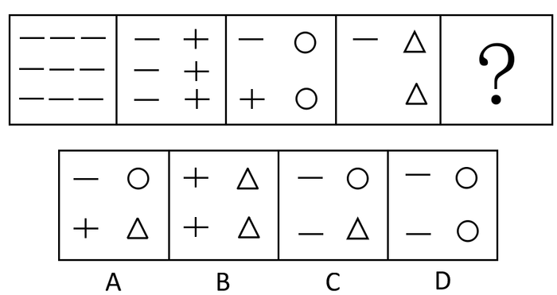
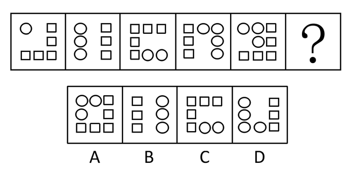
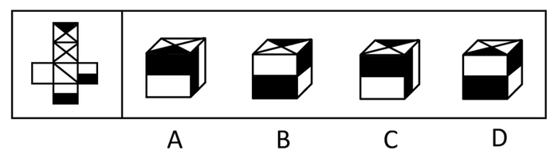
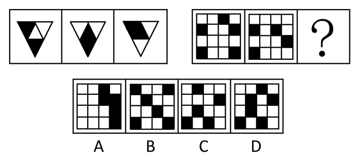
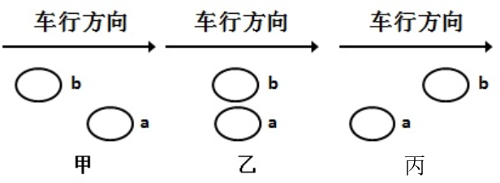
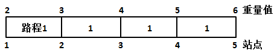
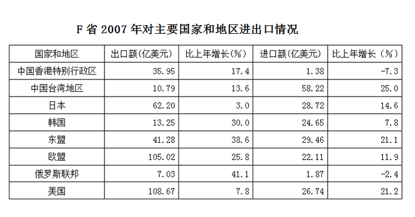
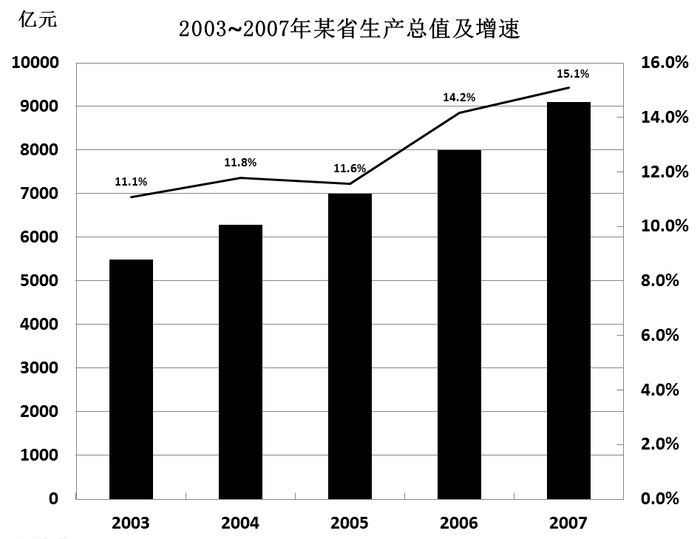
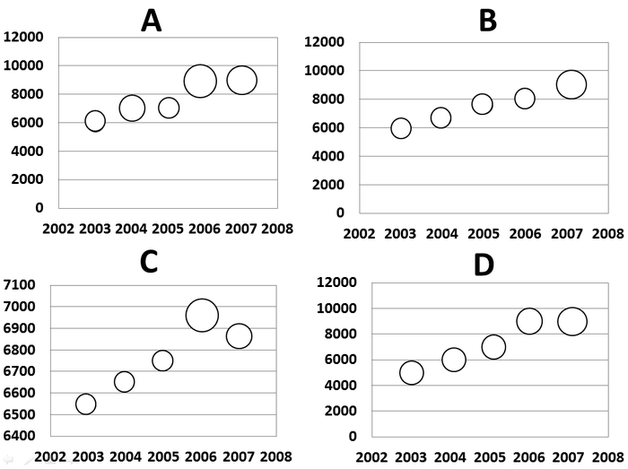

# 2008年福建省公务员录用考试《行测》题

<!-- gwy:overview:start -->
> **福建 · 2008 · 行测 · 统考** ｜ 130 题 · 图片 12 处 · 答案随题折叠

| 题型模块 | 题量 | 题号 |
| --- | ---: | ---: |
| 常识判断 | 30 | 1–30 |
| 言语理解与表达 | 30 | 31–60 |
| 判断推理 | 45 | 61–105 |
| 数量关系 | 10 | 106–115 |
| 资料分析 | 15 | 116–130 |
| **合计** | **130** | |

导航：[题型与作答说明](#题型与作答说明) · [题目](#题目) · [材料 1](#材料-1)
<!-- gwy:overview:end -->

> 候选采集稿。参考答案及解析来自粉笔页面，不代表官方答案或真实高分答卷；来源使用许可与原卷对应关系仍需人工核实。

## 题型与作答说明

常识判断

（30题）

根据题目要求，在四个选项中选出一个正确答案。

言语理解与表达

（30题）

每道题包含一段文字或一个句子，后面是一个不完整的陈述。注意：答案可能是完成所给文字主要意思的提要，也可能是满足陈述中其他方面的要求，你的选择应与所提要求最相符合。

判断推理

（45题）

本部分包含图形推理、定义判断、类比推理、事件排序、机械推理与逻辑判断六种类型的试题，均为单项选择题。

数量关系

（10题）

本部分包含数字推理与数学运算两种类型的试题，为单项选择题。

资料分析

（15题）

所给出的图、表、文字资料有若干个问题，请根据资料提供的信息，分析、比较、计算和判断处理。

## 题目

### 第 1 题

克隆技术属于生物技术中的：

A. 细胞工程

B. 化学工程

C. 系统工程

D. 遗传工程

第 1 题 · 答案与解析

**参考答案（粉笔题库参考内容）**

A

**解析**

细胞工程是指以细胞为基本单位，在体外条件下进行培养繁殖，或人为使细胞的某些生物特性按人们的意愿发生改变，从而达到改良生物品种和创造新品种的目的，加速繁育动植物新个体，或获得某种有用的物质的过程。所以细胞工程包括动植物细胞的体外培养技术、细胞融合技术、单克隆抗体、核移植、胚胎移植技术等。克隆技术属于生物技术中的细胞工程。

故正确答案为A。

本题相关知识点：

生物技术主要包括以下五项技术：基因工程、细胞工程、酶工程、发酵工程、蛋白质工程。基因工程是20世纪70年代以后兴起的一门新技术，其主要原理是应用人工方法把生物的遗传物质，通常是脱氧核糖核酸（DNA）分离出来，在体外进行切割、拼接和重组，然后将重组了的DNA导入某种宿主细胞或个体，从而改变它们的遗传品性。

**考点**：生物常识

**来源**：2008年福建省公务员录用考试《行测》题第1题

### 第 2 题

光年是什么计量单位：

A. 时间

B. 长度

C. 体积

D. 质量

第 2 题 · 答案与解析

**参考答案（粉笔题库参考内容）**

B

**解析**

光年是天文学中计算星体间距离的单位，指的是光在一年中所经过的路程，是长度单位。

故正确答案为B。

**考点**：科技理论与成就

**来源**：2008年福建省公务员录用考试《行测》题第2题

### 第 3 题

以下园林建筑中，不属于皇家园林的是：

A. 承德避暑山庄

B. 颐和园

C. 圆明园

D. 拙政园

第 3 题 · 答案与解析

**参考答案（粉笔题库参考内容）**

D

**解析**

承德避暑山庄、颐和园、圆明园均为清朝皇家园林，拙政园是江南园林的代表，是苏州园林中面积最大的古典山水园林。

本题为选非题，故正确答案为D。

**考点**：文化常识

**来源**：2008年福建省公务员录用考试《行测》题第3题

### 第 4 题

被称之为“书圣”的我国著名书法家王羲之的代表作《兰亭序》的书体是：

A. 隶书

B. 楷书

C. 行书

D. 草书

第 4 题 · 答案与解析

**参考答案（粉笔题库参考内容）**

C

**解析**

王羲之是东晋伟大书法家，他一改汉魏质朴书风，开晋后妍美劲健之体，创楷、行、草之典范，后世莫不宗法。行书字帖《兰亭序》是他的代表作，被书法界誉为“天下第一行书”。

故正确答案为C。

**考点**：文化常识

**来源**：2008年福建省公务员录用考试《行测》题第4题

### 第 5 题

下列选项中，属于公务员应当具备的条件是：

A. 具有身份证、军民证或护照

B. 年满20周岁，且无犯罪记录

C. 男性身高：170cm以上，女性身高165cm以上

D. 具有良好的品行

第 5 题 · 答案与解析

**参考答案（粉笔题库参考内容）**

D

**解析**

本题考查法律常识。

《公务员法》第十三条规定：“公务员应当具备下列条件：（一）具有中华人民共和国国籍；（二）年满十八周岁；（三）拥护中华人民共和国宪法，拥护中国共产党领导和社会主义制度；（四）具有良好的政治素质和道德品行；（五）具有正常履行职责的身体条件和心理素质；（六）具有符合职位要求的文化程度和工作能力；（七）法律规定的其他条件。”

故正确答案为D。

**考点**：行政法

**来源**：2008年福建省公务员录用考试《行测》题第5题

### 第 6 题

当今随着信息技术的飞速发展，人们对光存储容量的要求不断提高，下列哪个光存储技术是目前最先进的：

A. CD

B. DVD

C. Laser Disk

D. Blu-Ray Disc（蓝光DVD）

第 6 题 · 答案与解析

**参考答案（粉笔题库参考内容）**

D

**解析**

Blu-Ray Disc是前不久刚刚确定的新一代光存储技术标准，它具有存储量大、保存时间长等特点，目前还处于推广阶段。而Laser Disk是对激光存储技术的统称。CD、DVD是目前较为常见和普及的光存储技术。

故正确答案为D。

**考点**：化学常识

**来源**：2008年福建省公务员录用考试《行测》题第6题

### 第 7 题

下列不属于网页浏览器的是：

A. Internet Explorer

B. Firefox

C. Foxpro

D. Chrome

第 7 题 · 答案与解析

**参考答案（粉笔题库参考内容）**

C

**解析**

Internet Explorer、Firefox、Chrome三个都是网页浏览器，Foxpro全称是Visual Foxpro，属于数据库开发软件。

本题为选非题，故正确答案为C。

**考点**：物理常识

**来源**：2008年福建省公务员录用考试《行测》题第7题

### 第 8 题

2008年9月8日山西省襄汾县发生了重大事故，造成重大人员伤亡，山西省省长为此引咎辞职，该事故是：

A. 煤矿瓦斯爆炸事故

B. 水库决口事故

C. 尾矿库溃坝事故

D. 火灾事故

第 8 题 · 答案与解析

**参考答案（粉笔题库参考内容）**

C

**解析**

本题考查时事政治。

2008年9月8日早8时，山西襄汾县新塔矿的选矿厂的尾矿库发生溃坝事故，宽约600米，长约3公里的泥石流将下游的一个农贸集市和两个村子的部分房子冲垮，山西省省长引咎辞职。

故正确答案为C。

**考点**：时事政治-其他

**来源**：2008年福建省公务员录用考试《行测》题第8题

### 第 9 题

春夏秋冬四季的循环往复变化使得地球景观绚丽多彩，这是大自然赋予地球的珍贵礼物。然而四季这个礼物似乎分配不公，地球上只有温带才有明显的四季变化，而寒带和热带则是长冬无夏和长夏无冬。其原因是：

A. 地球绕太阳公转时地轴和公转轨道有一定的夹角所致

B. 寒带的冰雪太多无法构成

C. 热带的地形地貌构成使之不易散热

D. 是由地球自转引起的

第 9 题 · 答案与解析

**参考答案（粉笔题库参考内容）**

A

**解析**

四季变化的原因在于地球围绕太阳公转的轨道与地球自身地轴的夹角所致。

故正确答案为A。

本题相关知识点：

地球自转引起的是昼夜变化。

**考点**：自然地理

**来源**：2008年福建省公务员录用考试《行测》题第9题

### 第 10 题

对于夏季防雷常识，下列选项中论述正确的是：

A. 遇到雷雨时，人们应尽快进入室内，打开窗户通风，并尽快通过电视、电脑或收音机了解此次雷雨的相关信息

B. 汽车金属外壳易导电，所以在汽车上遇到雷雨时，应尽可能跑出汽车避雷

C. 在游泳池或河边遇到雷雨时，可以跳入水中，因为有水的保护，雷难以直接打到人身上，所以在水中较为安全

D. 切勿站在山顶、楼顶，不宜把羽毛球拍、高尔夫球杆等扛在肩上

第 10 题 · 答案与解析

**参考答案（粉笔题库参考内容）**

D

**解析**

本题考查生活常识中夏季防雷常识。

A项，打雷时，不宜使用无防雷措施或防雷措施不足的电视、音响等电器，而且最好拔掉电器用具插头。该项错误。

B项，汽车往往是极好的避雷设施，因有屏蔽作用，即使被闪电击中，也不会伤人。该项错误。

C项，由于水是导电的，所以切勿游泳或从事其它水上运动或活动，更不宜停留在游泳池、湖泊、海滨、水田和船上等地。该项错误。

D项，不宜进行室外球类运动，在空旷场地不宜打伞，不宜把锄头、铁锹、羽毛球拍、钓鱼竿、高尔夫球杆等扛在肩上。该项正确。

故正确答案为D。

**考点**：生活常识

**来源**：2008年福建省公务员录用考试《行测》题第10题

### 第 11 题

我国地质调查局认定，2008年5月12日发生在四川汶川的地震，其产生的主要原因是：

A. 印度洋板块向亚洲板块俯冲，造成青藏高原快速隆升

B. 亚洲板块向印度洋板块俯冲，造成青藏高原快速隆升

C. 印度洋板块与太平洋板块激烈碰撞所致

D. 亚洲板块与太平洋板块激烈碰撞所致

第 11 题 · 答案与解析

**参考答案（粉笔题库参考内容）**

A

**解析**

汶川大地震的成因是印度洋板块向亚洲板块俯冲，造成青藏高原隆升。

故正确答案为A。

**考点**：自然地理

**来源**：2008年福建省公务员录用考试《行测》题第11题

### 第 12 题

福建省首条经“小三通”口岸赴台湾旅游的线路是：

A. 厦门一金门一台北

B. 厦门一澎湖一高雄

C. 福州一香港一台北

D. 福州一澎湖一马祖一台北

第 12 题 · 答案与解析

**参考答案（粉笔题库参考内容）**

A

**解析**

福建省首条经“小三通”口岸赴台湾旅游的线路是“厦门一金门一台北”。

故正确答案为A。

**考点**：中国地理

**来源**：2008年福建省公务员录用考试《行测》题第12题

### 第 13 题

我国现行宪法规定：

A. 社会主义的公有财产不可侵犯；公民的私有财产不受侵犯

B. 中华人民共和国的公有财产神圣不可侵犯；公民的私有财产不受侵犯

C. 社会主义的合法的公有财产神圣不可侵犯；公民的私有财产不受侵犯

D. 社会主义的公有财产神圣不可侵犯；公民的合法的私有财产不受侵犯

第 13 题 · 答案与解析

**参考答案（粉笔题库参考内容）**

D

**解析**

《宪法》第十二条规定：“社会主义的公有财产神圣不可侵犯。国家保护社会主义的公共财产。禁止任何组织或者个人用任何手段侵占或者破坏国家的和集体的财产。”

《宪法》第十三条规定：“公民的合法的私有财产不受侵犯。国家依照法律规定保护公民的私有财产权和继承权。国家为了公共利益的需要，可以依照法律规定对公民的私有财产实行征收或者征用并给予补偿。”

故正确答案为D。

**考点**：宪法

**来源**：2008年福建省公务员录用考试《行测》题第13题

### 第 14 题

下列属于犯罪中止的是：

A. 已经着手实行犯罪但犯罪未发生

B. 在犯罪过程中，自动有效地防止犯罪结果发生

C. 在犯罪过程中，由于行为人意志以外的原因犯罪结果未发生

D. 行为人为实施犯罪而准备了工具，但没有着手实施犯罪

第 14 题 · 答案与解析

**参考答案（粉笔题库参考内容）**

B

**解析**

我国《刑法》第二十四条规定，在犯罪过程中，自动放弃犯罪或者自动有效地防止犯罪结果发生的是犯罪中止。对于中止犯，没有造成损害的，应当免除处罚；造成损害的，应当减轻处罚。

故正确答案为B。

**考点**：刑法

**来源**：2008年福建省公务员录用考试《行测》题第14题

### 第 15 题

某市机要局向K公司购买办公用品（手提电脑10台）后发现质量问题，现该局依法向K公司索赔，其所依之法是：

A. 行政法

B. 民法

C. 经济法

D. 宪法

第 15 题 · 答案与解析

**参考答案（粉笔题库参考内容）**

B

**解析**

A项错误，行政法是调整由于国家行政权的作用而发生的行政关系的法律规范的总和，其功能是控制行政权，保护公民权。

B项正确，民法调整平等主体的自然人、法人和非法人组织之间的人身关系和财产关系。本题中，某市机要局作为民事主体与K公司的法律地位平等，它们签订办公用品购买合同，属于民事法律行为，受民法调整。

C项错误，经济法是调整国家宏观调控经济活动中形成的经济法律关系的法律规范的总称。

D项错误，宪法是国家的根本大法，是治国安邦的总章程，适用于国家全体公民，它规定了国家的根本任务和根本制度，即社会制度、国家制度的原则和国家政权的组织以及公民的基本权利义务等内容。

故正确答案为B。

**考点**：民法典

**来源**：2008年福建省公务员录用考试《行测》题第15题

### 第 16 题

依我国《继承法》，关于遗嘱继承与法定继承的关系，正确的选项是：

A. 遗嘱继承优先于法定继承

B. 法定继承优先于遗嘱继承

C. 遗嘱继承与法定继承无所谓谁优先

D. 遗嘱继承与法定继承不相干

第 16 题 · 答案与解析

**参考答案（粉笔题库参考内容）**

A

**解析**

《继承法》第十六条规定：“公民可以依照本法规定立遗嘱处分个人财产，并可以指定遗嘱执行人。公民可以立遗嘱将个人财产指定由法定继承人的一人或者数人继承。公民可以立遗嘱将个人财产赠给国家、集体或者法定继承人以外的人。”据此，对公民遗产的继承，如果财产所有权人生前立有遗嘱，只要该遗嘱是合法有效的，遗嘱继承即优先于法定继承。因此，B、C、D三项错误，A项正确。

故正确答案为A。

**考点**：民法典

**来源**：2008年福建省公务员录用考试《行测》题第16题

### 第 17 题

发明专利权与实用新型和外观设计专利权的期限不同，其正确的选项是：

A. 前者为20年，后者为10年

B. 前者为10年，后者为20年

C. 前者后者均为10年

D. 前者后者均为20年

第 17 题 · 答案与解析

**参考答案（粉笔题库参考内容）**

A

**解析**

专利权的法律保护具有时间性，中国的发明专利权期限为20年，实用新型专利权和外观设计专利权期限为10年，均自申请日起计算。

故正确答案为A。

**考点**：其他法律法规

**来源**：2008年福建省公务员录用考试《行测》题第17题

### 第 18 题

下列选项中，不属于阶级社会中关于法律与道德的共同点的是：

A. 都是社会规范

B. 都具有阶级性

C. 约束范围都相同

D. 都是治国途径

第 18 题 · 答案与解析

**参考答案（粉笔题库参考内容）**

C

**解析**

法律与道德所约束的范围是不同的，道德约束的范围比法律约束的范围更广，其他三项均为二者的共同点。

本题为选非题，故正确答案为C。

**考点**：法理学

**来源**：2008年福建省公务员录用考试《行测》题第18题

### 第 19 题

李某向张某借款5万元用于开旅行社，答应旅行社开业后3个月还款，张某同意，李某拿到5万元后并没有去开旅行社而是用于购买家用电器，张某知道后要求李某立即还款，李某声称还款的期限是旅行社开业后3个月，现在旅行社还没有开业自己没有还钱义务。

下列表述正确的是：

A. 李某还钱的期限未到，李某可以不还钱

B. 李某还钱的期限视为已到，李某应当还钱

C. 李某还钱的条件未成就，李某可以不还钱

D. 李某还钱的条件视为已成就，李某应当还钱

第 19 题 · 答案与解析

**参考答案（粉笔题库参考内容）**

D

**解析**

《中华人民共和国合同法》第四十五条规定：“当事人对合同的效力可以约定附条件。附生效条件的合同，自条件成就时生效。附解除条件的合同，自条件成就时失效。当事人为自己的利益不正当地阻止条件成就的，视为条件已成就；不正当地促成条件成就的，视为条件不成就。”第四十六条规定：“当事人对合同的效力可以约定附期限。附生效期限的合同，自期限届至时生效。附终止期限的合同，自期限届满时失效。”

附条件合同中的“条件”必须是将来客观上不确定的事实，如果不属于将来或该事实是确定要发生的，则不能成为条件；而附期限合同中的“期限”是以将来确定的事实的到来为客观的，如果不属于将来或不是确实的事实，则不能成为期限附款。本案中，李某向张某借款时约定的“旅行社开业后3个月还款”，是将来不确定发生的事实，因此属于附条件的合同，而不是附期限的合同。而后来李某将借到的5万元用于购买家电，致使“旅行社开业”这一条件不能成就（不正当地阻止条件成就），根据《合同法》第45条规定，李某的行为视为条件已成就，应当还钱。

故正确答案为D。

**考点**：民法典

**来源**：2008年福建省公务员录用考试《行测》题第19题

### 第 20 题

对下列政府行为提起行政诉讼，人民法院依法不能受理的是：

A. 县公安局违反《治安管理处罚法》规定对某人滥用处罚权

B. 县政府制定某商品禁售的文件

C. 专利权未到期限被县政府专利主管部门取消专利权

D. 县工商局违反法规收取管理费

第 20 题 · 答案与解析

**参考答案（粉笔题库参考内容）**

B

**解析**

《行政诉讼法》第十二条规定：“人民法院不受理公民、法人或者其他组织对下列事项提起的诉讼：（一）国防、外交等国家行为；（二）行政法规、规章或者行政机关制定、发布的具有普遍约束力的决定、命令；（三）行政机关对行政机关工作人员的奖惩、任免等决定；（四）法律规定由行政机关最终裁决的具体行政行为。”本题中B项属于（二）中的具有普遍约束力的决定，其他选项均为人民法院的受理范围。

故正确答案为B。

**考点**：行政法

**来源**：2008年福建省公务员录用考试《行测》题第20题

### 第 21 题

党的十六大报告提出了“四个尊重”，其核心是：

A. 尊重劳动

B. 尊重知识

C. 尊重人才

D. 尊重创造

第 21 题 · 答案与解析

**参考答案（粉笔题库参考内容）**

A

**解析**

党的十六大报告提出：“必须尊重劳动、尊重知识、尊重人才、尊重创造，这要作为党和国家的一项重大方针在全社会认真贯彻。”“四个尊重”的核心是“尊重劳动”。离开劳动，知识、人才、创造都无从谈起。只有通过劳动，包括现代科学劳动，才能充分发挥知识、人才和创造性的力量，创造先进生产力和先进文化，创造出大量物质财富，提高人民的物质文化生活水平。

故正确答案为A。

**来源**：2008年福建省公务员录用考试《行测》题第21题

### 第 22 题

“鸟鸣山更幽”包含的哲理是：

A. 静止的绝对性与运动的相对性

B. 运动的相对性

C. 静止的绝对性

D. 静止的相对性与运动的绝对性

第 22 题 · 答案与解析

**参考答案（粉笔题库参考内容）**

D

**解析**

本题反映的是静止的相对性与运动的绝对性。

故正确答案为D。

**考点**：唯物论

**来源**：2008年福建省公务员录用考试《行测》题第22题

### 第 23 题

唯物辩证法的实质与核心是：

A. 对立统一规律

B. 否定之否定规律

C. 质量互变规律

D. 规律的客观性

第 23 题 · 答案与解析

**参考答案（粉笔题库参考内容）**

A

**解析**

唯物辩证法又称“马克思主义辩证法”，指建立在唯物主义基础上的辩证法理论，是“关于自然、人类社会和思维的运动和发展的普遍规律的科学”。唯物辩证法的三大基本规律是对立统一规律、质量互变规律和否定之否定规律。其实质与核心是对立统一规律。

故正确答案为A。

**考点**：唯物辩证法

**来源**：2008年福建省公务员录用考试《行测》题第23题

### 第 24 题

宗教与哲学的共同点在于：

A. 是“科学之科学”

B. 是理论化、系统化的世界观

C. 是麻醉人们的精神鸦片

D. 是社会意识形态

第 24 题 · 答案与解析

**参考答案（粉笔题库参考内容）**

D

**解析**

宗教与哲学都是人类文化上层建筑和社会意识形态的重要内容。

故正确答案为D。

**考点**：唯物史观

**来源**：2008年福建省公务员录用考试《行测》题第24题

### 第 25 题

被誉为意大利文艺复兴时期“三杰”的是：

A. 达·芬奇、米开朗基罗、拉斐尔

B. 达·芬奇、泰戈尔、拉斐尔

C. 莎士比亚、达·芬奇、但丁

D. 米开朗基罗、拉斐尔、托尔斯泰

第 25 题 · 答案与解析

**参考答案（粉笔题库参考内容）**

A

**解析**

被誉为意大利文艺复兴时期“三杰”的是达·芬奇、米开朗基罗和拉斐尔。

故正确答案为A。

**来源**：2008年福建省公务员录用考试《行测》题第25题

### 第 26 题

“塞翁失马，焉知非福”的典故出自：

A. 《左传》

B. 《淮南子·人间训》

C. 《史记》

D. 《论语》

第 26 题 · 答案与解析

**参考答案（粉笔题库参考内容）**

B

**解析**

本题考查我国历史典故的出处。“塞翁失马，焉知非福”出自《淮南子·人间训》中一篇叫《塞翁失马》的寓言故事。故B项正确。

A项错误，《左传》是春秋末年鲁国史官左丘明编著的中国第一部叙事详细的编年史著作。

C项错误，《史记》是西汉著名史学家司马迁撰写的一部纪传体史书。

D项错误，《论语》由孔子弟子及再传弟子编写而成，主要记录孔子及其弟子的言行。

故正确答案为B。

**考点**：文学常识

**来源**：2008年福建省公务员录用考试《行测》题第26题

### 第 27 题

中国近代洋务运动的关键人物是：

A. 李鸿章 陈独秀

B. 李鸿章 曾国藩

C. 容闳 孙中山

D. 光绪 袁世凯

第 27 题 · 答案与解析

**参考答案（粉笔题库参考内容）**

B

**解析**

李鸿章和曾国藩是近代洋务运动的关键人物，他们大力支持近代洋务运动，在一定程度上促进了近代中国工业的形成和发展。

故正确答案为B。

**考点**：中国历史

**来源**：2008年福建省公务员录用考试《行测》题第27题

### 第 28 题

人的本质在其现实性上是一切社会关系的总和，就个人与社会的关系上看，人的价值在于：

A. 实现马斯洛理论中第五层次的需求

B. 个人对社会的尊重与满足

C. 社会对个人的尊重与满足以及个人对社会的责任与贡献

D. 社会对个人的责任与贡献以及个人对社会的尊重与满足

第 28 题 · 答案与解析

**参考答案（粉笔题库参考内容）**

C

**解析**

从个人与社会的关系上来看，人的价值在于社会对个人的尊重与满足以及个人对社会的责任与贡献。

故正确答案为C。

**考点**：唯物史观

**来源**：2008年福建省公务员录用考试《行测》题第28题

### 第 29 题

航空界有个关于飞行安全的“海恩法则”：每一起严重事故的背后，必然有29次轻微事故和300起未遂先兆及1000起事故隐患。“海恩法则”启示我们：

A. 规律是客观的，我们要善于发现和利用规律

B. 量变是质变的前提，质变是量变的必然结果

C. 矛盾是普遍的、客观的

D. 只要注意防范，事故是可以避免的

第 29 题 · 答案与解析

**参考答案（粉笔题库参考内容）**

B

**解析**

“海恩法则”说明了量变与质变的关系，量变是质变的前提，质变是量变的必然结果。

故正确答案为B。

**考点**：唯物辩证法

**来源**：2008年福建省公务员录用考试《行测》题第29题

### 第 30 题

以下关于福建相关问题的描述不准确的选项是：

A. 福建土楼造型独特，规模宏大，结构奇巧。由永定、南靖、华安的“六群四楼”共46座土楼组成的福建土楼群，于2008年被联合国教科文组织列入《世界遗产名录》

B. 为了全面推进海峡西岸经济区建设，提供源源不断的项目支撑，福建省每年6月18日在厦门举办中国·海峡项目成果交易会（简称“6·18”）。这是一个项目、资本、技术、人才集聚的平台，通过对接，推动项目成果向现实生产力转化

C. 1907年7月福建省第一条铁路漳厦铁路动工；1958年投入运营的鹰厦铁路，是福建省首条出省铁路；在建的福厦高速铁路是我国铁路中长期规划“八纵八横”主通道沿海快速铁路的重要组成部分

D. 福建省委提出的推进海峡西岸“两个先行区”建设，就是要努力把海峡西岸经济区建设成为科学发展的先行区、两岸人民交流合作的先行区

第 30 题 · 答案与解析

**参考答案（粉笔题库参考内容）**

B

**解析**

中国·海峡项目成果交易会每年6月18日在福州举办，而非厦门。

本题为选非题，故正确答案为B。

**考点**：文化常识

**来源**：2008年福建省公务员录用考试《行测》题第30题

### 第 31 题

下面画横线字注音完全正确的一项是：

A. 忍俊不<u>禁</u>(jīn)          精神抖<u>擞</u>(shǒu)

B. 人迹<u>罕</u>至(hǎn)        鞠躬尽<u>瘁</u>(chui)

C. <u>孜孜</u>不倦(zī)           <u>惴惴</u>不安(zhuì)

D. 参<u>差</u>不齐(chī)         <u>锲</u>而不舍(qiè)

第 31 题 · 答案与解析

**参考答案（粉笔题库参考内容）**

C

**解析**

此题归为语句表达的字音辨析题。

A项错误，“擞”读作sǒu；B项错误，“瘁”读作cuì；D项错误，“差”读作cī。

故正确答案为C。

**来源**：2008年福建省公务员录用考试《行测》题第31题

### 第 32 题

这条商业街位于繁华的市中心，开张以来，生意一直很好，人流如潮，＿＿。

上面画线处填入词语，最恰当的是：

A. 车水马龙

B. 纷至沓来

C. 络绎不绝

D. 接踵而来

第 32 题 · 答案与解析

**参考答案（粉笔题库参考内容）**

C

**解析**

A项“车水马龙”形容来往车马很多，连续不断的热闹情景；B项“纷至沓来”形容接连不断的到来；C项“络绎不绝”形容行人车马来来往往，接连不断；D项“接踵而来”指人们前脚跟着后脚，接连不断地来，形容来者很多，络绎不绝。

语境中，横线处与前面的“人流如潮”构成并列关系，需强调的是顾客往返之多，A、B、D三项均无法与“人流”搭配，排除，C项当选。

故正确答案为C。

**考点**：关联关系-并列关系、成语填空

**来源**：2008年福建省公务员录用考试《行测》题第32题

### 第 33 题

在有关科学实践中，没有使用＿＿的仪器，经过＿＿的调查，进行＿＿的论证，往往很难得出正确的结论。

填入画横线部分最恰当的一项是：

A. 周密 严密 细密

B. 精密 周密 细密

C. 细密 严密 周密

D. 精密 周密 严密

第 33 题 · 答案与解析

**参考答案（粉笔题库参考内容）**

D

**解析**

空格处的词语要根据其后搭配的名词，以及选项词语的意思、用法来选择。

“精密”指精致细密，一般用于形容仪器；

“周密”指周到细密，多形容思考、计划；

“细密”指不粗疏、用笔细而密或文章结构严密；

“严密”指严谨缜密，多用于逻辑、论证。

故正确答案为D。

**考点**：实词填空、词的辨析-搭配对象

**来源**：2008年福建省公务员录用考试《行测》题第33题

### 第 34 题

面对“限塑令”，书店可以推出多次循环使用的环保购书袋以提升书店在读者心目中的形象，还可以推出一系列其他环保时尚的文化产品，为书店营销带来新的热点和卖点。

以下最能准确表达作者观点的是：

A. “限塑令”对书店来说，是一次考验

B. “限塑令”给书店带来了商机

C. 书店可利用环保购书袋拓展增加利润的空间

D. 面对“限塑令”，书店可以充分发挥行业优势，化被动为主动

第 34 题 · 答案与解析

**参考答案（粉笔题库参考内容）**

D

**解析**

根据提问知此题为中心理解题。

A项侧重的是“限塑令”给书店带来的困难和挑战，未抓住材料的重点；B项阐述不准确，“限塑令”本身并不能带来商机，转化为商机需要书店的主观努力，材料强调的正是这种努力的途径；C项不是材料的阐述重点。

D项正确，概括材料，材料主要提出了书店面对“限塑令”的解决策略以及将其为己所用、转为优势的途径。

故正确答案为D。

**考点**：关联词-对策

**来源**：2008年福建省公务员录用考试《行测》题第34题

### 第 35 题

某些病毒毫无疑问能引起癌症。可是，有一些儿童期的癌症却可能是由于在生命早期接触感染过少而引起的。

作者想要表述的观点是：

A. 儿童期接触病毒可能引发癌症

B. 生命早期接触病毒会引发成年时癌症

C. 儿童期适当接触病毒可能增强免疫力

D. 某些病毒能够引起癌症

第 35 题 · 答案与解析

**参考答案（粉笔题库参考内容）**

C

**解析**

文段由转折关联词“可是”构成转折关系，重点关注转折后内容，即生命早期接触病毒过少可能会引起儿童期的癌症，据此可知，儿童期需要适当接触病毒，对应C项。

A项，与文意相悖，排除；

B项，“引发成年时癌症”无中生有，文段并未提及，排除；

D项，为转折前的非重点，排除。

故正确答案为C。

**考点**：关联词-转折

**来源**：2008年福建省公务员录用考试《行测》题第35题

### 第 36 题

长期以来，中国队在乒乓球比赛中一直占有绝对优势，或者说独大。这种局面持续的时间之长，已经让很多人感觉乒乓球成了一项中国人自己和自己玩的运动，虽然水平很高，但大大降低了观众看比赛的归属感和竞争心态。

这段话的主要观点是：

A. 乒乓球比赛中国队一直占有绝对优势

B. 乒乓球成了一项中国人自己和自己玩的运动

C. 中国队在乒乓球项目上的绝对优势降低了观众看比赛的兴趣

D. 世界各国观众对乒乓球比赛日渐缺乏兴趣

第 36 题 · 答案与解析

**参考答案（粉笔题库参考内容）**

C

**解析**

据提问“主要观点”知该题为中心理解题。材料首句介绍了中国队在乒乓球比赛中的现状，第二句从“虽然······但······”可以看出作者强调的是“但”后面的部分，即在这种现状之下观众的心态，故答案为C。

A项只是观点的背景；B项不是材料的重点；D项没有谈到中国乒乓球的绝对化优势，也有表述绝对化的嫌疑。

故正确答案为C。

**考点**：关联词-转折

**来源**：2008年福建省公务员录用考试《行测》题第36题

### 第 37 题

在她走马上任时，全球第一所“孔子学院”在韩国首尔刚刚挂牌。而到2008年初，已有210多所“孔子学院”在60多个国家相继建立。此时，距离提出在全球建立100所“孔子学院”的五年目标，刚刚过去三年。

这段话的主要观点是：

A. 她上任后，工作业绩显著

B. 近年来，孔子学院发展迅速

C. 她上任后，孔子学院发展迅速

D. 孔子学院超规划发展

第 37 题 · 答案与解析

**参考答案（粉笔题库参考内容）**

C

**解析**

据提问知此题是中心理解题。

材料阐述的主体有两个，一个是“她”，一个是“孔子学院”，二者间的关系是她上任后孔子学院建立之迅速，因此答案选C。

A、B、D三项主体不全，表述不够完整准确。

故正确答案为C。

**考点**：关联词-并列

**来源**：2008年福建省公务员录用考试《行测》题第37题

### 第 38 题

＿＿＿＿＿＿＿＿＿＿。历史证明，哪怕是最有效率的万能政府，实际上也不可能全面介入管理每一个家庭或者宗族的具体生活，正如大脑不能指挥身上的每一个细胞的具体活动一样。

填入上面横线的句子，与上下文衔接最恰当的一项是：

A. 家庭是国家和社会的细胞

B. 人类历史的发展和家庭是分不开的

C. 家和万事兴

D. 正是一个个不起眼的家庭组成了大社会

第 38 题 · 答案与解析

**参考答案（粉笔题库参考内容）**

A

**解析**

根据“历史证明”一词可知，空格处与下文构成的是前者概括、后者具体阐释的总—分关系。文段叙述的是政府和家庭的关系，那么空格处也应当涉及到这两个主体；再看“正如大脑······细胞······”，A项也以“细胞”比喻家庭，上下文形成呼应，因此为最佳选项。

B、C两项和材料观点联系不大；D项在主体关系以及上下文统一上不及A项恰当。

故正确答案为A。

**考点**：横线在开头

**来源**：2008年福建省公务员录用考试《行测》题第38题

### 第 39 题

天文学家认为，整个地球都是由环绕早期太阳的尘埃造就的，太阳系中的固态物质概莫如此。\_\_\_\_\_\_\_\_？这一直是个未解之迷。

填入上面横线的句子，与上下文衔接最恰当的一项是（    ）。

A. 那么，固态物质又从哪里来呢

B. 但是，尘埃本身又从哪里来呢

C. 天文学家的观点可靠吗

D. 为什么天文学家这样看呢

第 39 题 · 答案与解析

**参考答案（粉笔题库参考内容）**

B

**解析**

这道题属于语句填空题，语句填空题的做题方法是要与文段谈论的话题保持一致。文段中提到整个地球都是由尘埃造就的，而太阳系中的固态物质也都是由尘埃造就的，话题保持一致，应该继续讨论尘埃。由此可知，成为“未解之谜”的，必是尘埃是怎么来的。

故正确答案为B。

【文段出处】未来网：《研究称人类可能起源于黑洞 神话传说中的人类起源》

**考点**：横线在中间

**来源**：2008年福建省公务员录用考试《行测》题第39题

### 第 40 题

改造创新后的孝德，与“文化糟粕”截然不同，理应属于民族优秀文化传统范畴，在高校德育内容中完全应占有一席之地。＿＿＿＿＿＿＿＿＿＿。例如，可通过专题讲座、主题班会等活动，让大家直接参加孝文化的讨论，增进对孝德教育的理性认同。

填入上面横线的句子，与上下文衔接最恰当的一项是：

A. 那么，可以采取哪些方式进行呢

B. 因此，应在开展大学生德育工作中加入孝德元素，使之参与育人过程

C. 在高校进行孝德教育的形式可以是多种多样的

D. 但是，只有丰富多彩的教育形式才能收到好的成效

第 40 题 · 答案与解析

**参考答案（粉笔题库参考内容）**

B

**解析**

画横线部分在中间，起到承上启下的作用，上文对“孝德进高校德育”作肯定总结，下文通过例子说明孝德进高校德育的形式途径，而B项正好起到了承上启下的作用，当选。

A项，第一句话说的是“理应”、“完全应”，而不是“如果”、“假如”，所以第一句和二句并不是假设与结果的关系，不能用“那么”连接，且第一句中并没有提及“方式”，A项的问句问得很突兀，明显与第一句脱节，故排除；同理，原文第一句与D项也不能构成转折关系，排除；C项的“多种多样”在原文中并没有体现，排除。

故正确答案为B。

**考点**：横线在中间

**来源**：2008年福建省公务员录用考试《行测》题第40题

### 第 41 题

下列选项中，没有错别字的是：

A. 他一下车，歌迷们便蜂涌而上，争相拍摄，请求签名

B. 登上天安门城楼，他浮想连翩，热泪夺眶而出

C. “熵”是表现系统内部无序和混乱程度的量度，其降低表明系统的进化和有序

D. 由于当前国际能源价格不断飙升、全球环境与气候问题突显，该文件将对中美未来经济合作具有重大影响，也将为全球可持续发展做出贡献

第 41 题 · 答案与解析

**参考答案（粉笔题库参考内容）**

C

**解析**

A项错误，“蜂涌而上”应为“蜂拥而上”；

B项错误，“浮想连翩”应为“浮想联翩”；

C项没有错别字；

D项错误，“突显”应为“凸显”。

故正确答案为C。

**来源**：2008年福建省公务员录用考试《行测》题第41题

### 第 42 题

下列选项中，没有错别字的是：

A. 他躺在床上，翻来复去睡不着

B. 每到周末，这条街道便人来人往，穿流不息

C. 多年来他刻苦自学、勇于探索，并能吸取各家所长，融汇贯通，形成自己的风格

D. 有的书法家在书写时采用方折瘦硬的笔法以追求“铜铸气”，以颤抖生涩求“铜蚀斑锈气”

第 42 题 · 答案与解析

**参考答案（粉笔题库参考内容）**

D

**解析**

A项中“翻来复去”应为“翻来覆去”；

B项中“穿流不息”应为“川流不息”；

C项中“融汇贯通”应为“融会贯通”；

D项没有错别字。

故正确答案为D。

**来源**：2008年福建省公务员录用考试《行测》题第42题

### 第 43 题

下列选项中，没有语病的是：

A. 我们知道，魏晋人在思想上崇尚放任、崇尚自由，因此其文学、艺术、哲学皆能彰显个性。然而在政治上，魏晋时期则为典型的衰世

B. 汉末之王充思想，是批评阴阳五行、天人感应及是古非今思想的代表人物

C. 意志坚强的人们绝不会因为暂时的挫折影响了他对获得最后胜利的信心

D. 《礼记》是从先秦至西汉关于《仪礼》解说、发挥的文字汇集，是我国秦汉以前的社会生活史和生活习俗、礼仪制度、人生经验

第 43 题 · 答案与解析

**参考答案（粉笔题库参考内容）**

A

**解析**

A项没有语病；

B项主宾搭配不当，句子的主干是“王充思想是代表人物”，不合逻辑，应去掉“思想”；

C项主语“人们”和后面的“他”所指对象范围应当一致，但实际表述前后矛盾，“人们”应当与“他们”相对应；

D项也是主宾搭配不当，句子的主干是“《礼记》是文字汇集，是社会生活史和生活习俗、礼仪制度、人生经验”，不合逻辑。

故正确答案为A。

**来源**：2008年福建省公务员录用考试《行测》题第43题

### 第 44 题

下列选项中，有语病的是：

A. 过于技术化的倾向使得许多学者尤其是研究生只知道分类与统计，却不肯认真地阅读文学文本和下艰苦的思辨功夫，从而往往把问题简单化了

B. 课程改革的合理性，是指对课程改革活动的一种价值定位和预期，也是根据某种理论或事实的标准与尺度对课程改革活动所做的价值判断和分析

C. 近年来大豆净进口量激增是我国粮食贸易结构最为始料不及的

D. 自汉字传入日本，随着汉籍的传入，如《论语》、《孝经》等，其承载的文化思想已经潜移默化地浸入大和民族的灵魂之中

第 44 题 · 答案与解析

**参考答案（粉笔题库参考内容）**

C

**解析**

A、B、D项没有语病。C项题干为"激增是结构始料不及的"，始料不及的主语更多是人或人称代词，与"我国粮食贸易结构"搭配不当，当选。

故正确答案为C。

**来源**：2008年福建省公务员录用考试《行测》题第44题

### 第 45 题

我们必须始终<u>坚定不移</u>地高举邓小平理论伟大旗帜，进行社会主义建设。

下列选项中，最适合用来替换画线部分词语的是：

A. 不折不扣

B. 坚持不懈

C. 毫不动摇

D. 不屈不挠

第 45 题 · 答案与解析

**参考答案（粉笔题库参考内容）**

C

**解析**

此题是语句表达的词语替换题。

“坚定不移”指稳定坚强，毫不动摇，强调的是稳定、不动摇。A项“不折不扣”指不打折扣，表示完全、十足、彻底，强调程度上的彻底；

B项“坚持不懈”指坚持到底，一点也不松懈，强调坚持；C项“毫不动摇”强调的是不动摇，形容始终不渝地坚持；D项“不屈不挠”比喻在压力、邪恶势力和困难面前不屈服、不低头，表现十分顽强，强调的是不屈服。

综上，C项最符合要求。

故正确答案为C。

**来源**：2008年福建省公务员录用考试《行测》题第45题

### 第 46 题

中国制造业规模迅猛扩张并成为全球产业链中<u>不可或缺</u>的重要组成部分。

下列选项中，最适合用来替换画线部分词语的是：

A. 缺一不可

B. 必不可少

C. 独一无二

D. 举足轻重

第 46 题 · 答案与解析

**参考答案（粉笔题库参考内容）**

B

**解析**

此题是语句表达的词语替换题。“不可或缺”表示非常重要，不能有一点点的缺失，通常形容必不可少的因素或是部分。

A项“缺一不可”是说少一样都不行；B项“必不可少”强调不可缺少，是绝对需要的；C项“独一无二”强调独特性；D项“举足轻重”是指一举一动都足以影响全局，强调重要性。综上，B项最接近“不可或缺”的词意。

故正确答案为B。

**来源**：2008年福建省公务员录用考试《行测》题第46题

### 第 47 题

下列选项中，没有歧义的是：

A. 我们需要相信自己的人

B. 三个教育局的领导听了他的课

C. 请你告诉他要早一点回家做作业

D. 小明和小军的哥哥在操场上踢足球

第 47 题 · 答案与解析

**参考答案（粉笔题库参考内容）**

C

**解析**

A项关系含糊，可理解为两种意思，一种是需要“自信的人”，一种是需要相信“自己的人”，有歧义；

B项“三个”在句中作定语，可以理解为修饰“教育局”，也可以理解为修饰“领导”，有歧义；

C项没有歧义；

D项关系含糊，可以理解为踢球的有小明、小军的哥哥，也可以理解踢球的有小明的哥哥、小军的哥哥，有歧义。

故正确答案为C。

**来源**：2008年福建省公务员录用考试《行测》题第47题

### 第 48 题

下列选项中，没有歧义的是：

A. 他已经走了三个小时了

B. 我们在楼顶看见他了

C. 小王去打针了

D. 我们要一分为二地看待收入差距这个问题

第 48 题 · 答案与解析

**参考答案（粉笔题库参考内容）**

D

**解析**

A项“走”词义不明确，可以理解为“行走”，也可以理解为“离开”；

B项的歧义在于“在楼顶”的语义指向不明，“在楼顶”的可以理解是“我们”，也可以理解为是“他”；

C项“小王”和“打针”关系含糊，可以理解为小王作为病人去接受打针，也可以理解为小王作为医生去给病人打针，存在歧义；

D项没有歧义。

故正确答案为D。

**来源**：2008年福建省公务员录用考试《行测》题第48题

### 第 49 题

电脑的出现，在很大程度上改变了我们的生活。坐在电脑前打字、浏览，越来越多地替代了提笔写字、捧书阅读。但电脑在带来便捷的同时，也对传统文化造成了强大的冲击，即便是一些优秀的传统文化也离我们渐行渐远。书法是中华文化的瑰宝，是民族精神的体现，但在电脑面前，练习毛笔字的群体正在萎缩，充满魅力的书法作品也正逐渐淡出人们的视野。保护传统文化、保护书法艺术刻不容缓。

下列选项中，最适合做本段文字标题的是：

A. 电脑时代保护书法艺术刻不容缓

B. 即便在电脑时代也应让书法传承下来

C. 电脑时代传统文化一定不能淡出

D. 电脑时代学习书法就是继承民族精神

第 49 题 · 答案与解析

**参考答案（粉笔题库参考内容）**

A

**解析**

据提问知此题是标题选择题。

材料前三句中间用转折词“但”提出“电脑时代对传统文化形成冲击”的观点。接着论述转向传统艺术中的书法，先说其价值，然后用“但”引出问题：书法艺术也遭受电脑的巨大冲击。可见，前三句只是铺垫，后面的论述才是重点，主体是“书法艺术”。最后一句提出针对问题的呼吁。由此，材料的重点在于积极应对危机。A项体现了积极应对的态度，具有呼吁性，点明了材料的中心论点。

B、D两项说法没有错，但没有体现“刻不容缓”的紧迫性；C项的信息不够切合材料，材料说的是书法艺术在淡出视野，而非传统文化，且材料的论述重点在书法艺术。

故正确答案为A。

**考点**：标题填入题

**来源**：2008年福建省公务员录用考试《行测》题第49题

### 第 50 题

研究证明，血液中脂肪蛋白含量的增多，会增强人体阻止吸收过多的胆固醇。一些人通过体育锻炼和减肥，能够明显增加血液中脂肪蛋白的含量。

根据这段文字，我们可以推出最恰当的结论是：

A. 有些人通过体育锻炼降低了血液中的胆固醇，这些人一定是胖子

B. 不经常进行体育锻炼的人，特别是胖子，血液中出现高胆固醇的风险最大

C. 体育锻炼和减肥是降低血液中高胆固醇的最有效办法

D. 有些人通过体育锻炼和减肥来降低血液中的胆固醇

第 50 题 · 答案与解析

**参考答案（粉笔题库参考内容）**

D

**解析**

据提问和材料知此题是中心理解题。材料阐述的是脂肪蛋白的增多利于人体阻止吸收过多的胆固醇，而体育锻炼能增加脂肪蛋白，也就间接地减少了过多的胆固醇，因此D项正确。

A项“一定”、B项“最大”、C项“最有效”的结论缺少依据，无法推出。

故正确答案为D。

**知识拓展：**

这种题目目前多在逻辑判断中考查，属于论证逻辑选结论型试题。

**考点**：关联词-对策

**来源**：2008年福建省公务员录用考试《行测》题第50题

### 第 51 题

由于信息高速公路上信息垃圾问题越来越严重，网络专家们不断发出警告：如果我们不从现在开始就重视预防和清除信息高速公路上的垃圾，那么总有一天信息高速公路将无法正常通行。

在下列语句中，意义最接近网络专家警告的是：

A. 总有那么一天，信息高速公路不再能正常通行

B. 只要从现在就开始重视信息高速公路上信息垃圾的预防和清除，信息高速公路即可预防无法正常通行的后果

C. 只有从现在就开始重视信息高速公路上信息垃圾的预防和清除，信息高速公路才可能预防无法正常通行的后果

D. 信息高速公路如果有一天不再能正常通行，一定是因为我们没有从现在起就重视信息高速公路上信息垃圾的预防和清除

第 51 题 · 答案与解析

**参考答案（粉笔题库参考内容）**

C

**解析**

根据提问知此题是中心理解题。文段中的警告结构为“如果······那么······”，可理解为假设性的充分条件。谈不采取前者措施将产生后者的严重后果，意思即C项“只有······才······”。

A项表述不完整，与材料文意不符；B、D项为干扰项，B项中“只要······就······”表示充分非必要条件关系，D项在肯定后推不出确定性的条件。

故正确答案为C。

**知识拓展：**

本题虽为言语题，但涉及逻辑知识，二者有相通性。注意区分充分条件和必要条件。

**考点**：关联词-对策、特殊问法

**来源**：2008年福建省公务员录用考试《行测》题第51题

### 第 52 题

一种观点认为：一个国家如果能够有效地运作经济，就一定能够创造财富而变得富有；而这样的一个国家要想保持政治稳定，它所创造的财富必须得到公正的分配；而财富的公正分配将减少经济风险；但是，经济风险的存在正是经济有效运行不可或缺的先决条件。

下列选项中，对这段文字理解正确的是：

A. 一个国家政治上的稳定和经济上的富有不可能并存

B. 一个国家政治上的稳定和经济上的有效运作不可能并存

C. 一个富有国家的经济运作一定是有效率的

D. 在一个经济运作无效率的国家中，财富一定会得到公正的分配

第 52 题 · 答案与解析

**参考答案（粉笔题库参考内容）**

B

**解析**

据提问知是细节判断题。借助充分条件推理规则来分析，从转折词“但是”的语意入手，利用逆反推理可知，如果经济有效地运作，就不能结束经济风险；不能结束经济风险，就意味着财富分配不公正；财富分配不公正，就不能保持政治稳定。因此，经济有效地运作与保持政治稳定不可兼得，故选B。

A项“不可能”表述错误，“经济运作有效，必然富有”推不出“富有就一定经济运作有效”；C项错误；D项绝对化，不能断定。

故正确答案为B。

**知识拓展：**

言语理解与表达题与逻辑判断题从某种程度而言，具有相通性，注意充分条件和必要条件容易混淆，在细节判断题中经常出现。

**考点**：细节判断题

**来源**：2008年福建省公务员录用考试《行测》题第52题

### 第 53 题

一项调查显示：所有的桥牌爱好者都爱好围棋；有些围棋爱好者爱好武术；所有武术爱好者都不爱好健美操；有些桥牌爱好者同时爱好健美操。

下列选项中，对这段文字理解无误的是：

A. 有的围棋爱好者也爱好桥牌

B. 有的桥牌爱好者爱好武术

C. 有的桥牌爱好者不爱好健美操

D. 围棋爱好者都爱好健美操

第 53 题 · 答案与解析

**参考答案（粉笔题库参考内容）**

A

**解析**

据提问和材料知此题是非典型的细节判断题。

A项正确，由“所有的桥牌爱好者都爱好围棋”可知，有同时爱好桥牌和围棋的，即有的围棋爱好者也爱好桥牌；

B项错误，因为围棋爱好者中爱好武术的未必是同时爱好桥牌，即桥牌爱好者不一定爱好武术；

C项错误，根据“有些桥牌爱好者同时爱好健美操”不能推出“有的桥牌爱好者不爱好健美操”；

D项错误，由“有些围棋爱好者爱好武术；所有武术爱好者都不爱好健美操”可知，爱好武术的围棋爱好者也不爱好健美操。

故正确答案为A。

**知识拓展：**

此题实际上是言语中的逻辑判断题，考查的知识点在于直言命题几种形式的关系分析，这是逻辑中经常出现的考点，有一定难度。考生需要把握几个关系：有的A推不出有的非A；一个A能推出有的A；所有A推得出有的A；有的A推不出所有A；有的A和所有非A矛盾；有的非A和所有A矛盾。

**考点**：细节判断题

**来源**：2008年福建省公务员录用考试《行测》题第53题

### 第 54 题

语言是语言科学的实验材料。濒危语言蕴藏着罕见的语言特征，可供语言研究的内容深奥而丰富。由于我们对语言研究的历史还十分短暂，对语言的了解还十分肤浅，所以每一种语言的消失都会带走语言学信息，使我们失去一个理解语言本质的机会，失去一个研究的样本，这意味着我们将更难了解语言的真谛。

这段文字的主旨是：

A. 语言是语言科学的研究材料

B. 濒危语言蕴藏着丰富的语言特征

C. 濒危语言的消失将是语言科学研究不可挽回的损失

D. 要全力拯救濒危语言

第 54 题 · 答案与解析

**参考答案（粉笔题库参考内容）**

C

**解析**

据提问“主旨”一词知该题为中心理解题。材料前两句说明了语言尤其是濒危语言的研究价值，其后阐述了失去某种语言是一种损失的观点，用总结词“所以”连接，可见，前面的价值说明是为后面的损失问题作铺垫，因此材料的主旨应当在于后者，即失去濒危语言的损失，故C项为正确答案。

A、B项是材料主旨的知识背景和铺垫；材料没有谈到如何做，D项是材料主旨的引申，不选。

故正确答案为C。

**考点**：关联词-因果

**来源**：2008年福建省公务员录用考试《行测》题第54题

### 第 55 题

研制大型飞机投资大、周期长，不确定因素多，是一项极其复杂的系统工程。面临许多风险和困难，任务十分艰巨。要生产安全可靠、具有市场竞争力的大型飞机，并实现产业化，需要我们做许多艰苦细致的工作。

作者接下来最有可能强调的是：

A. 研制大型飞机的投资和周期

B. 研制大型飞机的工程复杂性

C. 如何实现大型飞机的收支平衡，并最终实现盈利

D. 如何做好研制大型飞机有组织的实施工作

第 55 题 · 答案与解析

**参考答案（粉笔题库参考内容）**

D

**解析**

据提问知此题是接语选择题。根据最后的过渡句可知，其强调需要做艰苦细致的工作，下文需顺承文意，应当阐述如何做好实施工作，故选D。

A、B项都是“需要做细致工作”的原因，属于过渡句前边的内容，不选；C项“收支平衡”、“盈利”之说，衔接过远，缺少语意过渡，不选。

故正确答案为D。

**考点**：接语选择题

**来源**：2008年福建省公务员录用考试《行测》题第55题

### 第 56 题

在一次商业谈判中，甲方代表说：“根据以往贵公司履行合同的情况，有的产品不具备合同规定的要求，我方蒙受了损失，希望以后类似的情况不再发生。”乙方代表回应道：“履约时出现质量问题，按规定可以退回或求偿，贵公司当时既没退货，也未提出求偿要求。这究竟是怎么回事？”

在这段文字中，乙方代表的回答实际上要表达的意思是：

A. 甲方企图要乙方赔偿上次合同的损失

B. 甲方说乙方有的产品不符合要求，但无证据

C. 甲方因为宽容，已经损失了追究乙方违约责任的时机

D. 甲方为了在这次谈判中增加谈判的筹码，故意指责乙方以往有违约行为

第 56 题 · 答案与解析

**参考答案（粉笔题库参考内容）**

D

**解析**

根据甲方在提出不满后最后以“希望以后类似的情况不再发生”做结尾——本对话是为今后的合作谈判，而题目问题是推断乙方回答的意图，可知本题为中心理解题。

A项的观点没有在材料中体现，且引申不合理；B项未引申，同时B、C两项能支持D项；D项引申适度。

故正确答案为D。

**考点**：特殊问法

**来源**：2008年福建省公务员录用考试《行测》题第56题

### 第 57 题

近年来，不少公司竞相开发“训练大脑”的游戏软件，市面上已有几十种益智游戏软件。尽管这类软件说明书写得五花八门，但涉及其功能时不外乎强调两点：“增强诸如注意力、记忆力和信息处理速度等大脑功能”；“减缓大脑随年龄增长而不可避免的功能下降的速度”。几乎所有的这类公司，都声称其游戏软件程序是根据最新科研成果而设计的。

这段文字意在强调：

A. 益智游戏软件的开发即将成为一个新兴的行业

B. 益智游戏软件的开发是以最新科学研究为理论依据的

C. 益智游戏软件的开发将大大提高人的智商，应加快推广

D. 益智游戏软件的开发，作为一个新生事物，其科学性值得研讨

第 57 题 · 答案与解析

**参考答案（粉笔题库参考内容）**

D

**解析**

据提问知该题为中心理解题，需要合理引申。材料前两句叙述了益智游戏软件在市面上的情况及其功能说明，然后阐述这些游戏软件的设计依据。根据转折词“但”后边的“不外乎”以及最后句中“声称”等可以看出，作者对益智游戏软件是持怀疑态度的，故B、C项错误，D项正确。A项不是作者强调的重点，不选。

故正确答案为D。

**考点**：关联词-转折

**来源**：2008年福建省公务员录用考试《行测》题第57题

### 第 58 题

社区是社会的基本构成单位，“和谐社区”是构建和谐社会主义的重要基础。要把“和谐社区”建设纳入社区发展的战略规划，以科学发展观为指导，按照“保障生产、服务生活、维护稳定”的职能定位，积极构建全方位、立体化、深层次的和谐社区创建体系，努力建设以“舒适的居民环境，温馨便捷的优质服务，安全稳定的社会秩序，健康文明的生活方式，团结协作的共建氛围，竞相迸发的发展活力”为基本特征的和谐社区。

这段文字的意思不包括：

A. 构建“和谐社区”的重要意义

B. 构建“和谐社区”的主要思路

C. “和谐社区”的基本特征

D. “和谐社区”的基本结构

第 58 题 · 答案与解析

**参考答案（粉笔题库参考内容）**

D

**解析**

A项，根据“社区是社会的基本构成单位，‘和谐社区’是构建和谐社会主义的重要基础”可知，构建“和谐社区”的意义文段有提及，排除；

B项，根据文段第二句话的内容可知，构建“和谐社区”的主要思路文段有提及，排除；

C项，根据“努力建设以‘舒适的居民环境，温馨便捷的优质服务，安全稳定的社会秩序，健康文明的生活方式，团结协作的共建氛围，竞相迸发的发展活力’为基本特征的和谐社区”可知，“和谐社区”的基本特征文段有提及，排除；

D项，文中并未提到“和谐社区”的基本结构，当选。

本题为选非题，故正确答案为D。

**考点**：细节判断题

**来源**：2008年福建省公务员录用考试《行测》题第58题

### 第 59 题

通过寄生方式繁衍后代的黄蜂，能在适合自己后代寄生的各种昆虫的大小不同的虫卵中，注入恰好数量的卵。如果它在宿主的卵中注入的卵过多，它的幼虫就会在互相竞争中因为得不到足够的空间和营养而死亡；其幼虫中注入的卵过少，宿主卵中多余的营养就会腐败，这又会导致其幼虫死亡。

根据上段文字，我们可以推断出：

A. 在黄蜂的寄生繁衍机制中，黄蜂应具备准确区分宿主虫卵大小的能力

B. 黄蜂在虫卵较大的昆虫区出现的数量多，在虫卵较小的昆虫区出现的数量少

C. 黄蜂在昆虫中注入过多的虫卵要比注入过少的虫卵更易引起寄生幼虫死亡

D. 黄蜂卵大小决定黄蜂幼虫的存活率的高低

第 59 题 · 答案与解析

**参考答案（粉笔题库参考内容）**

A

**解析**

据材料和提问知是细节判断题。根据语意——黄蜂在宿主的卵中注入的卵过多或过少都会导致幼虫死亡，可知黄蜂具有注入适量卵的能力，而把握适量的前提是要能准确区分宿主虫卵大小的能力，因此A项推断正确。

B项用概念“昆虫区”之大小偷换了“宿主的卵”之大小，表述错误；C项的比较关系由材料无法推出；D项材料并未提及黄蜂卵的大小与幼虫的存活率的关系。

故正确答案为A。

**考点**：细节判断题

**来源**：2008年福建省公务员录用考试《行测》题第59题

### 第 60 题

粮食安全问题已经成为我国政府和社会关注的一个重点。从国际背景看，受美国“次贷”危机等影响，以股票、房地产为代表的资产价格在全球范围内都在快速下跌。因为股票与房地产市场的下挫，全球范围内规模巨大的热钱把投机重点转到石油、粮食上，导致石油和粮食这两项影响人类衣食住行的商品价格不断上涨。从国内看，今年我国夏粮丰收后，粮价继续在低价位徘徊，同国际市场的价差加大。与此同时，我国蔬菜、猪肉及许多材料的价格都在上涨，唯有粮食价格没有明显上涨。我国现有的粮食价格体系一旦“失守”，将直接影响我国经济的正常运行和社会稳定。

不符合这段文字思想的是：

A. 国内外市场的粮食价差及其扩大，是影响我国粮食安全的一个潜在因素

B. 美国“次贷”危机，对我国粮食安全形成了威胁

C. 国际热钱窥视中国粮食市场，将使我国粮食安全问题面临严峻挑战

D. 大幅度提高国内粮食价格，缩小国内外价差，是我国应对全球粮食危机的重要策略

第 60 题 · 答案与解析

**参考答案（粉笔题库参考内容）**

D

**解析**

据提问知是细节判断题。材料首句引出话题，进而从国际和国内两个角度阐述粮食价格的影响因素。A、B、C项为影响粮食安全问题的因素，均在材料中有所体现。

由材料最后一句可知，我国现有的粮食价格体系必须保持稳定，而D项提出要大幅提高国内粮食价格，明显错误。

本题为选非题，故正确答案为D。

**考点**：细节判断题

**来源**：2008年福建省公务员录用考试《行测》题第60题

### 第 61 题

从所给四个选项中，选择最合适的一个填入问号处，使之呈现一定的规律性：

A. A

B. B

C. C

D. D

第 61 题 · 答案与解析

**参考答案（粉笔题库参考内容）**

B

**解析**

元素组成凌乱，考数数。

以行为单位，面的数量呈现明显的规律，同一行的三个图形面数量都相等，每一行的图形面的数量分别为1、2、4。

故正确答案为B。

**考点**：数量规律-面

**来源**：2008年福建省公务员录用考试《行测》题第61题

### 第 62 题

从所给四个选项中，选择最合适的一个填入问号处，使之呈现一定的规律性：

A. A

B. B

C. C

D. D

第 62 题 · 答案与解析

**参考答案（粉笔题库参考内容）**

C

**解析**

本题考查的是元素换算。

每个十字形等价为两个横线，每个圈等价为三个横线，每个三角形等价为四个横线，且每组图形均可以等价为九个横线。

故正确答案为C。

**考点**：数量规律-素

**来源**：2008年福建省公务员录用考试《行测》题第62题

### 第 63 题

从所给四个选项中，选择最合适的一个填入问号处，使之呈现一定的规律性：

A. A

B. B

C. C

D. D

第 63 题 · 答案与解析

**参考答案（粉笔题库参考内容）**

A

**解析**

元素个数，每个图形内各元素的数量分别为6，6，7，7，8，8。选项中元素个数为8，6，7，7。

故正确答案为A。

**考点**：数量规律-素

**来源**：2008年福建省公务员录用考试《行测》题第63题

### 第 64 题

左边给定的是纸盒外表面的展开图，右边哪一项能由它折叠而成？请把它找出来。

A. A

B. B

C. C

D. D

第 64 题 · 答案与解析

**参考答案（粉笔题库参考内容）**

A

**解析**

B、D项中前面和右面两个面上黑白块的横竖朝向应该不同，题干当中这两个面之间构成直角，直角边是同一条边，因此这两个面折合后两黑白色块应该是垂直关系，而B、D项中是平行关系，因此错误；

C项中上面的黑色三角形应该与前面中的黑色矩形共边，因此错误。

故正确答案为A。

注：A选项是把题干当成了纸盒的内表面来折，本题年份比较早，出题不够严谨，近年来空间重构题都是给的纸盒的外表面，同学们做题需注意。

**考点**：空间类-空间重构-六面体

**来源**：2008年福建省公务员录用考试《行测》题第64题

### 第 65 题

从所给四个选项中，选择最合适的一个填入问号处，使之呈现一定的规律性：

A. A

B. B

C. C

D. D

第 65 题 · 答案与解析

**参考答案（粉笔题库参考内容）**

A

**解析**

元素组成相似，元素黑白叠加。

前两图黑白叠加形成第三个图形。规则为同色相加为白，异色相加为黑，即黑＋白＝黑，白＋黑＝黑，黑＋黑＝白，白＋白＝白。

故正确答案为A。

**考点**：样式规律-黑白运算

**来源**：2008年福建省公务员录用考试《行测》题第65题

### 第 66 题

因果型预测方法，是指依据事物运动变化的因果关系，由已知原因的“脉络”估测未来结果的一种预测方法。根据上述定义，下列选项中运用了因果型预测方法的是（    ）。

A. 小明的成绩在班级成绩中一直名列前茅，一定是品学兼优的好学生

B. 秋粮已连续三年丰收，根据前一阶段的农业气象条件、平均亩穗数、病虫害发生面积等数据综合分析，本年度应该是一个丰收年

C. 河流清澈见底，说明河水中没有暗涌

D. 凡是本届奥运会没有获得奖牌的运动员都没有努力训练

第 66 题 · 答案与解析

**参考答案（粉笔题库参考内容）**

B

**解析**

第一步：判断题干中的关键词。

关键词：由已知原因的“脉络”估测未来结果。

第二步：逐一分析选项。

A项，“品学兼优的好学生”是对小明当前状态的推断，而非对其未来结果的预测，不符合定义。

B项，由“前一阶段的农业气象条件、平均亩穗数、病虫害发生面积等数据”预测“本年度丰收”这一未来结果，符合定义。

C项，“河水没有暗涌”是对河水当前状态的推断，而非对其未来结果的预测，不符合定义。

D项， “没有努力训练”是对运动员过去状态的推断，而非对其未来结果的预测，不符合定义。

第三步：再次标注答案。

故正确答案为B。

**考点**：方式目的

**来源**：2008年福建省公务员录用考试《行测》题第66题

### 第 67 题

行政决策是指行政机关和行政领导者在处理政务时，从公共利益和公平公正原则出发，依照法律和有关规定所作出的决定性的行政行为。

根据上述定义，下列选项中不属于行政决策的是：

A. 五平镇政府为降低能耗，制定了关于改变居民家居取暖燃料结构的详细实施办法

B. 某项国家重点工程项目需占用某市农民土地，市政府为此制定了征用农民土地的政策

C. 针对能否收取开瓶费等问题，江苏省苏州市消费者协会、苏州餐饮业商会共同制定《苏州市规范餐饮业经营行为办法》

D. 1997年亚洲金融风暴危机中，为继续保持稳定的汇率政策，防止亚洲国家陷入新一轮金融动荡，中国政府公开做出人民币不贬值的承诺

第 67 题 · 答案与解析

**参考答案（粉笔题库参考内容）**

C

**解析**

第一步：找出定义关键词。

“行政机关和行政领导者”、“从公共利益和公平公正原则出发，依照法律和有关规定”。

第二步：逐一分析选项。

A项：五平镇政府制定了有利于降低能耗的实施办法，符合“行政机关和行政领导者”，符合定义，排除；

B项：出于公共利益的考量，市政府制定了征用农民土地的政策，符合“行政机关和行政领导者”、“从公共利益和公平公正原则出发，依照法律和有关规定”，符合定义，排除；

C项：江苏省苏州市消费者协会、苏州餐饮业商会不是行政机关和行政领导者，不符合“行政机关和行政领导者”，不符合定义，当选；

D项：为继续保持稳定的汇率政策，防止亚洲国家陷入新一轮金融动荡，中国政府作出人民币不贬值的承诺，符合“行政机关和行政领导者”、“从公共利益和公平公正原则出发，依照法律和有关规定”，符合定义，排除。

本题为选非题，故正确答案为C。

**考点**：主客体

**来源**：2008年福建省公务员录用考试《行测》题第67题

### 第 68 题

危机管理策划是指为防止爆发危机或者危机发生后为减少、消除危机带来的风险与损失，通过策划手段使人更有效地掌握事物和社会舆论的一些办法与措施的综合过程。

根据上述定义，下列选项中不属于危机管理策划的是：

A. 得知台风即将登陆，当地政府发出禁止渔民出海的紧急通知

B. 为防止比赛中发生不测，事先预备了足够的水、急救设备并配备医护人员

C. 企业出现危机，迅速拍卖名下部分资产，获取了流动资金，避免了破产

D. 房屋突然坍塌，小刘由于身材矮小，加之跑得快，在缝隙中躲过一劫

第 68 题 · 答案与解析

**参考答案（粉笔题库参考内容）**

D

**解析**

第一步：抓住定义中的关键词。

定义中强调“防止爆发危机”、“危机发生后减少或消除损失”、“通过策划手段”等。

第二步：逐一判断选项。

A、C项属于危机发生后减少或消除损失，且A项中的禁止出海与C项中的拍卖财产均为策划后的具体措施；

B项属于防止爆发危机，且预备的物品与医护人员为策划后采取的措施，均符合定义；

D项中小刘躲过一劫属于利用自身优势，且房屋坍塌为突发事件，不存在“策划”这一关键词。

本题为选非题，故正确答案为D。

**考点**：拆词

**来源**：2008年福建省公务员录用考试《行测》题第68题

### 第 69 题

侧向思维方法是指利用其他领域的观念、知识或方法来寻找解决本领域某个问题的可能途径和思路的一种方式。

根据上述定义，下列选项中没有运用侧向思维方法的是：

A. 格拉塞通过观察啤酒冒泡的现象，提出了汽泡室的设想

B. 鲁班由茅草的细齿刮破手指而发明了锯

C. 奥地利的医生奥恩布鲁格，受到凭敲酒桶叩击声就能知道桶内有多少酒的启发，想出以“叩诊”的方法诊断人体胸腔中是否有积水

D. 居里夫人根据实验室中看到的蓝光，发现了天然放射性元素镭

第 69 题 · 答案与解析

**参考答案（粉笔题库参考内容）**

D

**解析**

第一步：抓住定义中的关键词。

定义中强调“利用其他领域”、“解决本领域某个问题”。

第二步：逐一判断选项。

D项为通过观察本领域内某种现象而受到启发做出重大发现的，不符合定义要求；

A、B、C三项都是通过利用其他领域的方法来解决自己研究领域的问题，符合定义要求。

本题为选非题，故正确答案为D。

**考点**：方式目的

**来源**：2008年福建省公务员录用考试《行测》题第69题

### 第 70 题

商业贿赂行为，是指经营者在市场交易活动中，为争取交易机会，特别是为获得相对于竞争对手的市场优势，通过秘密给付财物或者其他报偿等不正当手段收买客户的负责人、雇员、合伙人、代理人和政府有关部门工作人员等能够影响市场交易的有关人员的行为。根据上述定义，下列选项中属于商业贿赂行为的是（    ）。

A. 某建筑商出资100万元建立孤儿院，树立良好社会形象，后来在市政府项目招标中中标

B. 政府官员小王为其同学优先办理项目审批手续

C. 医生李某高价购进国外医疗设备，提供设备的厂商为李某国外读书的女儿免费提供一年食宿

D. 某品牌啤酒厂商在商场为其啤酒并不存在的功效做宣传

第 70 题 · 答案与解析

**参考答案（粉笔题库参考内容）**

C

**解析**

第一步：判断题干中的关键词。

目的：争取交易机会，特别是为获得相对于竞争对手的市场优势；方式：秘密给付财物或者其他报偿等不正当手段收买客户的负责人、雇员、合伙人、代理人和政府有关部门工作人员等能够影响市场交易的有关人员。

第二步：逐一分析选项。

A项，某建筑商在市政府项目招标中中标属于正当的商业行为，没有使用收买有关人员的不正当手段，不符合定义。

B项，政府官员小王为同学优先办理了手续，但小王的同学并没有秘密给付财物或者其他报偿，不符合定义。

C项，医疗设备的厂商用为李某国外读书的女儿免费提供食宿作为报偿，不正当地获得了和李某的交易机会，符合定义。

D项，啤酒厂商的目的不是为了争取交易机会，其宣传行为中也没有秘密给付报偿的不正当手段，不符合定义。

第三步：再次标注答案。

故正确答案为C。

**考点**：方式目的

**来源**：2008年福建省公务员录用考试《行测》题第70题

### 第 71 题

技术转移是指技术成果从一个企业、一个机构转移到其他企业、机构的活动。大范围的技术转移就形成技术扩散。

根据以上的定义，下列不是技术转移的是：

A. F公司的一个部门负责人把一些经验传授给新加入的同事

B. S大学的一个实验室最近通过研究开发出一种节能的新技术，他们把这一技术有偿地转让给了D企业

C. P公司通过出售、授权转让专利或其他知识产权、技术给其他公司

D. 知识从产生知识的地方向使用知识的地方转移

第 71 题 · 答案与解析

**参考答案（粉笔题库参考内容）**

A

**解析**

本题只针对技术转移提问，因此只需分析这一定义即可。

第一步：抓住定义中的关键词。

定义中强调“技术成果”、“转移”、“从一个企业、一个机构”、“到其他企业、机构”等。

第二步：逐一判断选项。

A项中传授新加入的同事不属于另外的企业或机构，因此不符合定义。其余三项均符合定义。

本题为选非题，故正确答案为A。

**考点**：常规问法

**来源**：2008年福建省公务员录用考试《行测》题第71题

### 第 72 题

暗示效应是指在无对抗的条件下，用含蓄、抽象诱导的间接方法对人们的心理和行为产生影响，从而诱导人们按照一定的方式去行动或接受一定的意见，使其思想、行为与暗示者期望的目标相符合。

根据上述定义，下列选项中属于没有产生暗示效应的是：

A. 课堂上同学们仍在讨论课间的话题，正在讲课的老师停了下来，教室里立刻鸦雀无声

B. 70多岁的张奶奶一个劲儿念叨着“我孙子快回来了”，没过多久，孙子果然回来看望她

C. 森林里，老猎户一声不响地走着，大家紧随其后

D. 自从班主任在班会上表扬小红学习进步快之后，小红学习更加努力了

第 72 题 · 答案与解析

**参考答案（粉笔题库参考内容）**

B

**解析**

第一步：抓住定义中的关键词。

定义中强调“对人们的心理和行为产生影响”、“含蓄、抽象”等。

第二步：逐一判断选项。

B项中老奶奶的念叨不可能对外地的孙子的心理和行为产生影响，只是属于巧合，不符合定义。其余三项均符合定义。

本题为选非题，故正确答案为B。

**考点**：方式目的

**来源**：2008年福建省公务员录用考试《行测》题第72题

### 第 73 题

无公害蔬菜，是指应用微生物农药、农用抗生素等生物防治措施及高效低毒、低残留的化学农药综合防治蔬菜病虫害，使农药残留量低于国家规定允许食用标准的蔬菜。根据上述定义，下列选项中说法正确的是（    ）。

A. 无公害蔬菜必须使用微生物农药

B. 农用抗生素允许使用

C. 化学农药只要高效低毒就可以使用

D. 无公害蔬菜可放心食用，绝对不会对身体有一点伤害

第 73 题 · 答案与解析

**参考答案（粉笔题库参考内容）**

B

**解析**

第一步：判断题干中的关键词。

方式：应用微生物农药、农用抗生素等生物防治措施及高效低毒、低残留的化学农药综合防治蔬菜病虫害；目的：农药残留量低于国家规定允许食用标准。

第二步：逐一分析选项。

A项，无公害蔬菜可以使用微生物农药，也可以使用高效低毒、低残留的化学农药等。该项说法错误。

B项，农用抗生素作为一种生物防治措施，在无公害蔬菜的种植中可以使用。该项说法正确。

C项，适用于无公害蔬菜的化学农药不仅要高效低毒，还要低残留。该项说法错误。

D项，从给出的定义来看，无法判断无公害蔬菜是否一定对身体无害。该项说法错误。

第三步：再次标注答案。

故正确答案为B。

**考点**：方式目的

**来源**：2008年福建省公务员录用考试《行测》题第73题

### 第 74 题

绿色科技是指以提倡文明的生活方式和适度的消费方式，强调自然资源的合理开发和循环利用，发展清洁生产技术、无污染的绿色产品，企业实行绿色管理和对环境的治理，保持人类社会可持续发展的科学技术。

根据上述定义，下列选项中不是发展绿色科技的手段是：

A. 工业产品减少用料的小型化

B. 厂房减少占地实现多功能化

C. 废物的高回收利用化

D. 降低生产原材料经济成本

第 74 题 · 答案与解析

**参考答案（粉笔题库参考内容）**

D

**解析**

第一步：抓住定义中的关键词。

定义中强调“自然资源的合理开发和循环利用”、“清洁生产”、“无污染”等。

第二步：逐一判断选项。

A项中的减少用料、B项中的减少占地、C项中的废物高回收都符合定义中合理开发和循环利用自然资源的要求。

D项中的降低经济成本属于成本控制范畴，与定义无关。

本题为选非题，故正确答案为D。

**考点**：单定义-其他句式

**来源**：2008年福建省公务员录用考试《行测》题第74题

### 第 75 题

个人独资企业是指依法设立，由一个自然人投资，财产为投资人个人所有，投资人以其个人财产对企业债务承担无限责任的经营实体。

根据上述定义，下列选项中叙述正确的是：

A. 李某以个人积蓄出资办厂，后企业经营不善，无法偿付到期债务，债权人追至李某家里，要求其家人替李某偿还债务

B. 小明患有小儿麻痹症，但不影响他成为个人独资企业的投资人

C. 晓辉，15岁，头脑灵活，利用多年的“压岁钱”出资成立个人独资企业

D. 因香烟利润丰厚，龙某决定成立个人独资企业专卖自家土制香烟

第 75 题 · 答案与解析

**参考答案（粉笔题库参考内容）**

B

**解析**

第一步：抓住定义中的关键词。

定义中强调“自然人”、“个人财产”、“承担企业债务”、“依法设立”等。

第二步：逐一判断选项。

A项中企业债务以李某个人财产承担，与家人无关；

B项中小明虽身患残疾，但智力正常，因此属于自然人，符合定义；

C项中晓辉未到法定年龄，无民事行为能力；

D项中香烟为国家专卖，个人投资属违法，不符合定义。

故正确答案为B。

**考点**：单定义-其他句式

**来源**：2008年福建省公务员录用考试《行测》题第75题

### 第 76 题

《文心雕龙》：刘勰

A. 《汉书》：班固

B. 《国语》：孟子

C. 《诗经》：屈原

D. 《孔雀东南飞》：陶渊明

第 76 题 · 答案与解析

**参考答案（粉笔题库参考内容）**

A

**解析**

第一步：判断题干词语间的逻辑关系。

题干两词是对应关系，文学作品与作者之间的对应。

第二步：逐一判断选项词语间的逻辑关系。

A项《汉书》的作者是班固；

B项《国语》的作者是左丘明；

C项《诗经》的作者不唯一，但不是屈原；

D项《孔雀东南飞》的作者不明。

故正确答案为A。

**考点**：逻辑关系-对应关系

**来源**：2008年福建省公务员录用考试《行测》题第76题

### 第 77 题

酱油：食盐

A. 动物：熊猫

B. 双软马车：手推车

C. 鸡精：味精

D. 房间：大厅

第 77 题 · 答案与解析

**参考答案（粉笔题库参考内容）**

C

**解析**

第一步：判断题干词语间的逻辑关系。

题干两词为并列关系，都为调味品的一种。

第二步：判断选项词语间的逻辑关系。

A项中两词为种属关系，熊猫是动物的一种；

B项中双软马车是交通工具，手推车是运输工具，不构成并列关系；

C项为并列关系，都为调味品；

D项为种属关系，大厅是房间的一种。

故正确答案为C。

**考点**：逻辑关系-并列关系

**来源**：2008年福建省公务员录用考试《行测》题第77题

### 第 78 题

夸脱：牛奶

A. 泉水：汽水

B. 木头：家具

C. 吨：货车

D. 盎司：黄金

第 78 题 · 答案与解析

**参考答案（粉笔题库参考内容）**

D

**解析**

第一步：判断题干词语间的逻辑关系。

题干两词为对应关系，是物质与其指定计量单位的对应关系。

第二步：判断选项词语间的逻辑关系。

A项为并列关系；

B项为包容关系中的组成关系；

C项中吨不是货车的计量单位，而是货物的计量单位；

D项中两词是对应关系，盎司是黄金的计量单位。

故正确答案为D。

**考点**：逻辑关系-对应关系

**来源**：2008年福建省公务员录用考试《行测》题第78题

### 第 79 题

破釜沉舟：项羽

A. 望梅止渴：袁绍

B. 陈桥兵变：赵括

C. 焚书坑儒：嬴政

D. 背水一战：韩当

第 79 题 · 答案与解析

**参考答案（粉笔题库参考内容）**

C

**解析**

第一步：判断题干词语间的逻辑关系。

题干两词为对应关系，是成语与其主人公之间的对应。

第二步：判断选项词语间的逻辑关系。

A项中望梅止渴的主人公为曹操；

B项中陈桥兵变的主人公为赵匡胤；

C项中焚书坑儒的主人公为秦始皇嬴政；

D项中背水一战与韩信有关。

故正确答案为C。

**考点**：逻辑关系-对应关系

**来源**：2008年福建省公务员录用考试《行测》题第79题

### 第 80 题

馒头：面粉

A. 毛笔：宣纸

B. 衣服：布料

C. 运动员：教练

D. 飞机：导弹

第 80 题 · 答案与解析

**参考答案（粉笔题库参考内容）**

B

**解析**

第一步：判断题干词语间的逻辑关系。

面粉是制作馒头的原材料，二者为原材料与成品的对应关系。

第二步：判断选项词语间的逻辑关系。

A项中为并列关系；

B项中为原材料与成品的对应关系；

C项中不是原材料与成品的对应关系；

D项中不是原材料与成品的对应关系。

故正确答案为B。

**考点**：逻辑关系-对应关系

**来源**：2008年福建省公务员录用考试《行测》题第80题

### 第 81 题

报纸：《福建日报》（    ）。

A. 茶：武夷岩茶

B. 汗水：水

C. 树：树叶

D. 奶茶：咖啡

第 81 题 · 答案与解析

**参考答案（粉笔题库参考内容）**

A

**解析**

第一步：判断题干词语间逻辑关系。

题干两个词属于包容关系中的种属关系，《福建日报》是报纸中的一种。

第二步：判断选项词语间逻辑关系。

A项，武夷岩茶是茶中的一个品种，两者属于包容关系的种属关系，与题干逻辑关系一致，符合题意。

B项，水是汗水的一个组成部分，两者属于包容关系中的组成关系，与题干逻辑关系不符，排除。

C项，树叶是树的一个组成部分，两者属于包容关系中的组成关系，与题干逻辑关系不符，排除。

D项，奶茶和咖啡是饮品的不同类别，属于并列关系，与题干逻辑关系不符，排除。

第三步：再次标注答案。

故正确答案为A。

**考点**：逻辑关系-包容关系

**来源**：2008年福建省公务员录用考试《行测》题第81题

### 第 82 题

警察：公务员

A. 白人：妇女

B. 棉花：棉籽

C. 足球：运动

D. 跳舞：行为

第 82 题 · 答案与解析

**参考答案（粉笔题库参考内容）**

C

**解析**

第一步：判断题干词语间的逻辑关系。

警察是公务员，二者为包容关系中的种属关系。

第二步：判断选项词语间的逻辑关系。

A项：有的白人是妇女，有的白人不是妇女，有的妇女是白人，有的妇女不是白人，二者为交叉关系，与题干逻辑关系不一致，排除；

B项：棉花从棉籽表皮长出，二者为对应关系，与题干逻辑关系不一致，排除；

C项：足球是一种运动，二者为包容关系中的种属关系，与题干逻辑关系一致，保留；

D项：跳舞是一种行为，二者为包容关系中的种属关系，与题干逻辑关系一致，保留。

比较C、D两项，题干警察和C项足球是名词，而D项跳舞是动词，因此C项与题干逻辑关系更一致，当选。

故正确答案为C。

**考点**：逻辑关系-包容关系

**来源**：2008年福建省公务员录用考试《行测》题第82题

### 第 83 题

伊妹儿：电子邮件

A. 算账：结账

B. 引擎：发动机

C. 炒鱿鱼：解雇

D. 可可：巧克力

第 83 题 · 答案与解析

**参考答案（粉笔题库参考内容）**

B

**解析**

第一步：判断题干词语间的逻辑关系。

题干两词是同义词，且是音译词和本土词之间的同义词。

第二步：判断选项词语间的逻辑关系。

A项中算账与结账不是同义词；

B项引擎是engine的音译词，与发动机同义；

C项中两词为同义词，但炒鱿鱼不是音译词；

D项中可可是巧克力的制作原料，不是同义词。

故正确答案为B。

**考点**：逻辑关系-全同关系

**来源**：2008年福建省公务员录用考试《行测》题第83题

### 第 84 题

法官：判案

A. 音响：音乐会

B. 学生：自学

C. 顾客：就餐

D. 教师：授课

第 84 题 · 答案与解析

**参考答案（粉笔题库参考内容）**

D

**解析**

第一步：判断题干词语间的逻辑关系。

题干两词为职业与工作内容的对应关系，并且为必然的对应关系。

第二步：判断选项词语间的逻辑关系。

A项中音响不是职业；

B项中学生的工作内容不一定是自学；

C项中顾客的工作内容不一定是就餐；

D项中教师的工作内容必然是授课。

故正确答案为D。

**考点**：逻辑关系-对应关系

**来源**：2008年福建省公务员录用考试《行测》题第84题

### 第 85 题

WHO：WTO

A. APEC：OPEC

B. DNA：H5N1

C. GDP：R&D

D. SKYPE：MSN

第 85 题 · 答案与解析

**参考答案（粉笔题库参考内容）**

A

**解析**

第一步：判断题干词语间的逻辑关系。

题干两词关系为并列关系中的对比关系，WHO是世界卫生组织，WTO是世界贸易组织，二者都是国际性组织。

第二步：判断选项词语间的逻辑关系。

A项的APEC为亚太经合组织，OPEC为石油输出国组织，均为国际性组织；

B中DNA为脱氧核糖核酸，H5N1为禽流感病毒；

C项为GDP国内生产总值，R&D是指研发；

D中SKYPE是一家全球性互联网电话公司的名称，MSN是微软公司的一个网络服务工具，均不是并列关系。

故正确答案为A。

**考点**：逻辑关系-并列关系

**来源**：2008年福建省公务员录用考试《行测》题第85题

### 第 86 题

（1）撰写文稿

（2）压缩文档

（3）突发灵感

（4）发送电子邮件

（5）开启电脑

A. 3—5—1—2—4

B. 2—5—3—1—4

C. 1—2—5—4—3

D. 3—2—1—5—4

第 86 题 · 答案与解析

**参考答案（粉笔题库参考内容）**

A

**解析**

通过题目可知，最后一步为发送邮件，之前为压缩文件。

故正确答案为A。

**来源**：2008年福建省公务员录用考试《行测》题第86题

### 第 87 题

（1）爬行动物出现

（2）无脊椎动物出现

（3）哺乳动物出现

（4）病毒与细菌出现

（5）两栖动物出现

A. 2—4—5—3—1

B. 5—4—2—1—3

C. 4—2—3—1—5

D. 4—2—5—1—3

第 87 题 · 答案与解析

**参考答案（粉笔题库参考内容）**

D

**解析**

此题是生物出现、发展的演进过程。最简单的细菌和病毒首先出现，哺乳动物出现最晚。

故正确答案为D。

**来源**：2008年福建省公务员录用考试《行测》题第87题

### 第 88 题

（1）项目实施

（2）项目论证

（3）确定中标单位

（4）正式立项

（5）公开招标

A. 2一4—5—3—1

B. 1—2—5—3—4

C. 4—2—3—1—5

D. 5—2—3—4—1

第 88 题 · 答案与解析

**参考答案（粉笔题库参考内容）**

A

**解析**

由题可知，项目的论证显然是最早的，而项目的实施必然是最晚的。

故正确答案为A。

**来源**：2008年福建省公务员录用考试《行测》题第88题

### 第 89 题

（1）公文签发

（2）公文校核

（3）公文归档

（4）公文审批

（5）公文起草

A. 4—5—2—1—3

B. 5—4—3—1—2

C. 5—2—4—1—3

D. 2—4—5—1—3

第 89 题 · 答案与解析

**参考答案（粉笔题库参考内容）**

C

**解析**

公文起草在时序上最早，而归档则最晚。

故正确答案为C。

**来源**：2008年福建省公务员录用考试《行测》题第89题

### 第 90 题

（1）表明身份

（2）制作当场处罚决定书

（3）听取陈述、申辩

（4）说明处罚理由

（5）制作笔录

A. 1—2—4—3—5

B. 5—4—1—3—2

C. 3—4—5—2—1

D. 1—4—3—5—2

第 90 题 · 答案与解析

**参考答案（粉笔题库参考内容）**

D

**解析**

本题模拟的是公务人员执法的过程。

公务人员执法首先必须说明身份，故（1）在最前面；同理在制作当场处罚决定书之前必须说明处罚理由，故（4）在（2）前。

故正确答案为D。

**来源**：2008年福建省公务员录用考试《行测》题第90题

### 第 91 题

（1）城市内涝

（2）奋力排涝

（3）连降暴雨

（4）险情解除

（5）台风来袭

A. 2—3—4—1—5

B. 1—5—3—2—4

C. 5—3—2—1—4

D. 5—3—1—2—4

第 91 题 · 答案与解析

**参考答案（粉笔题库参考内容）**

D

**解析**

台风来袭导致连降暴雨，造成城市内涝，之后市民开始奋力排涝，最终得以排除险情。

故正确答案为D。

**来源**：2008年福建省公务员录用考试《行测》题第91题

### 第 92 题

（1）拘传

（2）拘留

（3）取保候审

（4）逮捕

（5）监视居住

A. 1—3—5—2—4

B. 1—3—4—2—5

C. 5—4—2—1—3

D. 5—2—1—3—4

第 92 题 · 答案与解析

**参考答案（粉笔题库参考内容）**

A

**解析**

本题考查我国的刑事强制措施。拘传的强制程度最轻，逮捕则最重。

故正确答案为A。

**来源**：2008年福建省公务员录用考试《行测》题第92题

### 第 93 题

（1）工作试点

（2）公布实施

（3）提出暂行方案

（4）发现问题

（5）修改完善

A. 4—3—1—5—2

B. 4—5—2—1—3

C. 3—1一4—2—5

D. 2—4—5—1—3

第 93 题 · 答案与解析

**参考答案（粉笔题库参考内容）**

A

**解析**

由题目容易知道，方案的公布实施必定是最后的行为，故而很容易排除B、C、D项。

故正确答案为A。

**来源**：2008年福建省公务员录用考试《行测》题第93题

### 第 94 题

（1）伦敦奥运会

（2）雅典奥运会

（3）亚特兰大奥运会

（4）北京奥运会

（5）悉尼奥运会

A. 1—4—2—3—5

B. 4—3—2—1—5

C. 3—1—2—5—4

D. 3—5—2—4—1

第 94 题 · 答案与解析

**参考答案（粉笔题库参考内容）**

D

**解析**

亚特兰大奥运会为1996年，悉尼奥运会为2000年，雅典奥运会为2004年，北京奥运会为2008年。虽然伦敦曾多次举办奥运会，但是通过排除法很容易得出答案。D项为连续进行的五届奥运会。

故正确答案为D。

**来源**：2008年福建省公务员录用考试《行测》题第94题

### 第 95 题

（1）客户起诉索赔

（2）重返国际市场

（3）企业反思、整改

（4）采用绿色有机种植技术

（5）茶叶农药残留物超标

A. 5—1—3—4—2

B. 4—5—1—3—2

C. 5—1—2—3一4

D. 5—4—1—2—3

第 95 题 · 答案与解析

**参考答案（粉笔题库参考内容）**

A

**解析**

农药残留物超标是整个事件的起因，应排在第一位。重返国际市场是整个事件的结果，应排在最末。

故正确答案为A。

**来源**：2008年福建省公务员录用考试《行测》题第95题

### 第 96 题

某车站并排停着两列待发的列车甲和乙。过了一会儿，甲车内的乘客看见车外树木向东移动，乙车内的乘客通过车窗看到甲车没动。

如果以地面为参照物，上述乘客所看到的甲乙两车运动情况说明：

A. 甲列车向西运动，乙列车静止不动

B. 甲列车向西运动，乙列车向东运动

C. 乙列车向西运动，甲列车不动

D. 甲乙两列车同时同速向西运动

第 96 题 · 答案与解析

**参考答案（粉笔题库参考内容）**

D

**解析**

由相对运动关系的理论可知，甲车内乘客看见树木向东，由于树木静止，因此甲向西运动。乙中乘客看到甲静止，因此乙与甲的运动速度和方向一致，都向西。

故正确答案为D。

**来源**：2008年福建省公务员录用考试《行测》题第96题

### 第 97 题

一列火车在平直的轨道上做匀速直线运动，从车厢顶部某一点先后落下a、b两个小球，站在路旁的人看来，它在空中的相对位置如下图中的甲、乙、丙所示。

则正确的是：

A. 图甲

B. 图乙

C. 图丙

D. 无法判断

第 97 题 · 答案与解析

**参考答案（粉笔题库参考内容）**

B

**解析**

从做匀速直线运动的火车上抛下的小球，在水平方向上依然做与火车速度一致的匀速运动，在竖直方向上做自由落体运动；因此a、b在水平方向上应该始终速度一致，没有路程差。

故正确答案为B。

**来源**：2008年福建省公务员录用考试《行测》题第97题

### 第 98 题

塑料垃圾难以被自然分解，这一直令人类头痛。近年来，许多易于被自然分解的塑料代用品纷纷问世，这是人类为减少塑料垃圾所做的一种努力。但是，这种努力几乎没有成效。据统计，近年来全球范围内大多数垃圾处理公司每年填埋的垃圾中塑料垃圾的比例未减反增。

以下选项如果为真，最能削弱上述论证的是：

A. 近年来，由于实行了垃圾分类，越来越多过去被填埋的垃圾被回收利用了

B. 塑料代用品利润很低，生产商缺乏投资的积极性

C. 近年来，用塑料包装的商品品种有了很大的增长

D. 上述垃圾处理公司绝大多数属于发达或中等发达国家

第 98 题 · 答案与解析

**参考答案（粉笔题库参考内容）**

A

**解析**

第一步：找到论点和论据。

论点：塑料代用品没能减少塑料垃圾。

论据：填埋的垃圾中塑料垃圾的比例未减反增。

本题论点强调塑料垃圾数量，论据强调塑料垃圾的比例，二者话题不一致，削弱考虑拆桥，即证明填埋的垃圾中塑料垃圾的比例无法推出塑料垃圾的数量。

第二步：逐一分析选项。

A项：实行了垃圾分类，越来越多过去被填埋的垃圾被回收利用了，说明被回收利用的其他垃圾量可能比塑料垃圾减少量多，从而使得塑料垃圾量减少的同时，塑料垃圾的比例未减反增，即无法通过塑料垃圾的比例推出塑料垃圾数量，削弱论证，当选；

B项：塑料代用品利润很低，生产商缺乏投资的积极性，与塑料垃圾数量无直接关系，属无关选项，排除；

C项：塑料包装的商品品种有了很大的增长，说明塑料垃圾数量增多，加强了题干论证，排除；

D项：垃圾处理公司的位置，与塑料垃圾数量无直接关系，属无关选项，排除。

故正确答案为A。

**考点**：拆桥

**来源**：2008年福建省公务员录用考试《行测》题第98题

### 第 99 题

法人或者其他组织的法定代表人、负责人超越权限订立的合同，除相对人知道或者应当知道其超越权限的以外，该代表行为有效。由上述文字可推出：

A. 相对人不是应当知道并且不知道其越权与自己订立合同时，法人的负责人的代表行为无效

B. 相对人知道或者应当知道其越权与自己订立合同时，法人的负责人的代表行为有效

C. 相对人不知道也不应该知道其越权与自己订立合同时，法人的负责人的代表行为有效

D. 相对人并非应当知道其越权与自己订立合同时，法人的负责人的代表行为有效

第 99 题 · 答案与解析

**参考答案（粉笔题库参考内容）**

C

**解析**

第一步：翻译题干。

题干可转化为充分条件的命题，即如果其行为无效，说明相对人知道或者应当知道其越权，则其行为无效。可翻译为“无效→（知道 或 应当知道）”。

第二步：逐一翻译选项并判断正确答案。根据逆否规则判断。

A项，－知道 且 －应当知道→无效，前件“－知道 且 －应当知道”否定题干推导关系的后件，否后件无法推出肯前件，A项错误；

B项，知道 或 应当知道→-无效，“知道 或 应当知道”是肯定题干推导关系的后件，肯后件无法推出否前件，故B项错误；

C项，－知道 且 －应当知道=－（知道 或 应当知道），由题干推导关系的逆否规则可知“－（知道 或 应当知道）→-无效”，C项正确；

D项，－应当知道→-无效，－应当知道，但可以知道，所以没有形成对题干推导关系后件的否定，因此推不出否前件，D项错误。

故正确答案为C。

**考点**：常规翻译

**来源**：2008年福建省公务员录用考试《行测》题第99题

### 第 100 题

在公共场所、道旁挖坑等地面施工中，没有采取设置明显警示标志等安全措施造成行人损害的，适用过错推定责任。即在行人证明了自己受到的损害是由施工人的行为引起的之后，如果施工人不能证明自己无过错，就认定施工人有过错。

由上述文字可以推出地面施工致人损害时：

A. 受害人有义务证明自己受到了损害

B. 受害人有义务证明损害由施工人的行为引起

C. 受害人有义务证明自己无过错但没有义务证明施工人有过错

D. 施工人有义务证明自己无过错，受害人没有义务证明自己无过错

第 100 题 · 答案与解析

**参考答案（粉笔题库参考内容）**

B

**解析**

第一步：抓住题干主要信息。

题干第一句说公共场所、道旁挖坑等地面施工侵权中适用过错推定责任。第二句说过错推定责任的含义。

第二步：分析题干信息，并结合选项得出答案。

A项中受害人是否有义务证明自己受到伤害题干没有给出，A项错误；

B项中由第二句中“在行人证明了自己受到的损害是由施工人的行为引起的之后”可以得出行人必须先证明自己受到的损害是由施工人的行为引起的，B项正确；

C项中由题干可知行人必须证明的是自己受到的损害是由施工人的行为引起的，但对于自己有无过错并不负证明责任，C项错误；

D项中由第二句中“如果施工人不能证明自己无过错，就认定施工人有过错”可知证明自己无过错不是施工人的义务，施工人可以选择证明或不证明，D项错误。

故正确答案为B。

**考点**：日常结论

**来源**：2008年福建省公务员录用考试《行测》题第100题

### 第 101 题

轿车的减震系统越“硬”，跑高速、过弯道车身越稳。“路通”汽车销售公司的销售人员据此向制造商建议，为了提高销量，应将“路通”公司所售轿车减震系统设计得更“硬”一些。

以下各项如果为真，最能支持上述建议的是：

A. 目前市场上畅销轿车的减震系统比“路通”公司销售的轿车更“硬”

B. 德国轿车减震系统比较“硬”，德国车是好车

C. 很多人认为减震系统“硬”会使汽车颠簸，还是“软”些好

D. 近来喜欢“硬”的减震系统的开始多起来，尤其是年轻的开车族

第 101 题 · 答案与解析

**参考答案（粉笔题库参考内容）**

D

**解析**

第一步：找到论点和论据。

论点是减震系统应该更“硬”一些，论据是减震系统越“硬”，跑高速、过弯道车身越稳。

第二步：判断加强方式。

本题提问为加强建议，建议为论点，因此需加强论点。

第三步：逐一判断选项。

A项中畅销轿车的减震系统更“硬”，属于肯定前件，不能说明更“硬”就会更畅销；

B项中德国轿车与题干无关；

C项与题干相悖，属削弱选项；

D项说明喜欢减震系统“硬”的人多，因此该公司减震系统变“硬”，销售量会增加，支持了题干建议。

故正确答案为D。

**考点**：补充论据

**来源**：2008年福建省公务员录用考试《行测》题第101题

### 第 102 题

学校的教授中有一些是足球迷，学校预算委员会的成员一致要求把学校的足球场改建为办公楼，而所有的足球迷都强烈反对这样做。

由此可以得出：

A. 学校预算委员会的成员并非都是学校的教授

B. 学校所有的教授都是学校预算委员会的成员

C. 学校有的教授不是学校预算委员会的成员

D. 学校预算委员会有的成员是足球迷

第 102 题 · 答案与解析

**参考答案（粉笔题库参考内容）**

C

**解析**

第一步：翻译题干，利用充分条件。

①一些教授→足球迷；

②学校预算委员会成员→同意足球场改建办公楼；

③足球迷→反对足球场改建办公楼。

第二步：逐一翻译选项并判断选项的正误。

将③利用逆否规则，可以得到：同意足球场改建办公楼→不是足球迷，再联系②可以得到：学校预算委员会成员→同意足球场改建办公楼→不是足球迷，因此D项错误。

把①、③与②的逆否命题联系起来可以得到：一些教授→足球迷→反对足球场改建办公楼→不是学校预算委员会成员，因此B项错误、C项正确。

已知“一些教授→足球迷→反对足球场改建办公楼→不是学校预算委员会成员”，A项中“学校预算委员会成员”否定了后件，但是在翻译推理中“有的”不能进行逆否，因此A项无法判断，不能选。

故正确答案为C。

**考点**：集合推理

**来源**：2008年福建省公务员录用考试《行测》题第102题

### 第 103 题

我国正处于人均GDP从100美元到3000美元的过渡期，在加快工业化的进程中，人们对物质文化的需求不断提高。但是，目前政府提供公共产品和公共服务不足，这与人民群众日益增长的社会公共需求不适应。

如果下面各项内容是真，不能加强上述论述的选项是：

A. 2004年底，全国参加基本养老保险、失业保险、医疗保险的人数约占全国就业人员总数74432万人的21.96%、14.22%和16.64%

B. 2004年，44.8%的城镇人口和79.1%的农村人口没有任何医疗保障

C. 2004年，公共卫生保健支出占GDP的比重，中低等收入国家的平均水平为2.6%，而我国为1.9%

D. 2004年，中央政府财政收入占财政总收入的54.9%，地方政府财政收入占财政总收入的45.1%；中央财政支出占财政总支出的27.8%，地方政府财政支出占总支出的72.2%

第 103 题 · 答案与解析

**参考答案（粉笔题库参考内容）**

D

**解析**

第一步：找出论点与论据。

上述论述的论点是政府提供的公共产品与公共服务不足，没有论据。

第二步：判断加强方式。

由于本题没有论据，只需加强论点。

第三步：逐一判断选项。

A、B、C项均可以加强题干结论；

D项所论述的是财政收入与支出的构成，与原题中的论述无关。

本题为选非题，故正确答案为D。

**考点**：加强选非题

**来源**：2008年福建省公务员录用考试《行测》题第103题

### 第 104 题

在过去相当长的一段时期，我们一直把苏联模式的社会主义当作标准的社会主义，但从上世纪八十年代开始，人们开始重新思考“什么是社会主义，怎样建设社会主义”，以及“社会主义是不是只能有苏联那样一种模式”等问题。

此段话的逻辑前提是：

A. 苏联同美国进行军事竞争

B. 苏联戈尔巴乔夫进行政治变革

C. 苏联的社会主义理论遭到英美国家政治评论家的抨击

D. 苏联模式的社会主义日益暴露出弊端

第 104 题 · 答案与解析

**参考答案（粉笔题库参考内容）**

D

**解析**

第一步：抓住题干主要信息。

题干中描述了两个事实，一是之前把苏联模式的社会主义作为标准，二是之后重新批判性看待之前的行为。

第二步：分析题干信息，并结合选项得出答案。

D项中由于苏联模式的社会主义暴露弊端，所以引得对之前做法的重新思考，符合题意；

A项中和美国的竞争、B项中的政治变革、C项中英美的抨击都与事实无关。

故正确答案为D。

**考点**：必要条件

**来源**：2008年福建省公务员录用考试《行测》题第104题

### 第 105 题

政府应该履行经济调节和市场监管的职能，努力实现政企分开、政资分开、政事分开、政府与市场中介组织分开，主要运用经济和法律手段管理经济活动。政府部门的主要职责就在于提供基本公共服务，维护社会公平，创造并维持良好的市场环境，促使市场经济稳定运行。

下列选项最能支持上述信息的一项论断是：

A. 市场经济条件下政府不能再从事具体的经济活动或进行微观经济管理

B. 市场经济的条件下政府的作用较之计划经济时更为弱化了

C. 政府的作用在于防止和弥补市场失灵、提供市场经济正常运行的基本条件，以确保经济的平稳发展

D. 推行行政管理体制改革，就是要加快形成行为规范、运转协调、公正透明、廉洁高效的行政管理体制

第 105 题 · 答案与解析

**参考答案（粉笔题库参考内容）**

C

**解析**

第一步：找到论点和论据。

本题的论点是政府应该运用经济和法律手段管理经济活动来履行经济调节和市场监管的职能。论据是政府部门的主要职责就在于提供基本公共服务，维护社会公平，创造并维持良好的市场环境，促使市场经济稳定运行。

第二步：逐一判断选项的作用。

A项中的“不能再从事”过于绝对，A项错误；

B项中“市场经济与计划经济的比较”和D项中“推行行政管理体制改革”在题干中均无涉及，是无关项，B、D项错误；

C项中“政府的作用在于防止和弥补市场失灵、提供市场经济正常运行的基本条件，以确保经济的平稳发展”表明了政府的主要职责和作用，进而说明了政府通过管理经济活动来履行经济调节和市场监管的职能，C项加强了论证，C项正确。

故正确答案为C。

**考点**：补充论据

**来源**：2008年福建省公务员录用考试《行测》题第105题

### 第 106 题

1，2，6，15，( )。

A. 19

B. 24

C. 31

D. 27

第 106 题 · 答案与解析

**参考答案（粉笔题库参考内容）**

C

**解析**

故正确答案为C。

**来源**：2008年福建省公务员录用考试《行测》题第106题

### 第 107 题

2/7，3/8，-1/7，-3/16，( )，3/32。

A. 3/7

B. 32/14

C. 2/19

D. 1/14

第 107 题 · 答案与解析

**参考答案（粉笔题库参考内容）**

D

**解析**

原数列是交叉数列。

奇数项2/7、-1/7、(1/14)是等比数列，公比为-1/2；

偶数项3/8、-3/16、3/32是公比为-1/2的等比数列。

故正确答案为D。

**来源**：2008年福建省公务员录用考试《行测》题第107题

### 第 108 题

2.7，10^2，4.2，10^3，5.7，10^5，7.2，10^7，( )，( )。

A. 8.7，10^9

B. 8.3，10^9

C. 8.7，10^11

D. 8.3，10^11

第 108 题 · 答案与解析

**参考答案（粉笔题库参考内容）**

C

**解析**

原数列为交叉数列。奇数项2.7、4.2、5.7、7.2、（    ）是公差为1.5的等差数列；偶数项是幂次数列，底数均为10，指数依次为2、3、5、7、（    ），组成质数数列；因此括号中的数字为（7.2+1.5=8.7），（10^11）。

故正确答案为C。

**来源**：2008年福建省公务员录用考试《行测》题第108题

### 第 109 题

1/2，1/6，1/12，1/20，( )。

A. 1/24

B. 1/28

C. 1/30

D. 1/40

第 109 题 · 答案与解析

**参考答案（粉笔题库参考内容）**

C

**解析**

解析1：

原数列的分母可以拆分为相邻两个数的乘积，1/(1×2)、1/(2×3)、1/(3×4)、1/(4×5)、(1/(5×6))。

解析2：

分母相差分别为4，6，8，(10)。

故正确答案为C。

**来源**：2008年福建省公务员录用考试《行测》题第109题

### 第 110 题

A. 11

B. 2

C. 4

D. 5

第 110 题 · 答案与解析

**参考答案（粉笔题库参考内容）**

C

**解析**

计算规律如下：(左上+右上)×(左下−右下)=中心，(3 + 4) × (5 − 3) = 14、(6+2)×(7-3)=32、(8 + 3) × (9 − ?) = 55，?＝4。

故正确答案为C。

**来源**：2008年福建省公务员录用考试《行测》题第110题

### 第 111 题

三位数的自然数P满足：除以7余2，除以6余2，除以5也余2，则符合条件的自然数P有：

A. 2个

B. 3个

C. 4个

D. 5个

第 111 题 · 答案与解析

**参考答案（粉笔题库参考内容）**

C

**解析**

解析1：

由题可知，该数减去2应当同时为5、6、7的倍数，5、6、7的最小公倍数为210，故满足条件的三位数有210＋2＝212，210×2＋2＝422，210×3＋2＝632，210×4＋2＝842，共四个数字。

解析2：

根据口诀：余同取余，和同加和，差同减差，最小公倍数做周期。知道满足余同，该自然数P满足P＝210n＋2，又因为P是三位数，则100≤210n＋2≤999，解得：1≤n≤4。满足条件的n有4个。

故正确答案为C。

**来源**：2008年福建省公务员录用考试《行测》题第111题

### 第 112 题

一项工程原计划450人100天完成，现在需要提前10天，需要增加的人数是：

A. 45

B. 50

C. 55

D. 60

第 112 题 · 答案与解析

**参考答案（粉笔题库参考内容）**

B

**解析**

解析1：

需要提前10天完成，则假设每人每天工作量是1，增加的人数用来完成450人10天的工作量，工作时间为90天，则需要的人数是（450×10）÷90＝50人。

解析2：

设每天每人工作量为1，则总工程量为450×100＝45000，提前十天完成需要的人数是45000÷(100−10)=500人，需要增加500－450＝50人。

故正确答案为B。

**考点**：给效率比例型

**来源**：2008年福建省公务员录用考试《行测》题第112题

### 第 113 题

调查发现，男女生各半的一个100人的班，20%患有色盲症，其余正常；如果女生有色盲5人，则正常男生的人数是：

A. 15

B. 30

C. 35

D. 40

第 113 题 · 答案与解析

**参考答案（粉笔题库参考内容）**

C

**解析**

由题可知，色盲人数为100×20%＝20人，故男生中色盲人数为20－5 ＝15人。又知男、女各半，故男生为50人，50－15＝35人，即为正常男生人数。

故正确答案为C。

**考点**：和差倍比问题

**来源**：2008年福建省公务员录用考试《行测》题第113题

### 第 114 题

假设一条路上每隔10公里就有一个自然村，共有5个自然村，依次在一至五号这5个自然村收购粮食重量为10吨、15吨、20吨、25吨、30吨；现要选一自然村设立临时粮站来贮存粮食，已知每吨粮食运输费为0.5元/公里。

要让运输费用最少，则临时粮站应选在：

A. 五号

B. 四号

C. 三号

D. 二号

第 114 题 · 答案与解析

**参考答案（粉笔题库参考内容）**

B

**解析**

解析1：

比例转化进行计算，则1到5站点的粮食重量分别转化成2、3、4、5、6。路程每段设为1。

将二三四五号站点分别代入，得出结果：

二站点：2+4×1+5×2+6×3=34；

三站点：2×2 + 3×1 + 5×1 + 6×2 = 24；

四站点：2 × 3 + 3 × 2 + 4 × 1 + 6 × 1 = 22；

五站定：2×4+3×3+4×2+5×1=30。

解析2：

按照常识，应该让重量轻的走多的路程。所以从四站点和五站点钟选择运费最少的站点。然后依次代入计算。由解析1中计算得出，四站点的运费最少。

故正确答案为B。

**考点**：统筹规划问题

**来源**：2008年福建省公务员录用考试《行测》题第114题

### 第 115 题

某项射击资格赛后的统计表明，某国四名运动员中，三名运动员的平均环数加上另一运动员的环数，计算后得到的环数分别为92、114、138、160，则此国四名运动员资格赛的平均环数是：

A. 63

B. 126

C. 168

D. 252

第 115 题 · 答案与解析

**参考答案（粉笔题库参考内容）**

A

**解析**

设四名运动员得分分别为a、b、c、d，由题意可列式为：(a+b+c)/3 + d = 92①，(a + b + d)/3 + c = 114②，(a+c+d)/3 + b = 138③，(b + c + d)/3 + a = 160④。将①②③④分别乘以3后相加可得，6(a+b+c+d)=3(92+114+138+160)，2(a+b+c+d)=504，解得a+b+c+d=252，则四人平均环数为252/4=63。

故正确答案为A。

秒杀技：四名运动员的平均环数必然小于任意三名运动员环数加上另一名的环数。选项中只有A小于92，符合条件。

**来源**：2008年福建省公务员录用考试《行测》题第115题

## 材料 1

F省2007年全年实现地区生产总值9160.14亿元，其中，第一产业生产值1038.38亿元，增长4.0％；第二产业生产值4508.02亿元，增长18.6％；第三产业生产值3613.74亿元，增长13.8％。人均地区生产总值25662元，比上年增长14.3％。

        居民消费价格总水平比上年上涨5.2％。其中，服务价格上涨1.9％，商品零售价格上涨4.3％，工业品出厂价格上涨0.8％，原材料、燃料、动力购进价格上涨4.3％，农业生产资料价格上涨10.3％，比上年提高9.4个百分点。F省A、B、C三市房屋销售价格分别上涨6.8％、7.0％和6.7％。

        城镇新增就业人员68万人，比预期目标多3万人。全年有9.8万下岗人员实现了再就业。年末城镇登记失业率为3.89％，与上年末同比下降0.04个百分点，控制在预期目标4％以内。

        财政总收入1284.27亿元，按可比口径，比上年增长26.8％，其中，地方级财政收入700.03亿元，可比增长29.4％，财政支出901.22亿元，增长23.7％。全省国税税收收入（含进口税收）856亿元，增长22.6％；全省地税系统组织各项收入644.29亿元，增长29.1％。

### 第 116 题

F省全省人口大约为：

A. 3569万人

B. 3569535人

C. 3696万人

D. 3696534人

第 116 题 · 答案与解析

**参考答案（粉笔题库参考内容）**

A

**解析**

F省人口数= (9160.14 × 10^4)/25662 ＜ (4 × 9160 × 10^4)/(4 × 25000)= (4 × 9160 × 10^4)/10^5 = 3664万人，通过分析，只有A项符合。

故正确答案为A。

**考点**：文字资料、现期平均数

**来源**：2008年福建省公务员录用考试《行测》题第116题

### 第 117 题

按照2007年的增长率，第一产业在2009年可实现生产值是：

A. 1038.38亿元

B. 1079.92亿元

C. 998.44亿元

D. 1123.11亿元

第 117 题 · 答案与解析

**参考答案（粉笔题库参考内容）**

D

**解析**

2007年第一产业产值为1038.38亿元，增长率为4.0%，则按此增长率计算2009年的产值应该为1038.38 × (1 + 4.0%)^2 ≈1038.38×(1+2×4%)≈1121亿元，与D项最接近。

故正确答案为D。

**考点**：文字资料、现期计算

**来源**：2008年福建省公务员录用考试《行测》题第117题

### 第 118 题

在消费价格中，上涨最快的是：

A. 服务价格

B. 商品零售价格

C. 原材料、燃料、动力购进价格

D. 农业生产资料价格

第 118 题 · 答案与解析

**参考答案（粉笔题库参考内容）**

D

**解析**

由原文第二段，可直接找到各项价格上涨数据。

故正确答案为D。

**考点**：文字资料、直接找数

**来源**：2008年福建省公务员录用考试《行测》题第118题

### 第 119 题

2006年第三产业占地区生产总值的比重为：

A. 39.5%

B. 49.2%

C. 39.8%

D. 47.7%

第 119 题 · 答案与解析

**参考答案（粉笔题库参考内容）**

C

**解析**

选项数值过于接近，采用较为精确的计算。2006年第三产业产值为：3613.74/(1+13.8%) ≈ 3175亿元，2006年地区总产值为：1038.38/(1+4.0%) + 4508.02/(1+18.6%) + 3613.74/(1+13.8%) ≈ 7940.4亿元，2006年第三产业占地区总产值的比例：3613.74/(1 + 13.8%) ÷ (1038.38/(1 + 4.0%) +(4508.02/(1+18.6%)+3613.74/(1+13.8%)) ≈ 39.8%。

故正确答案为C。

**考点**：基期比重、文字资料

**来源**：2008年福建省公务员录用考试《行测》题第119题

### 第 120 题

下列表述不正确的选项是：

A. 城镇预期增加就业人员65万人

B. 全省财政支出占总收入的70.2%

C. 2006年农业生产资料价格上涨0.9%

D. 2006年地税系统各项收入498.26亿

第 120 题 · 答案与解析

**参考答案（粉笔题库参考内容）**

D

**解析**

A项城镇新增就业人员68万人，比预期目标多3万人，可知预期目标为65万人，正确；

B项全省财政支出占总收入的百分比为901.22 ÷ 1284.27 ≈ 9 ÷ 13 ≈ 70%，正确；

C项农业生产资料价格上涨10.3%，比上年提高9.4个百分点，所以2006年农业生产资料价格上涨10.3%-9.4%=0.9%，正确；

D项进行较为精确的计算，2006年地税收入= 644.29/(1+29.1%) = (5 × 644.29)/(5 × 129.1%)= (5 × 644.29)/645.5% ≈ 499.06亿元，错误。

本题为选非题，故正确答案为D。

**考点**：文字资料、综合分析

**来源**：2008年福建省公务员录用考试《行测》题第120题

## 材料 2

| 国家和地区 | 出口额(亿美元) | 比上年增长(%) | 进口额(亿美元) | 比上年增长（%） |
| --- | ---: | ---: | ---: | ---: |
| 中国香港特别行政区 | 35.95 | 17.4 | 1.38 | −7.3 |
| 中国台湾地区 | 10.79 | 13.6 | 58.22 | 25.0 |
| 日本 | 62.20 | 3.0 | 28.72 | 14.6 |
| 韩国 | 13.25 | 30.0 | 24.65 | 7.8 |
| 东盟 | 41.28 | 38.6 | 29.46 | 21.1 |
| 欧盟 | 105.02 | 25.8 | 22.11 | 11.9 |
| 俄罗斯联邦 | 7.03 | 41.1 | 1.87 | −2.4 |
| 美国 | 108.67 | 7.8 | 26.74 | 21.2 |

### 第 121 题

2006年F省对日本的进口额为：

A. 60.39亿美元

B. 19.67亿美元

C. 25.06亿美元

D. 28.72亿美元

第 121 题 · 答案与解析

**参考答案（粉笔题库参考内容）**

C

**解析**

此题根据选项设置用估算法：20＜28.72/(1+14.6%)＜28.72。

故正确答案为C。

**考点**：基期计算、统计表

**来源**：2008年福建省公务员录用考试《行测》题第121题

### 第 122 题

2007年F省对哪个国家和地区的贸易顺差值最高？

A. 美国

B. 欧盟

C. 东盟

D. 俄罗斯联邦

第 122 题 · 答案与解析

**参考答案（粉笔题库参考内容）**

B

**解析**

此题直接比较大小计算：对美国贸易顺差为：108.67-26.74≈81亿美元；对欧盟贸易顺差为：105.02-22.11≈83亿美元；对东盟贸易顺差和俄罗斯联邦顺差显然都小于50亿美元。可知F省对欧盟的贸易顺差最大。

故正确答案为B。

**考点**：简单加减计算、统计表

**来源**：2008年福建省公务员录用考试《行测》题第122题

### 第 123 题

对美国的出口额占F省对外贸易总额的比重为：

A. 27.33%

B. 28.28%

C. 18.32%

D. 8.23%

第 123 题 · 答案与解析

**参考答案（粉笔题库参考内容）**

C

**解析**

根据选项利用凑整法，对外贸易总额为对各国进、出口额的总和，所以按照各个地区的进出口数值估算进出口总额约36＋70＋90＋40＋70＋125＋9＋135＝575亿美元，故对美国的出口额占F省对外贸易总额的比重为10% ＜ 108.67 ÷ 575 ＜ 20%，在此区间的选项为C项。

故正确答案为C。

**考点**：现期比重、统计表

**来源**：2008年福建省公务员录用考试《行测》题第123题

### 第 124 题

上表中出口额增长率的排名和对欧盟进口额增长率的排名相同的是：

A. 日本

B. 香港地区

C. 美国

D. 台湾地区

第 124 题 · 答案与解析

**参考答案（粉笔题库参考内容）**

B

**解析**

此题直接进行出口额增长率和进口额增长率的排名查找，分别对应表格数据的第三列和第五列，可以从表格数据的第五列可以得出F省对欧盟进口额增长率排第5位，查找第三列得出出口额增长率排第5位的是香港地区。

故正确答案为B。

**考点**：排序类、统计表

**来源**：2008年福建省公务员录用考试《行测》题第124题

### 第 125 题

下列选项中描述不正确的是：

A. 对香港地区的进口额为负增长

B. F省对外贸易出口的增长高于进口的增长

C. 2006年对香港地区的出口额和对韩国的进口额排名相同

D. 2006年对日本的出口额和对东盟的进口额排名不同

第 125 题 · 答案与解析

**参考答案（粉笔题库参考内容）**

D

**解析**

根据选项从简到难依次排除，A项对香港地区的进口额为负增长，正确；B项由表查找得出F省出口率之和高于进口率之和，正确；06年的进出口额需要进行运算，故选择明显的国家排名顺序，读表得出2006年对日本的出口额排名第3，07年日本和东盟进口额相差很小但是东盟的涨幅很大，故得06年对东盟的进口额排第3，和日本06年出口额排名相同。

本题为选非题，故正确答案为D。

**考点**：统计表、综合分析

**来源**：2008年福建省公务员录用考试《行测》题第125题

## 材料 3

### 第 126 题

2004年该省生产总值为：

A. 5556亿元

B. 6195亿元

C. 6272亿元

D. 6933亿元

第 126 题 · 答案与解析

**参考答案（粉笔题库参考内容）**

C

**解析**

B、C两项数值接近故不能直接读图，采用估算法，因为“2005年生产总值为7000亿元，2004生产总值增速为11.8%”，A、B、C、D四项增加11.8%，约增加10%，只有C项增加后结果最接近7000亿元。

故正确答案为C。

**考点**：基期计算、统计图

**来源**：2008年福建省公务员录用考试《行测》题第126题

### 第 127 题

该省2007年比2004年生产总值增长率提高了：

A. 3.3个百分点

B. 3.6个百分点

C. 47.5个百分点

D. 0.3个百分点

第 127 题 · 答案与解析

**参考答案（粉笔题库参考内容）**

A

**解析**

2007年比2004年生产总值增长率提高的值为：15.1%－11.8%＝3.3%，即3.3个百分点。

故正确答案为A。

**考点**：简单加减计算、统计图

**来源**：2008年福建省公务员录用考试《行测》题第127题

### 第 128 题

按照该省5年的平均增速，预计2008年该省生产总值增加额为：

A. 1383亿元

B. 10348亿元

C. 1187亿元

D. 10544亿元

第 128 题 · 答案与解析

**参考答案（粉笔题库参考内容）**

C

**解析**

该省五年增速分别为：11.1%、11.8%、11.6%、14.2%、15.1%，则该5年的平均增速介于11.1%与15.1%之间，读图得出07年生产总值约为9100亿元，9100 × 11.1% ≈ 1010亿元，9100 × 15.1% ≈ 1370亿元，则2008年该省生产总值增加额介于1010亿元与1370亿元之间，只有C项符合。

故正确答案为C。

**考点**：现期计算

**来源**：2008年福建省公务员录用考试《行测》题第128题

### 第 129 题

下列气泡图中，气泡的大小表示生产总值的增速，那么哪个图为该省全省生产总值及增速图？

A. A

B. B

C. C

D. D

第 129 题 · 答案与解析

**参考答案（粉笔题库参考内容）**

D

**解析**

排除法。与图结合可知，2007年的气泡最大，故它的位置应最高，排除A、C两项。又因为2006年与2007年的气泡相差不大，可排除B项。

故正确答案为D。

**考点**：直接找数、统计图

**来源**：2008年福建省公务员录用考试《行测》题第129题

### 第 130 题

下列选项中，说法正确的是：

A. 图中该省这几年生产总值的增速均在提高

B. 该省2007年比2002年生产总值翻两番

C. 图中有两年的生产总值的增速大于平均增速

D. 该省2006年比上一年生产总值增加了1000多亿元

第 130 题 · 答案与解析

**参考答案（粉笔题库参考内容）**

C

**解析**

A项：读图得出2005年增长率小于2004年增长率，错误；

B项：2002年生产总值显然大于3000亿元，2007年生产总值约为9100亿元，若翻两番，2002年生产总值= 9100/4 = 2275亿元。根据图中数据，2002年生产总值显然大于4000亿元，故不可能翻两番，错误；

C项：2006、2007年生产总值增速分别为14.2%、15.1%，相对于其他三年较大，可判断大于平均增速，正确；

D项：读图得出2006年比上一年生产总值增加了正好1000亿元，错误。

故正确答案为C。

**考点**：统计图、综合分析

**来源**：2008年福建省公务员录用考试《行测》题第130题

