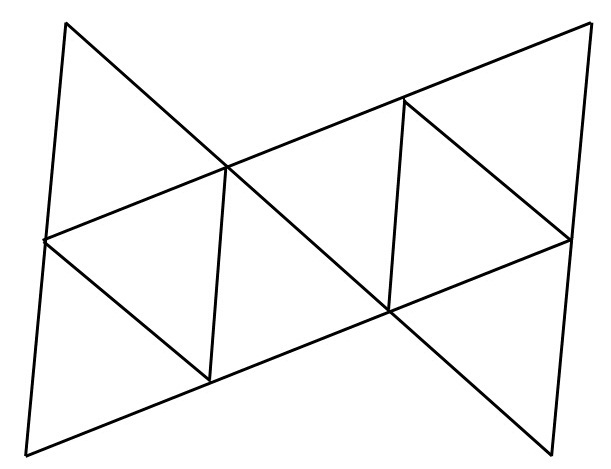
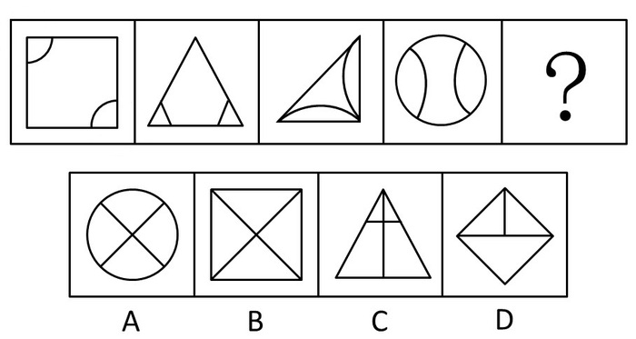
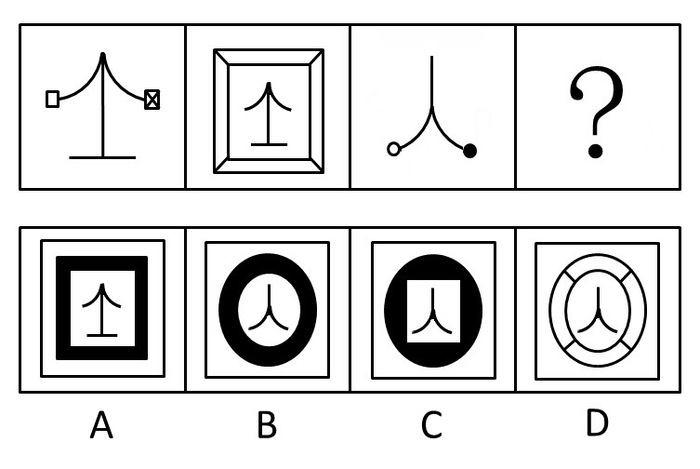
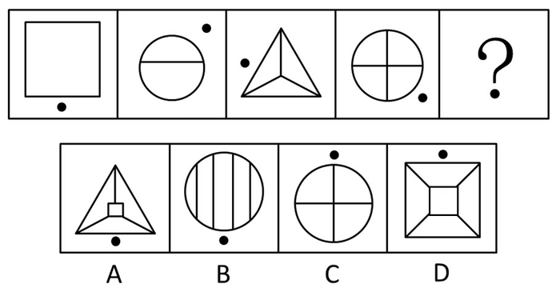
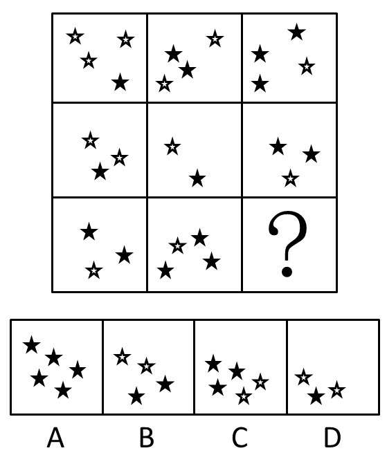
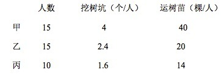
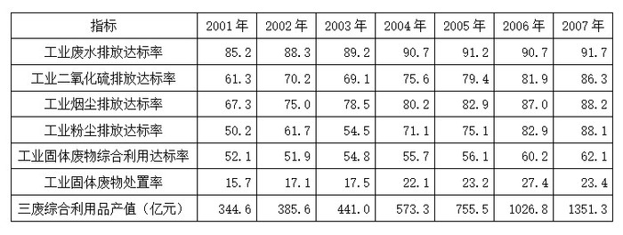
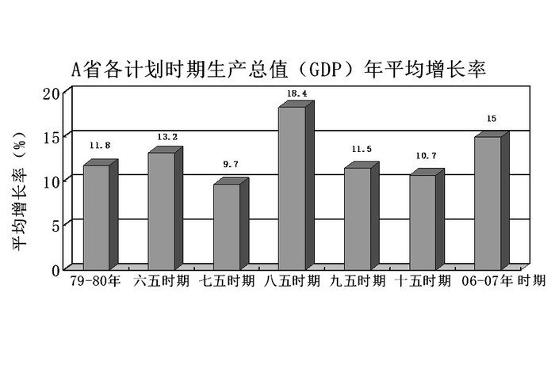
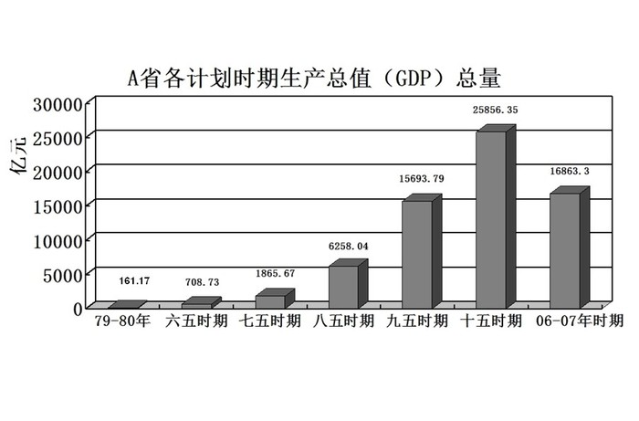

# 2009年福建省公务员录用考试《行测》题（春季）

<!-- gwy:overview:start -->
> **福建 · 2009 · 行测 · 统考** ｜ 130 题 · 图片 114 处 · 答案随题折叠

| 题型模块 | 题量 | 题号 |
| --- | ---: | ---: |
| 常识判断 | 35 | 1–35 |
| 言语理解与表达 | 30 | 36–65 |
| 判断推理 | 40 | 66–105 |
| 数量关系 | 10 | 106–115 |
| 资料分斩 | 15 | 116–130 |
| **合计** | **130** | |

导航：[题型与作答说明](#题型与作答说明) · [题目](#题目) · [材料 1](#材料-1)
<!-- gwy:overview:end -->

> 候选采集稿。参考答案及解析来自粉笔页面，不代表官方答案或真实高分答卷；来源使用许可与原卷对应关系仍需人工核实。

## 题型与作答说明

常识判断

（35题）

根据题目要求，在四个选项中选出一个最恰当的答案。

言语理解与表达

（30题）

本部分包括表达与理解两方面的内容。请根据题目要求。在四个选项中选出一个最恰当的答案。

判断推理

（40题）

本部分包括图形推理、定义判断、类比推理与逻辑判断四种类型的试题。

数量关系

（10题）

本部分包括数字推理与数学运算两种类型的试题。

资料分斩

（15题）

所给出的图、表、文字或综合性资料均有若干个问题要你回答。你应根据资料提供的信息进行分析、比较、计算和判断处理。

## 题目

### 第 1 题

科学发展观的基本要求是：

A. 发展

B. 以人为本

C. 全面协调可持续

D. 统筹兼顾

第 1 题 · 答案与解析

**参考答案（粉笔题库参考内容）**

C

**解析**

党的十七大报告指出：“科学发展观，第一要义是发展，核心是以人为本，基本要求是全面协调可持续，根本方法是统筹兼顾。”

故正确答案为C。

### 第 2 题

胡锦涛同志在纪念十一届三中全会召开30周年大会上指出：我们要不动摇、不懈怠、（    ），坚定不移地推进改革开放，坚定不移地走中国特色社会主义道路。

A. 不折腾

B. 不改变

C. 不踌躇

D. 不放弃

第 2 题 · 答案与解析

**参考答案（粉笔题库参考内容）**

A

**解析**

胡锦涛同志在纪念十一届三中全会召开30周年大会上指出：我们要不动摇、不懈怠、不折腾， 坚定不移地推进改革开放，坚定不移地走中国特色社会主义道路。

故正确答案为A。

**本题相关知识点：**

“不动摇，不懈怠，不折腾”——

首先是“不动摇”。这就是高举中国特色社会主义伟大旗帜不动摇，坚持党的基本路线不动摇，坚持改革开放不动摇；

其次是“不懈怠”，就是要坚韧不拔地推进改革开放。这是精神状态问题，改革开放作为一场新的伟大革命，不可能一蹴而就，而是要长期艰苦奋斗；

再次是“不折腾”，这主要是老老实实地按照科学规律办事的问题。

### 第 3 题

2008年党中央带领全国各族人民取得抗震救灾重大胜利。伟大抗震救灾精神是：

A. 万众一心、众志成城，不怕困难、顽强拼搏，坚忍不拔、敢于胜利

B. 万众一心、众志成城，不畏艰险、百折不挠，以人为本、尊重科学

C. 万众一心、众志成城，团结互助、和衷共济，迎难而上、敢于胜利

D. 为国争光，艰苦奋斗，精益求精，勇攀高峰，团结协作

第 3 题 · 答案与解析

**参考答案（粉笔题库参考内容）**

B

**解析**

胡锦涛总书记提出的抗震救灾精神：万众一心、众志成城，不畏艰险、百折不挠，以人为本、尊重科学。

故正确答案为B。

### 第 4 题

2009年元旦是《告台湾同胞书》发表30周年纪念日，当前推动两岸关系和平发展的政治基础是：

A. 坚持大陆和台湾同属一个中国

B. 深化交流合作、推进协商谈判

C. 促进两岸同胞团结奋斗

D. 弘扬中华文化、加强精神纽带

第 4 题 · 答案与解析

**参考答案（粉笔题库参考内容）**

A

**解析**

党的十七大报告指出：“坚持一个中国原则，是两岸关系和平发展的政治基础。尽管两岸尚未统一，但大陆和台湾同属一个中国的事实从未改变。中国是两岸同胞的共同家园，两岸同胞理应携手维护好、建设好我们的共同家园。台湾任何政党，只要承认两岸同属一个中国，我们都愿意同他们交流对话、协商谈判，什么问题都可以谈。”

故正确答案为A。

**本题相关知识点：**

一个中国原则是指大陆和台湾同属一个中国的原则。它是在中国人民捍卫中国主权和领土完整的正义斗争中形成的，具有不可动摇的事实和法理基础。这个原则是我国政府开展外交工作的基本原则，也是实现和平统一的基础和前提。

### 第 5 题

中央经济工作会议指出，2009年经济工作的首要任务是：

A. 深化重点领域和关键环节改革

B. 保持经济平稳较快发展

C. 提高对外开放水平

D. 改善民生

第 5 题 · 答案与解析

**参考答案（粉笔题库参考内容）**

B

**解析**

保持经济平稳较快发展是2009年经济工作的首要任务。

故正确答案为B。

**本题相关知识点：**

2009年经济工作主要任务：

一、继续加强和改善宏观调控，促进经济平稳较快发展。

二、坚持不懈抓好“三农”工作，增强农产品供给保障能力。

三、加快经济结构调整，促进经济自主协调发展。

四、深化重点领域和关键环节改革，提高对外开放水平。

### 第 6 题

甲乙两地居民的恩格尔系数分别为30%和32%，这可能表明：

A. 从生活水平看，乙地居民略高于甲地居民

B. 从生活水平看，甲地居民略高于乙地居民

C. 从收入水平看，甲地居民略高于乙地居民

D. 从收入水平看，乙地居民略高于甲地居民

第 6 题 · 答案与解析

**参考答案（粉笔题库参考内容）**

B

**解析**

恩格尔系数是食品支出总额占个人消费支出总额的比重。它是国际上通用的衡量居民生活水平高低的一项重要指标，一般随居民家庭收入和生活水平的提高而下降。一个家庭或国家的恩格尔系数越小，就说明这个家庭或国家经济越富裕，生活水平越高。反之，如果这个家庭或国家的恩格尔系数越大，就说明这个家庭或国家的经济越困难，生活水平越低。题中，甲地居民的恩格尔系数略小于乙地，说明甲地居民的总体生活水平略高于乙地。

故正确答案为B。

### 第 7 题

面对当前世界金融危机的冲击，我国一般不适宜采取的经济措施为：

A. 实行积极的财政政策

B. 实行从紧的货币政策

C. 立足扩大内需

D. 加快发展方式转变和结构调整

第 7 题 · 答案与解析

**参考答案（粉笔题库参考内容）**

B

**解析**

中国采取一系列的积极政策应对全球金融危机：

（1）财政政策由稳健变为积极，投资4万亿进行基础建设和重点项目建设，以及民生工程；

（2）实行宽松的货币政策，放松银根，鼓励银行放贷同时试点地方政府发行债券，为地方发展融资；

（3）政府加大了扶助的力度 ，通过提供融资便利、税费减免、出口退税、提供培训等措施，鼓励中小企业发展、鼓励创业，刺激就业；

（4）提高社会保障水平、加快养老医疗制度改革，刺激国内消费。

A项正确，属于应该采取的经济措施；

B项错误，不符合条件；

C项正确，属于应该采取的经济措施；

D项正确，属于应该采取的经济措施。

故正确答案为B。

**本题相关知识点：**

当通货膨胀的时候，经济增速过快出现泡沫，国家就会采取从紧的政策。此时通货膨胀的根源就是市场上流通的货币太多了，货币供过于求。

此时采取从紧的财政政策手段（提高税收，减少政府对社会事业的支出等）和货币政策手段（提高利率水平，提高准备金，提高基准利率等）来抑制经济过热，控制通货膨胀程度。

当通货紧缩或者经济增速放缓的时候，国家就会采取宽松的政策。此时经济放缓的根源就是市场上流通的货币少了，货币量供小于求。

此时通过积极的财政政策手段（减小税收，增加政府对社会事业的支出等）和宽松货币政策手段（降低利率水平，降低准备金，降低基准利率等）来刺激经济增长，减缓经济衰退。

### 第 8 题

下列有关国家与本国货币名称不匹配的是：

A. 英国一欧元

B. 俄罗斯一卢布

C. 印度一卢比

D. 印度尼西亚一盾

第 8 题 · 答案与解析

**参考答案（粉笔题库参考内容）**

A

**解析**

由于英国、瑞典和丹麦决定暂不加入欧元区。目前，使用欧元的国家为德国、法国、意大利、荷兰、比利时、卢森堡、爱尔兰、希腊、西班牙、葡萄牙、奥地利、芬兰、斯洛文尼亚、塞浦路斯、马耳他、斯洛伐克（2009年1月1日加入欧元区）、爱沙尼亚（2011年1月1日加入欧元区），称为欧元区。目前欧元区共有17个成员国和超过3亿2千万的人口。

A项错误，不匹配，英国不属于欧元区，其货币仍然是英镑。

故正确答案为A。

### 第 9 题

国务院出台《职工带薪年休假条例》，为劳动者享有休息休假权提供了法律保障，这主要体现了：

A. 我国经济实力逐步增强

B. 国务院具有立法职能

C. 国家机关坚持依法治国的原则

D. 党全心全意为人民服务的宗旨

第 9 题 · 答案与解析

**参考答案（粉笔题库参考内容）**

C

**解析**

国务院出台《职工带薪年休假条例》，通过行政法规对带薪休假制度进行规范，为劳动者享有休息休假权提供了法律保障。这主要体现了我国国家机关认真践行科学发展观，高度关注民生，坚持依法治国的原则。

故正确答案为C。

### 第 10 题

下列行政机关中无权制定地方政府规章的是：

A. 福建省政府

B. 厦门市政府

C. 泉州市政府

D. 福州市政府

第 10 题 · 答案与解析

**参考答案（粉笔题库参考内容）**

C

**解析**

《中华人民共和国立法法》第73条规定：省、自治区、直辖市和较大的市的人民政府，可以根据法律、行政法规和本省、自治区、直辖市的地方性法规，制定规章。这里所谓“较大的市”包括：省会市、经济特区所在的市以及计划单列市。据此，福建省政府、福州市（福建省省会）和厦门市（经济特区），都有权制定地方政府规章，只有泉州市政府无权制定地方政府规章。

本题为选非题，故正确答案为C。

注：本题所涉《立法法》第73条已经修改，改为第九十三条第一款规定：“省、自治区、直辖市和设区的市、自治州的人民政府，可以根据法律、行政法规和本省、自治区、直辖市的地方性法规，制定规章。”因此，根据现行规定，本题无答案。

### 第 11 题

某市公办学校全部向外来务工人员的子女开放，不允许再收取任何入学赞助费。这最主要体现的法律价值是：

A. 安全

B. 平等

C. 效率

D. 秩序

第 11 题 · 答案与解析

**参考答案（粉笔题库参考内容）**

B

**解析**

法律价值是指在作为客体的法律与作为主体的人的关系中，法律对一定主体需要的满足状况以及由此所产生的人对法律性状、属性和作用的评价。

某市公办学校全部向外来务工人员的子女开放，不允许再收取任何入学赞助费，意味着外来务工人员的子女可以与城市居民一样平等地享有受教育权。因此，这最主要体现的法律价值是“平等”。

故正确答案为B。

### 第 12 题

甲经贸公司租赁乙商场柜台代销丙厂名牌羽绒衣。下列行为违反了《反不正当竞争法》规定的是：

A. 在摊位广告牌上标明“厂家直销”

B. 在商场明显位置摆放该产品所获得的各种奖牌

C. 开展微利销售，实行“买一送一”

D. 对顾客一周之内来退货“不问理由一概退换”

第 12 题 · 答案与解析

**参考答案（粉笔题库参考内容）**

A

**解析**

《反不正当竞争法》第九条规定，经营者不得利用广告或者其他方法，对商品的质量、制作成分、性能、用途、生产者、有效期限、产地等作引人误解的虚假宣传。甲经贸公司并非生产厂家，却在摊位广告牌上标明“厂家直销”欺骗消费者，违反了法律规定。

故正确答案为A。

### 第 13 题

具体行政行为的效力不包括：

A. 执行力

B. 拘束力

C. 确定力

D. 公信力

第 13 题 · 答案与解析

**参考答案（粉笔题库参考内容）**

D

**解析**

具体行政行为的效力包括确定力、拘束力、执行力和公定力。

确定力：具体行政行为一旦作出，不得随意更改；已确定的行政决定，公民无权自行变更；已确定的行政执法行为，非经法定程序行政机关不得随意改变。

拘束力：具体行政行为生效后，必须按照已经确定的内容实施行为，相对人必须遵守和实际履行行政行为规定的义务。

执行力：国家强制当事人实施具体行政行为所要求的义务。具体行政行为的效力不包括公信力。

公定力：具体行政行为一经作出，推定合法，行政相对人不得任意否定。

本题为选非题，故正确答案为D。

**本题相关知识点：**

具体行政行为，即指行政机关行使行政权力，对特定的公民、法人和其他组织作出的有关其权利义务的单方行为。

具体行政行为特征：

1.具体行政行为是法律行为。

2.具体行政行为是对特定人与特定事项的处理。第一是就特定事项对特定人的处理，第二是就特定事项对可以确定的一群人的处理，第三是就特定事项对不特定人的处理。

3.具体行政行为是单方行政职权行为。

4.具体行政行为是外部性处理。

### 第 14 题

根据公务员考核的有关规定，连续（    ）年年度考核被评为“不称职”等级的公务员将被辞退。

A. 两

B. 三

C. 四

D. 五

第 14 题 · 答案与解析

**参考答案（粉笔题库参考内容）**

A

**解析**

本题考查法律常识。

根据《公务员法》第八十八条的规定：“公务员有下列情形之一的，予以辞退： （一）在年度考核中，连续两年被确定为不称职的； （二）不胜任现职工作，又不接受其他安排的； （三）因所在机关调整、撤销、合并或者缩减编制员额需要调整工作，本人拒绝合理安排的； （四）不履行公务员义务，不遵守法律和公务员纪律，经教育仍无转变，不适合继续在机关工作，又不宜给予开除处分的； （五）旷工或者因公外出、请假期满无正当理由逾期不归连续超过十五天，或者一年内累计超过三十天的。”

故正确答案为A。

**本题相关知识点：**

关于辞职辞退，《公务员法》第八十三条至八十六条规定了予以辞退和不得辞退的相关内容，具体如下：

第八十三条：公务员有下列情形之一的，予以辞退：

（一）在年度考核中，连续两年被确定为不称职的；

（二）不胜任现职工作，又不接受其他安排的；

（三）因所在机关调整、撤销、合并或者缩减编制员额需要调整工作，本人拒绝合理安排的；

（四）不履行公务员义务，不遵守公务员纪律，经教育仍无转变，不适合继续在机关工作，又不宜给予开除处分的；

（五）旷工或者因公外出、请假期满无正当理由逾期不归连续超过十五天，或者一年内累计超过三十天的。

第八十四条：对有下列情形之一的公务员，不得辞退：

（一）因公致残，被确认丧失或者部分丧失工作能力的；

（二）患病或者负伤，在规定的医疗期内的；

（三）女性公务员在孕期、产假、哺乳期内的；

（四）法律、行政法规规定的其他不得辞退的情形。

第八十五条：辞退公务员，按照管理权限决定。辞退决定应当以书面形式通知被辞退的公务员。

被辞退的公务员，可以领取辞退费或者根据国家有关规定享受失业保险。

第八十六条：公务员辞职或者被辞退，离职前应当办理公务交接手续，必要时按照规定接受审计。

### 第 15 题

“骏马能历险，犁田不如牛；坚车能载重，渡河不如舟”，这句话启发我们在用人方面要坚持：

A. 德才兼备原则

B. 量才适用原则

C. 法治管理原则

D. 任人唯贤原则

第 15 题 · 答案与解析

**参考答案（粉笔题库参考内容）**

B

**解析**

马能历险，牛能犁田，车能载重，舟能渡河。这启发我们在用人方面要扬长避短，人尽其才，也就是要坚持“量才适用原则”。

量才适用——坚持“让合适的人做合适的事”的原则，不断挖掘人的优点和长处，而且使人的最大优势与相关岗位相匹配，让人的优势能得到最大限度的发挥，创造出高价值。

故正确答案为B。

### 第 16 题

省政府办公厅要求各级各部门领导干部深入基层、走进群众开展春节慰问活动，秘书小王起草公文，他使用的公文文种应是：

A. 通告

B. 公告

C. 通知

D. 公报

第 16 题 · 答案与解析

**参考答案（粉笔题库参考内容）**

C

**解析**

通告适用于公布社会各有关方面应当遵守或者周知的事项。

公告是国家权力机关、行政机关向国内外郑重宣布重大事件和决议、决定时所用的一种公文。

通知是向特定受文对象告知或转达有关事项或文件，让对象知道或执行的公文。

公报也称新闻公报，是党政机关和人民团体公开发布重大事件或重要决定事项的报道性公文。

由此可见，省政府办公厅要求各级各部门领导干部深入基层、走进群众开展春节慰问活动。秘书小王起草公文所用的公文文种应是“通知”。

故正确答案为C。

### 第 17 题

下列对联最适合用于祝贺教师60周岁寿辰的是：

A. 为学有宗花甲成庆，诲人无倦恩重及门

B. 花甲有二犹在拼搏，赢得称颂留传万年

C. 碧桃献岁宜家受福，古稀逢春获寿延年

D. 执掌教坛垂六十载，栽培桃李满三千株

第 17 题 · 答案与解析

**参考答案（粉笔题库参考内容）**

A

**解析**

B项错误，花甲有二，是62岁。

C项错误，古稀是70岁。

D项错误，执掌教坛六十载，即这位教师在工作岗位上担任教职已有60年，当然不止60岁。

故正确答案为A。

**本题相关知识点：**

孔子曰：“吾十有五而志于学，三十而立，四十而不惑，五十而知天命，六十而耳顺，七十而从心所欲。”——《论语·为政》

由此延伸：

耳顺、耳顺之年、还历之年、花甲之年：均指60岁；

从心之年、古稀之年、悬车之年、杖围之年：均指70岁；

喜寿：指77岁，草书喜字似七十七，故特代指77岁；

朝枚之年、朝枝之年、耄\[mào\]耋\[dié\]之年：均指八九十岁；

米寿：指88岁，因米字拆开好似八十八，故借指88岁；

上寿：九十为上寿；

白寿：指99岁，百少一为99，故借指99岁；

期颐：原指百岁高龄的人需要颐养，后来指人一百岁；期颐之年：指百岁；

茶寿：指108岁；茶字上面廿，下面为八十八，二者相加得108岁。

### 第 18 题

孔子提出“君子和而不同”的思想，“和而不同”反映了中华文化具有的特点是（    ）。

A. 民族性

B. 阶级性

C. 妥协性

D. 包容性

第 18 题 · 答案与解析

**参考答案（粉笔题库参考内容）**

D

**解析**

本题考查中华文化的特点。

A项，民族性是指对包括语言、文字、历史等在内的某一文化的共同认知。“和而不同”体现不出民族性。该项与题意不符，排除；

B项，阶级性是指在有阶层划分的社会里的人的思想意识所具有的特性。这种特性是由人的社会地位决定的，反映着本阶层的特殊利益和要求。“和而不同”体现不出不同阶层的阶级特性。该项与题意不符，排除；

C项，妥协性是指为了避免冲突、争执，与某人或几个方面之间商谈条件以求得互让。“和而不同”体现不出妥协性。该项与题意不符，排除；

D项，《论语》中说“君子和而不同，小人同而不和。”“和而不同”指意见可以不同但要和睦相处，善于求同存异。从文化关系的意义上看，这是处理不同文化关系的最高境界，反映了中华文化具有的包容性特点。该项符合题意，当选。

故正确答案为D。

### 第 19 题

西欧有一句名谚：“中国人的头，阿拉伯人的口，法兰西人的手。”结合对古代科技史的理解，下列说法不正确的是：

A. 中国人的智慧创造了领先世界的科技成就

B. 古代欧洲的科技成就比中国的科技成就更高

C. 欧洲吸收和借鉴中国科技成就，形成近代科学

D. 阿拉伯人在东西方文化交流中起到了桥梁作用

第 19 题 · 答案与解析

**参考答案（粉笔题库参考内容）**

B

**解析**

由“中国人的头”可知，在古代科学发展史上，是中国人的智慧创造了领先世界的科技成就，而古代欧洲的科技成就显然远不如中国。

本题为选非题，故正确答案为B。

### 第 20 题

北京奥运场馆“水立方”“鸟巢”在建筑外形上相呼应，其设计体现了“天圆地方”的中国传统理念。这表明：

A. 人的认识来源于客观，灵感来源于主观

B. 建筑艺术对建筑业有重大的指导作用

C. 创新是继承与发展的统一

D. 人们可以根据自己的需要创造出新的设想

第 20 题 · 答案与解析

**参考答案（粉笔题库参考内容）**

C

**解析**

北京奥运场馆“水立方”“鸟巢”在建筑外形上的创新设计，继承并发展了“天圆地方”的中国传统理念，这表明“创新是继承与发展的统一”。

继承是发展的根基，只有进行了继承，才能搭建一个发展的平台，才能让发展成为可能。发展是继承的升华，只有继承而得不到发展，只是一潭死水，没有任何活力，二者是相辅相成的，处理好这两者关系的结果就是创新。

故正确答案为C。

### 第 21 题

在“首届京剧旦角最佳演员”的评选中，梅兰芳、程砚秋、尚小云、（    ）当选，被誉为京剧“四大名旦”。

A. 荀慧生

B. 常香玉

C. 王汉伦

D. 阎立品

第 21 题 · 答案与解析

**参考答案（粉笔题库参考内容）**

A

**解析**

1927年“首届京剧旦角最佳演员”活动中，梅兰芳、程砚秋、尚小云、荀慧生，被誉为京剧“四大名旦”。

故正确答案为A。

**本题相关知识点：**

“四大名旦”是20世纪20年代起在京剧舞台上异军突起的四位艺术明星，他们以各自的风格特色，各自的代表剧目，形成了四大流派，改变了老生唱主角的一统天下，形成了旦角挑班唱戏的新局面。

梅兰芳的表演以庄重深邃，气势非凡，简洁凝练而艺压群芳，塑造了《宇宙锋》的赵艳容；《霸王别姬》的虞姬；《贵妃醉酒》的杨玉环；《凤还巢》的程雪娥等一个个华美形象。最为可贵的是他不以奇特取巧，而在平淡中见神采，成为京剧旦角的楷模，被誉为“一代宗师”。

尚小云的表演以神完气足，明快俏丽，美媚柔脆和文戏武唱为特点，他创造《汉明妃》的昭君；《福寿镜》的胡氏；《双阳公主》的公主；《摩登伽女》的钵吉帝等艺术形象，不但显示了他深厚的、文武全能的功力，而且都有标新立异之处，给人耳目清明之感。

程砚秋的表演以文武昆乱无不精湛的艺术造诣而赢得观众。他的青衣戏《武家坡》、花旦戏《闹学》、刀马旦戏《穆柯寨》、武旦戏《沈云英》、昆腔戏《思凡》和《费宫人》都给观众留下了深刻的印象。变声后，嗓音所限，为露巧藏拙，在唱腔上独辟蹊径，终以低回委婉、俏丽华美的“程腔”演出了《三击掌》《骂殿》《荒山泪》《窦娥冤》等戏，为旦角的唱腔开辟了新天地。

荀慧生的表演，无论唱、念、做、打，均在细微之处见神韵，见精巧。很注意从情感投入到唱、念、做、打中去刻画人物形象。使人物的神态深入人心。所以在唱念表演中绝无矫揉造作之感，而能神到，意到，一唱一动挥洒自如。他演的《杜十娘》《红娘》《勘玉钏》《大英杰烈》《荀灌娘》都有各自准确的个性和特点，极其生动、逼真。

### 第 22 题

许多国家的著名城市都是沿河而建的，下列组合正确的是(    )。

A. 埃及—开罗—尼日尔河

B. 匈牙利—布达佩斯—易北河

C. 德国—汉堡—莱茵河

D. 法国—巴黎—塞纳河

第 22 题 · 答案与解析

**参考答案（粉笔题库参考内容）**

D

**解析**

本题考查著名城市依托的河流。古代大城市往往依托一条河流，穿城而过的河对一座城市来说是一种得天独厚的资源，河流可以提供城市地表饮用水和生产用水，城市交通尤其是水运便利，古代城市临河利于防御等。

A项，埃及首都开罗是沿尼罗河而建的，尼日尔河流经几内亚、马里、尼日尔、贝宁和尼日利亚，组合错误，排除；

B项，匈牙利首都布达佩斯是沿多瑙河而建的，易北河从捷克共和国出发，穿过德国注入北海，组合错误，排除；

C项，德国港口城市汉堡是沿易北河而建的，莱茵河发源于瑞士境内，流经列支敦士登、奥地利、法国、德国和荷兰，最后在鹿特丹附近注入北海，组合错误，排除；

D项，法国首都巴黎的重要景点（巴黎圣母院、埃菲尔铁塔、卢浮宫等）都在塞纳河两岸，组合正确，当选。

故正确答案为D。

### 第 23 题

“神舟”七号航天员进行出舱活动，这是中国人第一次真正触摸和感受到地球以外的世界。载人航天中三大基本技术是：天地往返、出舱行走、（  ）。

A. 释放伴飞小卫星

B. 深空探测

C. 在轨试验

D. 交会对接

第 23 题 · 答案与解析

**参考答案（粉笔题库参考内容）**

D

**解析**

出舱行走与天地往返、交会对接被称为载人航天中最重要的三大基本技术，其中出舱则是人类大规模空间活动的前提。

故正确答案为D。

### 第 24 题

蹦极运动员从高处跳下，弹性绳被拉展前做自由落体运动，被拉展后在弹性绳的缓冲作用下，下落到一定高度后速度减为零。下列说法中正确的是（    ）。

A. 弹性绳拉展前运动员处于失重状态，弹性绳拉展后运动员处于超重状态

B. 弹性绳拉展后运动员先处于失重状态，后处于超重状态

C. 弹性绳拉展后运动员先处于超重状态，后处于失重状态

D. 运动员一直处于失重状态

第 24 题 · 答案与解析

**参考答案（粉笔题库参考内容）**

B

**解析**

本题考查失重与超重的相关知识。

失重状态指的是物体在引力场中自由运动时有质量而不表现重量或重量较小的一种状态，当物体加速度竖直向下时为失重状态。超重状态是指物体所受限制力大于物体所受重力的状态，当物体加速度竖直向上时为超重状态。

弹性绳自拉展后到收缩前，拉力小于重力，加速度方向向下，运动员处于失重状态。弹性绳开始收缩后，拉力大于重力，加速度方向向上，运动员处于超重状态。B项表述正确。

故正确答案为B。

### 第 25 题

下列关于地震自救表述不正确的是：

A. 为防止次生灾害的发生，首先要切断电源、气源

B. 应疏散到屋外平地、小胡同、陡山坡及河岸边

C. 在家中可选择床下、桌子底下就地避险

D. 在单元楼内，可选择开间小的卫生间、厨房、储藏室及墙角躲避

第 25 题 · 答案与解析

**参考答案（粉笔题库参考内容）**

B

**解析**

本题考查地震自救的相关知识。

A项，地震发生时，电线、煤气管道可能受地震影响而发生短路、泄漏等危险，从而引起火灾。为防止次生灾害的发生，应切断电源、气源。该项正确。

B项，地震发生时，高大建筑物的玻璃碎片和大楼外侧混凝土碎块等可能掉下伤人，窄小胡同中堆放的物品倒塌也极易发生危险，陡山坡与河岸边在地震时容易发生山体滑坡、河堤崩塌，从而发生危险。该项错误。

地震来临，无法离开屋内时，应该尽可能地藏在小范围的空间内，由于空间小的卫生间、厨房、储藏室及墙角不易坍塌，可以躲在床下、桌子下以及卫生间或厨房这种开间小的房屋。C、D项正确。

本题为选非题，故正确答案为B。

### 第 26 题

多数汽车的前窗都是倾斜的，最主要是为了：

A. 避免因反光而影响驾驶员视线

B. 减少空气阻力

C. 结构合理，视野开阔，承受冲击力强

D. 便于雨水流走

第 26 题 · 答案与解析

**参考答案（粉笔题库参考内容）**

A

**解析**

汽车的前窗相当于一块平面镜，车内的人或一些物品会呈现在前窗上，呈现一个等大的虚像，给司机造成一个错觉，不易分清车内和车外的人或东西，容易造成交通事故。前窗是倾斜的，车内的人或物的像就会呈现在车的正上方，这样司机就不会混淆车内、车外的人或物。而大型客车都比较高，在地面上行走的人的像不会出现在前窗上，所以前窗平面司机容易区分车内、车外的人或事物。

故正确答案为A。

### 第 27 题

2009年1月6日，中国海军护航舰艇编队顺利抵达亚丁湾海域执行护航任务。亚丁湾位于：

A. 红海

B. 波斯湾

C. 地中海

D. 印度洋

第 27 题 · 答案与解析

**参考答案（粉笔题库参考内容）**

D

**解析**

亚丁湾是指印度洋在也门和索马里之间的一片水域，它通过曼德海峡与红海相连，是波斯湾石油输往欧洲和北美洲的重要水路，也是全球海盗活动的主要区域之一。

故正确答案为D。

### 第 28 题

许多人喜欢晨练，但从环境角度来看，城市早晨的空气并不新鲜，原因是：

A. 早晨空气中有时有逆温层，不利于污染物的扩散

B. 早晨空气中含有大量的二氧化碳

C. 早晨公路上汽车太多，污染严重

D. 早晨人们刚刚起床，不适宜在室外锻炼

第 28 题 · 答案与解析

**参考答案（粉笔题库参考内容）**

A

**解析**

从环境角度来看，城市早晨的空气并不新鲜，原因是早晨空气有时有逆温层，这种情况不利于污染物的扩散。

逆温层——一般情况下，在低层大气中，气温是随高度的增加而降低的。但有时在某些层次可能出现相反的情况，气温随高度的增加而升高，这种现象称为逆温。出现逆温现象的大气层称为逆温层。在逆温层中，较暖而轻的空气位于较冷而重的空气上面，形成一种极其稳定的空气层，就像一个锅盖一样，笼罩在近地层的上空，严重地阻碍着空气的对流运动。由于这种原因，近地层空气中的水汽，烟尘以及各种有害气体，上天无路，入地无门，只有飘浮在逆温层下面的空气层中，使空气中的污染物不能及时扩散开去，加重了大气污染。

故正确答案为A。

### 第 29 题

白居易在登上庐山时写下：“人间四月芳菲尽，山寺桃花始盛开”。产生诗中景象的原因是：

A. 山地土壤贫瘠，桃树开花较迟

B. 山地由于海拔高，气温低，桃树开花来得迟

C. 山地云雾多，桃树开花来得迟

D. 山地空气稀薄缺氧，桃树开花较迟

第 29 题 · 答案与解析

**参考答案（粉笔题库参考内容）**

B

**解析**

人间四月的芳菲已经尽了，山寺里的桃花却才开始盛开。为什么会出现这种现象呢？这是由于山寺海拔高，气温低，桃树开花来得迟了。

故正确答案为B。

### 第 30 题

当人静止地站在斜坡式电梯上随电梯一起向上运动时（手与电梯不接触），下列表述准确的是：

A. 人不受摩擦力作用

B. 人所受的摩擦力方向沿电梯面向下

C. 人所受的摩擦力方向沿电梯面向上

D. 人所受的摩擦力方向可能沿电梯向上，也可能向下

第 30 题 · 答案与解析

**参考答案（粉笔题库参考内容）**

C

**解析**

当人静止地站在斜坡式电梯上随电梯一起向上运动时，如果手与电梯不接触，那么为了保持平衡，人所受的摩擦力方向一定是沿电梯面向上的。

故正确答案为C。

### 第 31 题

夏天，打开冰箱冷冻室的门，常常看到冷冻室中冒出一股白雾，这是：

A. 冰箱里原有的水蒸气凝结成小水滴

B. 冰箱里的冰升华后又凝结成小水滴

C. 冰箱里的水变成水蒸气

D. 冰箱外部空气中的水蒸气遇冷凝结成小水滴

第 31 题 · 答案与解析

**参考答案（粉笔题库参考内容）**

D

**解析**

冰箱内外温差较大，打开冰箱冷冻室之后，内部冷空气飘散到外面，使空气中的水蒸气液化成小水滴。

故正确答案为D。

### 第 32 题

20世纪60年代初，美国贝尔实验室编写了一个名为“磁芯大战”的游戏，游戏中通过复制自身来摆脱对方的控制，这就是（  ）的第一个雏形。

A. “蠕虫”

B. “木马”

C. “病毒”

D. “黑客”

第 32 题 · 答案与解析

**参考答案（粉笔题库参考内容）**

C

**解析**

“磁芯大战”游戏中通过复制自身来摆脱对方的控制，同时“吃掉”对方程序，这是病毒的第一个雏形。

故正确答案为C。

### 第 33 题

中共福建省委提出要努力把海峡西岸经济区建设成为“两个先行区”，“两个先行区”指的是：

A. 科学发展的先行区、对外交流合作的先行区

B. 科学发展的先行区、两岸人民交流合作的先行区

C. 改革开放的先行区、两岸人民交流合作的先行区

D. 改革开放的先行区、对外交流合作的先行区

第 33 题 · 答案与解析

**参考答案（粉笔题库参考内容）**

B

**解析**

“两个先行区”指的是：科学发展的先行区，两岸人民交流合作的先行区。

故正确答案为B。

### 第 34 题

1984年，福建省55名厂长、经理联名发出（  ）的呼吁信，开启了全国国有企业改革的先声。

A. “松绑放权”

B. “大念山海经”

C. “以智取胜”

D. “利用外资”

第 34 题 · 答案与解析

**参考答案（粉笔题库参考内容）**

A

**解析**

1984年3月24日，《福建日报》在头版头条刊出55位厂长、经理发出的“松绑放权”呼吁信，开启了全国国有企业改革的先声。

故正确答案为A。

### 第 35 题

迄今为止，福建省自然景观、文化遗址被列入《世界遗产名录》的是：

A. 武夷山，三坊七巷

B. 福建土楼，三坊七巷

C. 三坊七巷，泰宁金湖

D. 武夷山，福建土楼

第 35 题 · 答案与解析

**参考答案（粉笔题库参考内容）**

D

**解析**

迄今（2009年）为止，福建省自然景观、文化遗址被列入《世界遗产名录》的是武夷山和福建土楼。

故正确答案为D。

**本题相关知识点：**

1.南平武夷山，世界文化和自然遗产，申请成功日期为1999年12月1日；

2.龙岩土楼，世界文化遗产，申请成功日期为2008年7月6日；

3.漳州土楼，世界文化遗产，申请成功日期为2008年7月6日；

4.三明泰宁丹霞，世界自然遗产，申请成功日期为2010年8月1日。

### 第 36 题

下列成语中没有错别字的一项是：

A. 量体栽衣、甚嚣尘上

B. 提纲挈领、落华流水

C. 恼羞成怒、腹背受敌

D. 礼仪廉耻、里应外合

第 36 题 · 答案与解析

**参考答案（粉笔题库参考内容）**

C

**解析**

本题考查辨析汉字字形的能力。

C项没有错别字。

A项“量体栽衣”中“栽”字错误，应改为“裁”；B项“落华流水”中“华”改为“花”；D项“礼仪廉耻”中“仪”应改为“义”。

故正确答案为C。

### 第 37 题

下列各句中，括号内的成语使用恰当的一项是：

A. 古人中不乏刻苦学习的楷模，悬梁刺股者、秉烛达旦者、闻鸡起舞者，在历史上（汗牛充栋）

B. “崇尚科学文明，反对迷信愚昧”图片展，将伪科学暴露得（淋漓尽致），使观众深受教育

C. 本刊将（洗心革面），继续提高稿件的编辑质量，决心向文学刊物的高层次、高水平攀登

D. 谈起电脑、互联网，这个孩子竟然说得头头是道、（左右逢源），使在场的专家惊叹不已

第 37 题 · 答案与解析

**参考答案（粉笔题库参考内容）**

B

**解析**

本题考查辨析成语使用对错的能力。

首先解释一下各选项成语的含义：

B项“淋漓尽致”形容文章或说话表达得非常充分、痛快，用来形容对伪科学的揭露是恰当的，当选。

A项“汗牛充栋”形容藏书非常多，用来形容人是不恰当的，排除；C项“洗心革面”比喻彻底悔改，用来形容提高刊物的质量是不恰当的，排除；D项“左右逢源”一是比喻做事得心应手，顺利无阻，属褒义；二是比喻处事圆滑，属贬义。现在以贬义用法较常见，用来形容一个谈论互联网的孩子是不恰当的，排除。

故正确答案为B。

### 第 38 题

①中华文明是世界古代文明中始终没有＿＿＿、延续五千多年发展至今的文明。

②我国神舟七号载人飞船的成功发射，＿＿＿了我国航天事业的又一新篇章。

③销声匿迹数十年的国家一级保护动物黑鹤、白鹤等20多种＿＿＿鸟类，近年来出现在黄河入海口。

上面划线处填入词语，最恰当的是：

A. 中断 揭穿 珍稀

B. 终断 揭露 珍奇

C. 终断 揭示 珍贵

D. 中断 揭开 珍稀

第 38 题 · 答案与解析

**参考答案（粉笔题库参考内容）**

D

**解析**

本题考查实词语境最佳搭配。

此题适用排除法。

第二个空，“揭开新篇章”属于习惯搭配，其他三个词语都不可与“新篇章”搭配，由此可以直接排除A、B、C三项。

第一个空，“中断”是中途停止，是暂时的，而“终断”指彻底停止，是永久的。中华民族的文化是没有发展中停止过的，故“中断”符合题意。

第三个空，“珍稀”形容珍贵、稀少的东西。题干中的一级保护动物不仅珍贵，更重要的是数量稀少，用“珍稀”形容最符合，而“珍奇”和“珍贵”无法完整体现题意。

故正确答案为D。

### 第 39 题

改革开放以来，随着市场经济的发展和政府职能的＿＿＿，政府管理社会的方法逐步从行政管理向公共管理转变，公共事务的管理主体日趋多元化，＿＿＿趋于多样化，正在形成以政府为＿＿＿的、多元的、开放的公共管理体系。

填入划横线部分最恰当的一项是：

A. 转变 手法 中心

B. 转向 手段 中心

C. 转变 手段 核心

D. 转向 手法 核心

第 39 题 · 答案与解析

**参考答案（粉笔题库参考内容）**

C

**解析**

本题考查实词词义侧重的辨析与填空。

此题可以通过排除法来找到答案，首先从习惯搭配来看。

第一个空，只有填入“转变”才可以形成恰当的语境呼应，“政府职能的转变”是习惯搭配。“转变”是指从一种形式、状态或特点变为另一种形式、状态或特点，而“转向”指改变方向或者改变政治立场。此处“转变”更符合题意，故排除B、D两项。

第二个空，只有填入“手段”才可以形成恰当的语境呼应，“手段”指为达到某种目的而采取的具体方法，而“手法”一是指艺术品或文学作品的技巧，二是指手段。显而易见“手段”符合题意，排除A项。

故正确答案为C。

### 第 40 题

有位作家说，要想使自己生活的扁舟轻驶，务必要让它＿＿＿的仅限于必不可少之物，不然轻则＿＿＿无以进，重则可能压沉自己的生活之舟。道理很明白，什么都舍不得撒手，往往＿＿＿什么都不得不＿＿＿。

上面划线处填入词语，最恰当的是：

A. 装载 徜徉 致使 割爱

B. 装载 徘徊 致使 舍弃

C. 承载 徜徉 导致 割爱

D. 承载 徘徊 导致 舍弃

第 40 题 · 答案与解析

**参考答案（粉笔题库参考内容）**

D

**解析**

本题考查实词语境最佳选择。

此题可以通过排除法来找到答案。

第二个空，只有填入“徘徊”才可以形成恰当的语境呼应。“徘徊”指在一个地方来回地走，比喻犹豫不决，而“徜徉”指安详自在地步行。“徘徊无以进”是正确的，排除A、C两项。

第三个空，只有填入“导致”才可以形成恰当的语境呼应。“导致”指引起，而“致使”指由于某种原因而使得，此处填入“导致”正确，排除B项。

故正确答案为D。

### 第 41 题

一些同志＿＿＿懂得建设社会主义精神文明的重要，＿＿＿知道它在建设中国特色社会主义当中的地位，＿＿＿在一定时期内能够做到两个文明一起抓，＿＿＿当精神文明建设形势比较好、经济建设任务又很重要的时候，他们往往＿＿＿自觉不自觉地将精神文明建设当成“软”任务来看待。

填入划横线部分最恰当的一项是：

A. 不 不 尽管 然而 才

B. 也 也 而且 但是 就

C. 又 又 而且 然而 则

D. 既 又 虽然 但是 也

第 41 题 · 答案与解析

**参考答案（粉笔题库参考内容）**

B

**解析**

本题考查关联词的辨析与使用。

本题可从最后一个空入手，“精神文明建设形势比较好······”与横线后“将精神文明建设当成‘软’任务来看待”前后之间为顺承关系，B项“就”符合文意，保留。A项“才”表示必要条件关系，C项“则”表示转折关系，D项“也”表示并列关系，均与文意不符，排除。

前四个空代入验证，根据文意可知，题干前两个分句之间为并列关系，填入“也······也······”符合句义。第三个横线后的分句与前两个分句之间为递进关系，“而且”为表示递进关系的关联词，符合要求。第四空，横线前表示“两个文明一起抓”，后文“将精神文明建设当成‘软’任务来看待”，语义不一致，形成转折关系，“但是”符合文意，B项当选。

故正确答案为B。

### 第 42 题

亚当·斯密是一个经常被引用＿＿＿很少被认真阅读的思想家，＿＿＿亚当·斯密在大学的“真正身份”是讲授逻辑、修辞学、法理学的道德哲学教授，＿＿＿他也同时被视为经济学的鼻祖和自由主义的典范。

上面划线处填入词语，最恰当的是：

A. 却 虽然 但

B. 但 因为 所以

C. 而 虽然 但

D. 而 因为 所以

第 42 题 · 答案与解析

**参考答案（粉笔题库参考内容）**

A

**解析**

本题考查关联词的辨析与填空。

由第一分句“经常被······很少被······”可知，第一空，应该用表示转折关系的词，用“却”最为恰当。C项为干扰项，虽然“而”也可表示转折，但是从语意程度来讲，“却”的转折意味更加强烈。

第二、三空，由“他也同时被视为”可知，后两句之间并不存在因果关系，应该用“虽然······但”。

故正确答案为A。

### 第 43 题

郭教授认为，<u>构建</u>一个更加开放的绿色亚洲，是亚洲可持续发展的必由之路。

替换划横线部分最恰当的一项是：

A. 构想

B. 建造

C. 建构

D. 构成

第 43 题 · 答案与解析

**参考答案（粉笔题库参考内容）**

C

**解析**

此题考查词语替换的能力。

“构建”指建立（多用于抽象的事物），只有C项“建构”与其词义相同。

“建构”也是指建立，用于抽象的事物；“构想”指构思，形成想法，“建造”指建筑，修建，无法与“构建”替换，因此排除。

故正确答案为C。

### 第 44 题

这些志愿者，来自<u>五湖四海</u>，迅速地深入到抗灾第一线。

替换划横线部分最恰当的一项是：

A. 四通八达

B. 神州大地

C. 全国各地

D. 四面八方

第 44 题 · 答案与解析

**参考答案（粉笔题库参考内容）**

D

**解析**

此题考查成语替换的能力。

题干中，“五湖四海”泛指不同的地区，“来自五湖四海”强调的是来自许多不同的地方。

D项“四面八方”泛指各个方面或各个地方，替换“五湖四海”最恰当。

A项“四通八达”用来形容交通十分便利；B项“神州大地”指祖国各地，但并没有强调各地的不同；C项“全国各地”语意平平，不能反映出“五湖四海”想要表达的感情色彩。

故正确答案为D。

### 第 45 题

全所职工在载人航天精神的<u>鼓舞</u>下，齐心协力攻克技术难关，成功克隆出一头牛。

替换划横线部分最恰当的一项是：

A. 鼓动

B. 鼓励

C. 激励

D. 激发

第 45 题 · 答案与解析

**参考答案（粉笔题库参考内容）**

C

**解析**

本题考查词语替换的能力。

题干中，“鼓舞”指使振作起来，增强信心或勇气。

C项“激励”指激发鼓励，主体可以是人也可以是某种精神，用在该句中最恰当。

A项“鼓动”指用言语、文字等激发人们的情绪，使他们行动起来，有唆使的意味。原句中鼓舞的主体是航天精神，因此用“鼓动”不妥，排除；B项“鼓励”指激发、勉励，主体多为人，因此用在此处不恰当，排除；D项“激发”指刺激使奋发，一般与“积极性”“潜力”等搭配，排除。

故正确答案为C。

### 第 46 题

忠实与通顺，作为翻译的标准，应该是统一的整体，不能把两者割裂开来，与原意<u>大相径庭</u>的文字，不管多么通顺，都称不上是翻译；同样，译文词不达意也起不到翻译的作用。

替换划横线部分最恰当的一项是：

A. 面目全非

B. 截然相反

C. 南辕北辙

D. 迥然不同

第 46 题 · 答案与解析

**参考答案（粉笔题库参考内容）**

D

**解析**

本题考查成语替换的能力。

题干中，“大相径庭”指事物区别明显，意见、看法截然不同，一般作谓语。

D项“迥然不同”形容相差得很远，很明显不一样。两个成语的意义、用法相似，原句可以用“迥然不同”来替换。

A项“面目全非”形容改变得不成样子（含贬义），而原句是在比较两种不同事物之间的关系，不合题干语意，排除；“截然相反”通常用于形容事物或事件毫无共同之处，截然不同，“南辕北辙”是说想到达南方，车子却向北行，比喻行动和目的正好相反，题干中，翻译是不可能与原意完全相悖的，因此B、C两项排除。

故正确答案为D。

### 第 47 题

下列句子中，存在病句的是：

A. “舆论监督强势”并不表明我国舆论监督到位和充分

B. 发展现代农业，是保障我国粮食安全的根本途径

C. 应对公共应急事件处置是基层干部执政能力的重要组成部分

D. 专家指出，张经理在处置突发事件时流泪表明了他在应对复杂局面时缺乏对事态发展的判断和预测能力

第 47 题 · 答案与解析

**参考答案（粉笔题库参考内容）**

C

**解析**

本题考查辨析病句的能力。

C项可将主干提炼出来为“应对处置是执政能力的重要组成部分”，可知主语和宾语搭配不当，应该在“处置”的后面加上“能力”。

其他选项语句表达通顺，没有语病。

故正确答案为C。

### 第 48 题

下列句子中，没有歧义的是：

A. “有偿新闻”应当受到批评，这是极其错误的

B. 民族精神是衡量一个国家综合国力强弱的重要尺度，是国家软实力的重要体现

C. 李教授接到遗传学会秘书组来信，信上说：“只要你单位同意，报销食宿费和路费，安排住处，领取大会出席证的问题可由我们解决”

D. 村支部书记看见新来的下派干部很高兴，于是两人亲切地交谈起来

第 48 题 · 答案与解析

**参考答案（粉笔题库参考内容）**

B

**解析**

本题考查辨析歧义的能力。

B项句意明确，没有歧义。

A项中的“这是极其错误的”有歧义，可理解为“有偿新闻”是错误的或者批评“有偿新闻”是错误的；C项中的“可由我们解决”有歧义，可理解为“你单位同意负责报销食宿费、路费并安排住处，我们负责领取大会出席证”，也可理解为“你单位同意你来，我们就负责报销食宿费、路费，安排住处，并负责领取大会出席证”；D项中的“很高兴”有歧义，可理解为“村支部书记”很高兴或者“新来的下派干部”很高兴。

故正确答案为B。

### 第 49 题

下列句子中，语意不明确的是：

A. 隆重简短的欢送仪式之后，这架飞机开始了大陆民航56年来的首次台湾之旅

B. 为满足广大游客的需要，华夏旅行社设计并开通了20余条红色旅游精品线路

C. 在美国家庭中，汉语已成为继英语和西班牙语之后又一种得到广泛使用的语言

D. 他在某杂志生活栏目上发表的那篇关于饮食习惯与健康的文章，批评的人很多

第 49 题 · 答案与解析

**参考答案（粉笔题库参考内容）**

D

**解析**

本题考查歧义辨析的能力。

D项中的“批评的人很多”语意不明，可理解为“他的文章批评了很多人”或者“他的文章受到了很多人的批评”。

其余三项句意表达明确，没有问题。

故正确答案为D。

### 第 50 题

下列句子中没有歧义的是：

A. 大家对护林员揭发村长带头偷运木料的问题，普遍感到非常气愤

B. 实践证明，一个人知识的多寡，成就的大小，关键在于勤奋的程度

C. 近期，福州和厦门的部分地区外来务工人员提前返乡了

D. 两个朋友送的小福娃使他非常高兴

第 50 题 · 答案与解析

**参考答案（粉笔题库参考内容）**

B

**解析**

本题考查辨析歧义的能力。

B项语句表达通顺，句意明确，没有歧义。

A项中的“普遍感到非常气愤”有歧义，可理解为对“村长带头偷运木料”感到非常气愤或者对“护林员揭发村长”感到非常气愤；C项中的“福州和厦门部分地区”有歧义，可理解为“福州”和“厦门部分地区”或者“福州和厦门”的部分地区；D项“两个”修饰的是“朋友”还是“朋友送的福娃”有歧义。

故正确答案为B。

### 第 51 题

未来学家科克伦认为今后五十年内，人脑可能与电脑直接相连。他说，到二十一世纪初科学家将开始进行把芯片和人脑直接相连的开发工作。只要解决芯片与大脑接口问题，这一设想完全可能变为现实。现在已经能把《大不列颠百科全书》的全部内容以分子大小的字体刻在一枚针的针尖上，因此，人们利用同样的技术也可用来开发植入大脑的芯片。

这段文字的主旨是：

A. 今后五十年内，人脑将可能与电脑直接相连

B. 科学家将进行把芯片和人脑直接相连的开发工作

C. 电脑对信息存取的能力可以与人脑相媲美

D. 目前，制约电脑植入人脑的关键是芯片与大脑接口问题

第 51 题 · 答案与解析

**参考答案（粉笔题库参考内容）**

A

**解析**

据提问知此题为中心理解题。

阅读可知，材料为典型的总分结构。第一句即为主旨句，其后的内容都在围绕主旨句阐述人脑与电脑相连的可能性，通过解释和举例来支撑主旨句。

故A项是对主旨的正确概括。

B、D项只是对原文细节的简单复述，没有抓住材料的语意重点；C项在材料中没有体现，予以排除。

故正确答案为A。

### 第 52 题

梁朝简文帝诗云：“紫燕跃武，赤兔越空。”二句中赤兔指良马，紫燕亦指良马。李善注谢灵运诗云：“文帝自代还。有良马九匹，一名飞燕骝。”在古代，武威铜马足下的飞燕无疑是用来比喻良马之神速，这种造型让人一看便知其意，所以铜马应直截了当取名为“紫燕骝”或“飞燕骝”，此名恰合古意，最为雅致贴切。

这段文字的主旨是：

A. 中国古代诗人多善于写马

B. 武威铜马足下的飞燕是用来比喻良马神速的

C. 武威铜马直接命名为“紫燕骝”或“飞燕骝”更为贴切

D. 南北朝文人都喜欢马

第 52 题 · 答案与解析

**参考答案（粉笔题库参考内容）**

C

**解析**

由提问标志词“主旨”可知本题为中心理解题。

题干首先引经据典，通过引用诗文表明在古代“紫燕”“飞燕”都是良马的代称，最后得出结论，即铜马应直截了当地取名为“紫燕骝”或“飞燕骝”。

C项表述最符合文意。

A项错误，文段只是引用了写马的诗句，并没有说古代诗人善于写马；B项为文段细节，不是主旨；D项在文段中没有依据，属于无中生有，予以排除。

故正确答案为C。

### 第 53 题

在教学活动中，教师起什么作用？叶圣陶先生的看法是，“各种学科的教学都一样，无非教师帮着学生学习的一串过程”。换句话说，教学，教学，就是“教”学生“学”，主要不是把现成的知识教给学生，而是把学习的方法教给学生，学生就可以受用一辈子。

这段文字的主旨是：

A. 教师要讲究教学方法

B. 教师应讲授学习的过程

C. 教师应把学习的方法教给学生

D. 教师教学主要不是把现成的知识教给学生

第 53 题 · 答案与解析

**参考答案（粉笔题库参考内容）**

C

**解析**

本题属于中心理解题。文段主要介绍了教师在教学活动中的作用。文段由设问句开始，引用叶圣陶先生的名言进行了回答，后通过“不是······而是······”的句式，强调教师要把学习的方法教给学生，便于学生受用一辈子。结合选项，C项的表述是“而是”后面的重点内容，符合文段中心，当选。

A、B两项，原文未涉及相关内容，属于无中生有，排除；

D项，是对文段“不是······”部分内容的概括，偏离文段中心，排除。

故正确答案为C。

### 第 54 题

在著名的优质麦产区山东省兖州市，国际粮商与改制后的基层粮管所合作，利用其收储网络大量收购小麦、玉米等粮源，形成具有一定规模的收储网络。在不断复制这种模式的同时，在国内企业已经进驻的地方，国际粮商开设面粉加工企业，利用掌握的优质粮源以及低价策略挤压国内企业生存空间。

下列选项中，最适合做本段文字标题的是：

A. 合作实现双赢

B. 国际粮商渗透中国粮区

C. 挤压并购悄然展开

D. 深远的意图

第 54 题 · 答案与解析

**参考答案（粉笔题库参考内容）**

B

**解析**

文段阐述了在山东省兖州市，国际粮商和基层粮管所合作，大量收购粮食，同时又在国内开设面粉加工厂，挤压了国内企业的生存空间。概括而言，文段主要说明了国际粮商通过合作等形式渗透中国粮区，故B项当选。另外通过阅读可知，题干对国际粮商挤压国内企业生存空间是持反对态度的，B项的“渗透”一词明确地表示了对国际粮商的不满，最适合做本段文字标题，验证B项正确。

A项，文段中“挤压”一词可以感受到作者对于国际粮商的行为是很不满的，因此标题中不会出现“双赢”这样积极的字眼，排除；

C项，“挤压”在文中确实有所体现，但是“并购”无法从文中推出，排除；

D项，该标题含义宽泛，与文段内容贴合不紧密，排除。

故正确答案为B。

### 第 55 题

地球上生命的历史也就是生物与它们的环境相互作用的历史。动植物的形体和习性在很大程度上是由环境造成的，而反向作用，即生物对其所在环境的实际影响则相对较小。只有到了二十世纪，作为物种之一的人类才获得了足够的力量，有效地改变他所在的世界——大自然。

根据这段话，下列推断正确的一项是：

A. 动植物的形体和习性在很大程度上是由环境造成的，人类也就可以通过自己的努力提高动植物的质量

B. 环境决定动植物的形体和习性，生物也反过来决定环境的变迁

C. 动植物的形体和习性完全由环境和人类造成

D. 到了二十世纪，作为物种之一的人类获得了足够的力量，能够决定环境的变迁

第 55 题 · 答案与解析

**参考答案（粉笔题库参考内容）**

A

**解析**

由提问方式可知本题为细节判断题。

A项正确，由人类能“有效地改变他所在的世界——大自然”以及“动植物的形体和习性在很大程度上是由环境造成的”可知，人类可以改造自然从而影响动植物的形体和习性，提高动植物的质量。

B项与原文不符，原文是说生物对环境的影响相对较小，而不是“生物也反过来决定环境的变迁”；C项“完全由环境和人类造成”说法过于绝对；D项说法错误，原文只是说人类能够有效地改变自然，但并不能理解为人类可以决定环境的变迁。

故正确答案为A。

### 第 56 题

重视加强领导干部的学习，是我们党保持和发展先进性，始终走在时代前列的重要保证，也是领导干部健康成长、提高素质、不断进步的重要途径。特别是在新形势下，领导干部只有认认真真地学习，才能始终跟上时代进步的潮流，才能担当起领导干部的重任。可以说，领导干部的学习水平，在很大程度上决定着工作水平和领导水平。

这段文字的主旨是：

A. 加强领导干部的思想建设，是我们党的建设的重要保证

B. 领导干部只有加强学习，才能提高理论素养

C. 领导干部的学习水平，在很大程度上关系到工作水平和领导水平

D. 加强领导干部的学习，对于加强党的建设和干部自身建设具有重要的意义

第 56 题 · 答案与解析

**参考答案（粉笔题库参考内容）**

D

**解析**

由提问标志词“主旨”可知本题为中心理解题。

文段主要讲的是加强领导干部学习的重要性。第一句为文段主旨句，即从党的发展和领导干部个人发展两个方面说明加强领导干部学习的重要意义。

D项正确，是对原文主旨的恰当概括。

A项错误，文段主要说的是“领导干部的学习”，而不是“领导干部的思想建设”；B、C两项是对原文的简单复述，未能抓住材料重点，予以排除。

故正确答案为D。

### 第 57 题

据国际货币基金组织统计显示，发达国家最终消费支出占GDP的比例平均在80％左右，发展中国家平均约70％以上。而中国改革开放后，由于经济增长快，投资率较高，消费率出现稳步下降的趋势，在55％～65％的区间波动。从2001年至今，消费率一直处在60％以下。消费在国民经济中所占比重大大低于国际平均水平。 由上述可以推断，我国的消费政策应调整为：（  ）。

A. 大力提倡超前消费，超越发达国家80%的消费指标

B. 继续保持艰苦创业的优良传统，促使消费水平稳步下降

C. 进一步提高消费水平，保持经济的平稳较快发展

D. 维持既有消费水平，使国民经济发展保持后劲

第 57 题 · 答案与解析

**参考答案（粉笔题库参考内容）**

C

**解析**

根据文意，我国的消费支出在国民经济中所占比重大大低于国际平均水平，这是消费结构不合理的一个表现，因此，我国的消费政策应该是向发展中国家的国际水平看齐，即提高消费水平。C项正确。

A项，过于激进，我国是发展中国家，不应该盲目追随发达国家。

B项，我国现在的消费水平已经低于发展中国家的平均水平了，无需继续降低消费水平。

D项，题目要求要调整消费政策，说明现在的消费水平是不合理的，因此不能继续维持既有消费水平。

故正确答案为C。

### 第 58 题

研究人员指出，<u>术语“生物降解”这个词的使用是不规范的</u>。一些生产厂家说，这些产品如果在物理上发生了变化，则是可以生物降解的，它们一旦与其它物质混合，便会自然消失或者可以支持生物的成长。研究人员认为，真正的生物降解物质在需氧条件下可以分解成二氧化碳和水。在厌氧条件下它们则可以分解成甲烷和二氧化碳。然而，经他们试验的每个产品都不能降解，也不能达到上述标准。

根据文意，划横线部分的意思是：

A. “生物降解”不是一个科学术语

B. “生物降解”这个说法名不符实

C. “生物降解”在现实中根本不存在

D. “生物降解”这个术语的运用有语法错误

第 58 题 · 答案与解析

**参考答案（粉笔题库参考内容）**

B

**解析**

由提问方式可知本题为词句理解题。

由文段可知术语“生物降解”这个词的使用是不规范的。为了说明这句话，下文先介绍了厂家的说法，又谈了研究人员的看法及试验结果。

试验表明厂家的宣传与实际情况不符，即名不符实，B项表述正确。

A项错误，文段并没有否定“生物降解”这个术语的科学性，倒数第二句话还对这类物质的特点作了分析；C项错误，原文也没有否定“生物降解”的现实性，由原文“真正的生物降解物质······”这句话可以推断得出；D项是无中生有，予以排除。

故正确答案为B。

### 第 59 题

理想是由真实的素材构成的。缺乏这种认识，人类就不能切合实际地运用它的理想能力。真正的友谊，这一美好的理想，会激励我们竞争；但认识到它只是一个理想，实际上常含有一点虚幻的成分，这种认识乃是一种不可忽视的对幻想的解毒剂。<u>友谊是如此，一切真理也都如此。</u>

根据文意，对划横线部分理解不准确的是：

A. 友谊是由真实的素材构成的

B. 友谊常含有虚幻的成分

C. 友谊是幻想的解毒剂

D. 友谊与真理都是某种理想

第 59 题 · 答案与解析

**参考答案（粉笔题库参考内容）**

C

**解析**

由提问方式可知本题为语句理解题。

C项错误。原文是说应该认识到友谊是一种理想，这种认识是幻想的解毒剂，而不是说友谊是幻想的解毒剂，C项偷换概念。

由文段中“真正的友谊，这一美好的理想······”可知真正的友谊是一种理想，而“理想是由真实的素材构成的”，所以A项“友谊是由真实的素材构成的”说法正确；由原文“但认识到它只是一个理想，实际上常含有一点虚幻的成分”可知B项也正确；“友谊是如此，一切真理也都如此”表明友谊是一种理想，而真理也是一种理想，故D项正确。

本题为选非题，故正确答案为C。

### 第 60 题

经济学上所推崇的“橄榄型”收入分配结构，是指低收入和高收入相对较少，中等收入占绝大多数的收入分配结构，可以说是最理想的收入分配结构，这种结构要比我国目前的“金字塔型”结构稳定得多。在“更加注重社会公平”这一精神指导下，中央强调对不同的收入群体采取不同的调节办法，决心构建“橄榄型”收入分配结构。

对这段话理解不准确的是：

A. “橄榄型”收入分配结构比较有利于社会稳定

B. “金字塔型”收入分配结构是不太理想的收入分配结构

C. “橄榄型”收入分配结构比较注重社会公平

D. “金字塔型”收入分配结构改进的关键在于应优先增加中等收入人群的财富

第 60 题 · 答案与解析

**参考答案（粉笔题库参考内容）**

D

**解析**

由提问方式可知本题为细节判断题。

由文段中“‘橄榄型’收入分配结构，是指低收入和高收入相对较少，中等收入占绝大多数的收入分配结构”可知，“橄榄型”收入分配结构比较注重社会公平。

D项错误，原文只是说要变我国的“金字塔型”分配结构为“橄榄型”分配结构，并没有提到结构改进的步骤方法，该项属于无中生有。

根据原文“这种结构要比我国目前的‘金字塔型’结构稳定得多”可知，A、B两项说法正确；C项正确，中等收入人群所占比例越高，分配结构也就越能体现社会公平。

本题为选非题，故正确答案为D。

### 第 61 题

近年来，不少国家纷纷实施“人与生物圈计划”，目的都是为了寻求同一个答案。为什么人类在享受自己获得和创造的财富时，会不时受到大自然的种种惩罚？因为人类在土壤侵蚀、沙漠化、滥伐森林、越来越多的物种灭绝、环境污染等所导致的生态系统退化中，逐步意识到自身还没有真正揭开人与生物圈之间的秘密。

这段话中“秘密”一词具体指的是：

A. 人类为什么会受到自然的惩罚

B. 生态系统为什么会退化

C. 人类应怎样在维持生态平衡的同时来获得发展

D. 人类搞经济建设怎样才能适应环境

第 61 题 · 答案与解析

**参考答案（粉笔题库参考内容）**

C

**解析**

据提问知此题是词语理解题。

综合整个文段可知这个“秘密”涉及两个方面的内容：人类既要维持生态平衡，同时又要获得发展。所以C项符合文意，当选。

A、B两项意思相近，都是仅仅从人类受惩罚的原因去分析，不全面，排除；D项侧重于谈人类怎么适应环境，但这只是问题的一个方面，也不全面，排除。

故正确答案为C。

### 第 62 题

徐文长创画雪竹的方法，所画极为精绝。有人评论说：“徐文长先生画雪竹，纯以明代瘦笔破笔燥笔断笔为之，绝不类竹；然后以淡墨水勾染而出枝间叶上，罔非积雪，竹之全体，在隐约间矣。”

对徐文长画雪竹，下面说法中与原文意思相符的一项是：

A. 他画雪竹时，取材不限于一类竹子，因而能使人隐约感到全体竹子的形象

B. 他画的雪竹，满身处处有雪，枝干叶若隐若现

C. 他画的竹虚实结合，因而不像竹子

D. 他能用不好的笔，画出极为精绝的艺术珍品

第 62 题 · 答案与解析

**参考答案（粉笔题库参考内容）**

B

**解析**

B项，根据文段“枝间叶上，罔非积雪，竹之全体，在隐约间矣”可知，选项表述正确，当选；

A项，根据文段“枝间叶上，罔非积雪，竹之全体，在隐约间矣”可知，能使人隐约感到全体竹子的形象的原因为“罔非积雪”，选项表述错误，排除；

C项，“绝不类竹”指形体上与竹子不完全相似，但并未否定徐文长创画雪竹技法的巧妙与高超，该项“不像竹子”的说法显然不符合原文意思，排除；

D项，“不好的笔”无中生有，文段“瘦笔破笔燥笔断笔”指的是观画人的感觉，并非不好的笔，排除。

故正确答案为B。

【文段出处】《竹子在我国传统诗画艺术中得到如此厚爱》

### 第 63 题

民间剪纸是劳动人民为了满足自身精神生活的需要而创造，并广为流传的一种艺术样式。它生存于劳动者深厚的生活土壤中，体现了人类艺术最基本的审美观念和精神品质，具有鲜明的艺术特色和生活情趣。剪纸艺术的产生主要是为了满足：

A. 社会物质生活的需求

B. 社会艺术情趣的需求

C. 社会价值取向的需求

D. 社会精神生活的需求

第 63 题 · 答案与解析

**参考答案（粉笔题库参考内容）**

D

**解析**

材料开始提到“民间剪纸是劳动人民为了满足自身精神生活的需要而创造”，由此可知剪纸艺术的产生主要是为了满足“社会精神生活的需求”。

故正确答案为D。

### 第 64 题

蚂蚁是所有动物中最爱寻衅和好战的物种，尤其是以肉食为主的“狩猎蚁”。“狩猎蚁”的外交政策是永无休止的侵犯、武力争夺地盘，以及尽其所能地消灭邻近群体。特别是在食物短缺时，与其他群体的冲突则会达到高潮。早春时节，群体开始发育的时期，“狩猎蚁”还会袭击其它种类的蚂蚁，斗争的结果总是以“狩猎蚁”的胜利而告终。

这段话直接支持了这样一种观点：

A. 弱肉强食，适者生存

B. 枪杆子里出政权

C. 狭路相逢勇者胜

D. 进攻是最有效的防守

第 64 题 · 答案与解析

**参考答案（粉笔题库参考内容）**

A

**解析**

据提问可知本题为中心理解题。

材料通过描述“狩猎蚁”好斗的特点，以及它们往往在斗争中最终获胜的现象，揭示了自然界中“弱肉强食，适者生存”的规律。所以A项符合文意。

B项涉及政治斗争，不符合文意；C项不能体现“狩猎蚁”喜欢主动出击、好斗的特点；文中并没有提到“狩猎蚁”进攻是为了防守，因此D项错误。

故正确答案为A。

### 第 65 题

科普，也就是科学普及。既然是一种普及的工作，那么为了达到普及的目的，在工作方式和风格上，或者比如说，在科普作品的形式和风格上，自然应具备某种流行的特色。如果连流行都做不到，怎么能叫普及呢？但在现实中，我国的科普作品虽然挂着普及的招牌，在大多数情况下，却实在难以称得上有流行特征。

这段话主要想告诉我们：

A. 科普按照一般观念，可以理解为科学技术的普及

B. 科普工作要求在工作方式和风格上应具有流行的特色

C. 我国的科普作品如果能真正具有流行特征，那么科学技术就能普及

D. 我国目前的科普作品并没有达到真正的普及，原因是不够流行

第 65 题 · 答案与解析

**参考答案（粉笔题库参考内容）**

B

**解析**

此题为中心理解题。

材料先提出观点“科普作品的形式和风格都应具备流行的特色”，然后用反问句加强了对此观点的肯定。然后对现实生活中的科普作品没有流行特征这一问题进行了批评。

所以材料主要想告诉我们的就是科普工作方式和风格上应具有流行特色，B项符合文意。

文段第一句话仅表明“科普，也就是科学普及”，文段未提及科普与科学技术的关系，所以A项的观点属于无中生有，排除；C项表述过于绝对，材料提到了“科普应具有某种流行特色”，但这并不意味着达到了某种流行特色就能够使科学技术普及，排除；D项没有引申，只是表述了文段中的表面含义，而本题是隐含主旨题，排除。

对于隐含主旨题目而言，选项需要寻找材料的深层含义，文段提出的是“科学普及没有实际效果”这样一个现实问题，那么对于隐含主旨的题目选项来说，对策优于原因，B项是解决对策，D项是原因分析。

故正确答案为B。

### 第 66 题

将下图沿线条折成一个正多面体。这个正多面体是：

A. 四面体

B. 六面体

C. 八面体

D. 十面体

第 66 题 · 答案与解析

**参考答案（粉笔题库参考内容）**

C

**解析**

由于题干图形中有八个面，因此折出的必为八面体。

故正确答案为C。

### 第 67 题

请从所给的四个选项中，选择最适合的一个填在问号处，使之体现图形所表达的规律。

A. A

B. B

C. C

D. D

第 67 题 · 答案与解析

**参考答案（粉笔题库参考内容）**

D

**解析**

元素组成凌乱，考查数数。每个图形中均有3个封闭的面，A、B、C三项都是4个面。

故正确答案为D。

### 第 68 题

根据图1和图2的逻辑关系，下列选项中与图3有类似逻辑关系的是：

A. A

B. B

C. C

D. D

第 68 题 · 答案与解析

**参考答案（粉笔题库参考内容）**

B

**解析**

内部图形特征。图1中左侧的白色小方框作为了图2的内框，图1中右侧的条纹小方框作为了图2的外框。同理，将图3的左侧圆框作为内框，将右侧的黑色圆框作为外框可得。

故正确答案为B。

### 第 69 题

请从所给的四个选择项中，选择最适合的一个，使之呈现一定的规律性。

A. A

B. B

C. C

D. D

第 69 题 · 答案与解析

**参考答案（粉笔题库参考内容）**

D

**解析**

综合考查位置和数量，除小黑点以外的图形中，封闭面的个数依次为1，2，3，4，5；小黑点的位置依次逆时针旋转得到。

故正确答案为D。

### 第 70 题

请从所给的四个选项中，选择最适合的一个填在问号处，使之呈现一定的规律性。

A. A

B. B

C. C

D. D

第 70 题 · 答案与解析

**参考答案（粉笔题库参考内容）**

A

**解析**

元素数量，黑白分开数。每一行中，前两个图形中的黑星数目的和等于第三个图形中的黑星数目；前两个图形中白星数目的差等于第三个图中白星的数目。那么黑色应该为5，白色为0。

故正确答案为A。

### 第 71 题

行政决策是指国家行政机关及其工作人员为履行国家管理职能，在充分收集相关信息、系统论证的基础上，依法对要解决的问题作出科学决定的活动过程。

根据上述定义，下列属于行政决策的是：

A. 某局长自行决定从国外引进某项目，后该项目取得巨大收益

B. 为解决企业的排污问题，某市政府在充分、系统论证的基础上作出了相应的决策，然而具体实施时该决策方案失败，造成了巨大的经济损失

C. 某政府机关为建设机关工作人员住宅收集了大量的资料，并对该建筑的设计问题召开会议，商讨并形成了相关决议

D. 甲市农业局局长去乙市考察，见乙市山区种植桉树取得较大收益，便决定在甲市东区平原地带也大面积种植桉树

第 71 题 · 答案与解析

**参考答案（粉笔题库参考内容）**

B

**解析**

第一步：找出定义关键词。

“国家行政机关及其工作人员”、“履行国家管理职能”、“充分收集相关信息、系统论证”、“科学决定”。

第二步：逐一分析选项。

A项：某局长自行决定，未体现其经过“充分收集相关信息、系统论证”，不符合定义，排除；

B项：充分、系统论证的基础上作出了相应的决策，体现其经过“充分收集相关信息、系统论证”，符合定义，当选；

C项：该政府机关建设机关工作人员住宅，不属于“履行国家管理职能”，不符合定义，排除；

D项：甲市农业局局长决定，所做的决定均未体现其经过“充分收集相关信息、系统论证”，不符合定义，排除。

故正确答案为B。

### 第 72 题

电子政府是指政府机构运用现代网络通讯与计算机技术，将其内部和外部的管理和服务职能通过精简、优化、整合、重组后到网上实现，打破时间、空间以及部门分隔的制约，为社会公众以及自身提供一体化的高效、优质、廉洁的管理和服务。

根据上述定义，下列不属于电子政府的是：

A. 某市政府建立网络平台，将其原有全部的政务在网络上一一对应实现

B. 某市政府内部实行办公系统自动化

C. 某市政府建立内部信息化网络平台，使各部门实现信息共享

D. 某市政府向社会组织和个人开辟网上申报系统

第 72 题 · 答案与解析

**参考答案（粉笔题库参考内容）**

B

**解析**

第一步：抓住定义中的关键词。

定义中强调“运用现代网络通讯与计算机技术”、“管理和服务职能”、“网上实现”。

第二步：逐一判断选项。

B项中的办公系统自动化与定义中的网络实现无关，不符合定义，当选；

A、C、D三项均通过网络实现，符合定义，排除。

本题为选非题，故正确答案为B。

### 第 73 题

一事不再罚，是指对当事人的同一违法行为，行政机关不得给予两次以上罚款的行政处罚。

根据上述定义，下列违反一事不再罚的是：

A. 甲酒后驾车在A路段被罚款300元，后其继续驾驶在B路段又被罚款500元

B. 某市环保局对甲企业的违规排污行为罚款1万元，数日后市工商局又责令其停业整顿

C. 甲因走私香烟被县工商局罚款5000元，不久县法院以甲构成走私罪判其罚金6500元

D. 某县环保局对甲企业的违规排污行为罚款1万元并责令其停业整顿；由于此次排污所造成的后果严重，县工商局又对甲企业罚款2万元

第 73 题 · 答案与解析

**参考答案（粉笔题库参考内容）**

D

**解析**

第一步：判断题干中的关键词。

主体：行政机关。关键词：同一违法行为、两次以上罚款。

第二步：逐一分析选项。

A项，甲在A、B两路段酒驾属于两次违法行为，理应受到两次罚款。该项没有违反一事不再罚，排除；

B项，数日后工商局责令停业整顿，没有罚款，甲企业前后总共只受到一次罚款。该项没有违反一事不再罚，排除；

C项，法院不是行政机关，以走私罪判处罚金6500元不属于行政处罚。该项没有违反一事不再罚，排除；

D项，环保局和工商局都是行政机关，前后两次罚款针对同一违法行为。该项违反了一事不再罚，当选。

故正确答案为D。

### 第 74 题

非物质文化遗产是指各族人民世代相承、与群众生活密切相关、通过口头和动作传承的各种传统文化表现形式和文化空间。

根据上述定义，下列不属于我国非物质文化遗产的是：

A. 福建的高甲戏、歌仔戏、福州评话

B. 梁祝传说、白蛇传传说、孟姜女传说

C. 《红楼梦》、《水浒传》、《西游记》、《三国演义》

D. 火宫殿火神庙会、药王山庙会、自贡灯会

第 74 题 · 答案与解析

**参考答案（粉笔题库参考内容）**

C

**解析**

第一步：抓住定义中的关键词。

定义中强调“与群众生活密切相关”、“通过口头和动作传承”。

第二步：逐一判断选项。

A、B两项均为口头传承，符合定义，排除；

C项中的文学名著不属于“通过口头和动作传承”，不符合定义，当选；

D项为动作传承，符合定义，排除。

本题为选非题，故正确答案为C。

### 第 75 题

有限合伙企业是指由普通合伙人和有限合伙人共同组成的合伙企业。其中普通合伙人对合伙企业债务无条件承担无限责任，有限合伙人以其认缴的出资额为限对合伙企业债务承担有限责任。

根据上述定义，下列属于有限合伙企业的是：

A. 甲、乙为某合伙企业的合伙人，对因甲的过错所造成的合伙企业债务，甲承担无限责任；乙以其在合伙企业中的财产份额为限承担责任

B. 对合伙企业的债务，所有的合伙人承担无限连带责任

C. 企业的对外债务由企业以其自有资本承担，与甲、乙的个人财产无关

D. 某合伙企业，甲出资2万元，乙出资20万元。甲参与企业日常经营管理，乙不参与管理。后合伙企业经营亏损，对外欠债达100多万，对此债务甲承担无限责任，乙以20万为限承担赔偿责任

第 75 题 · 答案与解析

**参考答案（粉笔题库参考内容）**

D

**解析**

第一步：抓住定义中的关键词。

定义中强调“普通合伙人无条件承担无限责任”、“有限合伙人以其认缴的出资额为限”。

第二步：逐一判断选项。

A项，甲承担无限责任不是无条件，而是由于过错，因此无法确定甲是否是普通合伙人，排除；

B项，合伙人中没有有限合伙人，排除；

C项，甲、乙均不是普通合伙人，不符合定义，排除；

D项，甲为普通合伙人，乙为有限合伙人，符合定义，当选。

故正确答案为D。

### 第 76 题

减量化是指在生产、流通和消费等过程中减少资源的消耗和废物的产生，是循环经济的一种。

根据上述定义，下列不属于减量化的是：

A. 某机动车制造企业按照国家规定的机动车燃油经济性标准，采用节油技术

B. 某企业根据市政府所提倡的精神，淘汰本企业耗能高的生产工艺

C. 某农业生产基地对农作物秸秆、畜禽粪便、废农用薄膜进行综合利用

D. 某公司严格执行产品包装标准，防止过度包装

第 76 题 · 答案与解析

**参考答案（粉笔题库参考内容）**

C

**解析**

第一步：抓住定义中的关键词。

定义中强调“在生产、流通和消费等过程中”、“减少资源的消耗和废物的产生”。

第二步：逐一判断选项。

A项中的节油技术、B项中的淘汰耗能高的生产工艺均属于在生产过程中减少资源的消耗和废物的产生，D项属于在生产、消费过程中减少资源的消耗和废物的产生，均符合定义，排除；

C项中的行为不是在生产、流通和消费过程中的行为，不符合定义，当选。

本题为选非题，故正确答案为C。

### 第 77 题

货币政策是指中央银行为实现既定的经济目标运用各种工具调节货币供给和利率，进而影响宏观经济的方针和措施的总和。主要的货币政策措施有：控制货币发行；控制和调节对政府的贷款；推行公开市场业务；改变存款准备金率；调整再贴现率；选择性信用管制；直接信用管制。

根据上述定义，下列属于货币政策的选项共有：

①调整存款类金融机构人民币存款准备金率

②调整证券交易印花税税率

③调整一年期人民币存贷款基准利率

④发行票据回笼货币

⑤调整出口退税政策

A. 2项

B. 3项

C. 4项

D. 5项

第 77 题 · 答案与解析

**参考答案（粉笔题库参考内容）**

B

**解析**

第一步：抓住定义中的关键词。

定义中的关键词为几种提到的货币政策措施。

第二步：逐一判断选项。

①属于改变存款准备金率；③是直接信用管制；④属于控制货币发行，均符合定义。②⑤均为税收政策，与货币政策无关，不符合定义。

故正确答案为B。

### 第 78 题

同一律是指在同一思维过程中，每一思想与自身同一。即每一概念、命题、论题等思维形式都保持一致、一贯、有确定的内容。

根据上述定义，下列符合同一律的是：

A. 有人说：“群众是真正的英雄。我是群众。所以，我是真正的英雄。”

B. 有人说：“经验主义不能一概都反对，例如工作经验、生产经验就不应该反对。”

C. 有人攻击进化论时说：“你相信猴子为人类的祖先，那么请问你，你自己是由你的祖父，还是从你的祖母的猴群中变来的？”

D. 有人说：“正义的事业是不可战胜的，而我们的事业是正义的事业，所以我们的事业是不可战胜的。”

第 78 题 · 答案与解析

**参考答案（粉笔题库参考内容）**

D

**解析**

第一步：抓住定义中的关键词。

定义中强调“同一思维过程中”、“思维形式保持一致、一贯、有确定内容”。

第二步：逐一判断选项。

A项中的“我”与“群众”不属于同一概念，不符合定义，排除；

B项中“经验主义”与“工作经验、生产经验”不是同一概念，不符合定义，排除；

C项中的结论与“猴子为人类的祖先”不是同一个命题，不符合定义，排除；

D项中“我们的事业”与“正义的事业”是同一概念，符合定义，当选。

故正确答案为D。

### 第 79 题

就业歧视是指用人单位没有合法依据，对未来潜在的就业人员自行作出各种限制性条款，从而排除了本该符合相关职位的人员的平等就业权的一种现象。

根据上述定义，下列属于就业歧视的是：

A. 某高等艺术院校发布《招生简章》要求女性报考者身高要达到160cm，男性要达到175cm

B. 某国有煤矿招聘井下作业矿工，要求应聘者为男性

C. 某公司招聘普通文员，要求应聘者为未婚女性

D. 某高校招聘教师，新聘教师若有本地户口安家费为1万元，若无本地户口安家费仅为5千元

第 79 题 · 答案与解析

**参考答案（粉笔题库参考内容）**

C

**解析**

第一步：抓住定义中的关键词。

定义中强调“用人单位”、“没有合法依据”、“限制性条款”、“本符合相关职位的人员”、“排除平等就业权”。

第二步：逐一判断选项。

A项中的“高等艺术院校”不是用人单位，不符合定义，排除；

B项中的性别要求有法律依据，不符合定义，排除；

C项要求“未婚”，没有法律依据，为就业歧视，符合定义，当选；

D项中有无本地户口均可招聘，只是安家费不同，没有剥夺平等就业权，不符合定义，排除。

故正确答案为C。

### 第 80 题

生态阈值是指生态系统从一种状态快速转变为另一种状态的某个点（生态阈值点）或一段区间（生态阈值带）。推动这种转变的动力来自某个或多个关键生态因子微弱的附加改变。其中生态阈值带暗含了生态系统从一种状态到另一状态逐渐转换的过程，而不像点型阈值那样发生突然的转变。

根据上述定义，下列表述错误的是：

A. 若能够证明保存30%的原生植被可以保护大部分物种不受威胁，若低于30%则将严重威胁物种的生存，则30%为其生态阈值

B. 若经研究发现温度再升高基准温度的3.75%将使当地生态系统面临严重干旱的威胁，则3.75%为其生态阈值

C. 若经研究发现当鸟类栖息地从15%减少到7%的区间，鸟类多样性会逐渐下降，此间若加以保护可以恢复。但若减少到7%以下时，鸟类的多样性就会急速下降，则7%为其生态阈值

D. 若经研究发现某地相对空气湿度在44.7%一53%区间将有利于当地植被生存，但若高于53%或低于44.7%将严重影响植被生存，则44.7%和53%为其生态阈值

第 80 题 · 答案与解析

**参考答案（粉笔题库参考内容）**

B

**解析**

第一步：抓住定义中的关键词。

定义中强调“生态系统从一种状态快速转变为另一种状态的某个点或某一段区间”、“某个或多个关键生态因子微弱的附加改变”、“逐渐转换的过程”。

第二步：逐一判断选项。

B项中的影响生态因子应该为温度，因此生态阈值应为基准温度，而与3.75％无关，不符合定义，当选；

A、C、D三项均将影响因子的某一特定值作为生态阈值，符合定义，排除。

本题为选非题，故正确答案为B。

### 第 81 题

水：水杯

A. 衣服：衣架

B. 房子：窗户

C. 货物：集装箱

D. 拐杖：轮椅

第 81 题 · 答案与解析

**参考答案（粉笔题库参考内容）**

C

**解析**

第一步：判断题干词语间逻辑关系。

题干两词为对应关系，水杯能够盛水，二者是物质和承载物质的器皿的对应，强调前者能够放在后者里面。

第二步：判断选项词语间逻辑关系。

A项，衣服和衣架是对应关系，但衣服不能放在衣架里面，不符合题干的逻辑关系，排除；

B项，房子和窗户是包容关系中的组成关系，窗户是房子的一部分，不符合题干的逻辑关系，排除；

C项，货物和集装箱是对应关系，货物能够放在集装箱里，符合题干的逻辑关系，当选；

D项，拐杖和轮椅是并列关系，都能够帮助伤残人员，不符合题干的逻辑关系，排除。

故正确答案为C。

### 第 82 题

优雅：优美

A. 黑暗：黑色

B. 雨天：湿润

C. 迅速：迅捷

D. 距离：质量

第 82 题 · 答案与解析

**参考答案（粉笔题库参考内容）**

C

**解析**

第一步：判断题干词语间的逻辑关系。

题干两词为近义词关系。

第二步：判断选项词语间的逻辑关系。

A项中两词无明显逻辑关系，排除；

B项中两词为属性关系，湿润是雨天的特征描述，排除；

C项中两词为近义词关系，当选；

D项为两个物理量的专业术语，属于并列关系，排除。

故正确答案为C。

### 第 83 题

蒸汽机：内燃机

A. 喷气机：战斗机

B. 中药：西药

C. 平板电视：液晶电视

D. 脉冲电话：数字电话

第 83 题 · 答案与解析

**参考答案（粉笔题库参考内容）**

D

**解析**

第一步：判断题干词语间逻辑关系。

蒸汽机和内燃机是两种工作原理不同的动力机械，二者构成并列关系，且蒸汽机的发明时间较早，内燃机的发明时间较晚。

第二步：判断选项词语间逻辑关系。

A项：喷气机是根据发动机不同分类的飞机类型，战斗机是根据用途不同分类的飞机类型，二者构成交叉关系，与题干逻辑关系不一致，排除；

B项：中药和西药是两种不同的药物类型，二者构成并列关系，但二者的发明时间没有明显的先后顺序，与题干逻辑关系不一致，排除；

C项：平板电视是根据屏幕外观不同分类的电视类型，液晶电视是根据显示技术不同分类的电视类型，二者构成交叉关系，与题干逻辑关系不一致，排除；

D项：脉冲电话和数字电话是两种传输方式不同的电话类型，二者构成并列关系，且脉冲电话的发明时间较早，数字电话的发明时间较晚，与题干逻辑关系一致，当选。

故正确答案为D。

### 第 84 题

铅笔：钢笔：毛笔

A. 电话：电视：电脑

B. 足球：篮球：气球

C. 棉衣：皮衣：毛衣

D. 棉花：棉衣：棉被

第 84 题 · 答案与解析

**参考答案（粉笔题库参考内容）**

C

**解析**

第一步：判断题干词语间逻辑关系。

题干三个词属于并列关系，铅笔、钢笔、毛笔都是笔的一种，且都具有同种作用，即用来书写。

第二步：判断选项词语间逻辑关系。

A项，电话、电视、电脑不具有同种作用，与题干不符，排除；

B项，足球与气球不是同种事物，与题干不符，排除；

C项，棉衣、皮衣和毛衣是并列关系，都属于衣服的一种且作用相同，符合题意，当选；

D项，棉花、棉衣、棉被不构成并列关系，与题干不符，排除。

故正确答案为C。

### 第 85 题

花：雪花：杜鹃花

A. 瓜：西瓜：哈密瓜

B. 人：白人：机器人

C. 山：黄山：长白山

D. 海：上海：地中海

第 85 题 · 答案与解析

**参考答案（粉笔题库参考内容）**

D

**解析**

第一步：判断题干词语间的逻辑关系。

题干中后两词均由第一词衍生而来，且第三个词与第一个词构成种属关系，雪花不是花，第二个词与第一个词构成反向种属关系。

第二步：判断选项词语间的逻辑关系。

A项中西瓜与瓜构成种属关系，排除；

B项中机器人与人不构成种属关系，排除；

C项中黄山与山构成种属关系，排除；

D项中地中海与海构成种属关系，上海不是海，第二个词与第一个词构成反向种属关系，当选。

故正确答案为D。

### 第 86 题

中国：越南：老挝

A. 法国：瑞士：意大利

B. 中国：越南：日本

C. 美国：加拿大：墨西哥

D. 巴西：阿根廷：巴拿马

第 86 题 · 答案与解析

**参考答案（粉笔题库参考内容）**

A

**解析**

第一步：判断题干词语间的逻辑关系。

题干中三个国家互为陆上邻国关系。

第二步：判断选项词语间的逻辑关系。

A项中三个国家互为陆上邻国关系，当选；

B项中中国和日本不是陆上邻国关系，排除；

C项中墨西哥和加拿大不是陆上邻国关系，排除；

D项中巴西与巴拿马不是陆上邻国关系，排除。

故正确答案为A。

### 第 87 题

基督教：佛教：禅宗

A. 生物：遗传：密码

B. 生物：仿生：遗传

C. 管乐：弦乐：提琴

D. 物理学：大气物理学：天文

第 87 题 · 答案与解析

**参考答案（粉笔题库参考内容）**

C

**解析**

第一步：判断选项词语间逻辑关系。

题干中前两个词属于并列关系，基督教和佛教都是宗教的一种；后两个词属于包含关系，禅宗是佛教的一种。因此该题属于双重逻辑，包含了并列关系和包含关系。

第二步：逐一分析选项。

A项，生物和遗传属于包含关系，密码和遗传没有必然逻辑关系，可见该项结构与题干不一致，不符合题意，排除；

B项，仿生是模仿生物系统的功能和行为来建造技术系统，生物与仿生是对应关系；遗传和生物属于对应关系，显然这与题中并列与包含的双重逻辑关系不一致，不符合题意，排除；

C项，弦乐和管乐都属于乐器，两者是并列关系；提琴隶属于弦乐，弦乐和提琴是包含关系，和题干都属于含有并列关系和包含关系的双重逻辑，该项符合题意，当选；

D项，前两项物理学与大气物理学是包含关系；后两项大气物理学和天文学都是空间物理学的一种，是并列关系。该项的双重逻辑是先包含关系后并列关系，与题干中先并列关系后包含关系相反，不符合题意，排除。

故正确答案为C。

### 第 88 题

西红柿 对于 （    ） 相当于 马达 对于 （    ）

A. 番茄酱 压缩机

B. 番茄 发动机

C. 柿子 马车

D. 蔬菜 汽车

第 88 题 · 答案与解析

**参考答案（粉笔题库参考内容）**

B

**解析**

第一步：将选项逐一代入，判断各选项前后部分的逻辑关系。

A项，代入后，前两词为对应关系，后两词为组成关系，排除；

B项，前后两词均为全同关系中的同义词关系，当选；

C项，不构成逻辑关系，排除；

D项，前两词为种属关系，后两词为组成关系，排除。

故正确答案为B。

### 第 89 题

政府：行政：奖励

A. 学校：教师：炒股

B. 部队：战士：作战

C. 农村：农民：粮食

D. 工厂：生产：制鞋

第 89 题 · 答案与解析

**参考答案（粉笔题库参考内容）**

D

**解析**

第一步：判断题干前两词间的逻辑关系，并在选项中进行选择。

题干中前两词为主谓对应关系。

A项前两词为职业与工作场所的对应关系；

B项中前两词为组成关系；

C项中前两词为职业与工作场所的对应关系；

D项中前两词为主谓对应关系。

第二步：判断题干后两词间的逻辑关系，并在选项中进行选择。

题干中后两词为种属关系，奖励是行政措施的一种。D项后两词为种属关系，制鞋是生产中的一种，符合题干。

故正确答案为D。

### 第 90 题

飞机：天空

A. 树木：树叶

B. 电流：电线

C. 钟表：指针

D. 历史：史记

第 90 题 · 答案与解析

**参考答案（粉笔题库参考内容）**

B

**解析**

第一步：判断题干词语间逻辑关系。

飞机在天空飞行，两者是物体与运动场所的对应关系。

第二步：判断选项词语间逻辑关系。

A项，树叶是树木的组成部分，两者是包容关系，与题干不符，排除；

B项，电流在电线中移动，两者是对应关系，符合题干，当选；

C项，指针是钟表的组成部分，两者是包容关系，与题干不符，排除；

D项，史记记载历史，史记不是历史的运动场所，与题干不符，排除。

故正确答案为B。

### 第 91 题

通过调查得知，并非所有的食品店都有卫生许可证。

如果上述调查的结论是真实的，则可以推出的是：

A. 所有的食品店都没有卫生许可证

B. 少数食品店没有卫生许可证

C. 多数食品店有卫生许可证

D. 有的食品店确实没有卫生许可证

第 91 题 · 答案与解析

**参考答案（粉笔题库参考内容）**

D

**解析**

第一步：抓住题干主要信息。

题干中命题“并非所有的食品店都有卫生许可证”意思即为“有的食品店没有卫生许可证”。

第二步：分析题干信息，并结合选项得出答案。

A项：食品店有卫生许可证，由“有的食品店”无法推出“所有食品店”，无法推出；

B项：少数食品店没有卫生许可证，“少数”题干并未涉及，无法推出；

C项：多数食品店有卫生许可证，“多数”题干并未涉及，无法推出；

D项：有的食品店确实没有卫生许可证，正是第一步中的题干主要信息，可以推出。

故正确答案为D。

### 第 92 题

电影《非诚勿扰》在泉城上映，具有独家经营权的神州公司的宣传部门投入了100万元进行广告宣传，业务部组织了8家电影院超前放映和加长档期，财务部具体实施与各电影院收入分账，经过各部门的努力，公司最后赚得500万元。而公司在总结此项工作时却批评了宣传部门此次工作中的失误。

以上事实如果为真，最能合理解释上述情况的是：

A. 公司宣传部没有事先跟其他部门沟通，宣传部门缺乏针对性

B. 公司宣传部的投入力度不足，《非诚勿扰》在白城上映时，白城公司投入了200万元

C. 由于忽视了该片自身具有免费宣传效应，公司宣传部的投入事实上过大

D. 公司宣传部的宣传在创意和形式上没有新的突破

第 92 题 · 答案与解析

**参考答案（粉笔题库参考内容）**

C

**解析**

第一步：找出题干矛盾。

公司的宣传部门投入了100万元进行广告宣传，公司最后赚得500万元，但公司在总结此项工作时却批评了宣传部门此次工作中的失误。

第二步：逐一分析选项。

A项：公司宣传缺乏针对性，但这并不影响公司最后赚得500万元，无法说明为什么在盈利情况下公司批评了宣传部门的失误，不能解释题干矛盾，排除；

B项：公司宣传部的投入力度不足，但这并不影响公司最后赚得500万元，无法说明为什么在盈利情况下公司批评了宣传部门的失误，不能解释题干矛盾，排除；

C项：公司宣传部投入过大，即本来不需要这么高的成本就能获取同等利润，说明成本增加了，与公司利润直接相关，解释了题干矛盾，当选；

D项：公司宣传部没有新的突破，但这并不影响公司最后赚得500万元，无法说明为什么在盈利情况下公司批评了宣传部门的失误，不能解释题干矛盾，排除。

故正确答案为C。

### 第 93 题

行政复议法规定：公民、法人或者其他组织认为具体行政行为侵犯其合法权益，可以向上一级行政机关或者法律、法规规定的行政机关申请复议。行政诉讼法规定：对属于人民法院受案范围的行政案件，公民、法人和其他组织可以先向上一级行政机关申请复议，申请人不服复议决定的，可以在收到复议决定书之日起15日内向人民法院提起诉讼，也可以直接向人民法院提起诉讼。

从以上论述，可以推导出的是：

A. 公民、法人或者其他组织对具体行政行为不服，只能申请行政复议

B. 公民、法人或者其他组织对具体行政行为不服，只能提起行政诉讼

C. 公民、法人或者其他组织对具体行政行为不服，不能直接提起行政诉讼

D. 公民、法人或者其他组织对行政复议决定不服，可以在法律规定的时间内提起行政诉讼

第 93 题 · 答案与解析

**参考答案（粉笔题库参考内容）**

D

**解析**

日常结论题，根据题干信息逐一分析选项。

A项：根据“申请人不服复议决定的，可以在收到复议决定书之日起15日内向人民法院提起诉讼，也可以直接向人民法院提起诉讼”可知，公民、法人或者其他组织对具体行政行为不服，也可以提起行政诉讼，选项推导错误，排除；

B项：根据“公民、法人或者其他组织认为具体行政行为侵犯其合法权益，可以向上一级行政机关或者法律、法规规定的行政机关申请复议”可知，公民、法人或者其他组织对具体行政行为不服，也可以申请行政复议，选项推导错误，排除；

C项：根据“申请人不服复议决定的，可以在收到复议决定书之日起15日内向人民法院提起诉讼，也可以直接向人民法院提起诉讼”可知，公民、法人或者其他组织对具体行政行为不服，可以直接提起行政诉讼，选项推导错误，排除；

D项：根据“申请人不服复议决定的，可以在收到复议决定书之日起15日内向人民法院提起诉讼”可知，公民、法人或者其他组织对行政复议决定不服，可以在法律规定的时间内提起行政诉讼，选项可以推导出，当选。

故正确答案为D。

### 第 94 题

调查表明，在当今85~90岁的人中，极少数人是左撇子。社会学家研究认为，这是因为在80年前如果小孩用左手吃饭或写字就要挨打，所以被迫用右手。

这项调查能够加强的论断是：

A. 用手习惯是遗传优势与社会压力的产物

B. 在过去，人们用左手还是右手存在不同的社会态度

C. 因为用右手的人可以长寿，所以父母逼迫用左手的小孩改变习惯

D. 使用右手更聪明，在科学上是站不住脚的

第 94 题 · 答案与解析

**参考答案（粉笔题库参考内容）**

A

**解析**

第一步：抓住题干主要信息。

第一句说明调查表明85~90岁这个年龄阶段的人中极少数人是左撇子；第二句是社会学家的解释，认为80年前的小孩迫于压力不得不用右手。

第二步：分析题干信息，并结合选项得出答案。

A项，从题干可知，用手习惯与来自外界的压力有关，正确；

B项，从题干社会学家的观点可看出，过去人们是反对使用左手的，所以对用左手还是用右手，不存在不同的社会态度，题干的调查无法加强B项的论断；

C项，题干只提到过去的小孩被迫用右手，没有解释原因，无法从题干的调查得到加强；

D项，讨论的是用右手是否更聪明的问题，与题干内容无关，属于无关选项。

故正确答案为A。

### 第 95 题

所有河南来京打工人员都办理了暂住证；所有办暂住证的人员都获得了就业许可证；有些河南来京的打工人员当上了门卫；有些武术学校的学员当上了门卫；所有的武术学校的学员都未获得就业许可证。

如果上述情况是真的，无法断定为真的选项是：

A. 有些河南来京打工人员是武术学校的学员

B. 所有河南来京打工人员都获得了就业许可证

C. 有些门卫有就业许可证

D. 有些门卫没有就业许可证

第 95 题 · 答案与解析

**参考答案（粉笔题库参考内容）**

A

**解析**

第一步：翻译题干。

①河南来京打工人员暂住证；②暂住证就业许可证；③有些河南来京打工人员门卫；④有些武术学校学员门卫；⑤武术学校学员就业许可证。

第二步：逐一判断选项。

由①和②可知，河南来京打工人员就业许可证，又由⑤可知，就业许可证武术学校学员，因此可知，河南来京打工人员武术学校学员，与A项说法矛盾，A项错误；

由①和②可知，河南来京打工人员就业许可证，即所有河南来京打工人工都获得就业许可证，B项正确；

由③可知，有些门卫河南来京打工人员，又知①和②，可推出有些门卫有就业许可证，C项正确；

由④可知，有些门卫武术学校学员，又知⑤，可推出有些门卫没有就业许可证，D项正确。

本题为选非题，故正确答案为A。

### 第 96 题

某住宅小区扩建后，新搬入的住户纷纷向房地产公司投诉附近机场噪音太大，令人难以忍受。然而，老住户们并没有声援说他们同样感到噪音巨大。公司声称他们不会置住户的健康于不顾，但还是决定对投诉不准备采取措施。他们认为机场的噪音并不大，因为老住户并没有投诉。

以下哪项如果为真，最能反驳房地产公司的上述观点？

A. 老住户们平时都佩戴了耳塞来解决问题，他们觉得挺有效果的

B. 老住户们没有声援投诉，是因为长期受噪音影响他们的听觉已经迟钝

C. 房地产承销商没有居住在这个小区，因此他们没有感觉到附近机场噪音巨大

D. 有些新住户对机场的噪音过分敏感，他们的投诉有刁难的嫌疑

第 96 题 · 答案与解析

**参考答案（粉笔题库参考内容）**

B

**解析**

第一步：找出论点和论据。

论点：机场的噪音不大。

论据：老住户没有投诉。

第二步：判断削弱方式。

论点强调噪音不大，论据强调老住户没有投诉，论点和论据不存在因果关系，需削弱论证，在论点和论据间拆桥。

第三步：逐一判断选项的作用。

B项在没有投诉和噪音不大之间拆桥桥，证明老住户没有投诉是因为听觉变迟钝了，跟机场噪音无关；

A项说的是老住户通过戴耳机来解决问题，C项说的是房地产承销商没觉得噪音大，D项说的是新住户对噪音过于敏感，这三个选项都与老住户没有投诉无关，只说明机场噪音并非不大，无法有力地反驳房地产公司从老住户没有投诉推出噪音不大的观点。

故正确答案为B。

### 第 97 题

某教授就死刑问题认为：杀人偿命，天经地义，严厉的刑罚在一定程度上能阻止和预防重大犯罪。例如在美国，实行死刑的州，其犯罪率要比不实行死刑的州低。因此死刑能减少犯罪。

以下选项最有可能质疑该教授观点的是：

A. 死刑是剥夺犯罪人生命的一种刑罚，在刑罚体系中最严厉

B. 世界上许多国家在不同程度上废除了死刑

C. 美国的法律规定了在犯罪地起诉并按其法律裁决，许多罪犯因此经常流窜作案

D. 在最近几年，美国民间呼吁废除死刑的力量在不断减弱

第 97 题 · 答案与解析

**参考答案（粉笔题库参考内容）**

C

**解析**

第一步：找到论点和论据。

论点：严厉的刑罚能阻止和预防重大犯罪。

论据：所举的美国的例子。

第二步：判断削弱方式。

题干提问要求削弱教授观点，教授观点即为论点，因此需削弱论点。

第三步：逐一判断选项。

A、B、D三项均不能说明死刑对重大犯罪的影响，属于无关选项；

C项说明死刑只是让罪犯流窜作案，并没有减少犯罪情况的发生，有力地削弱了论点。

故正确答案为C。

### 第 98 题

清朝雍正年间，市面流通的铸币，其金属构成是铜六铅四，即六成为铜，四成为铅。不少商人出于利计，纷纷熔币取铜，使得市面的铸币严重匮乏，不少地方出现以物易物的现象。但朝廷征收市民的赋税，必须以铸币缴纳不得代以实物或银子，市民只得以银子向官吏购兑铸币用以纳税，不少官吏因此大发了一笔。这种情况，雍正以前的明清两朝历代从未出现过。

从以上陈述可推出的结论有：

①上述铸币中所含铜币的价值要高于该铸币的面值

②上述用银子购兑铸币的交易中，并不按朝廷规定的比例成交

③雍正以前明清两朝历代，铸币的铜含量均在六成以下

④清朝雍正年间，铸币是唯一的货币形式

A. ①③

B. ①②

C. ③④

D. ②③

第 98 题 · 答案与解析

**参考答案（粉笔题库参考内容）**

B

**解析**

第一步：抓住题干主要信息。

第一句话说明清朝雍正年间铸币的金属构成；第二句说的是商人为谋利熔币取铜；第三句说的是朝廷征税要求市民必须以铸币缴纳，市民用银子向官吏购兑铸币，官吏从中得利；第四句说明雍正以前的明清两朝历代不曾出现这种情况。

第二步：分析题干信息，并结合选项得出答案。

由第二句商人熔币取铜可以获得利益，说明铸币中所含铜币的价值要高于铸币的面值，商人才能获利，结论①正确；

由第三句市民向官吏购兑铸币，官吏从中得利，可推知这种购兑交易不是按正常比例成交，否则官吏就无法大发一笔了，结论②正确；

第四句中明清两朝不曾出现的情况指的是商人熔币取铜和官吏从铸币购兑交易中获利的情况，并没有说明明清两朝历代铸币中的铜含量是多少，结论③无法推出；

结论④题干没有体现，同样无法推出。

只有结论①和②可从题干推出。

故正确答案为B。

### 第 99 题

某音像公司制作的正版音乐光盘每张售价50元，赢利15元，而在市场上发现盗版制品每张仅售20元。因此盗版光盘如果销售10万张，就会给该音像公司造成150万元的损失。

为使上述论证能够成立，必须假设的前提是：

A. 由于政府相关部门依法打击销售盗版光盘，因此很多人没有盗版光盘可买

B. 因封面包装的不同，很多消费者很容易识别出正版和盗版光盘

C. 如果没有盗版光盘，该公司生产正版光盘的销售量不会少于10万张

D. 非法光盘后来的销售价降低到一张15元

第 99 题 · 答案与解析

**参考答案（粉笔题库参考内容）**

C

**解析**

第一步：找出论点和论据。

论点：盗版光盘如果销售10万张，就会给该音像公司造成150万元的损失。

论据：某音像公司制作的正版音乐光盘每张售价50元，赢利15元，而在市场上发现盗版制品每张仅售20元。

论点说盗版光盘销售10万张，就会给该音像公司造成150万元的损失，论据说正版音乐光盘每张赢利15元，论点论据话题一致，问题为前提假设，加强考虑必要条件。

第二步：逐一分析选项。

A项：只说明盗版光碟的销量变少，不能说明音像公司的损失额，无关项，不能加强，排除；

B项：盗版光盘容易识别与其造成的损失额无关，不能加强，排除；

C项：如果没有盗版光盘，该公司生产正版光盘的销售量少于10万张的话，由于一张光盘盈利15元，那么公司损失少于150万元，论点无法成立，必要条件加强，当选；

D项：非法光盘售价降低与其造成的损失额无关，不能加强，排除。

故正确答案为C。

### 第 100 题

很多人认为对基础的研究投入大量经费似乎作用不大，因为直接对生产起作用的是应用型科技。但是，应用研究发展需要基础理论研究作后盾，纯理论研究可能暂时看不出有什么用处，但不能肯定将来也不会带来巨大利益。

上述议论最可能假设的前提是：

A. 没有必要投入经费进行纯理论研究，因为它没有实际用途

B. 发现一种新的现象与开发它的实际用途之间存在时滞

C. 相比较而言，我们更该重点投入经费进行应用型科技研究

D. 当前的教育体制不利于进行纯理论研究

第 100 题 · 答案与解析

**参考答案（粉笔题库参考内容）**

B

**解析**

第一步：找出论点和论据。

论点：纯理论研究可能暂时看不出有什么用处，但不能肯定将来也不会带来巨大利益。

没有有效论据。

第二步：判断加强方式。

论据有利于说明论点，本题只有论点没有论据，所以需要加强论点。

第三步：逐一判断选项的作用。

A项说的是没必要进行纯理论研究，直接否定论点；

B项由于发现新现象与开发其实际用途之间存在时间滞后问题，因此暂时看似没用，但将来或许大有用途，B项是论点成立最有可能假设的前提；

C项认为要重点进行应用型研究，间接说明纯理论研究没用，也是削弱论点；

D项说的是教育体制的问题，跟纯理论研究有没有用无关，属于无关选项。

故正确答案为B。

### 第 101 题

时代要求教师教育学生不是灌输知识，而是培养能力。提高教育质量的关键措施是尽快把目前的应试教育转变为素质教育。

以下各项都可能是上述论述所假设的，除了：

A. 能力强的学生必须建立在掌握较多知识的基础上

B. 建立社会主义市场经济体制应培养能适应新时代要求的学生

C. 素质教育的重点是灌输知识

D. 目前我国中小学教育的弊端在于以应试为指挥棒

第 101 题 · 答案与解析

**参考答案（粉笔题库参考内容）**

C

**解析**

第一步：找到论点和论据。

论点：把应试教育转变为素质教育。

没有论据。

第二步：判断加强方式。

由于题干没有论据，因此需要加强论点。

第三步：逐一判断选项。

A、B、D三项均可得出素质教育的重要性，属加强论点；

C项与题干相悖，属削弱选项。

故正确答案为C。

### 第 102 题

在打猎季节，在人行道上行走时被汽车撞伤的人数是树林中的打猎事故中受伤人数的2倍。因此，在打猎季节，人们在树林里比在人行道上行走安全。

要评价上面的论证，最重要的是要知道：

A. 打猎季节在树林中行走的人数

B. 在打猎季节，马路上的行人和树林中人数的比例

C. 打猎季节在人行道行走时被撞伤的人数和总人数的比例

D. 在打猎季节，汽车司机和打猎人都能小心点，那么受伤的人数将会有所下降

第 102 题 · 答案与解析

**参考答案（粉笔题库参考内容）**

B

**解析**

第一步：找出论点和论据。

论点：在打猎季节，人们在树林里比在人行道上行走安全。

论据：在打猎季节，在人行道上行走时被汽车撞伤的人数是树林中的打猎事故中受伤人数的2倍。

第二步：判断加强方式。

论点比较的是在人行道上和在树林里行走的安全性，论据比较的是在人行道上和在树林里行走出事故的比例，论点和论据之间存在漏洞，需要加强论证。

第三步：逐一判断选项的作用。

A项只提到在树林中行走的人数，C项只提到在人行道上行走时被撞伤的人数和总人数的比例，A、C两项都只提到一种情况，无法比较在树林中行走和在人行道上行走的总人数情况，因此无法评价题干的论证；

B项，在某种情况下行走是否安全，是要看出事故的人数与总人数的比例，论据只说明在人行道上被汽车撞伤的人数和在打猎事故中受伤的人数的比例，并没有说明在人行道上和在森林里行走的总人数比例，因此要评价题干的论证是否成立，需要知道在打猎季节马路上的行人总数和树林中行走的总人数的比例，才能得出这两种情况下分别出事故的比例，从而比较两者的安全程度，正确；

D项，说的是如何降低受伤人数的数量，与题干无关，属于无关选项。

故正确答案为B。

### 第 103 题

审判员在法院工作，这些人在法院工作，所以这些人是审判员。

与上述推理的方式最为相似的是：

A. 动物是由细胞构成的，植物是由细胞构成的，微生物是由细胞构成的。所以全部生物都是由细胞构成的

B. 钟表是有一定构造，有规律的；世界也是有一定构造，有规律的。既然钟表是人制造出来的，世界也必然是人创造出来的

C. 经过对最近3个月销售的液态牛奶的跟踪调查，没有发现因有质量问题而退货或投诉的。因此，可以说这批液态奶的质量是合格的

D. 中子是基本粒子，中子是不带电的，因此有些粒子是不带电的

第 103 题 · 答案与解析

**参考答案（粉笔题库参考内容）**

B

**解析**

第一步：翻译题干。

题干可以抽象为，AB，CB，因此A=C。

第二步：逐一判断选项。

A项可以抽象为，AB，CB，DB，因此A∧C∧DB；

B项可以抽象为，AB，CB，因此A=C=人创造出来的；

C项可以抽象为AB；

D项可以抽象为AB，AC，因此BC；

故正确答案为B。

### 第 104 题

以下能驳倒“他既会弹钢琴，也会弹吉他”的有：

①他会弹吉他，但不会弹钢琴

②他会弹钢琴，但不会弹吉他

③他既不会弹钢琴也不会弹吉他

④他或者不会弹钢琴或者不会弹吉他

⑤如果他不会弹钢琴那么他也不会弹吉他

A. 2项

B. 3项

C. 4项

D. 5项

第 104 题 · 答案与解析

**参考答案（粉笔题库参考内容）**

C

**解析**

第一步：翻译题干。

他：弹钢琴∧弹吉他。

第二步：分析题意，结合选项得出答案。

根据命题的对当关系，一个命题的矛盾命题可以驳倒原命题。题干的矛盾命题为“－（弹钢琴∧弹吉他）”，根据摩根规则，“-（弹钢琴∧弹吉他）”等价于“-弹钢琴∨-弹吉他”，只要不会其中一种，就可以驳倒题干命题，①②③④中都提到他至少不会其中一种，符合题意。⑤可翻译为，不会弹钢琴不会弹吉他，不是题干命题的否定。

故正确答案为C。

### 第 105 题

法律制度是人类社会发展到一定阶段的产物，战国时期魏国李悝制定了《法经》，它是中国历史上第一部系统的封建成文法典。唐代在总结前代立法经验的基础上制定了《永徽律疏》，即《唐律疏议》。《永徽律疏》的完成标志着封建立法达到最高水平，成为中华法系法律制度的代表性法典，对后世及亚洲其他封建国家产生了深远的影响。

由此无法推出的是：

A. 《法经》的内容为唐代的立法所继承和发展

B. 《法经》是中国现存的最早的一部封建法典

C. 《永徽律疏》是中国古代法律制度的成熟之作，因此研究中华法系必须研读该法律

D. 《唐律疏议》代表了中国封建立法的最高水平，并对明清法律产生很大的影响

第 105 题 · 答案与解析

**参考答案（粉笔题库参考内容）**

B

**解析**

第一步：抓住题干主要信息。

第一句话说明《法经》是中国历史上第一部系统的封建成文法典；第二句说的是唐代总结前代立法经验，制定《永徽律疏》，即《唐律疏议》；第三句说明《永徽律疏》的意义。

第二步：分析题干信息，并结合选项得出答案。

由第一、二句可知，《永徽律疏》的制定，有一部分是总结、借鉴和发展了《法经》的内容，A项表述正确；

由第二句可知，《法经》是中国第一部系统的封建成文法典，而非现存的最早的一部封建法典，B项表述有误；

由第四句“中华法系法律制度的代表性法典”可知，C项表述正确；

由第四句可知，D项表述正确，《唐律疏议》是《永徽律疏》的另一种称法。

A、C、D三项均能根据题干推出。

本题为选非题，故正确答案为B。

### 第 106 题

3，，，9，（    ），

A. 

B. 

C. 

D. 

第 106 题 · 答案与解析

**参考答案（粉笔题库参考内容）**

C

**解析**

观察数列特征，有特殊符号“+”，考虑机械划分。原数列可转化为、、、、（    ）、；“+”前是2，3，5，7，（    ），13，此数列是质数数列，则所求项“+”前为11；“+”后是、、、、（    ）、，根号下的数列是公差为1的等差数列，则所求项“+”后是。故所求项为。

故正确答案为C。

### 第 107 题

1，4，11，27，61，133，（    ）

A. 268

B. 279

C. 294

D. 309

第 107 题 · 答案与解析

**参考答案（粉笔题库参考内容）**

B

**解析**

数列无明显特征，作差作和均无规律，考虑递推。观察发现：，，，，，即第一项×2+修正项=第二项，修正项为2，3，5，7，11，此数列为质数数列，故所求修正项为13。则所求项。

故正确答案为B。

### 第 108 题

7，21，14，21，63，（    ），63

A. 35

B. 42

C. 40

D. 56

第 108 题 · 答案与解析

**参考答案（粉笔题库参考内容）**

B

**解析**

数列无明显特征，作差、作和均无规律，考虑递推数列。从左到右相邻四项，第一项的3倍等于第四项。即：7×3=21，21×3=63，14×3=（    ），21×3=63。故所求项为42。

故正确答案为B。

### 第 109 题

637951，59736，6795，976，（  ）

A. 96

B. 69

C. 76

D. 67

第 109 题 · 答案与解析

**参考答案（粉笔题库参考内容）**

B

**解析**

作差作和作商都没有明显规律，项数较少。此时观察前后两项，发现前一项分别去掉一位奇数字1、3、5、7后，再从后往前重新排列得到后一项。则所求项为：976去掉7后从后到前重新排列得69。

故正确答案为B。

### 第 110 题

15，39，65，94，128，170，（  ）

A. 180

B. 210

C. 225

D. 256

第 110 题 · 答案与解析

**参考答案（粉笔题库参考内容）**

C

**解析**

数列没有明显特征，考虑多级数列。一次作差后得到新数列为24，26，29，34，42，（    ）。得到的新数列起伏较小，再次作差得到第二个新数列为2，3，5，8，？，发现为前两项相加等于后一项的递推数列，则第二个新数列的？=5+8=13。因而一次作差新数列中（    ）= 42+13=55。故原数列的未知项应为170+55=225。

故正确答案为C。

### 第 111 题

下列数中最大的是：

A. 599×601

B. 598×602

C. 590×610

D. 500×700

第 111 题 · 答案与解析

**参考答案（粉笔题库参考内容）**

A

**解析**

观察四个选项发现均为前一个乘数逐渐变小，后一个乘数逐渐变大；A、B、C三项的乘数都接近600，因此可考虑平方差公式：。根据平方差公式四个选项可以转化为：

A项，；

B项，；

C项，；

D项，。

整理完后可以发现A项最大。

故正确答案为A。

### 第 112 题

一个袋子里放有10个小球（其中4个白球，6个黑球），无放回地每次抽取1个，则第二次取到白球的概率是：

A. 2/15

B. 4/15

C. 1/5

D. 2/5

第 112 题 · 答案与解析

**参考答案（粉笔题库参考内容）**

D

**解析**

题干当中给出了两个颜色小球的个数，且为不放回抽取，因此第二次取出白色球有以下两种情况。

情况一：第一次取到白球且第二次也取到白球，此时的概率为；

情况二：第一次取到黑球而第二次取到白球，此时的概率为；

可知题干中所求，第二次取到白球的概率为。

故正确答案为D。

### 第 113 题

某村的一块试验田，去年种植普通水稻，今年该试验田的1/3种上超级水稻，收割时发现该试验田的水稻总产量是去年总产量的1.5倍。如果普通水稻的产量不变，则超级水稻的平均产量与普通水稻的平均产量之比是：

A. 5：2

B. 4：3

C. 3：1

D. 2：1

第 113 题 · 答案与解析

**参考答案（粉笔题库参考内容）**

A

**解析**

赋值去年普通水稻产量为6，则今年的产量为6×1.5=9。今年种超级水稻，则普通水稻的面积为，由于普通水稻产量不变，所以今年种植普通水稻的产量应为，今年种植超级水稻的产量为9-4=5，而的普通水稻的产量为。因此，超级水稻的平均产量与普通水稻的平均产量之比是5：2。

故正确答案为A。

### 第 114 题

某人登山，上山时每走30分钟，休息10分钟；下山时每走30分钟，休息5分钟；下山的速度是上山速度的1.5倍。如果下山用了2小时15分，那么上山用的时间是：

A. 3小时40分

B. 3小时50分

C. 4小时

D. 4小时10分

第 114 题 · 答案与解析

**参考答案（粉笔题库参考内容）**

B

**解析**

设上山的速度为1，则下山的速度为1.5。下山用了2小时15分，即135分钟。下山时每走30分钟，休息5分钟。即下山时走了4个30分钟，休息了3个5分钟。也就是下山共走了2个小时。由此可知，下山的路程为：。上山的速度是1，则上山需要走3小时，即6个30分钟，期间还需要休息5个10分钟。那么上山用的时间是：3小时50分钟。

故正确答案为B。

### 第 115 题

某单位周六下午组织40名干部职工参加义务植树活动，共需挖树坑60个，运树苗不限。他们分为甲、乙、丙三组，每组劳动效率如下表所示。在保证挖好60个树坑的前提下，科学安排，可使运树苗的量达到最大。最多可运多少棵树苗：

A. 600

B. 560

C. 540

D. 520

第 115 题 · 答案与解析

**参考答案（粉笔题库参考内容）**

D

**解析**

由表中数据可知，甲组运树苗的效率远高于乙、丙两组，则应当尽量安排甲组的人运树苗，才能使运树苗量达到最大。如果乙、丙两组都去挖坑，则可挖坑个，还缺8个，则另须甲组两人挖坑，甲组剩余13人全部都去运树苗，则有棵，所以最多可运520棵树苗。

故正确答案为D。

## 材料 1

一、根据下面的废水、废气、固体废物“三废”治理效率情况（单位 %）资料表，完成各题。

### 第 116 题

2006年，“三废”综合利用产品产值比2001年增长了：

A. 1.73倍

B. 1.98倍

C. 2.19倍

D. 2.98倍

第 116 题 · 答案与解析

**参考答案（粉笔题库参考内容）**

B

**解析**

根据题干“2006年······比2001年增长了”和选项中的“倍”，可判定本题为一般增长率问题。定位表格最后一行，可知：2006年“三废”综合利用产值为1026.8亿元，2001年为344.6亿元。根据增长率公式： 增长率。

故正确答案为B。

### 第 117 题

从2001年到2007年，排放达标率逐年提高的是：

A. 工业废水

B. 工业二氧化硫

C. 工业烟尘

D. 工业粉尘

第 117 题 · 答案与解析

**参考答案（粉笔题库参考内容）**

C

**解析**

定位表格2-5行，要想达到排放达标率逐年提高，则数据应随年份增大而逐渐变大，观察数据可以发现只有工业烟尘排放达标率的数据逐年变大，C项当选。

故正确答案为C。

### 第 118 题

从2001年到2007年，排放达标率提高最明显的是：

A. 工业废水

B. 工业二氧化硫

C. 工业烟尘

D. 工业粉尘

第 118 题 · 答案与解析

**参考答案（粉笔题库参考内容）**

D

**解析**

定位表格2-5行，可以得到选项中各类物质2001年和2007年的排放达标率数据，代入数据作差可得：

工业废水排放达标率：91.7%-85.2%=6.5%；

工业二氧化硫排放达标率：86.3%-61.3%=25%；

工业烟尘排放达标率：88.2%-67.3%=20.9%；

工业粉尘排放达标率：88.1%-50.2%=37.9%。

2007年工业粉尘排放达标率比2001年增长最多，因此提高最明显。

故正确答案为D。

### 第 119 题

工业固体废物处置率比上年提高最明显的是在：

A. 2002年

B. 2004年

C. 2005年

D. 2006年

第 119 题 · 答案与解析

**参考答案（粉笔题库参考内容）**

B

**解析**

定位表格第7行，可以得到各年数据，代入各年数据作差可得：

2002年17.1%-15.7%=1.4%；

2004年22.1%-17.5%=4.6%；

2005年23.2%-22.1%=1.1%；

2006年27.4%-23.2%=4.2%。

2004年比上年增长最多，因此提高最明显。

故正确答案为B。

### 第 120 题

下列说法不正确的是：

A. 2007年工业废水排放达标率比2001年提高了6.5个百分点

B. 2007年工业固体废物综合利用率比2001年提高了10.0个百分点

C. 从2001年到2007年，“三废”综合利用取得了较高的经济效益，综合利用产品价值提高了近3倍

D. 从2001年到2007年，“三废”达标治理效率、工业固体废物综合利用率及工业固体废物处置率均呈逐年上升趋势，说明工业固体废物治理与综合利用取得了很大成效

第 120 题 · 答案与解析

**参考答案（粉笔题库参考内容）**

D

**解析**

A项：定位表格第二行，2007年的“工业废水排放达标率”为91.7%，2001年的“工业废水排放达标率”为85.2%，则91.7%－85.2%=6.5%，提高了6.5个百分点，正确；

B项：定位表格第六行，2007年的“工业固体废物综合利用率”为62.1%，2001年的“工业固体废物综合利用率”为52.1%，则62.1%－52.1%=10%，提高了10个百分点，正确；

C项：定位表格最后一行，2007年的“‘三废’综合利用产品产值”为1351.3，2001年的“‘三废’综合利用产品产值”为344.6，则1351.3÷344.6-1≈3，提高了近3倍，正确；

D项：定位表格第6行，2001年的“工业固体废物综合利用达标率”为52.1%，2002年的“工业固体废物综合利用达标率”为51.9%，52.1%>51.9%，因而不是呈逐年上升趋势而是有所下降，错误。

本题为选非题，正确答案为D。

## 材料 2

二、根据以下资料，完成各题。

### 第 121 题

从1981年到2005年，A省生产总值年均增长率最高的是：

A. “六五”时期

B. “八五”时期

C. “九五”时期

D. “十五”时期

第 121 题 · 答案与解析

**参考答案（粉笔题库参考内容）**

B

**解析**

定位第一个柱状图，1981-2005年为六五时期-十五时期，年均增长率最高的年份数据最大，柱状图应最高，因此确定八五时期年均增长率最高。

故正确答案为B。

### 第 122 题

已知A省2007年生产总值为9075亿元，“十一五”时期年均增长率不变，在2008年可实现的生产总值为：

A. 10113.16亿元

B. 10397.21亿元

C. 10436.25亿元

D. 11078.65亿元

第 122 题 · 答案与解析

**参考答案（粉笔题库参考内容）**

C

**解析**

根据题干“2008年”为以后的时间+选项带单位，确定本题是现期计算问题。定位第一个柱状图，2007年的增长率为15%，由题干已知2007年的生产总值为9075亿元。根据现期公式：现期量，代入数据可得：亿元。

故正确答案为C。

### 第 123 题

A省“十五”时期的生产总值比“六五”时期增加了：

A. 33.48倍

B. 35.48倍

C. 36.48倍

D. 37.24倍

第 123 题 · 答案与解析

**参考答案（粉笔题库参考内容）**

B

**解析**

根据题干“增加了”和选项中的“倍”，判定本题为一般增长率问题。定位第二个柱状图，“十五”期间的生产总值为25856.35，“六五”期间生产总值为708.73。根据增长率公式： ，与B项最接近。

故正确答案为B。

### 第 124 题

从1979年到2007年，A省生产总值总量为：

A. 50543.75亿元

B. 67146.25亿元

C. 67407.05亿元

D. 68512.25亿元

第 124 题 · 答案与解析

**参考答案（粉笔题库参考内容）**

C

**解析**

定位第二个柱状图，将1979年到2007年A省生产总值相加得到：总量=161.17+708.73+1865.67+6258.04+15693.79+25856.35+16863.30。观察选项，发现选项后两项不同，可以采用尾数法，将加数的后两位相加得到17+73+67+04+79+35+30=305，则最后两位应为05。

故正确答案为C。

### 第 125 题

在下列关于A省的说法中不能从图中得出结论的是：

A. “十五”时期的GDP总量大约是“九五”时期的1.65倍

B. 生产总值年均增长除了“七五”时期低于10%外，其余时期均高于10%

C. 如果保持现有的GDP年增长率，可以预测“十一五”时期的生产总值将明显高于“十五”时期

D. 改革开放30年来，国民经济得到了迅猛发展，2007年GDP增速居全国第二位

第 125 题 · 答案与解析

**参考答案（粉笔题库参考内容）**

D

**解析**

A项：定位第二个柱状图，十五时期的GDP总量为25856.35，九五时期的GDP总量为15693.79，所求倍数倍，正确；

B项：定位第一个柱状图，仅七五时期数据低于10%，正确；

C项：定位第一个柱状图，可知现有GDP年增长率为15%，为正增长，因此十一五期间的生产总值将明显高于“十五”时期，正确；

D项：材料中没有给出全国数据和其他省份数据，因此无法判断A省在全国的排名，错误。

本题为选非题，故正确答案为D。

## 材料 3

三、根据以下资料，完成各题。

        改革开放以来，某省从业人员总量伴随经济增长而持续增加，城乡就业规模不断扩大。就业结构经过调整逐步合理，从业人员素质逐步提高，城镇登记失业率稳中有降，成功地解决了经济结构调整以及城市化进程中的就业问题。至2007年底，某省从业人员总量达到2015.33万人，比1978年底增加1090.92万人，年均增长2.7%，全省从业人员占全省总人口比重比1978年上升了18.5个百分点，达到56.3%。其中，全省城镇从业人员数673.26万人，比1978年增长了2.26倍。仅2001—2007年7年间就增加251.16万人，占1978年以来增加人数的53.8%。从2003年以来，城镇登记失业率持续下降，2007年全省城镇登记失业率为3.9%，比2002年低0.3个百分点，比全国同期平均水平低0.1个百分点。人员素质显著提高。全省国有企事业单位专业技术人员从1978年的8.41万人增加到2007年的62.38万人。1982年至2007年，大专及以上文化程度的人口占总人口的比重从0.6%上升到4.8%，高中（含中专）人口所占比重从5.7%上升到12.0%，而文盲、半文盲人口比重从25.2%下降到10.0%。人员素质的提高，专业技术人员的增加，为全省经济建设奠定了良好的基础。

### 第 126 题

到2007年底，该省全社会从业人员总量比1978年底增长了：

A. 1.02倍

B. 1.18倍

C. 1.32倍

D. 2.26倍

第 126 题 · 答案与解析

**参考答案（粉笔题库参考内容）**

B

**解析**

根据“增长了”+“倍”，可判定本题为一般增长率问题。定位文字材料：“至2007年底，某省从业人员总量达到2015.33万人，比1978年底增加1090.92万人”，根据增长率公式：增长率。

故正确答案为B。

### 第 127 题

根据文中资料，可推算出1978年该省总人口大约为：

A. 2162万人

B. 2446万人

C. 2542万人

D. 2668万人

第 127 题 · 答案与解析

**参考答案（粉笔题库参考内容）**

B

**解析**

根据“1978年”为基期时间，结合选项带具体单位，判定本题为基期计算问题。定位文字材料：“至2007年底，某省从业人员总量达到2015.33万人，比1978年底增加1090.92万人，年均增长2.7%，全省从业人员占全省总人口比重比1978年上升了18.5个百分点，达到56.3%。”可知1978年某省从业人数为2015.33-1090.92=924.41万人，占全省总人口的比重为56.3%-18.5%=37.8%。根据比重公式：比重，可知整体，代入数据可得：1978年总人口万人，与B项最为接近。

故正确答案为B。

### 第 128 题

改革开放三十年以来，该省城镇从业人数净增（   ），平均每年增加（   ）。

A. 251.16万人 8.37万人

B. 362.40万人 12.08万人

C. 379.24万人 12.64万人

D. 466.74万人 15.56万人

第 128 题 · 答案与解析

**参考答案（粉笔题库参考内容）**

D

**解析**

根据“改革开放三十年以来”“人数净增”，结合选项带单位，可以判定本题第一个空为增长量计算问题。定位文字材料：“全省城镇从业人员数673.26万人，比1978年增长了2.26倍”。根据：增长量，代入数据可得：增长量万人，与D项最为接近。

故正确答案为D。

### 第 129 题

2007年该省国有企事业单位专业技术人员总数比1978年增长了：

A. 5.38倍

B. 6.42倍

C. 7.42倍

D. 8.21倍

第 129 题 · 答案与解析

**参考答案（粉笔题库参考内容）**

B

**解析**

根据题干“······增长了”，结合选项中的“倍”，可判定本题为一般增长率问题。定位文字材料“全省国有企事业单位专业技术人员从1978年的8.41万人增加到2007年的62.38万人”，根据公式：增长率，与B项最接近。

故正确答案为B。

### 第 130 题

根据文中资料，不能得出的结论是：

A. 近年来，该省失业人数持续下降，预计今后几年将进一步下降

B. 2001～2007年七年间，该省城镇从业人数大幅度提高

C. 改革开放三十年以来，该省劳动就业成绩显著

D. 改革开放三十年以来，该省劳动人员素质显著提高，学历层次也明显提高

第 130 题 · 答案与解析

**参考答案（粉笔题库参考内容）**

A

**解析**

A项：材料中没有提及未来的就业趋势，错误；

B项：定位文字材料：“仅2001—2007年7年间就增加251.16万人，占1978年以来增加人数的53.8%”，增加人数占比超过50%，大幅度提高，正确；

C项：定位文字材料：“至2007年底，某省从业人员总量达到2015.33万人，比1978年底增加1090.92万人，年均增长2.7%”，可知该省劳动就业人数大幅度提高，正确；

D项：定位文字材料：“人员素质显著提高······1982年至2007年，大专及以上文化······而文盲、半文盲人口比重从25.2%下降到10.0%”，可知该省劳动人员素质显著提高，学历层次也明显提高，正确。

本题为选非题，故正确答案为A。

