# 2009年913联考《行测》题（辽宁/海南/重庆/福建）

<!-- gwy:overview:start -->
> **福建 · 2009 · 行测 · 统考** ｜ 120 题 · 图片 157 处 · 答案随题折叠

| 题型模块 | 题量 | 题号 |
| --- | ---: | ---: |
| 常识判断 | 20 | 1–20 |
| 言语理解与表达 | 30 | 21–50 |
| 判断推理 | 35 | 51–85 |
| 数量关系 | 15 | 86–100 |
| 资料分析 | 20 | 101–120 |
| **合计** | **120** | |

导航：[题型与作答说明](#题型与作答说明) · [题目](#题目) · [材料 1](#材料-1)
<!-- gwy:overview:end -->

> 候选采集稿。参考答案及解析来自粉笔页面，不代表官方答案或真实高分答卷；来源使用许可与原卷对应关系仍需人工核实。

## 题型与作答说明

常识判断

（20题）

根据题目要求，在四个选项中选出一个最恰当的答案。

言语理解与表达

（30题）

本部分包括表达与理解两方面的内容。请根据题目要求，在四个选项中选出一个最恰当的答案。

判断推理

（35题）

本部分包括图形推理、定义判断、类比推理与逻辑判断四种类型的题目。

数量关系

（15题）

本部分包括数字推理与数学运算两种类型的试题。

资料分析

（20题）

所给出图、表、文字或综合性资料均有若干个问题要你回答，你应根据资料提供的信息进行分析、比较、计算和判断处理。

## 题目

### 第 1 题

《清明上河图》反映了我国哪个朝代的都市生活 ？（    ）

A. 北宋

B. 南宋

C. 明朝

D. 元朝

第 1 题 · 答案与解析

**参考答案（粉笔题库参考内容）**

A

**解析**

本题考查著名风俗画《清明上河图》描绘的朝代。

《清明上河图》由北宋画家张择端创作，这幅画栩栩如生地描绘了北宋都城汴京（今河南开封）清明时节的繁荣景象，表现了当时的日常社会生活与习俗风情，是汴京当年繁荣的见证，也是北宋城市经济情况的写照。B、C、D项不是《清明上河图》描绘的年代，应排除。

故正确答案为A。

### 第 2 题

有关地方戏与发源地之间的对应关系，错误的一项是：

A. 评剧——天津

B. 黄梅戏——安徽

C. 吕剧——山东

D. 花鼓戏——湖南

第 2 题 · 答案与解析

**参考答案（粉笔题库参考内容）**

B

**解析**

B项错误，根据《中国民间艺术大辞典》记载：“黄梅戏，又名黄梅调，源于湖北黄梅一带的采茶调，清道光年间即有演出。后以安徽安庆为基地，并用安庆语音演唱，形成今天黄梅戏的主要唱腔。”故对应错误。

A项正确，根据《中国民间艺术大辞典》记载：“评剧产生于河北省东部的滦县、迁安、玉田、三河及宝坻一带农村，1910年左右形成于唐山。习称‘蹦蹦戏’或‘落子戏’，又名‘平腔梆子戏’，简称‘平戏’。1935年蹦蹦戏在上海演出时，正式使用评剧名称。”其中宝坻今属天津市，故起源于天津的说法也对。

本题为选非题，故正确答案为B。

### 第 3 题

对下列农业知识的掌握有误的一项是：

A. 农作物肥料的三要素是氮、磷、钾

B. 种植棉花，苗肥要“轻”，蕾肥要“控”，花铃肥要“重”

C. 一般小麦的亩产量高于水稻，水稻的亩产量高于玉米

D. 美国是世界上最大的谷物生产国

第 3 题 · 答案与解析

**参考答案（粉笔题库参考内容）**

C

**解析**

中国小麦一般亩产在800斤左右，全国大多数地区都只能种一季。玉米亩产可以超1000斤，水稻平均亩产1200斤，袁隆平培育的杂交稻2004年最高纪录达1600斤，所以小麦亩产量低于水稻、玉米。

本题为选非题，故正确答案为C。

### 第 4 题

关于天文，下列说法中正确的一项是：

A. 中国农历纪年的闰年一般为383、384或385天

B. 根据小孔成像的原理，日偏食的时候树荫下的光斑也会缺一块

C. 黑洞巨大的引力场使得包括光子在内的任何物质只能逃逸而无法进入

D. 北斗七星的勺柄一年四季指北，可据此在夜间辨明方向

第 4 题 · 答案与解析

**参考答案（粉笔题库参考内容）**

B

**解析**

A项错误，中国农历纪年中，有闰月的一年称为闰年。一般年份分为12个月，354或355天，闰年则为13个月，383或者384天；

C项错误，黑洞巨大的引力，光线也无法逃脱；

D项错误，北斗星的位置随季节变化而周期性变动，黄昏时的春季，北斗星的斗柄指东，夏季指南，秋季指西，冬季指北。

故正确答案为B。

### 第 5 题

一个国家中的文化精华，称其为“国粹”。中国的三大国粹为：

A. 儒学、国画和针灸

B. 茶艺、昆曲和武术

C. 瓷器、书法和儒学

D. 国画、京剧和中医

第 5 题 · 答案与解析

**参考答案（粉笔题库参考内容）**

D

**解析**

中国京剧、中国画、中国医学，被世人称为“中国的三大国粹”。 这三大国粹具有鲜明的民族特色，显示出中华民族独特的艺术渊源以及技艺发展轨迹。

故正确答案为D。

### 第 6 题

小王从农贸市场买来一条金鱼，没过几天鱼就死了，下列最有可能导致金鱼死亡的原因是：

A. 用河水养金鱼，每天为鱼换水

B. 把鱼缸放在窗台上，让鱼晒太阳

C. 在鱼缸里放入一些石头、水草，和金鱼做朋友

D. 从自来水管接水后，直接倒入鱼缸

第 6 题 · 答案与解析

**参考答案（粉笔题库参考内容）**

D

**解析**

自来水是经漂白粉消毒处理过的，漂白粉中的次氯酸钙会有一定的残留，次氯酸化合物有一定毒性，所以不能直接养鱼，需要将自来水用日光照射或放置两三天再用来养鱼。

故正确答案为D。

### 第 7 题

下列说法不正确的是：

A. 地壳中含量最多的金属——铜

B. 内蒙古境内最大的湖泊——呼伦湖

C. 最早发现X射线的科学家——伦琴

D. 我国最大的内陆咸水湖——青海湖

第 7 题 · 答案与解析

**参考答案（粉笔题库参考内容）**

A

**解析**

地壳中含量最多的前5位元素是氧、硅、铝、铁、钙，其中氧是非金属气态单质，硅非金属，所以地壳中最多的金属元素是铝。

本题为选非题，故正确答案为A。

### 第 8 题

下列少数民族政权及其创建者之间对应关系完全正确的一组是：

A. 鲜卑族：前秦：拓跋珪

B. 契丹族：辽：耶律阿保机

C. 蒙古族：元：成吉思汗

D. 女真族：后金：皇太极

第 8 题 · 答案与解析

**参考答案（粉笔题库参考内容）**

B

**解析**

A项错误，鲜卑族拓拔珪创立北魏，前秦是由氐族人苻坚建立。北魏、前秦均为五胡十六国时期政权。五胡是指匈奴、羯、鲜卑、羌及氐，前秦和北魏是这段时期影响力较大、存在时间较长的政权；

C项错误，成吉思汗虽然是蒙古历史上的领袖，但元是其孙忽必烈创建的政权，并非成吉思汗；

D项错误，后金政权虽然是由女真族创立，却不是皇太极，而是他的父亲努尔哈赤。

故正确答案为B。

### 第 9 题

根据联合国教科文组织制定的标准，下列哪个国家已经进入老龄化社会：

A. 甲国60岁以上人口占总人口数的9%

B. 乙国60岁以上人口占总人口数的8%

C. 丙国65岁以上人口占总人口数的7%

D. 丁国70岁以上人口占总人口数的3%

第 9 题 · 答案与解析

**参考答案（粉笔题库参考内容）**

C

**解析**

老龄化社会指老年人口占总人口达到或超过一定比例的人口结构模型。联合国标准为一个地区65岁以上人口占总人口的7%，该地区即视为进入老龄化社会。

故正确答案为C。

### 第 10 题

对于实施西部大开发战略，叙述错误的是：

A. 是实现共同富裕、加强民族团结、保持社会稳定和边疆安全的战略举措

B. 是扩大国内有效需求、实现经济持续快速增长的重要途径

C. 是实现现代化建设第二步战略目标的客观需要

D. 是适应世界范围结构调整，提高我国国际竞争力的迫切要求

第 10 题 · 答案与解析

**参考答案（粉笔题库参考内容）**

C

**解析**

实施西部大开发战略，加快中西部地区发展，是党中央总揽全局、面向新世纪做出的重大决策。十五届五中全会上强调，不失时机地实施西部大开发战略，直接关系到扩大内需、促进经济增长，具有重要的现实意义和深远的历史意义。

（1）实施西部大开发战略是实现共同富裕、保护社会稳定、民族团结和边疆安全的迫切要求。

（2）实施西部大开发战略是扩大国内有效需求、保持经济持续快速增长的必然要求。

（3）实施西部大开发战略是实现现代化建设第三步战略目标的客观需要。

（4）实施西部大开发战略也是适应世界范围结构调整，提高中国国际竞争力的迫切要求。

A项正确，根据十五届五中全会概括的西部大开发的战略意义，A项说法正确。

B项正确，根据十五届五中全会概括的西部大开发的战略意义，B项说法正确。

C项错误，我国现代化建设“三步走”：第一步，从1981年到1990年实现国民生产总值比1980年翻一番，解决人民的温饱问题；第二步，从1991年到20世纪末，使国民生产总值再增长一倍，人民生活达到小康水平；第三步，到21世纪中叶，人均国民生产总值达到中等发达国家水平，人民生活比较富裕,基本实现现代化。然后，在这个基础上继续前进。其中第二步战略目标截止于20世纪末。

2000年10月，中共十五届五中全会通过的《中共中央关于制定国民经济和社会发展第十个五年计划的建议》，把实施西部大开发、促进地区协调发展作为一项战略任务。强调：“实施西部大开发战略、加快中西部地区发展，关系经济发展、民族团结、社会稳定，关系地区协调发展和最终实现共同富裕，是实现第三步战略目标的重大举措。”

现代化建设第二步截止于2000年，而2000年西部大开发战略才刚刚开始，西部大开发是实现现代化建设第二步战略目标的客观需要，明显错误，应该说西部大开发是实现第三步战略目标的重大举措。

D项正确，根据十五届五中全会概括的西部大开发的战略意义，D项说法正确。

本题为选非题，故正确答案为C。

### 第 11 题

下列表述中正确的一项是：

A. GDP的计算包含了伴随经济增长而来的生态与环境变化的影响

B. G20峰会的宗旨是推动新兴市场国家之间就实质性问题进行讨论和研究，以寻求合作并促进国际金融稳定和经济持续发展

C. “金砖四国”指的是巴西、俄罗斯、印度、中国四个国家

D. 东盟是指东亚五国为致力于经济一体化建设而建立的区域性国家联盟

第 11 题 · 答案与解析

**参考答案（粉笔题库参考内容）**

C

**解析**

本题考查经济常识。

A项错误，GDP也就是国内生产总值，指一定时期内（一个季度或一年），一个国家或地区的经济中所生产出的全部最终产品和提供劳务的市场价值的总值。所以GDP不包括环境和生态因素。

B项错误，20国集团（即G20），由八国集团、欧洲联盟以及一些亚洲、非洲、拉丁美洲、大洋洲国家财政部长和中央银行行长参加，旨在促进工业化国家和新兴市场国家就国际经济、货币政策和金融体系的重要问题开展富有建设性和开放性的对话，以寻求合作并推动国际金融体制的改革，促进经济的稳定和持续增长。G20峰会作用于已工业化的发达国家和新兴市场国家之间，而非仅仅是新兴市场国家之间。

C项正确，“金砖四国”（BRIC）引用了俄罗斯（Russia）、中国（China）、巴西（Brazil）和印度（India）的英文首字母。该词与英语单词的砖（Brick）类似，因此被称为“金砖四国”。2010年南非（South Africa）加入后，“金砖四国”英文单词变为“BRICS”，并改称为“金砖国家”。

D项错误，东盟是东南亚国家联盟的简称，其前身是马来亚（现马来西亚）、菲律宾和泰国于1961年7月31日在曼谷成立的东南亚联盟，而非东亚国家联盟。

故正确答案为C。

### 第 12 题

下列诗句，与中国和西域的物质文明交流无关的一组是：

A. 沧海月明珠有泪，蓝田日暖玉生烟

B. 兰陵美酒郁金香，玉碗盛来琥珀光

C. 年年战骨埋荒外，空见蒲桃入汉家

D. 汉家天马出蒲梢，苜蓿榴花遍城郊

第 12 题 · 答案与解析

**参考答案（粉笔题库参考内容）**

A

**解析**

A项错误，出自李商隐《锦瑟》：“锦瑟无端五十弦，一弦一柱思华年。庄生晓梦迷蝴蝶，望帝春心托杜鹃。沧海月明珠有泪，蓝田日暖玉生烟。此情可待成追忆，只是当时已惘然。”蓝田位于今天陕西蓝田，是玉石产地。但该诗中并没有体现与西域物质文明交流；

B、C、D项正确，B、C、D项中的玉碗、琥珀、蒲桃和苜蓿都是西域地区的指代。

本题为选非题，故正确答案为A。

### 第 13 题

关于输血的知识，下列说法中正确的一项是：

A. 输血前经过检疫就能够避免受血者感染血液传播性疾病

B. 在大出血的紧急情况下，可依据献血者所报血型，直接输血

C. 输血可以为病人增加抵抗力，补充营养，所以手术病人应常规输血

D. 成分输血具有疗效好、副作用小、节约血液资源以及便于保存和运输等优点

第 13 题 · 答案与解析

**参考答案（粉笔题库参考内容）**

D

**解析**

A项错误，因为输血中器械不洁也可能会造成感染；

B项错误，据我国《血液制品管理条例》，紧急状况下也要检测献血者的血常规，避免感染风险；

C项错误，输血一般在患者缺血时进行，补充营养和增加抵抗力无需输血；

D项正确，输血（transfusion of blood components)是根据血液比重不同，将血液的各种成分加以分离提纯，依据病情需要输入有关的成分。成分输血可以一血多用，节约血源，减少输血不良反应，减少疾病风险，便于保存，使用方便，制剂容量小、纯度高，效果好。

故正确答案为D。

### 第 14 题

下列对我国计划生育政策中晚婚晚育标准叙述正确的一项是：

A. 晚婚是指男26周岁、女24周岁结婚

B. 晚婚是指男28周岁、女25周岁结婚

C. 晚育是指男28周岁、女26周岁后生育第一胎

D. 晚育是指已婚妇女24周岁以上或实行晚婚后怀孕生育第一个子女

第 14 题 · 答案与解析

**参考答案（粉笔题库参考内容）**

D

**解析**

在我国地方通行的计划生育条例普遍规定，男子年满25周岁、女年满23周岁后结婚为晚婚，女年满24岁周岁后初育为晚育。

故正确答案为D。

### 第 15 题

根据法律规定，下列可免征个人所得税的是：

A. 学生甲勤工俭学获得收入4000元

B. 乙购买财产保险，因财产损失获得保险赔款20万元

C. 残疾人丙因急需治病而将自己的房产转让所获得收入30万元

D. 运动员丁因荣获奥运银牌而得到的籍贯所在地人民政府颁发的奖金30万元

第 15 题 · 答案与解析

**参考答案（粉笔题库参考内容）**

B

**解析**

根据《个人所得税法》，以下情况免征个税：

1、省级政府、国务院部委和中国人民解放军军级以上单位，以及外国组织、国际组织颁发的科学、教育、技术、文化、卫生、体育、环境保护方面的奖金。

2、国债和国家发行的金融债券产生的利息。

3、按国家统一规定发给的补贴、津贴。

4、福利费、抚恤金、救济金。

5、保险赔款。

6、军人转业费、复员费。

7、按国家统一规定发给干部、职工的安家费、退职费、退休工资、离休工资、离休生活补助费。

8、按我国有关法律规定应予免征的各国驻华使馆、领事馆外交代表、领事官员和其他人员的所得。

9、中国政府参加的国际公约、签订的协议中规定免税的所得。

10、经国务院财政部门批准免税的所得。

A项错误，勤工俭学属于正常劳动报酬，不在免征范围内；

C项错误，C项属于正常转让获利，该情况也并不在免税范围内；

D项错误，获当地政府奖金，不符合省级以上要求，也不在免税范围内。

故正确答案为B。

备注：本题已过时，根据最新的个人所得税法，起征点已经为5000元。

### 第 16 题

《全国推进依法行政实施纲要》要求，减少行政执法层次，适当下移执法重心。对与人民群众日常生活、生产直接相关的行政执法活动，其主要实施机关是：

A. 省、市两级行政执法机关

B. 乡镇级行政执法机关

C. 县级行政执法机关

D. 市、县两级行政执法机关

第 16 题 · 答案与解析

**参考答案（粉笔题库参考内容）**

D

**解析**

国务院《全面依法行政实施纲要》19条规定：深化行政执法体制改革。加快建立权责明确、行为规范、监督有效、保障有力的行政执法体制。继续开展相对集中行政处罚权的工作，积极探索相对集中行政许可权，推进综合执法试点。要减少行政执法层次，适当下移执法重心；对人民群众日常生活、生产直接相关的行政执法活动，主要由市、县两级行政执法机关实施。要完善行政执法机关的内部监督制约机制。

故正确答案为D。

### 第 17 题

某国驻华外交官参与了一起走私案件，根据我国法律规定，应当：

A. 通过外交途径解决

B. 由我国司法机关解决

C. 由该国司法机关解决

D. 由我国司法机关同该国驻华使馆协商解决

第 17 题 · 答案与解析

**参考答案（粉笔题库参考内容）**

A

**解析**

《刑事诉讼法》第16条第2款规定：对于享有外交特权和豁免权的外国人犯罪应当追究刑事责任的，通过外交途径解决。享有外交特权和豁免权的外国人触犯我国刑法的行为，并非不构成犯罪，而是犯了罪不交付我国法院审判，他们的刑事责任通过外交途径解决。一般有下列几种方式：（1）要求派遣国召回；（2）建议派遣国依法处理；（3）对罪行严重的，由我国政府宣布为“不受欢迎的人”，限期出境。

故正确答案为A。

### 第 18 题

2008年6月，十一届全国人民代表大会常务委员会第三次会议听取和审议国务院关于四川汶川特大地震抗震救灾及灾后恢复重建工作情况的报告。

这属于全国人民代表大会常务委员会的哪一项职权：

A. 特定问题调查

B. 监督国务院的工作

C. 讨论和决定国务院工作中的重大问题

D. 决定重大的国家事项

第 18 题 · 答案与解析

**参考答案（粉笔题库参考内容）**

B

**解析**

根据我国《宪法》规定，全国人大常务委员会行使监督国务院、中央军委、最高人民法院和最高人民检察院的工作的职权。题目中说的是听取国务院的工作报告，属于监督其工作，而对于国务院的具体事务，全国人大常委会并不直接决定。

故正确答案为B。

### 第 19 题

小明在单亲家庭中长大，现在上高二。一次放学途中小明被李刚欺负，双方动起手来。混乱中小明抄起瓜摊的西瓜刀扎向李刚，结果李刚因伤势过重在送往医院的途中死亡。对此案，法官应判定：

A. 小明属于正当防卫，李刚死亡属意外，小明无罪释放

B. 家庭问题导致了小明现在的行为，小明的父母负有连带责任，应受到相应的法律制裁

C. 小明还不具备完全民事行为能力，令家人将其带回并严加管教

D. 小明已年满14周岁，行凶杀人严重破坏社会秩序，应当负刑事责任

第 19 题 · 答案与解析

**参考答案（粉笔题库参考内容）**

D

**解析**

A项错误，本案不属于正当防卫，不具备正当防卫的构成要件，李刚的死并非意外；

B项错误，根据《刑法》第五条规定：“刑罚的轻重，应当与犯罪分子所犯罪行和承担的刑事责任相适应。”

C项错误，本案为刑事案件，和民事行为能力没有必然关系；

D项正确，根据《刑法》第十七条第二款规定：“已满十四周岁不满十六周岁的人，犯故意杀人、故意伤害致人重伤或者死亡、强奸、抢劫、贩卖毒品、放火、爆炸、投放危险物质罪的，应当负刑事责任。”题目中上高二的小明已达到刑事责任年龄，应负刑事责任。

故正确答案为D。

### 第 20 题

某制币厂为纪念奥运会特制纪念金币若干枚，每枚售价20088.8元。其广告宣传主要内容为：（1）纪念币系纯金制造；（2）纪念币数量仅有2008枚。后经证实，该纪念币系金铜合金，纪念币数量为20000枚。为此，购买者与该制币厂发生纠纷。该纠纷应如何处理：

A. 按无效合同处理，理由为欺诈

B. 按可撤销合同处理，理由为欺诈

C. 按可撤销合同处理，理由为重大误解

D. 按有效合同处理

第 20 题 · 答案与解析

**参考答案（粉笔题库参考内容）**

B

**解析**

《中华人民共和国民法总则》第一百四十八条规定：“一方以欺诈手段，使对方在违背真实意思的情况下实施的民事法律行为，受欺诈方有权请求人民法院或者仲裁机构予以撤销。”本题中，制币厂采用隐瞒事实和欺骗的手段销售不符合合同约定的产品，属于明显欺诈行为，购买者可按照可撤销民事法律行为的规定，主张撤销该合同。

故正确答案为B。

### 第 21 题

诗人创作诗歌很讲究意境的创设，借物传情，以景物＿＿＿＿＿心境，是其常用的＿＿＿＿。

依次填入横线处的词语，最恰当的一组是：

A. 折射 策略

B. 烘托 手法

C. 衬托 形式

D. 暗示 步骤

第 21 题 · 答案与解析

**参考答案（粉笔题库参考内容）**

B

**解析**

此题考查近义实词的语境搭配和不同侧重点。

第一个空，“烘托”是通过写别的事情把想要表达的事物写出来，题干说诗人创作诗歌借描写景物来传达感情，从对景物的描写来传达出此时的心境。“烘托”符合此意，所以当选。“折射”是一种光学名词，不能形容心境；“衬托”为了突出主要事物，用类似的事物或反面的、有差别的事物作陪衬。“衬托”和“烘托”的不同在于“衬托”会把做陪衬的事物和主要描写的事物都做描绘。而“烘托”侧重写一种事物，从而把想要突出的事物“托”出来。所以“衬托”在这里不合适；“暗示”是指不明说，而用含蓄的话或动作使人领会，不符合语境。所以排除A、C、D，B正确。

第二个空，“手法”指写作文学作品的技巧，即说明诗人采用“烘托”的手法对诗歌进行创作，符合语境，经验证，B确实正确。

故正确答案为B。

### 第 22 题

乡间的地和农民一样，没有多少闲歇的时间。翻松土地，把菜籽点进土里，覆上一层草木灰，洒些水。这些菜籽并不贪睡，吸足水分，拱出地面，冒芽，吐绿，\_\_\_地挤在一起。

在横线处填入词语，最恰当的是：

A. 密密匝匝

B. 热热闹闹

C. 林林总总

D. 郁郁葱葱

第 22 题 · 答案与解析

**参考答案（粉笔题库参考内容）**

A

**解析**

此题考查实词的语境搭配。

通过关键字“挤”可以看出题干想要表现的是菜芽的稠密，A项“密密匝匝”形容很稠密的样子，形容发芽的菜籽很多，符合语境，是正确的。

B项“热热闹闹”形容景象纷繁盛大，用来形容发芽的菜籽也不合适；C项“林林总总”形容品种繁多，不符合语境；D项“郁郁葱葱”形容草木苍翠茂盛，而这里菜籽才刚发芽，显然不合适。

故正确答案为A。

### 第 23 题

追求与放弃都是正常的生活态度，有所追求就应有所放弃，有价值的人生，需要开拓进取、成就事业，但更要懂得正确和必要的放弃——这不是＿＿＿＿，而是一种＿＿＿＿。

依次填入横线处的词语，最恰当的一组是：

A. 淡漠 豁达

B. 无为 境界

C. 退却 智慧

D. 无奈 自信

第 23 题 · 答案与解析

**参考答案（粉笔题库参考内容）**

C

**解析**

此题考查实词的语境搭配。

第一个空，文段讲述的是要有选择地放弃。“退却”是指畏难后退，最符合此语境下对“放弃”的理解，所以第一个空应为“退却”。“淡漠”冷淡没有热情或者印象淡薄；“无为”是指顺其自然，不必有所作为；“无奈”是无可奈何，没有别的办法。都不符合此语境。A、B、D错误，C正确。

第二个空，懂得“正确有选择的放弃”，开拓进取，成就事业，是一种人生智慧的体现，所以第二个空格填智慧是正确的，印证了C选项。

故正确答案为C。

### 第 24 题

如果两个朋友已相识多年，他们之间的情感必然非常＿＿＿＿；有时亲密无间，有时形同陌路。潮起潮落，甘甜苦涩。我们如何平静地对待这些起起落落，直接影响到友谊的＿＿＿＿。

依次填入横线处的词语，最恰当的一组是：

A. 深厚 发展

B. 复杂 进展

C. 细腻 保持

D. 多样 延续

第 24 题 · 答案与解析

**参考答案（粉笔题库参考内容）**

B

**解析**

此题是近义实词的语境搭配。

第一个空，空后指出情感有时亲密，有时陌生，“复杂”是指实物的种类、情绪等多而杂，因此用“复杂”可以概括。“深厚”是指感情浓深，基础坚实；“细腻”是细致，都不能体现多而杂之感。“多样”是指多种样式，不能用来形容情感。故排除A、C、D项，B项正确。

第二个空，“发展”是事物由小到大、由简单到复杂、由低级到高级的变化。不能用来形容“友谊”；“保持”是维持（原状），使不消失或减弱。不能体现向前发展的意思，所以不选；“延续”指照原来的样子继续下去，不是正面意义的表达。“进展”指向前发展，可以用来修饰友谊。可以验证B为正确。

故正确答案为B。

### 第 25 题

许多好书的价值只限于某一特定的历史时期，它们没有展示出那种＿＿＿＿的吸引力。这种吸引力来源于用各个时代、各个地区的人都能理解的方式来讨论各时代、各地区的人都要＿＿＿＿的问题。

依次填入横线处的词语，最恰当的一组是：

A. 一如既往 解决

B. 历久弥新 考察

C. 一唱百和 思考

D. 经久不衰 面对

第 25 题 · 答案与解析

**参考答案（粉笔题库参考内容）**

D

**解析**

此题是混搭填空题。

突破口在第一个空。通过关键词“只限于”、“没有”可知，第一个空格处填入的词表述出来的意思，应是与“只限于同一个时期”相反的。

D项“经久不衰”是指历经很久也不会衰退，符合语境，当选。

A项“一如既往”指态度没有变化，完全像从前一样，C项“一唱百和”形容附和的人极多，都不能形容好书的吸引力，所以不选；B项“历久弥新”指经历长久的时间而更加鲜活，侧重点在于“新”而不在“久”，不符合语境。

所以排除A、B、C；D正确。

故正确答案为D。

### 第 26 题

原始民族的艺术作品大半都不是纯粹从审美的动机出发，它们的创作常常是为了＿＿＿＿的目的，而且后者往往还是主要的动机，审美的要求只是满足次要的＿＿＿＿而已。

依次填入横线处的词语，最恰当的一组是：

A. 实用 欲望

B. 生活 情感

C. 娱乐 目标

D. 交换 生存

第 26 题 · 答案与解析

**参考答案（粉笔题库参考内容）**

A

**解析**

此题是近义实词的语境搭配。需要考生联系段意选择正确选项。

第一个空，根据题干中关联词“不是……而是……”可知，第一个空应填与“审美”是相对的词。“实用”是指实际使用价值，是与“审美的”相对的，根据正常的逻辑可以判断，第一个空应填“实用”。所以应选A。

第二个空，可以得到进一步确认，“审美”从本质上来说满足了人们精神生活的需要，即满足了人们除了物质外的次要的欲望。

故正确答案为A。

### 第 27 题

阅读习惯与阅读兴趣关系密切，二者相辅相成。良好的阅读习惯以阅读兴趣为基础、为＿＿＿＿；阅读兴趣又在良好阅读习惯的长期＿＿＿＿下，不断强化，得以巩固。

依次填入横线处的词语，最恰当的一组是：

A. 目标 推动

B. 核心 影响

C. 动力 引导

D. 源泉 培养

第 27 题 · 答案与解析

**参考答案（粉笔题库参考内容）**

C

**解析**

此题是实词语境搭配。需要考生联系段意选择正确的词语进行搭配。

第一个空，题干中阅读兴趣能促使良好的阅读习惯的养成，故第一空应选择“动力”，“目标”“核心”“源泉”都不能体现出推动的意思，所以都不选，故A、B、D排除；答案为C。

第二个空，良好的阅读习惯带领、激发阅读兴趣的强化，“引导”符合语境，所以可以验证C正确。

故正确答案为C。

### 第 28 题

“不折腾”，其实是对一个常识的＿＿＿＿：一个正常的社会，必须＿＿＿＿致力于增进以民主和民生为双轴的全民核心利益，必须＿＿＿＿改善包括物质生活、精神生活、政治生活在内的公共生活，必须在安定和谐中让民众免于匮乏与恐惧。

依次填入横线处的词语，最恰当的一组是：

A. 确认 全心全意 自力更生

B. 重申 坚定不移 殚精竭虑

C. 阐发 矢志不渝 高瞻远瞩

D. 概括 聚精会神 锲而不舍

第 28 题 · 答案与解析

**参考答案（粉笔题库参考内容）**

D

**解析**

此题考查实词的语境搭配。

突破口在第二、三个空。材料讲述的是正常的社会必须要做到什么，第二、三个空的主语应为“社会”。

“全心全意”指投入全部精力，一点没有保留，主语应是人。“矢志不渝”立誓决不改变自己的志向。主语也应为人，故排除A、C，在B、D中寻找答案。

“殚精竭虑”指用尽精力，费尽心思，主语也应为人，故排除B。

“聚精会神”原指君臣协力，集思广益。后形容精神高度集中。“锲而不舍”指不断地镂刻，比喻有恒心，有毅力。符合语境，所以D项正确。

故正确答案为D。

### 第 29 题

崛起最本质的意义，是在＿＿＿＿体系中相对力量的快速增强。有力量＿＿＿＿是一件好事，但也可以是一件坏事。崛起带给中国决策层和知识分子最＿＿＿＿的议题之一：如何看待中国力量的快速增长？更进一步，中国应该如何运用已经或即将获得的力量？

依次填入横线处的词语，最恰当的一组是：

A. 既定 多半 迫切

B. 现在 自然 现实

C. 当前 也许 棘手

D. 固有 通常 严峻

第 29 题 · 答案与解析

**参考答案（粉笔题库参考内容）**

A

**解析**

此题为实词填空题。

第二个空，题干中的“但”字表示对前面意思的转折和否定，说明“有力量是件好事”不是绝对的。“多半”“也许”“通常”都可以表示此意；“自然”意为当然，语义绝对。据此可排除B项，在A、C、D中寻找答案。

第三个空，需要的是能与“议题”相搭配的词语。“严峻”一般与“形势”搭配，与“议题”搭配不当，排除D项。“棘手”比喻事情难办，侧重于“难”，“迫切”是指急切、急迫，侧重于“急”。

根据后文句意可以推断，后文提到的问题并非难以处理，而是需要有好的应对政策，故用“迫切”更符合句意，正确答案为A。

第一个空格各词语含义如下：既定：已经确定；现在：这个时候，指说话的时候，有时包括说话前后或长或短的一段时间，区别与“过去”、“将来”；当前：目前，现阶段；固有：本来有的，不是外来的。崛起是对于已经确定下来体系而言的，“既定”最符合题意，验证A选项正确。

故正确答案为A。

### 第 30 题

拍纪实作品就像熬中药一样，需要慢火，需要工夫。我常常觉得，纪实作品就像齿轮一样，少了哪一个环节也转动不起来——少了哪个阶段的作品，都无法很好地反映整个时代的＿＿＿＿。只有把每个时期的东西都＿＿＿＿记录下来，才可以好好地进行总结和＿＿＿＿。我始终觉得，我要追求的，就是\_\_\_的效果。

依次填入横线处的词语，最恰当的一组是：

A. 变迁 连续 比照 滴水穿石

B. 面貌 完整 归纳 一鸣惊人

C. 联系 分别 分析 细入毫芒

D. 轨迹 真实 反省 积少成多

第 30 题 · 答案与解析

**参考答案（粉笔题库参考内容）**

A

**解析**

此题是实词和成语的混搭填空题。

第二个空，材料说纪实作品像齿轮一样，要齐全，要全面的反映整个时代不断的变化和发展。所以需要保证连贯不间断的记录才能好好的进行总结。“连续”可以表达此意，符合语境，所以A当选。

“完整”侧重于整体性而非连贯性；“分别”记录下来没法保证连续性；“真实”侧重点在“真”而不在“完整连贯”，所以B、C、D都不选。材料前面说拍纪实作品就像熬中药，因此是一个循序渐进的过程，A项“滴水穿石”能够反映此变化。所以可以验证A确实正确。

第一个空，各选项的含义如下：变迁是指情况或阶段变化转移，例如时代变迁等；面貌用来比喻事物所呈现的景象、状态；联系是指接上彼此关系；轨迹用来比喻人生经历的或事物发展的道路。第一个空格需要表达的是反映整个时代变迁的词语，可以验证A选项中的“变迁”正确。

故正确答案为A。

### 第 31 题

娃娃鱼不善于追捕，只是隐蔽在滩口的乱石间，发现猎物经过时，进行突然袭击。它的牙齿又尖又密，猎物进入口内后很难逃掉。它的牙齿不能咀嚼，只是张口将食物囫囵吞下，然后在胃中慢慢消化。娃娃鱼有很强的耐饥本领，甚至两三年不进食也不会饿死。它同时也能暴食，饱餐一顿可增加体重的五分之一。食物缺乏时，还会出现同类相残的现象，甚至以卵充饥。娃娃鱼喜食鱼、蟹、虾、蛙、蛇等动物。

这段文字介绍了娃娃鱼的：

A. 性情特点

B. 生活特性

C. 捕食习性

D. 消化功能

第 31 题 · 答案与解析

**参考答案（粉笔题库参考内容）**

C

**解析**

据提问可知此题是中心理解题。

C项正确，文段先提到娃娃鱼的追捕习惯、牙齿特点，讲的是娃娃鱼是如何捕食的。之后说“耐饥”、“暴食”、“食卵”以及“爱吃鱼虾等”等内容，讲的是娃娃鱼饮食习性。所有材料都是围绕着“捕食习性”来进行描述的。

A项“性情特点”在材料中没有体现；B项“生活特性”表述太过宽泛，没有针对性；D项表述明显错误。

故正确答案为C。

### 第 32 题

传统中国画讲究“知白守黑”，其含义是“黑者为画，白者为空白”。画面上留的空白要像画的形象那样被重视。换句话说，留出的空白要合理，要符合构图规则。最忌空白大小形状相同，最忌空白似圆、似方，最忌空白散乱如星。好的空白有大有小，都是不规则的三角形，所留空白完整统一。

这段文字意在说明：

A. 传统中国画的笔法特点

B. 传统中国画的构图原则

C. 鉴赏传统中国画的角度

D. 传统中国画的用墨技巧

第 32 题 · 答案与解析

**参考答案（粉笔题库参考内容）**

B

**解析**

通过“意在”可知，这是一道中心理解题。文段首先指出中国传统画是讲究“知白守黑”，接着通过“换句话说”引出文段的重点，即留白要符合中国传统画的构图规则。之后通过“最忌”、“好的”引出正反两个方面，具体介绍怎样才能符合中国传统画的构图规则。故整个文段重点介绍的是中国传统画的构图原则，对应B项。

A项“笔法特点”、D项“用墨技巧”文段并未提及，无中生有，排除；C项“鉴赏”不是文段强调的重点，文段重点强调的是构图原则，排除。

故正确答案为B。

### 第 33 题

你做一项工作，只是为了谋生，对它并不喜欢，这项工作就只是你的职业。你做一项工作，只是因为喜欢，并不在乎它能否带来利益，这项工作就是你的事业。最理想的情形是，事业和职业一致，做喜欢的事并能以此谋生。

这段文字主要叙述的是：

A. 职业与事业

B. 谋生与理想

C. 兴趣与工作

D. 目标与现实

第 33 题 · 答案与解析

**参考答案（粉笔题库参考内容）**

A

**解析**

文段开篇指出职业是以谋生为目的但并不喜欢的工作，接着指出事业是不在乎是否有利益但喜欢的工作，最后尾句指出理想的工作情形是事业和职业一致，兼顾喜欢和谋生。故文段主要围绕“职业”和“事业”展开论述，对应A项。

B、C两项，“理想”“兴趣”均偏离文段核心话题，非重点，排除；

D项，文段未提及“目标”“现实”，无中生有，排除。

故正确答案为A。

### 第 34 题

奥运会时，有个帖子说：奏国歌时，西班牙队没有一个开口的，因而很不爱国。以此推论，乔丹领军的梦之队是最爱国的。他们领奖时，队员都身披美国国旗。然而真相是，西班牙国歌压根没歌词。美国国家队赞助商是锐步，而乔丹的赞助商是耐克，因发誓效忠耐克，他们便用国旗遮住锐步的标识领奖。

最适合做这段文字标题的是：

A. 讹传与事实

B. 事实胜于雄辩

C. 表象与真相

D. 爱国不在形式

第 34 题 · 答案与解析

**参考答案（粉笔题库参考内容）**

C

**解析**

据提问知此题是标题选择题，难度很高。

材料前部分讲的是根据表面现象得出的结论，后部分讲的是真相是什么。通过转折词“然而”连接两部分，表明表现所见和事实真相形成鲜明对比。

C项最准确全面地概括了材料，所以C正确。

A项“讹传”是指与事实、事件等不相符的传闻，材料前面提到的情况都是真实存在的，不是传闻，故不能用“讹传”；材料只是客观的叙述了表象和真相，并没有在他们之间做出对比，所以B项错误；材料主题词为“真相”“表象”，作为标题应突出主题词，所以D选项不选。

故正确答案为C。

### 第 35 题

食物链一词是英国动物学家埃尔顿于1927年首次提出的。如果一种有毒物质被食物链的低级部分吸收，如被草吸收，虽然浓度很低，不影响草的生长，但兔子吃草后有毒物质很难排泄，会在它体内积累；鹰吃大量的兔子，有毒物质会在鹰体内进一步积累。美国国鸟白头鹰之所以面临灭绝，并不是被人捕杀，而是因为有害化学物质DDT逐步在其体内积累，导致生下的蛋皆是软壳，无法孵化。

这段文字介绍了（  ）。

A. 食物链一词的来源和含义

B. 美国白头鹰灭绝的原因

C. 食物链的累积和放大效应

D. 环境对食物链有非常重要的影响

第 35 题 · 答案与解析

**参考答案（粉笔题库参考内容）**

C

**解析**

本题属于中心理解题。文段首句作为背景的介绍引入话题，后通过假设复句，介绍了食物链的累积和放大效应，文段最后运用这一效应大胆猜想白头鹰面临灭绝的原因。可知文段论述的中心就是“食物链的累积和放大效应”，故C项正确。

A项，文段未解释“食物链的含义”，故排除。

B项，“白头鹰”是文段举的例子，例子是为论点服务的，其本身不是文段重点；此外，该项表述过于绝对，原文说的是“白头鹰面临灭绝”，而非该项说的“白头鹰灭绝”，故排除。

D项，文段未提及“食物链”与“环境”的关系，属于无中生有，故排除。

故正确答案为C。

【文段出处】《大自然残酷的生存法则》

### 第 36 题

勒·克莱齐奥摘取2008年诺贝尔文学奖，在中国算是个“爆冷”的消息。毕竟，尽管在将近20年的时间里，他的作品只零零星星地在国内图书市场上出现过；尽管他是中国最早译介过来的法国当代作家之一，国内读者对他的认识怕是还停留在名字的阶段。甚至仅仅是名字，也是相当一级的法国文学爱好者才听说过。这既不说明读者无知，也不说明诺贝尔奖所谓的“独特品味”，而只是说明一直存在的文学与大众文化的差距而已，差距本身并没有高低之别。

 对这段文字理解正确的是：

A. 获诺贝尔奖的作品大多曲高和寡

B. 勒·克莱齐奥的作品在国内不畅销

C. “独特品味”使诺贝尔奖脱离大众文化

D. 国内读者对诺贝尔奖获奖作品了解较少

第 36 题 · 答案与解析

**参考答案（粉笔题库参考内容）**

B

**解析**

据提问可知此题是细节判断题。

B选项正确，从文段中“他的作品只零零星星地在国内图书市场上出现过”可知克莱齐奥的作品在国内不畅销。

A选项错误，“获诺贝尔的作品”范围太广，不能得出大多曲高和寡的结论；C选项错误，文段中指出“这既不说明读者无知，也不说明诺贝尔奖所谓的‘独特品味’”，明确提到这不能说明读者无知；D选项错误，国内读者对诺贝尔获奖作品了解较少无法从文段中找到论据，同时也与现实不符。

故正确答案为B。

### 第 37 题

“头顶马聚源，脚踩内联升，身穿瑞蚨祥，腰缠四大恒”，这首老北京民谣形象地反映了老字号在市民心目中的地位。荣宝斋的字画、亨得利的钟表、月盛斋的酱肉、张一元的茶叶、八街的麻花、狗不理的包子……这些耳熟能详的老字号，构成了人们对悠悠岁月的珍贵记忆。这段文字主要说的是：

A. 老字号在老百姓心中的分量和意义

B. 老字号的诚信为自己赢得良好的信誉

C. 老字号沉淀、积累了丰富的商业文化

D. 每家老字号都有自己独特的传统技艺

第 37 题 · 答案与解析

**参考答案（粉笔题库参考内容）**

A

**解析**

据提问“主要说的是”可知此题属于中心理解题。

A项正确，材料先用一段童谣表明了北京老字号在老百姓心中的地位很重要，又用“耳熟能详”、“珍贵记忆”等印证了此观点，所以材料主要内容就是老字号在老百姓心中的分量和意义。

B、D两项错误，分别提到老字号诚信的作用以及老字号的独特传统技艺，但是相对与整个文段而言，比较片面，属于概括不全；C项错误，“商业文化”文段并未提及，属于无中生有。

故正确答案为A。

### 第 38 题

散步不要刻意求快，还要玩，还要赏。天空有大雁飞过，身边花团锦簇、蜂蝶翩跹，也浑然不顾快步如飞、勇往直前么？俯仰皆情趣，万不可不屑一顾也。散步不要非得规定走多远，完不成指标不罢休；不要给人感觉好像翻山越岭抢占高地，要不徐不疾，不快不慢，漫不经心，洒脱冲淡。

这段文字主要说明散步：

A. 贵在散心

B. 是健身的有效方式

C. 是陶冶情趣的重要途径

D. 重在表现自由率真的天性

第 38 题 · 答案与解析

**参考答案（粉笔题库参考内容）**

A

**解析**

据提问知此题是中心理解题。

A选项正确，文段提到“散步不要刻意求快，也不要刻意求远，而应该是不徐不疾，不紧不慢，要漫不经心，洒脱冲淡。”可见这里讲的散步侧重的是散心，让心情在散步的过程中得到放松。

B项“健身的有效方式”无中生有，文段并没有提及健身方式，排除；C项“陶冶情趣”侧重强调修养品格，怡情养性，而文段重在强调散步可以放松心情，故与文段不符，排除；D项比较片面，没有完整地总结文段关于散步的大意，故表述片面，排除。

故正确答案为A。

### 第 39 题

有人说，民主就像一个旋转的陀螺，重要的是旋转的过程，离开了这个过程，民主的陀螺就会倒下。就民主决策而言，正确的决策结果自然会给人们带来希望和信心，而决策的过程，对人们凝聚信心的影响更大。

这段文字中的比喻意在强调：

A. 民主决策过程对民主的重要性

B. 只有通过民主决策，才能凝聚信心

C. 决策过程中的民主，是广泛的社会参与

D. 有效的参与过程，便是凝聚信心的过程

第 39 题 · 答案与解析

**参考答案（粉笔题库参考内容）**

A

**解析**

据提问“意在强调”可知此题是中心理解题。

A项正确，本文段先提到实现民主的过程很重要，又说民主决策的过程对人们的信心凝聚影响更大，更加印证了民主决策过程的重要性。

B项错误，“只有……才能”和D项中的“……便是”，说法过于绝对，不符合文意；C项错误，文段中未提到“决策过程中的民主，是广泛的社会参与”，C项是无中生有。

故正确答案为A。

### 第 40 题

真正美的东西，都是充满了感情的。面对美的东西，我们常常一往情深，或者一见钟情。而感情这个东西很奇怪，一方面，它是个人的，富有极端强烈的个性色彩，只有达到高度个性化的时候，它才是最真挚的。正因为这样，感情这个东西常常是隐秘的，人与人之间难于传达，所谓父不能喻之于子，夫不能喻之于妻；然而，另一方面，感情这个东西却又最具有社会性，最需要普遍的传达，最需要人与人之间的交流。

这段文字意在说明：

A. 人们容易对美的东西产生真情

B. 感情既是个人的，又是社会的

C. 充分体现个人意志的情感才是真挚的

D. 人们之间的感情是隐秘的，不易传达

第 40 题 · 答案与解析

**参考答案（粉笔题库参考内容）**

B

**解析**

据提问“意在”可知此题是中心理解题。

B项正确，材料中先用“真正美的东西都是充满感情的”引出“感情”这个词，然后用“一方面……另一方面”分别叙述了“感情”的特点，即“感情的个人性”和“感情的社会性”，B项完整表达了文意。

A项错误，人们容易对美的东西产生感情，A选项偷换概念，将“感情”换为“真情”；C项错误，整个文段要表达的是感情既具有强烈的个性色彩，同时又具有社会性，C项以偏概全；D项错误，文中提到“感情这个东西却又最具有社会性，最需要普遍的传达”，而选项中却是“不易传达”这是错的，D选项混淆是非。

故正确答案为B。

### 第 41 题

孩子大多是被学校忽视的艺术家，但这并不否定命题绘画的重要性。实际上，命题绘画与自由发挥是相辅相成的。前者训练的是孩子们的逻辑性和观察力，而后者培养的是他们的敏感性和平衡感。法国评论家安德烈·马尔罗曾说过：“孩子既是艺术家，又不是艺术家，因为此时的他们被自己的天赋所支配，而并非他们在支配天赋。”安德烈·马尔罗在此最想表达的观点是(    )。

A. 单凭天赋是不能成为艺术家的

B. 孩子的天赋可能大多被忽视了

C. 孩子们无法意识到自己的天赋

D. 学会支配天赋才能成为艺术家

第 41 题 · 答案与解析

**参考答案（粉笔题库参考内容）**

D

**解析**

安德烈·马尔罗说孩子是艺术家，是因为他们具有天赋；而说他们不是艺术家，是因为他们还不会支配自己的天赋。因此，要成为艺术家，仅仅拥有天赋是远远不够的，要学会支配天赋。故D选项是安德烈·马尔罗想表达的主要观点。

A选项，不符合文段意思，文段重点强调的是“支配天赋”而不是有没有天赋。故排除。

B选项，说法不是安德烈·马尔罗的观点，故排除。

C选项，表述错误，“无法意识到自己的天赋”在文中无法体现。

故正确答案是D。

### 第 42 题

一个中年人住进医院，左半边身子没有知觉。有个孩子在病房里大声喧哗，被他父亲拧了一下，痛得直叫。病人说：“我真羡慕这孩子啊！”有人问：“羡慕他无忧无虑？”病人摇头。“羡慕他如花的年龄？”病人说：“不是，我羡慕他有那么敏感的疼痛。如果我能感觉到疼痛，那就意味着康复有望了。”

最适合做这段文字标题的是：

A. 生命拒绝麻木

B. 生命庆幸疼痛

C. 生命中的疼痛

D. 别样的“疼痛”

第 42 题 · 答案与解析

**参考答案（粉笔题库参考内容）**

B

**解析**

文段开篇讲到一个半边身子没有知觉的中年人，在医院看到一个孩子因大声喧哗被父亲拧的痛得直叫，之后论述了一段其他病人与中年人的对话，病人指出他羡慕别人能够感受到疼痛的原因是疼痛意味着有康复的可能，因此文段重点在于最后一句话即凸显出感受疼痛在特定条件下的特殊意义，是生命体征正常的信号，具备能够康复的可能性，B项“生命庆幸疼痛”，“庆幸”体现出了生命不能缺少疼痛，最适合做文段标题，当选。

A项，未体现“疼痛”这一核心话题，偏离文段重点，排除；

C项，“生命中的疼痛”仅简单提及“疼痛”，未体现出文段中疼痛所承载的“康复希望”这一特殊价值，表述过于宽泛，偏离文段重点，排除；

D项，“别样的‘疼痛’”强调疼痛的特殊性，未体现病人对这份疼痛的羡慕的核心情感，偏离文段重点，排除。

故正确答案为B。

### 第 43 题

最初的生命可能就是一群偶然聚集在一起的有机物。之后，这群偶遇的有机物有了明确的分工。蛋白质负责提供支架和生产能量，DNA和RNA则保存和实施群体的“复制图纸”，磷脂分子和蛋白质还联手建了细胞膜。正是这层神奇的膜，将有机物集群包裹在一个稳定的环境中。生命的单元——细胞就这样诞生了。

这段文字主要描述的是：

A. 细胞诞生的科学假说

B. 细胞初始的变化过程

C. 生命单元的形成条件

D. 生命演化的合理猜想

第 43 题 · 答案与解析

**参考答案（粉笔题库参考内容）**

A

**解析**

文段开篇提出生命可能是一群偶然聚在一起的有机物，随后展开说明，分析不同有机物的具体分工，最后点明结论——细胞就这样诞生了。故文段主要描述了对细胞诞生过程的合理推断，对应A项。

B项，“细胞初始的变化过程”无中生有，文段讨论的是细胞的诞生，而非变化过程，排除；

C项和D项“生命”范围扩大，文段讨论的主题词是“细胞”，偏离文段中心，排除。

故正确答案为A。

### 第 44 题

一些人有这样一种思想误区，即只讲“实现自身价值”，不讲“提高自身价值”。人当然天生就有价值，这价值应当重视，但还有待提高。提高不能靠包装与炒作，必须要真正提高质量，具体表现无非就是德与才。这两方面的提高，只有通过克己修身。“玉不琢，不成器”，人不克己修身，如何能成“大器”？所以孟子说：“天将降大任于斯人也，必先苦其心志，劳其筋骨，饿其体肤，空乏其身，行拂乱其所为，所以动心忍性，曾益其所不能。”不经艰苦磨炼，如何能“曾益其所不能”？这段文字意在（    ）。

A. 澄清对待自身价值的思想误区

B. 强调德才兼备是人才质量的核心

C. 批评某些人一味自我包装炒作的行为

D. 阐明克己修身对提高自身价值的重要意义

第 44 题 · 答案与解析

**参考答案（粉笔题库参考内容）**

D

**解析**

这是一道中心理解题。 文段前三句话告诉我们提高德与才的必要性。第四句话用必要条件关联词“只有”引出提高德与才的对策，即克己修身。随后引用孟子的话对克己修身的重要性进行了进一步的论证。由此可见整个文段的中心是在告诉我们通过克己修身可以实现自身价值的提高。D选项是对文段中心的概括。

 A选项的认识误区对应文段的第一句话，未体现文段的重点，排除。

 B选项的信息文中未涉及，排除。

 文中并未谈一些人的炒作包装行为，故C选项排除。

 故正确答案为D。

### 第 45 题

一块木料，能不能用，怎样使用，舍弃什么，不是用嘴说，也不是用眼看，更不是凭“老经验”去推断下结论——权威只有一个，就是用尺子量一量，用墨线校一校。这就是“匠人规则”。匠人们之所以令人肃然起敬，源于他们对工作一丝不苟，始终遵循“尺子最有发言权”这一准则。

这段文字中的“匠人规则”启示我们：

A. 规则是有标准有角、非常清楚的，钉就是钉，铆就是铆

B. 尊重规则、遵守规则，是做好一切事情的前提和根本

C. 规则可惩罚违反它的人，又可保护和赏赐遵守它的人

D. 规则作为尺度和准绳，为人们做事提供了一个客观的标准

第 45 题 · 答案与解析

**参考答案（粉笔题库参考内容）**

B

**解析**

此题是中心理解题。

B项正确，文段详细描述了“匠人规则”，意在说明人们做事要遵循最基本的标准和尺度，不能违背起码的准则。

A项错误，描述的是匠人规则是什么，不是“启示”，所以不选；C项错误，是匠人规则的作用，在材料表面就可以看出来，也不属于“启示”；D项错误，D项只是原文的一个同义转换，而题目问的是“启示我们”什么，所以要更深一层。

故正确答案为B。

### 第 46 题

明政府的盐务政策决定了政府必须和商人进行交易，但政府似乎从来没有意识到自己和商人之间是一种契约关系，在其看来，国家高高在上，每个国民都有为其作出牺牲的义务。商人被期望自愿地参与政府活动，而且产生利税。当无利可图、没有人愿意经销食盐时，政府会征召商人去完成这项任务，就如普通百姓需要承担各种徭役一般。事实上，商人在同政府交易时承担一些损失被认为理所当然，官员们可能认为这种损失在一定程度上是特许经商的费用。

根据这段文字，文中“特许经商的费用”是指（    ）。

A. 政府和商人交易所需费用

B. 盐商进行食盐专卖的代价

C. 盐商获得利润的必要成本

D. 盐商经销食盐所缴纳的赋税

第 46 题 · 答案与解析

**参考答案（粉笔题库参考内容）**

B

**解析**

首先定位原文，“特许经商的费用”出现在文段最后，通过分析最后一句话可得“承担的一些损失是特许经商的费用”，那么，“特许经商的费用”指的就是“商人承担的损失”。

B项中的盐商进行食盐专卖的代价就是商人承担的损失，符合文意，当选。

A项“费用”、C项“成本”、D项“赋税”都是在进行专卖过程中必须承担的，不是一种损失，与文段不符，排除。

故正确答案为B。

### 第 47 题

画者练就一双画眼，大千世界各种形象随时随地、有光有色流过眼前，偶有美感，即刻被这双眼捉住，尽情地痴醉其间，这是何等的快乐。这些快感一层层积存心中，闲暇时便一片片翻出来看，这又是何等美妙的享受。时而，浩阔深幽的心底，会悠然浮起一幅画来，它不是那些眼见过的画面，这才是一幅真正的画！我不过没有时间将它形之于纸，却常常这样完成了绘画所必需的全部思维过程。

这段文字意在说明：

A. 画家构思的过程

B. 艺术创作过程的快乐

C. 好画诞生的过程

D. 艺术品是内心世界的形象

第 47 题 · 答案与解析

**参考答案（粉笔题库参考内容）**

D

**解析**

根据提问“意在”可知此题是中心理解题。

此题以标点符号感叹号的分析作为切入，材料先说画者通过画眼把大千世界的景色汇聚于心，然后积存沉淀在心中形成一幅不同于眼见过的画面的“真正的画”，所以可以引申得出材料想要说明的是艺术品是内心世界的形象化，是外化的思维。

D选项完整表述了文意。

A项仅仅是简单陈述这一事实，并不是引申意；B项错误，材料讲的是虚拟的、内心的艺术创作，创作中的“快乐”只是创作感受的一部分，并不是材料主要想表达的；C项错误，材料中说“并没有形之于纸”。

故正确答案为D。

### 第 48 题

在心理层面上，中国人对自身的确认，有“身体发肤，受之父母，不敢毁伤，孝之始也”的观念，使生命受之于一个体细胞的“克隆”，可能使人们难以接受，并且失去对生命的神圣感。在技术层面上，有性繁殖是自然进化的结果，它所包含的确定性和不确定性，基本上能够保证人类适应自然的生存条件；但是，“克隆人”在进化上的不确定性，是否有利于他们适应自然而生存，人们还难以预料。

对这段文字的主旨概括最确切的是（  ）。

A. “克隆”技术面临的难关

B. 中国人的生命观念与“克隆人”技术的冲突

C. 有性繁殖与无性繁殖的主要区别

D. 中国人难以接受“克隆人”技术的原因

第 48 题 · 答案与解析

**参考答案（粉笔题库参考内容）**

D

**解析**

本题属于中心理解题。文段是分—分结构，前一个分句介绍的是“在心理上人们难以接受‘克隆’”，后一个分句介绍的是“人们难以预料‘克隆人’能否适应自然而生存”。结合选项，D项的概括全面包含了两个分句的内容。

A项，文段主要介绍的是“中国人对‘克隆’的态度”，而不是“克隆”技术，偏离文段主题，故排除。

B项，只概括了文段前一个分句关于“心理层面”的内容，概括不全面，故排除。

C项，文段并未强调“有性繁殖”与“无性繁殖”的区别，偏离文段论述对象，故排除。

故正确答案为D。

【文段出处】

《当代生命科学发展面临的伦理困惑——克隆人和生命伦理问题》

### 第 49 题

确实是一种巧妙的安排，让我们这个地球拥有取之不尽、用之不竭的水、火、土资源。但是，藉此而赖以生存的人类决不满足于仅仅从这些自然资源中获取谷物等以填饱肚子。当然，也只有当他们远离饥饿的时候，才有心思去利用其对世界的认知能力、对周围丰富的联想能力以及由此而迸发出的无限创造力，从而将某些自然物转换成为人所需的人造物，创造出一种与当时人类生活方式相适应的生产形式——制陶。

这段文字意在说明：

A. 温饱问题的解决是艺术创造的必要的物质基础

B. 制陶技术是人类创造性地利用自然资源的结果

C. 人类生产形式的改进源于提升生活方式的需求

D. 制陶技术是人类利用自然满足所需能力的标志

第 49 题 · 答案与解析

**参考答案（粉笔题库参考内容）**

B

**解析**

文段首先指出我们拥有无尽的水、火、土资源，接着通过转折关联词“但是”指出人类不满足于从自然资源中获取谷物，并迸发出无限创造力，从而创造出一种生产形式，即制陶，故文段重在强调人类利用自然资源创造出了制陶技术，对应B项。

A项错误，材料重点讲的是人类生产形式的改进而非“艺术创造”；C项“源于”表述错误，人类生产形式改进的原因有很多，并不仅仅因为提升生活方式的需求，且“生产形式的改进”表述不准确，文段侧重强调创造出制陶，即从无到有的过程，而不是进行改进，排除；D项错误，“标志”与文意不符，制陶技术只是人类利用自然满足所需能力的其中一种技术。

故正确答案为B。

### 第 50 题

以往认为最适合哲学的领域，如今已被对人类存在的各方面经验作出成功解释的科学所占领。在一个信息技术取得支配地位的世界上，哲学似乎已败下阵来。它至少不能把智慧切成一个个可以测量的小块提供给人们。在20世纪，有无数哲学家讥讽自己从事的学科，认为哲学活动在经历了三千年之后，至今还在希望能把我们引向真理，那不过是遥遥无期的幻象而已。然而，哲学仍然比以往任何时候都受人喜爱，这或许是因为近几十年来，哲学一直从科学和其他学科中寻求庇护，而今已从这种专业束缚中解脱出来的缘故吧。

这段文字意在说明：

A. 当前哲学所面临的危机，恰恰为其发展提供了机遇

B. 对哲学命运的悲观认识，致使很多哲学家妄自菲薄

C. 哲学智慧内涵丰富，不能仅依经验作为评价标准

D. 哲学现今所获得的独立性，赋予其新的魅力与动力

第 50 题 · 答案与解析

**参考答案（粉笔题库参考内容）**

D

**解析**

据提问“意在”可知此题是中心理解题。

D项表述正确，文段首先介绍了哲学领域被科学挤占的现状以及许多哲学家对哲学命运的悲观认识，这样看来似乎哲学便要败下阵来了，紧接着用“然而”进行转折，指出“哲学仍然比以往任何时候都受人喜爱”，最后说明了产生这种现象的原因——而今哲学已从专业束缚中解脱出来，具有了独立性。由此可知，材料想要表达的是哲学现今所获得的独立性，并且此独立性赋予了其新的魅力与动力。

A选项错误，是强干扰项，哲学所面临的危机并不是其发展的原因；B、C项错误，表述片面，都不是材料主要内容。

故正确答案为D。

### 第 51 题

从所给的四个选项中，选择最合适的一个填入问号处，使之呈现一定的规律性：

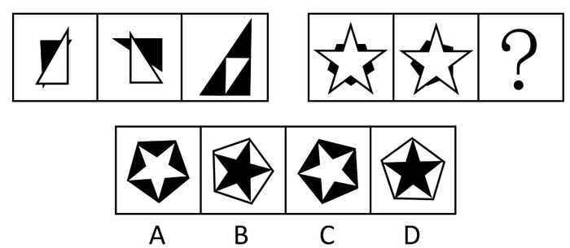

A. A

B. B

C. C

D. D

第 51 题 · 答案与解析

**参考答案（粉笔题库参考内容）**

A

**解析**

元素组成相同，优先考虑位置规律。

观察发现，白色图形面积不变，黑色图形面积逐渐增大，首先排除B、D两项。第一组第一个图形中白色部分沿着竖轴旋转得到第二个图形中白色部分，第二个图形中白色部分沿着横轴翻转得到第三个图形中白色部分。因此？处五角星的尖尖应朝向正下方，只有A项符合。

故正确答案为A。

### 第 52 题

从所给的四个选项中，选择最合适的一个填入问号处，使之呈现一定的规律性：

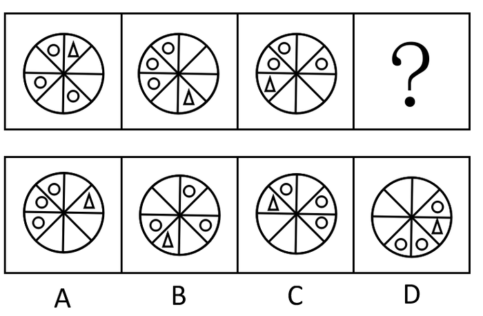

A. A

B. B

C. C

D. D

第 52 题 · 答案与解析

**参考答案（粉笔题库参考内容）**

C

**解析**

元素组成相同，考查位置规律。三角形每次顺时针移动3格子，2格，1格，C项符合题意。

故正确答案为C。

### 第 53 题

从所给的四个选项中，选择最合适的一个填入问号处，使之呈现一定的规律性：

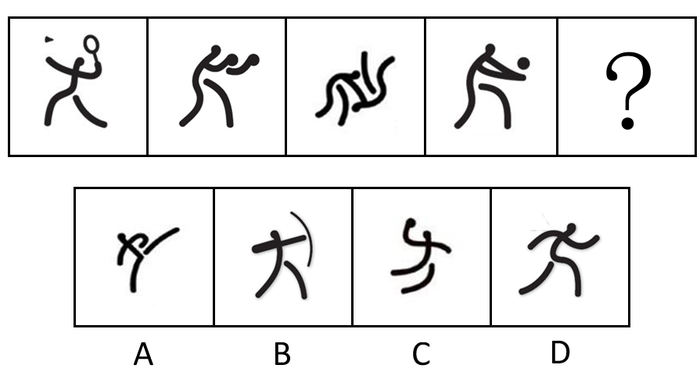

A. A

B. B

C. C

D. D

第 53 题 · 答案与解析

**参考答案（粉笔题库参考内容）**

B

**解析**

元素组成凌乱，考查数量规律。数部分（连接在一起的黑色线条为一个部分），每幅子图都由三部分构成，选项的组成部分依次为2、3、2、2。

故正确答案为B。

### 第 54 题

从所给的四个选项中，选择最合适的一个填入问号处，使之呈现一定的规律性：

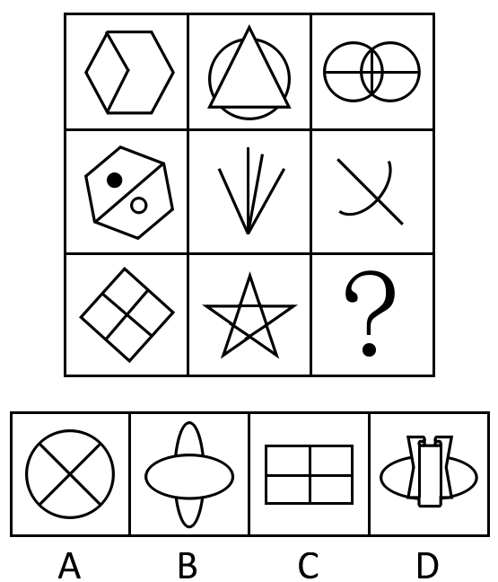

A. A

B. B

C. C

D. D

第 54 题 · 答案与解析

**参考答案（粉笔题库参考内容）**

B

**解析**

本题考查直线数，九宫格中第一行各个图形直线数分别为8、3、2；第二行各个图形直线数分别为7、4、1，第三行各个图形直线数分别为6、5、(？)。发现九宫格“米”字位置叠加直线数之和均等于12。即8+4+(?)=2+4+6，?=0。故第三行第三个图形应不包含直线，本题选B。

故正确答案为B。

### 第 55 题

从所给的四个选项中，选择最合适的一个填入问号处，使之呈现一定的规律性：

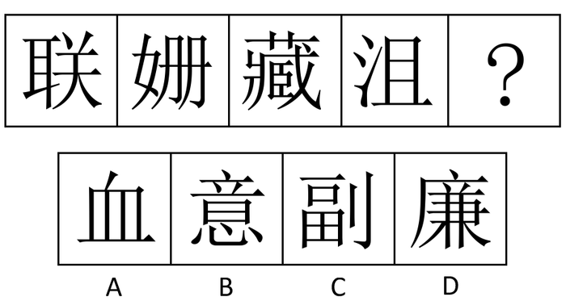

A. A

B. B

C. C

D. D

第 55 题 · 答案与解析

**参考答案（粉笔题库参考内容）**

A

**解析**

每个图中均有3个封闭空间，选项中的封闭区间分别是3、2、5、5。

故正确答案为A。

### 第 56 题

酝酿效应是指当一个人长时间致力于解决某一个问题而百思不得其解时，如果他暂时停下来去做别的事情，一段时间之后，他可能会忽然想到解决的办法。

下列属于酝酿效应的一项是：

A. 小王找某份文件一时没有找到，过了两个小时他发现了那份文件

B. 晓峰写毕业论文遇到困难，几天后他参加学术会议时得到很多相关信息，并且理清了思路

C. 某修理人员在修理电视时查阅了大量线路图，终于修好了电视

D. 某研究人员申请一项迟迟没有得到有关部门批复，他转而研究别的课题，几个月后该项目得到比准

第 56 题 · 答案与解析

**参考答案（粉笔题库参考内容）**

B

**解析**

第一步：抓住定义中的关键词。

定义的关键是“长时间致力于解决某一个问题”、“暂时停下来去做别的事情”、“他可能会忽然想到解决的办法”。

第二步：逐一判断选项。

A项“过了两个小时他发现了那份文件”没有体现“暂时停下来去做别的事情”；

B项“晓峰写毕业论文遇到困难”体现了“长时间致力于解决某一个问题”，“参加学术会议时得到很多相关信息”体现了“暂时停下来去做别的事情”，“理清了思路”说明“他可能会忽然想到解决的办法”；

C项“查阅了大量线路图，终于修好了电视”没有体现“暂时停下来去做别的事情”；

D项不是主体想出来的办法，不符合题干“他可能会忽然想到解决的办法”。

故正确答案为B。

### 第 57 题

发散性思维是一种从不同的方向、途径和角度去设想、探索多种答案，最终使问题获得圆满解决的思维方法。

以下属于发散性思维的一项是：

A. 司马光见到小朋友落入水缸，当“救人离水”行不通时，果断地砸破水缸，“让水离人”救了小朋友

B. 病人因胸痛来门诊检查，医生根据经验考虑可能是气胸、肺炎、心绞痛等，经各项检查，确诊为肺炎

C. 根据草莓比香蕉贵，香蕉比苹果贵，苹果比桔子贵，因此得出草莓比桔子贵

D. 画家在艺术创作的时候，事先要在脑海中将自己想要呈现的主题、构图和色彩进行安排，呈现出一幅草图

第 57 题 · 答案与解析

**参考答案（粉笔题库参考内容）**

A

**解析**

第一步：抓住定义中的关键词。

定义关键为“从不同的方向、途径和角度”、“多种答案”、“问题获得圆满解决”。

第二步：逐一判断选项。

A项“当‘救人离水’行不通时，果断地砸破水缸”体现出“从不同的方向、途径和角度”，“让水离人”救了小朋友也说明了“问题获得圆满解决”，属于发散性思维；

B项“医生根据经验考虑”，不能体现“从不同的方向、途径和角度”；

C项和D项也不符合定义，其中C项是对同类问题的类比推论以及D项“事先要在脑海中进行安排”，没有体现“从不同的方向、途径和角度”、更没有说明“多种答案”。

故正确答案为A。

### 第 58 题

类比推理是指根据两个（或两类）对象之间在某些方面的属性相似或相同的关系，推出它们在其他方面的属性也可能相似或相同的逻辑方法。

以下推理过程没有应用类比推理的一项是：

A. 由“敲击木桶可以大致判断桶内的酒量”推断出“叩击胸腔可以大致判断胸腔积液的量”

B. 由“氯霉素可以影响幼龄小白鼠的骨骼发育”推断出“氯霉素可以影响幼儿的骨骼发育”

C. 由“从这个病人的痰中发现了癌细胞”推断出“这个病人患了肺癌”

D. 由“颜色鲜艳的蘑菇一般具有毒性”推断出“颜色鲜艳的蛇一般具有毒性”

第 58 题 · 答案与解析

**参考答案（粉笔题库参考内容）**

C

**解析**

第一步：抓住定义中的关键词。

定义的关键词有“两个（或两类）对象之间”、“某些方面的属性相似或相同的关系”、“其他方面的属性也可能相似或相同”。

第二步：逐一判断选项。

A项在木桶和胸腔之间类比、B项在小白鼠和幼儿之间类比、D项在蘑菇和蛇之间类比，以上均属于不同种类之间，符合“两个（或两类）对象之间”。

只有C项“痰中发现了癌细胞”，“癌细胞”和“肺癌”是同一对象，是因果关系的推断，没有运用类比推理。

本题为选非题，故正确答案为C。

### 第 59 题

社会保障制度是指在政府的管理下，按照一定的法律和规定，通过国民收入的再分配，以社会保障金为依托，为保障人民生活而提供物质帮助和服务的社会安全制度。

下列属于社会保障制度范围内的一项是：

A. 下岗工人在街道办事处的帮助下申请了优惠贷款，开办了自己的工厂，为许多下岗工人提供了再就业机会

B. 市领导在春节前夕探望了本市的孤寡老人，并为他们送去了食品、衣物及彩电等物资，希望他们能度过一个温暖祥和的节日

C. 退休职工李大爷前不久查出了肺癌，手术及其他治疗共花费了几十万元，其中大部分的医疗费用由医疗保险机构报销

D. “希望工程图书室”项目的开展使得边远山区的学校也有了自己的图书馆，那里的孩子也能读到自己喜欢的书了

第 59 题 · 答案与解析

**参考答案（粉笔题库参考内容）**

C

**解析**

第一步：抓住定义中关键词。

定义强调“以社会保障金为依托”、“为保障人民生活而提供物质帮助和服务”。

第二步：逐一判断选项。

A项“申请了优惠贷款”、B项市领导的行为以及D项“希望工程图书室”项目均没有体现“以社会保障金为依托”。

而C项退休职工大部分的医疗费用由医疗保险机构报销，医疗保险机构符合“以社会保障金为依托”，且该项体现出“为保障人民生活而提供物质帮助和服务”。

故正确答案为C。

### 第 60 题

亚健康是对生物有机体生理机能状态的一种描述，一般指生理机能处于健康与疾病之间的状态。由健康过渡到疾病需要一个从量变到质变的过程，而在质变发生之前的这个特殊阶段即是亚健康。

下列现象中属于亚健康的一项是：

A. 老王退休后连续多次在医院体检发现血压很高，但是他从没有感到身体不适

B. 小刘在上周六出去购物时遭遇抢劫，在搏斗中被歹徒用匕首捅伤，现在已脱离生命危险，正在医院进行最后的康复调理

C. 小兵正在读初三，面临升学的压力，他经常熬夜学习，最近感到眼睛看东西又一层雾气，医学专家说这可能是假性近视

D. 小刚的爸爸在单位体检时，发现腹内有肿囊包块，医生说可能是长期劳累所致，劝其保养，可他因没有任何外在征兆而并不在意

第 60 题 · 答案与解析

**参考答案（粉笔题库参考内容）**

C

**解析**

第一步：抓住定义中关键词。

定义中强调“处于健康与疾病之间的状态”、“由健康过渡到疾病”、“质变发生之前”。

第二步：逐一判断选项。

A项“连续多次在医院体检发现血压很高”，说明老王的血压很高，已经处于疾病状态了，不符合“质变发生之前”；

B项“已脱离生命危险，正在医院进行最后的康复调理”强调由疾病过渡到健康，与题干“由健康过渡到疾病”不符；

C项用专家不太肯定的推论说明小兵正处于“有健康过渡到疾病”的阶段，符合题干定义；

D项“腹内有肿囊包块”，说明已经处于疾病状态，不符合题干“质变发生之前”。

故正确答案为C。

### 第 61 题

妄想是一种病理性的歪曲信念，是病态的推理和判断。它具有以下特征：1、信念的内容与事实不符，没有客观现实基础，但患者深信不疑；2、妄想内容均涉及患者本人，总是与个人的利害有关；3、妄想具有个人独特性；4、妄想的内容因文化背景和个人经历而有差异，但常有浓厚的时代色彩。

下列所描述的症状可以被判断为妄想的一项是：

A. 小王最近总是思考“先有蛋，还是先有鸡”这个问题，虽然自己知道也没有必要，可是就是无法把这个问题从脑子里清除掉

B. 丽丽最近发现身边的事物和环境发生了变化，变得不真实，周围好像舞台背景，树木、房屋好像纸糊的一样，毫无生气

C. 老张最近总是在家中听到有人在门口骂他，尽管老板告诉他说自己什么都没听到

D. 因为自己的腹部有一块椭圆形的胎记，小李认为自己是拥有超能力外星人的后代，尽管听到的人都觉得这是无稽之谈，可他自己却深信不疑

第 61 题 · 答案与解析

**参考答案（粉笔题库参考内容）**

D

**解析**

第一步：抓住定义中关键词。

定义的关键词有“与事实不符”、“患者深信不疑”、“均涉及患者本人”、“总是与个人的利害有关”、“具有个人独特性”、“浓厚的时代色彩”。

第二步：逐一判断选项。

A、B两项不符合“坚信不疑”，并且没有现实根据，也不符合“均涉及患者本人”，显然不符合题干定义；

C项“老张最近总是在家中听到有人在门口骂他”没有体现“总是与个人的利害有关”、“具有个人独特性”；

D项符合定义的所有要素。

故正确答案为D。

### 第 62 题

犯罪的间接故意是指行为人明知自己的行为可能发生危害社会的结果，并且放任这种结果发生的心理态度。

下列属于犯罪的间接故意的是：

A. 甲欲毒杀同事乙，于是在大家共同喝水的饮水机中投毒，乙当天并未从饮水机中取水，但却导致其他三位同事中毒

B. 甲欲枪杀乙，在乙家门口伏击，只击中了乙的胳膊

C. 出租车司机甲与朋友吃饭时多喝了几杯，但是凭借自己多年的驾驶经验，甲认为不会有什么问题，于是不顾朋友劝阻执意出车，结果撞死了行人乙

D. 某医院护士甲将病人乙和丙的药物弄混，到了给乙用药的时间，甲没有仔细核对就拿起应该给丙服用的药物给乙服用，结果因药性不对导致乙死亡

第 62 题 · 答案与解析

**参考答案（粉笔题库参考内容）**

A

**解析**

第一步：抓住定义中关键词。

定义中强调“明知自己的行为可能发生”、“放任这种结果发生”。

第二步：逐一判断选项。

A项中甲明知投毒会对他人也造成危害，仍然放任自己的行为是犯罪的间接故意；

B项只是针对被害人的行为，属于直接故意；

C项中司机认为自己不会对他人造成危害以及D项中护士的行为，都属于过失而非间接故意。

故正确答案为A。

### 第 63 题

习得性无助是指在多次经历过消极体验之后，再面临同样或类似情境时个体所产生的一种无能为力的心理状态与行为表现。

下列属于习得性无助的一项是：

A. 小明兴高采烈的跟妈妈谈起自己跟同学去爬树的事，遭到严厉批评，并被警告不准再玩危险的游戏。小明此后再也不把玩的事情告诉妈妈了

B. 4岁的丽丽刚刚跟爸妈分房睡，她说一闭上眼就会想起奶奶讲的老妖精的故事，于是爸爸妈妈只好允许丽丽每晚都开着台灯睡

C. 小李因为宿舍水管漏水的事多次报告宿舍管理员和学校的后勤部门，可是一个月了还是没人来修，前两天宿舍灯又坏了，小李索性不报告了

D. 小张刚搬来的时候，邻居家的小狗一看到他就很凶地叫，过了一个多月，小狗认识他了，每次都会友好地向他摇尾巴，但小张还是有点害怕

第 63 题 · 答案与解析

**参考答案（粉笔题库参考内容）**

C

**解析**

第一步：抓住定义中关键词。

定义的关键是“多次经历过消极体验之后”、“面临同样或类似情境”、“无能为力的心理状态”。

第二步：逐一判断选项。

A项并未体现出“无能为力的心理状态”；

B项中并未体现“多次经历过消极体验之后”；

C项水管漏水时报告没人来修，属于消极体验，再次面临相类似的情境时，就索性不报告了，是一种无能为力的行为表现，符合定义；

D项中小张面临的情形已经发生了变化，不符合题干中“面临同样或类似情境”。

故正确答案为C。

### 第 64 题

定金是指合同当事人为了确保合同的履行，依据法律规定或者当事人双方的约定，由当事人一方在合同订立时，或订立后、履行前，按合同标的额的一定比例，预先给付对方当事人的金钱或其他代替物。

以下属于定金的是：

A. 甲与乙（房东）于6月5日签订租房协议（月租金500元），该协议将于6月10日生效。乙要求甲先交100元钱，如甲不能履行合同，将不予退还。

B. 小张今年考上大学，通知书上写明，须先交纳学费5000元，才能办理入学手续。

C. 甲预向乙借款1000元，甲的好友丙将自己1000元的相机留给乙作为担保。

D. 小王近期签订了一份购房合同，在合同条款中规定，首付10万现金，剩余10万元于办理产权证书时一并交清。

第 64 题 · 答案与解析

**参考答案（粉笔题库参考内容）**

A

**解析**

第一步：抓住定义中关键词。

定义强调“合同当事人”、“合同订立时，或订立后、履行前”、“预先给付对方当事人的金钱或其他代替物”。

第二步：逐一判断选项。

A项符合定义；

B项没有涉及合同订立，显然不符合定义；

C项中的丙并非“合同当事人”，而是第三人的担保，不符合定义；

D项属于交付中的首付款而非定金。

故正确答案为A。

### 第 65 题

诽谤罪是指故意捏造并散布某种事实，损坏他人人格，破坏他人名誉，情节严重的行为。

下列行为构成诽谤罪的是：

A. 甲因公司经理对其进行批评而心怀不满，认为这是由于自己在言行方面得罪了经理的缘故，于是多次在同事面前表述这种想法，给经理的声誉造成了很坏的影响。

B. 乙与邻居王某素来不睦，在王某想要卖房搬家之际，乙多次向周围住户宣称王某家的房屋风水不好，致使王某因房价下跌遭受严重的经济损失。

C. 丙听说同学小张在校外参与打架斗殴，在消息未经证实的情况下，丙到处向同学诉说小张因带头聚众斗殴而被拘留，致使小张因压力过大而自杀。

D. 丁为某公司财务部门主管领导，因一笔巨款不翼而飞，认为是会计小刘私吞，因而多次找小刘谈话，并在部门会议上表示小刘有作案嫌疑，致使小刘声誉受损。

第 65 题 · 答案与解析

**参考答案（粉笔题库参考内容）**

C

**解析**

第一步：抓住定义中关键词。

定义中强调“故意捏造并散布”、“损坏他人人格”、“破坏他人名誉”、“情节严重”。

第二步：逐一判断选项。

A项并未体现“情节严重”；

B项并未“损害他人人格”；

C项符合定义所有要素，特别是“情节严重”使人因压力过大而自杀；

D项中是否“故意捏造”并无定论。

故正确答案为C。

### 第 66 题

股票：证券

A. 电脑病毒：程序

B. 粮食：谷物

C. 操作系统：电脑

D. 军人：警察

第 66 题 · 答案与解析

**参考答案（粉笔题库参考内容）**

A

**解析**

第一步：判断题干词语间的逻辑关系。

题干两词为包容关系，且是包容关系中的种属关系。前者是后者的一种，股票是一种证券。

第二步：判断选项词语间的逻辑关系。

A项电脑病毒是一种程序，和题干逻辑一致；

B项正好前后相反，谷物应是一种粮食；

C项中操作系统和电脑、D项中军人和警察都不是种属关系。

故正确答案为A。

### 第 67 题

骨骼：肌肉

A. 齿轮：发条

B. 表针：表盘

C. 果核：果皮

D. 轮胎：汽车

第 67 题 · 答案与解析

**参考答案（粉笔题库参考内容）**

A

**解析**

第一步：判断题干词语间的逻辑关系。

题干两词为对应关系，且为一一对应。两者紧密相连，骨骼和肌肉都是有机体中紧密相连的组成部分。

第二步：判断选项词语间的逻辑关系。

A项中齿轮和发条都是传动器紧密相连的组成部分，符合题干逻辑；

而B项中表针和表盘以及C项中果核与果皮并非紧密相连，排除B、C；

D项是部分与整体的关系，也不符合题干逻辑，排除D。

故正确答案为A。

### 第 68 题

近视：眼镜

A. 聋哑：手语

B. 中风：针灸

C. 癌症：化疗

D. 失明：墨镜

第 68 题 · 答案与解析

**参考答案（粉笔题库参考内容）**

A

**解析**

第一步：判断题干词语间的逻辑关系。

题干两词为对应关系。眼镜可以帮助近视患者看清事物，但不能治疗近视。

第二步：判断选项词语间的逻辑关系。

A项：手语可以帮助聋哑人交流，但不能治疗聋哑，与题干逻辑关系一致，当选；

B项：针灸是中风的一种治疗手段，与题干逻辑关系不一致，排除；

C项：化疗是癌症的一种治疗手段，与题干逻辑关系不一致，排除；

D项：墨镜不能帮助失明患者看清事物，二者无明显的逻辑关系，排除。

故正确答案为A。

### 第 69 题

钢笔：墨水

A. 血管：血液

B. 枪支：子弹

C. 煤炉：煤灰

D. 电钻：钻头

第 69 题 · 答案与解析

**参考答案（粉笔题库参考内容）**

B

**解析**

第一步：判断题干词语间的逻辑关系。

题干两词为对应关系，钢笔装墨水才能书写，墨水是消耗品，并且完全嵌在钢笔之中。

第二步：判断选项词语间的逻辑关系。

A项不是消耗品，排除A；

B项枪支装入子弹才能发射，子弹是消耗品，并且嵌在枪支中；

C项没有明显逻辑关系；

D项钻头不是嵌在电钻内。

故正确答案为B。

### 第 70 题

红绿灯：交通

A. 机场：安检

B. 手机：通话

C. 教育部：学生

D. 开关：电流

第 70 题 · 答案与解析

**参考答案（粉笔题库参考内容）**

D

**解析**

第一步：判断题干词语间逻辑关系。

题干两个词属于对应关系，红绿灯控制交通，且红绿是两种不同状态。

第二步：逐一分析选项。

A 项，安检是机场工作的一个环节，机场并不能控制安检，该项逻辑关系与题干不符，排除。

B 项，手机有通话功能，控制通话的应是按键而不是手机本身，该项逻辑结构与题干不符，排除。

C 项，教育部是学生的管理服务机构，逻辑结构与题干不符，排除。

D 项，开关控制电流，开关是两种不同的状态，该项逻辑关系与题干一致，应选。

第三步：再次标注答案

故正确答案为D。

### 第 71 题

学生：报到：录取通知书

A. 顾客：积分：优惠券

B. 会计：报销：火车票

C. 考生：考试：准考证

D. 员工：考勤：工作证

第 71 题 · 答案与解析

**参考答案（粉笔题库参考内容）**

C

**解析**

第一步：判断题干词语间的逻辑关系。

题干词语间为对应关系，第一个通过第三个达到第二个目的，且后两者是一一对应关系。“学生”凭“录取通知书”“报到”，报到和录取通知书是一一对应。

第二步：判断选项词语间的逻辑关系。

A项中积分和优惠卡、B项中报销和火车票、D项中考勤和工作中均不是一一对应；

C项“考生”凭“准考证”参加“考试”，且准考证和考试是一一对应，和题干逻辑一致。

故正确答案为C。

### 第 72 题

电脑：电子邮件：照片

A. 毛笔：国画：字帖

B. 卡车：货物：冰箱

C. 空调：温度：冷气

D. 手机：信息：彩信

第 72 题 · 答案与解析

**参考答案（粉笔题库参考内容）**

D

**解析**

第一步：判断题干词语间逻辑关系。

电脑是发送电子邮件的工具，电子邮件发送的内容可包括照片，且利用电脑发送邮件是一种通信方式。

第二步：判断选项词语间逻辑关系。

A项，毛笔是画国画的工具，但国画和字帖两者无直接联系，与题干不符。

B项，卡车是运送货物的工具，货物的内容可以包括冰箱，但卡车运输货物不是一种通信方式，与题干不符。

C项，空调是降低温度的家电，冷气是空调的产物，与题干不符。

D项，手机是传播信息的工具，信息的内容可以包括彩信，利用手机发送短信是一种通信方式，符合题意。

第三步：再次标注答案。

故正确答案为D。

### 第 73 题

提案：政协委员：政协会议

A. 菜肴：厨师：宴会

B. 道具：演员：文艺演出

C. 动物：饲养员：动物演出

D. 纪录：运动员：运动会

第 73 题 · 答案与解析

**参考答案（粉笔题库参考内容）**

D

**解析**

第一步：判断题干词语间的逻辑关系。

题干词语间为对应关系，是一一对应，是人员与其对应工作会议或场所的对应，政协委员在政协会议上发表提案，政协委员和政协会议一一对应。

第二步：判断选项词语间的逻辑关系。

A项厨师准备宴会菜肴，厨师的工作场所应为厨房；

B项演员用道具进行文艺演出，演员和文艺演出不是一一对应；

C项饲养员训练动物进行动物演出，饲养员和动物演出也不是一一对应，应是驯兽师。

三项均不符合这种一一对应关系，且前后对应顺序不一致。

D项运动员在运动会上创造纪录，运动员和运动会一一对应，符合题干逻辑。

故正确答案为D。

### 第 74 题

（  ）：刺激消费：发消费券 相当于 增加体重：鼓励进食：（  ）

A. 消除贫困 多吃肉类

B. 金融安全 餐费打折

C. 消除危机 调换品味

D. 扩大内需 用餐免费

第 74 题 · 答案与解析

**参考答案（粉笔题库参考内容）**

D

**解析**

第一步：由题干和选项判断词语间的逻辑关系。

由题干与选项可推断出题目考查对应关系，发消费券的目的是刺激消费，而鼓励进食的目的是增加体重。显然第一空内应为刺激消费的目的，而第二空内应为鼓励进食的措施或手段，发消费券是政府让利行为，第二空内也应是政府让利行为。

第二步：逐一判断选项。

A、C项不符合题干这种对应关系；

B项通过发消费券方式来刺激消费，与金融安全没有明显的逻辑关系；

D项通过发消费券方式来刺激消费，从而实现扩大内需的目的；通过用餐免费的方式来鼓励进食，从而达到增加体重的目的。其中用餐免费和发消费券都是政府让利，消费者收益。

故正确答案为D。

### 第 75 题

网球运动：男女：（  ）  相当于 交通标志：（  ）：信号灯

A. 教练员 红绿

B. 混合双打 明暗

C. 单打比赛 黑白

D. 裁判员 左右

第 75 题 · 答案与解析

**参考答案（粉笔题库参考内容）**

A

**解析**

第一步：将选项逐一代入判断题干逻辑关系。

题干词语间为对应关系，是事物分类对应。网球运动中有男女之分，交通标志信号灯应的标志应是红绿。

第二步：逐一判断选项。

A项网球运动中有男女教练员，交通标志中有红绿三色信号灯符合题干逻辑。

交通标志的信号灯不应是明暗、黑白或左右而是红绿，排除B、C、D。

故正确答案为A。

### 第 76 题

一项对某市大学生运动会的调查结果似乎存在着矛盾，当参加百米决赛的运动员被问及在此次运动会上的名次时，有60%的回答者说他们的成绩位居此次比赛的前20%。

如果所有参与调查的运动员说的都是真话，那么下列哪项能对上述现象给出更合理的解释：

A. 并不是所有未回答者的名次都在百米决赛的前20%以外

B. 其余40%的回答者百米决赛的成绩都在前20%之外

C. 参加百米决赛的运动员有80%的人成绩不理想

D. 百米决赛成绩较差的运动员没有参加调查

第 76 题 · 答案与解析

**参考答案（粉笔题库参考内容）**

D

**解析**

第一步：找出题干矛盾。

60%的参与调查的运动员回答说他们的成绩位居此次比赛的前20%。

第二步：逐一分析选项。

A项：只能说明没有回答的人群中也有人成绩位居前20%， 不能解释题干矛盾中60%与20%的冲突，排除；

B项： 60%的被调查者成绩在前20%，那么40%的回答者必然在前20%之外，是对题干矛盾的重复，不能解释题干矛盾，排除；

C项：成绩是否理想与具体的排名无关，不能解释题干矛盾中60%与20%的冲突，排除；

D项：成绩较差的运动员没有参加调查，说明大部分参与调查的运动员成绩较好，而参与调查的人数少于比赛人数，其中约60%参与调查的人的成绩在比赛前20%是完全可能的，可以解释题干矛盾，当选。

故正确答案为D。

### 第 77 题

专家们认为，造成老虎数量急剧下降的原因很简单：捕杀野生动物的违法行为仍未被完全禁止，东亚许多国家仍猖狂地进行动物皮毛交易。专家指出，亚洲新的人口增长趋势和经济变化对老虎生存造成了非常重大的影响。亚洲富有的中产阶级可以承受昂贵的“虎宴”——用老虎身体的各个部分做成晚餐，炫耀财富。这也充分刺激了野生老虎的非法贸易，直接导致了亚洲老虎数量急剧下降。由此可以推出：

A. 减少对老虎的捕杀，老虎数量就不会下降

B. 制止动物毛皮交易，老虎数量就不会下降

C. 经济变化趋势对有些动物的生存影响很大

D. 如果中产阶级改变不健康的消费观，老虎的数量就不会下降

第 77 题 · 答案与解析

**参考答案（粉笔题库参考内容）**

C

**解析**

第一步：翻译题干。

捕杀野生动物⇒老虎数量急剧下降；动物皮毛交易⇒老虎数量急剧下降；亚洲新的人口增长趋势和经济变化⇒老虎数量急剧下降；亚洲富有的中产阶级需求⇒野生老虎的非法贸易⇒老虎数量急剧下降。

第二步：根据逆否规则逐一判断选项。

A项，减少对老虎的捕杀⇒老虎数量就不会下降，否前推不出否后，排除A；

B项，制止动物毛皮交易⇒老虎数量就不会下降,否前推不出否后，排除B；

C项，由题干“亚洲的经济变化趋势对老虎的生存造成了重大的影响”可知C项满足题干推断；

D项，中产阶级改变不健康的消费观⇒老虎数量就不会下降,否前推不出否后，排除D。

故正确答案为C。

### 第 78 题

一项新的研究表明，存在于舌头上的能检测甜味的蛋白质，也存在于肠道。研究人员据此推测，肠道同样能尝出糖果的味道。这项研究的负责人说：“其实，肠道与舌头品尝甜味的方式是一样的。”

下列哪项最能支持上述推测：

A. 只要有了这种检测甜味蛋白质的物质，就能尝到甜味

B. 除了甜味，肠道还能尝到酸味

C. 除了肠道，还有其他器官能够尝到甜味

D. 味觉可以通过其他感觉表达出来

第 78 题 · 答案与解析

**参考答案（粉笔题库参考内容）**

A

**解析**

第一步：找出论点和论据。

论点：肠道同样能尝出糖果的味道。

论据：存在于舌头上的能检测甜味的蛋白质，也存在于肠道。

第二步：逐一分析选项。

A项：只要有了这种蛋白质就能尝到甜味，建立了该蛋白质和甜味的关系，说明肠道有了这种蛋白质，就一定能尝到甜味，能尝出糖果的味道，搭桥选项，当选；

B项：肠道能尝到酸味与题干论点无关，不能加强，排除；

C项：其他器官能尝到甜味与题干论点无关，不能加强，排除；

D项：味觉能通过其他感觉表现出来，没有涉及肠道和甜味蛋白质的关系，不能加强，排除。

故正确答案为A。

### 第 79 题

科学家发现，生活在大的群体之中的鸟类，比生活在孤独之中的鸟类大脑中有着更多的新的神经元，也有着更强的记忆力。他们据此向人类发出忠告：如果你是一个孤独者，你最好结交一些朋友，否则就会丧失你宝贵的脑细胞，导致记忆力低下。

下列哪项如果为真，最能反驳上述观点：

A. 人类的大脑和鸟类根本不同

B. 人脑比鸟类大脑发达得多

C. 很多交友的人记忆力并不好

D. 很多孤独者的记忆力非常好

第 79 题 · 答案与解析

**参考答案（粉笔题库参考内容）**

D

**解析**

第一步：找到论点和论据。

论点：如果你是一个孤独者，你最好结交一些朋友，否则就会丧失你宝贵的脑细胞，导致记忆力低下。

论据：生活在大的群体之中的鸟类，比生活在孤独之中的鸟类大脑中有着更多的新的神经元，也有着更强的记忆力。

本题论点说的是人，论据说的是鸟，二者话题不一致，削弱考虑拆桥。

第二步：逐一分析选项。

A项：指出人类的大脑和鸟类不同，因此不能拿鸟的记忆力和人的记忆力作对比，所以孤独者不一定会记忆力低下，削弱论证，保留；

B项，指出人脑比鸟类大脑发达得多，因此不能拿鸟的记忆力和人的记忆力作对比，所以孤独者不一定会记忆力低下，削弱论证，保留；

C项：论点说的是孤独者记忆力的问题，而选项说的是很多交友的人，并非论点中的孤独者，主体不一致，无法削弱，排除；

D项：指出孤独者的记忆力非常好，直接削弱论点，削弱力度大于A、B项，当选。

故正确答案为D。

### 第 80 题

在几十位考古人员历经半年的挖掘下，规模宏大、内涵丰富的泉州古城门遗址——德济门重现于世。考古人员在此发现了一些古代寺院建筑构件。考古学家据此推测：元明时期该地附近曾有寺院存在。

下列哪项如果为真，最能质疑上述推测？

A. 考古人员未发现任何寺院遗址

B. 民居也常使用同样的建筑构件

C. 发掘出的寺庙建筑构件较少

D. 关于德济门的古代典籍未提到附近有寺院

第 80 题 · 答案与解析

**参考答案（粉笔题库参考内容）**

B

**解析**

第一步：找到论点和论据。

论点：考古学家推测元明时期该地附近曾有寺院存在。

论据：考古人员在泉州古城门遗址发现了一些古代寺院建筑构件。

本题论点说的是有寺院，论据说的是有古代寺院建筑构件，二者话题不一致，可以削弱论证，即证明有建筑构件不代表有寺院存在。

第二步：逐一分析选项。

A项：考古人员没有发现寺院遗址，并不能说明此前没有寺院，无法削弱，排除；

B项：民居也常使用同样的建筑构件，那说明考古人员在泉州古城门遗址发现的建筑构件可能就是民居使用的，与寺庙之间不存在必然的联系，削弱了论据与论点之间的联系，拆桥，当选；

C项：建筑构件的多少与是否存在寺庙没有明显联系，无法削弱，排除；

D项：典籍中是否提及到周围存在寺庙与存在寺庙没有明显联系，典籍记载的准确性也有待考证，属不明确选项，排除。

故正确答案为B。

### 第 81 题

研究人员分析了美国南加州将近4000名亚裔和非亚裔癌患者的病历资料，他们发现亚洲人的存活率远高于其他种族患者。一般而言，5年期的存活率，亚裔有20%，拉丁裔是12%，而黑人和白人则是10%，一些研究人员推测，这可能是由于生物学上的差异导致亚裔人体内肿瘤较不具有侵害性。

下列哪项对这个观点不构成质疑：

A. 亚裔人的饮食习惯和其他种族不同

B. 亚裔人普遍重视体检，可以早期发现癌症

C. 亚裔肿瘤患者除接受西医治疗外，还常常接受中医疗法

D. 亚裔人胃癌发病率比其他种族低

第 81 题 · 答案与解析

**参考答案（粉笔题库参考内容）**

D

**解析**

第一步：找到论点和论据。

论点：这（亚裔癌患者的存活率远高于其他种族患者）可能是由于生物学上的差异导致亚裔人体内肿瘤较不具有侵害性

论据：研究人员分析了美国南加州将近4000名亚裔和非亚裔癌患者的病历资料，他们发现亚洲人的存活率远高于其他种族患者。一般而言，5年期的存活率，亚裔有20%，拉丁裔是12%，而黑人和白人则是10%。

本题论据列举了4000名亚裔和非亚裔癌患者5年期的存活率数据，论点是据此推出，这（亚洲人的存活率远高于其他种族患者）可能是由于生物学上的差异导致亚裔人体内肿瘤较不具有侵害性，二者话题一致，且本题为选非题，排除能削弱的选项即可。

第二步：逐一分析选项。

A项：该项指出亚裔人的饮食习惯和其他种族不同，说明亚裔癌症患者存活率高可能是饮食习惯导致的，并非因为生物学差异，他因削弱，排除；

B项：该项指出亚裔人普遍重视体检，能早期发现癌症，说明亚裔癌症患者存活率高可能是由于重视体检，早发现早治疗，并非因为生物学差异，他因削弱，排除；

C项：该项指出亚裔肿瘤患者除西医治疗外还常接受中医疗法，说明亚裔癌症患者存活率高可能是由于联合治疗，并非因为生物学差异，他因削弱，排除；

D项：该项讨论的是亚裔人胃癌的发病率比其他种族低，而论点讨论的是亚裔癌患者的存活率，话题不一致，为无关项，无法削弱，当选。

本题为选非题，故正确答案为D。

### 第 82 题

研究人员报告说，动物脑部具有不同功能的区域占总脑量的比例是物种的一个重要特征。他们发现，在同物种中，不同个体之间的脑容量可能有明显差别，但脑部结构特征基本一致；在不同物种之间，结构特征就有较大差异。研究人员据此认为，脑部结构特征将有助于分辨不同物种间的亲缘关系。他们还指出，脑部结构的变化，通常标志着由进化产生了新的种群。例如，从较为原始的狐猴进化到现在的猴子；从猿进化到人，脑部的主要变化是新大脑皮层所占比例增加。

由此可以推出：

A. 聪明人大脑皮层比平常人发达

B. 人的大脑皮层比猴发达

C. 人脑与猿脑的结构相似度大于猴脑和狐猴脑的结构相似度

D. 黑猩猩和大猩猩脑结构的相似度大于黑猩猩和猴子的脑结构相似度

第 82 题 · 答案与解析

**参考答案（粉笔题库参考内容）**

D

**解析**

第一步：抓住题干的对象及关键。

第一句说明了具有不同功能的区域占总脑量的比例是物种的一个重要特征。

第二句说明在同物种不同个体之间的脑容量可能有明显差别，但脑部结构特征基本一致；而在不同物种之间，结构特征就有较大差异。

第三、四句话说明研究人员推测脑部结构特征将有助于分辨不同物种间的亲缘关系。

第二步：根据题干判断正确选项。

根据“在同物种中，不同个体之间的脑容量可能有明显差别，但脑部结构特征基本一致；在不同物种之间，结构特征就有较大差异”，可知同物种的脑部结构特征相似度大于不同物种的脑部特征相似度，所以同物种的“黑猩猩”和“大猩猩”脑结构的相似度大于不同物种的“黑猩猩”和“猴子”的脑结构相似度。

A项强调人脑之间差异、B项强调人脑和猴脑之间差异均不符合题干，而C项强调人脑与猿脑的结构相似度大于猴脑和狐猴脑也不符合“同物种不同个体之间的脑容量可能有明显差别，但脑部结构特征基本一致”。

故正确答案为D。

### 第 83 题

41摄氏度是人体发烧时才能达到的体温。不久前，研究人员将试管中的皮肤细胞每周两次，每次一小时暴露在41摄氏度的空气里。结果发现，这些细胞不但没有受到损害，反而生命力更加旺盛。他们由此推测，适度的高温可以起到延长寿命、抗衰老、美容的效果。

下列不能对上述观点构成质疑的一项是：

A. 常患感冒的人并没有比正常人更长寿

B. 影响衰老过程的主要不是皮肤细胞

C. 皮肤细胞不能代替所有的人体细胞

D. 体温暂时升高会对人体中有些细胞造成伤害

第 83 题 · 答案与解析

**参考答案（粉笔题库参考内容）**

A

**解析**

第一步：找出论点和论据。

论点：适度的高温可以起到延长寿命、抗衰老、美容的效果。

论据：研究人员将试管中的皮肤细胞每周两次，每次一小时暴露在41摄氏度的空气里。结果发现，这些细胞不但没有受到损害，反而生命力更加旺盛。

本题论点说的是适度的高温可以起到延长寿命、抗衰老、美容的效果，而论据说的是高温使皮肤细胞的生命力更旺盛。论点论据话题不一致，因为本题是选非题，找到可削弱的选项排除即可。

第二步：逐一分析选项。

A项：该项说的是常患感冒的人并没有比正常人更长寿，而论点说的是适度的高温可以起到延长寿命、抗衰老、美容的效果，二者话题不一致，为无关项，无法削弱，当选；

B项：该项说的是皮肤细胞不能影响衰老过程，断开了“皮肤细胞”和“衰老”之间的关系，为拆桥项，可以削弱，排除；

C项：该项说的是皮肤细胞不能代替所有的人体细胞，断开了“皮肤细胞”和“延长寿命、抗衰老”之间的关系，为拆桥项，可以削弱，排除；

D项：该项说的是体温暂时升高会对人体中有些细胞造成伤害，直接否定了适度高温的种种好处，削弱了论点，可以削弱，排除。

本题为选非题，故正确答案为A。

### 第 84 题

甲乙两公司均为使用其公司数码产品有疑难问题的顾客提供24小时的热线电话咨询服务。拨打热线电话要收取相应的通话费用，所以通常来说，消费者只有在使用数码产品遇到困难时才会拨打电话。甲公司接到的热线电话数量比乙公司多5倍。这说明，甲公司的数码产品一定比乙公司的复杂又难用。

以下各项如果为真，最能支持上述结论的是：

A. 乙公司数码产品的消费者数量比甲公司的多2倍

B. 甲公司数码产品的消费者数量比乙公司的多5倍

C. 乙公司收到的有关数码产品质量问题的投诉比甲公司多2倍

D. 甲公司收到的有关数码产品质量问题的投诉比乙公司多5倍

第 84 题 · 答案与解析

**参考答案（粉笔题库参考内容）**

A

**解析**

第一步：找到论点和论据。

论点：甲公司的数码产品一定比乙公司的复杂又难用。

论据：甲公司接到的热线电话数量比乙公司多5倍。

本题论点讨论的是甲公司的数码产品一定比乙公司的复杂又难用，论据讨论的是甲公司接到的热线电话数量比乙公司多5倍，二者话题不一致，加强优先考虑搭桥，即在“甲公司比乙公司电话多”与“甲公司的数码产品比乙公司的复杂又难用”之间建立联系。

第二步：逐一判断选项的作用。

A项：该项说的是甲公司的消费者比乙公司少，而甲公司接到的电话数却多，说明甲公司的数码产品比乙公司的复杂又难用，建立了“甲公司比乙公司电话多”与“甲公司的数码产品比乙公司的复杂又难用”之间建立联系，为搭桥项，可以加强，当选；

B项：该项说的是，甲公司数码产品的消费者数量比乙公司的多5倍，但却并没有明确表明甲公司的产品是否比乙公司差，为不明确项，无法加强，排除；

C项：该项说的是有关数码产品质量的问题，而论点说的是数码产品的复杂又难用的问题，话题不一致，无法加强，排除；

D项：该项说的是有关数码产品质量的问题，而论点说的是数码产品的复杂又难用的问题，话题不一致，无法加强，排除；

故正确答案为A。

### 第 85 题

日常生活中，有些人在服药时为省事，将药片放入口中后，不喝水或仅喝一口水，再用力一咽，就算是服完药了。有些人认为这种服药方式是不可取的。

以下哪项如果为真，最能支持这些人的观点：

A. 服药时增加饮水量会降低药物的浓度

B. 服药时大量饮水，可加快药物通过咽、食管进入胃的速度

C. 有些药物，由于代谢产物溶解度低，容易在泌尿道中析出，引起其他症状，因此病人在服药期间每天至少要饮水1500毫升

D. 服药时，饮水过少会使药片滞留在食管中时间较长，甚至产生副作用

第 85 题 · 答案与解析

**参考答案（粉笔题库参考内容）**

D

**解析**

第一步：找到论点和论据。

论点是服药时不喝水或仅喝一口水的服药方式不可取。

第二步：逐一分析选项。

A项说服药时增加饮水量会降低药物的浓度，但是我们并不明确浓度的降低对人体到底好还是不好，属于不明确的选项；

B项说服药时大量饮水可加快药物通过咽、食管进入胃的速度，这与题干的论点是无关的，属于无关选项；

C项指服药期间而不是服药时，无题干论点无关，属于无关项；

D项说饮水过少会使药片滞留在食管中时间较长，甚至产生副作用，支持了论点，与B项相比，D项加强力度更强。

故正确答案为D。

### 第 86 题

2，，，，，。

A. 

B. 

C. 

D. 

第 86 题 · 答案与解析

**参考答案（粉笔题库参考内容）**

B

**解析**

数列大部分为分数，考虑分数数列。数列中存在整数，考虑反约分。原数列可转化为：，，，，。

分开看，分子为2，6，10，14，18，是公差为4的等差数列，故所求项的分子为18+4=22；分母为1，4，9，16，25，是平方数列，故所求项的分母为36。因此所求项为。

故正确答案为B。

### 第 87 题

2，4，6，9，13，19，。

A. 28

B. 29

C. 30

D. 31

第 87 题 · 答案与解析

**参考答案（粉笔题库参考内容）**

A

**解析**

观察数列无明显特征，作差无规律，考虑递推数列。圈三数，找规律。观察发现：2＋4－0＝6，4＋6－1＝9，6＋9－2＝13，9＋13－3＝19，即第一项+第二项-修正项=第三项，修正项是公差为1的等差数列。故所求项为13＋19－4＝28。

故正确答案为A。

### 第 88 题

\-2，，4，2，16，。

A. 32

B. 64

C. 128

D. 256

第 88 题 · 答案与解析

**参考答案（粉笔题库参考内容）**

D

**解析**

观察数列无明显特征，作差无规律，考虑递推数列。圈三数，找规律。观察发现：，，，即。故所求项为。

故正确答案为D。

### 第 89 题

21，28，33，42，43，60，。

A. 45

B. 56

C. 75

D. 92

第 89 题 · 答案与解析

**参考答案（粉笔题库参考内容）**

A

**解析**

观察数列，无明显特征且变化趋势平缓，优先考虑作差。后项减去前项，得到一级差数列：7，5，9，1，17；无明显特征，考虑二次作差，后项减去前项，得到新数列：-2，4，-8，16，是公比为-2的等比数列。则等比数列的下一项为16×(-2)=-32，一级差数列的下一项为17-32=-15，故所求项为60-15=45。

故正确答案为A。

### 第 90 题

1，3，0，6，10，9，。

A. 13

B. 14

C. 15

D. 17

第 90 题 · 答案与解析

**参考答案（粉笔题库参考内容）**

D

**解析**

观察数列没有明显特征，作差作商和递推都无规律，且数字变化较小，考虑作和。相邻两项作和无规律，考虑三项作和，相邻三项的和为：、、、，则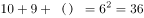，（ ）=17。

故正确答案为D。

### 第 91 题

A. 

B. 2

C. 

D. 3

第 91 题 · 答案与解析

**参考答案（粉笔题库参考内容）**

B

**解析**

分母有理化可得：； ；······。依次化简，则该算式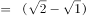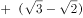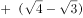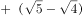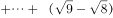。

故正确答案为B。

### 第 92 题

一个数列为1，-1，2，-2，-1，1，-2，2，1，-1，2，-2，则该数列的第2009项为：

A. \-2

B. \-1

C. 1

D. 2

第 92 题 · 答案与解析

**参考答案（粉笔题库参考内容）**

C

**解析**

观察发现，该数列为周期数列。由数字的顺序可知，每一个循环是“1、-1、2、-2、-1、1、-2、2”这8个数字。2009÷8=251…1，即第2009个数字是经过了251个周期后的第1个数字，每个周期的第1个数字是1。

故正确答案为C。

### 第 93 题

某市一条大街长7200米，从起点到终点共设有9个车站，那么每个车站之间的平均距离是：

A. 780米

B. 800米

C. 850米

D. 900米

第 93 题 · 答案与解析

**参考答案（粉笔题库参考内容）**

D

**解析**

植树问题。根据两端植树计算公式：，可得，解得间隔长度=900米。

故正确答案为D。

### 第 94 题

某商店实行促销手段，凡购买价值200元以上的商品可以优惠20%，那么用300元钱在该商店最多可买下价值多少元的商品：

A. 350元

B. 384元

C. 375元

D. 420元

第 94 题 · 答案与解析

**参考答案（粉笔题库参考内容）**

C

**解析**

假设最多可购买x元的商品，由题意可得，解得。则最多可购买375元的商品。

故正确答案为C。

### 第 95 题

两工厂各加工480件产品，甲工厂每天比乙工厂多加工4件，完成任务所需时间比乙工厂少10天。设甲工厂每天加工产品x件，则x满足的方程为：

A. 

B. 

C. 

D. 

第 95 题 · 答案与解析

**参考答案（粉笔题库参考内容）**

C

**解析**

甲每天加工产品x件，则乙每天加工产品(x-4)件；甲完成480件产品需要的时间是天，乙完成的时间是天。根据题意可得。

故正确答案为C。

### 第 96 题

某公司计划购买一批灯泡，11w的普通节能灯泡耗电110度/万小时，单价20元；5w的LED灯泡耗电50度/万小时，售价110元，若两种灯泡使用寿命均为5000小时，每度电价格为0.5元，则每万小时LED灯泡的总使用成本是普通节能灯泡的多少倍：

A. 1.23

B. 1.80

C. 1.93

D. 2.58

第 96 题 · 答案与解析

**参考答案（粉笔题库参考内容）**

D

**解析**

根据题意，每万小时需要个普通节能灯泡，消耗的电量是110度，总使用成本是2×20+110×0.5=95元；每万小时需要个LED灯泡，消耗的电量是50度，总使用成本是2×110+50×0.5=245元。则每万小时LED灯泡的总使用成本是普通节能灯泡的倍，只有D项符合。

故正确答案为D。

### 第 97 题

某商场举行周年让利活动，单件商品满300返180元，满200返100元，满100返40元，如果不参加返现金的活动，则商品可以打5.5折。小王买了价值360元、220元、150元的商品各一件，问最少需要多少钱：

A. 401.5元

B. 410元

C. 360元

D. 382.5元

第 97 题 · 答案与解析

**参考答案（粉笔题库参考内容）**

D

**解析**

如果打折，则买360元的产品只需360×0.55＞360－180＝180，所以采用满300返180元更好；

打折买220元的产品只需220×0.55＝121＞220－100＝120，采用满200返100元更好；

买150元的产品，打折只需150×0.55＝82.5元，采用打折更好。

所以最少需要180＋120＋82.5＝382.5元。

故正确答案为D。

### 第 98 题

现在时间为4点13分，此时时针与分针成什么角度：

A. 30度

B. 45度

C. 90度

D. 120度

第 98 题 · 答案与解析

**参考答案（粉笔题库参考内容）**

B

**解析**

钟表问题中，将钟表看成一个圆，12点为原点，12个数将钟表分成了12份，每份的度数是360°÷12=30°。时针1小时走30°，故时针每分钟走的度数是30°÷60=0.5°；分针1小时走360°，故分针每分钟走的度数是360°÷60=6°。

方法一：分针每分钟可追及时针6°-0.5°=5.5°。4点钟时，时针和分针所形成的角度是120°，到4点13分时，分针追赶了时针13分钟，即追赶的角度是13×5.5°=71.5°。则4点13分，时针和分针所形成的锐角是120°-71.5°=48.5°，与B项最接近。

方法二：4点13分时，时针在4和5之间，则120°＜时针与原点形成的角度＜150°，分针的角度是6°×13=78°。则4点13分，时针和分针所形成的锐角是（120°-78°）＜所求的角度＜（150°-78°），即42°＜所求的角度＜72°，只有B项符合。

故正确答案为B。

### 第 99 题

由1、2、3组成没有重复数字的所有三位数之和是多少：

A. 1222

B. 1232

C. 1322

D. 1332

第 99 题 · 答案与解析

**参考答案（粉笔题库参考内容）**

D

**解析**

由1、2、3组成的没有重复的数字有123、132、213、231、312、321。这6个数的和为123+132+213+231+312+321=1332。

故正确答案为D。

### 第 100 题

河流赛道长120米，水流速度2米/秒，甲船速度为6米/秒，乙船速度为4米/秒。比赛进行两次往返，甲、乙同时从起点出发，先顺水航行，问多少秒后甲、乙船第二次迎面相遇：

A. 48

B. 50

C. 52

D. 54

第 100 题 · 答案与解析

**参考答案（粉笔题库参考内容）**

C

**解析**

根据公式：，由于水速为2米/秒，所以顺行时甲船速度是8米/秒，乙船速度是6米/秒。逆行时甲船速度是4米/秒，乙船速度是2米/秒。甲、乙两次相遇分别在甲船第一次返回和甲船第二次顺行途中，甲第一次返回原地花费时间为秒，此时乙到达对岸，逆水往回走，两船距离1米，再次相遇需要的时间为秒。因此， 45+7=52秒后甲、乙船第二次迎面相遇。

故正确答案为C。

## 材料 1

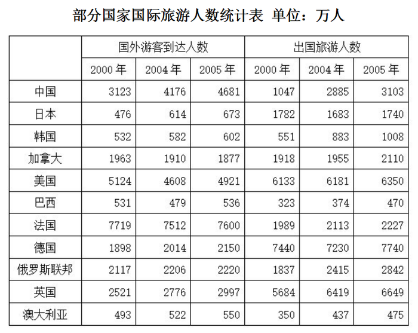

### 第 101 题

表中2005年国外游客到达人数高于出国旅游人数的国家有：

A. 2个

B. 3个

C. 4个

D. 5个

第 101 题 · 答案与解析

**参考答案（粉笔题库参考内容）**

C

**解析**

定位表格材料可知：2005年国外游客到达人数高于出国旅游人数的国家有中国（4681万人＞3103万人）、巴西（536万人＞470万人）、法国（7600万人＞2227万人）、澳大利亚（550万人＞475万人），共4个国家。

故正确答案为C。

### 第 102 题

2000~2005年，以下四国中出国旅游人数平均增长速度最快的是：

A. 韩国

B. 巴西

C. 俄罗斯联邦

D. 澳大利亚

第 102 题 · 答案与解析

**参考答案（粉笔题库参考内容）**

A

**解析**

根据题干“2000~2005年······平均增长速度最快的是”，可判定本题为年均增长率问题。定位表格材料可知：2000年韩国、巴西、俄罗斯联邦、澳大利亚的出国旅游人数分别为551万人、323万人、1837万人、350万人；2005年这四国的出国旅游人数分别为1008万人、470万人、2842万人、475万人。根据年均增长率公式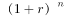，当年份差n相同时，直接比较即可。

韩国：；巴西：；俄罗斯联邦：；澳大利亚：。

比较可知韩国增长速度最快。

故正确答案为A。

### 第 103 题

2000~2005年，哪个国家出国旅游人数的发展速度超过了国外游客到达人数的发展速度：

A. 英国

B. 德国

C. 日本

D. 中国

第 103 题 · 答案与解析

**参考答案（粉笔题库参考内容）**

D

**解析**

根据题干“······的发展速度超过······的发展速度”，发展速度即增速，可判定本题为一般增长率问题。定位表格材料可得：2000年英国、德国、日本、中国出国旅游人数分别为5684万人、7440万人、1782万人、1047万人；2005年四国出国旅游人数分别是6649万人、7740万人、1740万人、3103万人。2000年英国、德国、日本、中国的国外游客到达人数分别是2521万人、1898万人、476万人、3123万人；2005年四国的国外游客到达人数分别是2997万人、2150万人、673万人、4681万人。根据公式：，可得2000-2005年，出国旅游人数和国外游客到达人数增速分别如下：

英国：；。没有超过，排除；

德国：；。没有超过，排除；

日本：；。没有超过，排除；

中国：；。前者高于后者，当选。

故正确答案为D。

### 第 104 题

表中国家按所属大洲分类，2004年出国旅游人数均值最高的是：

A. 亚洲国家

B. 美洲国家

C. 欧洲国家

D. 大洋洲国家

第 104 题 · 答案与解析

**参考答案（粉笔题库参考内容）**

C

**解析**

根据题干“······2004年······均值最高”，结合材料给出2004年数据，可判定本题为现期平均数问题。定位表格材料可得：2004年亚洲国家（中国、日本、韩国）的出国旅游人数分别是2885万人、1683万人、883万人；2004年美洲国家（加拿大、美国、巴西）的出国旅游人数分别是1955万人、6181万人、374万人；2004年欧洲国家（法国、德国、俄罗斯联邦、英国）的出国旅游人数分别是2113万人、7230万人、2415万人、6419万人；2004年大洋洲国家（澳大利亚）的出国旅游人数是437万人。出国旅游人数均值，可得：

亚洲国家平均人数万人；

美洲国家平均人数万人；

欧洲国家平均人数万人；

大洋洲国家只有1个，则其平均人数就是437万人。

比较可知均值最高的是欧洲国家。

故正确答案为C。

### 第 105 题

从资料中不能推出的结论是：

A. 法国是表中所列国家中最受欢迎的国际旅游目的地

B. 2005年美国国外游客到达人数的同比增长率小于巴西

C. 2000年国外游客到达人数与出国旅游人数最接近的国家是加拿大

D. 按国外游客到达人数排序，2000年、2004年、2005年中国在11国中位次不变

第 105 题 · 答案与解析

**参考答案（粉笔题库参考内容）**

C

**解析**

A项：定位表格材料可得：2000年、2004年、2005年法国国外游客到达人数分别是7719万人、7512万人、7600万人，均是当年表中所列国家中国外游客到达人数最多的国家，可推出法国是表中所列国家中最受欢迎的国际旅游目的地，正确；

B项：定位表格材料可得：2004年、2005年美国国外游客到达人数分别是4608万人、4921万人；2004年、2005年巴西国外游客到达人数分别是479万人、536万人。根据可得：2005年美国同比增长率；巴西同比增长率，即美国小于巴西，正确；

C项：定位表格材料可得：2000年加拿大国外游客到达人数和出国旅游人数分别是1963万人、1918万人，其人数之差=1963-1918=45万人；2000年韩国国外游客到达人数和出国旅游人数分别是532万人、551万人，其人数之差=551-532=19万人。故韩国的人数更接近，错误；

D项：定位表格材料可得：2000年、2004年、2005年中国国外游客到达人数分别是3123万人、4176万人、4681万人，在表中所列国家中均排名第三，位次不变，正确。

本题为选非题，故正确答案为C。

## 材料 2

2000年、2005年、2006年发达国家、发展中国家和世界总体的国际储备（不包括黄金）和黄金储备变化情况，如图所示：

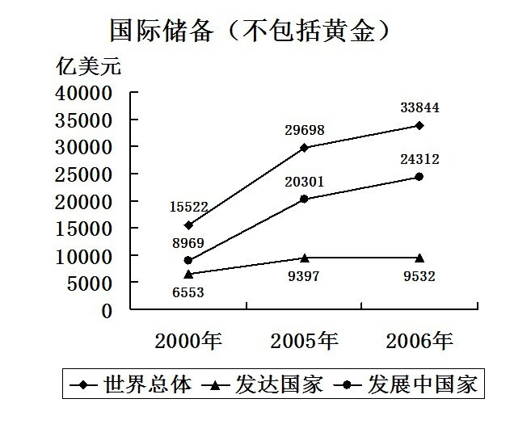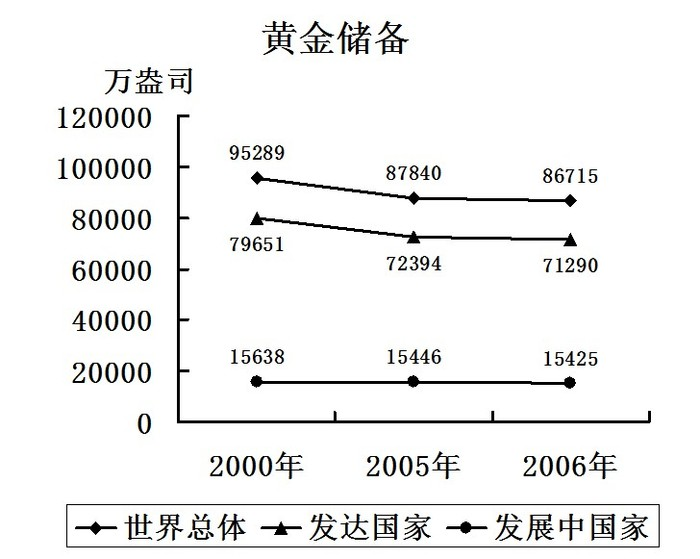

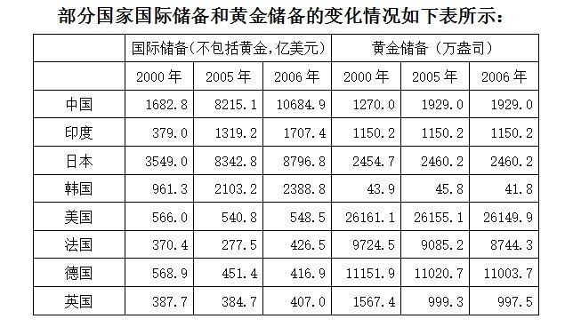

### 第 106 题

2000年到2006年黄金储备量下降幅度超过11%的国家有多少个：

A. 0

B. 1

C. 2

D. 3

第 106 题 · 答案与解析

**参考答案（粉笔题库参考内容）**

B

**解析**

根据题干“···下降幅度超过11%···”，可判定本题为一般增长率问题。定位统计表可得：2000年到2006年，黄金储备量下降的国家有韩国、美国、法国、德国、英国。2000年五国黄金储备量分别是43.9万盎司、26161.1万盎司、9724.5万盎司、11151.9万盎司、1567.4万盎司；2006年五国黄金储备量分别是41.8万盎司、26149.9万盎司、8744.3万盎司、11003.7万盎司、997.5万盎司。根据可得：

韩国下降幅度：；

美国下降幅度：；

法国下降幅度：；

德国下降幅度：；

英国下降幅度：。

比较可知下降幅度超过11%的国家只有英国。

故正确答案为B。

### 第 107 题

2000年到2006年印度国际储备量的平均增长速度低于：

A. 发达国家

B. 世界总体

C. 发展中国家

D. 中国

第 107 题 · 答案与解析

**参考答案（粉笔题库参考内容）**

D

**解析**

根据题干“2000年到2006年···平均增长速度···”，可判定本题为年均增长率问题。定位统计表可得：2000年、2006年印度国际储备量分别是379.0亿美元、1707.4亿美元；2000年、2006年中国国际储备量分别是1682.8亿美元、10684.9亿美元。定位折线图一可得：2000年发达国家、世界总体、发展中国家的国际储备量分别是6553亿美元、15522亿美元、8969亿美元；2006年发达国家、世界总体、发展中国家的国际储备量分别是9532亿美元、33844亿美元、24312亿美元。根据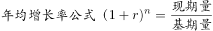，当年份差n相同时，直接比较即可。

印度：；

发达国家：；世界总体：；

发展中国家：；中国：。

比较可知只有中国超过印度。

故正确答案为D。

### 第 108 题

假设黄金价格为500美元/盎司，那么表中各年黄金储备量均超过相应年份国际储备量的国家有多少个：

A. 0

B. 1

C. 2

D. 3

第 108 题 · 答案与解析

**参考答案（粉笔题库参考内容）**

C

**解析**

根据题干“······黄金价格为500美元/盎司，那么表中各年黄金储备量均超过······”,结合，可判定本题为现期平均数问题。定位统计表可得：

2000年中国黄金储备为1270.0万盎司，则其黄金储备量=500×1270万≈65亿美元＜2000年中国国际储备1682.8亿美元,排除；

2000年印度黄金储备为1150.2万盎司，则其黄金储备量=500×1150.2万≈60亿美元＜2000年印度国际储备379.0亿美元,排除；

2000年日本黄金储备为2454.7万盎司，则其黄金储备量=500×2454.7万≈120亿美元＜2000年日本国际储备3549.0亿美元,排除；

2000年韩国黄金储备为43.9万盎司，则其黄金储备量=500×43.9万≈2亿美元＜2000年韩国国际储备961.3亿美元，排除；

2000年、2005年、2006年美国黄金储备均约为26000万盎司，则这三年的黄金储备量均约是500×26000万=1300亿美元，均大于其国际储备量，符合；

2006年法国黄金储备为8744.3万盎司，则黄金储备量=500×8744.3万≈435亿美元＞2006年法国国际储备量426.5亿美元。2000年、2005年法国黄金储备均大于2006年，且2000年、2005年法国国际储备量均小于2006年，故2000年、2005年法国的黄金储备量大于其国际储备量，符合；

2000年德国黄金储备是11151.9万盎司，则黄金储备量是500×11151.9万≈558亿美元＜2000年德国国际储备568.9亿美元，排除；

2000年英国黄金储备为1567.4万盎司，则黄金储备量是500×1567.4万≈80亿美元＜2000年英国国际储备量387.7亿美元，排除。

综上，满足条件的有美国、法国，共2个国家。

故正确答案为C。

### 第 109 题

与2005年相比，下面关于2006年储备量描述错误的是：

A. 中国黄金储备量占世界总体的比重略有上升

B. 美国黄金储备量占世界总体的比重略有下降

C. 中国黄金储备量没有变化，国际储备量上升

D. 美国黄金储备量略有下降，国际储备量略有上升

第 109 题 · 答案与解析

**参考答案（粉笔题库参考内容）**

B

**解析**

A项：定位表格材料和折线图二可得：2005年中国黄金储备量为1929万盎司，世界总体黄金储备量为87840万盎司；2006年中国黄金储备量为1929万盎司，世界总体黄金储备量为86715万盎司。根据，可得2005年中国黄金储备量占世界总体的比重为，2006年其比重为。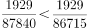，比重上升，正确；

B项：定位表格材料和折线图二可得：2005年美国黄金储备量为26155.1万盎司，世界总体黄金储备量为87840万盎司；2006年美国黄金储备量为26149.9万盎司，世界总体黄金储备量为86715万盎司。可得2005年美国黄金储备量占世界总体的比重为；2006年其比重为，比重上升，并非下降，错误；

C项：定位表格材料可得：2005年中国黄金储备量为1929万盎司，国际储备量为8215.1亿美元；2006年中国黄金储备量为1929万盎司，国际储备量为10684.9亿美元。黄金储备量没有变化，国际储备量上升，正确；

D项：定位表格材料可得：2005年美国黄金储备量为26155.1万盎司，国际储备量为540.8亿美元；2006年美国黄金储备量为26149.9万盎司，国际储备量为548.5亿美元。黄金储备量略有下降，国际储备略有上升，正确。

本题为选非题，故正确答案为B。

### 第 110 题

从资料中不能推出的结论是：

A. 上表所列国家中，西方国家更倾向于进行黄金储备

B. 与国际储备相比，表中多数国家黄金储备量相对稳定

C. 整体看来，多数发达国家的黄金储备量大大高于其国际储备量

D. 2000年至2006年印度的国际储备量年平均增长速度快于韩国

第 110 题 · 答案与解析

**参考答案（粉笔题库参考内容）**

C

**解析**

A项：定位表格材料可得：大部分西方国家2000年、2005年、2006年的黄金储备量要明显大于亚洲国家，国际储备量要明显小于亚洲国家，故西方国家更倾向于进行黄金储备，正确；

B项：定位表格材料可得：与2000年相比，2006年中国、印度、日本、韩国的国际储备量增幅较大；与2000年相比，2006年各国的黄金储备量变化幅度较小，相对稳定，正确；

C项：定位表格材料可得：黄金储备量（万盎司）和国际储备量（亿美元）单位不一致，无法进行比较，错误；

D项：定位表格材料可得：2000年、2006年印度国际储备量分别为379亿美元、1707.4亿美元；2000年、2006年韩国国际储备量分别为961.3亿美元、2388.8亿美元。根据年均增长率公式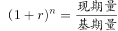，当年份差n相同时，直接比较即可。印度：，韩国：，印度快于韩国，正确。

本题为选非题，故正确答案为C。

## 材料 3

2006年全国共有生产力促进中心1331家，比上年增加61家。生产力促进中心在全国分布广泛，但地区分布不均，四川、山西、黑龙江、广西、福建等地较多，分别为136，99，96，94，83家。边远省份数量较少，如海南省仅有一家。云南、西藏、青海各2家。

        截止2006年底，国家级示范生产力促进中心达到128家，占全国生产力促进中心的9.6%，其中陕西省最多，有11家，占本省中心总数的23.4%。辽宁、山东、江苏三地各有9家，并列位居第二，分别占本省中心总数的25%，13.6%，17%。

        2006年，根据对1237家生产力促进中心的调查，其在岗职工总数为16927人。其中，35岁以下有7025人，占总人数的41.5%。比上年略有增加；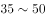岁有7708人，占总人数的45.5%，比上年略有减少；50岁以上在岗职工所占比例与上年基本一致。

        在16927名在岗职工中，有8299人具有大学或大学以上学历，占总数的49.0%。具有高级职称的人数为4295人，具有中级职称的人数为5114人，具有中级以上职称的在岗职工占55.6%。

### 第 111 题

2006年全国生产力促进中心数量比2005年增长了：

A. 2.9%

B. 3.7%

C. 4.0%

D. 4.8%

第 111 题 · 答案与解析

**参考答案（粉笔题库参考内容）**

D

**解析**

根据题干“2006年······比2005年增长了”，结合选项都是百分数，可判定本题为一般增长率问题。定位材料第一段可得：2006年全国共有生产力促进中心1331家，比上年增加61家。根据公式：，可得2006年全国生产力促进中心数量比2005年增长了。

故正确答案为D。

### 第 112 题

生产力促进中心数量最多的三个省份的中心数量占全国总数的比重是：

A. 19.7%

B. 22.7%

C. 23.0%

D. 24.9%

第 112 题 · 答案与解析

**参考答案（粉笔题库参考内容）**

D

**解析**

根据题干“······占······的比重”，结合题干与材料时间一致，可判定本题为现期比重问题。定位材料第一段可得：2006年全国共有生产力促进中心1331家······四川、山西、黑龙江、广西、福建等地较多，分别为136，99，96，94，83家。可知生产力促进中心数量最多的三个省份为四川、山西、黑龙江，分别为136、99、96家。根据公式：比重，则题干所求。

故正确答案为D。

### 第 113 题

以下省份按生产力促进中心数量由小到大排列正确的是：

A. 辽宁 山东 江苏

B. 江苏 陕西 辽宁

C. 辽宁 陕西 广西

D. 陕西 山东 江苏

第 113 题 · 答案与解析

**参考答案（粉笔题库参考内容）**

C

**解析**

根据题干“······按生产力促进中心数量······排列”，结合材料给出各省国家级示范生产力促进中心数量以及占本省中心总数的比重，可判定本题为现期比重问题。定位材料第二段可得：截止2006年底，国家级示范生产力促进中心······辽宁、山东、江苏三地各有9家，分别占本省中心总数的25%， 13.6%，17%。根据整体，可知部分相同，比重越大，则整体越小。则按本省中心总数排列，辽宁&lt;江苏&lt;山东，排除A、B、D项。

故正确答案为C。

### 第 114 题

2006年，全国生产力促进中心50岁以下在岗职工总人数为：

A. 2194

B. 14733

C. 16927

D. 无法计算

第 114 题 · 答案与解析

**参考答案（粉笔题库参考内容）**

D

**解析**

定位材料第一段可得：2006年全国共有生产力促进中心1331家；定位材料第二段可得：2006年，根据对1237家生产力促进中心的调查，其在岗职工······故材料中只有这1237家生产力促进中心在岗职工人数的相关数据，并没有全国的数据，故无法计算。

故正确答案为D。

### 第 115 题

在本次调查中，平均每个中心的中级以上职称在岗职工有多少人：

A. 6.7

B. 7.0

C. 7.6

D. 12.7

第 115 题 · 答案与解析

**参考答案（粉笔题库参考内容）**

C

**解析**

根据题干“在本次调查中，平均每个······有多少人”，可判定本题为现期平均数问题。定位材料第三段可得：2006年，根据对1237家生产力促进中心的调查，其在岗职工总数为16927人；定位材料第四段可得：具有高级职称的人数为4295人，具有中级职称的人数为5114人。根据公式：平均数，则平均每个中心中级以上职称的在岗职工人。

故正确答案为C。

## 材料 4

2008年1-3月社会消费品零售总额情况

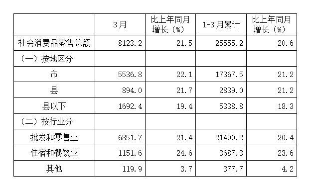

### 第 116 题

打字人员在抄录上表时因粗心输错了一个数据，该数据可能是：

A. 5536.8

B. 17367.5

C. 6851.7

D. 3687.3

第 116 题 · 答案与解析

**参考答案（粉笔题库参考内容）**

B

**解析**

定位表格材料可得：1-3月累计社会消费品零售总额是25555.2。按地区分，市级是17367.5，县级是2839，县以下是5338.8，三者之和=17367.5+2839+5338.8=25545.3，并非25555.2。结合选项可知是17367.5这个数据错误。

故正确答案为B。

### 第 117 题

2007年3月，批发和零售业社会消费品，零售总额为多少亿元：

A. 5499.0

B. 5643.9

C. 8318.0

D. 8717.2

第 117 题 · 答案与解析

**参考答案（粉笔题库参考内容）**

B

**解析**

根据题干“2007年3月······为多少亿元”，结合材料时间为2008年，可判定本题为基期计算问题。定位表格材料可得：2008年3月批发和零售业社会消费品零售总额为6851.7亿元，同比增长21.4%。则2007年3月批发和零售业社会消费品零售总额=亿元，与B项最接近。

故正确答案为B。

### 第 118 题

2008年1-2月县以下社会消费品零售总额比上年同期增长了：

A. 20.1%

B. 19.2%

C. 17.8%

D. 16.5%

第 118 题 · 答案与解析

**参考答案（粉笔题库参考内容）**

C

**解析**

根据题干“2008年1-2月······比上年同期增长了”，结合选项是百分数，且材料给出2008年3月和1-3月的增长率，可判定本题为混合增长率问题。定位表格材料可得：2008年3月县以下社会消费品零售总额是1692.4亿元，同比增长19.4%；2008年1-3月县以下社会消费品零售总额是5338.8亿元，同比增长18.3%。根据混合增长率口诀“混合居中不正中”，可知1-2月增长率＜1-3月的增长率18.3%＜3月的增长率19.4%，可排除A、B两项。再根据口诀“偏向基期量较大的一方”，1-2月县以下社会消费品零售总额是5338.8-1692.4=3646.4亿元＞3月1692.4亿元，可知，即1~2月增长率＞17.2%，排除D项。

故正确答案为C。

### 第 119 题

假设自2008年第一季度起，县级社会消费品零售总额每季度增长10%，则2009年第一季度县级社会消费品零售总额约为多少亿元：

A. 3847

B. 3974

C. 4157

D. 4263

第 119 题 · 答案与解析

**参考答案（粉笔题库参考内容）**

C

**解析**

根据题干“······2009年第一季度······约为多少亿元”，结合材料时间为2008年，可判定本题为现期计算问题。定位表格材料可得：2008年1-3月，即2008年第一季度县级社会消费品零售总额是2839亿元。根据题干：自2008年第一季度起，县级社会消费品零售总额每季度增长10%。根据公式：，可得2009年第一季度县级社会消费品零售总额≈2839×1.44≈4090亿元，与C项最接近。

故正确答案为C。

### 第 120 题

从资料中可以推出的结论是：

A. 2008年3月比2月的社会消费品零售总额高

B. 按地区分，2008年3月县级社会消费品零售总额同比增长量最小

C. 在县级社会消费品零售总额中住宿和餐饮业零售总额所占的份额最大

D. 2009年3月社会消费零售总额至少达到1.5万亿元，才能比2007年同月翻一番

第 120 题 · 答案与解析

**参考答案（粉笔题库参考内容）**

B

**解析**

A项：定位表格材料可得：2008年3月社会消费品零售总额为8123.2亿元。2月数据没有给出，故无法判断，错误；

B项：定位表格材料可得：2008年3月市级社会消费品零售总额是5536.8亿元，同比增长22.1%；县级社会消费品零售总额是894亿元，同比增长21.7%；县以下社会消费品零售总额是1692.4亿元，同比增长19.4%。根据增长量比较口诀“大大则大”，可知市级总额最大，增长率也最大，故增长量也最大。根据公式：，可得县级增长量亿元；县以下增长量。故县级社会消费品零售总额同比增长量最小，正确；

C项：定位表格材料可得：按地区和按行业是两种独立的分类，县级社会消费品零售总额并没有再按行业划分，故无法计算其住宿和餐饮业零售总额所占份额，错误；

D项：定位表格材料可得：2008年3月社会消费品零售总额8123.2亿元，同比增长21.5%。则2007年3月社会消费品零售总额亿元。要使2009年3月比2007年同月翻一番，则2009年至少要6660×2=13320亿元，即约1.33万亿元即可，并非1.5万亿元，错误。

故正确答案为B。

