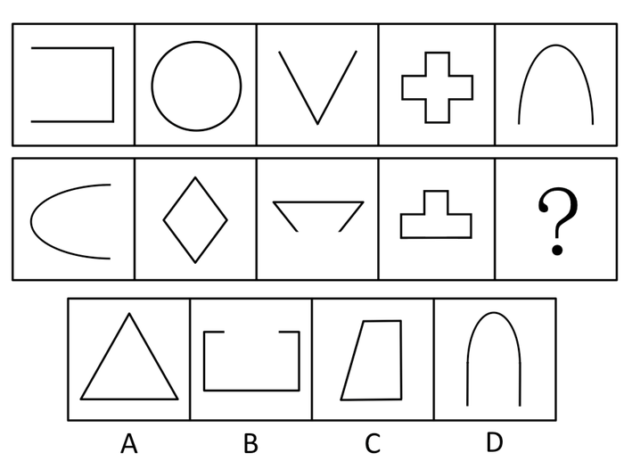
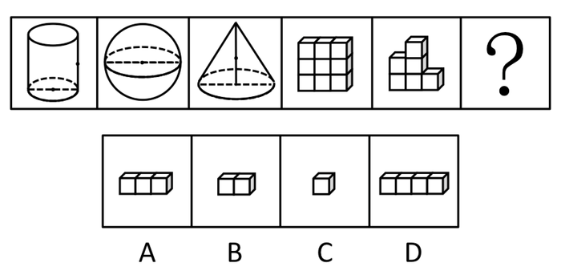
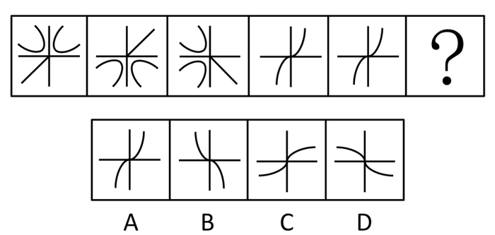
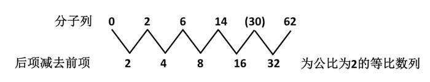
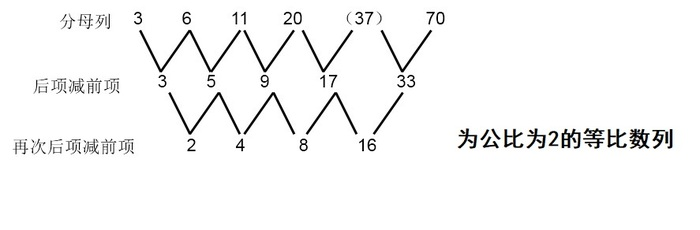
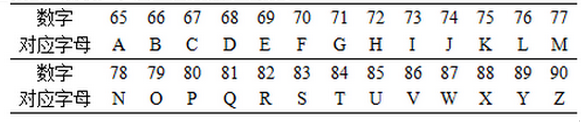
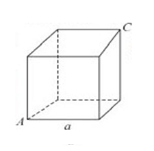
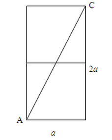
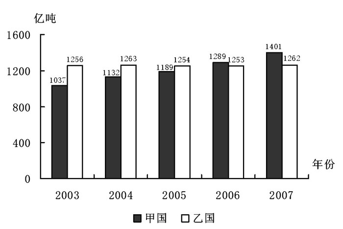
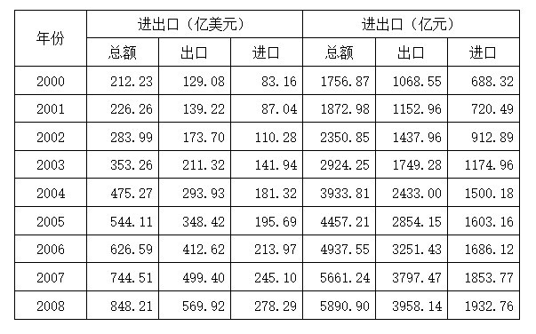

# 2010年福建省公务员录用考试《行测》题（春季）

<!-- gwy:overview:start -->
> **福建 · 2010 · 行测 · 统考** ｜ 120 题 · 图片 74 处 · 答案随题折叠

| 题型模块 | 题量 | 题号 |
| --- | ---: | ---: |
| 常识判断 | 35 | 1–35 |
| 言语能力与表达 | 25 | 36–60 |
| 判断推理 | 35 | 61–95 |
| 数量关系 | 10 | 96–105 |
| 资料分析 | 15 | 106–120 |
| **合计** | **120** | |

导航：[题型与作答说明](#题型与作答说明) · [题目](#题目) · [材料 1](#材料-1)
<!-- gwy:overview:end -->

> 候选采集稿。参考答案及解析来自粉笔页面，不代表官方答案或真实高分答卷；来源使用许可与原卷对应关系仍需人工核实。

## 题型与作答说明

常识判断

（35题）

根据题目要求，在四个选项中选出一个最恰当的答案。

言语能力与表达

（25题）

本部分包括表达与理解两方面的内容，请根据题目要求，在四个选项中选出一个最恰当的答案。

判断推理

（35题）

本部分包括图形推理、定义判断、类比推理与逻辑判断四种类型的试题。

数量关系

（10题）

本部分包括数字推理与数学运算两种类型的试题。

资料分析

（15题）

所给出的图、表、文字或综合性资料均有若干个问题要你回答，你应资料提供的信息进行分析、比较、计算和判断出来。

## 题目

### 第 1 题

2009年9月15日至18日在北京举行的党的十七届四中全会审议通过了：

A. 《中共中央关于加强和改进新形势下党的建设若干重大问题的决定》

B. 《中共中央关于推进农村改革发展若干重大问题的决定》

C. 《中共中央关于加强党的执政能力建设的决定》

D. 《中共中央关于深化行政管理体制改革的意见》

第 1 题 · 答案与解析

**参考答案（粉笔题库参考内容）**

A

**解析**

本题考查与时事政治相关的政治常识。

A项正确，2009年09月18日，中国共产党的十七届四中全会审议通过了《中共中央关于加强和改进新形势下党的建设若干重大问题的决定》。

B项错误，2008年10月9日至12日，中国共产党第十七届中央委员会第三次全体会议审议通过了《中共中央关于推进农村改革发展若干重大问题的决定》，对进一步推进农村改革发展作出了全面部署。

C项错误，2004年9月19日中国共产党第十六届中央委员会第四次全体会议通过《中共中央关于加强党的执政能力建设的决定》。

D选错误，中国共产党第十七届中央委员会第二次全体会议研究通过了《中共中央关于深化行政管理体制改革的意见》，就深化行政管理体制改革问题提出了中共中央关于深化行政管理体制改革的意见。

故正确答案为A。

**考点**：重要文件

**来源**：2010年福建省公务员录用考试《行测》题（春季）第1题

### 第 2 题

中央经济工作会议提出2010年扩大内需，调整经济结构的重点是：

A. 改善交通状况，发展现代物流业

B. 改善民生，发展社会事业

C. 改善外资结构，发展外向型经济

D. 改善投资结构，发展第三产业

第 2 题 · 答案与解析

**参考答案（粉笔题库参考内容）**

B

**解析**

本题考查经济常识。中央经济工作会议提出了2010 年经济工作的主要任务，第六个任务是着力保障和改善民生，全力维护社会稳定。保障和改善民生是我们发展经济的最终目的，也是实施扩大内需战略和推动经济发展方式转变的重大举措。2010 年要把改善民生、发展社会事业作为扩大内需、调整经济结构的重点，坚定不移地加以推进。

故正确答案为B。

**考点**：宏观经济与调控政策

**来源**：2010年福建省公务员录用考试《行测》题（春季）第2题

### 第 3 题

2009年12月7日至8日在丹麦首都哥本哈根召开的联合国气候谈判大会的主要目的，是在《京都议定书》框架的基础上，量化各国的减排目标，减少向大气排放：

A. C

B. CO

C. CO_2

D. SO_3

第 3 题 · 答案与解析

**参考答案（粉笔题库参考内容）**

C

**解析**

联合国气候谈判大会的主要目的，是在《京都议定书》的基础上，量化各国的减排目标，减少温室气体二氧化碳的排放。

故正确答案为C。

**考点**：其他

**来源**：2010年福建省公务员录用考试《行测》题（春季）第3题

### 第 4 题

世界博览会是一项由主办国政府组织或委托有关部门举办的有较大影响和悠久历史的国际性博览活动，2010年5日开幕的上海世界博览会的主题是：

A. 居住与环境，人类的家居科技

B. 人类 自然 科技

C. 水，生命之源

D. 城市，让生活更美好

第 4 题 · 答案与解析

**参考答案（粉笔题库参考内容）**

D

**解析**

城市，让生活更美好（Better City，Better Life）是中国2010年上海世界博览会的主题。

故正确答案为D。

**本题相关知识点：**

1800年，全球仅有2%的人口居住在城市，到了1950年，这个数字迅速攀升到了29%。而到了2000年，世界上大约有一半的人口迁入了城市。根据联合国的预测，到2010年，全世界的城市人口将占总人口的55%。

**考点**：中国地理

**来源**：2010年福建省公务员录用考试《行测》题（春季）第4题

### 第 5 题

2009年12月25日是古田会议召开80周年纪念日，下列表述与古田会议无关的是：

A. 规定了人民军队的性质和任务

B. 明确了党对人民军队的绝对领导地位

C. 规定了红军处理内外关系的准则

D. 纠正了“左倾”的军事路线

第 5 题 · 答案与解析

**参考答案（粉笔题库参考内容）**

D

**解析**

本题考查毛中特。

古田会议，是红四军在1929年12月28日至29日在福建省龙岩市上杭县古田召开的第九次党的代表大会。

A项正确，古田会议指出“中国的红军是一个执行革命的政治任务的武装集团”。“红军决不是单纯地打仗的，它除了打仗消灭敌人军事力量之外，还要负担宣传群众、组织群众、武装群众、帮助群众建立革命政权以至于建立共产党的组织等项重大任务”。这就规定了红军的无产阶级性质和全心全意为人民服务的根本宗旨。

B项正确，古田会议确立了中国共产党对军队实行绝对领导的原则。红军执行无产阶级革命政治任务，争取中国人民大众获得解放的事业，必须坚定地置于中国共产党的绝对领导下，这是红军保持其无产阶级性质的根本条件。强调必须确立党在红军中的绝对领导地位，强固党的组织。

C项正确，古田会议规定了军队内部、外部关系。在军队内部实行民主，又必须克服极端民主化倾向。厉行集中指导下的民主，上级的决定必须坚决执行，党内执行少数服从多数的原则，同时正确地开展思想批评。

D项错误，遵义会议是为了纠正博古“左”倾领导在军事指挥上的错误而召开的一次生死攸关的重要会议。

本题为选非题，故正确答案为D。

**考点**：党的历史

**来源**：2010年福建省公务员录用考试《行测》题（春季）第5题

### 第 6 题

“知行兼举”是中国古代哲学的一个命题，下列选项与之无关的是：

A. “纸上得来终觉浅，绝知此事要躬行”

B. “汝果欲学诗，工夫在诗外”

C. “天行健，君子以自强不息”

D. “读万卷书，行万里路”

第 6 题 · 答案与解析

**参考答案（粉笔题库参考内容）**

C

**解析**

本题要求选出与“知行兼举”无关的一项。“知行兼举”强调“行”与“知”的辩证统一关系，二者缺一不可。

A项正确，从书本上得到的知识终归是浅薄的，未能理解知识的真谛。要真正理解书中的深刻道理，必须去躬行实践；

B项正确，“汝果欲学诗，工夫在诗外”的意思是你如果当真要学诗的话，那就应该多注重关于作诗以外的事。就是说不能为了作诗而作诗，增加阅历不是浪费时间，是为了作诗积累素材，这样才能作出好诗；

C项错误，“天行健，君子以自强不息”强调自强不息的重要性，也就是主观能动性的发挥问题，与“知行”辩证关系无关；

D项正确，“读万卷书，行万里路”也强调认识和实践的辩证关系。

本题为选非题，故正确答案为C。

**考点**：认识论

**来源**：2010年福建省公务员录用考试《行测》题（春季）第6题

### 第 7 题

在我国传统学术发展史上，不同时期有不同的标志性学术成就。下列表述正确的是：

A. 汉代经学 魏晋玄学 隋唐佛学 宋明理学

B. 汉代经学 魏晋佛学 隋唐玄学 宋明理学

C. 汉代儒学 魏晋玄学 隋唐佛学 宋明经学

D. 汉代儒学 魏晋佛学 隋唐玄学 宋明经学

第 7 题 · 答案与解析

**参考答案（粉笔题库参考内容）**

A

**解析**

本题考查中国文化常识。

经学产生于西汉，汉武帝即位后，为了适应大一统的政治局面和加强中央集权统治，实行了罢黜百家、独尊儒术，改变博士原有制度，增设弟子员，有五经博士之说。从此儒学独尊，《诗》、《书》、《礼》、《易》、《春秋》五经超出了一般典籍的地位，成为崇高的法定经典，也成为士子必读的经典。汉代儒生们即以传习、解释五经为主业。自此经学正式宣告诞生。

玄学指的是魏晋时期出现的一种以《老子》为研究核心的哲学思潮。又称新道家，是对《老子》、《庄子》和《周易》的研究和解说，产生于魏晋。玄学是中国魏晋时期到宋朝中叶之间出现的一种崇尚老庄的思潮。

隋唐佛学思潮是我国汉传佛教史上引人注目的文化现象。它的兴起，不仅展示了佛教在中国化过程中所具有的强烈生命力，而且从特定角度推进了中国本土学术。

理学又名为道学，两宋时期产生的主要哲学流派。理学是中国古代最为精致、最为完备的理论体系，其影响至深至巨。宋明六百年儒学之发展，世人称之为“宋明理学”，宋明理学之“理”并不能简单地理解为道理、理论或义理。

所以，在我国传统学术发展史上，汉代经学、魏晋玄学、隋唐佛学、宋明理学成为各个时期的代表学术成就。

故正确答案为A。

本题相关知识点：

经学原本是泛指各家学说要义的学问，但在中国汉代独尊儒术后为特指研究儒家经典，解释其字面意义、阐明其蕴含义理的学问。

魏晋玄学：中国魏晋时期出现的一种崇尚老庄的思潮。“玄”这一概念，最早出现于《老子》：“玄之又玄，众妙之门。”玄学即是研究幽深玄远问题的学说。魏晋时人注重《老子》、《庄子》和《周易》，称之为“三玄”，而《老子》、《庄子》则被视为“玄宗”。

宋明理学亦称“道学”。指宋明（包括元及清）时代，占主导地位的儒家哲学思想体系。宋、明儒家的哲学思想。汉儒治经重名物训诂，至宋儒则以阐释义理、兼谈性命为主，因有此称。

**考点**：文化常识

**来源**：2010年福建省公务员录用考试《行测》题（春季）第7题

### 第 8 题

许多成语源于我国古代著名的历史故事。下列成语故事发生在战国时期的是：

A. 卧薪尝胆

B. 退避三舍

C. 秦晋之好

D. 负荆请罪

第 8 题 · 答案与解析

**参考答案（粉笔题库参考内容）**

D

**解析**

本题考查中国文化常识。战国（公元前475年—公元前221年）是中国历史上继春秋时期之后的大变革时期。战国时期包括二周灭亡前和二周之后秦灭六国完成之前。

A项错误，“卧薪尝胆”的典故发生在春秋时期，越国国王勾践励精图治以图复国的事迹。

B项错误，“退避三舍”的典故发生在春秋时期，涉及晋国和楚国。

C项错误，“秦晋之好”的典故出自春秋时期，秦晋之好代表的是一种政治上的联姻，是国家之间的联合，但后来渐渐将男女之间的婚姻也称作结为“秦晋之好”。

D项正确，“负荆请罪”的典故发生在战国时期，出自《史记•廉颇蔺相如列传》，形容主动向人认错、道歉，自请严厉责罚。

故正确答案为D。

**考点**：文化常识

**来源**：2010年福建省公务员录用考试《行测》题（春季）第8题

### 第 9 题

下列诗句作者是杜甫的是：

A. “春蚕到死丝方尽，蜡炬成灰泪始干”

B. “感时花溅泪，恨别鸟惊心”

C. “天生我材必有用，千金散尽还复来”

D. “春潮带雨晚来急，野渡无人舟自横”

第 9 题 · 答案与解析

**参考答案（粉笔题库参考内容）**

B

**解析**

A选项错误，“春蚕到死丝方尽，蜡炬成灰泪始干”出自《无题》，作者李商隐；

B选项正确，“感时花溅泪，恨别鸟惊心”出自《春望》，作者杜甫；

C选项错误，“天生我材必有用，千金散尽还复来”出自《将进酒》，作者李白；

D选项错误，“春潮带雨晚来急，野渡无人舟自横”出自《滁州西涧》，作者韦应物。

故正确答案为B。

**考点**：文学常识

**来源**：2010年福建省公务员录用考试《行测》题（春季）第9题

### 第 10 题

下列关于文史知识的表述不正确的是：

A. “及笄”是指女子十五岁

B. 乡试第一名称训“会元”

C. “五经”指《诗经》、《尚书》、《礼记》、《易经》和《春秋》

D. 晚清四大谴责小说包括《官场现形记》、《二十年目睹之怪现状》、《老残游记》和《孽海花》

第 10 题 · 答案与解析

**参考答案（粉笔题库参考内容）**

B

**解析**

本题考查中国文化常识，结合选项具体分析。

A项正确，及笄，古代女子满15岁结发，用笄贯之，因称女子满15岁为及笄。

B项错误，会元是指会试的第一名。会试由礼部主持，在京师举行考试。乡试的第一名被称为解元。

C项正确，五经一般指儒家典籍《诗经》《尚书》《礼记》《周易》《春秋》的合称。

D项正确，《官场现形记》是晚清谴责小说中最有代表性的作品，四大谴责小说之一；《二十年目睹之怪现状》是一部带有自传色彩的长篇小说，四大谴责小说之一；《老残游记》这部小说是他晚年所写的带有自传性质的未竟作品，四大谴责小说之一；《孽海花》是一部既具有谴责小说、又具有历史小说，还具有政治小说特点的长篇小说，四大谴责小说之一。

本题为选非题，故正确答案为B。

**考点**：文化常识

**来源**：2010年福建省公务员录用考试《行测》题（春季）第10题

### 第 11 题

下列关于“元宵节”的别称不正确的是：

A. 元夕节

B. 上元节

C. 正月半

D. 中元节

第 11 题 · 答案与解析

**参考答案（粉笔题库参考内容）**

D

**解析**

本题要求选出“不正确”的一项。“元宵节”又称上元节、元夕节、正月半、小正月、灯节等。农历七月十五为“中元节”。

本题为选非题，故正确答案为D。

**本题相关知识点：**

中元节又称“七月节”或“盂兰盆会”，为三大鬼节之一。中元节是道教的说法，“中元”之名起于北魏，有些地方俗称“鬼节”“施孤”，又称亡人节、七月半。根据古书记载：“道经以正月十五日为上元，七月十五日为中元，十月十五日为下元。”中元节与除夕、清明节、重阳节（除、清、九）等三节，都是中国传统节日里祭祖的四大节日。

**考点**：文化常识

**来源**：2010年福建省公务员录用考试《行测》题（春季）第11题

### 第 12 题

我国从2004年开始向海地派遣维和警察防暴队，执行联合国维和任务，下列关于海地的表述不正确的是：

A. 海地位于拉丁美洲

B. 海地与古巴隔海相望

C. 海地是世界上第一个独立的黑人国家

D. 西班牙语是海地的官方语言

第 12 题 · 答案与解析

**参考答案（粉笔题库参考内容）**

D

**解析**

本题考查与海地相关的地理国情知识，结合选项具体分析。

A项正确，海地是西印度群岛中的岛国，位于拉丁美洲加勒比海北部伊斯帕尼奥拉岛的西半部。

B项正确，海地位于加勒比海北部，西与古巴和牙买加隔海相望。

C项正确，海地，1804年1月1日宣告独立，取国名海地，是世界上第一个独立的黑人国家。

D项错误，海地官方语言为法语和克里奥尔语，90%居民使用克里奥尔语。

本题为选非题，故正确答案为D。

本题相关知识点：

海地位于加勒比海北部，印第安语意为“多山的地方”，是加勒比海上的一个岛国。该国的黑人占95%，因此有“黑人共和国”之称。居民多信奉天主教。官方语言为法语和克里奥尔语，90%居民使用克里奥尔语。

**考点**：世界地理

**来源**：2010年福建省公务员录用考试《行测》题（春季）第12题

### 第 13 题

下列不属于金融市场的是：

A. 拍卖市场

B. 期货市场

C. 股票市场

D. 外汇市场

第 13 题 · 答案与解析

**参考答案（粉笔题库参考内容）**

A

**解析**

本题要求选出“不属于”金融市场的一项。金融市场是指资金供应者和资金需求者双方通过信用工具进行交易而融通资金的市场，广而言之，是实现货币借贷和资金融通、办理各种票据和有价证券交易活动的市场，只有拍卖市场不属于金融市场。

本题为选非题，故正确答案为A。

**考点**：宏观经济与调控政策

**来源**：2010年福建省公务员录用考试《行测》题（春季）第13题

### 第 14 题

市场在资源配置中发挥越来越重要的作用，但面对世界金融危机，市场的失控引起了各国政府的重视，市场不具有的功能是：

A. 价格形成

B. 信息引导

C. 收入分配

D. 宏观调控

第 14 题 · 答案与解析

**参考答案（粉笔题库参考内容）**

D

**解析**

本题要求选出市场“不具有”的一项功能。宏观调控是政府实施的政策措施以调节市场经济的运行。在市场经济中，商品和服务的供应及需求是受价格规律及自由市场机制所影响。

本题为选非题，故正确答案为D。

**考点**：市场经济

**来源**：2010年福建省公务员录用考试《行测》题（春季）第14题

### 第 15 题

2009年，国务院先后恢复了10个经济区域发展规划，表明我国新的区域经济展图逐渐成型，下列关于区域经济的表述不正确的是：

A. 区域经济是一种综合性的经济发展的地理概念

B. 区域经济以行政区划界为划分依据

C. 医疗卫生和文化教育等区域性基础设施是发展区域经济的重要内容

D. 水分 、热量、光照、土地和灾害频率等自然条件都会影响区域经济的发展

第 15 题 · 答案与解析

**参考答案（粉笔题库参考内容）**

B

**解析**

本题要求选出表述“不正确”的一项。区域经济是在一定区域内经济发展的内部因素与外部条件相互作用而产生的生产综合体。这里的区域指的是自然地理区域，并非行政区域。

本题为选非题，故正确答案为B。

**本题相关知识点：**

在区域经济中，地理因素是其基本要素，一个国家的地理区位、自然资源会对国家的发展、国家经济行为产生重要影响。区域经济正是研究如何从地理的角度出发，在国际竞争中保护国家的自身利益。

**考点**：宏观经济与调控政策

**来源**：2010年福建省公务员录用考试《行测》题（春季）第15题

### 第 16 题

中央银行可以利用货币政策对证券市场进行调节，在短期内会导致股票指数下降的政策是：

A. 银行存款利率上调，银行准备金上调

B. 银行存款利率上调，银行准备金下调

C. 银行存款利率下调，银行准备金上调

D. 银行存款利率下调，银行准备金下调

第 16 题 · 答案与解析

**参考答案（粉笔题库参考内容）**

A

**解析**

本题考查经济常识。中央银行可以通过货币政策减少市场上的货币流通量，从而投入股市的资金就会减少，股票指数也会随之下降。

A项正确，银行存款利率上调，吸引人们把更多的货币存入银行，会导致市场上的货币流通量减少。银行准备金上调，商业银行把更多的货币存入央行，商业银行的可贷资金就会减少，市场上流通的货币量也会减少。因此二者都会减少市场上流通的货币量，会在短期内导致股票指数下降。

B项错误，银行存款利率上调，会导致市场上流通的货币流通量减少。而银行准备金下调则会增加市场上的货币流通量，因此二者结合，不一定短期内会导致股票指数下降。

C项错误，银行存款利率下调，会增加市场上的货币流通量，银行准备金上调会减少市场上的货币流通量。因此二者结合，不一定短期内会导致股票指数下降。

D项错误，银行存款利率下调和银行准备金下调都会导致市场上的货币流通量增加，在短期内会导致股票指数上涨。

故正确答案为A。

**考点**：宏观经济与调控政策

**来源**：2010年福建省公务员录用考试《行测》题（春季）第16题

### 第 17 题

下列关于外汇储备的说法不正确是：

A. 外汇储备是国家国际清偿力的重要组成部分，同时对平衡国际收支，稳定汇率有重要的影响

B. 目前中国的外汇储备总量居世界第一位

C. 某国的外汇储备包含其特有的外国国库券

D. 经济实力越强的国家，其持有的外汇储备就越多

第 17 题 · 答案与解析

**参考答案（粉笔题库参考内容）**

D

**解析**

外汇储备（Foreign Exchange Reserve），指一国政府所持有的国际储备资产中的外汇部分，即一国政府保有的以外币表示的债权。是一个国家货币当局持有并可以随时兑换外国货币的资产。狭义而言，外汇储备是一个国家经济实力的重要组成部分，是一国用于平衡国际收支，稳定汇率，偿还对外债务的外汇积累。

本题要求选出表述“不正确”的一项。经济体系的实力与繁荣程度，并不是以其外汇储备的多寡来衡量的。

本题为选非题，故正确答案为D。

**考点**：国际经济及组织

**来源**：2010年福建省公务员录用考试《行测》题（春季）第17题

### 第 18 题

下列行为中不属于行政行为的是：

A. 某国家机关为建住宅楼与某建筑公司签订建筑工程承包合同

B. 某县技术监督局对所辖境内某化工厂生产国家明令淘汰的产品的行为予以处罚

C. 国家知识产权局专利复审委员会根据利害关系人申请，宣告某专利权无效

D. 工商行政管理机关为符合条件的企业颁发营业执照

第 18 题 · 答案与解析

**参考答案（粉笔题库参考内容）**

A

**解析**

本题要求选出“不属于”行政行为的一项。行政行为是指行政主体行使行政职权，作出的能够产生行政法律效果的行为。某国家机关为建住宅楼与某建筑公司签订建筑工程承包合同属于平等的民事主体发生的民事法律关系，不属于行政行为的范畴。

本题为选非题，故正确答案为A。

**考点**：行政法

**来源**：2010年福建省公务员录用考试《行测》题（春季）第18题

### 第 19 题

下列属于不可以提起复议的行为是：

A. 国务院某部门的《关于提高食盐出厂（场）价格的通知》

B. 某市政府的《XX市农村社会基本养老保险实施细则》

C. 某镇政府的《关于出生人口性别比升高专项整治活动的意见》

D. 某省人大的《XX省实施＜中华人民共和国消费者权益保护法＞办法》

第 19 题 · 答案与解析

**参考答案（粉笔题库参考内容）**

D

**解析**

本题考查与行政复议相关的行政法知识。《行政复议法》第十三条定，公民、法人或者其他组织认为行政机关的行政行为所依据的下列规范性文件不合法，在对行政行为申请行政复议时，可以一并向行政复议机关提出对该规范性文件的附带审查申请：（一）国务院部门的规范性文件；（二）县级以上地方各级人民政府及其工作部门的规范性文件；（三）乡、镇人民政府的规范性文件；（四）法律、法规、规章授权的组织的规范性文件。

A项正确，国务院某部门的《关于提高食盐出厂（场）价格的通知》属于国务院部门的规定。

B项正确，某市政府的《XX市农村社会基本养老保险实施细则》属于县级以上地方各级人民政府及其工作部门的规定。

C项正确，某镇政府的《关于出生人口性别比升高专项整治活动的意见》属于乡、镇人民政府的规定。

D项错误，某省人大的《XX省实施＜中华人民共和国消费者权益保护法＞办法》属于地方性法规。

本题为选非题，故正确答案为D。

**考点**：行政法

**来源**：2010年福建省公务员录用考试《行测》题（春季）第19题

### 第 20 题

甲有一套商品房要出售，经人介绍，与乙签订房屋买卖合同，丙知道后找到甲，表示愿意以更高的价格购买，甲便与丙订立合同并办理房屋过户手续。

下列说法正确的是：

A. 房屋应归乙，甲向丙承担违约责任

B. 房屋应归丙，甲向乙承担违约责任

C. 房屋产权登记有误，应重新登记为甲

D. 甲与丙订立的合同无效，甲与乙协商房屋的归属权

第 20 题 · 答案与解析

**参考答案（粉笔题库参考内容）**

B

**解析**

文段中根据《合同法》的规定，房屋所有权的转移以是否完成房屋的过户手续为标志，文段中甲与丙订立合同办理房屋过户手续，房屋的所有权转移给丙所有，同时甲应当对乙承担合同不能履行的违约责任。

故正确答案为B。

**考点**：民法典

**来源**：2010年福建省公务员录用考试《行测》题（春季）第20题

### 第 21 题

下列关于公务员录用规定的表述不正确的是：

A. 录用担任一级主任科员以下及其他相当职级层次的公务员，采取公开考试、严格考察、平等竞争、择优录取的办法

B. 地方各级机关公务员的录用，由省级公务员主管部门负责组织

C. 录用特殊职位的公务员可由招录机关自行决定

D. 新录用的公务员试用期为一年

第 21 题 · 答案与解析

**参考答案（粉笔题库参考内容）**

C

**解析**

本题考查行政法。

A选项正确，根据《公务员法》第二十三条规定：“录用担任一级主任科员以下及其他相当职级层次的公务员，采取公开考试、严格考察、平等竞争、择优录取的办法。 民族自治地方依照前款规定录用公务员时，依照法律和有关规定对少数民族报考者予以适当照顾。”

B选项正确，根据《公务员法》第二十四条规定：“中央机关及其直属机构公务员的录用，由中央公务员主管部门负责组织。地方各级机关公务员的录用，由省级公务员主管部门负责组织，必要时省级公务员主管部门可以授权设区的市级公务员主管部门组织。”

C选项错误，根据《公务员法》第三十三条规定：“录用特殊职位的公务员，经省级以上公务员主管部门批准，可以简化程序或者采用其他测评办法。”

D选项正确，根据《公务员法》第三十四条规定：“新录用的公务员试用期为一年。试用期满合格的，予以任职；不合格的，取消录用。”

本题为选非题，故正确答案为C。

**考点**：行政法

**来源**：2010年福建省公务员录用考试《行测》题（春季）第21题

### 第 22 题

沈浩同志是新时期共产党的优秀代表，是农村基层干部的楷模，中共中央组织部号召全国各条战线的共产党员和广大干部向沈浩同志学习，其采用的公文形式是：

A. 公告

B. 决定

C. 通报

D. 意见

第 22 题 · 答案与解析

**参考答案（粉笔题库参考内容）**

C

**解析**

B选项错误，决定适用于对重要事项或者重大行动作出安排，奖惩有关单位及人员，变更或者撤销下级机关不适当的决定事项；

C选项正确，通报适用于表彰先进，批评错误，传达重要精神或者情况；题干为号召向沈浩同志学习，属表彰先进，应当用通报。

故正确答案为C。

**来源**：2010年福建省公务员录用考试《行测》题（春季）第22题

### 第 23 题

华裔科学家高锟获得2009年度诺贝尔物理学奖，其取得突破性成果的研究领域是：

A. 计算机软件

B. 光纤技术

C. 集成电路

D. 量子物理

第 23 题 · 答案与解析

**参考答案（粉笔题库参考内容）**

B

**解析**

本题考查科技常识。高锟，英国籍华裔物理学家，曾任香港中文大学校长，被称为“光纤之父”。高锟教授获奖是因为他在“有关光在纤维中的传输以用于光学通信方面”做出了突破性成就，获得2009年度诺贝尔物理学奖。

故正确答案为B。

**考点**：科技理论与成就

**来源**：2010年福建省公务员录用考试《行测》题（春季）第23题

### 第 24 题

下列关于计算机通讯技术的表述不正确的是：

A. Web2.0的用户既是网站内容的浏览者，也是网站内容的制造者

B. 3G相对于2G的优势在于传输声音和数据的速度更快

C. 物联网是在互联网的基础上，实现人与物品之间的信息交换

D. 进入纳米时代，新材料研究成为计算机芯片发展的关键

第 24 题 · 答案与解析

**参考答案（粉笔题库参考内容）**

C

**解析**

本题考查与计算机通讯技术相关的科技常识，结合选项具体分析。

A项正确，Web2.0是一个利用Web的平台，由用户主导而生成的内容互联网产品模式。Web2.0网站的内容通常是用户发布的，使得用户既是网站内容的浏览者也是网站内容的制造者，这也就意味着Web2.0网站为用户提供了更多参与的机会。

B项正确，3G与2G的主要区别是在传输声音和数据的速度上的提升，它能够在全球范围内更好地实现无线漫游，并处理图像、音乐、视频流等多种媒体形式，提供包括网页浏览、电话会议、电子商务等多种信息服务，同时也要考虑与已有2G系统的良好兼容性。

C项错误，物联网的概念是在1999年提出的，物联网就是“物物相连的互联网”，这有两层意思：第一，物联网的核心和基础仍然是互联网，是在互联网基础上的延伸和扩展的网络；第二，其用户端延伸和扩展到了任何物品与物品之间，进行信息交换和通讯。

D项正确，纳米时代，是指纳米科技被广泛应用的时代。进人纳米时代，新材料研究成为计算机芯片发展的关键基于互联网服务的增加、使用和交付模式，通常涉及通过互联网来提供动态易扩展且经常是虚拟化的资源。

本题为选非题，故正确答案为C。

**考点**：科技理论与成就

**来源**：2010年福建省公务员录用考试《行测》题（春季）第24题

### 第 25 题

下列关于日食的表述不正确的是：

A. 一次完整的日食过程的顺序是：初亏、食既、食甚、生光、复圆

B. 中国的《尚书》上有世界上最早的日食记录

C. 日食主要有日全食、日偏食和日环食

D. 日全食是因为地球挡住了太阳光线

第 25 题 · 答案与解析

**参考答案（粉笔题库参考内容）**

D

**解析**

本题要求选出表述“不正确”的一项。地球轨道与月球轨道有一个5度的夹角，在特定的时间月球会运行至一个特别的位置，令太阳、月球及地球连成一线，这时月球刚好遮掩了太阳的光球，这样便形成了一次日食。

本题为选非题，故正确答案为D。

**考点**：自然地理

**来源**：2010年福建省公务员录用考试《行测》题（春季）第25题

### 第 26 题

为降低乘客的眩晕感，“高速列车”的车里安装了减速玻璃。下列关于减速玻璃和普通玻璃的表述正确的是：

A. 减速玻璃的平面度比普通玻璃更好

B. 减速玻璃增强了光的折射作用

C. 透过普通玻璃，窗外的物体运动的速度看起来和实际速度一致

D. 透过减速玻璃，窗外的物体运动更模糊

第 26 题 · 答案与解析

**参考答案（粉笔题库参考内容）**

A

**解析**

本题考查与减速玻璃相关的物理常识，结合选项具体分析。

A项正确，减速玻璃不同于普通玻璃，它的平度更高，光畸变小，看景物不会变形，和没有玻璃一样的视觉效果，看起来就舒服，不会晃眼。而普通玻璃由于存在一定的光畸变，看景物会变形，会给高速运动的景物叠加一个变形的分量，就容易晃眼。

B项错误，减速玻璃各处的折射率相同，透过减速玻璃，窗外的物体运动不会模糊；而透过普通玻璃，窗外物体运动的速度看起来比实际速度快，普通玻璃相对减速玻璃更增强了光的折射作用。

C项错误，透过普通玻璃，窗外物体运动的速度看起来比实际速度快，速度不是一致的。

D项错误，减速玻璃具有良好的光学性能，透光率好，没有光畸变等，能非常真实地反映外面的景物形态与运转状态，视觉更加清晰。

相关知识：

减速玻璃并不能让外界景物的运动看起来比实际更慢，而是看起来和实际速度一致，即和没有玻璃时一模一样，因此所谓减速玻璃准确的名字应该叫“不增速玻璃”。而其它的普通玻璃，相对而言，可以称为“增速玻璃”。减速玻璃准确地矫正了玻璃在厚度、平面度（对于弯曲的玻璃则是曲率）的误差。

故正确答案为A。

**考点**：物理常识

**来源**：2010年福建省公务员录用考试《行测》题（春季）第26题

### 第 27 题

下列关于交通安全设备的表述不正确的是：

A. 设有救生筏船舶沉到水下一定深度时，会自动将救生筏释放

B. 汽车安全气囊应该与安全带配合工作，这样才能起到最佳的保护作用

C. 随着飞机的问世，原本用在杂技场上的降落伞开始进入航空领域

D. 黑匣子的作用，类似于计算机里的硬盘

第 27 题 · 答案与解析

**参考答案（粉笔题库参考内容）**

C

**解析**

本题考查生活常识，结合选项具体分析。

A项正确，救生筏是指船上供救生用的无自航能力的舟具。救生筏内备有一定数量的食品和淡水，供乘员在海上漂流待援使用。当有救生筏船舶沉到水下一定深度时，会自动将救生筏释放。油船上的救生艇筏，不应存放在货油舱、污油舱或其他含有爆炸性或危险性货物舱的上方。

B项正确，安全气囊要发挥保护作用需要安全带的配合，单独使用安全气囊可使事故死亡率降低18％左右，单独使用安全带可使事故死亡率下降42％左右，而当安全气囊与安全带配合使用时可使事故死亡率降低47％左右。

C项错误，18世纪30年代，随着热气球的问世，为了保障浮空人员的安全，杂技场上的降落伞开始进入航空领域。

D项正确，“黑匣子”是飞机专用的电子记录设备之一，里面装有飞行数据记录器和舱声录音器，飞机各机械部位和电子仪器仪表都装有传感器与之相连。它能把飞机停止工作或失事坠毁前半小时的有关技术参数和驾驶舱内的声音记录下来，需要时把所记录的参数重新放出来，供飞行实验、事故分析之用。

本题为选非题，故正确答案为C。

**考点**：生活常识

**来源**：2010年福建省公务员录用考试《行测》题（春季）第27题

### 第 28 题

下列关于含磷洗衣粉的表述不正确的是（    ）。

A. 含磷洗衣粉可以起到软化水的作用

B. 含磷洗衣粉是造成湖泊等水体发生“赤潮”的元凶之一

C. 含磷洗衣粉易吸水，易结块

D. 含磷洗衣粉对人体有毒副作用

第 28 题 · 答案与解析

**参考答案（粉笔题库参考内容）**

C

**解析**

本题考查含磷洗衣粉的相关知识。

A项正确，含磷洗衣粉由三聚磷酸钠、硅酸钠、烷基苯碳酸钠、荧光增白剂等化工原料合成。三聚磷酸钠具有螯合高价金属离子的性质，可起到软化水的作用。

B项正确，“赤潮”的根源在于含磷和含氮废水的大量排放，主要有生活污水、工业废水以及农田排水，而含磷洗衣粉是生活污水中磷污染的主要来源之一。因此，含磷洗衣粉是致使湖泊等水体发生“赤潮”的元凶之一。

C项错误，含磷洗衣粉具有吸收水分防止洗衣粉结块的作用，它能保持合成洗涤剂制品始终成为干爽的粒状，而非易吸水，易结块。

D项正确，含磷洗衣粉的主要成分之一是烷基苯磺酸钠，由于苯是一种脂溶性物质，未漂洗干净的衣物上残留的苯或苯类化合物，不仅会刺激皮肤引起瘙痒，而且会通过皮肤渗入人体内，时间久了，可能诱发疾病。

本题为选非题，故正确答案为C。

**考点**：生活常识

**来源**：2010年福建省公务员录用考试《行测》题（春季）第28题

### 第 29 题

下列生活常识中表述不正确的是（    ）。

A. 刚煮熟的鸡蛋放入冷水中一小段时间更容易剥壳

B. 冬季气温降低时往冰冷的玻璃杯中倒入开水容易导致玻璃杯破裂

C. 夏天自来水管外壁出现大量的水珠，这往往是下雨的预兆

D. 用水烧菜时，水开后应该加大火力，提升水温以便尽快将菜煮熟，节省燃料

第 29 题 · 答案与解析

**参考答案（粉笔题库参考内容）**

D

**解析**

本题考查生活常识。

A项，将刚煮熟的鸡蛋放入冷水中，蛋壳膜和蛋清因遇冷收缩程度不同，容易形成一定的空隙，能更容易剥掉蛋壳。该项表述正确。

B项，冬天气温降低时，滚烫的开水突然倒入冰冷的玻璃杯中，杯子内壁就受热急剧膨胀，但杯外壁却还是保持原样，内层玻璃突然向外大力挤压，杯子就破裂了。该项表述正确。

C项，夏天自来水管中的水温比外界空气温度要低得多，导致管壁比周围的空气温度低。空中的水气遇到比自身温度低的情况时，就会凝结成小水珠。夏天要下雨前，空气中的湿度明显增加，所以夏天要下雨时自来水管外壁会出现大量的水珠。该项表述正确。

D项，煮食物并不是火越旺越快。因为水沸腾后温度不变，即使再加大火力，也不能提高水温。结果只能加快水的汽化，使锅内水蒸发变干，浪费燃料。正确方法是用大火把锅内水烧开后，用小火保持水沸腾就可以了。该项表述错误。

本题为选非题，故正确答案为D。

**考点**：生活常识

**来源**：2010年福建省公务员录用考试《行测》题（春季）第29题

### 第 30 题

下列关于汽车行驶的表述不正确的是：

A. 汽车快速行驶时，尾部通常会卷起尘土，主要是由于汽车底部形成的低气压区导致的

B. 汽车急刹车时，乘客会向车行进方向倾倒，主要是由离心力导致的

C. 油罐车尾都通常会挂 一条铁链直达地面，主要是为了避免静电放电导致灾难发生

D. 汽车行驶时，车内一般都不开灯，主要是为了避免车内乘客在司机前的挡风玻璃上成像

第 30 题 · 答案与解析

**参考答案（粉笔题库参考内容）**

B

**解析**

本题要求选出表述“不正确”的一项。汽车急刹车时，乘客会向车行进方向倾倒，主要是由于惯性的原因，而非离心力所致。

本题为选非题，故正确答案为B。

**考点**：物理常识

**来源**：2010年福建省公务员录用考试《行测》题（春季）第30题

### 第 31 题

运动中扭伤后可采取的正确措施是：

A. 立即用冰袋冷敷，以防止毛细血管破裂后充血

B. 立即用热水袋热敷，以促进血液循环，加快痊愈

C. 立即用手揉捏受伤处，以散解淤血，防止肿胀

D. 不做任何处理，等待其自然恢复

第 31 题 · 答案与解析

**参考答案（粉笔题库参考内容）**

A

**解析**

一般而言，扭伤后应立即停止活动，在扭伤发生后的24小时内需采取冷敷处理（冷水、冰水、冰块等），使局部血管收缩，减少出血和渗出，减少肿胀，这对功能康复至关重要，千万不能揉或用酒精去按摩。24小时后可采取热敷或涂抹药膏活血化瘀。

故正确答案为A。

**考点**：生物常识

**来源**：2010年福建省公务员录用考试《行测》题（春季）第31题

### 第 32 题

为贯彻党的十七届四中全会精神，加快推进海峡西岸经济区建设，福建省委省政府提出要把海峡西岸经济区建设成为科学发展之区，改革开放之区，文明祥和之区与：

A. 科技创新之区

B. 生态优美之区

C. 两岸交流之区

D. 先行先试之区

第 32 题 · 答案与解析

**参考答案（粉笔题库参考内容）**

B

**解析**

本题考查时事政治常识。2009年5月17日上午举行的首届海峡论坛大会上，中共福建省委书记卢展工表示，福建将着力推进两岸交流合作，促进两岸互利共赢，努力把海峡西岸经济区建设成为科学发展之区、改革开放之区、文明祥和之区、生态优美之区。

故正确答案为B。

**来源**：2010年福建省公务员录用考试《行测》题（春季）第32题

### 第 33 题

国务院出台《关于支持福建省加快建设海峡西岸经济区的若干意见》，福建省已启动实施建设的综合区位于：

A. 平潭岛

B. 大嶝岛

C. 涠洲岛

D. 东山岛

第 33 题 · 答案与解析

**参考答案（粉笔题库参考内容）**

A

**解析**

本题考查时事政治。2009年5月14日，国务院正式下发《关于支持福建省加快建设海峡西岸经济区的若干意见》（以下简称《意见》），标志着海西建设从区域战略上升为国家战略，为地处海西“桥头堡”的平潭加快发展提供了前所未有的战略机遇。国务院《意见》指出，“在现有海关特殊监管区域政策的基础上，进一步探索在福建沿海有条件的岛屿设立两岸合作的海关特殊监管区域，实行更加优惠的政策。”根据这一精神，福建省委、省政府在深入调研的基础上，于7月底召开的省委八届六次全会上正式作出了设立福州（平潭）综合实验区的决定，提出积极探索开展两岸区域合作，建立两岸更加紧密合作交流的区域平台，努力把平潭建设成为探索两岸合作新模式的示范区和海峡西岸经济区科学发展的先行区。

故正确答案为A。

**来源**：2010年福建省公务员录用考试《行测》题（春季）第33题

### 第 34 题

2009年9月，福建省有三个项目入选世界非物质文化遗产，不包括：

A. 大红袍制作技艺

B. 妈祖信俗

C. 南音

D. 木拱廊桥

第 34 题 · 答案与解析

**参考答案（粉笔题库参考内容）**

A

**解析**

本题考查与福建省相关的文化常识，结合选项具体分析。

A项错误，2006年6月大红袍制作技艺入选首批国家级非物质文化遗产名录，而非世界非物质文化遗产。

B项正确，2009年9月30日联合国科教文组织政府间保护非物质文化遗产委员会第四次会议审议，决定将“妈祖信俗”列入世界非物质文化遗产，成为中国首个信俗类世界遗产。

C项正确，南音起源于前秦，兴于唐，形成在宋，是全中国最古朴的乐种之一。2009年10月1日，福建南音（泉州弦管）正式被联合国教科文组织列入人类非物质文化遗产代表作名录。

D项正确，联合国教科文组织政府间保护非物质文化遗产委员会第四次会议审议并批准了列入《人类非物质文化遗产代表名录》的76个项目，其中包括福建省以“古代木拱廊桥”为代表的“传统木结构营造技艺”。

本题为选非题，故正确答案为A。

**考点**：文化常识

**来源**：2010年福建省公务员录用考试《行测》题（春季）第34题

### 第 35 题

下列关于福建省情历史表述不正确的是：

A. 西周时福建称闽越

B. 从汉朝开始，福建作为一个郡出现在中国的版图上

C. 南宋时，福建设有一府五州二军，被称为“八闽”

D. 清政府设台湾府属于福建省

第 35 题 · 答案与解析

**参考答案（粉笔题库参考内容）**

B

**解析**

本题考查与福建省相关的中国历史常识，结合选项具体分析。

A项正确，福建，《禹贡》属扬州。在西周时期被称为闽越之地。

B项错误，秦始皇二十六年（公元前221年）设置闽中郡，治东冶（今福州），福建为闽中郡辖区的一部分。从此福建作为一个行政区划出现在中国的版图上。

C项正确，南宋时期升建州为建宁府。福建路因此包括一府五州二军；府、州、军实际是同一级行政机构，共计8个，故福建号称“八闽”。

D项正确，1683年，清政府将台湾岛纳入版图后于1684年设立台湾府，隶属于福建省布政使司。公元1887年台湾从福建分出设台湾省。

本题为选非题，故正确答案为B。

**考点**：中国历史

**来源**：2010年福建省公务员录用考试《行测》题（春季）第35题

### 第 36 题

这次国际金融危机　　　了中国特色发展模式的优越性，中国积极应对国际金融危机，并以本国经济增长为相关国家和经济体　　　困境提供市场和资金支持，进而在国际危机治理和国际机构改革进程中发挥了建设性作用，改善了国际形象，提升了道义感召力，国际社会开始重新　　　中国发展模式。

上面划线处依次填入词语，最恰当的是：

A. 凸显 摆脱 审视

B. 显现 走出 注视

C. 表明 远离 注意

D. 突显 去除 思考

第 36 题 · 答案与解析

**参考答案（粉笔题库参考内容）**

A

**解析**

本题考查近义实词不同侧重点的辨析和语境搭配。

从第二空入手，和“困境”搭配最恰当的是“摆脱”和“走出”，据此可排除C、D两项。

第一空，“凸显”是指清楚地显露出来，根据文意，国际金融危机涉及很多国家，中国由于其独特的发展模式，从而在所有国家中显现出了优越性，因此“凸显”比“显现”更符合语境。

第三空，“审视”是指仔细地观察；“注视”是指集中目光看，根据国际社会开始重视我国发展模式的语境，“审视”更为准确恰当。

故正确答案为A。

**考点**：实词填空、对应关系-前后呼应、词的辨析-搭配对象

**来源**：2010年福建省公务员录用考试《行测》题（春季）第36题

### 第 37 题

人是会思考的芦苇，也是世界上唯一会运用逻辑推理的生物。环环相扣，　　　的逻辑推理，确实可以帮助我们进行正确的思考、研究和决策。在二战前著名的德国国会纵火案中，季米特洛夫的无罪辩护，就是利用自己娴熟的法律知识和　　　的逻辑推理，驳倒了法西斯分子的诬陷栽赃，使法官不得不当庭宣判无罪释放。但错误的逻辑推理也常常可以使人陷入诡辩荒唐的　　　。

上面划线处依次填入词语，最恰当的是：

A. 思维缜密 不容辩驳 泥潭

B. 严丝合缝 毋庸置疑 泥沼

C. 层层递进 不容置喙 泥塘

D. 举一反三 无懈可击 泥淖

第 37 题 · 答案与解析

**参考答案（粉笔题库参考内容）**

D

**解析**

第一空，搭配“逻辑推理”，对应“环环相扣”，与之形成并列，表示逻辑推理的每一步都是紧密相连的，A项“思维缜密”不能与“环环相扣”形成并列，“思维缜密”包含了“环环相扣”，并且，“思维缜密”是形容人的，不能形容“逻辑推理”，排除A项；

第二空，考查的是近义成语的语境搭配。C项“不容置喙”是指不容许别人插嘴说话；B项“毋庸置疑”是指不必怀疑，没有怀疑的余地；D项“无懈可击”指没有一点弱点可以让人攻击，形容十分严密，找不到一点漏洞。由文意可推知，正是因为季米特洛夫毫无漏洞的逻辑辩护，使得法官不得不当庭释放他，因此“无懈可击”最为恰当，答案锁定D。

最后第三空，考查的是近义实词的语境搭配。D项的“泥淖”比喻艰难而不易摆脱的困境，符合语境。

故正确答案为D。

**考点**：对应关系-前后呼应、混搭填空、词的辨析-搭配对象、词的辨析-词义侧重

**来源**：2010年福建省公务员录用考试《行测》题（春季）第37题

### 第 38 题

林则徐小时候去应童子试，因人群拥挤，他的父亲就扛着送他进考场。考官见他父子这副样子，开玩笑道：“骑父作马”，引起　　　，弄得林则徐父亲十分尴尬。谁知，林则徐脱口而出：“望子成龙”。满场为之　　　。林则徐的回答既解除了父亲的　　　，又道出了父亲盼儿成材的心情，一时传为佳话。

依次填入划横线部分最恰当的一项是：

A. 拍手叫好 惊喜欲狂 窘境

B. 唏嘘一片 惊愕失色 困境

C. 哄堂大笑 惊叹不已 窘迫

D. 一片喝彩 惊叹不已 尴尬

第 38 题 · 答案与解析

**参考答案（粉笔题库参考内容）**

C

**解析**

第一空，由横线前的“开玩笑”可知，此处强调考官的玩笑引起人们发笑。C项“哄堂大笑”形容全屋子的人同时大笑，可以用于开玩笑引起的发笑，符合语境，保留。A项“拍手叫好”指拍着手叫好，一般用于仇恨得到消除，人们拍着手表示高兴，B项“唏嘘一片”一般用于感叹、感慨、议论、怀疑、不以为然，以及令人十分惊讶、难以置信的语境中，D项“一片喝彩”一般用于夸奖、赞美的语境中，三者均不能用于开玩笑引起发笑的语境中，排除。

第二空，代入验证。C项“惊叹不已”指满口赞赏和赞叹，用于表示人们对林则徐的回答，保留。

第三空，代入验证。C项“窘迫”指人所处的环境十分为难，用于表示当时林父的尴尬处境，当选。

故正确答案为C。

**考点**：对应关系-前后呼应、混搭填空、词的辨析-感情色彩

**来源**：2010年福建省公务员录用考试《行测》题（春季）第38题

### 第 39 题

迈克尔·杰克逊是流行乐坛最具影响力的音乐家之一，　　　世界销量第一的专辑。他魔幻般的舞步更是让无数的明星　　　。他一个人　　　了世界上39个慈善救助基金会，是全世界以个人名义捐助慈善事业最多的人。

上面划线处依次填入词语，最恰当的是：

A. 拥有 效仿 支持

B. 持有 羡慕 成立

C. 制作 折服 赞助

D. 录制 追捧 创办

第 39 题 · 答案与解析

**参考答案（粉笔题库参考内容）**

A

**解析**

本题考查近义实词的语境搭配。

第一空，填入“制作”、“录制”，不通顺，应为“制作了/录制了······的专辑”，排除C、D两项；

第二空，对应前文的“最具影响力”，“效仿”比“羡慕”意思更进一步，说明已从心理上的崇拜上升到行为上的模仿，更能体现杰克逊巨大的影响力，排除B。再由“以个人名义捐助慈善事业”可知，第三空填“支持”比“成立”更恰当。

故正确答案为A。

**考点**：实词填空、对应关系-前后呼应

**来源**：2010年福建省公务员录用考试《行测》题（春季）第39题

### 第 40 题

其实，我们每个人的生命最初都是一片光秃秃的土地。只是后来，在我们经历了许多物事之后，我们的种种体验就像一片柔韧而尖锐的犁铧一样，将我们的生命一点一点地开垦出来。被开垦的土地从此便不再是一片不毛之地，我们所有的体验都会在不同的时间里，将根须扎进我们生命的深处疯狂地生长，这些生长的植物中有清丽高贵也有瑕疵世俗。

根据这段文字，理解不正确的是：

A. 体验依附并丰富着生命

B. 人生应该努力获取多种体验

C. 人生经历种种滋味是不以个人意志为转移的

D. 生命底色纯洁无瑕

第 40 题 · 答案与解析

**参考答案（粉笔题库参考内容）**

B

**解析**

根据提问知本题为细节判断题。

B项是对文意的过度引申，文段提出体验有“清丽高贵也有瑕疵世俗”，它丰富了生命，但并没有明显提倡获取多种体验，表述错误。

A项可从“······种种体验就像······开垦出来”得出，C项可从最后一句“生长的植物中有清丽高贵也有瑕疵世俗”得出，D项根据文段“我们每个人的生命最初都是一片光秃秃的土地”，“光秃秃”就是表示什么都没有、纯净，故“纯洁无瑕”表述正确。

本题为选非题，故正确答案为B。

**考点**：细节判断题

**来源**：2010年福建省公务员录用考试《行测》题（春季）第40题

### 第 41 题

下列各句中存在歧义的一句是：

A. 这一场关于宗教的争辩，虽说引起甚嚣尘上，然而却没有结出果实来

B. 某国政府明令禁止取缔建立对冲基金

C. 某国政府公表示要认真执行无核政策，各国对此表示怀疑

D. 从大部分黑洞来的辐射非常弱，但总的来说，辐射是可以检测得到的

第 41 题 · 答案与解析

**参考答案（粉笔题库参考内容）**

B

**解析**

本题考查歧义辨析。

本题属于歧义句辨析题。B项中“禁止取缔建立对冲基金”会引起歧义，究竟是要禁止“取缔建立对冲基金”还是“禁止取缔并建立对冲基金”不明确。

故正确答案为B。

**来源**：2010年福建省公务员录用考试《行测》题（春季）第41题

### 第 42 题

①节能减排，促进低碳经济发展，既是救治全球气候变暖的关键性方案，也是践行科学发展观的重要手段

②低碳经济不一定成本很高，温室气体减排甚至会帮助节省成本，并且不需要很高的技术

③在全球气候变化的大背景下，发展低碳经济正在成为各级部门决策者的共识

④发展低碳经济是关乎每个人的事情，应对全球变暖，关乎地球上每个国家和地区，关乎每一个人

⑤然而，低碳不等于贫困，贫困不是低碳经济，低碳经济的目标是低碳高增长

⑥低碳经济并不是未来需要做的事情，而是应从现在做起

将以上6个句子重新排列，语序正确的是：

A. ①③②⑤⑥④

B. ⑥③②①⑤④

C. ④⑥②①⑤③

D. ③①⑤②⑥④

第 42 题 · 答案与解析

**参考答案（粉笔题库参考内容）**

D

**解析**

对比选项，确定首句，首句分别是①③④⑥句。③句介绍背景，引入“发展低碳经济”的话题，①句介绍发展低碳经济的重要性，④句论述发展低碳经济与每个人息息相关，⑥句提出对策，强调发展低碳经济要从现在做起。四句话题一致，均围绕“发展低碳经济”讨论，应先引出话题，再具体论述重要性、提出对策，因此，③句应置于①④⑥三句之前，锁定D项。

故正确答案为D。

**考点**：确定顺序、确定首句-首句特征

**来源**：2010年福建省公务员录用考试《行测》题（春季）第42题

### 第 43 题

2009年12月，藏羚羊基因组序图谱在青海大学医学院宣告绘制完成。

①藏羚羊是中国青藏高原特有的物种，是研究低氧适应性的极佳模式动物，具有珍贵的进化研究价值

②并且，有助于从根本上改善高原居民尤其是青藏高原藏族等世居少数民族的生存状态

③专家认为，此图谱的绘制完成，将为破译慢性高原病发机制提供科学依据

④这是世界上第一部高原濒危物种全基因组序列图谱，也是中国科学家对全球基因组科学的又一重大贡献

将以上4个句子重新排序，使之与前一部分文字组合完整，语序正确的是：

A. ①②③④

B. ②①③④

C. ④③①②

D. ④①③②

第 43 题 · 答案与解析

**参考答案（粉笔题库参考内容）**

D

**解析**

材料“这”指代的是藏羚羊基因组序列图谱，因此④应当紧跟题干，同时根据关联词“并且”可以首先排除A、B两项。既然讲述的是藏羚羊基因组序列图谱，接下来就应说明藏羚羊这一物种的独特性，即①。剩下的两个句子阐述的是藏羚羊基因组序列图谱的意义，首先是③，然后用“并且”这一表并列的关联词引出另一层意义②，即③②是紧密衔接在一起的，对应D项。

故正确答案为D。

**考点**：确定捆绑、确定首句-非首句特征

**来源**：2010年福建省公务员录用考试《行测》题（春季）第43题

### 第 44 题

城市是人类文明精华的汇聚之地，数千年来政治、经济、文化和科技的光芒在此交相辉映，然而演进至今，城市却遭遇各种挑战，诸如人口膨胀、饮水卫生、安全隐患、环境污染和交通拥挤等问题日益凸显。如果不加以有效解决，这些问题终将严重制约城市的发展。

这段文字的主旨是：

A. 城市发展面临危机

B. 城市是人类文明的中心所在

C. 城市的演进伴随着各种问题

D. 城市要健康发展必须积极有效地应对各种挑战

第 44 题 · 答案与解析

**参考答案（粉笔题库参考内容）**

D

**解析**

根据提问“主旨”一词知本题为中心理解题。

材料前段的内容是铺展背景，提出城市演进中出现的问题，其后用假设条件句“如果”引出条件内容和后果，那么条件的部分就是“应该加以有效解决城市发展中的问题”。条件部分就是材料的表面主旨。

因此，结合选项应该选择D，D项就是对条件的同义替换。

A、C项是问题，而材料的重点在于面对问题的做法；B项是材料的信息之一，但只是背景铺垫。

故正确答案为D。

**考点**：关联词-对策

**来源**：2010年福建省公务员录用考试《行测》题（春季）第44题

### 第 45 题

《毛诗序》说：“情动于中而行于言，言之不足，故嗟叹之，嗟叹之不足，故咏歌之，咏歌之不足，不知手之舞之，足之蹈之也。”这说明人在非常激动，内心情感用语言以至唱歌都难以充分表达的时候，会情不自禁地通过手舞足蹈来抒发。舞蹈表达感情的特点是形神结合，以感情引起体动，以体动表达感情，给人以生动的直观形象。

这段文字意在说明：

A. 舞蹈是内心情感的直观形象表现

B. 舞蹈是情感表现的最高境界

C. 舞蹈的艺术魅力在于能更好地表达内心情感

D. 舞蹈的灵魂源自内心情感

第 45 题 · 答案与解析

**参考答案（粉笔题库参考内容）**

C

**解析**

根据提问“意在”一词知本题为中心理解题。

文段通过《毛诗序》引出话题，“内心情感用语言以至唱歌都难以充分表达的时候，会情不自禁地通过手舞足蹈来抒发”，通过对比，说明舞蹈比语言和唱歌能更好地表达内心的情感，最后通过描写舞蹈表达的感情特点，从艺术魅力层面上加强论述前面的观点，对应C项正确。A项不能体现“更好地表达”这一层意思，排除；B项“最高境界”表述错误，文段只是说“更好地表达”，而不是“最高境界”，排除；D项“舞蹈的灵魂”无中生有，排除。

故正确答案为C。

**考点**：关联词-因果

**来源**：2010年福建省公务员录用考试《行测》题（春季）第45题

### 第 46 题

我们一直跑上最后的观海亭。那里石阶上下都厚厚地堆满了水沫似的雪，亭前的树上，雪着得很重，在雪的下层并结了冰块。旁边有几株山茶花，正在艳开着粉红色的花朵。那些花朵有些堕下来，半掩在雪花里，红白相映，色彩灿然，使我们感到华而不俗，清而不寒，因而联忆起那“天寒翠袖薄，日暮倚修竹”的美人儿来。

这段文字意在强调：

A. 雪中红花恍如美人

B. 雪色衬景忆美人

C. 观海亭的美景

D. 观海亭观雪赏花

第 46 题 · 答案与解析

**参考答案（粉笔题库参考内容）**

A

**解析**

这是一篇写景的散文，首先描绘了观海亭上的雪景，紧接着阐述了在雪景的衬托下山茶花更加美丽，最后用结论词“因而”点出中心，强调了雪中红花恍如“天寒翠袖薄，日暮倚修竹的美人儿”，对应A项。

旁边有几株山茶花，正在艳开着粉红色的花朵。那些花朵有些堕下来，半掩在雪花里，红白相映，色彩灿然，使我们感到华而不俗，清而不寒，因而联忆起那“天寒翠袖薄，日暮倚修竹”的美人儿来。B项偏离中心，B项强调的是“美人”，而文段将花比作美人，强调的是“花”美，排除B项；C项，文段强调的是雪中的花很美，C项的“美景”表诉不明确，排除C项；D项，文中“雪”是用来衬托“花”的美，但D项并未凸显“花美”，排除D项。

故正确答案为A项。

**考点**：关联词-因果

**来源**：2010年福建省公务员录用考试《行测》题（春季）第46题

### 第 47 题

只有儿子做了父亲，这父亲才有觉悟对自己的父亲好起来，可以与父亲共同地衔一枝烟，共同拔下巴上的胡须。但是做父亲的已经丧失了一个男人的真正权势后，对于儿子的能促膝相谈的态度却很有几分苦楚，或许明白这如同一个得胜的将军盛情款待一个败将只能显得人家宽大为怀一样，儿子的恭敬即使出自真诚，父亲在本能的潜意识里仍觉得这是一种耻辱，于是他开始钟爱起孙子了。

这段文字意在叙述：

A. 祖孙之爱的缘由

B. 父子天伦之乐背后的无奈

C. 一家三代的情感变迁

D. 父子间的情感与责任

第 47 题 · 答案与解析

**参考答案（粉笔题库参考内容）**

B

**解析**

材料一开始说明在儿子做了父亲之后，就会对自己的父亲好起来，也就是儿子可以享受“与父亲共同地衔一支烟，共同拔下巴上的胡须”的天伦之乐了，紧接着转折词“但是”指出父亲在儿子长大后，总会感觉几分苦楚，以致于面对儿子的恭敬，父亲会潜意识觉得这是一种耻辱，而以钟爱孙子来回避儿子，这是父亲没办法控制、潜意识的无奈。故整个文段重点讲了在儿子可以享受与父亲的天伦之乐时，父亲却潜意识地回避，对应B项“父子天伦之乐背后的无奈”。

A、C两项，文段重点讨论“父亲与儿子”之间的情感变化，祖孙之情不是文段的重点，父亲是通过钟爱孙子来回避儿子是文段重点“父子天伦之乐背后的无奈”的进一步论证。故“祖孙之爱”“一家三代的情感变迁”均强调对“孙子”的情感，偏离文段中心，排除；

D项，文段讨论的是情感，并没有涉及到责任，排除。

故正确答案为B。

**来源**：2010年福建省公务员录用考试《行测》题（春季）第47题

### 第 48 题

据悉，寿山石雕作品“春声赋”将在上海世博会福建馆展出。“春声赋”为传统的花鸟题材，一凤一凰与五十六只形态各异的小鸟或栖或飞，环绕在一棵不老松身边，形成众鸟朝凤的欢乐图景，寓意中国五十六个民族团结和睦与新中国繁荣富强。它是用整块名贵高山鸡母窝石历时五年雕刻而成，是福建省寿山石雕最重要的优秀作品之一，价值约一亿三千万人民币。这是寿山石首次参展世博会，将向全球展示寿山石文化的深刻内涵和艺术成就，对提高寿山石在全球范围内的知名度和影响力有着积极的意义。

最适合这则新闻报道的标题是：

A. 寿山石借力世博会再上新台阶

B. 寿山石雕“春声赋”将参展世博会

C. 寿山石雕“春声赋”价值过亿

D. 世博会首现寿山石雕“春声赋”

第 48 题 · 答案与解析

**参考答案（粉笔题库参考内容）**

B

**解析**

本文是一篇新闻报道，标题应契合新闻中心。首句提出“寿山石雕作品‘春声赋’将在上海世博会福建馆展出”，后对寿山石“春声赋”进行作品阐述，并介绍其参与世博会的好处。故文段首句引出新闻事件，其后均是对新闻事件具体的内容阐述，故文段重点为首句，对应B项。新闻标题应当尽量简明扼要地概括出整个文段的内容，材料首句给出信息“寿山石雕作品‘春声赋’将在上海世博会福建馆展出”，接下来对寿山石雕“春声赋”做了描述，然后说明其参展世博会的意义。对于读者而言，首句信息最具时效性且最重要，首句为主旨句，将B项作为标题最合适。

A项“借力世博会再上新台阶”、C项“价值过亿”均是后文具体阐述的内容，不是文段重点，且文段重点围绕“寿山石雕‘春声赋’”，A项“寿山石”概念扩大，排除A、C两项。D项与B项对比，重点凸出了“世博会”，而文段的重点是“寿山石雕‘春声赋’”，排除。

故正确答案为B。

**考点**：标题填入题

**来源**：2010年福建省公务员录用考试《行测》题（春季）第48题

### 第 49 题

筷子古名曰“箸”。《史记十二诸侯年表》中有“纣为象箸，而箕子唏”之语。由此可见，筷子的历史似可追溯到公元前11世纪的商纣时期，距今已有3000余年的历史。关于箸之易名为筷，亦有成就。明陆容于其所撰《菽园杂记》卷一中有云：“民间俗讳，各处有之，而吴中为甚。如舟行讳住，讳翻，以箸为快儿，幡布为抹布。”船家希望行船时安稳平顺，到码头捷足先登，亦在情理之中。“快”又大多以竹制成，就在“快”字头上添个“竹”字头，“筷”字乃成。

根据这段文字，可以推导出：

A. 筷子是商纣时期发明的

B. 名词“筷”这个称谓是在明代出现的

C. 筷子是从贵族阶层向劳动阶层普及的

D. 吴中是名词“筷”的发源地

第 49 题 · 答案与解析

**参考答案（粉笔题库参考内容）**

D

**解析**

根据材料中明陆容于其所撰《菽园杂记》卷一中有云：“民间俗讳，各处有之，而吴中为甚。如舟行讳住，讳翻，以箸为快儿，幡布为抹布。”“筷”字是吴中针对“箸”的民间俗语，故D项为正确答案。

，文段指出“筷子的历史似可追溯到公元前11世纪的商纣时期”，“似可追溯”表明作者并不确定，故A项“筷子是商纣时期发明的”过于绝对，排除；B项，文段中这本书《菽园杂记》指出“箸”在各地有许多民间俗讳，吴中称其为“筷”，但并不能知道“筷”这个称谓是从什么朝代开始出现的，故B项“名词‘筷’这个称谓是在明代出现的”，无法得知，排除。C项的阶层问题材料并未提及，无中生有，排除。

故正确答案为D。

**考点**：细节判断题

**来源**：2010年福建省公务员录用考试《行测》题（春季）第49题

### 第 50 题

摩天(skyscraper)一词，最初是船员的专门术语，意思是帆船上的高大的杆或者帆，后来不断演变，逐渐成为建筑中一个特定术语，1883年，“摩天大楼”首现出现在美国一位喜欢幻想的作家所写的《美国建筑师与建筑新闻》文中，这个术语就此诞生了。从那时到现在，人们建造了众多摩天大楼，它们鳞次栉比，耸立在世界各大城市的天空。 根据这段文字，理解不正确的是：（    ）

A. 联想与类比往往赋予词语以崭新的内容

B. 有些词语的意义要先于实物的存在

C. 词语的意义随着时间的推移不断扩大

D. 船员与作家共同创造了“摩天大楼”这个词语

第 50 题 · 答案与解析

**参考答案（粉笔题库参考内容）**

D

**解析**

A选项，文段中间美国一个喜欢幻想的作家提出了“摩天大楼”就是通过想象给“摩天”这个词赋予了新的内容，故A选项符合文意。

B选项，美国作家提出了“摩天大楼”这个概念之后，人们建造了众多的摩天大楼，故B选项“有些词语的意义要先于实物的存在”符合文意。

C选项，“摩天”最初是船员的专业术语，后来演变为建筑众多特定术语，故C说法符合文意。

D选项，“摩天”一词来源于船员专业术语，“摩天大楼”来源于作家，故D选项说法错误，理解不正确。

本题为选非题，故正确选项为D。

**考点**：细节判断题

**来源**：2010年福建省公务员录用考试《行测》题（春季）第50题

### 第 51 题

儒学源远流长、内涵丰富，其内部不仅有子学、经学之分，也有汉学、宋学的对立，每一学术形态下又有不同之派系，故后世有所谓“道统说”以对其内容做出判别、衡定、分析。一种学术思想，虽极其复杂，但不可无一中心，道统即表示一种居中心地位的思想传统。儒家的道统观念由来已久，不过系统表述道统思想的是唐代中期的韩愈。韩愈道统说是在“儒门淡薄”的颓势下，辟佛老、明仁义，重新确立儒学的正统地位，故对后世影响甚大。

根据这段文字，理解不正确的是：

A. 道统说因为学术思想的复杂性而出现

B. 韩愈是儒学发展史上的标志性人物

C. 韩愈的道统说被后世普遍认同

D. 儒学体系复杂，内部存在一些彼此矛盾的思想

第 51 题 · 答案与解析

**参考答案（粉笔题库参考内容）**

C

**解析**

根据提问知本题为细节判断题。

A项可由第一、二句得出，“儒学······故后世有所谓‘道统说’以对其内容做出判别、衡定、分析。一种学术思想，虽极其复杂，但不可无一中心，道统即表示一种居中心地位的思想传统。”可知“道统说”是应对学术复杂、无一中心而出现的，正确。

B项由第三、四句可以得出，韩愈“系统表述道统思想”，“重新确立儒学的正统地位”，挽救了“儒门淡薄”的颓势，对儒学做出了巨大贡献，“对后世影响甚大”，所以可以称为儒学发展史上的标志性人物，正确。

C项，材料最后一句只提到“韩愈道统说对后世影响甚大”并不等于“韩愈的道统说被后世普遍认同”，因此C项表述过于绝对，错误。

D项可由第一句得出，“儒学源远流长、内涵丰富······有汉学、宋学的对立”可知D项“ 儒学体系复杂，内部存在一些彼此矛盾的思想”，正确。

本题为选非题，本题答案为C。

**考点**：细节判断题

**来源**：2010年福建省公务员录用考试《行测》题（春季）第51题

### 第 52 题

孔子说“以言取人，失之宰予。”宰予在孔子三千弟子中排“言语科”第一，口才当然没得说，可他仅因为白天睡觉一小节，就失去了孔子的信任。孔子说：“始善于人也，听其言而言其行；今吾于人也，听其言而观其行。于予与改是。”孔子毕竟是圣人，很快就领悟到言易行难的道理，不轻信人言，而要察其所为。

根据这段文字，最符合作者意图的是：

A. 知易行难是世人的常态

B. 衡量一个人要言与行结合

C. 与行相比，言更容易得到旁人的好感

D. 与言相比，普通人更侧重对行的考察

第 52 题 · 答案与解析

**参考答案（粉笔题库参考内容）**

B

**解析**

根据提问“意图”一词知本题为中心理解题。

材料前面讲的是宰予因白天睡觉而失去了孔子对其的信任，接着写孔子对此的总结领悟：“不轻信人言，而要察其所为”。后段悟出的道理即作者意图表达的内容。

因此，结合选项应该选择B。

A项没抓住重点，作者是要说明认识、衡量一个人不能只听其言还要察其所为，而并非言易行难；C、D项不是材料的观点。

故正确答案为B。

**考点**：分述句特征-引入铺垫

**来源**：2010年福建省公务员录用考试《行测》题（春季）第52题

### 第 53 题

据报载，著名物理学家、英国剑桥大学教授斯蒂芬.霍金宣布他已放弃对“万有理论”（Theory of Everything）的追求，过去他认为人们很快就能找到一个至少能在原则上描述、预测宇宙中所有事物的终极“万有理论”，而现在他认为，人们永远都获得不了这样的理论；因为根据数学中的“哥德尔不完备性定理”，这样的理论根本就不可能有。

根据这段文字，理解不正确的是：

A. 任何一种学科的发展都离不开其他学科的支持

B. “哥德尔不完备性定理”比“万有理论”更加接近事物的真相

C. 追求真理的道路并不总是一帆风顺的

D. 霍金过往对“万有理论”的追求显示了人们不竭的探索精神

第 53 题 · 答案与解析

**参考答案（粉笔题库参考内容）**

B

**解析**

根据提问知本题为细节判断题。

一方面，根据数学中的“哥德尔不完备性定理”可知“万有理论”根本不存在，另一方面材料也没有就这两个理论进行比较，因此得不出B项的结论。

A项正确，霍金提及的“万有理论”是物理领域的，他现在推翻这个理论的依据之一是数学领域的“哥德尔不完备性定理”；C项霍金推翻了自己过去的观点，可见这是一种曲折的前进；D项符合文意。

本题为选非题，故正确答案为B。

**考点**：细节判断题

**来源**：2010年福建省公务员录用考试《行测》题（春季）第53题

### 第 54 题

从晋代一直到唐代，嘲笑一个人土气缺乏良好教养，不懂得上流社会的卫生习惯，往往就会说此人“不识澡豆”。澡豆是魏晋南北朝时发明的高档卫生清洁用品。此前人们盥洗的时候，去除油污的手段基本上只有米汤、面汤以及天然的皂角。澡豆则是以各种豆子研成的细末作为主料，利用豆角天然具有的去除油污的性能来清洁皮肤。

根据这段文字，可以得出结论的是：

A. 澡豆是上流社会发明的

B. 澡豆的出现是因为生活水平的提高

C. 普通百姓很少使用澡豆

D. 澡豆的除污能力是米汤、面汤和皂角所远远不及的

第 54 题 · 答案与解析

**参考答案（粉笔题库参考内容）**

C

**解析**

本题属于中心理解题。由文段用“不识澡豆”来嘲笑一个人“不懂得上流社会的卫生习惯”以及“澡豆是魏晋南北朝时发明的高档卫生清洁用品”可知，澡豆只是在上流社会中广泛使用，而普通百姓很少使用。结合选项，C项符合文段意思，当选。

A项，原文说的是澡豆是高档卫生清洁用品，并不意味着是上流社会发明的，属于过度推测，故排除。

B项，原文未涉及相关内容，属于无中生有，故排除。

D项，原文并没有指出澡豆的除污能力比米汤、面汤以及天然的皂角的除污能力强，更无从得出“远远不及”这样的推论，故排除。

故正确答案为C。

**考点**：中心理解题

**来源**：2010年福建省公务员录用考试《行测》题（春季）第54题

### 第 55 题

光在被照射物体单位面积上所施加的压力叫光压，也被称为辐射压强。根据量子理论，光具有“波粒二象性”，它既是一种电磁波，又是一种粒子，即光子。光子没有静态质量，但有动量。当光子撞击到光滑的平面上时，可以像从墙上反弹回来的乒乓球一样改变运动方向，并给撞击物体以相应的作用力，形成光压。

这段文字主要意在说明：

A. 光动量

B. 光运动

C. 光子

D. 光压

第 55 题 · 答案与解析

**参考答案（粉笔题库参考内容）**

D

**解析**

本题为非典型的中心理解题。

材料首先说明光压的定义，其次解释光压的形成原因和过程。

因此材料重点描述的即是光压。D项正确。

A、B、C项只是解释光压形成原因和过程时涉及到的术语，均不属于重点。

故正确答案为D。

**考点**：主题词

**来源**：2010年福建省公务员录用考试《行测》题（春季）第55题

### 第 56 题

每年冬天，当向南迁徙的鸟儿飞过英国的大地时，许多爱鸟人都会在庭院里抛种子和燕麦，希望可以帮助鸟群获得足够的能量。但这种做法使10%的黑顶林莺改变了传统的迁徙路线，它们由德国南部和奥地利飞往西南方向的西班牙转而飞向西北方的英国，在那里依赖爱鸟人的供养生存。

这段文字的主旨是：

A. 人的行为会影响动物的习性

B. 爱护野生动物要注意方法

C. 黑顶林莺的天性使得它们改变了迁徙路线

D. 人类可以通过自身的行为帮助鸟类

第 56 题 · 答案与解析

**参考答案（粉笔题库参考内容）**

A

**解析**

根据提问“主旨”一词知本题为中心理解题。

材料先讲爱鸟人为鸟群做的事，接着用转折关联词“但”引出观点：“这种做法使10%的黑顶林莺改变了传统的迁徙路线”，因此转折后的内容为重点。

因此，结合选项应该选择A，A项是该观点的同义替换。

B项引申过度，材料并未提出此观点；C项“天性”明显错误；D项是爱鸟人的希望，不是材料的观点，更不是主旨。

故正确答案为A。

**考点**：关联词-转折

**来源**：2010年福建省公务员录用考试《行测》题（春季）第56题

### 第 57 题

美国研究人员的一项研究显示，非洲最高峰乞力马扎罗山山峰的积雪正在快速融化，20年后乞力马扎罗山山峰的积雪可能消失殆尽。自2000年以来，乞力马扎罗山山峰的积雪减少了26%，2007年时，山峰积雪覆盖的面积比1912年时缩小了85%。造成山峰积雪减少的最主要原因可能是气候变暖，而云的变化和降雪量的变化则是次要因素。

最能反映这段文字原意的是：

A. 2007年乞力马扎罗山山峰的积雪覆盖面积是1912年的15%

B. 进入21世纪，乞力马扎罗山山峰积雪的融化速度越来越快

C. 如果不能改变气候变暖趋势，乞力马扎罗山山峰的积雪可能在20年后消失殆尽

D. 进入20世纪，乞力马扎罗山山峰积雪开始融化

第 57 题 · 答案与解析

**参考答案（粉笔题库参考内容）**

C

**解析**

材料首先提出“非洲最高峰乞力马扎罗山山峰的积雪正在快速融化，20年后乞力马扎罗山山峰的积雪可能消失殆尽”，最后指出“造成山峰积雪减少的最主要原因可能是气候变暖”。

因此，结合选项应该选择C。

A项不能根据“2007年时，山峰积雪覆盖的面积比1912年时缩小了85%”准确推出；B项从材料中的数据反映也不能准确推出；D项不是材料观点。

故正确答案为C。

**考点**：细节判断题

**来源**：2010年福建省公务员录用考试《行测》题（春季）第57题

### 第 58 题

当前，由于全球贸易“蛋糕”的缩小，部分经济实体借“反倾销”“特别保护税”之名，行贸易保护主义之实。近年来，由于中国是全球最大的贸易出口国，欧盟、美国等经济实体的对华贸易一直存在巨额逆差，他们对此选择了日益强硬的态度，相关的贸易摩擦日见增多。

根据这段文字，接下来作者最有可能着重讲述：

A. 全球贸易“蛋糕”如果缩小

B. 中国对外贸易顺差产生的原因

C. 部分经济实体的贸易情况

D. 中国如何采取积极措施应对贸易摩擦

第 58 题 · 答案与解析

**参考答案（粉笔题库参考内容）**

D

**解析**

根据提问可知本题为接语选择题。

材料首先提出了贸易保护主义的存在，由此提及中国对外贸易顺差引发的摩擦。根据最后一句“他们选择了日益强硬的态度，相关的贸易摩擦日见增多”，可知接下来应当是论述中国如何采取积极措施应对贸易摩擦，这样不仅承接连贯，也符合陈述逻辑，对应D项。

A、B、C三项均与上文承接不连贯。

故正确答案为D。

**考点**：接语选择题

**来源**：2010年福建省公务员录用考试《行测》题（春季）第58题

### 第 59 题

“泡沫论”的支持者并非杞人忧天。如果从2008年10月28日的最低点1664点算起，截至2009年8月6日的收盘价3365点，A股涨幅已经超过了100%。而从市盈率和市净率来分析，似乎也很容易得出A股泡沫严重的结论。根据8月3日汤森路透全球主要股市估值和表现对比表，上证综指的静态市盈率和市净率已经分别达到28.03和3.77，在全球股市中名列前茅。

根据这段文字，作者要表明的观点是：

A. A股没有泡沫

B. A股的泡沫达到历史最高点

C. A股可能存在泡沫

D. A股绝对存在泡沫

第 59 题 · 答案与解析

**参考答案（粉笔题库参考内容）**

C

**解析**

根据提问知本题为态度理解题。

材料首句提出观点“‘泡沫论’的支持者并非杞人忧天”，后文从多个方面对这个观点进行例证。再结合作者的语气，其得出的结论是“似乎A股存在严重泡沫”，由此可知作者的态度是相对支持。

因此，结合选项应该选择C。

A项与作者的倾向对立；B项“达到历史最高点”没有依据；而D项表述过于绝对。

故正确答案为C。

**考点**：分述句特征-多角度论述

**来源**：2010年福建省公务员录用考试《行测》题（春季）第59题

### 第 60 题

中国造纸工业所用的植物纤维原料中：木材占20%，芦苇占13%，竹子占15%，稻麦草占22%，废纸占30%。而在国外经济比较发达的国家，造纸工业所用的植物纤维原料中：木材占90%，其他（含废纸）只有约10%。目前，世界上一般用于书写、印刷和包装的普通纸，仍旧是以植物纤维为主要原料制成的，约占总产量的95%，其他的纸张则为5%。

这段文字支持的观点是：

A. 目前造纸的原料仍然局限于植物纤维原料

B. 废纸中的植物纤维含量较少

C. 造纸可以不必以木材为主要原料

D. 我国比国外经济比较发达的国家更重视保护木材资源

第 60 题 · 答案与解析

**参考答案（粉笔题库参考内容）**

C

**解析**

文段开篇对比了国内和国外造纸业所用的植物纤维的原料比例，可以看出我国造纸所用原料并非木材，国外造纸所用原料主要是木材，故造纸可以不必非用木材为主要原料。后指出世界上的普通纸，一般是以植物纤维为主要原料制成的，即植物纤维使用量很大，那么更应重视植物纤维原料的选择，森林是有限的，可以考虑其他原料，不能仅依靠木材为主要原料，对应C项。因此，结合选项应该选择C。

A项“仍然局限于”表述错误，文段讲的是“以植物纤维为主要原料”，并未指出造纸的原料全是植物纤维，排除；B项“废纸”无中生有；D项文段仅讲了造纸原料问题，并未与他国对比保护木材，故无法得出，排除。

故正确答案为C。

**考点**：关联词-对策

**来源**：2010年福建省公务员录用考试《行测》题（春季）第60题

### 第 61 题

从所给四个选项中，选择最合适的一个填入问号处，使之呈现一定的规律性：

A. A

B. B

C. C

D. D

第 61 题 · 答案与解析

**参考答案（粉笔题库参考内容）**

B

**解析**

属性特征明显，每组图中，第奇数项图形为不封闭图形，第偶数项图形为封闭图形；且不封闭图形的开口方向没有重复。

故正确答案为B。

**考点**：属性规律-复合

**来源**：2010年福建省公务员录用考试《行测》题（春季）第61题

### 第 62 题

从所给四个选项中，选择最合适的一个填入问号处，使之呈现一定的规律性：

A. A

B. B

C. C

D. D

第 62 题 · 答案与解析

**参考答案（粉笔题库参考内容）**

A

**解析**

当圆柱与圆锥满足的h=r时，圆柱的体积为πr^3，圆锥的体积为(1/3)πr^3 ，球的体积4/3πr^3   ，因此每组图中两个立体图形的体积之和等于第三个立体图形的体积。

故正确答案为A 。

**来源**：2010年福建省公务员录用考试《行测》题（春季）第62题

### 第 63 题

从所给四个选项中，选择最合适的一个填入问号处，使之呈现一定的规律性：

A. A

B. B

C. C

D. D

第 63 题 · 答案与解析

**参考答案（粉笔题库参考内容）**

C

**解析**

综合考查，元素变化和数量的综合运用。

每一行中，第二个图形是第一个图形的放大；第三个图形在第二个图形的基础上内部添加一个比第二个图形少一条边的图形组成。

故正确答案为C。

**考点**：特殊规律-图形间关系

**来源**：2010年福建省公务员录用考试《行测》题（春季）第63题

### 第 64 题

从所给四个选项中，选择最合适的一个填入问号处，使之呈现一定的规律性：

A. A

B. B

C. C

D. D

第 64 题 · 答案与解析

**参考答案（粉笔题库参考内容）**

C

**解析**

观察可知，所有图形都由直线线段组成，数直线线段的条数。

以行为单位，第一行三个图形包含的直线条数从左到右分别为6、1、8，总和为15，第二行三个图形包含的直线条数从左到右分别为7、5、3，总和为15；

由此可得出规律，九宫图每行包含的直线条数总和为15，第三行两个已知图形的直线条数分别为2和4，故未知图形的直线条数应为9。四个选项中，A项的直线条数有7条，B项有3条，C项有9条，D项有6条。

故正确答案为C。

注：若以列为单位，也可以发现第一列三个图形包含的直线条数从上到下分别为6、7、2，总和为15；第三列从上到下分别为8、3、4，总和为15；第二列已知图形包含的直线条数分别为1和5，故未知图形应包含9条，C项图形符合要求。故正确答案为C。

**考点**：数量规律-线

**来源**：2010年福建省公务员录用考试《行测》题（春季）第64题

### 第 65 题

从所给四个选项中，选择最合适的一个填入问号处，使之呈现一定的规律性：

A. A

B. B

C. C

D. D

第 65 题 · 答案与解析

**参考答案（粉笔题库参考内容）**

D

**解析**

元素组成相同，看位置规律。

每组图中，第二个图形由第一个图形旋转180°得到；第三个图形由第二个图形顺时针旋转90°得到。第二组的图形经此规律变化后，只有D项符合。

故正确答案为D。

**考点**：位置规律-旋转

**来源**：2010年福建省公务员录用考试《行测》题（春季）第65题

### 第 66 题

生态平衡是指在一定时间内生态系统中的生物和环境之间、生物各个种群之间，通过能量流动、物质循环和信息传递，使它们相互之间达到高度适应、协调和统一的状态。在一定限度的干扰下，生态系统能通过自我调节恢复到初始的稳定状态，一旦超过就会衰退乃至崩溃。

根据上述定义， 下列表述不正确的是：

A. 草原应设定最大适宜载畜量，才能保证生态平衡

B. 应根据环境的自净能力规定污染物的排放量

C. 食物链是一种能量流动的形式

D. 生态系统衰退的主要原因是受到人类的污染

第 66 题 · 答案与解析

**参考答案（粉笔题库参考内容）**

D

**解析**

第一步：找出定义关键词。

“能量流动、物质循环和信息传递”、“高度适应、协调和统一”、“在一定限度的干扰下”、“自我调节恢复”、“超过就会衰退”。

第二步：逐一分析选项。

A项，最大适宜载畜量属于一定限度的干扰，增大限度稳定性才会增加，符合定义，排除；

B项，规定的排放量是保证在干扰限度之内，从而保证自我恢复能力（即自净能力），符合定义，排除；

C项，能量流动，符合定义，排除；

D项，衰退的主要原因是超过干扰的限度，但不能得出超过限度是由人类造成的，不符合定义，当选。

本题为选非题，故正确答案为D。

**考点**：方式目的

**来源**：2010年福建省公务员录用考试《行测》题（春季）第66题

### 第 67 题

跨媒体制作是指将近期具有一定程度经济效益的作品通过不同传播媒体制作出数种副产品而展开的商业行为。

根据上述定义，下列属于跨媒体制作的是：

A. 电视剧《三国演义》改编自罗贯中的小说

B. 奥运会开幕式同时采用了动态空中焰火组图、地面LED系统等技术

C. 拍摄《黄飞鸿》系列电影

D. 《喜洋洋与灰太狼》电视剧很受欢迎，出现了同名电影

第 67 题 · 答案与解析

**参考答案（粉笔题库参考内容）**

D

**解析**

第一步：抓住定义中的关键词。

定义中强调“不同传播媒体制作”、“数种副产品”等。

第二步：逐一判断选项。

A项中只涉及电视一种传播媒体，罗贯中的小说不是传播媒体，不符合定义，排除；

B项中没有传播媒体，不符合定义，排除；

C项中只有电影一种传播媒体，不符合定义，排除；

D项中有电视、电影两种传播媒体，符合定义，当选。

故正确答案为D。

**考点**：方式目的

**来源**：2010年福建省公务员录用考试《行测》题（春季）第67题

### 第 68 题

斯德哥尔摩综合症是指被害者被犯罪者控制一段时间后，对犯罪者产生情感，甚至反过来帮助犯罪者的一种情绪。

根据上述定义，下列表述不属于斯德哥尔摩综合症的是：

A. 某银行职员被歹徒劫持数日，获救后在歹徒服刑期间与其订婚

B. 某甲入户行窃时被主人乙发现，甲持刀威胁乙并逼问其银行卡密码，在对峙中甲被乙制服。乙得知甲因急需大笔钱给母亲治病后深感同情，放走甲并给其一笔钱

C. 某年轻姑娘被绑架数年，受尽虐待，侥幸逃离后却不愿报案，并一直和绑架者保持联系

D. 甲男以找工作为诱饵，将乙女骗至家乡。乙女几次试图逃脱都未成功，在生了孩子之后便安心在当地生活，并协助甲男从事拐卖人口的活动

第 68 题 · 答案与解析

**参考答案（粉笔题库参考内容）**

B

**解析**

第一步：找出定义关键词。

“被害者被犯罪者控制”、“对犯罪者产生情感”、“帮助犯罪者”。

第二步：逐一分析选项。

A项：在歹徒服刑期间与其订婚，为受害者被犯罪者控制后对犯罪者产生情感，符合定义，排除；

B项：在对峙中甲被乙制服，是受害者乙控制了犯罪者甲，不符合“被害者被犯罪者控制”，不符合定义，当选；

C项：侥幸逃离后却不愿报案，并一直和绑架者保持联系，为受害者被犯罪者控制后对犯罪者产生情感，并帮助犯罪者，符合定义，排除；

D项：乙安心在当地生活，并协助甲男从事拐卖人口的活动，为受害者被犯罪者控制后对犯罪者产生情感，并帮助犯罪者，符合定义，排除。

本题为选非题，故正确答案为B。

**考点**：主客体

**来源**：2010年福建省公务员录用考试《行测》题（春季）第68题

### 第 69 题

“搭便车”是指一些人需要某种公共产品，但事先宣称自己并无需要，在别人付出代价取得后，他们就可不劳而获地享受成果。

根据上述定义，下列不属于“搭便车”现象的是：

A. 轮船公司不肯兴建灯塔

B. 由政府出资安装路灯

C. 一部分住户逃避缴纳小区道路维修费用

D. 多人合租一辆汽车一同旅行

第 69 题 · 答案与解析

**参考答案（粉笔题库参考内容）**

D

**解析**

第一步：找出定义关键词。

“需要某种公共产品”、“声称不需要”、“别人付出代价”、“不劳而获”。

第二步：逐一分析选项。

A项，灯塔为轮船公司需要的公共产品，符合“需要某种公共产品””，且不肯兴建符合“声称不需要”，符合定义，排除；

B项，路灯为行人需要的公共产品，行人可无偿享受、不劳而获，符合“需要某种公共产品”、“不劳而获”，符合定义，排除；

C项，道路属于公共产品，且这部分住户属于不劳而获，符合“需要某种公共产品”、“不劳而获”，符合定义，排除；

D项，多人合租不符合“声称不需要”和“不劳而获”，不符合定义，当选。

本题为选非题，故正确答案为D。

**考点**：单定义-其他句式

**来源**：2010年福建省公务员录用考试《行测》题（春季）第69题

### 第 70 题

生物质能是指太阳能以化学能形式贮存在生物质中的能量形式。

根据上述定义，下列不属于生物质能的是：

A. 利用动物脂肪作快艇燃料

B. 利用纤维素废料生产酒精

C. 利用动物粪便制造燃料

D. 利用太阳能集热器发电

第 70 题 · 答案与解析

**参考答案（粉笔题库参考内容）**

D

**解析**

第一步：找出定义关键词。

“太阳能以化学能形式贮存在生物质中”。

第二步：逐一分析选项。

A项：动物脂肪属于动物产生的有机生物质，其能量来源于动物摄取植物（植物储存了太阳能），符合“太阳能以化学能形式贮存在生物质中”，符合定义，排除；

B项：纤维素废料是植物的有机生物质，植物通过光合作用，将太阳能转化为化学能，并以纤维素等有机物的形式储存起来，符合“太阳能以化学能形式贮存在生物质中”，符合定义，排除；

C项：动物粪便是动物消化吸收后排出体外的食物残渣，其能量以粪便的形式贮存在动物中，符合“太阳能以化学能形式贮存在生物质中”，符合定义，排除；

D项：太阳能集热器利用太阳能转化为电能，不涉及生物质，不符合“太阳能以化学能形式贮存在生物质中”，不符合定义，当选。

本题为选非题，故正确答案为D。

**考点**：方式目的

**来源**：2010年福建省公务员录用考试《行测》题（春季）第70题

### 第 71 题

生物集群灭绝是指在一个相对短暂的地质时段中，在一个以上地理区域范围内，数量众多的生物突然死亡，从而造成生物物种数量短时间突然大幅下降。

根据上述定义，下列属于生物集群灭绝的是：

A. 1987年6月6日，最后一只黑海雀死去后，这种南美洲特有的雀科鸣鸟在地球上永远消失了。

B. 在过去的40年中，英国本土的鸟类种类减少了54%，本土的野生植物种类减少了28%，而本土蝴蝶的种类更是惊人地减少了71%

C. 有研究显示，巴西中西部热带草原地区的163种树木中将有70%以上的树种灭绝

D. 距今约2.5亿年前的二叠纪末期，地球上有96%的物种灭绝，其中90%的海洋生物和70%的陆地脊椎动物灭绝

第 71 题 · 答案与解析

**参考答案（粉笔题库参考内容）**

D

**解析**

第一步：找出定义关键词。

“相对短暂的地质时段”、“一个以上地理区域”、“数量众多的生物”、“突然死亡”、“生物物种数量短时间突然大幅下降”。

第二步：逐一分析选项。

A项：最后一只黑海雀死亡，不符合“在一个相对短暂的地质时段中，在一个以上地理区域范围内，数量众多的生物突然死亡”，不符合定义，排除；

B项：英国本土，不符合“在一个以上地理区域范围内”，不符合定义，排除；

C项：巴西中西部热带草原地区不符合“在一个以上地理区域范围内”，也未体现“在一个相对短暂的地质时段中”，不符合定义，排除；

D项：二叠纪末期符合“在一个相对短暂的地质时段中”，“海洋”和“陆地”符合“在一个以上地理区域范围内”，有96%的物种灭绝符合“数量众多的生物突然死亡”，符合定义，当选。

故正确答案为D。

**考点**：大前提

**来源**：2010年福建省公务员录用考试《行测》题（春季）第71题

### 第 72 题

试图使别人积极看待自己的努力是获得性印象管理；而尽可能弱化自己的不足或避免使别人消极地看待自己的防御性措施是保护性印象管理。

根据上述定义，下列属于保护性印象管理的是：

A. 小范上班时总是提前半小时到单位把办公室打扫得干干净净，同事都觉得他是一个勤快的人

B. 小陈平时不喜欢说话，因为他有时会出现口吃的现象

C. 小王读书很认真，获得了“三好学生”的称号

D. 小张有些小聪明，喜欢在课堂上抢答

第 72 题 · 答案与解析

**参考答案（粉笔题库参考内容）**

B

**解析**

由于题干针对保护性印象管理这一概念提问，因此只需分析这一概念即可。

第一部：抓住定义中的关键词。

定义中强调“弱化自己的不足”、“避免消极地看待自己”等。

第二步：逐一判断选项。

A、C、D项均属于强化自身的优点、使别人积极看待自己，不符合定义；

B项不说话是为了弱化自己口吃的不足，避免别人消极地看待自己，符合定义。

故正确答案为B。

**考点**：常规问法

**来源**：2010年福建省公务员录用考试《行测》题（春季）第72题

### 第 73 题

供给诱导需求是指供应商利用优于消费者的资讯，以自身的利益为优先考量，促使消费者购买更多的产品和服务。

根据上述定义，下列不属于供给诱导需求的是：

A. 某百货商场为促销，在元旦期间先对某商品进行提价，再以“满200元送50元”的手段促销该商品

B. 某超市售货员让顾客免费品尝国外某品牌饮料，并宣称该饮料是该国成功人士的首选

C. 林女士凭免费券到某美容店美容时，美容师说其美白产品效果很好，用了能使人年轻10岁，林女士随后订购了一年的美容消费

D. 李先生为更换手机到某电器城，他详细咨询了销售员，买到了一部自己称心的手机

第 73 题 · 答案与解析

**参考答案（粉笔题库参考内容）**

D

**解析**

第一步：找出定义关键词。

“优于消费者的资讯”、“优先考虑自身利益、促使购买更多产品”。

第二步：逐一分析选项。

A、B、C三项均属于利用优于消费者的资讯增加了消费者的消费，符合定义，排除；

D项中购买称心的手机不属于增加消费，而是消费者必需的消费，不符合定义，当选。

本题为选非题，故正确答案为D。

**考点**：方式目的

**来源**：2010年福建省公务员录用考试《行测》题（春季）第73题

### 第 74 题

帕累托最优是指这样一种社会状态，对于任何一个人来说，如果不使其他某个（或某些）人境况变坏，他的情况就不可能变好。

根据上述定义，下列不符合帕累托最优状态断定的是：

A. 处于帕累托最优状态的社会里，只有在有人境况变坏的情况下，才有人境况变好

B. 如果有人境况变好，但他人境况没有因此变坏，说明社会并非处于帕累托最优状态

C. 对于任何一个人来说，只要使其他人境况变好，他的境况就可能变好。这样的社会，处于帕累托最优状态

D. 对于任何一个人来说，只要使其他某个（或某些）人境况变坏，他的情况才可能变好。这样的社会，处于帕累托最优状态

第 74 题 · 答案与解析

**参考答案（粉笔题库参考内容）**

C

**解析**

第一步：抓住定义中的关键词。

定义中强调不使别人境况变坏→自身不会变好。

第二步：逐一判断选项。

由逆否规则可知，①自身变好→使别人境况变坏。

A、D项与上述结论一致；

B项为，自身变好→别人境况不变坏，为定义命题的逆否等价命题，因此是帕累托最优状态；

C项为，其他人境况变好→自身境况变好，与结论①的逆否命题相悖，因此不是帕累托最优状态。

本题为选非题，故正确答案为C。

**考点**：大前提

**来源**：2010年福建省公务员录用考试《行测》题（春季）第74题

### 第 75 题

工业产权是指法律规定对应用于生产和流通中的创造发明与显著标记等智力成果在一定期限和地区内享有占有权。

根据上述定义，下列属于工业产权的是：

A. 某企业近期购买的某国外先进生产设备

B. 某饮料公司开发的饮料秘密配方

C. 某服装生产企业经多年打拼创下的西裤品牌

D. 某学者在某大学学报上发表的论文

第 75 题 · 答案与解析

**参考答案（粉笔题库参考内容）**

C

**解析**

第一步：找出定义关键词。

“应用于生产和流通中”、“创造发明”、“显著标记”、“智力成果”、“在一定期限和地区内”。

第二步：逐一分析选项。

A项：先进设备本身不是“智力成果”，而是智力成果的表现载体，不符合定义，排除；

B项：秘方是一种商业秘密，所有权在谁就为谁长期全权占有，不符合“在一定期限和地区内享有占有权”，不符合定义，排除；

C项：品牌，是应用于生产和流通中的智力成果，而且是有期限的，也是有地域限制的，在其他地区不发生效力，符合定义，当选；

D项：学报上的论文不是“应用于生产和流通中”产生的，不符合定义，排除。

故正确答案为C。

**考点**：单定义-其他句式

**来源**：2010年福建省公务员录用考试《行测》题（春季）第75题

### 第 76 题

滑翔：飞机

A. 俯冲：海燕

B. 投掷：铅球

C. 背跃：跳高

D. 飞翔：天空

第 76 题 · 答案与解析

**参考答案（粉笔题库参考内容）**

A

**解析**

第一步：判断题干词语间的逻辑关系。

题干两词为语法关系，是动作与动作发出者之间的主谓结构。

第二步：判断选项词语间的逻辑关系。

A项为语法关系，且是动作与动作发出者之间的主谓结构，与题干逻辑关系一致，当选；

B项为动作与被施加动作者之间的动宾结构，与题干逻辑关系不一致，排除；

C项为包容关系中的种属关系，背跃是跳高的一种方式，与题干逻辑关系不一致，排除；

D项为对应关系，是动作与发生地点之间的对应关系，与题干逻辑关系不一致，排除。

故正确答案为A。

**考点**：语法关系

**来源**：2010年福建省公务员录用考试《行测》题（春季）第76题

### 第 77 题

Dos：windows XP

A. 眼镜：墨镜

B. 黑白电视机：彩色电视机

C. 汽车：跑车

D. 楼房：别墅

第 77 题 · 答案与解析

**参考答案（粉笔题库参考内容）**

B

**解析**

第一步：判断题干词语间的逻辑关系。

题干两词为并列关系，二者同为微软的操作系统中的一种。

第二步：判断选项词语间的逻辑关系。

A、C、D均为包容关系中的种属关系；

B为并列关系，二者均为电视的一种。

故正确答案为B。

**考点**：逻辑关系-并列关系

**来源**：2010年福建省公务员录用考试《行测》题（春季）第77题

### 第 78 题

二进制：十进制

A. 简谱：五线谱

B. 口译：笔译

C. 笔试：面试

D. 唐诗：唐朝

第 78 题 · 答案与解析

**参考答案（粉笔题库参考内容）**

A

**解析**

第一步：判断题干词语间逻辑关系。

二进制和十进制都是运算机制，二者为并列关系。

第二步：判断选项词语间逻辑关系。

A项：简谱和五线谱都是乐谱，二者为并列关系，保留；

B项：口译和笔译都是翻译的形式，二者为并列关系，保留；

C项：笔试和面试都是招聘考试的方式，二者为并列关系，保留；

D项：唐诗是唐朝时有的，二者为对应关系，与题干逻辑关系不一致，排除。

进一步对比选项，题干中二进制通过计算方式可以转换成十进制，二者之间是可以依据计算方式来相互转换的；A项中简谱通过添加音阶音可以转换成五线谱，二者之间是可以依据乐理的相关知识来相互转换的，而B项的口译和笔译、C项的笔试和面试则不能进行转换，因此A项和题干更相似，择优选择A项。

故正确答案为A。

**考点**：逻辑关系-并列关系

**来源**：2010年福建省公务员录用考试《行测》题（春季）第78题

### 第 79 题

茶叶：福建：铁观音

A. 旅游：海南：椰子

B. 文房四宝：安徽：宣纸

C. 京剧：北京：京胡

D. 蔬菜：上海：上海膏

第 79 题 · 答案与解析

**参考答案（粉笔题库参考内容）**

B

**解析**

第一步：判断题干前两词间的逻辑关系，并在选项中进行选择。

题干中前两词为对应关系，是地点与其特产的对应。

A项中前两词不是地点与其特产的对应；

B、C项中前两词为地点与特产的对应；

D项中前两词没有逻辑关系。

第二步：判断题干一、三词间的逻辑关系，并在选项中进行选择。

题干一、三词为种属关系。

B项中一、三词为种属关系；

C项中一、三词不构成种属关系。

故正确答案为B。

**考点**：逻辑关系-包容关系、逻辑关系-对应关系

**来源**：2010年福建省公务员录用考试《行测》题（春季）第79题

### 第 80 题

平行四边形：长方形：正方形

A. 点：线段：三角形

B. 三角形：等腰三角形：等边三角形

C. 线段：三角形：四边形

D. 直线：平面：空间

第 80 题 · 答案与解析

**参考答案（粉笔题库参考内容）**

B

**解析**

第一步：判断题干词语间的逻辑关系。

题干中前两词与后两词均为包容关系中的种属关系。

第二步：判断选项词语间的逻辑关系。

A、C项中词语均为平面几何中的图形，为并列关系；

B项中前两词与后两词均构成种属关系；

D项中后两词为并列关系。

故正确答案为B。

**考点**：逻辑关系-包容关系

**来源**：2010年福建省公务员录用考试《行测》题（春季）第80题

### 第 81 题

衣柜：衣服：拉链

A. 鞋盒：鞋子：鞋带

B. 食品：饼干：糖果

C. 运动：羽毛球：球拍

D. 灯光：阳光：月光

第 81 题 · 答案与解析

**参考答案（粉笔题库参考内容）**

A

**解析**

第一步：判断题干前两词间的逻辑关系，并在选项中进行选择。

题干中前两词为对应关系，是物体与其存放地点的对应。

A项中前两词为物体与存放地点的对应；

B、C项中前两词为种属关系；

D项中前两词为并列关系。

第二步：判断题干后两词间的逻辑关系，并在选项中进行选择。

题干后两词为组成关系。

A项中后两词为组成关系，符合题干。

故正确答案为A。

**考点**：逻辑关系-包容关系、逻辑关系-对应关系

**来源**：2010年福建省公务员录用考试《行测》题（春季）第81题

### 第 82 题

纸张：印刷：书籍（    ）。

A. 皮革：加工：鞋子

B. 种子：播种：粮食

C. 面粉：油炸：油条

D. 蓝图：施工：建筑

第 82 题 · 答案与解析

**参考答案（粉笔题库参考内容）**

A

**解析**

第一步：判断题干词语间逻辑关系。

纸张通过印刷可以变成书籍，三个词之间是材料、手段、制成品之间的对应关系，且纸张被印刷成书籍后纸张的成分并没有发生改变，变成书籍之后还是纸张。

第二步：判断选项词语间逻辑关系。

A项，皮革可以通过加工制成鞋子，三个词之间也是材料、手段、制成品之间的对应关系，符合题意。

B项，种子不是制成粮食的原材料，与题干不符。

C项，面粉不能直接油炸成油条，与题干不符。

D项，蓝图是施工的依据，并不是施工的原材料，与题干不符。

故正确答案为A。

**考点**：逻辑关系-对应关系

**来源**：2010年福建省公务员录用考试《行测》题（春季）第82题

### 第 83 题

梅兰芳  之于  京剧  正如  （  ）  之于  （  ）

A. 周立波 舞蹈

B. 关汉卿 昆曲

C. 马三立 相声

D. 刘德华 明星

第 83 题 · 答案与解析

**参考答案（粉笔题库参考内容）**

C

**解析**

第一步：判断题干词语间的逻辑关系。

题干两词为对应关系，是艺术领域与其领域中知名人物的对应关系。

第二步：判断题干词语间的逻辑关系。

C项中马三立是相声领域中的知名人物，属于艺术领域与其领域中知名人物的对应关系。

A、B、D项中的人物与领域均不构成逻辑关系。

故正确答案为C。

**考点**：逻辑关系-对应关系

**来源**：2010年福建省公务员录用考试《行测》题（春季）第83题

### 第 84 题

伐木  之于  森林  正如  （  ）  之于  （  ）

A. 雕刻 刻刀

B. 放牧 草原

C. 汽车 公路

D. 跑道 赛场

第 84 题 · 答案与解析

**参考答案（粉笔题库参考内容）**

B

**解析**

第一步：判断题干词语间的逻辑关系。

题干两词为对应关系，是动作与动作发生地点的对应。

第二步：判断选项词语间的逻辑关系。

A项中两词为动作与工具的对应；

B项为动作与动作发生地点的对应；

C项为事物与地点的对应；

D项中两词为交叉关系。

故正确答案为B。

**考点**：逻辑关系-对应关系

**来源**：2010年福建省公务员录用考试《行测》题（春季）第84题

### 第 85 题

高粱  之于  白酒  正如  （  ）  之于  （  ）

A. 蚊帐 被子

B. 黄豆 酱油

C. 砖头 水泥

D. 青草 牛奶

第 85 题 · 答案与解析

**参考答案（粉笔题库参考内容）**

B

**解析**

第一步：判断题干词语间的逻辑关系。

题干两词为对应关系，是事物与其制作原料的对应。

第二步：判断选项词语间的逻辑关系。

A项中两词为并列关系，二者均为家居用品；

B项中两词是事物与其制作原料的对应；

C项中两词为并列关系，二者均为建筑材料；

D项中两词没有逻辑关系。

故正确答案为B。

**考点**：逻辑关系-对应关系

**来源**：2010年福建省公务员录用考试《行测》题（春季）第85题

### 第 86 题

数据显示，全世界收看2006年世界杯足球赛电视转播的观众中，女性就占了39%，在下一届比赛时该比例可望升高。“这是一种新现象，但其价值却被严重低估。”世界第四大广告营销集团阳狮媒体的首席执行长莫里斯·勒维说：“我们显然因此错失了商机。”

由此可以推出：

①2006年世界杯期间的大量广告集中在男性消费品上

②2010年世界杯的女性观众人数可能将首次超过男性观众

③在转播世界杯比赛的电视广告中，将出现越来越多的女性消费品

④2010年世界杯比赛的电视广告中，可能出现更多的女性消费品

A. ①②③

B. ②③④

C. ①③④

D. ①②④

第 86 题 · 答案与解析

**参考答案（粉笔题库参考内容）**

C

**解析**

第一步：抓住题干主要信息。

题干说人们没有意识到世界杯足球赛电视转播的观众中女性比例持续升高这一现象的价值，因此错失了商机。

第二步：根据题干信息逐一分析选项。

由题干中女性比例持续升高和错失商机可以得知之前的广告集中在男性消费品上，因此①正确；

女性比例持续升高并不意味着女性观众人数会超过男性，因此②错误；

由首席执行长莫里斯·勒维所说的话可知，人们已经意识到错过了商机。为了不再继续错过商机，未来世界杯比赛的电视广告中将出现更多女性消费品，因此③④正确。

故正确答案为C。

**考点**：日常结论

**来源**：2010年福建省公务员录用考试《行测》题（春季）第86题

### 第 87 题

白炽灯功率越大，灯光越明亮。100瓦的白炽灯功率高于15瓦的白炽灯功率，因此，100瓦的白炽灯比15瓦的白炽灯明亮。

下列与上述推理最为类似的是：

A. 一个人越喜欢看电视和看书，他的近视程度越厉害。老张的爱人比他爱看电视，因此，老张的爱人近视程度比他的近视程度厉害

B. 一套房子的面积越大，他的总价越高。老张的房子比同一栋老李的房子面积大，因此，老张的房子比老李的房子贵

C. 今年跳远冠军的成绩比前年跳远冠军的成绩好。张华是今年的跳远冠军，因此，他今年的跳远成绩比他前年的好

D. 产品质量越高并且广告投入越多，产品需求就越大。甲公司投入的广告费比乙公司的多，因此，对甲公司产品的需求量比对乙公司的需求量大

第 87 题 · 答案与解析

**参考答案（粉笔题库参考内容）**

B

**解析**

第一步：翻译题干。

﹢功率⇒﹢明亮，A功率＞B功率，结论：A明亮＞B明亮。

第二步：逐一判断选项。

A项可翻译为，﹢看书∧﹢看电视⇒﹢近视，A看电视＞B看电视，结论：A近视＞B近视；

B项可翻译为，﹢面积⇒﹢总价，A面积＞B面积，结论：A总价＞B总价；

C项可翻译为，今年冠军＞前年冠军，张华＝今年冠军，结论：张华今年＞张华前年；

D项可翻译为，﹢质量∧﹢广告⇒﹢需求，A广告＞B广告，结论：A需求＞B需求。

对比题干与选项的格式，可以看出，B项与题干一致。

故正确答案为B。

**考点**：推理形式

**来源**：2010年福建省公务员录用考试《行测》题（春季）第87题

### 第 88 题

某年，电信公司投入了巨资改善网络通讯质量和网络覆盖区，结果当年用户增加了20%，但是利润却下降了10%。

最可能的原因是：

A. 新增用户的消费总额较低

B. 网络包年费大幅度降低

C. 电信公司当年的管理出了问题

D. 电信公司为扩大网络覆盖区投入的资金过多

第 88 题 · 答案与解析

**参考答案（粉笔题库参考内容）**

D

**解析**

第一步：找到论点和论据。

本题的论点是利润下降了10%。论据是当年用户增加了20%。

第二步：判断加强方式。

论点和论据间无因果关系，需加强论证。

第三步：逐一判断选项的作用。

由题干可知对电信公司来说，投资是支出，用户是收入，利润是收入与支出的差。而支出、收入均增加之后，利润却下降。因此，本题的原因为支出的增加大于收入的增加。

D项说投入资金过多，即远大于收入的增加，最终导致公司的利润下降；

A项中“新增用户的消费总额较低”说明收入抵不了电信公司的投入，最终会使公司的利润下降；

A项中新增用户消费总额抵不了公司投入的根本原因是D项中公司投入资金过多，所以D项是最佳答案；

B项中网络包年费下降和C中管理出问题均与题干内容无关，所以B、C项错误。

故正确答案为D。

**考点**：原因解释

**来源**：2010年福建省公务员录用考试《行测》题（春季）第88题

### 第 89 题

两组学生，其中一组参加了古文训练班，另一组没有参加，在语文考试中，参加过古文训练班的学生比那些没有参加过的学生的平均分数高很多，因此，要想让学生在语文考试中的成绩提高，就必须让他们参加古文训练班。

下列是上述论证所建立的假设是：

A. 很多学生参加了古文训练班

B. 学生的父母应该教给学生一些古文知识

C. 语文成绩的提高与参加古文训练班没有必然的联系

D. 只有参加古文训练才能够提高语文成绩

第 89 题 · 答案与解析

**参考答案（粉笔题库参考内容）**

D

**解析**

第一步：找到论点和论据。

题干论点为：提高语文成绩⇒参加古文训练。论据为参加过古文训练班的学生比那些没有参加过的学生的平均分数高很多。

第二步：判断加强方式。

论点和论据间存在逻辑关系，需加强论点。

第三步：逐一判断选项。

A项中“很多学生参加了古文训练班”并不能说明“提高语文成绩”和“参加古文训练”之间有因果关系，A项错误；

B项中“父母应该教给学生一些古文知识”和“参加古文训练班”无关，也不意味着能“提高语文成绩”，B项是无关项，B项错误；

C项中“语文成绩的提高与参加古文训练班没有必然的联系”否定了题干的论点，C项直接削弱了论点，C项错误；

D项可翻译为：提高语文成绩⇒参加古文训练，这与题干论点一致，D项加强了论点。

故正确答案为D。

**考点**：必要条件

**来源**：2010年福建省公务员录用考试《行测》题（春季）第89题

### 第 90 题

新型平板电脑比传统平板电脑更快捷，它安装了新型操作系统，因此，新型平板电脑的销售情况比传统平板电脑好。

下列最能削弱上述观点的是：

A. 某些平板电脑使用者的使用环境和平常人不同

B. 传统平板电脑最常用的功能在新型平板电脑中找不到

C. 新型平板电脑的操作系统是全新的

D. 无论平板电脑使用何种操作系统，使用习惯都因人而异

第 90 题 · 答案与解析

**参考答案（粉笔题库参考内容）**

B

**解析**

第一步：找到论点论据。

论点：新型平板电脑的销售情况比传统平板电脑好。

论据：新型平板电脑安装了新的操作系统。

第二步：逐一分析选项。

A项：使用者的使用环境与题干论点无关，无法得知销量高低，属于无关选项，排除；

B项：指出是由于新型平板电脑没有传统平板电脑最常用的功能，影响了人们的日常使用，所以会影响人们的购买热情，可以削弱，当选。

C项：是否是全新的与题干论点无关，无法得知销量高低，属于无关选项，排除；

D项：强调使用习惯不同，但使用习惯与平板电脑的销量无关，属于无关选项，排除。

故正确答案为B。

**考点**：拆桥

**来源**：2010年福建省公务员录用考试《行测》题（春季）第90题

### 第 91 题

在甲市，电动自行车一方面方便了居民的出行，另一方面又增加了城市交通压力，形成交通隐患。在甲市居民中形成“放开”和“限制”电动自行车的两种意见。

以下各项如果为真，都只能支持上述某一种意见，除了：

A. 甲市为方便市民出行，目前正在改善道路交通管网

B. 甲市发生的多起交通事故都是电动自行车占道行驶引起的

C. 由于电动自行车出行便利，致使甲市的公交车营业额递减

D. 电动自行车厂商是甲市的主要纳税大户

第 91 题 · 答案与解析

**参考答案（粉笔题库参考内容）**

D

**解析**

第一步：找到两种观点。

本题有两种观点，一是电动自行车方便了居民的出行，所以要放开电动自行车；二是电动自行车增加了城市的交通压力，所以要限制电动自行车。

第二步：逐一分析选项。

A项：“为方便市民出行，改善道路交通管网”，也就是为了方便居民的电动车出行，改变城市道路，体现了支持“放开电动车”的观点；

B项：“发生的多起交通事故都是电动自行车占道行驶引起的”，说明电动自行车的交通隐患，因此要限制电动自行车，体现了支持“限制电动车”的观点；

C项：“电动自行车出行便利，致使甲市的公交车营业额递减”，该项直接指出电动自行车出行便利，支持“放开电动车”的观点，公交车营业额递减与交通压力无关；

D项：“电动自行车厂商是主要纳税大户”与方便出行和增加交通压力都无关，D项不支持题干的两种观点。

本题为选非题，故正确答案为D。

**考点**：加强选非题

**来源**：2010年福建省公务员录用考试《行测》题（春季）第91题

### 第 92 题

根据医学理论，一个人想要健康就必须有足够的运动量，但是城里人往往是以汽车等交通工具代步，没有足够的运动量。所以，这个医学理论不成立。

下列最可能是上述论证的预设前提的是：

A. 城市生活节奏快

B. 有些城里人为了健康很注意运动

C. 以交通工具代步对城里人来说是必需的

D. 城里人不可能不健康

第 92 题 · 答案与解析

**参考答案（粉笔题库参考内容）**

D

**解析**

第一步：找到论点和论据。

题干论点为：健康⇒足够运动量，这一命题是假命题。论据为城里人运动量少。

第二步：判断加强方式。

论点强调了健康和运动量两方面，而论据仅说到城里人的运动量，因此需加强论证。

第三步：逐一判断选项。

A项中生活节奏、C项中的运动量少均与论点的健康无关；

B项肯定了医学理论，是削弱选项；

D项说明城里人健康，连接了论点和论据。

注意知识点，城里人健康同时运动量少，这是（健康⇒足够运动量）的矛盾命题，明显否定了医学观点。

故正确答案为D。

**考点**：搭桥

**来源**：2010年福建省公务员录用考试《行测》题（春季）第92题

### 第 93 题

为了粮食安全，某国家近一年来连续四次下调粮食出口退税率，以抑制粮食出口，但是，该国粮食出口仍然在不断增加，在国际商场上有很强的竞争力。

以上述如果为真，最能支持这一情况的是：

A. 国际市场上粮食处于供不应求的状态

B. 该国粮食的质量在国际市场上享有很高的声誉

C. 该国粮食的价格在下调退税率后仍然比其他国家低

D. 该国粮食的产量仍然在不断增加

第 93 题 · 答案与解析

**参考答案（粉笔题库参考内容）**

C

**解析**

第一步：找出题干矛盾。

某国家近一年来抑制粮食出口，但该国粮食出口仍然在不断增加，在国际商场上有很强的竞争力。

第二步：逐一分析选项。

A项中国际市场供不应求不能说明该国竞争力强，排除；

B项中的声誉高、D项中的产量增加都不一定会增加粮食出口，属于无关项，排除；

C项说明粮食价格低，因此更具竞争力，可以解释题干矛盾，当选。

故正确答案为C。

**考点**：原因解释

**来源**：2010年福建省公务员录用考试《行测》题（春季）第93题

### 第 94 题

去年某商品的销售量与前年相比减少一半，市场营销部门调查发现，去年与前年的最大不同是该商品的价格上涨了20%。

下列最可能有效解决商品销售量下滑问题的措施是：

A. 利用多种媒体加强广告宣传

B. 为该商品增加更多的使用功能

C. 根据实际情况，商品价格实行季节浮动价

D. 给购买该商品的顾客附赠一个小礼品

第 94 题 · 答案与解析

**参考答案（粉笔题库参考内容）**

C

**解析**

第一步：抓住题干的主要信息。

题干显示去年与前年某商品的价格上涨了20%，但是去年该商品的销售量与前年相比减少一半。

第二步：逐一判断选项的作用。

由题干中去年和前年“最大不同”在于价格上涨可知，解决措施应与价格下调有关。

A项中的广告宣传、B项中的增加功能、D项中的小礼品均不能使该商品的价格下调，因此不能解决销售量下滑的问题，均排除。

C项中“商品价格实行季节浮动价”能使该商品的价格下降从而拉动销售量，当选。

故正确答案为C。

**考点**：日常结论

**来源**：2010年福建省公务员录用考试《行测》题（春季）第94题

### 第 95 题

甲、乙、丙均为教师，其中一位是大学教师，一位是中学教师，一位是小学教师，并且大学教师比甲的学历高，乙的学历与小学教师不同，小学教师的学历比丙低。

由此可以推出：

A. 甲是小学教师，乙是中学教师，丙是大学教师

B. 甲是中学教师，乙是小学教师，丙是大学教师

C. 甲是大学教师，乙是小学教师，丙是中学教师

D. 甲是大学教师，乙是中学教师，丙是小学教师

第 95 题 · 答案与解析

**参考答案（粉笔题库参考内容）**

A

**解析**

本题选项是每项均完整地给出甲、乙、丙三人对应的身份，所以可用排除法。

由“乙的学历与小学教师不同”可知，乙不是小学教师，排除B、C两项；

由“大学教师比甲的学历高”可知，甲不是大学教师，排除D项。

故正确答案为A。

**考点**：排除法

**来源**：2010年福建省公务员录用考试《行测》题（春季）第95题

### 第 96 题

1，8，28，80，（  ）

A. 128

B. 148

C. 180

D. 208

第 96 题 · 答案与解析

**参考答案（粉笔题库参考内容）**

D

**解析**

原数列各项做因数分解：，，，。其中左子列1、2、4、8为等比数列，右子列1、4、7、10为等差数列。故原数列下一项为16×13=208。

故正确答案为D。

**来源**：2010年福建省公务员录用考试《行测》题（春季）第96题

### 第 97 题

0，1/3，6/11，7/10，（    ），31/35

A. 29/30

B. 29/33

C. 31/36

D. 30/37

第 97 题 · 答案与解析

**参考答案（粉笔题库参考内容）**

D

**解析**

对原数列进行反约分，变为0/3、2/6、6/11、14/20、(30/37)、62/70，分子列为二级等比数列，分母列为三级等比数列。

故正确答案为D。

**来源**：2010年福建省公务员录用考试《行测》题（春季）第97题

### 第 98 题

\-1，1，()，4/7，16/23，16/17

A. 2/7

B. 4/7

C. 4/9

D. 4/11

第 98 题 · 答案与解析

**参考答案（粉笔题库参考内容）**

B

**解析**

对原数列进行反约分，变为1/-1、2/2、(4/7)、8/14、16/23、32/34，分子列为等比数列，分母列为二级等差数列。

故正确答案为B。

**来源**：2010年福建省公务员录用考试《行测》题（春季）第98题

### 第 99 题

假设67代表C，7179代表GO，6778代表CN，那么687389代表：

A. FIY

B. BOY

C. DIY

D. DOG

第 99 题 · 答案与解析

**参考答案（粉笔题库参考内容）**

C

**解析**

观察题目可知，这是将英文大写字母用两位数的数字来表示，字母在字母表中的排序越靠后，与之对应的两位数数值越大。具体如下表所示：

故正确答案为C。

**来源**：2010年福建省公务员录用考试《行测》题（春季）第99题

### 第 100 题

观察左图相邻数字的规律，要使右图相邻数字也符合这个规律，应选择：

A. 46

B. 78

C. 65

D. 134

第 100 题 · 答案与解析

**参考答案（粉笔题库参考内容）**

A

**解析**

观察图一的数字，发现相邻两个数相加为、、，均为平方数，在图二的空缺处代入A选项，与相邻数字相加后，，均为平方数，符合题意。

故正确答案为A。

**来源**：2010年福建省公务员录用考试《行测》题（春季）第100题

### 第 101 题

田忌与齐威王赛马并最终获胜被传为佳话，假设齐威王以上等马、中等马和下等马的固定程序排阵，那么田忌随机将自己的三匹马排阵时，能够获得两场胜利的概率是：

A. 2/3

B. 1/3

C. 1/6

D. 1/9

第 101 题 · 答案与解析

**参考答案（粉笔题库参考内容）**

C

**解析**

田忌要获得两场胜利的可能，只有以自己的上等马、中等马分别与齐威王的中等马、下等马比赛这一种情况，而田忌和齐威王的比赛方式共有A_3^3=6种情况，因此获胜概率为1/6。

故正确答案为C。

**考点**：给情况求概率

**来源**：2010年福建省公务员录用考试《行测》题（春季）第101题

### 第 102 题

为估算湖中鲤鱼的数量，某人撒网捕到鲤鱼300条，并对这300条鱼作了标记后又放回湖中，过了一段时，他又撒网一次捕到鲤鱼200条，发现其中鲤鱼有5条有标记，由此他估算湖中鲤鱼的数量约为：

A. 1200条

B. 12000条

C. 30000条

D. 300000条

第 102 题 · 答案与解析

**参考答案（粉笔题库参考内容）**

B

**解析**

第二次撒网，捕到的200条鲤鱼中有标记的为5条，表明带有标记的鲤鱼占总鲤鱼数的，则湖中的鲤鱼数量约为。

故正确答案为B。

**考点**：和差倍比问题

**来源**：2010年福建省公务员录用考试《行测》题（春季）第102题

### 第 103 题

数列(1/4+9)，(1/2+9/2)，(3/4+3)，(1+9/4)，(5/4+9/5)，……中，数值最小的项是：

A. 第4项

B. 第6项

C. 第9项

D. 不存在

第 103 题 · 答案与解析

**参考答案（粉笔题库参考内容）**

B

**解析**

观察数列各项，得出该数列通项公式为，当n=6时取得最小值。

故正确答案为B。

**考点**：数列问题

**来源**：2010年福建省公务员录用考试《行测》题（春季）第103题

### 第 104 题

某村有甲乙两个生产小组，总共50人，其中青年人共13人。甲组中青年人与老年人的比例是2：3，乙组中青年人与老年人的比例是1：5，甲组中青年人的人数是：

A. 5人

B. 6人

C. 8人

D. 12人

第 104 题 · 答案与解析

**参考答案（粉笔题库参考内容）**

C

**解析**

方法一：方程法。设甲组中青年和老年分别有2x和3x人，乙组中青年与老年人分别为y和5y人，根据题意可得2x+y=13······①，5x+6y=50······②，①×6-②得7x=28，解得x=4，则甲组中青年人为2x=8人。

方法二：倍数特性。根据“甲组中青年人与老年人的比例是2：3，乙组中青年人与老年人的比例是1：5”可得，甲组人数为2+3=5的倍数，乙组人数为1+5=6的倍数，设甲、乙两组人数分别为5x及6y，则5x+6y=50，根据倍数特性，5x与50均为5的倍数，则6y为5的倍数，则y=5时，x=4；y=10时，x为负数，排除。则甲组有5x=20人，甲组青年人有人。

方法三：代入排除法。根据“甲组中青年人与老年人的比例是2：3”可得，甲组青年人数为2的倍数，排除A项；代入B项：甲组青年为6人，则甲组有人，乙组有50-15=35人，根据“乙组中青年人与老年人的比例是1：5”可得，乙组总人数为6的倍数，35不是6的倍数，排除；代入C项：甲组青年为8人，则甲组有人，乙组有50-20=30人，则乙组青年人有人，青年人共有8+5=13人，满足题意，当选。

故正确答案为C。

**考点**：和差倍比问题

**来源**：2010年福建省公务员录用考试《行测》题（春季）第104题

### 第 105 题

一只蚂蚁从下图的正方体的A顶点沿正方体的表面爬到正方体的C顶点，设正方体边长为a，问该蚂蚁爬过的最短路程为：

A. 

B. √(5a)

C. 

D. 

第 105 题 · 答案与解析

**参考答案（粉笔题库参考内容）**

B

**解析**

如图所示，最短路程为展开后A点到C点的直线距离：

故正确答案为B。

**考点**：几何公式类-立体图形、几何结论类-三角形相关、几何结论类-几何小题型、非典型最值问题

**来源**：2010年福建省公务员录用考试《行测》题（春季）第105题

## 材料 1

**根据以下资料，完成各题。**

        2009年前三个季度，我国规模以上电子信息制造业扭转了上半年下滑的势头，但比去年同期增速下降10个百分点以上，重点产品增长面逐步扩大。9月，重点监测的27个产品中，14个产品产量出现正增长，比上半年多了3个产品，其中计算机、显示器、彩电、数码相机绩效保持增长，手机，集成电路扭转上个月下降的势头，分别增长2.4%、4.7%。1~8月，规模以上电子信息制造业实现主营业务收入29618亿元，同比下降4.8%，实现利润892亿元，同比下降21.5%，二者降幅分别比1~5月缩小了3.7，19.5个百分点，电子信息11个行业中实现利润增长的行业扩大为4个，其中通信设备、视听产品行业分别增长28.1%、6.4%，计算机、电子元件行业分别下降35.5%、29.4%，电子器件行业扭亏为盈，实现利润35亿元。2009年1~9月，我国规模以上电子信息制造业完成出口交货值20329亿元，同比下降10.6%。1~9月全行业行业实现出口交货值占销售产值的比重为57.6%，比去年同期回落5.7个百分点，1~9月，电子信息产业500万元以上项目完成固定资产投资2808亿元，同比增长17.2%，增速低于去年同期12.1个百分点，低于同期全国制造业增速11.5个百分点。

### 第 106 题

2008年1~9月，规模以上电子信息制造业出口交货值约为：

A. 20329亿元

B. 22061亿元

C. 22739亿元

D. 31223亿元

第 106 题 · 答案与解析

**参考答案（粉笔题库参考内容）**

C

**解析**

由“2009年1~9月，我国规模以上电子信息制造业完成出口交货值20329亿元，同比下降10.6%”，则所求为，与C项最接近。

故正确答案为C。

**考点**：基期计算、文字资料

**来源**：2010年福建省公务员录用考试《行测》题（春季）第106题

### 第 107 题

2009年1-8月，规模以上电子信息制造业主营业务收入利润率约为：

A. 2%

B. 3%

C. 4%

D. 5%

第 107 题 · 答案与解析

**参考答案（粉笔题库参考内容）**

B

**解析**

由“1~8月，规模以上电子信息制造业实现主营业务收入29618亿元……实现利润892亿元”，则主营业务收入利润率为。

故正确答案为B。

**考点**：文字资料、现期比重

**来源**：2010年福建省公务员录用考试《行测》题（春季）第107题

### 第 108 题

2008年1~9月，电子信息产业500万元以上项目完成固定资产投资额约为：

A. 2396亿元

B. 2502亿元

C. 2618亿元

D. 2808亿元

第 108 题 · 答案与解析

**参考答案（粉笔题库参考内容）**

A

**解析**

根据题干“2008年1~9月，······完成固定资产投资额约为”，结合材料时间为2009年1~9月，可判定本题为基期计算问题。定位文字资料可得，2009年1~9月，电子信息产业500万元以上项目完成固定资产投资2808亿元，同比增长17.2%。根据公式：基期量，则所求投资额亿元，与A项最接近。

故正确答案为A。

**考点**：基期计算、文字资料

**来源**：2010年福建省公务员录用考试《行测》题（春季）第108题

### 第 109 题

2008年1~9月，电子信息制造业全行业实现出口交货值占销售产值的比重约为：

A. 51.9%

B. 57.5%

C. 63.3%

D. 72.8%

第 109 题 · 答案与解析

**参考答案（粉笔题库参考内容）**

C

**解析**

根据题干“2008年1~9月，······占······的比重约为”，结合材料时间为2009年1~9月，可判定本题为基期比重问题。定位文字资料可得：2009年1~9月全行业行业实现出口交货值占销售产值的比重为57.6%，比去年同期回落5.7个百分点。故2008年1~9月所求比重=57.6%+5.7%=63.3%。

故正确答案为C。

**考点**：文字资料、简单加减计算

**来源**：2010年福建省公务员录用考试《行测》题（春季）第109题

### 第 110 题

根据以上资料，无法推出的是：

A. 2009年上半年，在规模以上电子信息制造业重点监测的27个产品中有11个产品产量出现正增长

B. 2009年1~9月，电子信息产业500万元以上项目的固定资产投资同比增长超过10%，但增速低于去年同期

C. 2009年1~8月，电子器件行业的利润超过30亿元

D. 2009年前三季度，在规模以上电子信息制造业重点监测的产品中仅计算机、显示器和彩电保持增长

第 110 题 · 答案与解析

**参考答案（粉笔题库参考内容）**

D

**解析**

A项：定位文字资料可得，2009年9月，重点监测的27个产品中，14个产品产量出现正增长，比上半年多了3个产品。则2009年上半年有14-3=11个产品产量出现正增长，正确；

B项：定位文字资料可得，2009年1~9月，电子信息产业500万元以上项目完成固定资产投资2808亿元，同比增长17.2%，增速低于去年同期12.1个百分点。则2009年1~9月所求同比增速超过10%（17.2%＞10%），增速低于去年同期，正确；

C项：定位文字资料可得，2009年1~8月，电子器件行业扭亏为盈，实现利润35亿元。故其利润超过30亿元（35亿元＞30亿元），正确；

D项：定位文字资料可得，2009年9月，重点监测的27个产品中，14个产品产量出现正增长，比上半年多了3个产品，其中计算机、显示器、彩电、数码相机绩效保持增长。则2009年前三季度，计算机、显示器、彩电、数码相机绩效均保持增长，故并非仅有计算机、显示器和彩电，错误。

本题为选非题，故正确答案为D。

**考点**：文字资料、综合分析

**来源**：2010年福建省公务员录用考试《行测》题（春季）第110题

## 材料 2

**根据以下资料，完成各题。**

2003-2007年甲国、乙国碳排放量

### 第 111 题

2003年~2007年，乙国的年碳排放量最大值与最小值之间的差距为：

A. 7亿吨

B. 8亿吨

C. 9亿吨

D. 10亿吨

第 111 题 · 答案与解析

**参考答案（粉笔题库参考内容）**

D

**解析**

定位柱状图可得：2003~2007年，乙国的年碳排放量最大值为2004年的1263亿吨，最小值为2006年的1253亿吨。故题干所求差距=1263-1253=10亿吨。

故正确答案为D。

**考点**：简单加减计算、统计图

**来源**：2010年福建省公务员录用考试《行测》题（春季）第111题

### 第 112 题

2007年两国碳排放量之和比2006年两国碳排放量之和约增加了：

A. 1%

B. 2%

C. 5%

D. 7%

第 112 题 · 答案与解析

**参考答案（粉笔题库参考内容）**

C

**解析**

根据题干“2007年······比2006年······约增加了”，结合选项为百分数，可判定本题为一般增长率计算问题。定位柱状图可得：2007年甲乙两国碳排放量分别为1401亿吨、1262亿吨；2006年甲乙两国碳排放量分别为1289亿吨、1253亿吨。根据公式：，则2007年两国碳排放量之和比2006年增加了，与C项最接近。

故正确答案为C。

**考点**：一般增长率、统计图

**来源**：2010年福建省公务员录用考试《行测》题（春季）第112题

### 第 113 题

2003年~2007年，甲国平均每年比乙国少排放的碳总量为：

A. 30亿吨

B. 48亿吨

C. 55亿吨

D. 60亿吨

第 113 题 · 答案与解析

**参考答案（粉笔题库参考内容）**

B

**解析**

根据题干“······平均每年比······少······”，结合材料给出对应年份数据，可判定本题为现期平均数问题。定位图形材料可得：2003-2007年甲国每年的碳排放量为1037亿吨、1132亿吨、1189亿吨、1289亿吨、1401亿吨，乙国每年的碳排放量为1256亿吨、1263亿吨、1254亿吨、1253亿吨、1262亿吨。因此甲国平均每年比乙国少排放的碳总量为亿吨。

故正确答案为B。

**考点**：现期平均数、统计图

**来源**：2010年福建省公务员录用考试《行测》题（春季）第113题

### 第 114 题

2004~2007年，甲国的年碳排放量与上年相比增长幅度最大的年份是：

A. 2004年

B. 2005年

C. 2006年

D. 2007年

第 114 题 · 答案与解析

**参考答案（粉笔题库参考内容）**

A

**解析**

根据题干“2004~2007年，······与上年相比增长幅度最大的年份是”，可判定本题为一般增长率比较问题。定位柱状图可得2003~2007年甲国年碳排放量，根据公式：增长率，则2004~2007年甲国碳排放量的增长率分别为、 、、。故2004年甲国碳排放量的增长率最大。

故正确答案为A。

**考点**：一般增长率、统计图

**来源**：2010年福建省公务员录用考试《行测》题（春季）第114题

### 第 115 题

根据以上资料，能够推出的是：

A. 碳排放量总是呈逐年上升趋势的国家是发展中国家，反之，发达国家的碳排放量总是呈逐年下降

B. 2003~2006年，乙国的年碳排放量稳中有升

C. 2003~2006年，甲国的每年碳排放量总低于乙国的每年碳排放量总量

D. 甲国的年碳排放量的增速远大于乙国

第 115 题 · 答案与解析

**参考答案（粉笔题库参考内容）**

D

**解析**

A项：定位柱状图可得，资料中并没有与“发展中国家”、“发达国家”相关的任何信息，故无法推出，错误；

B项：定位柱状图可得，乙国2003~2006年的年碳排放量基本持平，并未体现出“稳中有升”，错误；

C项：定位柱状图可得：2006年甲乙两国的碳排放量分别为1289亿吨、1253亿吨。故2006年甲国的碳排放量大于乙国，错误；

D项：定位柱状图可得2003年与2007年甲、乙两国的年碳排放量，根据公式：增长率，则甲国、乙两国的年碳排放量的增速分别为、，故甲国年碳排放量的增速远大于乙国，正确。

故正确答案为D。

**考点**：统计图、综合分析

**来源**：2010年福建省公务员录用考试《行测》题（春季）第115题

## 材料 3

**根据以下资料，完成各题。**

**2000~2008年××省进出口总额**

### 第 116 题

由以上表估算2008年人民币对美元的平均汇率约为：

A. 6.6450

B. 6.9450

C. 6.9740

D. 6.9920

第 116 题 · 答案与解析

**参考答案（粉笔题库参考内容）**

B

**解析**

根据题干“······2008年人民币对美元的平均汇率······”，结合人民币对美元的汇率，可判定本题为比值计算问题。定位表格可得：2008年该省进出口总额为848.21亿美元（5890.90亿元）。故所求汇率，与B项最接近。

故正确答案为B。

**考点**：比值计算、统计表

**来源**：2010年福建省公务员录用考试《行测》题（春季）第116题

### 第 117 题

以2000年为基准，该省2008年的出口总额约增加：

A. 1244亿元

B. 2000亿元

C. 2890亿元

D. 4134亿元

第 117 题 · 答案与解析

**参考答案（粉笔题库参考内容）**

C

**解析**

根据题干“以2000年为基准，该省2008年的出口总额约增加”，结合选项带单位，可判定本题为增长量计算问题。定位表格可得：2000年和2008年该省的出口额分别为1068.55亿元、3958.14亿元。故所求增长量=现期量-基期量亿元。

故正确答案为C。

**考点**：增长量计算、统计表

**来源**：2010年福建省公务员录用考试《行测》题（春季）第117题

### 第 118 题

2006~2008年，该省平均每年进出口总额约为：

A. 650亿元

B. 800亿元

C. 5000亿元

D. 5500亿元

第 118 题 · 答案与解析

**参考答案（粉笔题库参考内容）**

D

**解析**

根据题干“2006~2008年，······平均每年进出口总额······”，结合材料时间为2000~2008年，可判定本题为现期平均数问题。定位表格可得：2006~2008年该省进出口总额分别为4937.55亿元、5661.24亿元、5890.90亿元。故所求平均每年进出口总额亿元。

故正确答案为D。

**考点**：现期平均数、统计表

**来源**：2010年福建省公务员录用考试《行测》题（春季）第118题

### 第 119 题

2000~2008年，该省年贸易顺差达到最大的年份是：

A. 2005年

B. 2006年

C. 2007年

D. 2008年

第 119 题 · 答案与解析

**参考答案（粉笔题库参考内容）**

D

**解析**

定位表格可得2000~2008年该省的出口额和进口额。根据公式：贸易顺差=出口额-进口额，则选项2005~2008年该省的贸易顺差分别为亿元、亿元、亿元、亿元。对比可得，2008年的贸易顺差最大。

故正确答案为D。

**考点**：简单加减计算、统计表

**来源**：2010年福建省公务员录用考试《行测》题（春季）第119题

### 第 120 题

根据以上资料，能够推出的是：

A. 2001~2008年，该省每年出口总额相对上年增幅最小的年份是2001年

B. 2001~2008年，该省每年出口总额相对上年增幅最大的年份是2001年

C. 2001~2008年，该省出口总额呈逐年上升趋势

D. 2001~2008年，人民币对美元的平均汇率呈逐年上升的趋势

第 120 题 · 答案与解析

**参考答案（粉笔题库参考内容）**

C

**解析**

A项：定位表格材料可得：2000年、2001年、2007年、2008年该省的出口总额分别为1068.55亿元、1152.96亿元、3797.47亿元、3958.14亿元。根据公式：增长率，则2001年出口总额的增速，2008年出口总额的增速≈4%。故2001年出口总额的增幅并非最小，错误；

B项：定位表格材料可得：2000年、2001年、2002年该省的出口总额分别为1068.55亿元、1152.96亿元、1437.96亿元。根据公式：增长率，则2001年出口总额的增速≈7.5%，2002年出口总额的增速≈25.2%。故2001年出口总额的增幅并非最大，错误；

C项：定位表格材料可得，2001-2008年该省出口总额逐年增加，即呈逐年上升趋势，正确；

D项：定位表格材料可得：2001年该省进出口总额为226.26亿美元（1872.98亿元）。则2000年人民币对美元的汇率=8+。根据本篇资料第一题可得，2008年人民币对美元的汇率2001年人民币对美元的汇率（），故2001-2008年人民币对美元的平均汇率并非呈上升趋势，错误。

故正确答案为C。

**考点**：统计表、综合分析

**来源**：2010年福建省公务员录用考试《行测》题（春季）第120题

