# 2010年918联考《行测》题（山西/河南/辽宁/福建/重庆/海南/青海/宁夏/内蒙古/陕西/西藏）

<!-- gwy:overview:start -->
> **福建 · 2010 · 行测 · 统考** ｜ 120 题 · 图片 178 处 · 答案随题折叠

| 题型模块 | 题量 | 题号 |
| --- | ---: | ---: |
| 言语理解与表达 | 30 | 1–30 |
| 数量关系 | 15 | 31–45 |
| 判断推理 | 35 | 46–80 |
| 资料分析 | 20 | 81–100 |
| 常识判断 | 20 | 101–120 |
| **合计** | **120** | |

导航：[题型与作答说明](#题型与作答说明) · [题目](#题目) · [材料 1](#材料-1)
<!-- gwy:overview:end -->

> 候选采集稿。参考答案及解析来自粉笔页面，不代表官方答案或真实高分答卷；来源使用许可与原卷对应关系仍需人工核实。

## 题型与作答说明

言语理解与表达

（30题）

本部分包括表达与理解两方面的内容，请根据题目要求，在四个选项中选出最恰当的答案。

数量关系

（15题）

本部分包括数字推理与数学运算两种类型的试题。

判断推理

（35题）

本部分包括图形推理、定义判断、类比推理与逻辑判断四种类型的试题。

资料分析

（20题）

所给出的图、表、文字或综合性资料均有若干个问题要你回答。你应根据资料提供的信息进行分析、比较、计算和判断处理。

常识判断

（20题）

根据题目要求，在四个选项中选出一个最恰当的答案。

## 题目

### 第 1 题

中国的一年四季，季季都令人神往，春日＿＿＿＿＿＿，夏天绿荫满枝，秋时＿＿＿＿＿＿，冬季银装素裹。

A. 姹紫嫣红 硕果累累

B. 风光旖旎 充实丰盈

C. 生机勃勃 琳琅满目

D. 婀娜多姿 五谷丰登

第 1 题 · 答案与解析

**参考答案（粉笔题库参考内容）**

A

**解析**

此题考查成语填空。

本题从第二空入手，“充实丰盈”通常用来修饰“人生”“生命”，不能用来形容秋天，排除B项；“琳琅满目”形容东西很多，让人眼花缭乱，与主语“秋”搭配不当，排除C项。

第一空，“婀娜多姿”形容姿态柔和而美好，多用来修饰女性，排除D项。“姹紫嫣红”形容各种花朵娇艳美丽，故A项当选。

第二空，代入验证，A项“硕果累累”指结的大的果实特别多，用于形容秋季的丰收非常恰当，A项当选。

故正确答案为A。

**考点**：对应关系-前后呼应、成语填空、词的辨析-搭配对象

**来源**：2010年918联考《行测》题（山西/河南/辽宁/福建/重庆/海南/青海/宁夏/内蒙古/陕西/西藏）第1题

### 第 2 题

电子书是利用计算机技术将一定的文字、图片、声音、影像等信息，通过数码方式＿＿＿＿在以光、电、磁为介质的设备中，再借助＿＿＿＿的设备来读取、复制和传输。

A. 存储 先进

B. 记录 特定

C. 保存 固有

D. 记忆 专门

第 2 题 · 答案与解析

**参考答案（粉笔题库参考内容）**

B

**解析**

此题考查实词辨析。

第一空，D项“记忆”只能以人作为主体，而不能是电子产品，故排除。

第二空，A项“先进”与否在题目中没有体现，文段重点是介绍电子书工作原理的特殊性，故排除；C项“固有”也不恰当，电子书可通过很多电子设备来读取，故排除。

故正确答案为B。

**考点**：实词填空、词的辨析-搭配对象、词的辨析-词义侧重

**来源**：2010年918联考《行测》题（山西/河南/辽宁/福建/重庆/海南/青海/宁夏/内蒙古/陕西/西藏）第2题

### 第 3 题

民间文化同以官方为代表的正统文化和以知识分子为代表的精英文化并非＿＿＿＿＿＿的。举例来说，它像无垠无际的沃土，＿＿＿＿着正统文化和精英文化，而衰落了的正统文化和精英文化又如枯枝败叶一样，流落于民间，丰厚了它的土层。

A. 相依相伴 培育

B. 全然隔绝 滋养

C. 此消彼长 维系

D. 泾渭分明 培养

第 3 题 · 答案与解析

**参考答案（粉笔题库参考内容）**

B

**解析**

第一空考查成语填空，探讨民间文化与正统文化和精英文化之间的关系。从例子来看，后半句论述正统文化与精英文化流落于民间，丰厚了土层，这说明三者相互补充，有交流。语句中“并非”这个词说明应该填“毫无关系”的同义词，据此排除A、C两项。

第二空考查实词填空，“滋养”与“培养”相比，前者包含用很多的养分、养料来培育之意，与前文的“沃土”相呼应，故B项当选。

故正确答案为B。

**考点**：对应关系-前后呼应、混搭填空、词的辨析-词义侧重

**来源**：2010年918联考《行测》题（山西/河南/辽宁/福建/重庆/海南/青海/宁夏/内蒙古/陕西/西藏）第3题

### 第 4 题

随着商品流通、贸易往来、人际交流的越来越＿＿＿＿，远古时代那种依靠步行的交通方式以及手提、肩扛、头顶的运输方式已很难适应社会发展的需要，于是交通运输设施的兴建与运输工具的制造便＿＿＿＿＿＿。

A. 突出 迫在眉睫

B. 重要 备受瞩目

C. 明显 日新月异

D. 频繁 应运而生

第 4 题 · 答案与解析

**参考答案（粉笔题库参考内容）**

D

**解析**

此题考查实词和成语填空。

本题可先从第二空入手。

“迫在眉睫”形容事情已到眼前，情势十分紧迫；“备受瞩目”指很受关注；“日新月异”指发展或进步迅速，不断出现新事物、新气象；“应运而生”指适应时机而产生。

文段前面部分描述了改变交通运输方式时机的成熟，故D项“应运而生”较合适，以承接上文，前后呼应，保留。

“备受瞩目”和“日新月异”意义与文段内容不符，故应排除B、C两项。

第一空，A项“突出”与“商品流通”搭配不当，故排除。

故正确答案为D。

**考点**：关联关系-因果关系、混搭填空、词的辨析-搭配对象

**来源**：2010年918联考《行测》题（山西/河南/辽宁/福建/重庆/海南/青海/宁夏/内蒙古/陕西/西藏）第4题

### 第 5 题

如果把一些中国象征都只是当作“元素”，就有点儿像把文化和传统当作装饰性的小挂件，看上去＿＿＿＿＿＿，但“如七宝楼台，眩人眼目，碎拆下来，不成片段”。

A. 五彩缤纷

B. 富丽堂皇

C. 林林总总

D. 包罗万象

第 5 题 · 答案与解析

**参考答案（粉笔题库参考内容）**

A

**解析**

此题考查成语填空。

本题重在理解末句的比喻与前面的对应关系。

B项“富丽堂皇”是形容房屋宏伟豪华，或形容诗文词藻华丽，与主语“小挂件”搭配不当；装饰性的小挂件就等于“七宝楼台”，因此横线处词语应与“眩人眼目”同义，据此排除C、D两项。

故正确答案为A。

**考点**：对应关系-前后呼应、成语填空

**来源**：2010年918联考《行测》题（山西/河南/辽宁/福建/重庆/海南/青海/宁夏/内蒙古/陕西/西藏）第5题

### 第 6 题

中国的县城确实太复杂，塞北尚在千里冰封，万里雪飘，江南已经百花吐艳，草木争辉了。2000多个县星罗棋布，地理位置、资源禀赋、文化传统和老百姓的生活方式都＿＿＿＿＿＿。

A. 各有千秋

B. 千姿百态

C. 气象万千

D. 千变万化

第 6 题 · 答案与解析

**参考答案（粉笔题库参考内容）**

A

**解析**

文段所描述的感情基调是积极的，强调各县有各县的特点，但是这些特点不一定都相同。A项“各有千秋”指各有各的存在的价值，比喻各有各的特色、各有各的长处，可修饰人也可修饰物，强调各自的特点不同，当选。B项“千姿百态”形容姿态多种多样或种类十分丰富，强调“多”，不能体现“不同”，而文段讲的是“地理位置、资源禀赋”等各不相同，排除；C项“气象万千”形容景象或事物壮丽而多变化，适用于除人以外的所有描述对象，D项“千变万化”形容变化极多，均强调的是“变”，而横线处强调的是“不同”，排除。

故正确答案为A。

**考点**：对应关系-前后呼应、成语填空

**来源**：2010年918联考《行测》题（山西/河南/辽宁/福建/重庆/海南/青海/宁夏/内蒙古/陕西/西藏）第6题

### 第 7 题

这些在今天看起来新奇、鲜活的历史，在当时却是＿＿＿＿的事情，并不被社会重视，大多是作为轶闻而散见于外地来京人士的私人笔记或清末以来出现的报章之中。资料的极端＿＿＿＿，成为社会史研究者和爱好者进入这个领域的重重难关。

A. 街谈巷议 晦涩

B. 耳熟能详 隐秘

C. 司空见惯 分散

D. 妇孺皆知 匮乏

第 7 题 · 答案与解析

**参考答案（粉笔题库参考内容）**

C

**解析**

本题可先从第二空入手，考查实词的搭配。文意是说资料不被重视，大多作为轶闻见诸报章。选项中，报章是公开发行，不可能“隐秘”，B项排除；私人笔记和报章的记载并不会少，D项“匮乏”排除；根据前文的“散见”一词可知，C项“分散”合适。

第一空，考查成语的搭配，横线处所形容的事情在当时“并不被社会重视”，可推断应该是平常、普通之事，所以填入C项“司空见惯”合适。

故正确答案为C。

**考点**：对应关系-前后呼应、混搭填空、词的辨析-搭配对象

**来源**：2010年918联考《行测》题（山西/河南/辽宁/福建/重庆/海南/青海/宁夏/内蒙古/陕西/西藏）第7题

### 第 8 题

敦煌壁画共有五万多平方米，若按高为一米来排列，有50多公里长，即使＿＿＿＿＿＿，也要夜以继日，作为人类文明奇迹和世界文化艺术瑰宝，敦煌壁画的重大价值不光是数量之巨，而且更在于其内涵的＿＿＿＿＿＿。

A. 浮光掠影 异彩纷呈

B. 蜻蜓点水 丰富多彩

C. 一目十行 源远流长

D. 走马观花 博大精深

第 8 题 · 答案与解析

**参考答案（粉笔题库参考内容）**

D

**解析**

此题考查成语填空。

本题从第二空入手，敦煌壁画的价值不光是数量多，而且在于内涵深远，故横线处应该填深远的近义词。“异彩纷呈”比喻突出的成就或表现纷纷呈现；“丰富多彩”指内容丰富，花色繁多。这两个成语都不能用来修饰“内涵”，故而应排除A、B两项。

第一空，“一目十行”是说看书时一眼可以看十行，形容看书速度非常快。此处用来形容粗略地看壁画不恰当，排除C项。

故正确答案为D。

**考点**：对应关系-前后呼应、成语填空

**来源**：2010年918联考《行测》题（山西/河南/辽宁/福建/重庆/海南/青海/宁夏/内蒙古/陕西/西藏）第8题

### 第 9 题

越来越多的人表示愿意购买医疗保险产品，但医疗保险产品的销售情况并没有与需求保持＿＿＿＿，因为消费者并不单是从开支管理角度来考虑，更多的是受到情感的＿＿＿＿，他们真正寻求的是一种心理安定，这往往是销售者所＿＿＿＿的。

A. 一致 左右 关注

B. 协调 干扰 利用

C. 同步 驱动 忽视

D. 统一 暗示 追求

第 9 题 · 答案与解析

**参考答案（粉笔题库参考内容）**

C

**解析**

此题考查实词的语境辨析。

本题可从第三空入手，根据前文的转折词“但”可知虽然很多人愿意买，可是“医疗保险产品的销售情况并没有······”，由此可知医疗保险产品的销售情况并不好，因为他们不重视“情感因素”，故排除A、B、D三项。

第二空“情感”不能和“暗示”搭配，排除D项；受到情感的影响与寻求心理安定可以对照理解，表明这是一种主动行为，并不是一种“干扰”或“左右”，A、B两项也可排除。

故正确答案为C。

**考点**：关联关系-转折关系、实词填空、词的辨析-搭配对象

**来源**：2010年918联考《行测》题（山西/河南/辽宁/福建/重庆/海南/青海/宁夏/内蒙古/陕西/西藏）第9题

### 第 10 题

根据智利的法律，所有新房屋的制造都必须按照严格的建筑程序和监督流程进行，建筑物在开建之前＿＿＿＿＿＿地必须由专业机构负责设计，因为对房屋防震的要求极高，所以智利在建筑的每一个环节上都＿＿＿＿＿＿，不敢有丝毫的＿＿＿＿。

A. 理所当然 精益求精 松懈

B. 无一例外 按部就班 懈怠

C. 一视同仁 精雕细刻 马虎

D. 毫无疑问 循规蹈矩 大意

第 10 题 · 答案与解析

**参考答案（粉笔题库参考内容）**

B

**解析**

此题考查成语和实词混搭填空。

“理所当然”和“一视同仁”填入第一个空白处和主语“建筑物”不搭配，排除A、C两项。

第二空，“循规蹈矩”原指遵守规矩，不敢违反，现也指拘守旧准则，不敢稍做变动，强调的是工作死板，与文段内容强调的细致用心不符，排除D项。“精雕细刻”多形容艺术品，而非建筑工程，排除C项；“按部就班”指按照一定的步骤、顺序进行，符合文意，B项当选。

故正确答案为B。

**考点**：关联关系-因果关系、混搭填空、词的辨析-搭配对象

**来源**：2010年918联考《行测》题（山西/河南/辽宁/福建/重庆/海南/青海/宁夏/内蒙古/陕西/西藏）第10题

### 第 11 题

清末民初，一批西方人跑到中国西南山区进行科学考察或偷猎活动，他们中有人在山区发现了一种体形较小的有尾熊，由于当地人称其为“山地熊”或“猫熊”，他们在文章中也就称其为“猫熊”，“猫熊”后来为什么叫成“熊猫”了呢？民国以后，有些传统的书刊由竖排改为横排，有人由于左右行文的不同，把“猫熊”读成了“熊猫”。不过，其根本原因还是因为动物学界没有对它进行明确的分类。

这段文字主要是：

A. 论述熊猫如何进入研究视野

B. 介绍“熊猫”一词的由来

C. 表明应对熊猫科学分类

D. 说明对“熊猫”的误称由来已久

第 11 题 · 答案与解析

**参考答案（粉笔题库参考内容）**

B

**解析**

据提问知此题属于中心理解题。

文段首先介绍了“熊猫”这一称呼的历史由来，又介绍了“熊猫”一词形成的科学原因，故而B项说法正确。

A项“进入研究视野”文中并未提及；C项属于主观臆断，文段只是说形成“熊猫”这一称呼的根本原因是动物学界没有对它进行明确的分类；民国以后才误读作“熊猫”，D项“由来已久”有夸大之嫌。

故正确答案为B。

**考点**：分述句特征-引入铺垫

**来源**：2010年918联考《行测》题（山西/河南/辽宁/福建/重庆/海南/青海/宁夏/内蒙古/陕西/西藏）第11题

### 第 12 题

我国是世界上生物种类最丰富的国家之一，高等植物和野生动物物种均占世界10%左右。然而，环境污染和生态破坏导致了动植物生存环境的破坏，物种数量急剧减少，有的物种已经灭绝。据统计，近50年约有200种高等植物灭绝，平均每年灭绝4种；野生动物中约有400种处于濒危或受威胁的状态。

这段文字意在说明：

A. 动植物灭绝速度逐年加快

B. 环境恶化导致动植物灭绝或濒危

C. 我国动植物物种比较丰富

D. 高等植物比野生动物更需要保护

第 12 题 · 答案与解析

**参考答案（粉笔题库参考内容）**

B

**解析**

据提问知此题属于中心理解题。

文段重点句在转折词“然而”之后，环境污染导致动植物生存环境破坏，物种减少，其后数据也证明了这个情况，故文段意思与B项接近。

A项主观臆断，“逐年加快”在文段中找不到依据；C项是对文段首句的同义复述，没有涉及文段后半部分提及的物种数量减少问题；D项错误，文段无从比较高等植物就更需要保护。

故正确答案为B。

**考点**：关联词-转折

**来源**：2010年918联考《行测》题（山西/河南/辽宁/福建/重庆/海南/青海/宁夏/内蒙古/陕西/西藏）第12题

### 第 13 题

动物头骨都含有钙的成分，很难溶解于水。有人曾做过实验，用5公斤猪骨头加上5公斤水，在高压锅里熬10个小时，结果一碗骨头汤中的钙含量不过10毫克，不及一袋牛奶钙含量的。骨头汤里还溶解有大量骨内脂肪，经常食用会引发其他健康问题。因此，喝骨头汤未必是治疗骨质疏松的最佳食疗方法，重要的是注重饮食多样化，多摄入富含钙的食物，如牛奶、豆腐、虾皮、紫菜等。

这段文字意在说明：

A. 喝骨头汤有利有弊

B. 预防骨质疏松补钙是关键

C. 如何科学有效补钙

D. 日常生活中多样化饮食最科学

第 13 题 · 答案与解析

**参考答案（粉笔题库参考内容）**

C

**解析**

据提问知此题属于中心理解题。

全文重点在“因此”后面，治疗骨质疏松的最佳疗法不是喝骨头汤，而是多摄入富含钙的食物。之前都是在证明动物骨头含有钙成分少，难溶于水。

因此，结合选项应该选择C项。

A项曲解文意，文段中只是提及骨头汤中钙含量非常少，并非是骨头汤的利弊问题；B项的“预防骨质疏松”文段并未提及；D项未抓住文段的中心，与主旨不符。

故正确答案为C。

**考点**：主题词

**来源**：2010年918联考《行测》题（山西/河南/辽宁/福建/重庆/海南/青海/宁夏/内蒙古/陕西/西藏）第13题

### 第 14 题

罗斯福在就任总统之前，曾在海军担任要职。有一次，他的一位好朋友向他打听海军在一个小岛上建立潜艇基地的计划。罗斯福神秘地向四周看了看，压低声音问道：“你能保密吗？”“当然能！”朋友十分肯定。“那么，”罗斯福微笑着说，“我也能。”

这段文字告诉我们：

A. 迂回同样能够达到目的

B. 幽默可以巧妙地化解难题

C. 坚持原则与灵活变通并不矛盾

D. 己所不欲，勿施于人

第 14 题 · 答案与解析

**参考答案（粉笔题库参考内容）**

B

**解析**

此题为中心理解题。

文段的小故事体现了罗斯福的睿智和幽默。

因此，结合选项应该选择B项。

A项“迂回”在文中无从体现；C项，文段中罗斯福没有泄密，故而并未表现出“灵活变通”，只是体现了幽默；D项“不欲”与文段内容不符。

故正确答案为B。

**来源**：2010年918联考《行测》题（山西/河南/辽宁/福建/重庆/海南/青海/宁夏/内蒙古/陕西/西藏）第14题

### 第 15 题

北京城最早的基础是唐代的幽州城，在此后的一千年中，北京曾经有过四次大规模的发展，或扩建，或新修，分别为金代的元都、元代的大都、明代早期所修的内城及中叶以后所建的外城，北京的凸字形城墙就是这样完成的。清代继承了明朝的北京，对城市的整体布局系统未加改动，一直到了现代。

根据这段文字，下列表述正确的是：

A. 北京城首次大规模发展是在元代

B. 北京城在明代早期扩建了外城

C. 北京城的凸字形城墙形成于明代

D. 北京城的整体布局在历史上没有大的改动

第 15 题 · 答案与解析

**参考答案（粉笔题库参考内容）**

C

**解析**

此题属于细节判断题。

北京城首次大规模发展是在金代，A项错误；北京城在明代中叶以后修建的外城，B项错误；北京城的整体布局系统在清代以后没有大的变动，D项错误。

故正确答案为C。

**考点**：细节判断题

**来源**：2011年深圳市公务员录用考试《行测》题第38题

### 第 16 题

①连残荷也消逝得无影无踪

②池塘里的荷叶虽然仍然是绿油油一片

③好像是一下子从夏天转入秋天

④但是看来变成残荷之日也不会太远了

⑤再过一两个月，池水一结冰

⑥连日来，天气突然变寒

对上述语句排序正确的一项是：

A. ⑤①②⑥③④

B. ⑥③②④⑤①

C. ②⑥③④⑤①

D. ⑥⑤①③②④

第 16 题 · 答案与解析

**参考答案（粉笔题库参考内容）**

B

**解析**

对比选项，判断首句，⑤句出现表示时间的词“再”，②句出现关联词“仍然”，均不适合作为首句，排除A、C两项；①④两句相比较，从时间顺序上来说④句在①句之前，故排除D项。

故正确答案为B。

**考点**：确定顺序、确定首句-非首句特征

**来源**：2010年918联考《行测》题（山西/河南/辽宁/福建/重庆/海南/青海/宁夏/内蒙古/陕西/西藏）第16题

### 第 17 题

如果没有闪电，人类将失去一位勤劳的“清洁工”。闪电交作时，大气中的部分氧气被激发成臭氧，稀薄的臭氧不但不臭，而且能吸收大部分宇宙射线，使地球表面的生物免遭紫外线过量照射的危害。闪电过程中产生的高温，又可杀死大气中90%以上的细菌和微生物，从而使空气变得更加纯净且清新宜人。

这段文字主要介绍：

A. 闪电形成的机制

B. 宇宙射线对人类的危害

C. 臭氧对人类的贡献

D. 闪电对地球的保护作用

第 17 题 · 答案与解析

**参考答案（粉笔题库参考内容）**

D

**解析**

根据提问知此题为中心理解题。

文段是总-分结构，提出闪电是人类的“清洁工”，然后分两段论述闪电使地球生物免遭紫外线过量照射危害，闪电使空气变得纯净，这两个具体作用对地球环境均是有益处的，与D项表述相符合。

A项闪电的形成机制在文段中未提及；B项在文段中只是稍有提及，并不是文段要介绍的主要内容；文段主要介绍的是闪电的作用，主体是闪电，而非臭氧，C项说法错误。

故正确答案为D。

**考点**：主题词

**来源**：2010年918联考《行测》题（山西/河南/辽宁/福建/重庆/海南/青海/宁夏/内蒙古/陕西/西藏）第17题

### 第 18 题

维特根斯坦是剑桥大学著名哲学家穆尔的学生。有一天，哲学家罗素问穆尔：“你最好的学生是谁？”穆尔毫不犹豫地说：“维特根斯坦。”“为什么？”“因为在所有学生中，只有他听课时总露出一副茫然的神色，而且总有问不完的问题。”后来，维特根斯坦的名气超过了罗素。有人问：“罗素为什么会落伍？”维特根斯坦说：“他没有问题了。”

这段文字意在说明：

A. 怀疑和提问总是成功的秘诀

B. 好奇心是研究的内在动力

C. 得到赏识是成才的重要因素

D. 发现问题是不断进步的前提

第 18 题 · 答案与解析

**参考答案（粉笔题库参考内容）**

D

**解析**

此题属于考查道理推断的中心理解题。

文段主要是讲提问的重要性。发现问题是维特根斯坦进步的原因，罗素被超越是因为他没有问题了，说的是发现问题与进步之间的关系，与D项说法相符。

A项中的“怀疑”在文段中没有依据；B项中的“好奇心”和文中的“提问题”并不是同一概念；C项中的“得到赏识”在文中未提及。

故正确答案为D。

**来源**：2010年918联考《行测》题（山西/河南/辽宁/福建/重庆/海南/青海/宁夏/内蒙古/陕西/西藏）第18题

### 第 19 题

我国当代快速城市化的一个明显问题是地方文化特色逐渐丧失。城市的文明特色是城市竞争力的根本所在，各城市在千百年的发展中形成了丰富的地方文化和各具特色的城市风貌，这些历史文化特色是城市的文化竞争力和经济竞争力的主要来源，也是人类文明的重要组成部分。保护好这些历史文化特色，就是在保护人类文明。

这段文字意在说明：

A. 快速城市化与城市的文化保护存在冲突

B. 保护城市的文化特色意义十分重大

C. 文化特色是城市竞争力的重要体现

D. 城市的文化特色丧失的速度非常惊人

第 19 题 · 答案与解析

**参考答案（粉笔题库参考内容）**

B

**解析**

此题属于中心理解题。

文段属于总-分-总结构，首先点明地方特色文化丧失，然后详细论述地方特色文化与城市、与人类文明的关系。文段末句揭示主旨，强调了保护历史文化特色的重要意义。

因此，结合选项应该选择B项。

文段指出了地方文化特色的逐渐丧失是快速城市化中的一个明显问题，A项中“存在冲突”在文中无支持依据；C项是文段片段的同义复述，没有体现文段主旨；D项中“速度非常惊人”在文中无从体现。

故正确答案为B。

**考点**：分述句特征-引入铺垫

**来源**：2010年918联考《行测》题（山西/河南/辽宁/福建/重庆/海南/青海/宁夏/内蒙古/陕西/西藏）第19题

### 第 20 题

有一个小孩，在上中学时，父母曾为他选择文学这条路。只上了一个学期，老师就在他的评语中写下了这样的结论：“该生用功，但做事过分拘礼和死板。这样的人即使有着完善的品德，也决不能在文学上有所成就。”后来，一位化学老师了解到他的这个特点后，就建议他改学化学，因为化学实验需要的正是一丝不苟，改学化学后，他好像找到了自己的人生舞台，成绩在同学中遥遥领先。后来，他荣获了诺贝尔化学奖，他的名字叫奥托•瓦拉赫。

这个故事主要告诉我们：

A. 父母不应该过早代替孩子选择人生道路

B. 教师对孩子的成功具有决定性的作用

C. 人在本质上只有特点而没有优缺点之分

D. 善于利用“缺点”就有可能获得成功

第 20 题 · 答案与解析

**参考答案（粉笔题库参考内容）**

D

**解析**

此题属于中心理解题。

故事主要是说有着一丝不苟性格的小孩在适合自己性格的学科上取得了成就，一丝不苟在文学老师看来是取得成就的障碍，但在化学领域就是成功的原因，D项符合文意。

A项是对文段前面部分的推断，并非是文段要告诉我们的道理；B项中“决定性”有夸大之嫌；C项本身说法不正确，且把文段所提到的“特点”延伸到人的本质上，属于过度推断。

故正确答案为D。

**来源**：2010年918联考《行测》题（山西/河南/辽宁/福建/重庆/海南/青海/宁夏/内蒙古/陕西/西藏）第20题

### 第 21 题

据初步统计，我国已经发现的不可移动文物点近47万处，博物馆约2900家，粗略估计，全国文物藏品不超过2000万件。这些数字是什么概念？英格兰面积只有我国的1/73，而受到国家登记保护的文物点达到50万处，各类博物馆3000余家。其中大英博物馆目前就拥有藏品700万件。建国历史仅200多年的美国，各类大小博物馆也有16000余家，其中美国斯密森博物馆收藏的文物就多达1.3亿件。

这段文字意在说明：

A. 我国对文物的保护和重视远远不够

B. 政府应该成为保护文物的中坚力量

C. 我国应加大对文物的发掘和管理力度

D. 各国对文物的判定标准不尽相同

第 21 题 · 答案与解析

**参考答案（粉笔题库参考内容）**

A

**解析**

文段开篇介绍我国不可移动文物点、博物馆和文物藏品数量情况，接着将我国这些数据与国土面积小的英国、建国历史短的美国进行对比，表明英国、美国的博物馆和文物数量都比我国的多，意在强调我国在文物数量和博物馆方面还存在不足，对应A项。

B项“政府”，C项“应加大对文物的发掘和管理力度”，D项“判定标准”在文段均未提及，属于无中生有，排除。

故正确答案为A。

**考点**：分述句特征-举例子

**来源**：2010年918联考《行测》题（山西/河南/辽宁/福建/重庆/海南/青海/宁夏/内蒙古/陕西/西藏）第21题

### 第 22 题

我国海区的潮汐资源以福建和浙江为最多，潮汐中蕴藏着巨大的能量。潮汐发电是利用海湾、河口等有利地形，建筑水堤，形成水库，以便大量蓄积海水，并在坝中或坝旁建造水力发电厂房，通过水轮发电机组进行发电。然而潮汐发电对自然条件的要求比较高，只有潮汐电站建在合适的地理位置，并且出现大潮、能量集中时，从潮汐中提取能量才有可能。

这段文字主要说明：

A. 我国潮汐资源的分布情况

B. 我国潮汐资源的利用现状

C. 潮汐发电的必要条件

D. 潮汐发电需要突破的技术障碍

第 22 题 · 答案与解析

**参考答案（粉笔题库参考内容）**

C

**解析**

此题属于中心理解题。

纵观文段，“只有”之后是主旨句，潮汐中提取能量取决于合适的地理位置和时间，需要大潮才能集中能量，C项是对其的同义复述。

文段只是提及福建和浙江的潮汐资源最多，A项是对文段的过度推断；B项中的“利用现状”在文中找不到依据；从文段中我们知道，要利用潮汐，不光需要技术，还需要地理位置和大潮的配合，故D项说法不正确。

故正确答案为C。

**考点**：关联词-对策、关联词-转折

**来源**：2010年918联考《行测》题（山西/河南/辽宁/福建/重庆/海南/青海/宁夏/内蒙古/陕西/西藏）第22题

### 第 23 题

交往和独处原是人在世上生活的两种方式，对于每个人来说，这两种方式都是必不可少的，只是比例不太相同罢了。由于性格的差异，有的人更爱交往，有的人更喜独处。人们往往把交往看作一种能力，却忽略了独处也是一种能力，并且在一定意义上是比交往更为重要的一种能力。反过来说，不懂交际固然是一种遗憾，不耐孤独也未尝不是一种很严重的缺陷。

这段文字主要说明：

A. 每个人对交往和独处的喜爱程度不同

B. 喜欢交往的人往往害怕独处

C. 享受孤独是一种很高的人生境界

D. 生活中既要擅于交际又要能耐孤独

第 23 题 · 答案与解析

**参考答案（粉笔题库参考内容）**

D

**解析**

此题属于中心理解题。

文段采用总—分—总的结构，讲述的主要内容是交往和独处这两种生活方式。文段首先指出二者都是必不可少的，然后进一步指出“不擅交际固然是一种遗憾，不耐孤独也未尝不是一种很严重的缺陷”。

由此可得，文段论述的重点是交际和独处都很重要，只不过人们往往忽略了独处能力，D项当选。

C项只提到一个方面，排除；A、B两项属于无关比较，排除。

故正确答案为D。

**考点**：分述句特征-多角度论述

**来源**：2010年918联考《行测》题（山西/河南/辽宁/福建/重庆/海南/青海/宁夏/内蒙古/陕西/西藏）第23题

### 第 24 题

翻译时，“直译”偏重于对原文的忠实，“意译”偏重于译文语气的顺畅。哪种译法最妥当，人们各执己见。依我看，直译和意译的分别根本不应存在，忠实的翻译必定能尽量表达原文的意思。思想感情与语言是一致的，相随而变的，一个意思只有一个精确的说法，换一个说法，意味就完全不同。所以想尽量表达原文的意思，必须尽量保持原文的语句组织。因此，直译不能不是意译，而意译也不能不是直译。

这段文字中，作者认为：

A. 应随原文意思灵活选择翻译方法

B. 忠实于原文思想是翻译的最高艺术

C. 人为划分直译、意译本无必要

D. 翻译时应尽量减少译者个人风格的影响

第 24 题 · 答案与解析

**参考答案（粉笔题库参考内容）**

C

**解析**

文段开篇分别介绍了“直译”和“意译”的特点，随后“依我看”引出了作者的观点，即忠实的翻译必定能尽量表达原文意思，尾句“因此”总结上文，即根本没有绝对的直译和意译，与C项表述一致，当选。

A项“灵活选择翻译方法”与“忠实翻译”不符，说法有误；B项中的“翻译的最高艺术”在原文中找不到根据；翻译的时候应尽量保存原文的语句结构，这与翻译时有个人的风格是不矛盾的，D项不是作者的观点。

故正确答案为C。

**考点**：关联词-因果

**来源**：2010年918联考《行测》题（山西/河南/辽宁/福建/重庆/海南/青海/宁夏/内蒙古/陕西/西藏）第24题

### 第 25 题

现在人们认识到，极光一方面与地球高空大气和地磁场的大规模相互作用有关，另一方面又与太阳喷发出来的高速带电粒子流有关，这种粒子流通常被称为太阳风。由此可见，形成极光必不可少的条件是大气、磁场和太阳风，缺一不可。具备这三个条件的太阳系其他行星，如木星和水星，它们的周围也会产生极光，这已被实际观察到的事实所证明。

这段文字主要介绍的是：

A. 太阳在极光形成中的作用

B. 形成极光的必备要素

C. 存在极光现象的行星

D. 人们对极光的观察和认识

第 25 题 · 答案与解析

**参考答案（粉笔题库参考内容）**

B

**解析**

据提问知此题属于中心理解题。

第一句话是论据，第二句话是根据第一句的论据所得出的结论，即形成极光必不可少的条件是大气、磁场和太阳风。最后一句又通过事实加强了结论。

所以这段文字主要介绍形成极光的必不可少的条件，对应B项。

A项错误，太阳风只是其中一个条件，文章也没有详细说这个作用；C项错误，文中举例说其他行星的极光也具备这三个条件，说的还是极光；D项错误，人们的观察和认知过于宽泛。

故正确答案为B。

**考点**：关联词-因果

**来源**：2010年918联考《行测》题（山西/河南/辽宁/福建/重庆/海南/青海/宁夏/内蒙古/陕西/西藏）第25题

### 第 26 题

有一次，苏格拉底淌水过河，脚一划，落水了。他拼命挣扎，大喊救命，不远处有个钓鱼者不但不救他，反而转身就走。最后是他的学生救了他。后来那个钓鱼者淌水过河，也落水了，苏格拉底和他的学生正巧在河边散步，便用竹竿把他救了上来。当学生们知道救上来的就是那个钓鱼者时，都后悔了，但苏格拉底却说：“不对，你们应该救他，这正是我们和他的区别。”

这段文字告诉我们：

A. 莫以善小而不为

B. 善有善报，恶有恶报

C. 做人原则应一以贯之

D. 普度众生是哲学家的使命

第 26 题 · 答案与解析

**参考答案（粉笔题库参考内容）**

C

**解析**

据提问知此题属于中心理解题。

文段中反映哲理的是最后一句话，学生们认为不应该救上次没有救苏格拉底的渔夫，但苏格拉底却认为应该救，即不能因为对方而改变自己的行事原则，也就是说做人的原则是应当始终如一的，对应C项。

A项错误，文中没有提到“善小”；B项错误，文中没有提到“作恶”；D项错误，苏格拉底主张的是坚持原则，而不是普度众生。

故正确答案为C。

**来源**：2010年918联考《行测》题（山西/河南/辽宁/福建/重庆/海南/青海/宁夏/内蒙古/陕西/西藏）第26题

### 第 27 题

遗传学对研究地球上的生命起源、医学、农业动植物和微生物育种，以至人类学和社会学等方面都有重要的指导意义。它是在动植物育种的基础上发展起来的，必然又可以回过来指导动植物育种的实践。抗菌素工业的兴起促进了微生物遗传学的发展，微生物遗传学的发展又推动抗菌素工业及其他发酵工业的进步，就是明显的例证。

这段文字主要介绍了：

A. 遗传学各个分支的演变过程

B. 生命科学对社会科学的作用方式

C. 遗传学的学科基础及指导意义

D. 遗传学广阔的应用前景

第 27 题 · 答案与解析

**参考答案（粉笔题库参考内容）**

C

**解析**

据提问知此题属于中心理解题。

文段中第一句说的是遗传学的学科基础，第二句是过渡句，引出了遗传学的实践指导意义，第三句通过例证来说明其实践意义。

所以文段主要介绍了遗传学的学科基础及指导意义，对应C项。

A项错误，文中没有说到各分支演变过程；B项表述片面，遗传学对人类学和社会学的指导作用只是一部分；D项错误，“应用前景”并没有提到。

故正确答案为C。

**考点**：分述句特征-举例子、分述句特征-多角度论述

**来源**：2010年918联考《行测》题（山西/河南/辽宁/福建/重庆/海南/青海/宁夏/内蒙古/陕西/西藏）第27题

### 第 28 题

策略博弈的本质在于参与者的决策相互依存，这种相互作用通过两种方式体现出来：第一种方式是序贯发生，参与者轮流出招；第二种方式是同时发生，参与者同时出招。但是不论如何，每个人必须明白这个博弈中还存在着其他的积极参与者，每个人都要将自己置身在他人的立场上，来评估自己的这一步行动会带来什么结果。

下列说法与这段文字相符的是：

A. 策略博弈的本质在于团体协作

B. 博弈的过程中参与者相互影响制约

C. 博弈中每一步的结果都直接影响全局

D. 博弈过程中要为他人设身处地地考虑

第 28 题 · 答案与解析

**参考答案（粉笔题库参考内容）**

B

**解析**

据提问知此题属于细节判断题。

文章是总-分结构，第一句主旨句就提出策略博弈本质是参与者的决策相互依存，而后列举了相互依存的两种表现方式，序贯发生和同时发生，据此判断B项说法正确。

A项错误，博弈是为了战胜另一方或多方，所以不可能是“协作”的；C项错误，文段中只是说博弈的“这一步行动会带来怎样的结果”，并没说结果都直接影响全局；D项错误，博弈的过程中要站在他人的立场上来评估自己，而不是为他人考虑，故A、C、D三项均排除。

故正确答案为B。

**考点**：细节判断题

**来源**：2010年918联考《行测》题（山西/河南/辽宁/福建/重庆/海南/青海/宁夏/内蒙古/陕西/西藏）第28题

### 第 29 题

法国和比利时的科学家试图找出数学天才与常人的大脑是否有差别，他们在发表的报告中说，研究发现有人能够快速心算复杂数学问题，可能是因为他们能够使用其他人无法使用的大脑部位。科研人员利用正电子射线扫描技术对一位著名数学家的大脑和普通人的大脑进行了比较研究。他们发现数学家在进行题目演算时，大脑中通常负责长期记忆的部分也进入活跃状态，而一般人则没有这种现象。科研人员因此推断，数学家在进行演算时使用了更多的记忆力，从而使演算速度加快，这个原理与电脑的原理一样，内存越大，运算速度越快。

根据这段文字，我们可以知道：

A. 大脑部位使用越多，运算速度就越快

B. 快速心算时，长期记忆一般会被激活

C. 脑容量决定了处理数学问题的能力

D. 运算速度加快是因为使用了更多的记忆力

第 29 题 · 答案与解析

**参考答案（粉笔题库参考内容）**

D

**解析**

据提问知此题属于细节判断题。

文段先提出研究报告认为心算源于使用了其他人无法使用的大脑部位，然后具体介绍科研过程，最后提出结论——数学家使用了大脑中负责长期记忆的部分，导致了运算速度的加快。

由“数学家在进行演算时使用了更多的记忆力，从而使演算速度加快”可知D项正确，当选。

A项错误，不一定大脑部位使用越多，运算速度就一定越快；B项错误，一位数学家在快速演算时负责长期记忆的部分被激活了，不能得出普遍性的结论；C项错误，混淆了“运算速度”和“能力”，A、B、C三项均排除。

故正确答案为D。

**考点**：细节判断题

**来源**：2010年918联考《行测》题（山西/河南/辽宁/福建/重庆/海南/青海/宁夏/内蒙古/陕西/西藏）第29题

### 第 30 题

“学习悖论”是古希腊有名的悖论之一，其内容：人们在学习时通常会面临两种情况，一是不知道要学习的内容，二是已经知道了要学习的内容。在这两种情况下，学习都是无意义的，因为前者学习没有目标，后者学习没有必要。其实，破解这个悖论并不难，用我国古语中＿＿＿＿＿＿＿＿＿＿的道理就能做到。

填入划横线部分最适当的一项是：

A. “谦受益”与“满招损”

B. “知其然”与“知其所以然”

C. “博观而约取”与“厚积而薄发”

D. “学而不思则罔”与“思而不学则殆”

第 30 题 · 答案与解析

**参考答案（粉笔题库参考内容）**

B

**解析**

横线出现在文段结尾，又根据“其实，破解这个悖论并不难”可知横线处要破解悖论，前文是说学习悖论表现为“不知道要学习的内容”和“已经知道了要学习的内容”，“就能做到”表明这个古语是来解决悖论的。只有B项符合文意，表明不知道要学习的内容，所以要“知其然”；已经知道了要学习的内容，还要知其原理，即还要“知其所以然”。

A项是说谦虚与骄傲的后果，与知不知道学习内容无关；C项两句话都是说“经过长时间有准备的积累即将大有可为”，不能破解悖论；D项是说学习和思考的关系亦不能破解。

故正确答案为B。

**考点**：横线在结尾

**来源**：2010年918联考《行测》题（山西/河南/辽宁/福建/重庆/海南/青海/宁夏/内蒙古/陕西/西藏）第30题

### 第 31 题

2，14，84，420，1680，（    ）

A. 2400

B. 3360

C. 4210

D. 5040

第 31 题 · 答案与解析

**参考答案（粉笔题库参考内容）**

D

**解析**

本题为作商数列。

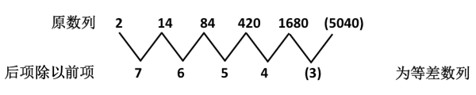

因此原数列的下一项为：。

故正确答案为D。

**来源**：2010年918联考《行测》题（山西/河南/辽宁/福建/重庆/海南/青海/宁夏/内蒙古/陕西/西藏）第31题

### 第 32 题

1/2，1/2，1/2，7/16，，

A. 

B. 1/4

C. 

D. 1/3

第 32 题 · 答案与解析

**参考答案（粉笔题库参考内容）**

B

**解析**

本题是分数数列。对原数列进行反约分，变为1/2，，，7/16，，(    )，其中分子列为二级等差数列，分母列为等比数列。

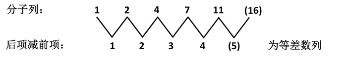

因此原数列的下一项为，即为1/4。

故正确答案为B。

**来源**：2010年918联考《行测》题（山西/河南/辽宁/福建/重庆/海南/青海/宁夏/内蒙古/陕西/西藏）第32题

### 第 33 题

5，6，16，28，60，（    ）

A. 72

B. 84

C. 92

D. 116

第 33 题 · 答案与解析

**参考答案（粉笔题库参考内容）**

D

**解析**

原数列为递推和数列。递推规律：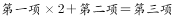，具体规律为：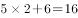，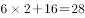，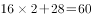，故所求项为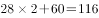。

故正确答案为D。

**来源**：2010年918联考《行测》题（山西/河南/辽宁/福建/重庆/海南/青海/宁夏/内蒙古/陕西/西藏）第33题

### 第 34 题

3，5，10，25，75，（    ），875

A. 125

B. 250

C. 275

D. 350

第 34 题 · 答案与解析

**参考答案（粉笔题库参考内容）**

B

**解析**

本题为递推数列。递推规律为：（第二项-第一项）×5=第三项。

具体规律为：，，。

因此所求项为：。

验证：，符合规律。

故正确答案为B。

**来源**：2010年918联考《行测》题（山西/河南/辽宁/福建/重庆/海南/青海/宁夏/内蒙古/陕西/西藏）第34题

### 第 35 题

10，24，52，78，（    ），164

A. 106

B. 109

C. 124

D. 126

第 35 题 · 答案与解析

**参考答案（粉笔题库参考内容）**

D

**解析**

原数列为平方修正数列。

原数列：10，24，52，78，（    ），164；

平方项：，，，，，，底数为等差数列；

修正项：+1，-1，+3，-3，+5，-5，正负交替出现；

则所求项为。

故正确答案为D。

**来源**：2010年918联考《行测》题（山西/河南/辽宁/福建/重庆/海南/青海/宁夏/内蒙古/陕西/西藏）第35题

### 第 36 题

在一个除法算式里，被除数、除数、余数和商之和是319，已知商是21，余数是6，问被除数是多少：

A. 237

B. 258

C. 279

D. 290

第 36 题 · 答案与解析

**参考答案（粉笔题库参考内容）**

C

**解析**

设被除数、除数分别为x、y。根据余数基本恒等式可得：x＝21y＋6；根据题目条件可得：x＋y＋21＋6＝319。联立以上两个方程可解得x＝279，y＝13，因此被除数是279。

故正确答案为C。

**来源**：2010年918联考《行测》题（山西/河南/辽宁/福建/重庆/海南/青海/宁夏/内蒙古/陕西/西藏）第36题

### 第 37 题

已知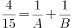，A、B为自然数，且，那么A有几个不同的值：

A. 2

B. 3

C. 4

D. 5

第 37 题 · 答案与解析

**参考答案（粉笔题库参考内容）**

B

**解析**

由题意中，且A、B均为自然数可得，代入题干等式可知，即。

另外由A、B均为自然数，可知，因此：，综合可得：，故，结合B为自然数，可知B可能为4、5、6、7。

依次代入可得：

当B=4时，A=60；

当B=5时，A=15；

当B=6时，A=10；

当B=7时，A不是自然数。

因此，A有3个不同的值。

故正确答案为B。

**来源**：2010年918联考《行测》题（山西/河南/辽宁/福建/重庆/海南/青海/宁夏/内蒙古/陕西/西藏）第37题

### 第 38 题

一副扑克牌有52张，最上面一张是红桃A。如果每次把最上面的10张移到最下面而不改变它们的顺序及朝向，那么，至少经过多少次移动，红桃A会出现在最上面：

A. 27

B. 26

C. 25

D. 24

第 38 题 · 答案与解析

**参考答案（粉笔题库参考内容）**

B

**解析**

每次移动扑克牌张数为10，因此移动的扑克牌总数必然是10的倍数；又因红桃A从最上面再回到最上面，则移动的扑克牌总数必然是52的倍数。10与52的最小公倍数是260，即移动扑克牌数达到260后，红桃A再次出现在最上面，移动次数为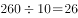次。

故正确答案为B。

**考点**：公倍数与公约数问题

**来源**：2018年福建省选调生考试《行政职业能力测验》第59题

### 第 39 题

一果农想将一块平整的正方形土地分割为四块小的正方形土地，并将果树均匀整齐地种植在土地的所有边界上，且在每块土地的四个角上都种上一棵果树。该果农未经细算就购买了60颗果树，如果仍按上述想法种植，那么他至少多买了多少棵果树：

A. 0

B. 3

C. 6

D. 15

第 39 题 · 答案与解析

**参考答案（粉笔题库参考内容）**

B

**解析**

将大正方形分割成4块小正方形后，有9个顶点，12条边，设每条边不含顶点种n棵果树且n为自然数，则有共种植(12n+9)棵果树。根据题意可得：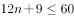，即n应为符合不等式的最大正整数，从而可发现当n＝4时，共种植57棵果树，最接近60，因此至少多买了3棵果树。

故正确答案为B。

**考点**：非典型最值问题

**来源**：2010年918联考《行测》题（山西/河南/辽宁/福建/重庆/海南/青海/宁夏/内蒙古/陕西/西藏）第39题

### 第 40 题

某社团共有46人，其中35人爱好戏剧，30人爱好体育，38人爱好写作，40人爱好收藏，这个社团至少有多少人以上四项活动都喜欢：

A. 5

B. 6

C. 7

D. 8

第 40 题 · 答案与解析

**参考答案（粉笔题库参考内容）**

A

**解析**

逆向考虑，分别考虑不喜欢其中某项活动的人数是多少。由题意可知，不喜欢戏剧的有11人，不喜欢体育的有16人，不喜欢写作的有8人，不喜欢收藏的有6人，只有当这四项集合相互没有交集时，四项活动都喜欢的人数才最少，因此最少人数为：46-(11+16+8+6)=5人。

故正确答案为A。

备注：要使四项都喜欢的人数最少，则需要使至少不喜欢其中某一项的人数最多，而人数最多的情况为不喜欢其中某一项的四个集合之间不产生交叉。

**考点**：多集合反向构造

**来源**：2010年918联考《行测》题（山西/河南/辽宁/福建/重庆/海南/青海/宁夏/内蒙古/陕西/西藏）第40题

### 第 41 题

一项工程由甲、乙、丙三个工程队共同完成需要15天，甲队与乙队的工作效率相同，丙队3天的工作量与乙队4天的工作量相同，三队同时开工2天后，丙队被调往另一工地，甲、乙两队留下继续工作。那么，开工22天以后，这项工程：

A. 已经完工

B. 余下的量需甲、乙两队共同工作1天

C. 余下的量需乙、丙两队共同工作1天

D. 余下的量需甲、乙、丙三队共同工作1天

第 41 题 · 答案与解析

**参考答案（粉笔题库参考内容）**

D

**解析**

设工程总量为150，则甲、乙、丙三个工程队每天效率的和为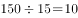，又知“甲队与乙队的工作效率相同，丙队3天的工作量与乙队4天的工作量相同”，可知甲、乙和丙三个工程队每天效率分别为3、3和4，开工22天，即甲和乙工作22天，丙工作2天，此时剩余工程量为：，因此余下工作量需甲、乙、丙三队共同工作1天。

故正确答案为D。

**考点**：给效率比例型

**来源**：2010年918联考《行测》题（山西/河南/辽宁/福建/重庆/海南/青海/宁夏/内蒙古/陕西/西藏）第41题

### 第 42 题

某家具店购进100套桌椅，每套进价200元，按期望获利50%定价出售，卖掉60套桌椅后，店主为了提前收回资金，打折出售余下的桌椅，售完全部桌椅后，实际利润比期望利润低了18%，余下的桌椅是打几折出售的？

A. 七五折

B. 八二折

C. 八五折

D. 九五折

第 42 题 · 答案与解析

**参考答案（粉笔题库参考内容）**

C

**解析**

根据题意可得，期望利润为：，则实际利润为：。

设余下的折扣为y，原来售价为：，则有：，解得y＝0.85，即八五折。

故正确答案为C。

**考点**：经济利润问题

**来源**：2010年918联考《行测》题（山西/河南/辽宁/福建/重庆/海南/青海/宁夏/内蒙古/陕西/西藏）第42题

### 第 43 题

小王从家开车上班，汽车行驶10分钟后发生了故障，小王从后备箱中取出自行车继续赶路，由于自行车的车速只有汽车的，小王比预计时间晚了20分钟到达单位，如果之前汽车再多行驶6公里，他就能少迟到10分钟，从小王家到单位的距离是多少公里？

A. 12

B. 14

C. 15

D. 16

第 43 题 · 答案与解析

**参考答案（粉笔题库参考内容）**

D

**解析**

汽车与自行车速度之比为5：3，设汽车速度为5v，则自行车速度为3v，根据题意可知汽车行驶6公里的路程用时比自行车少20-10=10分钟小时，即，解得v=4.8公里/小时，汽车行驶速度为5v=24公里/小时。

方法一：比例行程问题，根据公式S=v×t，速度一定时，距离与时间成正比，设汽车发生故障时距离单位S公里，已知自行车与汽车的速度差是一定的，则路程与时间差成正比，即S:(S-6)=20:10，则S=12公里，汽车10分钟行驶距离为公里，则从小王家到单位距离为12+4=16公里。

方法二：比例行程问题，根据公式S=v×t，路程一定时，速度与时间成反比，。设汽车故障位置到单位的路程中自行车与汽车用时分别为5t，3t，则5t-3t=20分钟，则t=10分钟，从小王家到单位汽车需行驶3t+10=40分钟小时。则全程距离为公里。

故正确答案为D。

**考点**：普通行程

**来源**：2010年918联考《行测》题（山西/河南/辽宁/福建/重庆/海南/青海/宁夏/内蒙古/陕西/西藏）第43题

### 第 44 题

长方形ABCD的面积是72平方厘米，E、F分别是CD、BC的中点，三角形AEF的面积是多少平方厘米？

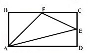

A. 24

B. 27

C. 36

D. 40

第 44 题 · 答案与解析

**参考答案（粉笔题库参考内容）**

B

**解析**

虽然为规则几何图形，但不是特殊的三角形，且三边值未知，若正面求解较为麻烦。从逆向考虑，注意到可以看作长方形依次去除周围三个三角形得到。由比例关系可知，的面积为长方形面积的1/4，的面积为长方形面积的1/4，而的面积为长方形面积的，因此的面积为长方形面积的，故可知其面积为平方厘米。

故正确答案为B。

**考点**：几何公式类-平面图形、几何结论类-三角形相关

**来源**：2010年918联考《行测》题（山西/河南/辽宁/福建/重庆/海南/青海/宁夏/内蒙古/陕西/西藏）第44题

### 第 45 题

长为1米的细绳上系有一个小球，从A处放手以后，小球第一次摆到最低点B处共移动了多少米？

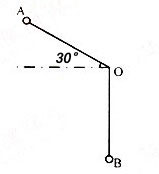

A. 

B. 

C. 

D. 

第 45 题 · 答案与解析

**参考答案（粉笔题库参考内容）**

A

**解析**

如下图所示，C点和A点关于中间的虚线对称，小球从A点到C点做自由落体直线运动，从C点到B点做半径为1米的圆周运动。，OA=OC=1米，则，故为等边三角形，则AC=1米；，则圆弧米，故小球移动的距离米。

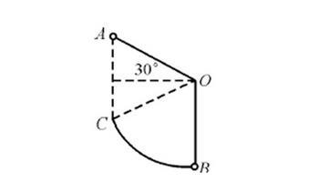

故正确答案为A。

备注：本题所求移动距离由线段与圆弧两部分组成，正确把握分界点是解题关键。考题中的分界点一般与物理常识相关。

**考点**：几何公式类-平面图形、几何结论类-三角形相关

**来源**：2010年918联考《行测》题（山西/河南/辽宁/福建/重庆/海南/青海/宁夏/内蒙古/陕西/西藏）第45题

### 第 46 题

从所给的四个选项中，选择最合适的一个填入问号处，使之呈现一定的规律性：

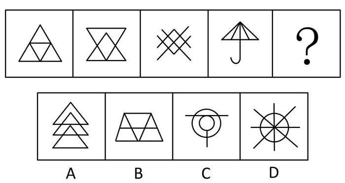

A. A

B. B

C. C

D. D

第 46 题 · 答案与解析

**参考答案（粉笔题库参考内容）**

C

**解析**

元素组成凌乱，考查数数。

本题主要考查图形封闭区域的个数，题干4个图形的封闭空间数均为4，4个选项图形的封闭空间数依次为6、6、4、8。

故正确答案为C。

**考点**：数量规律-面

**来源**：2010年918联考《行测》题（山西/河南/辽宁/福建/重庆/海南/青海/宁夏/内蒙古/陕西/西藏）第46题

### 第 47 题

从所给的四个选项中，选择最合适的一个填入问号处，使之呈现一定的规律性：

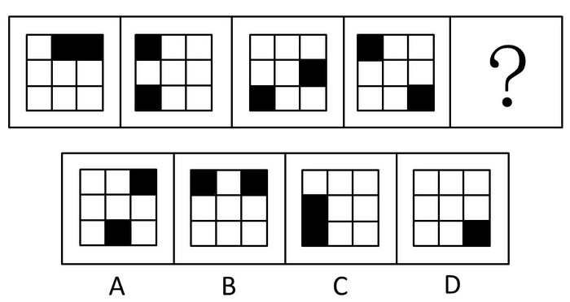

A. A

B. B

C. C

D. D

第 47 题 · 答案与解析

**参考答案（粉笔题库参考内容）**

A

**解析**

元素组成相同，优先考虑位置规律。如下图所示，黑块1每次逆时针平移3格，黑块2每次逆时针平移2格，只有A项符合。

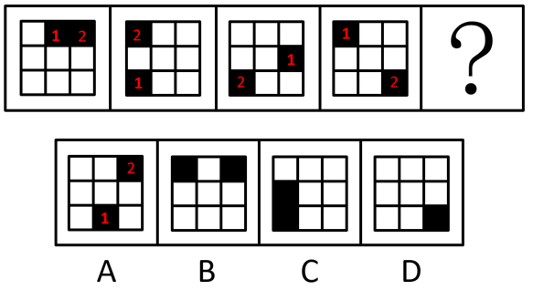

故正确答案为A。

**考点**：位置规律-平移

**来源**：2010年918联考《行测》题（山西/河南/辽宁/福建/重庆/海南/青海/宁夏/内蒙古/陕西/西藏）第47题

### 第 48 题

从所给的四个选项中，选择最合适的一个填入问号处，使之呈现一定的规律性：

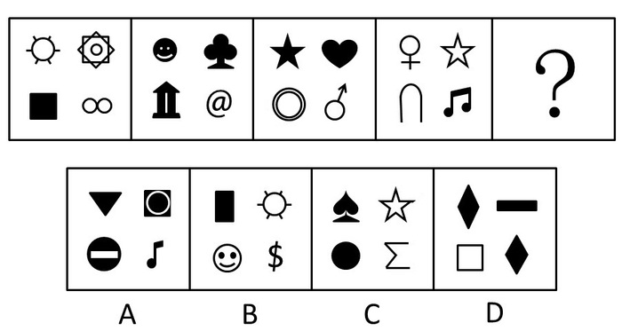

A. A

B. B

C. C

D. D

第 48 题 · 答案与解析

**参考答案（粉笔题库参考内容）**

A

**解析**

元素组成不同，且无明显属性规律，考虑数量规律。题干图形出现多个小元素，考虑元素的种类和个数。观察发现，题干每幅图中均有4种不同的元素，并且每幅图形之间的元素组成均不相同，故？处图形内部应有4种元素，且与前面出现过的元素均不相同，只有A项符合。

故正确答案为A。

**考点**：数量规律-素

**来源**：2010年918联考《行测》题（山西/河南/辽宁/福建/重庆/海南/青海/宁夏/内蒙古/陕西/西藏）第48题

### 第 49 题

从所给的四个选项中，选择最合适的一个填入问号处，使之呈现一定的规律性：

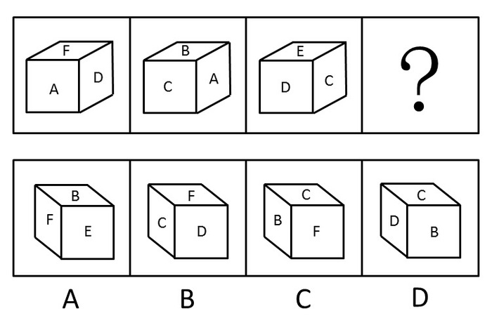

A. A

B. B

C. C

D. D

第 49 题 · 答案与解析

**参考答案（粉笔题库参考内容）**

A

**解析**

观察图1和图2，都有面A，而面B、C、D、F都与面A相邻，所以面A和面E是相对面，不可能同时出现；

同理，再看图2和图3，都有面C，面A、B、D、E都与面C相邻，所以面C和面F是相对面，不可能同时出现，排除B、C两项；

比较图1和图3，都有面D，而面A、C、E、F都与面D相邻，所以面B和面D是相对面，不可能同时出现，排除D项。

故正确答案为A。

**考点**：空间类-空间重构-六面体

**来源**：2010年918联考《行测》题（山西/河南/辽宁/福建/重庆/海南/青海/宁夏/内蒙古/陕西/西藏）第49题

### 第 50 题

从所给的四个选项中，选择最合适的一个填入问号处，使之呈现一定的规律性：

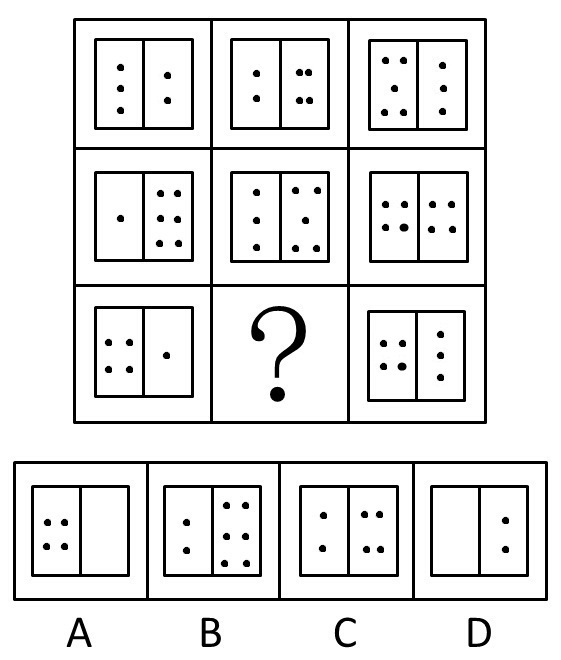

A. A

B. B

C. C

D. D

第 50 题 · 答案与解析

**参考答案（粉笔题库参考内容）**

D

**解析**

本题主要考查图形的点数量变化规律。

横行来看，左侧是相加，右侧是等差。第1，2列里前一格的黑点相加等于第3列里前一格的黑点，后一格中的黑点每一行均成等差数列（2、3、4）、（4、5、6）。在第三行问号处填入D项，满足此规律。

故正确答案为D。

**考点**：数量规律-素

**来源**：2010年918联考《行测》题（山西/河南/辽宁/福建/重庆/海南/青海/宁夏/内蒙古/陕西/西藏）第50题

### 第 51 题

不确定性避免是指在任何一个社会中，人们对于不确定的、含糊的、前途未卜的情景，都会感到面对的是一种威胁，从而总是试图加以防止。

根据上述定义，下列不属于不确定性避免的是：

A. 学校号召研究生出国深造，小王觉得自己生活比较安定，不想出去，就说：“我的外语水平不行，还是把机会让给其他同学吧。”

B. 随着金融风暴的到来，股市涨跌起伏不定，小赵将自己手上的股票迅速抛掉

C. 毕业答辩日期临近，小李对于答辩老师可能提出的问题心中没底，非常紧张

D. 小张在去国企工作还是自己创业之间反复思考，觉得后者风险太大，于是选择进入国企

第 51 题 · 答案与解析

**参考答案（粉笔题库参考内容）**

C

**解析**

第一步：找出定义关键词。

“不确定的、含糊的、前途未卜的情景”、“试图加以防止”。

第二步：逐一分析选项。

A、B、D三项中的情境都是不确定、含糊的、前途未卜的，且都试图加以阻止，符合定义，排除；

C项，小李没有试图阻止，不符合“试图加以防止”，不符合定义，当选。

本题为选非题，故正确答案为C。

**考点**：原因结果

**来源**：2010年918联考《行测》题（山西/河南/辽宁/福建/重庆/海南/青海/宁夏/内蒙古/陕西/西藏）第51题

### 第 52 题

文化反哺是指在急速的文化变迁时代所发生的年长一代向年轻一代进行广泛的文化吸收的过程。

根据上述定义，下列属于文化反哺的是：

A. 七十年代出生的人并不是狂热的追星族，但很多人都非常喜欢八十年代出生的歌星创作的一些歌曲

B. 张老师说：“现在教学都是电子化，很多时候要做PPT，要上网查资料，遇到不会的时候，儿子就是我的老师。”

C. 孙经理说，他们单位年轻人居多，他尝试着用跟儿子交流的方式与年轻人沟通，果然效果很好

D. 刘主任接受了下属们的建议，制定了新的工作制度，提高了员工的工作积极性

第 52 题 · 答案与解析

**参考答案（粉笔题库参考内容）**

B

**解析**

第一步：抓住定义中关键词。

定义的关键词包括“文化变迁时代”、“年长一代向年轻一代”和“文化吸收”。

第二步：逐一判断选项。

A项中如果加入七十年代的人是受到身边的八九十年代的人的影响，从而喜欢八十年代出生的歌星创造的一些歌曲的话，才算是文化反哺；

B项中张老师向儿子学习上网，属于文化反哺；

C项中与儿子的交流方式并不是文化吸收的过程；

D项中刘主任与下属的关系并不能确定为年长一代向年轻一代的关系。

故正确答案为B。

**考点**：单定义-其他句式

**来源**：2010年918联考《行测》题（山西/河南/辽宁/福建/重庆/海南/青海/宁夏/内蒙古/陕西/西藏）第52题

### 第 53 题

社会促进是指个体从事某项活动时，他人在场促进其活动完成，提高其活动效率的现象，也称社会助长。

根据上述定义，下列不属于社会促进的是：

A. 学生在进行数学计算时，教师的旁观可使学生充分开动脑筋

B. 小王扶起跌倒的李大爷，他觉得自己做了一件有意义的事

C. 员工在进行生产时，厂长站在车间里，员工效率就会大大提升

D. 足球运动员走进球场时，看到比赛场座无虚席就会斗志昂扬

第 53 题 · 答案与解析

**参考答案（粉笔题库参考内容）**

B

**解析**

第一步：抓住定义中关键词。

定义的关键词强调“他人在场”、“促进”。

第二步：逐一判断选项。

B项中小王扶起李大爷，是他自己觉得有意义，并不是因为别人在场促进他产生的行为，不符合定义；

A、C、D三项均符合社会促进的定义。

本题为选非题，故正确答案为B。

**考点**：单定义-其他句式

**来源**：2010年918联考《行测》题（山西/河南/辽宁/福建/重庆/海南/青海/宁夏/内蒙古/陕西/西藏）第53题

### 第 54 题

庭院经济是指农户充分利用家庭庭落的空间、周围非承包的空坪隙地和各种资源，从事高度集约化商品生产的一种经营形式，主要有种植业、养殖业、加工业。

根据上述定义，下列属于庭院经济的是：

A. 在阳台上种植花草美化居住环境

B. 在承包的池塘养殖鲤鱼

C. 在自家后院加盖瓦房建立手工艺编织厂

D. 在草原上放牧羊群

第 54 题 · 答案与解析

**参考答案（粉笔题库参考内容）**

C

**解析**

第一步：抓住定义中关键词。

定义强调“用家庭庭落的空间、周围非承包的空坪隙地和各种资源”，从事的是“商品生产”。

第二步：逐一判断选项。

A项不是商品生产；

B项是承包行为；

D项利用的不是家庭庭院，均不符合定义；

只有C项符合定义。

故正确答案为C。

**考点**：方式目的

**来源**：2010年918联考《行测》题（山西/河南/辽宁/福建/重庆/海南/青海/宁夏/内蒙古/陕西/西藏）第54题

### 第 55 题

积累基金是指国民收入中用作追加生产资金的部分，主要包括扩大再生产基金，如建工厂、修铁路、开垦土地、兴建水利等；非生产性基本建设基金，如修建学校、医院、体育场馆以及国家行政、国防部门的基本建设等；社会后备资金，如应付战争、自然灾害等突发性事件的物质储备等。

根据上述定义，下列不属于积累基金的是：

A. 三峡工程建设费用

B. 地震灾区学校重建费用

C. 奥运会场馆建设费用

D. 军事演习费用

第 55 题 · 答案与解析

**参考答案（粉笔题库参考内容）**

D

**解析**

第一步：找出定义关键词。

“扩大再生产基金，如建工厂、修铁路、开垦土地、兴建水利等；非生产性基本建设基金，如修建学校、医院、体育场馆以及国家行政、国防部门的基本建设等；社会后备资金，如应付战争、自然灾害等突发性事件的物质储备”。

第二步：逐一分析选项。

A项，符合“兴建水利”，符合定义，排除；

B项，符合“修建学校”，符合定义，排除；

C项，符合“修建体育场馆”，符合定义，排除；

D项，看似符合“应付战争”，但根据题干“应付战争······的物质储备”可知，军事演习不是物质储备，不符合定义，当选。

本题为选非题，故正确答案为D。

**考点**：单定义-其他句式

**来源**：2010年918联考《行测》题（山西/河南/辽宁/福建/重庆/海南/青海/宁夏/内蒙古/陕西/西藏）第55题

### 第 56 题

职业病是指企业、事业单位和个体经济组织的劳动者在职业活动中，因接触粉尘、放射性物质和其他有毒、有害物质等因素而引起的疾病。

根据上述定义，下列属于职业病的是：

A. 李老师搬进了刚装修的新办公室，由于有害气体严重超标，导致她患上了血液病

B. 刑警老王在近30年的职业生涯中接触过各种犯罪分子，在日常生活中，他也经常用职业的眼神打量亲朋好友

C. 小赵是一家公司的高级管理人员，工作经常加班加点，饮食很不规律，终于被医院查出患上了胃炎

D. 小张在一家皮鞋厂工作，因长期接触含苯物质而患上了再障性贫血

第 56 题 · 答案与解析

**参考答案（粉笔题库参考内容）**

D

**解析**

第一步：抓住定义中关键词。

定义强调的关键词包括“职业活动”、“毒害物质”。

第二步：逐一判断选项。

A项不属于职业活动；

B、C两项中老王和小赵都没有接触毒害物质；

D项中小张在鞋厂工作属于职业活动，接触的苯物质属于毒害物质，并引起了再障性贫血，符合定义。

故正确答案为D。

**考点**：原因结果

**来源**：2010年918联考《行测》题（山西/河南/辽宁/福建/重庆/海南/青海/宁夏/内蒙古/陕西/西藏）第56题

### 第 57 题

主观镜头是指在影视活动中把摄像机的镜头当做剧中人的眼睛，直接“目击”剧中人所看到的景象。

根据上述定义，下列属于主观镜头的是：

A. 电视剧《红楼梦》描写林黛玉初进贾府与别家不同，心情很复杂，于是处处留心，时时在意

B. 电视剧《三国演义》在展示蒋干“窃书”过程中，把周瑜帐中的每一个角落都用特写镜头进行了放大呈现

C. 电视剧《水浒传》中的豹子头林冲一出场就给了特写镜头，凸显了其外貌特征：“豹头环眼，燕颔虎须，八尺长短身材”

D. 电视剧《西游记》中，孙悟空大闹天宫时，镜头详细表现了打斗的过程

第 57 题 · 答案与解析

**参考答案（粉笔题库参考内容）**

B

**解析**

第一步：抓住定义中关键词。

定义的关键词句为“把摄像机的镜头当做剧中人的眼睛”。

第二步：逐一判断选项。

A项是对林黛玉表现的描写，不是她所看到的情景；

B项中“周瑜帐中的每一个角落”正是蒋干的眼睛所看到的内容，符合定义；

C、D两项都是特写，只有某个场景，不是剧中人林冲和孙悟空“目击”的情形。

故正确答案为B。

**考点**：单定义-其他句式

**来源**：2010年918联考《行测》题（山西/河南/辽宁/福建/重庆/海南/青海/宁夏/内蒙古/陕西/西藏）第57题

### 第 58 题

冗余设计是指在人力资源聘任、使用、解聘、辞退、晋升等过程中要留有充分的余地，使人力资源整体运行过程具有一定的弹性，当某一决策发生偏差时，留有纠偏和重新决策的余地。

根据上述定义，以下不属于冗余定义的是：

A. 篮球比赛中双方各出场5名队员，但通常每支职业篮球队有12—15人

B. 某公司每年都会招一批大学生，让他们在每个岗位实习，作为储备干部培养

C. 某物业配电室配备了两个人，即使一人有事外出，也可以保证有人值班

D. 设计部的一名员工辞职，公司立即从质检部抽人兼任，同时人力资源部开始紧急招人

第 58 题 · 答案与解析

**参考答案（粉笔题库参考内容）**

D

**解析**

第一步：找出定义关键词。

“留有充分的余地”。

第二步：逐一分析选项。

D项，抽人兼任、紧急招人，属于设计部没有在员工聘用上“留余地”所导致的被动行为，不符合“留有充分的余地”，不符合定义，当选；

A、B、C三项均符合定义，排除。

本题为选非题，故正确答案为D。

**考点**：单定义-其他句式

**来源**：2010年918联考《行测》题（山西/河南/辽宁/福建/重庆/海南/青海/宁夏/内蒙古/陕西/西藏）第58题

### 第 59 题

股东代表诉讼是指当公司的合法权益受到不法侵害而公司却怠于起诉时，公司的股东即以自己的名义起诉，所获赔偿归于公司的一种诉讼制度。

根据上述定义，以下情形可以提起股东代表诉讼的是：

A. 甲公司连续5年盈利，却不向股东分配利润

B. 乙公司由于经营不善，连年亏损，公司股东要求查询会计账簿，被公司拒绝

C. 丙公司经理私自以公司资产为他人提供担保，公司董事会就此提出诉讼

D. 某公司拖欠丁公司大笔贷款已近两年，而丁公司董事会和经理未采取任何措施索要

第 59 题 · 答案与解析

**参考答案（粉笔题库参考内容）**

D

**解析**

第一步：抓住定义中关键词。

关键词包括“公司的合法权益受到不法侵害······公司却怠于起诉时······所获赔偿归于公司。”

第二步：逐一判断选项。

A、B两项中的公司的合法权益没有受到不法侵害；

C项中“公司董事会就此提起诉讼”说明公司对不法侵害是积极应对的，不是“怠于起诉”的，所以均不能提起股东代表诉讼；

D项中丁公司的合法权益受到损害，同时其董事会和经理又未采取措施，所以可以提起股东代表诉讼。

故正确答案为D。

**考点**：单定义-其他句式

**来源**：2010年918联考《行测》题（山西/河南/辽宁/福建/重庆/海南/青海/宁夏/内蒙古/陕西/西藏）第59题

### 第 60 题

定义：

①行政赔偿：行政主体违法实施行政行为，侵犯相对人合法权益造成损害时由国家承担的一种赔偿责任。

②行政补偿：国家行政机关及其工作人员在管理国家和社会公共事务的过程中，因合法的行政行为给公民、法人或其他组织的合法权益造成了损失，由国家依法予以补偿的制度。

③行政追偿：行政赔偿义务机关代表国家向行政赔偿请求人支付赔偿费用后，依法责令有故意或重大过失的组织和个人承担部分或全部赔偿费用的法律制度。

例证：

（1）李某的宅基地被国家征用，获得各种补偿款六万元。

（2）某城建执法大队在拆除违章建筑时损害了相邻的合法建筑，后执法大队私下对房屋所有人进行了赔偿。

（3）刑警赵某对疑犯刑讯逼供造成重伤，公安机关对当事人进行赔偿之后，责令赵某承担部分医疗费用。

符合上述三种定义之一的例证有几个？

A. 0

B. 1

C. 2

D. 3

第 60 题 · 答案与解析

**参考答案（粉笔题库参考内容）**

C

**解析**

第一步：抓住每个定义中的关键词。

行政赔偿的关键词是“行政主体违法”、“由国家赔偿”；行政补偿的关键词是“合法的行政行为”；行政追偿的关键词是“行政赔偿义务机关代表国家……责令有故意或重大过失的组织和个人承担”。

第二步：逐一判断选项。

例证（1）中，国家行政机关实施合法的行政行为，并给予李某补偿，属于行政补偿；

例证（2）中，执法大队对合法建筑造成损害，给予赔偿时采取私下解决的办法，不符合“由国家承担”赔偿的制度，不属于行政赔偿；

例证（3）中，公安机关给予当事人赔偿，并责令赵某承担部分费用，属于行政追偿。

综上所述，符合题干三种定义之一的例证有2个。

故正确答案为C。

**考点**：特殊问法

**来源**：2010年918联考《行测》题（山西/河南/辽宁/福建/重庆/海南/青海/宁夏/内蒙古/陕西/西藏）第60题

### 第 61 题

鱼：鳞片

A. 人：衣服

B. 鸟：羽毛

C. 书：目录

D. 蚕：蚕茧

第 61 题 · 答案与解析

**参考答案（粉笔题库参考内容）**

B

**解析**

第一步：判断题干词语间逻辑关系。

鳞片是鱼身体的一部分，二者为包容关系中的组成关系。

第二步：判断选项词语间逻辑关系。

A项：衣服不是人身体的一部分，二者不是组成关系，与题干逻辑关系不一致，排除；

B项：羽毛是鸟身体的一部分，二者为包容关系中的组成关系，与题干逻辑关系一致，保留；

C项：目录是书的组成部分，二者为包容关系中的组成关系，与题干逻辑关系一致，保留；

D项：蚕是蚕蛾的幼虫，蚕茧是指桑蚕的茧，二者不是包容关系，与题干逻辑关系不一致，排除。

对比B、C两项，B项中的“鸟”和题干中的“鱼”都属于动物，而C项的“书”不是动物，因此B项与题干逻辑关系更为一致。

故正确答案为B。

**考点**：逻辑关系-包容关系

**来源**：2010年918联考《行测》题（山西/河南/辽宁/福建/重庆/海南/青海/宁夏/内蒙古/陕西/西藏）第61题

### 第 62 题

并蒂莲：鸳鸯

A. 松树：仙鹤

B. 夜来香：蝙蝠

C. 何首乌：画眉

D. 牡丹：孔雀

第 62 题 · 答案与解析

**参考答案（粉笔题库参考内容）**

A

**解析**

第一步：判断题干词语间的逻辑关系。

并蒂莲和鸳鸯都有相同的寓意，即夫妻恩爱。并且前者是一种植物，后者是一种动物。

第二步：判断选项词语间的逻辑关系。

四个选项中，只有A项中的松树和仙鹤具有相同寓意，都是比喻长寿，并且前者是植物后者是动物。

故正确答案为A。

**考点**：语义关系-比喻象征义

**来源**：2010年918联考《行测》题（山西/河南/辽宁/福建/重庆/海南/青海/宁夏/内蒙古/陕西/西藏）第62题

### 第 63 题

谬论：结论

A. 纠纷：纠葛

B. 相识：见识

C. 承认：否认

D. 否决：表决

第 63 题 · 答案与解析

**参考答案（粉笔题库参考内容）**

D

**解析**

第一步：判断题干词语间逻辑关系。

题干两个词属于包容关系中的种属关系，谬论是一种错误的结论。

第二步：判断选项词语间逻辑关系。

A项，纠纷与纠葛是近义词，都是纠缠不清，不易解决，与题干不符。

B项，相识是指互相认识，见识是指接触事物，扩大见闻，也指明智地、正确地作出判断及认识的能力。两个词意思不同，也不属于种属关系，与题干不符。

C项，承认与否认是反义关系，与题干不符。

D项，否决与表决属于包容关系中的种属关系，否决是一种不认可的表决，与题干相符。

故正确答案为D。

**考点**：逻辑关系-包容关系

**来源**：2010年918联考《行测》题（山西/河南/辽宁/福建/重庆/海南/青海/宁夏/内蒙古/陕西/西藏）第63题

### 第 64 题

时间：速度

A. 空间：质量

B. 体积：密度

C. 压力：效率

D. 价格：价值

第 64 题 · 答案与解析

**参考答案（粉笔题库参考内容）**

B

**解析**

第一步：判断题干词语间的逻辑关系。

题干两词构成对应关系，属于一一对应的物理学名词。速度等于路程除以时间，路程一定时，时间和速度成反相关。

第二步：判断选项词语间的逻辑关系。

A项中空间和质量并非完全对应；

B项中，密度等于质量除以体积，质量一定时，密度和体积成反相关，与题干逻辑一致；

C、D两项并非都是物理学名词。

故正确答案为B。

**考点**：逻辑关系-对应关系

**来源**：2010年918联考《行测》题（山西/河南/辽宁/福建/重庆/海南/青海/宁夏/内蒙古/陕西/西藏）第64题

### 第 65 题

演员：导演

A. 作家：读者

B. 战士：指挥官

C. 司机：交警

D. 歌手：经纪人

第 65 题 · 答案与解析

**参考答案（粉笔题库参考内容）**

B

**解析**

第一步：判断题干词语间的逻辑关系。

题干两词是并列关系，二者都是电影工作者，而且演员表演时要受导演的指挥。

第二步：判断选项词语间的逻辑关系。

A、C两项中作家和读者、司机和交警属于对应关系；

B项中战士和指挥官是并列关系，两者都是军人，并且战士要听从指挥官的指挥；

D项歌手是经纪人的雇佣方，经纪人听从歌手的管理。

故正确答案为B。

**考点**：逻辑关系-并列关系

**来源**：2010年918联考《行测》题（山西/河南/辽宁/福建/重庆/海南/青海/宁夏/内蒙古/陕西/西藏）第65题

### 第 66 题

子弹：枪管

A. 马车：山路

B. 原子：原子核

C. 电流：电缆

D. 行人：斑马线

第 66 题 · 答案与解析

**参考答案（粉笔题库参考内容）**

C

**解析**

第一步：判断题干词语间的逻辑关系。

题干两词属于对应关系，子弹通过枪管发射，两者完全一一对应。

第二步：判断选项词语间的逻辑关系。

A项山路上并非只能行驶马车，并非一一对应；

B项原子和原子核属于包容关系；

C项电流通过电缆传播，符合题干逻辑；

D项行人并非只能行走在斑马线上，并非一一对应。

故正确答案为C。

**考点**：逻辑关系-对应关系

**来源**：2010年918联考《行测》题（山西/河南/辽宁/福建/重庆/海南/青海/宁夏/内蒙古/陕西/西藏）第66题

### 第 67 题

地膜覆盖：增温保水

A. 田间管理：霜冻虫害

B. 临床试验：不良反应

C. 天气预报：卫星云图

D. 整顿市场：净化风气

第 67 题 · 答案与解析

**参考答案（粉笔题库参考内容）**

D

**解析**

第一步：判断题干词语间的逻辑关系。

题干两词属于因果关系，地膜覆盖是为了达到增温保水的目的。

第二步：判断选项词语间的逻辑关系。

A项中霜冻虫害是田间管理的原因，和题干逻辑顺序相反；

B项中临床试验可能导致不良反应，但并非是其目的；

C项中天气预报是根据卫星云图做出，和题干逻辑顺序相反；

D项中整顿市场是为了净化风气，符合题干逻辑。

故正确答案为D。

**考点**：逻辑关系-对应关系

**来源**：2010年918联考《行测》题（山西/河南/辽宁/福建/重庆/海南/青海/宁夏/内蒙古/陕西/西藏）第67题

### 第 68 题

促销：利润：商城

A. 游戏：娱乐：游乐场

B. 美化：绿化：城市

C. 检修：安全：铁路部门

D. 诚信：美德：人类

第 68 题 · 答案与解析

**参考答案（粉笔题库参考内容）**

C

**解析**

第一步：判断题干词语间逻辑关系。

题干三个词是对应关系，商城促销的目的是获得利润。

第二步：判断选项词语间逻辑关系。

A项，游戏是娱乐的一种，两者是包容关系，玩游戏的目的是为了获得享受和快感，与题干不符。

B项，城市搞绿化是为了美化环境，但绿化与美化的顺序与题干不一致，与题干不符。

C项，铁路部门检修是为了确保安全，与题干相符。

D项，诚信是美德的一种，两者是包容关系，美德不是诚信的目的，与题干不符。

故正确答案为C。

**考点**：逻辑关系-对应关系

**来源**：2010年918联考《行测》题（山西/河南/辽宁/福建/重庆/海南/青海/宁夏/内蒙古/陕西/西藏）第68题

### 第 69 题

（    ） 对于 处分 相当于 死刑 对于 （    ）

A. 撤职 刑法

B. 开除 刑罚

C. 严厉 严重

D. 警告 抢劫

第 69 题 · 答案与解析

**参考答案（粉笔题库参考内容）**

B

**解析**

第一步：将选项逐一代入，判断词语之间的逻辑关系。

A项，撤职是处分的一种，属于包容关系，死刑是刑罚的一种，但刑法属于法律的一种，两者属于对应关系；

B项，前两词构成包容关系，后两词也构成包容关系；

C项，前后两组词都是对应关系，但顺序相反；

D项，前两词构成包容关系，后两词构成对应关系。

第二步：逻辑关系相同即为答案。

B项前后两组词均构成包容关系。

故正确答案为B。

**考点**：逻辑关系-包容关系

**来源**：2010年918联考《行测》题（山西/河南/辽宁/福建/重庆/海南/青海/宁夏/内蒙古/陕西/西藏）第69题

### 第 70 题

（    ） 对于 爬行 相当于 青蛙 对于 （    ）

A. 缓慢 害虫

B. 匍匐 蟾蜍

C. 运动 动物

D. 螃蟹 跳跃

第 70 题 · 答案与解析

**参考答案（粉笔题库参考内容）**

D

**解析**

第一步：根据题干和选项判断本题考查的逻辑关系。

本题主要考查动物与其运动方式的一一对应关系。

第二步：判断选项词语间的逻辑关系。

根据题干可知，第一个词必须为动物，所以排除A、B、C三项；

D项，螃蟹的运动方式是爬行，青蛙的运动方式是跳跃，前后两组词均为对应关系。

故正确答案为D。

**考点**：逻辑关系-对应关系

**来源**：2010年918联考《行测》题（山西/河南/辽宁/福建/重庆/海南/青海/宁夏/内蒙古/陕西/西藏）第70题

### 第 71 题

如果月球表面曾经是岩浆海洋，那么许多元素的分布就应该是连续的。岩浆海洋掌握着解开月球诞生之谜的钥匙，如果岩浆海洋的存在得到确认，那么“巨型冲击假说”将成为最有力的月亮起源说。

由此可以推出：

A. 如果月球表面不曾是岩浆海洋，那么月球表面的元素分布就不是连续的。

B. 如果“巨型冲击假说”没有成为最有力的月亮起源说，那么表明月球表面的元素分布都不是连续的。

C. 如果月球表面的元素分布不是连续的，那么月球表面不曾是岩浆海洋

D. 如果月球表面的元素分布是连续的，那么“巨型冲击假说”将成为最有力的月亮起源说。

第 71 题 · 答案与解析

**参考答案（粉笔题库参考内容）**

C

**解析**

第一步：翻译题干。

第一句：月球表面曾经是岩浆海洋→许多元素的分布就应该是连续的，第二句：岩浆海洋的存在得到确认→“巨型冲击假说”将成为最有力的月亮起源说。

第二步：逐一翻译选项并判断选项是否正确。

A项：月球表面不曾是岩浆海洋→月球表面的元素分布就不是连续的，“月球表面不曾是岩浆海洋”属于否前件，无法推出确定的结论，排除；

B项：“巨型冲击假说”没有成为最有力的月亮起源说→月球表面的元素分布都不是连续的，这两个条件没有任何联系，排除；

C项：月球表面的元素分布不是连续的→月球表面不曾是岩浆海洋，是题干第一句推导关系的逆否等价，当选；

D项：月球表面的元素分布是连续的→“巨型冲击假说”将成为最有力的月亮起源说，“月球表面的元素分布是连续的”属肯后件，无法推出确定的结论，排除。

故正确答案为C。

**考点**：常规翻译

**来源**：2010年918联考《行测》题（山西/河南/辽宁/福建/重庆/海南/青海/宁夏/内蒙古/陕西/西藏）第71题

### 第 72 题

有人认为“巨额的国家预算赤字必然会导致巨额的国家贸易逆差”，如果这样的话，那么世界上预算赤字最大的国家必然会有相应的最大的贸易逆差；但我们知道，世界上预算赤字最大的国家是美国，而美国的贸易总的来说是顺差而不是逆差（因为尽管其货物贸易亏本，但其技术和服务贸易却赚的非常多）。

由此可以推出：

A. 巨额的国家预算赤字必然不会导致巨额的国家贸易逆差

B. 巨额的国家贸易逆差必然不会导致巨额的国家预算赤字

C. 巨额的国家预算赤字可能不会导致巨额的国家贸易逆差

D. 巨额的国家预算赤字可能会导致巨额的国家贸易逆差

第 72 题 · 答案与解析

**参考答案（粉笔题库参考内容）**

C

**解析**

第一步：翻译题干。利用充分必要条件。

第一句：国家预算赤字→国家贸易逆差，第二句：世界上预算赤字最大的国家→必然会有相应的最大的贸易逆差，第三句是事实信息：世界上预算赤字最大的国家是美国，而美国的贸易总的来说是顺差而不是逆差。

第二步：通过事实信息开始推导，并得到结论。

由于最后的例子与前面的假设相互矛盾，所以说明前面的例证并不是必然成立的，即巨额的国家预算赤字不一定会导致巨额的国家贸易逆差。

故正确答案为C。

**来源**：2010年918联考《行测》题（山西/河南/辽宁/福建/重庆/海南/青海/宁夏/内蒙古/陕西/西藏）第72题

### 第 73 题

某位经营者投入巨资修建了一条连通市区和机场的高速公路，这条公路比原来市区通往机场的高速公路路程短且路况好。当然，这条私营高速公路是要收费的。运行一段时间后，经营者发现车流量比预期要少得多，这条期望中的“招财路”并没有立即招财。

以下各项如果为真，则哪项最不可能造成上述结果：

A. 人们宁可多花时间也不愿支付额外的“过路费”

B. 绝大多数去机场的人还不知道新的高速公路已经开通

C. 金融危机影响了当地居民的收入，外出坐飞机的人减少

D. 与在一般公路上开车相比，在高速公路上开车更具危险性

第 73 题 · 答案与解析

**参考答案（粉笔题库参考内容）**

D

**解析**

第一步：找出题干矛盾。

这条收费的私营高速公路比原来市区通往机场的高速公路路程短且路况好，但运行一段时间后，经营者发现车流量比预期要少得多。

第二步：逐一分析选项。

A项：人们不想出“过路费”，解释了为什么新公路车流量比预期要少，排除；

B项：绝大多数去机场的人还不知道新的高速公路已经开通，解释了为什么新公路车流量比预期要少，排除；

C项：外出坐飞机的人减少，所以需要使用这条路的人变少，解释了为什么新公路车流量比预期要少，排除；

D项：原有公路与新建公路都是高速公路，高速公路的危险性不影响人们更倾向于选择原有公路还是新建公路，不能解释题干矛盾，当选。

本题为选非题，故正确答案为D。

**考点**：原因解释

**来源**：2010年918联考《行测》题（山西/河南/辽宁/福建/重庆/海南/青海/宁夏/内蒙古/陕西/西藏）第73题

### 第 74 题

美国鸟类学基金会在不久前公布了《美国鸟类状况》的报告。他们认为，全球变暖正促使鸟类调整生物钟，提前产蛋期，而上述变化会使这些鸟无法为其刚破壳而出的后代提供足够的食物，比如蓝冠山雀主要以蛾和蝴蝶的幼虫为食，而蛾和蝴蝶的产卵时间没有相应提前，“早产”的小蓝冠山雀会在破壳后数天内持续挨饿。

下列哪项如果为真，最能支持上述论证：

A. 最近40年的英国的平均气温不断上升

B. 很多鸟类的产蛋期确实提前了

C. 除了蛾和蝴蝶的幼虫外，蓝冠山雀很少吃其他食物

D. 蛾和蝴蝶的产卵期不同

第 74 题 · 答案与解析

**参考答案（粉笔题库参考内容）**

C

**解析**

第一步：找到论点和论据。

本题论点是鸟类提前产蛋期，无法为其刚破壳而出的后代提供足够的食物，论据是蓝冠山雀主要以蛾和蝴蝶的幼虫为食，而蛾和蝴蝶的产卵时间没有相应提前，“早产”的小蓝冠山雀会在破壳后数天内持续挨饿。

第二步：逐一判断选项的作用。

A项：最近40年的英国的平均气温不断上升，平均气温升高与产蛋期提前出生的后代没有足够的食物无直接关系，属无关选项；

B项：很多鸟类的产蛋期确实提前了，与产蛋期提前出生的后代没有足够的食物无直接关系，属无关选项；

C项：除了蛾和蝴蝶的幼虫外，蓝冠山雀很少吃其他食物，从而排除其他食物的可能性，进而说明提前出生的后代没有足够的食物，属加强选项；

D项：蛾和蝴蝶的产卵期不同，与产蛋期提前出生的后代没有足够的食物无直接关系，属无关选项。

故正确答案为C。

**考点**：补充论据

**来源**：2010年918联考《行测》题（山西/河南/辽宁/福建/重庆/海南/青海/宁夏/内蒙古/陕西/西藏）第74题

### 第 75 题

一种针对某种疾病的新疗法在12个月的临床试验中使68%的患者病情有了明显改善，其中43%的患者痊愈。然而，通常采用的治疗方法也可在12个月内将38%的患者完全治愈。由于新疗法主要选择了那些症状比较严重的患者，因此有人认为这种新疗法在疗效方面比常用的疗法更显著。

以下各项如果为真，能够对上述观点提出最有力质疑的是：

A. 新疗法出现后，这种疾病的患者仍然倾向于使用原有疗法

B. 这种疾病发病初期往往很严重，但相对容易治疗

C. 通过改变生活方式，很多人即使不用药也可使病情改善，甚至痊愈

D. 常用疗法使用四种药物搭配治疗，但新疗法只使用两种药物

第 75 题 · 答案与解析

**参考答案（粉笔题库参考内容）**

B

**解析**

第一步：找到论点和论据。

本题论点是新疗法在疗效方面比常用的疗法更显著，论据是新疗法在12个月的临床试验中使68%的患者病情有了明显改善，其中43%的患者痊愈，虽然通常采用的治疗方法也可在12个月内将38%的患者完全治愈，但是新疗法主要选择了那些症状比较严重的患者。

第二步：逐一判断选项的作用。

A项：说明患者仍然倾向于使用原有疗法，与新疗法的疗效好坏无关，属于无关选项；

B项：说明新疗法选择的那些症状比较严重的患者对象反而更容易治愈，削弱了论点；

C项：说明通过改变生活方式，很多人即使不用药也可使病情改善，甚至痊愈，那么新疗法和原来的方法的疗效根本不可能进行对比，实验情况不可能有明确的结果；

D项：对比了新旧疗法用的药物，无法从药物数量上说明疗效的情况，属于无关选项。

故正确答案为B。

**考点**：拆桥

**来源**：2010年918联考《行测》题（山西/河南/辽宁/福建/重庆/海南/青海/宁夏/内蒙古/陕西/西藏）第75题

### 第 76 题

某市要建花园或修池塘，有下列4种假设：修了池塘要架桥；架了桥就不能建花园；建花园必须植树；植树必须架桥。

据此不可能推出的是：

A. 最后有池塘

B. 最后一定有桥

C. 最后可能有花园

D. 池塘和花园不能同时存在

第 76 题 · 答案与解析

**参考答案（粉笔题库参考内容）**

C

**解析**

第一步：翻译题干。

第一句：建花园或修池塘；

第一种假设：修池塘→架桥；

第二种假设：架桥→—建花园；

第三种假设：建花园→植树；

第四种假设：植树→架桥。

第二步：逐一分析选项。

假设建花园。根据假设3、4和假设2可推得关系：建花园→植树→架桥→—建花园，即：建花园→—建花园，该种情况不可能出现，所以假设错误，一定不建花园，C项无法推出，当选；

而第一句中，建花园或修池塘，由上述可知一定不建花园，根据或关系的否一推一，所以一定修池塘，A、D两项均可以推出，排除；

再根据假设1，修池塘→架桥，所以一定架桥，所以B项可以推出，排除。

本题为选非题，故正确答案为C。

**考点**：常规翻译

**来源**：2010年918联考《行测》题（山西/河南/辽宁/福建/重庆/海南/青海/宁夏/内蒙古/陕西/西藏）第76题

### 第 77 题

合成氨基酸特征与20种标准氨基酸不同，将这些合成氨基酸整合进入蛋白质中，可以系统地改变蛋白质的结构和生物学特征。然而，到目前为止研究人员只能做到一次将一个合成氨基酸整合进一个蛋白质中，因此一次只能改变蛋白质的一种特性。

下列哪项是以上论述所需要的前提：

A. 改变蛋白质的结构，就可以改变蛋白质的生物学特征

B. 研究人员一次只能改变一个蛋白质的结构

C. 一个合成氨基酸只能改变蛋白质的一种结构

D. 一个合成氨基酸只能改变蛋白质的一种特性

第 77 题 · 答案与解析

**参考答案（粉笔题库参考内容）**

D

**解析**

第一步：找到论点和论据。

论点：一次只能改变蛋白质的一种特性。

论据：研究人员只能做到一次将一个合成氨基酸整合进一个蛋白质中。

本题问题为“前提”，考虑搭桥和必要条件，且论点说的是改变一个蛋白质特性，论据说的是将一个合成氨基酸整合进一个蛋白质中，话题不一致，考虑在二者之间搭桥。

第二步：逐一分析选项。

A项：改变蛋白质的结构就可以改变蛋白质的生物学特征，“蛋白质的生物学特性”与将合成氨基酸整合进蛋白质无直接关系，属无关选项，排除；

B项：研究人员一次只能改变一个蛋白质的结构，“蛋白质的结构”与蛋白质特性无直接关系，且该选项没有提到合成氨基酸，属无关选项，排除；

C项：一个合成氨基酸只能改变蛋白质的一种结构，“改变蛋白质的结构”与改变蛋白质特性无直接关系，属无关选项，排除；

D项：一个合成氨基酸只能改变蛋白质的一种特性，说明了整合合成氨基酸和改变蛋白质特征间的关系，即在论点和论据间搭桥，加强论证，当选。

故正确答案为D。

**考点**：搭桥

**来源**：2010年918联考《行测》题（山西/河南/辽宁/福建/重庆/海南/青海/宁夏/内蒙古/陕西/西藏）第77题

### 第 78 题

某国一足球杂志报道说，30年来该国足球甲级联赛的冠军都是通过假球决出来的。该杂志还给出证据说，有一位不愿透露姓名的参赛队员告诉记者，他和他的队友曾收取了20万美元的贿赂，于是他们在一场关键性的比赛中踢假球，最终让另一支球队获胜。但是，该国足球联赛主席则对这则报道进行了反驳。

以下各项如果为真，最能对该主席予以支持的是：

A. 该足球杂志曾数次刊发不实报道

B. 该国足联赛对踢假球行为处罚极重，所以一般不会出现踢假球事件

C. 即使那场比赛中踢假球事件是真的，也不能断定甲级联赛的冠军是通过假球决出来的，否则联赛也不会举办30年

D. 通过近期一次全国性的调查，并没有发现足够影响冠军归属的假球案件

第 78 题 · 答案与解析

**参考答案（粉笔题库参考内容）**

C

**解析**

第一步：找到论点和论据。

本题论点是30年来该国足球甲级联赛的冠军都是通过假球决出来的，论据是有一位不愿透露姓名的参赛队员告诉记者，他和他的队友曾收取了20万美元的贿赂，于是他们在一场关键性的比赛中踢假球，最终让另一支球队获胜。

第二步：判断削弱方式。

论点强调30年来的比赛，论据强调一场比赛，所以论点与论据间不存在明显因果关系，需削弱论证，在论点和论据间拆桥。

第三步：逐一判断选项的作用。

A项：杂志数次刊发不实报道，但是不能说明这个报道也是不实的，与题干结论无直接关系，属无关选项；

B项：处罚极重一般不会出现踢假球事件，可以在一定程度上支持，力度较弱；

C项：那场比赛中踢假球事件是真的，不能断定举办30年甲级联赛的冠军是通过假球决出来的，即在30年来的比赛和一场比赛间拆桥，削弱论证，从而对该主席予以支持；

D项：全国性的调查没发现不代表一定没有，所以支持力度较弱。

故正确答案为C。

**考点**：补充论据

**来源**：2010年918联考《行测》题（山西/河南/辽宁/福建/重庆/海南/青海/宁夏/内蒙古/陕西/西藏）第78题

### 第 79 题

“闪婚”是指男女双方恋爱不到半年就结婚。某研究所对某市法院审理的所有离婚案件做了调查。结果显示，闪婚夫妻三年内起诉离婚的比例远远高于非闪婚夫妻。由此，该研究机构认为闪婚是目前夫妻离婚的一个重要原因。

下列哪项如果为真，最能削弱以上论证？

A. 调查发现，离婚最快的夫妻往往不是闪婚夫妻

B. 到该市民政部门办理的协议离婚案件占该市离婚案件总量的70%

C. 调查显示，闪婚夫妻婚后感情更加融洽

D. 调查显示，恋爱时间过长的夫妻离婚率高于闪婚夫妻

第 79 题 · 答案与解析

**参考答案（粉笔题库参考内容）**

B

**解析**

第一步：找到论点论据。

论点：闪婚是目前夫妻离婚的一个重要原因。

论据：闪婚夫妻三年内起诉离婚的比例远远高于非闪婚夫妻。

第二步：逐一分析选项。

A项：离婚速度快慢与题干论点讨论的离婚的原因无关，属于无关选项，排除；

B项：协议离婚案件比例大，则说明起诉离婚案件比例小，它没有代表性，通过论据起诉离婚的情况不能推出论点整体离婚的原因，拆桥削弱，当选；

C项：婚后感情融洽与离婚原因没有必然关系，属于无关选项，排除；

D项：加入了别的对象，但是不能说明闪婚就不是夫妻离婚的一个重要原因，可能两者的离婚率都很高，属于不明确选项，排除。

故正确答案为B。

**考点**：拆桥

**来源**：2010年918联考《行测》题（山西/河南/辽宁/福建/重庆/海南/青海/宁夏/内蒙古/陕西/西藏）第79题

### 第 80 题

一群网友在现实中举办化装舞会，每个人必须按照网名所代表的人物或者事物来装扮自己。白雪公主、巫婆、佐罗、石头、哈利波特、仙人掌是甲、乙、丙、丁、戊、己六个网友的网名。甲、乙、戊是女性，其他三位是男性。乙、丙、戊的年龄超过了30周岁。在化装舞会上扮演上述六种角色的六个人分别说了一句话表明现实身份：

白雪公主：我比你们都小，请多多关照。

巫婆：巫婆只能是女的，男的应当叫巫师，所以我是女的。

佐罗：六个人的年龄从大到小排列，我是倒数第2的，我不是丁。

石头：我的网名是我妻子取的，因为她说我不浪漫，连木头都不如。

哈利波特：虽然我年纪最大，但我还是有童心的。

仙人掌：多刺的我终于能够在30岁以前把自己嫁出去了，明天举行婚礼，欢迎大家来参加。

如果他们说的都是真话，则不能推出的是：

A. 白雪公主是丁

B. 哈利波特是乙

C. 佐罗是己

D. 石头是丙

第 80 题 · 答案与解析

**参考答案（粉笔题库参考内容）**

B

**解析**

第一步：分析题干条件。

（1）甲、乙、戊是女性，丙、丁、己是男性；

（2）乙、丙、戊的年龄超过了30周岁；

（3）白雪公主年龄最小；

（4）巫婆是女性；

（5）佐罗年龄第2小，佐罗不是丁；

（6）石头是男性；

（7）哈利波特年龄最大；

（8）仙人掌是女性，且年龄小于30岁。

第二步：根据题干条件进行推理。

本题中“仙人掌”的已知信息较多，可由此入手推理。

结合条件（8）、（1）可知，仙人掌是女性，只能是甲、乙、戊中的一个，再结合条件（8）和（2）可知，仙人掌年龄小于30岁，因此不能是乙、丙、戊，则仙人掌只能是甲。

根据条件（2）可知，乙、丙、戊的年龄大于30岁，甲、丁、己的年龄小于30岁，根据条件（5）可知，佐罗年龄第2小，则佐罗年龄小于30岁，且佐罗不是丁，结合仙人掌是甲可知，佐罗只能是己。再结合条件（3）可知，白雪公主是丁。

结合条件（1）“丙、丁（白雪公主）、己（佐罗）是男性”和条件（6）“石头是男性”可知，石头是丙。剩下的巫婆、哈利波特和乙、戊无法对应。

故只有B项“哈利波特是乙”无法推出。

本题为选非题，只有B项符合。

**考点**：组合排列-单题-其他

**来源**：2010年918联考《行测》题（山西/河南/辽宁/福建/重庆/海南/青海/宁夏/内蒙古/陕西/西藏）第80题

## 材料 1

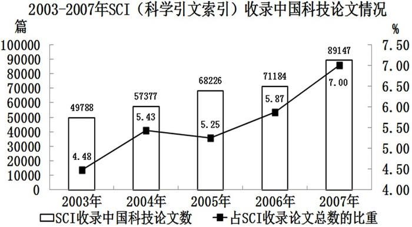

### 第 81 题

以下年份中，SCI收录中国科技论文数与上年相比增长量最少的是：

A. 2004

B. 2005

C. 2006

D. 2007

第 81 题 · 答案与解析

**参考答案（粉笔题库参考内容）**

C

**解析**

根据题干“与上年相比增长量最少”，判定本题为增长量比较问题。定位柱状图可得：2003年-2007年SCI收录中国科技论文数分别为49788篇、57377篇、68226篇、71184篇、89147篇。根据公式：增长量=现期量-基期量，四年的增长量分别如下所示。

2004年：57377－49788＞57000－50000＝7000篇；

2005年：篇；

2006年：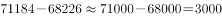篇；

2007年：篇。

2006年的增长量最少。

故正确答案为C。

备注：定位各年份数据在柱状图中，比较柱状图数据差距大小，也可以直接看柱状图的高度差，可明显看出2006年与2005年的柱状高度差最小，故2006年增长量最小。

**考点**：增长量比较、统计图

**来源**：2010年918联考《行测》题（山西/河南/辽宁/福建/重庆/海南/青海/宁夏/内蒙古/陕西/西藏）第81题

### 第 82 题

2003-2007年，SCI平均每年约收录多少篇中国科技论文：

A. 5.9万

B. 6.3万

C. 6.7万

D. 7.1万

第 82 题 · 答案与解析

**参考答案（粉笔题库参考内容）**

C

**解析**

根据题干“2003-2007年，SCI平均每年······”，结合材料给出2003-2007年的相关数据，可判定本题为现期平均数问题。定位柱状图可得：2003-2007年SCI收录中国科技论文数分别为49788篇、57377篇、68226篇、71184篇、89147篇。2003~2007年，SCI平均每年收录中国科技论文数为≈篇，即6.7万篇。

故正确答案为C。

**考点**：现期平均数、统计图

**来源**：2010年918联考《行测》题（山西/河南/辽宁/福建/重庆/海南/青海/宁夏/内蒙古/陕西/西藏）第82题

### 第 83 题

图中SCI收录论文总数最少的年份是：

A. 2003年

B. 2004年

C. 2005年

D. 2006年

第 83 题 · 答案与解析

**参考答案（粉笔题库参考内容）**

B

**解析**

根据题干“SCI收录论文总数最少的年份”，结合图形材料给出SCI收录中国科技论文数以及其占SCI收录论文总数的比重，可判定本题为现期比重问题。定位图形材料可得：2003-2006年SCI收录中国科技论文数分别为49788篇、57377篇、68226篇、71184篇；SCI收录中国科技论文数占SCI收录论文总数的比重分别为4.48%、5.43%、5.25%、5.87%。根据公式：总体=部分/比重，可得SCI收录论文总数分别如下：

2003年：万篇；

2004年：万篇；

2005年：万篇；

2006年：万篇。

四个数值量级相当，根据直除法，分别得到首位为11、10、13、12，比较可知2004年最少。

故正确答案为B。

**考点**：现期比重、统计图

**来源**：2010年918联考《行测》题（山西/河南/辽宁/福建/重庆/海南/青海/宁夏/内蒙古/陕西/西藏）第83题

### 第 84 题

2003-2007年间，SCI收录中国科技论文数的年均增长率约为：

A. 6%

B. 10%

C. 16%

D. 25%

第 84 题 · 答案与解析

**参考答案（粉笔题库参考内容）**

C

**解析**

根据题干“······年均增长率约为”，可判定本题为年均增长率问题。定位柱状图可得2007年SCI收录中国科技论文数为89147篇，2003年为49788篇。根据年均增长率公式：，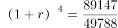，优先代入居中且好算（例如接近整十的数）的数。

若r=10%，；

若r=20%，。

故所求年均增长率在10%-20%之间，只有C项满足条件。

故正确答案为C。

**考点**：年均增长率、统计图

**来源**：2010年918联考《行测》题（山西/河南/辽宁/福建/重庆/海南/青海/宁夏/内蒙古/陕西/西藏）第84题

### 第 85 题

下列说法与资料相符的是：

A. 2004年SCI收录中国科技论文数的同比增长率是2004-2007这四年中最高的

B. 2005年SCI收录中国科技论文数占其收录论文总数比例的增量是2004-2007这四年中最大的

C. 2003-2007年间，SCI收录中国科技论文数占其收录论文总数的比重逐年上升

D. 若保持2007年的增长速度，2008年SCI收录中国科技论文数将超过10万篇

第 85 题 · 答案与解析

**参考答案（粉笔题库参考内容）**

D

**解析**

A项：定位柱状图可得，2003-2005年SCI收录中国科技论文数分别为49788篇、57377篇、68226篇。根据增长率，2004年同比增长率，2005年同比增长率，2005年同比增长率大于2004年，故2004年同比增长率不是最高，错误；

B项：定位折线图可得，2004-2007年SCI收录中国科技论文数占其收录论文总数比重分别为5.43%、5.25%、5.87%、7.00%。2005年该比例增量=5.25%-5.43%&lt;0，其他年份的该比例增量均为正值，故2005年该比例增量不是最大的，错误；

C项：定位折线图可知在2003-2007年间，SCI收录中国科技论文数占其收录论文总数的比重并不是逐年上升的，在2005年出现了下降的情况，错误；

D项：定位柱状图可得，2006-2007年SCI收录中国科技论文数分别为71184篇、89147篇。2007年增长率，若保持2007年的增长速度，则2008年SCI收录中国科技论文数篇>100000篇，即超过10万篇，正确。

故正确答案为D。

**考点**：统计图、综合分析

**来源**：2010年918联考《行测》题（山西/河南/辽宁/福建/重庆/海南/青海/宁夏/内蒙古/陕西/西藏）第85题

## 材料 2

近几年来，我国开始对国内20个制造业行业中820家企业的采购经理进行月度问卷调查，加工汇总他们对所在行业的采购和供应等问题的判断结果，得到制造业采购经理指数（PMI）。

        PMI是一个综合指数，由生产、新订单、主要原材料库存、从业人员、供应商配送时间5个分类指数乘以相应的权数后相加得到。PMI指数反映了当月制造业采购和供应状况相对于上月的变化。各类指数在50%以上，通常反映其对应的某一方面经济扩张；低于50%，通常反映其经济活动衰退。

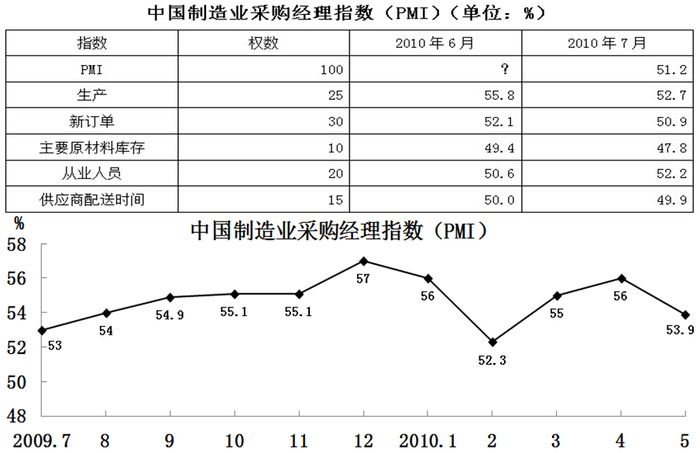

### 第 86 题

2010年6月，PMI的分类指数反映出几个方面的经济活动出现衰退？

A. 1

B. 2

C. 3

D. 4

第 86 题 · 答案与解析

**参考答案（粉笔题库参考内容）**

A

**解析**

定位文字材料第二段可得：PMI指数低于50%，通常反映其经济活动衰退。定位表格材料可知：2010年6月只有主要原材料库存的PMI指数（49.4%）低于50%，因此反映出1个方面的经济活动出现衰退。

故正确答案为A。

**考点**：直接找数、综合资料

**来源**：2010年918联考《行测》题（山西/河南/辽宁/福建/重庆/海南/青海/宁夏/内蒙古/陕西/西藏）第86题

### 第 87 题

哪个分类指数对PMI影响最大？

A. 生产

B. 新订单

C. 主要原材料库存

D. 从业人员

第 87 题 · 答案与解析

**参考答案（粉笔题库参考内容）**

B

**解析**

定位文字材料第二段可得：PMI是一个综合指数，由5个分类指数乘以相应的权数后相加得到，即权数越大，对PMI指数的影响就越大。定位表格材料可知：新订单的权数为30，是最大权数，因此新订单对PMI影响最大。

故正确答案为B。

**考点**：直接找数、综合资料

**来源**：2010年918联考《行测》题（山西/河南/辽宁/福建/重庆/海南/青海/宁夏/内蒙古/陕西/西藏）第87题

### 第 88 题

2010年7月哪一分类指数比上月降低最多？

A. 生产

B. 新订单

C. 主要原材料库存

D. 从业人员

第 88 题 · 答案与解析

**参考答案（粉笔题库参考内容）**

A

**解析**

定位表格材料第三、四列可得2010年6月与2010年7月各分类指数，由此可以算出：

生产的指数降低了：55.8%－52.7%＝3.1%；

新订单的指数降低了：52.1%－50.9%＝1.2%；

主要原材料库存的指数降低了：49.4%－47.8%＝1.6%；

从业人员的指数升高了。

故生产指数比上月降低最多。

故正确答案为A。

**考点**：简单加减计算、综合资料

**来源**：2010年918联考《行测》题（山西/河南/辽宁/福建/重庆/海南/青海/宁夏/内蒙古/陕西/西藏）第88题

### 第 89 题

表中“？”处的数据应为：

A. 51.6

B. 52.1

C. 53.8

D. 54.4

第 89 题 · 答案与解析

**参考答案（粉笔题库参考内容）**

B

**解析**

根据题干求2010年6月“？”处的数据，结合表格材料时间有2010年6月，定位文字材料第二段可得：PMI是一个综合指数，由生产、新订单、主要原材料库存、从业人员、供应商配送时间5个分类指数乘以相应的权数后相加得到，可判定本题为现期平均数问题。定位表格材料可得2010年6月各分类指数以及其权数。？，最接近B项。

故正确答案为B。

备注：加权平均值是根据权数的不同进行的平均数的计算，材料中PMI指数由5个分类指数乘以相应的权数后相加得到，而严谨的加权平均值等于各数值乘以相应的权数后相加得到总体值，还需除以总的单位数，即总权数。此题按照严谨的加权平均值方式进行计算，但由于总权数为100%，即为1，故无论是否除以总权数，计算结果相同，只是含义不同。

**考点**：现期平均数、综合资料

**来源**：2010年918联考《行测》题（山西/河南/辽宁/福建/重庆/海南/青海/宁夏/内蒙古/陕西/西藏）第89题

### 第 90 题

2009年7月至2010年5月，PMI增量最大的月份是：

A. 2009年9月

B. 2009年12月

C. 2010年3月

D. 2010年4月

第 90 题 · 答案与解析

**参考答案（粉笔题库参考内容）**

C

**解析**

根据题干“······PMI增量最大的月份是”，可判定本题为增长量比较问题。定位折线图可得2009年7月至2010年5月的PMI。根据公式：增长量=现期-基期，可得：2009年9月PMI增量为54.9%-54%=0.9%；

2009年12月PMI增量为57%-55.1%=1.9%；

2010年3月PMI增量为55%-52.3%=2.7%；

2010年4月PMI增量为56%-55%=1%。

可见增量最大的月份为2010年3月。

故正确答案为C。

**考点**：增长量比较、综合资料

**来源**：2010年918联考《行测》题（山西/河南/辽宁/福建/重庆/海南/青海/宁夏/内蒙古/陕西/西藏）第90题

## 材料 3

2010年5月1日到10月31日，世博会在中国上海举行。自开幕以来，世博会的消费拉动效应初步显现。

        世博园区共有浦东和浦西两个片区，5月份的销售总额为4.13亿元，其中浦东片区的销售额占89.4%。园区5月份日均入园25.91万人，园区内就餐人数约占入园总人数的64.5%。午餐比晚餐就餐多197.46万人次。

        世博园开园首日客流为20.69万人，5月29日入园人数为当月最多，比首日客流增加144.08%，是当月入园人数最低日5月5日的5.7倍。开园首日人均消费为5月份最高值，比5月份人均日消费高56.7%。5月29日实现销售额2313.04万元，是5月5日的4.7倍。

        随着入园人数的不断增加，世博园区的销售记录不断刷新，5月份第2到5周的销售总额（包括餐饮消费和特许商品销售）依次为5801.2万元、8108.57万元、10331.87万元和12239.75万元。其中，餐饮消费的营业额依次为3022.86万元、4325.52万元、5467.6万元和6232.2万元。

### 第 91 题

5月份世博会浦西片区的销售额约为多少亿元？

A. 0.28

B. 0.44

C. 0.97

D. 1.25

第 91 题 · 答案与解析

**参考答案（粉笔题库参考内容）**

B

**解析**

根据题干“5月份世博会浦西片区的销售额约为······”，结合材料给出5月份的销售总额以及浦东片区的销售额所占比重，可判定本题为现期比重问题。定位文字材料第二段可得：世博园区共有浦东和浦西两个片区，5月份的销售总额为4.13亿元，其中浦东片区的销售额占89.4%。根据公式：，故5月份世博会浦西片区的销售额亿元。

故正确答案为B。

**考点**：文字资料、现期比重

**来源**：2010年918联考《行测》题（山西/河南/辽宁/福建/重庆/海南/青海/宁夏/内蒙古/陕西/西藏）第91题

### 第 92 题

5月份世博园区人均日消费约为：

A. 46元

B. 51元

C. 138元

D. 153元

第 92 题 · 答案与解析

**参考答案（粉笔题库参考内容）**

B

**解析**

根据题干“5月份······人均日消费约为”，结合材料时间是2010年5月，可判定本题为现期平均数问题。定位文字材料第二段可得：5月份的销售总额为4.13亿元，园区5月份日均入园25.91万人。根据公式，人均日消费，可得5月份世博园区人均日消费，与B项最接近。

故正确答案为B。

**考点**：文字资料、现期平均数

**来源**：2010年918联考《行测》题（山西/河南/辽宁/福建/重庆/海南/青海/宁夏/内蒙古/陕西/西藏）第92题

### 第 93 题

5月5日世博园区的入园人数约为：

A. 3.6万人

B. 4.5万人

C. 5.2万人

D. 8.9万人

第 93 题 · 答案与解析

**参考答案（粉笔题库参考内容）**

D

**解析**

根据题干“5月5日世博园区的入园人数约为”，结合材料给出5月29日与5月5日入园人数之间的倍数关系，可判定本题为现期倍数问题。定位文字材料第三段可得：世博园开园首日客流为20.69万人，5月29日入园人数为当月最多，比首日客流增加144.08%，是当月入园人数最低日5月5日的5.7倍。则5月29日世博园区的入园人数为20.69×(1+144.08%)万人，5月5日的入园人数为万人，与D项最接近。

故正确答案为D。

**考点**：文字资料、现期倍数

**来源**：2010年918联考《行测》题（山西/河南/辽宁/福建/重庆/海南/青海/宁夏/内蒙古/陕西/西藏）第93题

### 第 94 题

第2~5周的特许商品销售额由高到低依次是：

A. 第5周、第4周、第3周、第2周

B. 第4周、第5周、第2周、第3周

C. 第2周、第3周、第4周、第5周

D. 第3周、第2周、向4周、第5周

第 94 题 · 答案与解析

**参考答案（粉笔题库参考内容）**

A

**解析**

定位文字材料第四段可得：5月份第2到5周的销售总额（包括餐饮消费和特许商品销售）依次为5801.2万元、8108.57万元、10331.87万元和12239.75万元。其中，餐饮消费的营业额依次为3022.86万元、4325.52万元、5467.6万元和6232.2万元。

第2周特许商品销售额为万元；

第3周特许商品销售额为万元；

第4周特许商品销售额为万元；

第5周特许商品销售额为万元。

由高到低的顺序为第5周、第4周、第3周、第2周。

故正确答案为A。

**考点**：排序类、文字资料

**来源**：2010年918联考《行测》题（山西/河南/辽宁/福建/重庆/海南/青海/宁夏/内蒙古/陕西/西藏）第94题

### 第 95 题

下列说法与资料相符的有几个？

（1）5月份世博区每日午餐就餐人次总高于晚餐就餐人次

（2）5月5日销售额不到当月第2周销售总额的

（3）5月第2~5周中，餐饮消费的营业额与特许商品销售额之差最大的是第3周

A. 0

B. 1

C. 2

D. 3

第 95 题 · 答案与解析

**参考答案（粉笔题库参考内容）**

B

**解析**

（1）定位文字材料第二段可得：5月份的午餐比晚餐就餐多197.46万人次，并没有提到具体的每一天的情况，错误；

（2）定位文字材料第三、四段可得：5月29日实现销售额2313.04万元，是5月5日的4.7倍，5月份第2周的销售总额为5801.2万元。5月5日的销售额为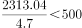万元；5月第2周的销售总额的万元>500万元，即超过5月5日销售额，正确；

（3）定位文字材料第四段可得：5月份第2到5周的销售总额（包括餐饮消费和特许商品销售）以及餐饮消费的营业额，则5月份第2到5周，餐饮消费的营业额与特许商品销售额之差分别如下：

第2周：万元；

第3周：万元；

第4周：万元；

第5周：万元。

差额最大的是第4周，错误。

综上所述，与资料相符的有1个。

故正确答案为B。

**考点**：文字资料、综合分析

**来源**：2010年918联考《行测》题（山西/河南/辽宁/福建/重庆/海南/青海/宁夏/内蒙古/陕西/西藏）第95题

## 材料 4

2009年度全国旅行社营业收入为1806.53亿元，同比增长8.64%；毛利润总额为134.36亿元，毛利率为7.44%；净利润总额为11.48亿元，净利润为0.64%。

        2009年度全国旅行社的旅游业务营业收入为1745.59亿元，同比增长8.87%；旅游业务毛利润为120.27亿元，旅游业务毛利率为6.89%；实缴税金为12.69亿元，同比增长12.37%；外汇结汇10.51亿美元，同比减少11.24%；全国促销费支出为6.76亿元，同比增长13.87%。

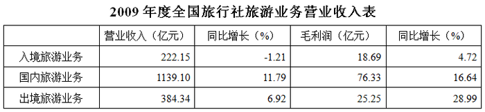

### 第 96 题

2008年度全国旅行社入境旅游业务营业收入约为多少亿元？

A. 185

B. 210

C. 225

D. 235

第 96 题 · 答案与解析

**参考答案（粉笔题库参考内容）**

C

**解析**

根据“2008年度全国旅行社入境旅游业务营业收入约为多少亿元”，结合材料时间为2009年，可判断此题为基期计算问题。定位表格材料可得，2009年度全国旅行社入境旅游业务营业收入为222.15亿元，增长率为-1.21%。代入公式。

故正确答案为C。

**考点**：基期计算、综合资料

**来源**：2010年918联考《行测》题（山西/河南/辽宁/福建/重庆/海南/青海/宁夏/内蒙古/陕西/西藏）第96题

### 第 97 题

2009年全国旅行社非旅游业务的毛利率约为：

A. 8%

B. 11%

C. 17%

D. 23%

第 97 题 · 答案与解析

**参考答案（粉笔题库参考内容）**

D

**解析**

根据题干“2009年全国旅行社非旅游业务的毛利率约为”，及公式毛利润率，可判断此题为现期比重问题。定位文字材料第一段可得，“2009年度全国旅行社营业收入为1806.53亿元······毛利润总额为134.36亿元”；定位文字材料第二段可得，“2009年度全国旅行社的旅游业务营业收入为1745.59亿元······旅游业务毛利润为120.27亿元”。则2009年度，非旅游业务的营业收入为亿元，非旅游业务的毛利润为亿元。代入公式毛利润率。

故正确答案为D。

**考点**：现期比重、综合资料

**来源**：2010年918联考《行测》题（山西/河南/辽宁/福建/重庆/海南/青海/宁夏/内蒙古/陕西/西藏）第97题

### 第 98 题

下列各项中，占当年全国旅行社的旅游业务营业收入比重最大的是：

A. 2009年国内旅游

B. 2008年国内旅游

C. 2009年入境旅游

D. 2008年入境旅游

第 98 题 · 答案与解析

**参考答案（粉笔题库参考内容）**

A

**解析**

根据题干“下列各项中，占······比重”，结合选项时间为2009年与2008年，可判断此题为两期比重问题。定位文字材料第二段可得，2009年度全国旅行社的旅游业务营业收入B=1745.59亿元，同比增长率b=8.87%；定位表格材料可得，2009年，国内旅游营业收入亿元，同比增长率，入境旅游营业收入亿元，同比增长率。根据两期比重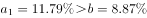，比重上升，则2009年国内旅游比重高于2008年，排除B项；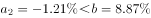，比重下降，则2009年入境旅游比重低于2008年，排除C项。2009年国内旅游比重为，2008年入境旅游比重为，前者大于后者，排除D项。

故正确答案为A。

**考点**：两期比重、综合资料

**来源**：2010年918联考《行测》题（山西/河南/辽宁/福建/重庆/海南/青海/宁夏/内蒙古/陕西/西藏）第98题

### 第 99 题

下列各项中，2009年毛利率最低的是：

A. 国内旅游业务

B. 入境旅游业务

C. 出境旅游业务

D. 总体旅游业务

第 99 题 · 答案与解析

**参考答案（粉笔题库参考内容）**

C

**解析**

根据题干“下列各项中，2009年毛利率最低的是”，及公式毛利润率，可判断此题为现期比重问题。总体毛利润率为混合比例，位于三个比值之间，排除D项；定位表格材料可得，2009年国内旅游业务、入境旅游业务、出境旅游业务的毛利率分别为、、，则毛利率最低的是出境旅游业务。

故正确答案为C。

**考点**：现期比重、综合资料

**来源**：2010年918联考《行测》题（山西/河南/辽宁/福建/重庆/海南/青海/宁夏/内蒙古/陕西/西藏）第99题

### 第 100 题

关于2009年全国旅行社营业状况，从资料中可以推出的结论是：

A. 三类旅游业务的毛利率均比上年有所增长

B. 国内旅游业务的毛利润比上年增加近8亿元

C. 全国旅行社旅游业务的外汇结汇比上年减少近1亿美元

D. 全国旅行社促销费用占其旅游业务营业收入的比例比上年有所下降

第 100 题 · 答案与解析

**参考答案（粉笔题库参考内容）**

A

**解析**

A项：，定位表格材料，2009年入境旅游业务、国内旅游业务、出境旅游业务毛利润增长率分别为、、，2009年入境旅游业务、国内旅游业务、出境旅游业务营业收入增长率分别为、、，根据两期比重比较的结论，、、，则三类旅游业务毛利率均比上年有所提高，正确；

B项：定位表格材料可得，国内旅游业的毛利润为76.33亿元，增长率为16.64%，根据公式，2009年国内旅游业务的毛利润增长量亿元，错误；

C项：定位文字材料第二段可得，外汇结汇10.51亿美元，减少率为11.24%，根据公式，外汇结汇的减少量为亿美元，错误；

D项：由文字材料可知，2009年全国旅行社促销费用的增长率a=13.87%，2009年旅游业务营业收入的增长率为b=8.87%；根据两期比重的结论，a＞b，比重上升，错误。

故正确答案为A。

**考点**：综合分析、综合资料

**来源**：2010年918联考《行测》题（山西/河南/辽宁/福建/重庆/海南/青海/宁夏/内蒙古/陕西/西藏）第100题

### 第 101 题

负责全国政府信息公开工作的主管部门是：

A. 中共中央宣传部

B. 国务院办公厅

C. 工业和信息化部

D. 国务院

第 101 题 · 答案与解析

**参考答案（粉笔题库参考内容）**

B

**解析**

A项错误，中宣部的具体职能有八条：（一）负责指导全国马克思主义理论的研究、学习和宣传；（二）负责引导社会舆论，指导协调中央的各新闻媒体做好新闻宣传工作，搞好舆论引导；（三）从宏观上指导精神文化产品的创作和生产；（四）规划和部署全局性的思想政治工作的任务；（五）受中央的委托，协同和会同有关部门对我们宣传文化系统的重要岗位的领导干部进行管理。联系宣传文化系统的知识分子，协助有关部门做好知识分子的工作；（六）负责提出宣传文化事业发展的指导方针。指导宣传文化系统制定政策和法规；同时还要按照中央的统一工作部署，做好宣传文化系统各有关部门之间的协调工作；（七）为中央领导和中宣部领导的决策和指导全局工作提供舆情信息的服务，并且要负责组织协调和指导宣传文化系统的舆情信息工作；（八）负责文化体制改革，包括新闻出版、广播电视业的改革和发展的调研，提出政策性的建议。

B项正确，国务院办公厅的具体职能如下：（一）负责国务院会议的准备工作，协助国务院领导同志组织实施会议决定事项；（二）协助国务院领导同志组织起草或审核以国务院、国务院办公厅名义发布的公文；（三）研究国务院各部门和各省、自治区、直辖市人民政府请示国务院的事项，提出审核意见，报国务院领导同志审批；（四）督促检查国务院各部门和地方人民政府对国务院决定事项及国务院领导同志指示的贯彻落实情况，及时向国务院领导同志报告；（五）负责国务院值班工作，及时报告重要情况，传达和督促落实国务院领导同志指示；（六）协助国务院领导同志做好需由国务院组织处理的突发事件的应急处置工作；（七）指导、监督全国政府信息公开工作；（八）办理国务院和国务院领导同志交办的其他事项。

C项错误，工业和信息化部主要职责为：拟订实施行业规划、产业政策和标准；监测工业行业日常运行；推动重大技术装备发展和自主创新；管理通信业；指导推进信息化建设；协调维护国家信息安全等。

D项错误，根据宪法第八十九条规定，国务院行使下列职权：（一）根据宪法和法律，规定行政措施，制定行政法规，发布决定和命令；（二）向全国人民代表大会或者全国人民代表大会常务委员会提出议案；（三）规定各部和各委员会的任务和职责，统一领导各部和各委员会的工作，并且领导不属于各部和各委员会的全国性的行政工作；（四）统一领导全国地方各级国家行政机关的工作，规定中央和省、自治区、直辖市的国家行政机关的职权的具体划分；（五）编制和执行国民经济和社会发展计划和国家预算；（六）领导和管理经济工作和城乡建设；（七）领导和管理教育、科学、文化、卫生、体育和计划生育工作；（八）领导和管理民政、公安、司法行政和监察等工作；（九）管理对外事务，同外国缔结条约和协定；（十）领导和管理国防建设事业；（十一）领导和管理民族事务，保障少数民族的平等权利和民族自治地方的自治权利；（十二）保护华侨的正当的权利和利益，保护归侨和侨眷的合法的权利和利益；（十三）改变或者撤销各部、各委员会发布的不适当的命令、指示和规章；（十四）改变或者撤销地方各级国家行政机关的不适当的决定和命令；（十五）批准省、自治区、直辖市的区域划分，批准自治州、县、自治县、市的建置和区域划分；（十六）依照法律规定决定省、自治区、直辖市的范围内部分地区进入紧急状态；（十七）审定行政机构的编制，依照法律规定任免、培训、考核和奖惩行政人员；（十八）全国人民代表大会和全国人民代表大会常务委员会授予的其他职权。

故正确答案为B。

**来源**：2010年918联考《行测》题（山西/河南/辽宁/福建/重庆/海南/青海/宁夏/内蒙古/陕西/西藏）第101题

### 第 102 题

下列不可能出现的天文现象：

A. 月全食

B. 日全食

C. 月环食

D. 日环食

第 102 题 · 答案与解析

**参考答案（粉笔题库参考内容）**

C

**解析**

由于地球的直径是月球的4倍，即使在月球轨道上，地球的本影直径仍为月球的2.5倍，远大于月球，挡住了阳光，地球本影长度大约是月地平均距离的3.5倍，月球直径远小于地球直径，因此绝不可能形成月环食。

故正确答案为C。

**本题相关知识点：**

1、月全食是月食的一种，当月亮、地球、太阳完全在一条直线上的时候，整个月亮全部走进地球的影子里，月亮表面大都昏暗了，就是月全食。

2、日全食是日食的一种，即太阳被月亮全部遮住的天文现象。如果太阳、月球、地球三者正好排成或接近一条直线，月球挡住了射到地球上去的太阳光，月球身后的黑影正好落到地球上，这时发生日食现象。在地球上月影里的人们开始看到阳光逐渐减弱，太阳面被圆的黑影遮住，天色转暗，全部遮住时，天空中可以看到最亮的恒星和行星，几分钟后，从月球黑影边缘逐渐露出阳光，开始生光、复圆。由于月球比地球小，只有在月影中的人们才能看到日全食。

3、当地球位于太阳和月球之间，且三球基本上在一直线上时，会发生月食。月食分为本影食和半影食，本影食又分为全食和偏食。月全食和月偏食的不同，不取决于观察地点，而取决于月球是否全部进入地球的本影。这是由于地球的直径是月球的4倍，即使在月球轨道上，地球的本影直径仍为月球的2.5倍，远大于月球,挡住了阳光,地球本影长度大约是月地平均距离的3.5倍，月球直径远小于地球直径，因此绝不可能形成月环食。

4、日环食是日食的一种。发生时太阳的中心部分黑暗，边缘仍然明亮，形成光环。这是因为月球在太阳和地球之间，但是距离地球较远，不能完全遮住太阳而形成的。发生日环食时，物体的投影有时会交错重叠。

**考点**：自然地理

**来源**：2010年918联考《行测》题（山西/河南/辽宁/福建/重庆/海南/青海/宁夏/内蒙古/陕西/西藏）第102题

### 第 103 题

下列生活方式不符合低碳经济要求的是：

A. 建筑中使用中空玻璃

B. 电冰箱中保持较多的霜

C. 步行或骑自行车上班

D. 使用太阳能热水器

第 103 题 · 答案与解析

**参考答案（粉笔题库参考内容）**

B

**解析**

定期除霜和清除冷凝器及箱体表面灰，保证蒸发器和冷凝器的吸热和散热性能良好，缩短压缩机工作时间，节约电能。相反的，保持较多的霜，使电冰箱更加耗电。所以不符合低碳经济的要求。

本题为选非题，故正确答案为B。

**考点**：生活常识

**来源**：2010年918联考《行测》题（山西/河南/辽宁/福建/重庆/海南/青海/宁夏/内蒙古/陕西/西藏）第103题

### 第 104 题

下列哪项不属于第三产业？

A. 教育

B. 社会福利

C. 邮电通信

D. 航天

第 104 题 · 答案与解析

**参考答案（粉笔题库参考内容）**

D

**解析**

根据国务院办公厅转发的国家统计局《关于建立第三产业统计报告》上对我国三次产业划分的意见，我国第三产业包括流通和服务两大部门，具体分为四个层次：一是流通部门：交通运输业、邮电通讯业、商业饮食业、物资供销和仓储业；二是为生产和生活服务的部门：金融业、保险业、地质普查业、房地产管理业、公用事业、居民服务业、旅游业、信息咨询服务业和各类技术服务业；三是为提高科学文化水平和居民素质服务的部门：教育、文化、广播、电视、科学研究、卫生、体育和社会福利事业；四是国家机关、政党机关、社会团体、警察、军队等，但在国内不计入第三产业产值和国民生产总值。

本题为选非题，故正确答案为D。

**考点**：宏观经济与调控政策

**来源**：2010年918联考《行测》题（山西/河南/辽宁/福建/重庆/海南/青海/宁夏/内蒙古/陕西/西藏）第104题

### 第 105 题

下列属于商业体育的是：

A. 国际奥林匹克运动会

B. 世界大学生运动会

C. 英格兰足球超级联赛

D. 世界乒乓球锦标赛

第 105 题 · 答案与解析

**参考答案（粉笔题库参考内容）**

C

**解析**

英格兰足球超级联赛，2004年巴克莱斯银行成为英超的赞助商，冠名为巴克莱斯超级足球联赛，通常简称“英超”，是英格兰足联总属下的职业足球联赛，由超级联盟负责具体运作。英格兰超级联赛成立于1992年2月20日，其前身是英格兰甲级联赛，是英格兰联赛系统的最高等级联赛。现时英超联赛已经成为世界上最受欢迎的体育赛事之一。

A、B、D三项均属于公益性的体育。

故正确答案为C。

**考点**：文化常识

**来源**：2010年918联考《行测》题（山西/河南/辽宁/福建/重庆/海南/青海/宁夏/内蒙古/陕西/西藏）第105题

### 第 106 题

“北麦南稻，南船北马”是以什么为分界线？

A. 秦岭—淮河

B. 昆仑山

C. 巴颜喀拉山—秦岭

D. 大兴安岭

第 106 题 · 答案与解析

**参考答案（粉笔题库参考内容）**

A

**解析**

秦岭—淮河线，就是我们常说的中国南北地理分界线，此线南北，无论是自然条件、农业生产方式，还是地理风貌以及人民的生活习俗，都有明显的不同。秦淮以北的大部分地区，河湖冬季结冰，年降水量较少，降水多集中在夏季，所以河流的水量不大，水位变化大，只有夏季才形成汛期，时间也比较短，且河流的含沙量较大。北方耕地为旱地，主要作物为小麦和杂粮，一年两熟或两年三熟；而在秦淮以南地区则正好相反，冬季不结冰，树木不落叶，一年四季常绿。河流的水量较大，水位变化不大，汛期时间长，河水含沙量较小。主要是水田，农作物主要是水稻和甘蔗、茶叶等亚热带经济作物。一年两熟或三熟。人们平常所说的“北麦南稻，南船北马”是这种差异的真实写照。

故正确答案为A。

**考点**：其他

**来源**：2010年918联考《行测》题（山西/河南/辽宁/福建/重庆/海南/青海/宁夏/内蒙古/陕西/西藏）第106题

### 第 107 题

下列哪项中的民俗均与端午节有关？

A. 剪窗花、踏青、燃放灯火、放风筝

B. 饮菊花酒、赏月、插茱萸、猜灯谜

C. 赏菊花、放孔明灯、插柳、贴春联

D. 饮雄黄酒、吃粽子、赛龙舟、插菖蒲

第 107 题 · 答案与解析

**参考答案（粉笔题库参考内容）**

D

**解析**

A项错误，体现不出是什么民俗；

B项错误，体现的是重阳节的民俗；

C项错误，体现不出是什么民俗；

D项正确，体现的是端午节的民俗。

故正确答案为D。

**本题相关知识点：**

赛龙舟是端午节的主要习俗。相传起源于古时楚国人因舍不得贤臣屈原投江死去，许多人划船追赶拯救。他们争先恐后，追至洞庭湖时不见踪迹。之后每年五月五日划龙舟以纪念之。借划龙舟驱散江中之鱼，以免鱼吃掉屈原的身体。竞渡之习，盛行于吴、越、楚。端午节吃粽子，这是中国人民的又一传统习俗。粽子，又叫“角黍”、“筒粽”。其由来已久，花样繁多。

佩香囊：端午节小孩佩香囊，传说有避邪驱瘟之意，实际是用于襟头点缀装饰。香囊内有朱砂、雄黄、香药，外包以丝布，清香四溢，再以五色丝线弦扣成索，作各种不同形状，结成一串，形形色色，玲珑可爱。

悬艾叶菖蒲：民谚说“清明插柳，端午插艾”。在端午节，人们把插艾和菖蒲作为重要内容之一。家家都洒扫庭除，以菖蒲、艾条插于门眉，悬于堂中。并用菖蒲、艾叶、榴花、蒜头、龙船花，制成人形或虎形，称为艾人、艾虎；制成花环、佩饰，美丽芬芳，妇人争相佩戴，用以驱瘴。

**考点**：文化常识

**来源**：2010年918联考《行测》题（山西/河南/辽宁/福建/重庆/海南/青海/宁夏/内蒙古/陕西/西藏）第107题

### 第 108 题

中国的七大古都有三个都位于同一个省，这个省是：

A. 河南省

B. 山西省

C. 陕西省

D. 江苏省

第 108 题 · 答案与解析

**参考答案（粉笔题库参考内容）**

A

**解析**

中国的七大古都为西安、洛阳、南京、北京、开封、杭州、安阳。其中洛阳、开封和安阳都位于河南省。西安位于陕西省，南京位于江苏省，北京则为现在的北京。

故正确答案为A。

**考点**：文化常识

**来源**：2010年918联考《行测》题（山西/河南/辽宁/福建/重庆/海南/青海/宁夏/内蒙古/陕西/西藏）第108题

### 第 109 题

以下属于人文景观的是：

A. 甘肃敦煌莫高窟

B. 江西庐山

C. 四川九寨沟

D. 吉林长白山天池

第 109 题 · 答案与解析

**参考答案（粉笔题库参考内容）**

A

**解析**

人文景观，又称文化景观，是人们在日常生活中，为了满足一些物质和精神等方面的需要，在自然景观的基础上，叠加了文化特质而构成的景观。人文景观，最主要的体现即聚落，其次有服饰、建筑、音乐等。而建筑方面的特色反映即宗教建筑景观，如伊斯兰建筑景观、佛教建筑景观。B、C、D三项均属于自然景观。

故正确答案为A。

**考点**：文化常识

**来源**：2010年918联考《行测》题（山西/河南/辽宁/福建/重庆/海南/青海/宁夏/内蒙古/陕西/西藏）第109题

### 第 110 题

下列作者、作品、朝代对应正确的一项是：

A. 诸葛亮——《诫子书》——汉

B. 贾谊——《过秦论》——汉

C. 韩愈——《秋声赋》——宋

D. 王安石——《捕蛇者说》——宋

第 110 题 · 答案与解析

**参考答案（粉笔题库参考内容）**

B

**解析**

A项错误，《诫子书》是三国时期诸葛亮的作品；

B项正确，《过秦论》是西汉贾谊政论散文的代表作，分上、中、下三篇。全文着重从各个方面分析秦王朝的过失，旨在总结秦速亡的历史经验，以作为汉王朝建立制度，巩固统治的借鉴，故名为《过秦论》；

C项错误，《秋声赋》是北宋的欧阳修写的；

D项错误，《捕蛇者说》是中唐的柳宗元写的。

故正确答案为B。

**考点**：文学常识

**来源**：2010年918联考《行测》题（山西/河南/辽宁/福建/重庆/海南/青海/宁夏/内蒙古/陕西/西藏）第110题

### 第 111 题

汉字造字的方法主要有四种：象形、指事、会意和形声。下列属于指事字的是：

A. 本

B. 日

C. 明

D. 竽

第 111 题 · 答案与解析

**参考答案（粉笔题库参考内容）**

A

**解析**

A项正确，指事一般是指在象形字的基础上加上指示性符号或用纯符号组合来创造新字的方法。指事字有以下两种情况：1.在象形字的基础上增加一个简单的符号，用来指示所要说明的事物。如“本”：就是在木下面加一短横，指出这儿是树根。2.用纯粹的符号来指明或象征某种事物、某种意义。例如：“上”和“下”都是以一条长横线表示位置的界限，线上加一短横，表示“上”，线下加一短横表示“下”。

B项错误，“日”是象形字，最初是指太阳的轮廓。象形文字是指纯粹利用图形来作文字使用，而这些文字又与所代表的东西，在形状上很相像。一般而言，象形文字是最早产生的文字。

C项错误，“明”是会意字。甲骨文以“日、月”发光表示明亮。会意字是根据事物间的某种关系而组合两个或两个以上的文字来示意的造字方法。会意字必须有两个条件，一必须是合体的，二必须由合体的几个字组成新的意义。例如：“从”是两人前后相随，表示跟从。“酒”以酿酒的瓦瓶“酉”和液体“水”合起来，表达字义。

D项错误，“竽”是形声字。从竹，表示从竹制作；从于，表读声。形声是一种半意半音的造字法。表示意义的部分叫“形旁”或“意符”，其作用是指出字的意义类属；表示声音的部分叫“声旁”或“声符”，其作用是标明字的读音。例如：“柑”便是一个形声字，“木”是形旁，表示“柑”字字义所属的类别；“甘”是声旁，表示“柑”字读“甘”的音。

故正确答案为A。

**考点**：文化常识

**来源**：2010年918联考《行测》题（山西/河南/辽宁/福建/重庆/海南/青海/宁夏/内蒙古/陕西/西藏）第111题

### 第 112 题

下列成语全部蕴含辩证思维的是：

A. 居安思危 仰观俯视 藏器待时

B. 群龙无首 水火不容 生龙活虎

C. 否极泰来 革故鼎新 祸福相倚

D. 周而复始 刚柔相济 龙吟虎啸

第 112 题 · 答案与解析

**参考答案（粉笔题库参考内容）**

C

**解析**

本题中的“仰观俯视”、“生龙活虎”、“龙吟虎啸”不蕴含辩证思维；

“否极泰来”体现静止与发展的辩证思维；

“革故鼎新”体现了新旧事物的发展变化的辩证思维；

“祸福相倚”体现了一分为二的观点。

故正确答案为C。

**考点**：文学常识

**来源**：2010年918联考《行测》题（山西/河南/辽宁/福建/重庆/海南/青海/宁夏/内蒙古/陕西/西藏）第112题

### 第 113 题

20世纪90年代以后，中国内地形成了一些跨省区市的经济区域：①长江三角洲和长江沿江地区经济带；②以广州、深圳为中心的珠江三角洲地区经济带；③包括北京、天津、河北、辽宁、山东、山西、内蒙古在内的环渤海地区经济区；④中部地区经济区，包括河南、湖北、湖南、安徽、江西。

上述经济区域形成的先后顺序是：

A. ①②③④

B. ②①④③

C. ②④③①

D. ④③①②

第 113 题 · 答案与解析

**参考答案（粉笔题库参考内容）**

A

**解析**

①1992年6月27日，江泽民同志在国务院召开的长江三角洲及长江沿江地区经济发展规划座谈会上发表题为《加快长江三角洲和沿江地区的经济发展》讲话，此后该区域发展提上日程；

②广东省1994年确立了发展珠江三角洲经济区的目标，因为这里是中国市场化及国际化程度最高的大都市经济圈；

③环渤海经济区这一概念走向官方，是在1992年中共的十四大报告中提出要加快环渤海地区的开发、开放，将这一地区列为全国开放开发的重点区域之一。直到2004年，环渤海经济圈概念基本形成；

④2004年3月，温家宝总理在政府工作报告中首次明确提出促进中部地区崛起。2006年4月，《国务院促进中部地区崛起的若干意见》出台，这为中部崛起指明了发展方向，中部地区经济区形成并发展。

因此，按照时间先后排序，应是①②③④。

故正确答案为A。

**考点**：中国地理

**来源**：2010年918联考《行测》题（山西/河南/辽宁/福建/重庆/海南/青海/宁夏/内蒙古/陕西/西藏）第113题

### 第 114 题

下列行为属于金融诈骗的是：

A. 恶意透支信用卡

B. 倒卖船票、车票

C. 伪造、自制他人的注册商标

D. 非法出售增值税发票

第 114 题 · 答案与解析

**参考答案（粉笔题库参考内容）**

A

**解析**

金融诈骗罪是指以非法占有为目的，采用虚构事实或者隐瞒事实真相的方法，骗取公私财物或者金融机构信用，破坏金融管理秩序的行为。根据《刑法》第一百九十六条规定，恶意透支信用卡属金融诈骗罪中信用卡诈骗罪。

故正确答案为A。

**考点**：刑法

**来源**：2010年918联考《行测》题（山西/河南/辽宁/福建/重庆/海南/青海/宁夏/内蒙古/陕西/西藏）第114题

### 第 115 题

世界贸易组织的争端解决机构是总理事会，争端解决的程序是：

A. 成立专家小组→磋商→上诉机构审议→通过专家组报告→争端解决机构裁决→执行和监督

B. 磋商→成立专家小组→通过专家组报告→上诉机构审议→争端解决机构裁决→执行和监督

C. 上诉机构审议→争端解决机构裁决→执行和监督→磋商→成立专家小组→通过专家组报告

D. 争端解决机构裁决→上诉机构审议→成立专家小组→磋商→通过专家组报告→执行和监督

第 115 题 · 答案与解析

**参考答案（粉笔题库参考内容）**

B

**解析**

世界贸易组织的争端解决机构是总理事会。争端解决的程序是：

（1）磋商：根据《争端解决规则和程序谅解》规定，争端当事方应当首先采取磋商方式解决贸易纠纷。磋商要通知争端解决机构。磋商是秘密进行的，是给予争端各方能够自行解决问题的一个机会。

（2）成立专家小组：如果有关成员在10天内对磋商置之不理或在60天后未获解决，受损害的一方可要求争端解决机构成立专家小组。专家小组一般由3人组成，依当事人的请求，对争端案件进行审查，听取双方陈述，调查分析事实，提出调查结果，帮助争端解决机构作出建议或裁决。专家组成立后一般应在6个月内向争端各方提交终期报告，在紧急情况下，终期报告的时间将缩短为3个月。

（3）通过专家组报告：争端解决机构在接到专家组报告后20-60天内研究通过，除非当事方决定上诉，或经协商一致反对通过这一报告。

（4）上诉机构审议：专家小组的终期报告公布后，争端各方均有上诉的机会。上诉由争端解决机构设立的常设上诉机构受理。上诉机构可以维持、修正、撤消专家小组的裁决结论，并向争端解决机构提交审议报告。

（5）争端解决机构裁决：争端解决机构应在上诉机构的报告向世贸组织成员散发后的30天内通过该报告，一经采纳，则争端各方必须无条件接受。

（6）执行和监督：争端解决机构监督裁决和建议的执行情况。如果违背义务的一方未能履行建议并拒绝提供补偿时，受侵害的一方可以要求争端解决机构授权采取报复措施，中止协议项下的减让或其它义务。

故正确答案为B。

**考点**：国际经济及组织

**来源**：2010年918联考《行测》题（山西/河南/辽宁/福建/重庆/海南/青海/宁夏/内蒙古/陕西/西藏）第115题

### 第 116 题

下列不属于具体行政行为的是：

A. 医院开具《死亡医学证明》

B. 工商局吊销营业执照

C. 交警开具违章罚单

D. 民政局颁发社团登记证书

第 116 题 · 答案与解析

**参考答案（粉笔题库参考内容）**

A

**解析**

具体行政行为包括三个构成要件：

第一是主体要件。具体行政行为的主体必须是合法存在的行政主体，包括国家行政机关，法律、法规、规章授权的组织，行政机关委托的组织；

第二是功能要件。即具体行政行为能强制性地直接导致行政法律关系的产生、变更和消灭；

第三是客观要件。即行政主体客观上实施了运用行政职权或职责的行为。

医院不是行政机关，也不是法律、法规、规章授权的组织，行政机关委托的组织，不具主体要件；《死亡医学证明》是医院在执业范围内从事诊疗活动中出具的依据自然科学知识，从医学角度说明居民死亡及其原因的医学证明文件。该行为不能强制性地直接导致行政法律关系的产生、变更和消灭，不具功能要件；医院出具的死亡医学证明是基于执业权利，即医疗权利而出具的，并非基于行政职权或职责，该证明不具客观要件。

综上，医院出具的《死亡医学证明》其性质非具体行政行为。

本题为选非题，故正确答案为A。

**考点**：行政法

**来源**：2010年918联考《行测》题（山西/河南/辽宁/福建/重庆/海南/青海/宁夏/内蒙古/陕西/西藏）第116题

### 第 117 题

根据《产品质量法》，下列说法正确的是：

A. 装修材料、建设工程的质量都可以适用该法

B. 对产品质量的监督检查以抽查为主要方式

C. 产品的生产者或销售者承担检验费用

D. 因产品存在缺陷造成损害要求赔偿的诉讼时效期间为一年

第 117 题 · 答案与解析

**参考答案（粉笔题库参考内容）**

B

**解析**

A项错误，建筑工程质量并不适用于产品质量法。《产品质量法》第二条规定：建设工程不适用产品质量法的规定，但是，建设工程使用的建筑材料、建筑构配件和设备，属于规定的产品范围的，适用产品质量法规定；

B项正确，《产品质量法》第十五条规定：国家对产品质量实行以抽查为主要方式的监督检查制度；

C项错误，《产品质量法》第十五条规定：检验抽取样品的数量不得超过检验的合理需要，并不得向被检查人收取检验费用。监督抽查所需检验费用按照国务院规定列支；

D项错误，《产品质量法》第四十五条规定：因产品存在缺陷造成损害要求赔偿的诉讼时效期间为二年，自当事人知道或者应当知道其权益受到损害时起计算。

故正确答案为B。

**考点**：劳动法和经济法

**来源**：2010年918联考《行测》题（山西/河南/辽宁/福建/重庆/海南/青海/宁夏/内蒙古/陕西/西藏）第117题

### 第 118 题

按照我国现行法律规定，下列说法不正确的是：

A. 国家为了公共利益的需要，可以对土地实行征收或征用

B. 宅基地、自留地、自留山属于集体所有

C. 任何组织或个人不得侵占、买卖或者以其他形式非法转让土地，土地的所有权可以依照法律的规定转让

D. 城市的土地属于国家所有，农村和城市郊区的土地，除法律规定属于国家所有以外，属于集体所有

第 118 题 · 答案与解析

**参考答案（粉笔题库参考内容）**

C

**解析**

A项正确，根据《宪法》第十条规定：“国家为了公共利益的需要，可以依照法律规定对土地实行征收或者征用并给予补偿。”

B项正确，根据《宪法》第十条规定：“宅基地和自留地、自留山，属于集体所有。”

C项错误，根据《宪法》第十条规定：“任何组织或者个人不得侵占、买卖或者以其他形式非法转让土地。土地的使用权可以依照法律的规定转让。”因此，土地的所有权可以依照法律的规定转让的说法错误。

D项正确，根据《宪法》第十条规定：“城市的土地属于国家所有。农村和城市郊区的土地，除由法律规定属于国家所有的以外，属于集体所有。”

本题为选非题，故正确答案为C。

**考点**：宪法

**来源**：2010年918联考《行测》题（山西/河南/辽宁/福建/重庆/海南/青海/宁夏/内蒙古/陕西/西藏）第118题

### 第 119 题

下列甲乙关系不属于姻亲关系的是：

A. 甲是乙的表姐夫

B. 甲是乙的岳母

C. 甲是乙的养子

D. 甲和乙是妯娌

第 119 题 · 答案与解析

**参考答案（粉笔题库参考内容）**

C

**解析**

姻亲是以婚姻关系为中介而产生的亲属。具体分为：

（1）血亲的配偶。指自己直系、旁系血亲的配偶。如儿媳、姐夫等。

（2）配偶的血亲。指自己配偶的血亲。如岳父、夫之妹等。

（3）配偶的血亲的配偶。指自己的配偶的血亲的夫或妻。如妯娌、连襟等。姻亲关系因夫妻离婚或夫妻中一方死亡、他方再婚而消失。

C项是由收养确定的关系，而非姻亲关系。

本题为选非题，故正确答案为C。

**考点**：民法典

**来源**：2010年918联考《行测》题（山西/河南/辽宁/福建/重庆/海南/青海/宁夏/内蒙古/陕西/西藏）第119题

### 第 120 题

下列各项中，不符合《中华人民共和国劳动合同法》的是：

A. 用人单位强令冒险作业危及劳动者人身安全的，劳动者可以立即解除劳动合同

B. 劳动者在试用期间被证明不符合录用条件的，用人单位可以解除劳动合同

C. 非全日制用工劳动报酬结算支付周期最长不得超过一个月

D. 用人单位自用工之日起超过一个月不满一年未与劳动者订立书面劳动合同的，应当向劳动者每月支付二倍的工资

第 120 题 · 答案与解析

**参考答案（粉笔题库参考内容）**

C

**解析**

A项正确，根据《劳动合同法》第三十八条规定：“用人单位以暴力、威胁或者非法限制人身自由的手段强迫劳动者劳动的，或者用人单位违章指挥、强令冒险作业危及劳动者人身安全的，劳动者可以立即解除劳动合同，不需事先告知用人单位。”

B项正确，根据《劳动合同法》第三十九条第（一）款规定：“劳动者在试用期间被证明不符合录用条件的，用人单位可以解除劳动合同。”

C项错误，根据《劳动合同法》第七十二条规定：“非全日制用工小时计酬标准不得低于用人单位所在地人民政府规定的最低小时工资标准。非全日制用工劳动报酬结算支付周期最长不得超过十五日。”因此，题干中不得超过一个月的说法错误。

D项正确，根据《劳动合同法》第八十二条规定：“用人单位自用工之日起超过一个月不满一年未与劳动者订立书面劳动合同的，应当向劳动者每月支付二倍的工资。”

本题为选非题，故正确答案为C。

**考点**：劳动法和经济法

**来源**：2010年918联考《行测》题（山西/河南/辽宁/福建/重庆/海南/青海/宁夏/内蒙古/陕西/西藏）第120题

