# 2011年917联考《行测》题（河南/福建/甘肃/重庆/新疆兵团）

<!-- gwy:overview:start -->
> **福建 · 2011 · 行测 · 统考** ｜ 120 题 · 图片 17 处 · 答案随题折叠

| 题型模块 | 题量 | 题号 |
| --- | ---: | ---: |
| 常识判断 | 20 | 1–20 |
| 言语理解与表达 | 35 | 21–55 |
| 数量关系 | 10 | 56–65 |
| 判断推理 | 40 | 66–105 |
| 资料分析 | 15 | 106–120 |
| **合计** | **120** | |

导航：[题型与作答说明](#题型与作答说明) · [题目](#题目) · [材料 1](#材料-1)
<!-- gwy:overview:end -->

> 候选采集稿。参考答案及解析来自粉笔页面，不代表官方答案或真实高分答卷；来源使用许可与原卷对应关系仍需人工核实。

## 题型与作答说明

常识判断

（20题）

根据题目要求，在每个选项中选出一个正确答案。

言语理解与表达

（35题）

根据题目要求，在每个选项中选出一个正确答案。

数量关系

（10题）

本部分包括数字推理与数学运算两种类型的试题。

判断推理

（40题）

本部分包括图形推理、定义判断、类比推理与逻辑判断四种类型的试题。

资料分析

（15题）

所给出的图、表或一段文字均有5个问题要你回答。你应根据资料所提供的信息进行分析、比较、计算和判断处理。

## 题目

### 第 1 题

毛泽东同志在其诗词中描写过许多历史事件：

①六盘山上高峰，红旗漫卷西风

②黄洋界上炮声隆，报道敌军宵遁

③更喜岷山千里雪，三军过后尽开颜

④雾满龙冈千嶂暗，齐声唤，前头捉了张辉瓒

以上诗词涉及的历史事件按时间先后顺序排列正确的是：

A. ②④③①

B. ④②①③

C. ②④①③

D. ④②③①

第 1 题 · 答案与解析

**参考答案（粉笔题库参考内容）**

A

**解析**

本题考查毛中特。

②黄洋界上炮声隆，报道敌军宵遁——1928年秋，出自《西江月·井冈山》描述的是黄洋界保卫战；④雾满龙冈千嶂暗，齐声唤，前头捉了张辉瓒——1931年春，出自《渔家傲·反第一次大“围剿”》；③更喜岷山千里雪，三军过后尽开颜——1935年9月；出自《七律·长征》，此时红军长征即将胜利；①六盘山上高峰，红旗漫卷西风——1935年10月7日，出自《清平乐·六盘山》，为毛泽东翻越六盘山时所作。

故正确答案为A。

**考点**：党的历史

**来源**：2011年917联考《行测》题（河南/福建/甘肃/重庆/新疆兵团）第1题

### 第 2 题

建国以来，我国提出了一系列的外交方针政策：

①“韬光养晦，有所作为”

②“和平共处五项原则”“求同存异”

③“搁置争议，共同开发”

④“和谐共处”“合作共赢”

上述方针政策按时间先后顺序排列正确的是：

A. ②③①④

B. ②①③④

C. ①②③④

D. ①②④③

第 2 题 · 答案与解析

**参考答案（粉笔题库参考内容）**

A

**解析**

本题考查毛中特。

②“和平共处五项原则”是1953年12月周恩来总理在会见来访的印度代表团时提出的，“求同存异”是1955年4月19日周恩来在万隆会议上提出的；③“搁置争议，共同开发”是1979年6月中方通过外交渠道正式向日方提出共同开发钓鱼岛附近资源的设想；①“韬光养晦，有所作为”是1989年邓小平提出的；④“和谐共处”“合作共赢”是我国现在的政策。

故正确答案为A。

**考点**：党的历史

**来源**：2011年917联考《行测》题（河南/福建/甘肃/重庆/新疆兵团）第2题

### 第 3 题

下列选项中不准确的是：

A. 行政处罚通常由违法行为发生地的县级以上有权行政主体管辖

B. 在我国，人民检察院对行政案件的审理进行监督主要是采用抗诉的方式

C. 行政机关作出影响相对方权利义务决定后，应说明作出决定的法律依据

D. 行政机关发现对公民、法人或其他组织作出的行政处罚有错误的，应当主动改正

第 3 题 · 答案与解析

**参考答案（粉笔题库参考内容）**

C

**解析**

C项错误，行政机关应该在作出影响相对方权利义务决定之前，说明法律依据，并非之后。

本题为选非题，故正确答案为C。

**考点**：行政法

**来源**：2011年917联考《行测》题（河南/福建/甘肃/重庆/新疆兵团）第3题

### 第 4 题

下列选项中错误的是：

A. 甲就其被处行政拘留处罚起诉后，由被告所在地人民法院管辖

B. 若利害关系人就行政许可要求组织听证，那么听证费用应由申请人承担

C. 某派出所对乙作出行政拘留的处罚决定，乙遂向其县级人民政府申请行政复议

D. 丙工厂将排污口建在行洪道上并违规排放，某市环保局与市水利局对该工厂分别作出处罚

第 4 题 · 答案与解析

**参考答案（粉笔题库参考内容）**

B

**解析**

B项错误，《行政许可法》第四十七条规定：“行政许可直接涉及申请人与他人之间重大利益关系的，行政机关在作出行政许可决定前，应当告知申请人、利害关系人享有要求听证的权利；申请人、利害关系人在被告知听证权利之日起五日内提出听证申请的，行政机关应当在二十日内组织听证。申请人、利害关系人不承担行政机关组织听证的费用。”

本题为选非题，故正确答案为B。

**考点**：行政法

**来源**：2011年917联考《行测》题（河南/福建/甘肃/重庆/新疆兵团）第4题

### 第 5 题

下列属于旁系血亲关系的是：

A. 祖孙之间的关系

B. 兄弟之间的关系

C. 夫妻之间的关系

D. 父子之间的关系

第 5 题 · 答案与解析

**参考答案（粉笔题库参考内容）**

B

**解析**

祖孙、父子之间是直系血亲，夫妻之间是姻亲关系，兄弟之间是旁系血亲。

故正确答案为B。

【本题相关知识点】直系血亲是指与自己具有直接血缘关系的亲属，即生育自己的和由自己所生育的上下各代亲属。旁系血亲是相对直系血亲而言的，它指与自己具有间接血缘关系的亲属，即除直系血亲以外的、与自己同出一源的血亲。

**考点**：民法典

**来源**：2011年917联考《行测》题（河南/福建/甘肃/重庆/新疆兵团）第5题

### 第 6 题

下列选项中错误的是：

A. 环境法律关系主体不履行环境义务的，有可能承担民事责任

B. 甲公司不服省政府最终裁决，向最高人民法院提起行政诉讼

C. 根据我国立法法规定，国务院各部委有权发布命令、指示和规章

D. 某市政府一处长被撤销职务，他不能因此事向当地人民法院提起诉讼

第 6 题 · 答案与解析

**参考答案（粉笔题库参考内容）**

B

**解析**

B项错误，最高人民法院的管辖范围：一、审理法律规定由它管辖的和它认为应当由自己审判的第一审案件；二、审理对高级人民法院、专门人民法院判决、裁定的上诉、抗诉、申请再审与申诉案件；三、审理最高人民检察院按照审判监督程序提出的抗诉案件；四、核准本院判决以外的死刑案件；五、依法审理国家赔偿案件，决定国家赔偿；六、核准法定刑以下判处刑罚的案件。

本题为选非题，故正确答案为B。

**考点**：其他法律法规

**来源**：2011年917联考《行测》题（河南/福建/甘肃/重庆/新疆兵团）第6题

### 第 7 题

汉字源远流长，下列字体按出现时间先后顺序排列正确的是：

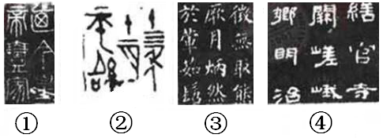

A. ②①④③

B. ①②④③

C. ②①③④

D. ①③④②

第 7 题 · 答案与解析

**参考答案（粉笔题库参考内容）**

A

**解析**

图中文字依次是小篆、金文、楷书、隶书，时间先后顺序是金文、小篆、隶书、楷书。

故正确答案为A。

**考点**：文化常识

**来源**：2011年917联考《行测》题（河南/福建/甘肃/重庆/新疆兵团）第7题

### 第 8 题

中国古代以天干地支纪年，天干是：甲、乙、丙、丁、戊、己、庚、辛、壬、癸。地支是：子、丑、寅、卯、辰、巳、午、未、申、酉、戌、亥。甲午战争发生在1894年，1900年八国联军侵华以干支纪年是：

A. 乙亥年

B. 庚子年

C. 辛丑年

D. 壬寅年

第 8 题 · 答案与解析

**参考答案（粉笔题库参考内容）**

B

**解析**

题干给了关键信息“甲午战争发生在1894年”，1894与1900相差6年，分别在天干和地支按顺序往后数6个数，可推出1900年为庚子年。

故正确答案为B。

【本题相关知识点】干支纪年是中国古代的一种纪年法。即以甲、乙、丙、丁、戊、己、庚、辛、壬、癸十天干和子、丑、寅、卯、辰、巳、午、未、申、酉、戌、亥十二地支按照顺序组合起来纪年。如甲子、乙丑等，经过六十年又回到甲子。周而复始，循环不已。

**考点**：文化常识

**来源**：2011年917联考《行测》题（河南/福建/甘肃/重庆/新疆兵团）第8题

### 第 9 题

下列说法错误的是：

A. 《古文观止》成书于清代康熙年间

B. 《尚书》是我国最早的历史文献总集

C. 《史记》是司马迁编纂的叙事历史著作

D. 《资治通鉴》是司马光主编的编年体史书

第 9 题 · 答案与解析

**参考答案（粉笔题库参考内容）**

C

**解析**

C项错误，编纂即编辑，但《史记》是司马迁撰写的中国第一部纪传体通史。纪传体史书的突出特点是以大量人物传记为中心内容，非叙事。

本题为选非题，故正确答案为C。

**考点**：文学常识

**来源**：2011年917联考《行测》题（河南/福建/甘肃/重庆/新疆兵团）第9题

### 第 10 题

下列说法错误的是：

A. 18世纪美国在世界上最早确立了总统共和制

B. 15世纪新航路的开辟开启了世界经济全球化的进程

C. 17世纪英国通过工业革命成为当时世界上最发达的工业国

D. 19世纪法国颁布的《拿破仑法典》是资产阶级国家最早的民法典

第 10 题 · 答案与解析

**参考答案（粉笔题库参考内容）**

C

**解析**

C项错误，英国工业革命始于18世纪。

本题为选非题，故正确答案为C。

【本题相关知识点】英国工业革命或称作英国产业革命，是指18世纪发源于英格兰中部地区的工业革命。英国的工业革命影响了整个欧洲大陆，并带动了当时许多国家相继发生工业革命。工业革命是指用机器生产代替手工劳动，从工厂手工业向机器大工业转变的过程。

**来源**：2011年917联考《行测》题（河南/福建/甘肃/重庆/新疆兵团）第10题

### 第 11 题

下列选项正确的是：

A. 黎族同胞说：“我们每年举行盛大的赛马会”

B. 朝鲜族同胞说：“我们种的莲雾又获得丰收”

C. 傣族同胞说：“泼水节是我们传统的盛大节日”

D. 高山族同胞说：“我们用青稞酒招待远方来客”

第 11 题 · 答案与解析

**参考答案（粉笔题库参考内容）**

C

**解析**

A项错误，赛马会每年藏历6月举行，是藏北草原规模盛大的传统节日；B项错误，莲雾生长在台湾和广东地区，属热带水果，朝鲜族多分布于东北地区；C项正确，泼水节是傣族的传统节日；D项错误，青稞酒是藏族人民最喜欢的酒，非台湾的高山族。

故正确答案为C。

**考点**：文化常识

**来源**：2011年917联考《行测》题（河南/福建/甘肃/重庆/新疆兵团）第11题

### 第 12 题

下列说法错误的是：

A. 青藏高原上雪山连绵、冰川耸立，是世界上最大的“固体水库”

B. 准噶尔盆地位于天山以北，降水较多，农牧业发达，被誉为“塞北江南”

C. 柴达木盆地存储丰富的盐、石油、煤以及多种金属矿藏，被称为“聚宝盆”

D. 成都平原上有举世瞩目的都江堰，自古农业发达，有“天府之国”的美称

第 12 题 · 答案与解析

**参考答案（粉笔题库参考内容）**

A

**解析**

A项错误，地球上90%的冰雪储存在南极大陆，世界上最大的“固体水库”是南极洲，而非青藏高原。

本题为选非题，故正确答案为A。

**考点**：自然地理

**来源**：2011年917联考《行测》题（河南/福建/甘肃/重庆/新疆兵团）第12题

### 第 13 题

下列说法正确的是：

A. 木马是一种计算机程序，它常被黑客用来窃取用户电脑中的信息

B. 信息存储的常用单位有TB、GB、MB、KB、B，1TB=1000^2MB=1000^4B

C. 防病毒卡是病毒防护的硬件，安装它可以清除病毒，避免硬盘被感染

D. WINDOWS可以支持图形、音频等，但对硬件配置的要求却比LINUX低

第 13 题 · 答案与解析

**参考答案（粉笔题库参考内容）**

A

**解析**

A项正确，木马是利用计算机程序漏洞侵入电脑后窃取文件信息的程序；B项错误，信息存储的常用单位有TB、GB、MB、KB、B，1KB=1024B，1MB=1024KB，1GB=1024MB，1TB=1024GB；C项错误，防病毒卡是病毒防护的硬件产品，将病毒防护程序固化，可以对一定范围内新出现的病毒具有防护能力，但对其不具备消除能力；D项错误，目前来说，WINDOWS对硬件配置的要求比LINUX高。

故正确答案为A。

**考点**：科技理论与成就

**来源**：2011年917联考《行测》题（河南/福建/甘肃/重庆/新疆兵团）第13题

### 第 14 题

下列关于蛋白质化学特性叙述错误的是：

A. 蛋白质的组成单位是氨基酸

B. 蛋白质可以水解为脱氧核苷酸

C. 蛋白质变性凝固过程是不可逆的

D. 组成蛋白质的基本化学元素是碳、氢、氧、氮

第 14 题 · 答案与解析

**参考答案（粉笔题库参考内容）**

B

**解析**

A项正确，组成蛋白质的基本结构是氨基酸；B项错误，蛋白质水解的活性产物为氨基酸。因为，脱氧核糖核酸（英文缩写为DNA）是染色体的主要组成成分，其水解的活性产物是脱氧核糖核苷酸。

本题为选非题，故正确答案为B。

**考点**：生物常识

**来源**：2011年917联考《行测》题（河南/福建/甘肃/重庆/新疆兵团）第14题

### 第 15 题

下列说法错误的是：

A. 家用冰箱不宜存放汽油、乙醇等易燃性液体

B. 使用干粉灭火器灭火时，应对准火焰的底部喷射

C. 火灾现场中首先对人体造成危害的一般是烟雾和毒气

D. 发现室内燃气泄漏，应打开门窗，关闭气源和大功率家用电器

第 15 题 · 答案与解析

**参考答案（粉笔题库参考内容）**

D

**解析**

D项错误，室内发生燃气泄漏后，应当：首先，关闭气源，打开门窗通风；其次，撤离事故发生的房屋；最后，到达安全地域后，电话通知燃气公司进行检修或者通知119、110报警。绝对不可以做的事情：（1）开关任何的电器开关；（2）不可以在室内打电话、打手机；（3）不可使用明火等。因此，发现室内燃气泄露时，不应“关闭大功率家用电器”。

本题为选非题，故正确答案为D。

**考点**：生活常识

**来源**：2011年917联考《行测》题（河南/福建/甘肃/重庆/新疆兵团）第15题

### 第 16 题

下列最符合环保要求的做法是：

A. 小吴很讲究卫生，与人握手后就用清洁剂洗手

B. 为减少用水量，小何在洗碗时常使用生物洗涤剂

C. 为减少生活垃圾，小王将剩菜搅碎后再用水冲走

D. 小明喜欢上网，每到新年他就给朋友们发电子贺卡

第 16 题 · 答案与解析

**参考答案（粉笔题库参考内容）**

D

**解析**

平均每张纸质贺卡要消耗10克优质纸张，每10万张贺卡要消耗1吨纸，这些纸张折合5.5立方米木材，而要得到这些木材需砍伐30棵10年生的大树，而且在生产过程中还需消耗电、排放废水。因此，新年祝福发送电子贺卡的方式最为符合环保要求。

故正确答案为D。

【本题相关知识点】环境保护（简称环保），是由于生产发展导致的环境污染问题过于严重，为解决现实的或潜在的环境问题，协调人类与环境的关系，兴起的一场保卫生态环境和有效处理污染问题的措施。

**考点**：生活常识

**来源**：2011年917联考《行测》题（河南/福建/甘肃/重庆/新疆兵团）第16题

### 第 17 题

下列说法错误的是：

A. 城市生态系统容易被污染，主要原因是城市生态系统营养结构简单

B. 在国家或地方自然保护区内建立野生药材保护区，需要征得自然保护部门的同意

C. 我国近年出现的水华和赤潮分别是淡水和海水长期被污染，使水体富营养化而产生的

D. 酸雨是由于大气中二氧化碳浓度过高引起的，它对人体、水生系统、陆生系统、建筑物等都会产生较大危害

第 17 题 · 答案与解析

**参考答案（粉笔题库参考内容）**

D

**解析**

D项错误，酸雨，是指pH值小于5.6的降水，包括雨、雪在内，其酸性成分主要是硫酸，也有硝酸和盐酸等。所以酸雨主要是由化石燃料燃烧产生的二氧化硫、氮氧化物等酸性气体，经过复杂的大气化学反应，被雨水吸收溶解而成。酸雨并非由于大气中二氧化碳浓度过高而引起。

本题为选非题，故正确答案为D。

**考点**：其他

**来源**：2011年917联考《行测》题（河南/福建/甘肃/重庆/新疆兵团）第17题

### 第 18 题

下列说法错误的是：

A. 当今世界各军事强国都将雷达对抗作为研究发展电子战的重点

B. 深水载人潜水器体积小、航程短，必须依靠母船补给能量和空气

C. 目前航空母舰舰载机的起飞方式有滑跃起飞、垂直起飞和弹射起飞

D. 人类使用生物武器可追溯到冷兵器时代，它利用细菌、病毒杀伤敌人

第 18 题 · 答案与解析

**参考答案（粉笔题库参考内容）**

A

**解析**

A项错误，电子战，是指为削弱、破坏敌方电子设备的使用效能，保障己方电子设备发挥效能而采用的综合技术措施，其实质是斗争双方利用电磁波的作用来争夺对电磁频谱的有效使用权，而非雷达。电子战用装备的发展得到世界各主要军事强国的高度重视，而在诸多种类的电子战装备中，电子战机以其速度快、机动性强、用途灵活广泛、干扰强度大等优势在历次战争中发挥了重要作用，成为各国空军和海军航空兵军用飞机发展的重点。

本题为选非题，故正确答案为A。

**考点**：科技理论与成就

**来源**：2011年917联考《行测》题（河南/福建/甘肃/重庆/新疆兵团）第18题

### 第 19 题

下列选项中错误的是：

A. 汽车价格下降，其互补品汽油需求量将增加

B. 货币供给既定，市场利率提高，货币投机需求则相应减少

C. 在企业成本核算中，补偿机器设备无形损耗的折旧费属于可变成本

D. 与汽车、飞机制造业相比，日用小商品制造业最接近于完全竞争模式

第 19 题 · 答案与解析

**参考答案（粉笔题库参考内容）**

C

**解析**

本题主要考查经济常识。

A项正确，两种商品要一起消费才能使消费者得到满足的互为互补品。汽车和汽油属于互补品，汽车价格下降，需求量增加，汽油的需求量也会相应增加。

B项正确，投机性货币需求量与利率之间呈反方向关系。由于债券市场价格是经常波动的，凡预计债券价格将上涨(即预期利率将下降) 的人，就会用货币买进债券以备日后以更高价格卖出; 反之，凡预计债券价格将下跌的人，就会卖出债券保存货币以备日后债券价格下跌时再买进。

C项错误，可变成本指的是厂商在短期生产中生产一定数量的产品对可变生产要素支付的成本，如原料、劳动、燃料成本。不变成本又称固定成本，是指总成本中（短期内）不随产量变动而变动的那些项目，如固定资产折旧、车间经费、企业管理费等，这些项目在产量增大或降低时都不会随之变化，故称不变成本或固定成本。机器设备的无形损耗属于不变成本。

D项正确，完全竞争市场是指一个行业中有非常多的生产或者销售企业，他们都以同样的方式向市场提供同类的、无差别的产品。汽车、飞机制造业厂商有限，且提供的产品是有较大差别的，与它们相比，日用小商品制造业最接近于完全竞争模式。

本题为选非题，故正确答案为C。

**考点**：微观经济

**来源**：2011年917联考《行测》题（河南/福建/甘肃/重庆/新疆兵团）第19题

### 第 20 题

下列说法错误的是：

A. 企业在目标设立过程中，通常目标要略高于当前的生产经营能力

B. 在管理过程中，各级管理人员及其所属的职能部门是控制的主体

C. 组织的专项计划必须以综合计划为指导，避免与综合计划相脱节

D. 扁平式管理需要较多的管理人员，管理人员之间的协调比较困难

第 20 题 · 答案与解析

**参考答案（粉笔题库参考内容）**

D

**解析**

D项错误，组织结构扁平化就是通过减少行政管理层次，裁减冗余人员，从而建立一种紧凑、干练的扁平化组织结构。扁平式管理需要的管理人员相对较少。

本题为选非题，故正确答案为D。

【本题相关知识点】扁平式管理亦称扁平化管理，是现代企业的一种新型管理模式，意在减少管理层级、提升管理效率。扁平化管理结构，有矩阵式结构、团队式结构、网络式结构等，强调以工作流程为中心、企业信息的充分交流以及企业资源与权力的适当授权。

**来源**：2011年917联考《行测》题（河南/福建/甘肃/重庆/新疆兵团）第20题

### 第 21 题

食品安全不仅由食品药品监督管理部门负责，还涉及工商、卫生、农业、质量检验检疫等部门的职责，“九龙治水”极易造成“＿＿＿＿＿”，一项论责任要各方分担、利益却与其他部门无涉的工作，常常会由于缺少强力的调配、精确的协调和统一的部署，失去推动力。

填入划横线部分最恰当的一项是：

A. 各自为政

B. 一盘散沙

C. 群龙无首

D. 敷衍了事

第 21 题 · 答案与解析

**参考答案（粉笔题库参考内容）**

C

**解析**

本题考查成语语境填空，空格处的双引号表示强调和引用。由题意可知，原文“缺少强力的调配、精确的协调和统一的部署”极易造成的问题应该是“没有领头，无法统一行动”，所以“群龙无首”最为合适，且与“九龙治水”对应。因此，结合选项应该选择C项。

A项“各自为政”指各自按自己的主张办事，不互相配合，比喻不考虑全局，各搞一套，与文意不符，排除；B项“一盘散沙”比喻人多却不团结、力量分散，造成问题的原因应该是没有统一领导，而非各部门之间不配合，不团结，排除；D项“敷衍了事”指办事责任心不强，将就应付，强调态度不端正，与文意不符，排除。

故正确答案为C。

**考点**：对应关系-前后呼应、对应关系-形象表达、成语填空、词的辨析-搭配对象

**来源**：2011年917联考《行测》题（河南/福建/甘肃/重庆/新疆兵团）第21题

### 第 22 题

在生物界中，最为高级的人眼也有不足之处，比如能观看的角度太小。而鱼眼在视角上＿＿＿＿＿，在所有的动物中，鱼的眼睛视角最大，有的大到160~170度，甚至还有更大的。

填入画横线部分最恰当的一项是：

A. 得天独厚

B. 独一无二

C. 绝无仅有

D. 卓尔不群

第 22 题 · 答案与解析

**参考答案（粉笔题库参考内容）**

A

**解析**

文段开头指出生物界最高级的人的眼睛也有不足，紧接着用转折词“而”引出后面的内容，表示鱼眼在视角上比其他生物的眼睛要强得多。文段拿鱼眼和其他生物的眼睛做比较，突出鱼眼自身的优势，“得天独厚”表示“独具特殊的优越条件”，符合文意。

B项“独一无二”和C项“绝无仅有”是近义词，都强调“只此一个，再也找不出第二个”，而文段强调的是视角的优势，并非罕见，排除；

D项“卓尔不群”指超出寻常，与众不同，一般用来形容人的才德，排除。

故正确答案为A。

**考点**：对应关系-前后呼应、成语填空

**来源**：2011年917联考《行测》题（河南/福建/甘肃/重庆/新疆兵团）第22题

### 第 23 题

在职称评审过程中，各级评审组织几乎无法看到申报人的艺术实践能力，只能看到表格栏目里的论文和项目。在唯论文是重的标准下，音乐理论的教师还能体现一些真才实学，而表演艺术的教师则只能扬短避长、＿＿＿＿＿。

填入画横线部分最恰当的一项是：

A. 滥竽充数

B. 削足适履

C. 委曲求全

D. 弄虚作假

第 23 题 · 答案与解析

**参考答案（粉笔题库参考内容）**

B

**解析**

本题考查成语辨析。空格前有顿号，说明前后两词意思相近相关。“扬短避长”表达放弃了不该放弃的东西，在这里有强迫自己做不擅长的事情的意思，B项“削足适履”是指因为鞋小脚大，就把脚削去一块来凑和鞋的大小，有“不合理的迁就凑和”的意思，二者意思相近，都有不合理的迁就的意思。因此，结合选项应该选择B项。

A项“滥竽充数”比喻没有真才实学的人混在行家里面充数，或是以次充好，与文意不符，排除；D项“弄虚作假”比喻耍花招，用虚伪面目或假冒物品行骗，表演艺术的老师并没有作假和欺骗，排除；C项“委曲求全”指勉强迁就，以求保全，也指为了顾全大局而让步，与文意不符，排除。

故正确答案为B。

**考点**：关联关系-并列关系、对应关系-前后呼应、成语填空、词的辨析-搭配对象

**来源**：2014年天津市公务员录用考试《行测》题第23题

### 第 24 题

今年以来，本市机械工业经济运行总体平稳增长，利润总额保持增加，对外贸易回升明显。但产销和利润＿＿＿＿＿持续放缓。新订单＿＿＿＿＿回落，企业成本压力明显上升。

依次填入划横线部分最恰当的一项是：

A. 涨势 涨幅

B. 涨幅 涨势

C. 增速 增幅

D. 增幅 增速

第 24 题 · 答案与解析

**参考答案（粉笔题库参考内容）**

C

**解析**

第一空，与“放缓”搭配的不能是幅度，所以排除B、D两项。

第二空，根据语境可知，表示新订单数量回落了，“增幅”和“涨幅”都表示比率的增加，但“增幅”侧重形容数量比率的增加，而“涨幅”侧重形容价格比率的增加，如股票涨幅3%，材料中修饰的是“新订单”，故应该选择表示数量增加的“增幅”，排除A项。

故正确答案为C。

**考点**：实词填空、词的辨析-词义侧重

**来源**：2011年917联考《行测》题（河南/福建/甘肃/重庆/新疆兵团）第24题

### 第 25 题

在当前的涨价风潮中，有的商品确系成本增加而导致的终端消费价格上涨，但是也有不少商品却属于无须涨价之列，只不过看到其他产品涨价，便想搭上涨价的顺风车，为自己＿＿＿＿＿私利。这种跟风涨价的势头，政府必须采取有力措施坚决＿＿＿＿＿。

依次填入划横线部分最恰当的一项是：

A. 牟取 遏制

B. 谋取 遏制

C. 牟取 遏止

D. 谋取 遏止

第 25 题 · 答案与解析

**参考答案（粉笔题库参考内容）**

C

**解析**

本题考查近义实词辨析。“牟取”指谋取（名利）；“谋取”指设法取得。从释义可以看出，“谋取”的语义可以涵盖“牟取”，但“谋取”是一个中性词，而“牟取”是一个贬义词。第一空，作者想表达的是以不正当的或非法的手段取得金钱，应该用“牟取”，故排除B、D两项。第二空，“遏制”强调约束，对象可以是对手或某种敌对力量，一般用于肯定句中。“遏止”强调使停止，问题严重程度更深，对象多是某种不良趋势或是“战争”等某些突发重大事件，肯、否定句中都可以使用。文中“跟风涨价”是一种不良趋势，应该填入“遏止”，故排除A项。

故正确答案为C。

**考点**：实词填空、词的辨析-词义侧重

**来源**：2011年917联考《行测》题（河南/福建/甘肃/重庆/新疆兵团）第25题

### 第 26 题

唐朝是丝绸生产的＿＿＿＿＿时期，无论产量、质量和种类都达到了前所未有的水平。丝绸的生产组织分为宫廷手工业、农村副业和独立手工业三种，＿＿＿＿＿较前代大大扩大了。

依次填入划横线部分最恰当的一项是：

A. 鼎盛 规模

B. 重要 范围

C. 繁荣 种类

D. 成熟 领域

第 26 题 · 答案与解析

**参考答案（粉笔题库参考内容）**

A

**解析**

由第一处空格后面“达到了前所未有的水平”可知，第一空应填形容丝绸业发展程度的词，所以填入“鼎盛”和“繁荣”都可以，排除B、D两项；第二空，前面讲述的是不同的丝绸生产组织，只能和“规模”相搭配，排除C项。

故正确答案为A。

**考点**：实词填空、词的辨析-程度轻重

**来源**：2011年917联考《行测》题（河南/福建/甘肃/重庆/新疆兵团）第26题

### 第 27 题

城市规模是＿＿＿＿＿城市发展程度的重要指标，＿＿＿＿＿城市规模的大小可从人口、占地范围、经济发展的水平等多方面来＿＿＿＿＿。

依次填入划横线部分最恰当的一项是：

A. 衡量 判断 考察

B. 衡量 考察 判断

C. 考察 衡量 判断

D. 考察 判断 衡量

第 27 题 · 答案与解析

**参考答案（粉笔题库参考内容）**

A

**解析**

本题考查实词辨析。第一空，“衡量······指标”为固定搭配，故排除C、D两项。第二空，“判断”指判别断定，对城市规模“大小”进行判断，符合。“考察”指到现场观察了解，细致深刻地观察，“对城市规模的大小的确定可从人口······等多方面”来观察研究，故最后一空用“考察”较恰当，排除B项。

故正确答案为A。

**考点**：实词填空、词的辨析-搭配对象

**来源**：2011年917联考《行测》题（河南/福建/甘肃/重庆/新疆兵团）第27题

### 第 28 题

当代法国生态纪录片并不仅仅是单纯＿＿＿＿＿动物生活，而是探索更深层的真实，把被肉眼隐藏的内涵加以揭示，复活人们的现实生活中＿＿＿＿＿了的感觉，让观众发现在日常认识中被忽略的动物的力量和美感，并从动物身上寻找到全新的意义，透过它们，人类也多了一扇审视自己的窗口。在这些华美影像背后，人与动物、自然精髓、天地仁爱，＿＿＿＿＿成关于生命本身的哲学命题。

依次填入划横线部分最恰当的一项是：

A. 再现 久违 构建

B. 展示 淡忘 塑造

C. 复制 枯萎 交织

D. 记录 消弭 谱写

第 28 题 · 答案与解析

**参考答案（粉笔题库参考内容）**

C

**解析**

本题考查实词辨析。突破口在第二空，“复活”中的“活”，含有死而复生的意思。A项“久违”、B项“淡忘”均与“死”无直接对应，排除；D项“消弭”指消除，平息，消弭忧患，与句意不符，排除。C项“枯萎”指因干枯而萎缩，原指花朵的死亡，可与“复活”相呼应，保留。

验证第一空，C项“纪录片······复制生活”搭配得当，第三空，“交织”填入后搭配得当，当选。

故正确答案为C。

**考点**：实词填空、对应关系-前后呼应、词的辨析-搭配对象

**来源**：2011年917联考《行测》题（河南/福建/甘肃/重庆/新疆兵团）第28题

### 第 29 题

天花作为一种恶性传染病，是最早被人类＿＿＿＿的一种烈性传染病。早在3000多年前古埃及，就曾留下了天花流行的＿＿＿＿。在古埃及法老拉美西斯五世的木乃伊上，考古学家在其脸部找到了有天花的＿＿＿＿，通过考古学和病理学的研究，证明了这可能是人类历史上目前能找到的最早的一个天花病例。

依次填入划横线部分最恰当的一项是：

A. 认识 迹象 痕迹

B. 认知 印迹 印证

C. 记载 痕迹 印记

D. 记录 传说 印迹

第 29 题 · 答案与解析

**参考答案（粉笔题库参考内容）**

C

**解析**

第一空，B项“认知”指通过心理活动获取知识，属于心理学用语，不符合文段语境，排除。

第二空，填入空白处的词语要与“留下”构成搭配，而A项“迹象”与“留下”搭配不当，排除；另外，由文段后面提到的“考古学和病理学对天花的研究”，可知“3000多年前古埃及天花的流行”是真实存在的，而不仅仅是“传说”，排除D项。

通过排除法，得出答案为C项。将C项带回原文进行验证，文段介绍了天花以及古埃及法老染天花的事例，说明天花在人类历史上是有记录的，所以第一空填入“记载”符合语境，同时也照应后文“早在3000多年前”；第二空，“痕迹”侧重于印迹，与“留下”构成搭配，符合语境；第三空，古埃及法老染过天花，脸上有天花的痘印，“印记”符合语境。

故正确答案为C。

【文段出处】《欲走还留之最后的天花》

**考点**：实词填空、对应关系-前后呼应、词的辨析-搭配对象

**来源**：2011年917联考《行测》题（河南/福建/甘肃/重庆/新疆兵团）第29题

### 第 30 题

苏州建城有2500年之久，它已经＿＿＿＿＿。无怪乎七年前初次＿＿＿＿＿的时候它是那样疲劳，那样忧伤，那样强颜欢笑。失修的名胜与失修的城市，以及市民失修的心灵似乎都在＿＿＿＿＿苏州自身的存在。苏州，还是苏州吗？

依次填入划横线部分最恰当的一项是：

A. 千疮百孔 拜访 置疑

B. 未老先衰 探访 质疑

C. 老气横秋 寻访 质问

D. 老态龙钟 造访 怀疑

第 30 题 · 答案与解析

**参考答案（粉笔题库参考内容）**

D

**解析**

本题考查成语和实词的混搭。第一空，由首句“苏州建城有2500年之久”可知苏州城经历时间已久，“未老先衰”与文段“2500年之久”不符，排除B项；“老气横秋”含贬义，而文段只是客观形容苏州城的古老，排除C项。

第三空，“怀疑”是介于信和不信之间，在这里作者是想表示苏州市民的失望和无奈，不是真的不相信苏州的存在，因而此处填“怀疑”恰当。“置疑”一般用于否定，与文意不符，排除A项。

第一空，代入验证，用“老态龙钟”形容历史悠久的苏州城符合语境。

故正确答案为D。

**考点**：对应关系-前后呼应、混搭填空、词的辨析-搭配对象

**来源**：2011年917联考《行测》题（河南/福建/甘肃/重庆/新疆兵团）第30题

### 第 31 题

人的欲望是无穷的，不受限制的欲望无疑是贪婪的同义语。相对于人的无限的欲望而言，科学技术与生产力的任何进步都不过是＿＿＿＿＿。一种文明如果把掠夺和征服自然（以便使人的无穷欲望得到满足）视为自己的价值＿＿＿＿＿，那么，环境污染与生态危机的出现就是不可避免的。因此，环境危机是不能通过＿＿＿＿＿的技术手段来解决。

依次填入划横线部分最恰当的一项是：

A. 无济于事 原则 复杂

B. 螳臂当车 根本 简单

C. 杯水车薪 圭臬 单纯

D. 沧海一粟 底线 单一

第 31 题 · 答案与解析

**参考答案（粉笔题库参考内容）**

C

**解析**

本题考查成语和实词的混搭填空。第一空，“进步”与“无限欲望”的对比应该用“杯水车薪”来形容，比喻力量太小，无济于事，符合此处语境。“无济于事”指对于事情没有什么帮助，太过绝对，因而排除；“沧海一粟”比喻极其渺小，一般形容个体和整体的关系，无法形容努力程度；“螳臂当车”比喻不正确估计自己的力量，去做办不到的事情，必然招致失败，有贬义，与原意不符。

第二空，“原则”“根本”都偏褒义，“圭臬”比喻规则和法度，是中性词，这里应该使用“圭臬”。“底线”指最低条件，不符合原意。

第三空，侧重不能单单凭借技术这一种手段，不是评价技术手段是“简单”“复杂”还是“单一”，因而应填“单纯”。

故正确答案为C。

**考点**：对应关系-前后呼应、混搭填空

**来源**：2011年917联考《行测》题（河南/福建/甘肃/重庆/新疆兵团）第31题

### 第 32 题

其实“拥有秘密”是成年的一个\_\_\_\_\_\_\_，孩子要长大成人，必然要进入一个拥有秘密的世界。这是一个\_\_\_\_\_\_\_的过程，最初，孩子并没分清哪些是秘密，不知道如何保守秘密、不懂得给秘密分级，但是他们又极为渴望拥有秘密。于是，他们的生活变得\_\_\_\_\_\_\_，好像每个人都守着很多不能告诉别人的秘密。

依次填入画横线部分最恰当的一项是：

A. 标志 学习 神秘兮兮

B. 界线 成长 神秘莫测

C. 特征 积累 莫测高深

D. 象征 变化 深不可测

第 32 题 · 答案与解析

**参考答案（粉笔题库参考内容）**

A

**解析**

本题可从第三空入手，横线前搭配“他们”，“他们”指代前文的孩子。故横线处所填词语表示孩子拥有秘密的状态。A项“神秘兮兮”指很神秘的样子，符合文意，保留。B项“神秘莫测”、C项“莫测高深”、D项“深不可测”都形容非常神秘，难以揣测，与原文形容孩子们故作神秘的语境不符，均排除。

第一空，代入验证，“其实‘拥有秘密’是成年的一个标志”，符合文意，保留。

第二空，代入验证，强调从不懂到懂的过程，“学习”符合文意，当选。

故正确答案为A。

**考点**：对应关系-前后呼应、混搭填空

**来源**：2014年天津市公务员录用考试《行测》题第21题

### 第 33 题

在评价改革开放30年历史的时候，如果抽象地论证改革开放的历史必然性，或者具体地罗列改革开放的成就，都难以统一思想。因为有人同样可以罗列许多存在的问题。并同改革开放前做简单对比，＿＿＿＿＿甚至否定客观结论。因此，要从大处着眼，用历史的眼光来＿＿＿＿＿，把这“30年”放到“两个100年”的历史大背景中去＿＿＿＿＿。

依次填入划横线部分最恰当的一项是：

A. 怀疑 衡量 探讨

B. 质疑 评判 考察

C. 反思 评价 考量

D. 猜疑 分析 研究

第 33 题 · 答案与解析

**参考答案（粉笔题库参考内容）**

B

**解析**

第一空，由后面的“甚至”可知，填入的词语应与“否定”构成递进关系，“反思”不一定指向消极方面，“猜疑”指没有依据地怀疑，均不准确，排除C、D两项。

第二空，由于文段讨论的是人们对改革开放的历史评价，“评判”指“评论性的评价或判断”，在这里最符合文意。“衡量”指比较、评定或估量、考虑，用在此处与文意不符，排除A项。

以第三空做验证，“考察”侧重于实地观察，与文中“要从大处着眼，用历史的眼光”形成语义对应，符合语境。

故正确答案为B。

**考点**：关联关系-因果关系、实词填空、词的辨析-程度轻重

**来源**：2011年917联考《行测》题（河南/福建/甘肃/重庆/新疆兵团）第33题

### 第 34 题

杭州勇敢接抱坠楼女童的“最美妈妈”，引发了无数人的钦佩与感动。这种钦佩与感动，其实是当代人对相互关爱、尊重生命的＿＿＿＿＿，是对真善美、对人性的美丽与高贵的一种＿＿＿＿＿，是对社会更美好、更人性的一种＿＿＿＿＿。

依次填入划横线部分最恰当的一项是：

A. 渴望 追求 希冀

B. 追求 渴望 希冀

C. 希冀 追求 渴望

D. 希冀 渴望 追求

第 34 题 · 答案与解析

**参考答案（粉笔题库参考内容）**

A

**解析**

本题为实词填空题。固定搭配需考虑常见的用法。“追求”常常与“真善美”“美丽与高贵”相搭配，由此排除B、D两项；“希冀”指希望得到；“渴望”指迫切地盼望。相比之下，“渴望”的程度更深。对应句意可知，“对社会更美好、更人性”只是一种希望，填“希冀”较合适；而“对相互关爱、尊重生命”是一种深层次的、迫切的盼望，因此填“渴望”。

故正确答案为A。

**考点**：实词填空、词的辨析-搭配对象

**来源**：2011年917联考《行测》题（河南/福建/甘肃/重庆/新疆兵团）第34题

### 第 35 题

18世纪以后，由科学革命、工业革命和政治革命构成的＿＿＿＿反应给予欧洲资本主义不可阻挡的＿＿＿＿＿＿，至1914年，欧洲列强在世界大部分地区建立的霸权，深刻地影响着殖民地和半殖民地社会的经济生活和社会结构。而欧洲之所以能够实现这种前所未有的＿＿＿＿，是因为其现代化进程一直在继续和加速。

依次填入画横线部分最恰当的一项是：

A. 连串 生命力 发展

B. 连锁 推动力 扩张

C. 系列 助推力 拓展

D. 连续 催化剂 扩展

第 35 题 · 答案与解析

**参考答案（粉笔题库参考内容）**

B

**解析**

本题为实词辨析题。

第一空，18世纪以后，科学革命、工业革命和政治革命是一环套一环，接连发生的，用“连锁”最为恰当，且连锁反应是固定搭配。其他三项“连串”“系列”“连续”都不能显示出三种革命一环扣一环的特点。

第二空，应填“推动力”或“助推力”，“生命力”“催化剂”不能显示它不可阻挡地前进发展的意思。

第三空，根据前面“建立的霸权······影响着殖民地······”可知，这是欧洲一次前所未有的“扩张”，而非“发展”“拓展”“扩展”，且“殖民扩张”也是固定搭配。

故正确答案为B。

**考点**：实词填空、对应关系-前后呼应、词的辨析-搭配对象

**来源**：2014年天津市公务员录用考试《行测》题第20题

### 第 36 题

①尽管海外屯田存有各种风险，但它能在一定程度上减轻为保障国内粮食供给而对耕地施加的压力。因此，我国也应积极探索海外屯田

②印度也于2008年开始在巴拉圭、乌拉圭、巴西等国展开租田谈判

③2007年的粮食危机又引发了新一轮的“海外屯田潮”

④日本最先开始海外屯田，它拥有超过国内农田面积三倍的1200万公顷海外农田

⑤此外，一些企业，如摩根士丹利、英国LandKom公司、瑞士黑土农垦和阿尔帕科农业公司等也开始积极投资购买海外农田

⑥在全球粮食危机和粮食贸易保护的背景下，大量国家加入了耕地海外扩张行列，将“海外屯田”作为确保粮食安全的重要战略

⑦过去严重依赖粮食进口的沙特、阿曼等海湾国家在2008年组成海湾国家合作委员会，携手并战于海外屯田

将以上7个句子重新排列，语序正确的是：

A. ①⑥④③⑦②⑤

B. ⑥④⑦⑤②③①

C. ①⑥④⑦②③⑤

D. ⑥④③⑦②⑤①

第 36 题 · 答案与解析

**参考答案（粉笔题库参考内容）**

D

**解析**

首先对比选项判断首句，⑥交代海外屯田的背景，①交代一种结果，所以⑥应为首句，排除A、C两项；根据时间发生的先后顺序，③应该位于⑦和②之前。

故正确答案为D。

**考点**：确定顺序、确定首句-首句特征

**来源**：2011年917联考《行测》题（河南/福建/甘肃/重庆/新疆兵团）第36题

### 第 37 题

①干细胞的重要性奠定了其在医药卫生、科技产业、国防等领域内的重要地位

②美国总统奥巴马上任之初就宣布取消前任总统对干细胞研究的限制

③干细胞因其在生命科学、新药试验和疾病研究这三大生物医药领域的重要作用受到全世界医学界和政治人物的关注

④2009年，美国FDA批准了世界上首次人类胚胎干细胞治疗脊髓损伤的临床试验

⑤因此，干细胞的研究、开放和应用可以看作是人类的健康工程，预期在未来几年内会有很大的飞跃

⑥现在人们已经发现，癌症、糖尿病、帕金森氏症、心脑血管病、组织器官纤维化、自身免疫性疾病等一系列疾病都可能是干细胞数量减少或结构功能变异引起的

将以上6个句子重新排列，语序正确的是：

A. ③②①⑤⑥④

B. ①⑤③②⑥④

C. ③②④⑥①⑤

D. ①⑤⑥④③②

第 37 题 · 答案与解析

**参考答案（粉笔题库参考内容）**

C

**解析**

首先对比选项判断首句，①③两句首句特征不明显，不好判断；进一步观察发现，②句论述美国取消对干细胞研究的限制，④句指出美国批准了首次利用干细胞的临床实验，两者话题一致，符合前后逻辑关系，构成捆绑，对应C项。

故正确答案为C。

**考点**：确定捆绑

**来源**：2011年917联考《行测》题（河南/福建/甘肃/重庆/新疆兵团）第37题

### 第 38 题

深入研读西方经典不会使人变好或变坏，也不会使公民变得更有用或更有害。心灵的自我对话本质上不是一种社会现实，西方经典的全部意义在于使人善用自己的孤独。

关于上述文字，下列理解正确的是：

A. 研读西方经典可以排遣孤独

B. 西方经典是人们排遣孤独的产物

C. 研读西方经典并不会提高公民的素质

D. 研读西方经典是自我心灵的非功利性活动

第 38 题 · 答案与解析

**参考答案（粉笔题库参考内容）**

D

**解析**

本题考查细节判断。文段中提到“心灵的自我对话本质上不是一种社会现实，西方经典的全部意义在于使人善用自己的孤独”，由此可知“研读西方经典不是一种社会现实，仅仅是心灵的自我对话”，由此可推出D项“自我心灵的非功利性活动”符合文意。A项“排遣孤独”不合适，文中说的是善用孤独；B项的因果关系文段未提及，原文只是强调西方经典的意义在于使人们善用孤独；C项说法绝对，文中也没有提到公民素质这一问题。

故正确答案为D。

**考点**：细节判断题

**来源**：2011年917联考《行测》题（河南/福建/甘肃/重庆/新疆兵团）第38题

### 第 39 题

“我不同意你的说法，但我誓死捍卫你说话的权利”，这句话据称是法国启蒙思想家，被称为“法国良心”的伏尔泰说的，作为捍卫“言论自由”标志性的符号，这句话一直被欧美媒体和政客不遗余力地向全世界推广。令人意想不到的是，经考证，伏尔泰并未说过这句话，这好像在西方“言论自由”的说法上戳了一个窟窿。一个在欧美生活多年的中国学者称，在美国有18种“言论自由”不受保护，“欧洲人权公约”对言论自由限制的内容比言论自由的内容长一倍。

这段文字意在强调：

A. 西方“言论自由”存在双重标准

B. 西方“言论自由”是不存在的

C. 西方不存在绝对的“言论自由”

D. 西方不存在自由

第 39 题 · 答案与解析

**参考答案（粉笔题库参考内容）**

C

**解析**

由文意可知，文段的主题是西方“言论自由”，表明其言论自由不是绝对的完美。因此，只有C项准确地表述出了原意。A项“双重标准”文中没有提到；B、D两项都过于绝对。

故正确答案为C。

**考点**：主题词、关联词-并列

**来源**：2011年917联考《行测》题（河南/福建/甘肃/重庆/新疆兵团）第39题

### 第 40 题

文艺批评的诸多缺陷是缺乏理论勇气的表现，批评之所以失语和缺位，是因为背后没有了可适用的足够强大的新理论和精神来支撑，心中也就无话可说。什么是健康的文艺批评？标准有很多。其中最重要的一条标准，就是能宽容、理性地对待与自己文化主张不一样的文化实践。

这段文字意在强调：

A. 宽容、理性是文艺批评中最重要的理论标准

B. 文艺批评失语和缺位是由于缺乏理论勇气造成的

C. 健康的文艺批评必须要有足够强大的新方法、新理论来支撑

D. 健康的文艺批评必须能宽容、理性地对待不同的文化主张

第 40 题 · 答案与解析

**参考答案（粉笔题库参考内容）**

D

**解析**

本题考查中心理解。文段的行文思路是先提出问题，再解决问题。先剖析错误的文艺批评，再引出、强调健康的文艺批评，因而最后一句为主旨句，即健康的文艺批评的最重要的标准之一是宽容、理性地对待不同的文化主张。D项是对主旨句的原意重现。因此，结合选项应该选择D项。

A项只提到“宽容”“理性”不够全面；B项在说错误的文艺批评，不是本段文字强调的重点；C项概括错误。

故正确答案为D。

**来源**：2011年917联考《行测》题（河南/福建/甘肃/重庆/新疆兵团）第40题

### 第 41 题

中央气象台进行天气预报，先用计算机解出描述天气演变的方程组，“算”出来未来天气。天气预报员通过分析天气图、气象卫星等资料，再根据经验的累积，作出未来3—5天的具体天气预报。每天上午8点，中央气象台联网各地气象台，进行天气会商，首席预报员把大家的预报意见汇总后，对未来天气的发展变化作出预报结论。

这段文字主要介绍的是：

A. 我国“未来天气”预报是怎样做出来的

B. 中央气象台用高科技的手段观测天气

C. 人工分析预报在天气预报中无可替代

D. 天气预报是科学家们集体智慧的结晶

第 41 题 · 答案与解析

**参考答案（粉笔题库参考内容）**

A

**解析**

文段用三句话概述了天气预报的过程，“先······再······汇总······作出结论”，整个过程都是围绕“未来天气预报”展开。因此，结合选项应该选择A。

B项总结得不全面，只提到了第一步；C项中的“人工分析”不是文段强调的重点；D项中“科学家”没有在文中出现。

故正确答案为A。

**考点**：主题词、关联词-并列

**来源**：2011年917联考《行测》题（河南/福建/甘肃/重庆/新疆兵团）第41题

### 第 42 题

曾几何时，欧洲殖民者走到哪里，朗姆酒就被带到哪里。当地人被迫接受列强的殖民统治，但却心甘情愿地接受了朗姆酒，“为了得到朗姆酒，他们甚至愿意付出一切”。殖民地造就了朗姆酒，而朗姆酒的存在又促进了殖民地的不断扩张。

作者在上述这段话中没有表达的意思是：

A. 殖民地人民喜欢殖民者的朗姆酒

B. 朗姆酒帮助了欧洲殖民地的扩张

C. 朗姆酒随殖民扩张被带到世界各地

D. 朗姆酒深受不同种族、不同阶级的喜爱

第 42 题 · 答案与解析

**参考答案（粉笔题库参考内容）**

D

**解析**

本题考查细节判断，且为选非题。结合选项应该选择D项，文段中没有提到“阶级”这一概念，故D项“朗姆酒深受不同种族、不同阶级的喜爱”是无中生有。A、B、C三项都在原文中出现过。

本题为选非题，故正确答案为D。

**考点**：细节判断题

**来源**：2011年917联考《行测》题（河南/福建/甘肃/重庆/新疆兵团）第42题

### 第 43 题

家长、学生和雇主没有参与院校管理的当然权力，但却有对高等院校社会责任的问责权。高等教育大众化，大学经费来源多元化，导致家长、学生以及雇主都成为高等院校的利益相关者。对于家长和学生而言，他们对高等院校责任的问责，更多在学生能否获得良好的学习经历和学习体验，学校能否培养出适合社会需求的毕业生。雇主则要求高等院校不仅能够培养出适应岗位需求的毕业生，而且能够针对企业和社会需求，进行直接投入生产和增加效益的应用型研究。

从上述文字我们可以得出：

A. 高等教育大众化容易受到急功近利的社会风气影响

B. 高等院校应给予家长、学生和雇主社会责任问责权

C. 高等院校的发展应考虑家长、学生和雇主的利益诉求

D. 家长、学生和雇主的要求促进了应用型学科蓬勃发展

第 43 题 · 答案与解析

**参考答案（粉笔题库参考内容）**

C

**解析**

整个文段为总—分结构，首句家长、学生和雇主有对高等院校社会责任的问责权，是文段中心句，下文具体解释了家长、学生和雇主的利益诉求。因此，文段重点对应C项。

A项文段没有提及社会风气，属于无中生有，排除；B项错在文中已明确说了家长、学生和雇主“有对高等院校社会责任的问责权”，“应给予”表述有误，排除；D项“促进了应用型学科蓬勃发展”文段并未提及，无中生有，排除。

故正确答案为C。

**考点**：细节判断题

**来源**：2011年917联考《行测》题（河南/福建/甘肃/重庆/新疆兵团）第43题

### 第 44 题

蝴蝶以其绚丽的色彩和优美的舞姿，赢得了“会飞的花朵”“大自然的舞姬”等美誉。蝴蝶翅膀丰富的色彩、各异的图案造就了这美丽的精灵。有些蝴蝶在阳光下飞舞时翅膀会闪烁着金属光芒，有些蝴蝶翅膀的色彩可以单一到通体只有一个颜色，也有蝴蝶的颜色可以丰富到让人眼花缭乱，甚至还有人在蝴蝶翅膀上收集到了阿拉伯数字1—9和26个英文字母形状的图案。

这段文字描述的主要是：

A. 蝴蝶是自然界美丽的化身

B. 蝴蝶的翅膀丰富多彩、无奇不有

C. 蝴蝶是昆虫中极具有观赏性的类群

D. 在蝴蝶翅膀上有许多绚丽的图案

第 44 题 · 答案与解析

**参考答案（粉笔题库参考内容）**

B

**解析**

“蝴蝶”“翅膀”两词在文中多次出现，可知文段论述的中心是“蝴蝶翅膀”，排除A、C两项。通读文段可知，第二句“蝴蝶翅膀丰富的色彩、各异的图案造就了这美丽的精灵”为文段的主旨句。D项只阐述了文段的部分内容，不及B项表述全面，排除。

故正确答案为B。

**考点**：主题词

**来源**：2011年917联考《行测》题（河南/福建/甘肃/重庆/新疆兵团）第44题

### 第 45 题

目前正在向世界各地全面拓展的汉语国际推广活动，必须将海外华人族群文化的现状考虑在内，以全面促进汉语国际推广，弘扬中华文化来发展软实力是一回事，支持海外华人文化从中华文化的母体脱胎而出，成为当地社会的族群文化又是另一回事。如果以前者来取代后者，就会混淆华人学习母语与学习一种外国语的界限，混淆配合海外华人构建自己的族群文化与弘扬中华文化的界限，对维护和发展华人与中国的政策关系是不利的。

这段文字强调的是：

A. 应注意维护和发展海外华人与中国的正常关系

B. 发展中华文化软实力应与支持海外华人族群文化齐头并进

C. 海外华人文化应与中华文化巧妙融合，同时保有自身的特色

D. 汉语国际推广活动的前提之一是支持海外华人构建自己的族群文化

第 45 题 · 答案与解析

**参考答案（粉笔题库参考内容）**

D

**解析**

这段文字主要论述汉语国际推广活动必须支持海外华人构建自己的族群文化，不能将其与弘扬中华文化相混淆。结合选项，应该选择D项。

A项为无中生有，原文没有提到“海外华人与中国的正常关系”这一概念，排除；

B、C两项并未提到“汉语国际推广活动”这一核心概念，排除。

故正确答案为D。

**考点**：主题词

**来源**：2011年917联考《行测》题（河南/福建/甘肃/重庆/新疆兵团）第45题

### 第 46 题

蜗牛参加了很多次动物运动会，成绩如下：跳高，零；跳远，不到一厘米；短跑，一小时一米；马拉松，到了下一届运动会开幕还没跑完，结果每次都没有得奖；今年，蜗牛参加了攀岩比赛，它速度不快，但却登上了顶峰，获得了冠军。

与这个故事寓意最相符的是：

A. 天生我材必有用

B. 冰冻三尺，非一日之寒

C. 世上无难事，只怕有心人

D. 金无足赤，人无完人

第 46 题 · 答案与解析

**参考答案（粉笔题库参考内容）**

A

**解析**

本题考查中心理解。这段文字讲述了蜗牛参加跳高、跳远、短跑、马拉松等项目无一成功，且成绩很差，而在攀岩比赛中却以其耐力获得了冠军。表达了每个人再不济也都有自己的一技之长的意思，A项“天生我材必有用”表达了这一含义。因此，结合选项应该选择A项。

B项比喻一种情况的形成是经过长时间的积累、酝酿的，与材料无关。C项表示只要肯下决心去做，世界上没有什么办不好的事情，困难总是可以克服的。原文是强调蜗牛攀岩的天分，而非刻苦努力的韧劲。D项侧重的是缺点，与原文不符。

故正确答案为A。

**考点**：关联词-并列

**来源**：2011年917联考《行测》题（河南/福建/甘肃/重庆/新疆兵团）第46题

### 第 47 题

芭蕾，在中国若从清末在宫廷里表演算起，已经一个多世纪；如果从俄罗斯上个世纪20年代在上海开始教授也近百年。芭蕾舞与中国传统审美确实存在很大距离，然而中国人却能顺利接受，百年来从未间断。即便在“文革”那样的岁月，芭蕾舞仍然畅行于舞台，担负起“样板”的重任。芭蕾舞，曾经是欧洲宫廷欣赏的文化，进入我国却实现了中国化，一批批中国选手登上国际赛场领奖台。

这段文字叙述的主要是：

A. 在中国芭蕾舞也有着悠久的历史传统

B. 芭蕾舞以其独特的魅力在中国生根开花

C. 中国人对芭蕾舞始终保持着开放的态度和持续的热情

D. 芭蕾舞成为一个外来文化在中国大地生根开花的奇迹

第 47 题 · 答案与解析

**参考答案（粉笔题库参考内容）**

D

**解析**

文段开篇指出芭蕾舞在中国已有悠久历史，接着通过转折词“然而”强调尽管芭蕾舞与中国传统审美存在很大距离，但中国人能顺利接受并使其持续发展，甚至在特殊历史时期也承担重要角色，最后说明芭蕾舞成功实现中国化并在国际赛场取得成就。故整个文段围绕芭蕾作为外来文化在中国的发展展开，对应D项。

A项，“悠久的历史传统”仅对应文段开头内容，非重点，排除；

B项，“独特的魅力”无中生有，文段并未提及，排除；

C项，强调中国人对芭蕾舞的态度和热情，但文段侧重强调芭蕾舞在中国的发展，偏离文段中心，排除。

故正确答案为D。

**考点**：分述句特征-引入铺垫

**来源**：2011年917联考《行测》题（河南/福建/甘肃/重庆/新疆兵团）第47题

### 第 48 题

诗歌绝不能仅仅停留在纸质媒体上，要充分利用舞台、影视等多种平台，这样才能为人民群众所接受并保持长久的生命力。很多优秀诗歌作品本身具有较高的艺术性，在走向舞台、影视的过程中又融入了表演者的理解和感受，对诗歌进行了“第二次艺术创作”，辅以声光电等多种现代艺术表现形式，极大地提升了诗歌的欣赏性和观赏性。

对这段话理解正确的是：

A. 借助当代技术手段，人民群众对诗歌的理解远胜古人

B. 借助舞台、影视等艺术形式，诗歌可以保持长久生命力

C. 表演者对诗歌进行“第二次艺术创作”延长了诗歌的生命力

D. 普及诗歌需要借助舞台、影视等人民群众喜闻乐见的艺术形式

第 48 题 · 答案与解析

**参考答案（粉笔题库参考内容）**

B

**解析**

本题考查中心理解。这段文字是总—分结构，文段首句指出诗歌“要充分利用舞台、影视等多种平台，这样才能······并保持长久的生命力”。其后以“优秀诗歌作品”为例进行解释说明，B项即是对文段主旨句的同义替换。

A项无中生有，原文没有提到“理解远胜古人”这个概念；C项偷换概念，“表演者对诗歌进行‘第二次艺术创作’”“极大地提升了诗歌的欣赏性和观赏性”而非“延长了诗歌的生命力”；D项不够全面，不仅要普及，让人民群众接受，还要保持它长久的生命力。

故正确答案为B。

**考点**：分述句特征-其他

**来源**：2011年917联考《行测》题（河南/福建/甘肃/重庆/新疆兵团）第48题

### 第 49 题

阿Q和一切不朽的文学典型一样，是说不尽的。不同时代、不同民族、不同阶段、不同文化程度的读者从不同的角度、侧面去解读它。甚至同一个读者在人生的不同阶段对它都会有不同的理解。这些不同的解读和理解构成了一部阿Q接受史，这部接受史没有终结，也永远不会终结。

下列说法与这段文字不符的是：

A. 阿Q的形象随着时代发展不断丰富

B. 对阿Q的解读是个常说常新的话题

C. 对阿Q的解读与读者自身阅历有关

D. 未来的人民对阿Q会有更新的解读

第 49 题 · 答案与解析

**参考答案（粉笔题库参考内容）**

A

**解析**

本题考查细节判断。材料中论述的核心词是“对阿Q的解读”，B、C、D三项都是在讲“对阿Q的解读”，而A项却说的是“阿Q的形象”，和原文说的不是一个话题。

本题为选非题，故正确答案为A。

**考点**：细节判断题

**来源**：2011年917联考《行测》题（河南/福建/甘肃/重庆/新疆兵团）第49题

### 第 50 题

政府对公共风险进行管制，区别于其他社会事务的最大特点在于“决策于未知之中”，不确定性的存在，为风险管制的决策与实施增加了难度。鉴于此，风险管制者应该通盘考虑科学因素、经济因素、政治因素和法律因素，忽视其中任何一项因素，都可能导致管制失灵。

上述文字中，作者意在表明：

A. 公共风险管制的重要性

B. 公共风险管制的复杂性

C. 公共风险管制的多变性

D. 公共风险管制的不可控性

第 50 题 · 答案与解析

**参考答案（粉笔题库参考内容）**

B

**解析**

本题考查中心理解。文段首句指出公共风险管制对象的不确定性增加了公共风险管制的难度。“鉴于此”之后的部分则提出解决的方法，即必须整体协调、综合考虑各个方面的因素，不能忽视任何一方面。其强调的是公共风险管制的复杂性。因此，结合选项，B项符合题意，为正确选项。

A项，“重要性”在文段中没有提及，排除；

C项，多变的是公共风险事件，而不是公共风险管制，偷换概念，排除；

D项，文段只是说公共风险管制的相关因素很多，决策实施起来比较复杂，并没有说它是不可控制的，与文意不符，排除。

故正确答案为B。

**考点**：关联词-对策

**来源**：2011年917联考《行测》题（河南/福建/甘肃/重庆/新疆兵团）第50题

### 第 51 题

进入21世纪，中国的媒体事件频发，媒体对事件的关注程度和方式决定了公众的态度和事件的发展。人们所看到的已经不是事件本身，而是经过媒体把关后的媒体事件。随着网络的兴起，媒体事件更是集中地以网络事件的形式表现。在网络事件中，网民是网络舆论和网络监督主体。他们的触角遍布社会各个角落，时时处处监督着政府和官员的一举一动。

下列说法与这段文字不符的是：

A. 网络监督呈现出广泛性和普遍性

B. 网络对社会舆论有重大影响

C. 媒体事件可能不是事件本身

D. 网络监督比传统手段更有效率

第 51 题 · 答案与解析

**参考答案（粉笔题库参考内容）**

D

**解析**

本题考查细节判断，且为选非题。最后一句指出网民作为网络监督者的特点———无处不在，也从侧面说明网络监督的广泛性和普遍性，故A项符合文意；第三、四句也说明正是由于网络，才有了网络事件，正是由于网络，网民才能制造网络舆论，这必然会对社会舆论产生影响，故B项符合文意；第二句说明如今的“媒体事件”和“事件本身”有所不同，故C项符合文意。

文段首句点出“媒体事件频发”这一事实；第二句说明如今的“媒体事件”和“事件本身”有所不同；第三句指出媒体事件的表现形式；第四句则指出网民具有网络舆论制造者和网络监督者的双重身份；最后一句指出网民作为网络监督者的特点———无处不在。文段并没有对比网络监督和传统的监督手段，D项属无中生有。

本题为选非题，故正确答案为D。

**考点**：细节判断题

**来源**：2011年917联考《行测》题（河南/福建/甘肃/重庆/新疆兵团）第51题

### 第 52 题

在日本经济雄视天下的时候，很多企业家涌入艺术品市场，大肆搜罗西方印象派的作品。后来随着经济泡沫的破裂，日本艺术品购买力一落千丈，那些艺术大师的经典作品，恰似万顷波涛上的巨轮，尚能岿然不动；那些平凡之作却是小舢板，在风雨飘摇中不堪一击，其所有者难免遭受灭顶之灾。

这段文字意在强调：

A. 购买艺术品时不能盲目跟风

B. 艺术品市场受经济形势影响

C. 艺术大师的经典作品能保值

D. 艺术品价格取决于作品的成就

第 52 题 · 答案与解析

**参考答案（粉笔题库参考内容）**

A

**解析**

本题考查中心理解。文段首句引出话题，“很多企业家涌入艺术品市场”“大肆搜罗”，说的就是很多人盲目跟风购买艺术品，第二句以经济泡沫破裂时经典作品与平凡之作的不同情况对比，通过转折词“却”强调平凡之作的“所有者难免遭受灭顶之灾”，说明盲目跟风的危害。所以作者意在强调购买艺术品时不能盲目跟风。因此，结合选项应该选择A项。

B项仅仅说明了文段的表面意思，没有体现文段针对的对象“所有者”，排除；C项是对文段第二句“那些艺术大师的经典作品，恰似万顷波涛上的巨轮，尚能岿然不动”的同义转述，表述片面，排除；D项“取决于”表述绝对，排除。

故正确答案为A。

【本题相关知识点】本段文字节选自《剑武：艺术品收藏，鸡犬升天即泡沫》，原文中意在告诫人们“无论是收藏，还是投资投机，都得有一个细心的甄别之时、精心的定位之际，万不可盲从，切不可盲动”。佐证了A项的答案。

**考点**：关联词-转折

**来源**：2011年917联考《行测》题（河南/福建/甘肃/重庆/新疆兵团）第52题

### 第 53 题

中国的电视人，必须正视这样一个事实：无论手机、网络还是其他移动终端，真正对电视形成挑战的，不是这些实体的机构和渠道，而是在这些媒体环境浸泡之下慢慢嬗变的受众。这些受众，他们也许是电视群众，也许是网民，也许是“手拍暴民”，电视内容从传递到他们身上的那一刻开始，就已经脱离了制作者的掌控。这些受众将从电视节目中获得什么样的信息、乐趣和价值观，他们将如何解读、衍生、变造电视节目，都让电视人夜不能寐。

文章接下来最可能讲述的是：

A. 电视受众趣味发生变化的原因

B. 电视制作人如何引导受众的审美导向

C. 电视制作如何适应受众趣味的变化

D. 受众如何利用手机、网络等媒体发表见解

第 53 题 · 答案与解析

**参考答案（粉笔题库参考内容）**

C

**解析**

根据提问可知本题为接语选择题。文末的话题落在尾句提出了一个电视制作所面临的问题：电视人面临受众趣味发生变化而夜不能寐。故下文应该想办法解决这一问题，即电视制作如何适应这一变化，C项表述能够与上文形成很好的衔接。

A、D两项只强调了受众，并没有提到电视制作和解决问题，排除。B项中的“引导”体现的是电视人的主动性，而由“电视内容从传递到他们身上的那一刻开始，就已经脱离了制作者的掌控”可知，电视人处于被动状态，排除。

故正确答案为C。

**考点**：接语选择题

**来源**：2011年917联考《行测》题（河南/福建/甘肃/重庆/新疆兵团）第53题

### 第 54 题

有科学实验表明，大多数人并没有同时处理多项任务的能力。只要一上网，人们的工作记忆就会严重超载，导致大脑额叶难以聚精会神地关注任何一件小事。同时，由于神经通路具有可塑性，上网越多，对大脑适应精力分散状态的训练就越多。这也是为什么习惯上网的人，只要离开互联网，就会感到无所适从。大脑的全面发展要求我们既能迅速解析各种信息，又能无拘无束的沉思冥想；既要能在互联网数字中积极工作，又要能隐退到田园中静思遐想。今天的问题在于，我们正在丧失在两种截然不同的思想状态之间保持平衡的能力。

下列说法与这段文字相符的是：

A. 网络限制了人类大脑的全面发展能力

B. 网络使人们处理多项任务的能力衰退

C. 上网会使人的记忆力下降，精力分散

D. 人类原本具备自由转换思想状态的能力

第 54 题 · 答案与解析

**参考答案（粉笔题库参考内容）**

A

**解析**

本题考查细节判断。结合选项应该选择A项，只有A项与原文相符。B项将文中的“没有······能力”偷换成“使······能力衰退”；C项将文中的“记忆······超载”偷换成“使······记忆能力下降”；D项将文中的“丧失······能力”偷换成“原本具备······能力”。

故正确答案为A。

**考点**：细节判断题

**来源**：2011年917联考《行测》题（河南/福建/甘肃/重庆/新疆兵团）第54题

### 第 55 题

有项购物实验，先让购物者看一些他们喜爱的物品，或者厌恶的物品，以改变他们的情绪，然后再展示一些普通物品的图片，让购物者在其中进行选择。结果发现，受积极情绪控制的受试者，能够很快做出购买决定，且他们的决定更不容易被其他原因所改变。

这段文字意在说明：

A. 心情愉快能让购物者做出快而不易变更的决定

B. 提示售货员切不可让顾客购物时产生厌恶情绪

C. 购物者看他们喜爱的物品会很快做出购买决定

D. 情绪不好的购物者会很快改变他们的购买决定

第 55 题 · 答案与解析

**参考答案（粉笔题库参考内容）**

A

**解析**

本题考查中心理解。文段首先介绍了实验的内容，然后用“结果发现”引出文段的观点，即“受积极情绪控制的受试者，能够很快做出购买决定，且他们的决定不易改变”，A项即是对观点的同义替换，其中“心情愉快”是对“受积极情绪控制”的替换。B、C、D三项过度引申，不能由原文推知。

故正确答案为A。

**考点**：分述句特征-举例子

**来源**：2011年917联考《行测》题（河南/福建/甘肃/重庆/新疆兵团）第55题

### 第 56 题

去某地旅游，旅行社推荐了以下两个报价方案：甲方案成人每人1000元，小孩每人600元；乙方案无论大人小孩，每人均为700元。现有N人组团，已知1个大人至少带3个小孩出门旅游，那么对于这些人来说：

A. 只要选择甲方案都不会吃亏

B. 甲方案总是比乙方案更优惠

C. 乙方案总是比甲方案更优惠

D. 甲方案和乙方案一样优惠

第 56 题 · 答案与解析

**参考答案（粉笔题库参考内容）**

A

**解析**

方法一：因为甲方案中小孩的价格较为便宜，因此对甲方案来说1个大人带的小孩越多越划算。考虑题目给出的临界状态，1个大人带3个小孩时平均每个人的价钱恰为700元。因此可知选择甲方案总不会吃亏。

方法二：设小孩子的数量为n。甲方案：1000＋600n，乙方案：700（1＋n），且n最小为3。等于3时，甲、乙方案相等，当n越大，乙的价格越高，所以只要选择甲方案就都不会吃亏。

故正确答案为A。

**考点**：经济利润问题、统筹规划问题

**来源**：2011年917联考《行测》题（河南/福建/甘肃/重庆/新疆兵团）第56题

### 第 57 题

1路、2路和3路公交车都是从8点开始经过A站后走相同的路线到达B站，之后分别是每30分钟、40分钟和50分钟就有1路、2路和3路车到达A站。在傍晚17点05分有位乘客在A站等候准备前往B站，他先等到几路车？

A. 1路

B. 2路

C. 3路

D. 2路和3路

第 57 题 · 答案与解析

**参考答案（粉笔题库参考内容）**

C

**解析**

方法一：从8点到晚17点05分共历时9×60＋5＝545分钟，17点05分之后公交车到达的时间为1路：30×19＝570分钟，2路：40×14＝560分钟，3路：50×11＝550分钟，因此最先等来的是17点10分的3路公交车。

方法二：17点05分距8点为9×60＋5＝545分钟，545÷30＝18余5，即1路公交车还有30–5＝25分钟到达；545÷40＝13余25，即2路公交车还有40–25＝15分钟到达；545÷50＝10余45，即3路公交车还有50–45＝5分钟到达，因此先等来的为3路公交车。

故正确答案为C。

**考点**：周期余数问题

**来源**：2011年917联考《行测》题（河南/福建/甘肃/重庆/新疆兵团）第57题

### 第 58 题

小赵、小钱、小孙、小李、小周五个人的收入依次成等比，已知小赵的收入是3000元，小孙的收入是3600元，那么小周比小孙的收入高：

A. 700元

B. 720元

C. 760元

D. 780元

第 58 题 · 答案与解析

**参考答案（粉笔题库参考内容）**

B

**解析**

5人收入成等比数列，则第一、三、五个人收入也成等比数列，因此小周的收入为3600×3600/3000＝4320元，比小孙高4320－3600＝720元。

故正确答案为B。

**考点**：数列问题

**来源**：2011年917联考《行测》题（河南/福建/甘肃/重庆/新疆兵团）第58题

### 第 59 题

火车站A和B与初始发车站C的直线距离都等于akm，站点A在发车站C的北偏东20度，站点B在发车站C的南偏东40度，若在站点A和站点B之间架设火车轨道，则最短的距离为：

A. akm

B. 3akm

C. 2akm

D. √3akm

第 59 题 · 答案与解析

**参考答案（粉笔题库参考内容）**

D

**解析**

如图所示，根据题意中A在C点北偏东20度和B在C点南偏东40度可知，A、B、C三点构成顶角为120度的等腰三角形，且AB为底边。过点C做AB的中垂线，交AB于点D。根据勾股定理可得，CD＝1/2a，AD=√3/2a，则AB＝2AD＝√3a。

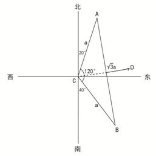

故正确答案为D。

**考点**：几何结论类-三角形相关

**来源**：2011年917联考《行测》题（河南/福建/甘肃/重庆/新疆兵团）第59题

### 第 60 题

高速公路上行驶的汽车A的速度是每小时100公里，汽车B的速度是每小时120公里，此刻汽车A在汽车B前方80公里处，汽车A中途加油停车10分钟后继续向前行驶。那么从两车相距80公里处开始，汽车B至少要多长时间可以追上汽车A？

A. 2小时

B. 3小时10分

C. 3小时50分

D. 4小时10分

第 60 题 · 答案与解析

**参考答案（粉笔题库参考内容）**

B

**解析**

汽车A在加油的10分钟内汽车B行驶路程为120×1/6=20公里，此时A、B间还剩余80－20＝60公里，为A、B追及的路程，需要用时60/(120−100) = 3小时，因此汽车B追上A共用时3小时10分钟。

故正确答案为B。

**考点**：相遇追及

**来源**：2011年917联考《行测》题（河南/福建/甘肃/重庆/新疆兵团）第60题

### 第 61 题

某房地产公司分别以80万人民币的相同价格出售两套房屋。一套房屋以盈利20%的价格出售，另一套房屋以盈利30%的价格出售，那么该房地产公司从中获利约为：

A. 31.5万元

B. 31.6万元

C. 31.7万元

D. 31.8万元

第 61 题 · 答案与解析

**参考答案（粉笔题库参考内容）**

D

**解析**

根据公式：成本=售价/(1+利润率)，则一套房屋的成本为80/(1+20%)=80/1.2≈66.67万元，另一套房屋的成本为80/(1+30%)=80/1.3≈61.54万元。根据公式：利润=售价-成本，则房地产总司从中获利80×2-（66.67+61.54）=160-128.21≈31.8万元。

故正确答案为D。

**考点**：经济利润问题

**来源**：2011年917联考《行测》题（河南/福建/甘肃/重庆/新疆兵团）第61题

### 第 62 题

一根绳子对折三次后，从中剪断，共剪成几段绳子？

A. 9

B. 6

C. 5

D. 3

第 62 题 · 答案与解析

**参考答案（粉笔题库参考内容）**

A

**解析**

对折3次后绳子共有2^3=8折，剪断后共有8个切口。

因此剪断后绳子共有8+1=9段。

故正确答案为A。

**来源**：2011年917联考《行测》题（河南/福建/甘肃/重庆/新疆兵团）第62题

### 第 63 题

某高校从E、F和G三家公司购买同一设备的比例分别是20%、40%和40%，E、F和G三家公司所生产设备的合格率分别是98%、98%和99%，现随机购买到一台次品设备的概率是：

A. 0.013

B. 0.015

C. 0.016

D. 0.01

第 63 题 · 答案与解析

**参考答案（粉笔题库参考内容）**

C

**解析**

从E公司买到次品的概率为20%×（1–98%），从F公司买到次品的概率为40%×（1–98%），从G公司买到次品的概率为40%×（1–99%）。故随机买到一台次品的概率为20%×2%+40%×2%+40%×1%=0.016。

故正确答案为C。

**考点**：给概率求概率

**来源**：2011年917联考《行测》题（河南/福建/甘肃/重庆/新疆兵团）第63题

### 第 64 题

某市规定，出租车合乘部分的车费向每位乘客收取显示费用的60%，燃油附加费由合乘客人平摊。现有从同一地方出发的三位客人合乘，分别在D、E、F点下车，显示的费用分别为10元、20元、40元，那么在这样的合乘中，司机的营利比正常（三位客人是一起的，只是分别在上述三个地方下车）多：

A. 1元

B. 2元

C. 10元

D. 12元

第 64 题 · 答案与解析

**参考答案（粉笔题库参考内容）**

C

**解析**

第一位下车客人为合乘，涉及金额为10元；第二位下车客人为合乘，涉及金额为20元；第三位下车客人合乘部分涉及金额20元，独乘部分涉及金额为20元；所以实际营利为10×60%+20×60%+20×60%+20=50元，正常情况下应为40元，故比正常多50–40=10元。

故正确答案为C。

**考点**：分段计算问题、统筹规划问题

**来源**：2011年917联考《行测》题（河南/福建/甘肃/重庆/新疆兵团）第64题

### 第 65 题

今年某高校数学系毕业生为60名，其中70％是男生，男生中有1/3选择继续攻读硕士学位，女生选择攻读硕士学位的人数比例是男生选择攻读硕士学位人数比例的一半，那么该系选择攻读硕士学位的毕业生共有：

A. 15位

B. 19位

C. 17位

D. 21位

第 65 题 · 答案与解析

**参考答案（粉笔题库参考内容）**

C

**解析**

根据题意，该系毕业生为60名，其中70%是男生，则其中30%为女生；男生中有1/3选择继续攻读硕士学位，女生中选择攻读硕士学位的人数比例是男生选择攻读硕士学位人数比例的一半，则女生中有1/6选择继续攻读硕士学位。因此该系攻读硕士学位的毕业生共有60 × 70% × 1/3+60×30%×1/6=17位。

故正确答案为C。

**考点**：和差倍比问题

**来源**：2011年917联考《行测》题（河南/福建/甘肃/重庆/新疆兵团）第65题

### 第 66 题

请从所给的四个选项中，选择最合适的一项填在问号处，使之呈现一定的规律性：

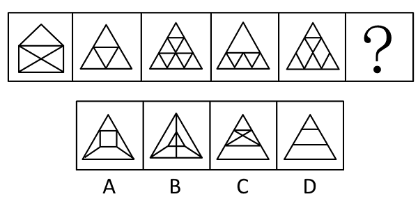

A. A

B. B

C. C

D. D

第 66 题 · 答案与解析

**参考答案（粉笔题库参考内容）**

C

**解析**

元素组成凌乱，考查数笔画。已知题干中的前五个图形都是一笔画，所以选只有一笔画的C项。A、D两项均为两笔画；B项为三笔画。

故正确答案为C。

**考点**：数量规律-线

**来源**：2011年917联考《行测》题（河南/福建/甘肃/重庆/新疆兵团）第66题

### 第 67 题

从所给的四个选项中，选择最合适的一个填入问号处，使之呈现一定的规律性：

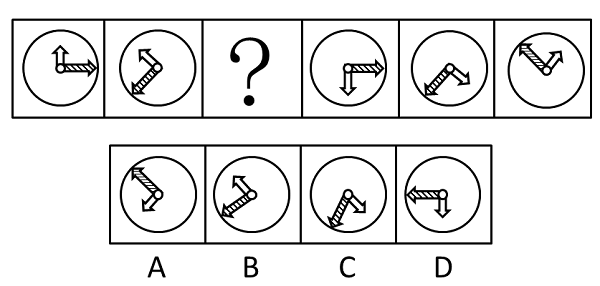

A. A

B. B

C. C

D. D

第 67 题 · 答案与解析

**参考答案（粉笔题库参考内容）**

A

**解析**

元素组成相同，考查位置规律。本题考查位置中的旋转问题。图形从左到右，长箭头依次按照顺时针方向以120°的角度旋转，短箭头始终与其保持垂直，按照逆时针方向每次旋转60°，符合此规律的只有A项。

故正确答案为A。

**考点**：位置规律-旋转

**来源**：2011年917联考《行测》题（河南/福建/甘肃/重庆/新疆兵团）第67题

### 第 68 题

从A、B、C、D四个图形中选出最合适的一个，使得它保持第一行四个图形所呈现的规律性：

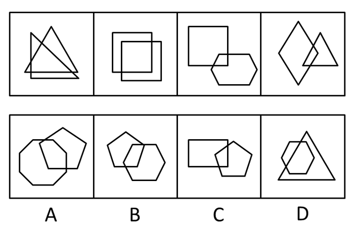

A. A

B. B

C. C

D. D

第 68 题 · 答案与解析

**参考答案（粉笔题库参考内容）**

C

**解析**

元素组成凌乱，且都是由两个元素组成，找两个元素之间的关系。题干各图中两个图形相交形成的图形均包含4条直线段，所以选相交图形也只有4条直线段的C项。A、D两项的相交图形包含6条线段；B项的相交图形包含5条线段。

故正确答案为C。

**考点**：特殊规律-图形间关系

**来源**：2011年917联考《行测》题（河南/福建/甘肃/重庆/新疆兵团）第68题

### 第 69 题

从A、B、C、D四个图形中选出最合适的一个，使得它保持第一行四个图形所呈现的规律性：

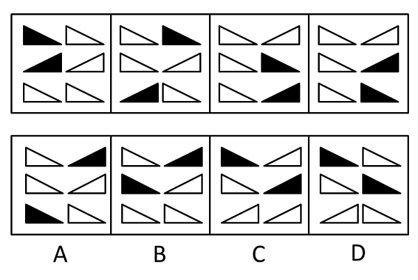

A. A

B. B

C. C

D. D

第 69 题 · 答案与解析

**参考答案（粉笔题库参考内容）**

A

**解析**

图形元素组成相同，优先考虑位置规律。观察前两个图形发现，第一个图形中左上角黑三角顺时针与右侧相邻的白三角互换位置，另外一个黑三角逆时针与下方相邻的三角互换位置得到第二个图形，后面图形按照此规律依次得到下一幅图形。只有A项符合此规律。

故正确答案为A。

**考点**：位置规律-平移

**来源**：2011年917联考《行测》题（河南/福建/甘肃/重庆/新疆兵团）第69题

### 第 70 题

从A、B、C、D四个图形中选出最合适的一个，使得它保持上面四个图形所呈现的规律性：

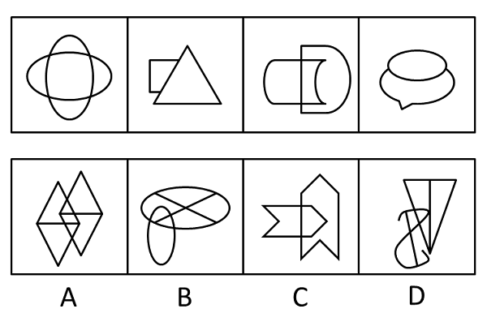

A. A

B. B

C. C

D. D

第 70 题 · 答案与解析

**参考答案（粉笔题库参考内容）**

C

**解析**

元素组成凌乱，经过验证排除属性规律，考虑数量规律。题干图形均为一笔画，在连通图形里，奇点个数为0或2才能一笔完成，A、B两项都有4个奇点，D项6个奇点，C项0个奇点，只有C项符合条件。

故正确答案为C。

**考点**：数量规律-线

**来源**：2011年917联考《行测》题（河南/福建/甘肃/重庆/新疆兵团）第70题

### 第 71 题

从所给的四个选项中，选择最合适的一个填入问号处，使之呈现一定的规律性：

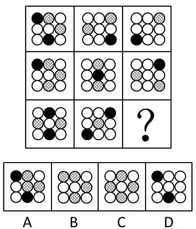

A. A

B. B

C. C

D. D

第 71 题 · 答案与解析

**参考答案（粉笔题库参考内容）**

A

**解析**

元素组成相似，考查元素种类。题干中的图形都由黑圆、白圆、网格圆三种元素组成，只有A项包含全部三种元素，B、C、D三项均只包含其中的两种。

故正确答案为A。

注意：本题有陷阱，容易用元素叠加运算，当发现此路不通时，应转换思路。

**考点**：数量规律-素

**来源**：2011年917联考《行测》题（河南/福建/甘肃/重庆/新疆兵团）第71题

### 第 72 题

从所给的四个选项中，选择最合适的一个填入问号处，使之呈现一定的规律性：

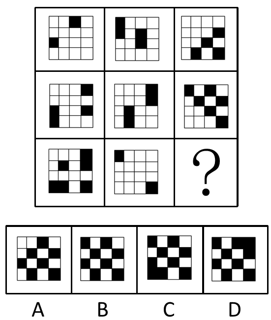

A. A

B. B

C. C

D. D

第 72 题 · 答案与解析

**参考答案（粉笔题库参考内容）**

B

**解析**

题干每个图当中都包含有黑白块，且黑块数量不同，排除位置考点。题干中所有图形中包含的黑色方格的数量均是偶数。四个选项中黑色方格的数量依次为7、8、9、9，只有B项遵循这个规律。

故正确答案为B。

**考点**：数量规律-素

**来源**：2011年917联考《行测》题（河南/福建/甘肃/重庆/新疆兵团）第72题

### 第 73 题

从A、B、C、D四个图形中选出最合适的一个，使得它保持上面四个图形所呈现的规律性：

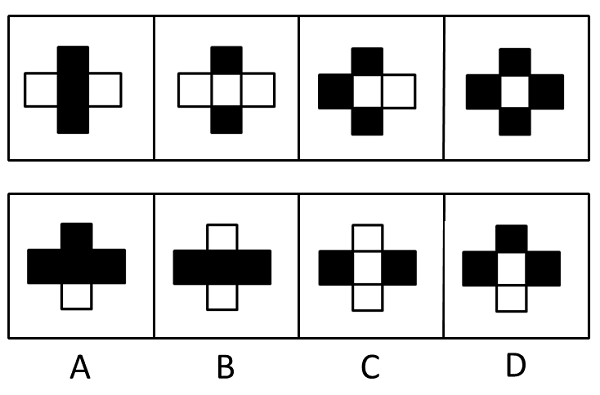

A. A

B. B

C. C

D. D

第 73 题 · 答案与解析

**参考答案（粉笔题库参考内容）**

D

**解析**

元素构成相似，考查元素运算，相邻的两个图形间只有一个方块是不同的，如把原来图形分为上下左右中五个部分，1、2图形中间部分不同，2、3图形左侧部分不同，依次类推，与图形4不同的是选项D，下侧方块不同。

故正确答案为D。

**考点**：黑白块类

**来源**：2011年917联考《行测》题（河南/福建/甘肃/重庆/新疆兵团）第73题

### 第 74 题

从A、B、C、D四个图形中选出最合适的一个，使得它保持上面四个图形所呈现的规律性：

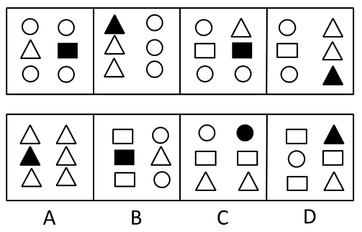

A. A

B. B

C. C

D. D

第 74 题 · 答案与解析

**参考答案（粉笔题库参考内容）**

B

**解析**

元素组成相似，整体观察图形，本题考查阴影元素周遍。图形中黑色元素为三角形或四边形，并且成奇偶的分布特征，即奇数项图形中的黑色元素都为四边形，偶数项图形中的黑色元素都为三角形。

故正确答案为B。

**考点**：样式规律-遍历

**来源**：2011年917联考《行测》题（河南/福建/甘肃/重庆/新疆兵团）第74题

### 第 75 题

从所给的四个选项中，选择最合适的一个填入问号处，使之呈现一定的规律性：

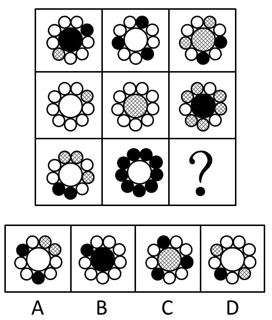

A. A

B. B

C. C

D. D

第 75 题 · 答案与解析

**参考答案（粉笔题库参考内容）**

D

**解析**

本题考查元素周遍。题干中共出现白圆、黑圆、网状圆三种元素，观察元素出现频率，除了右下角的小圆圈没出现过网状圆元素以外，每种元素在其他圆圈位置上至少出现过一次，而四个选项中只有D项的右下角圆圈是网状圆。

故正确答案为D。

**考点**：样式规律-遍历

**来源**：2011年917联考《行测》题（河南/福建/甘肃/重庆/新疆兵团）第75题

### 第 76 题

负性制裁是指社会以消极性手段对违反社会规范的社会成员所进行的惩治方式。其特点是强迫性，迫使社会成员认识到不遵守社会规范所承担的不良后果。

根据上述定义，下列不属于负性制裁的是：

A. 甲因入室行凶抢劫，被判处死刑

B. 乙因不孝顺父母，受到邻里谴责

C. 丙因不当行为，被单位警告处分

D. 丁因严重违反校纪，被开除学籍

第 76 题 · 答案与解析

**参考答案（粉笔题库参考内容）**

B

**解析**

第一步：抓住定义中的关键词。

关键词包括“惩治方式”、“强迫性”。

第二步：逐一判断选项。

A项中的“死刑”、C项中的“警告处分”、D项中的“开除学籍”都是具有“强迫性”的惩治方式，因此均属于负性制裁；而B项中的“邻里谴责”不是惩治方式，也不具有强迫性。

本题为选非题，故正确答案为B。

**考点**：方式目的

**来源**：2011年917联考《行测》题（河南/福建/甘肃/重庆/新疆兵团）第76题

### 第 77 题

冲突管理是由冲突与管理组合而成，冲突是指人们由于某种抵触或对立状况而感知到的不一致的差异，管理者不仅要解决组织中的冲突，更要刺激功能性的冲突，以促进组织目标的达成。

根据上述定义，下列选项不属于冲突管理的是：

A. 某公司营销部和技术部因产品的定位产生意见分歧，公司领导在听取技术部的意见后，采纳了他们的意见

B. 某公司的部门之间常有沟通和协作障碍，公司决定将各个部门人员分批送到拓展机构开展团队协作训练，效果显著

C. 在课题论证会上，主持人鼓励大家发言，有些专家观点针锋相对，最后主持人汇总了大家的意见后提出结论性意见

D. 某公司人力资源部与战略部对公司目标的确定存在争议，公司领导要求各部联合论证方案的合理性，最终形成新的方案

第 77 题 · 答案与解析

**参考答案（粉笔题库参考内容）**

B

**解析**

第一步：找出定义关键词。

“某种抵触或对立状况而感知到的不一致的差异”、“管理者不仅要解决组织中的冲突，更要刺激功能性的冲突，以促进组织目标的达成”。

第二步：逐一分析选项。

A项：“意见分歧”是“某种抵触或对立状况”的体现，且最终解决了冲突，促进目标的达成，属于冲突管理，符合定义，排除；

B项：只是存在“沟通和协作障碍”，并不是对立状况，不符合定义，当选；

C项：“观点针锋相对”是“某种抵触或对立状况”的体现，且最终解决了冲突，促进目标的达成，属于冲突管理，符合定义，排除；

D项：“存在争议”是“某种抵触或对立状况”的体现，且最终解决了冲突，促进目标的达成，属于冲突管理，符合定义，排除。

本题为选非题，故正确答案为B。

**考点**：方式目的

**来源**：2011年917联考《行测》题（河南/福建/甘肃/重庆/新疆兵团）第77题

### 第 78 题

基多夫定理是指最好的想法如果提出的时机选择不当，也会招致失败，即一个决策正确与否不能离开具体的地点、时间、条件，如果脱离这些基本前提条件，真理就有可能成为谬误。

根据上述定义，下列不符合基多夫定理的是：

A. 甲公司原总裁对其继任者说：在没有获得全部事实根据前，你不应做出任何决策

B. 许多厂商纷纷报名参加在某市举办的机床博览会，而乙机床厂经理在收到邀请函时，就明确表示拒绝参加

C. 20世纪80年代，世界爆发了严重的石油危机，丙汽车公司的董事长抓住这一时机，作出了汽车转型决策

D. 近年，众多热水器厂在广告投入过大，导致价涨量滞，处于行业领先的丁公司立刻采取了降价政策

第 78 题 · 答案与解析

**参考答案（粉笔题库参考内容）**

B

**解析**

第一步：抓住定义中的关键词。

关键词为“时机选择不当，也会招致失败”。

第二步：逐一判断选项。

A项中的“在没有获得全部事实根据前”、C项中的“抓住这一时机”、D项中的“价涨量滞”均涉及到了“时机选择”，符合基多夫定理；而B项中机床厂经理在收到邀请函时，明确表示拒绝参加，并没有体现“时机选择”，也不能说是失败与否。

本题为选非题，故正确答案为B。

**考点**：单定义-其他句式

**来源**：2011年917联考《行测》题（河南/福建/甘肃/重庆/新疆兵团）第78题

### 第 79 题

顶层设计是指统筹考虑系统各层次和各要素，追根溯源，统揽全局，在最高层次上寻求问题的系统解决之道。

根据上述定义，下列选项不符合顶层设计的是（    ）。

A. 某市政府在有关园林绿化决策执行效果的检查过程中发现问题，有关领导指示对北区绿化方案进行优化

B. 某公司董事会就公司扩大经营范围，在海外收购项目等问题召集相关专家起草方案，在论证后董事会进行表决

C. 某岛屿具有不冻不淤的深水港口与沙白滩阔等条件，辖区政府为利用好这些资源，组织海内外专家研究岛屿开发方案

D. 软件公司在开发大型软件时，就软件的框架召集专家进行论证，在充分吸收专家意见的基础上，确立了软件设计思路

第 79 题 · 答案与解析

**参考答案（粉笔题库参考内容）**

A

**解析**

第一步：抓住定义中的关键词。

客体：系统各层次各要素。属性：系统解决之道。

第二步：逐一分析选项。

A项，对北区绿化方案的优化仅限于北区这一局部，而非整个系统的解决之道，不符合定义，当选；

B项，海外收购项目等问题是扩大经营范围的各个要素，起草方案是公司扩大经营范围的系统性方案，符合定义，排除；

C项，深水港口和白沙滩阔是整个岛屿的各个要素，开发方案是开发岛屿的系统性方案，符合定义，排除；

D项，软件的框架设计是软件的各个层次和要素，软件设计思路是开发整个软件的系统性方案，符合定义，排除。

本题为选非题，故正确答案为A。

**考点**：方式目的

**来源**：2016年重庆市选调优秀大学生到基层工作考试《行测》题第70题

### 第 80 题

机会成本是指同一经济主体在从事某项经济活动时面临多项决策，如果所选择的决策不是价值最大的，那么价值最大的决策与所选择决策之间的差额就是机会成本。

根据上述定义，下列对机会成本理解正确的是：

A. 小赵如果将旧书卖给收报纸的将得到50元，但是他将书以20元的价格卖给了宿舍管理员。他付出了机会成本30元

B. 小庄有闲钱1万元，他投资了股票，结果损失2000元；如果他投资期货，将获利1000元，为此他付出了8000元的机会成本

C. 小贾、小郑如果在甲公司工作，将获得5万年薪；如果在乙公司工作，将获得4万年薪；如果在丙公司工作，将获得3万年薪。结果，小贾选择了乙公司，小郑选择了丙公司，他们付出了相同的机会成本

D. 小王如果将汽车卖给小李，将得款12万元；如果将汽车卖给小明，将得款10万元。结果他将车卖给了小李，他获得2万元机会成本

第 80 题 · 答案与解析

**参考答案（粉笔题库参考内容）**

A

**解析**

第一步：抓住定义中的关键词。关键词为“所选择的决策不是价值最大”，“价值最大的决策与所选择决策之间的差额”。第二步：逐一判断选项。A项符合关键词，对机会成本理解正确；B项中机会成本应该是3000元；C项中两者的机会成本分别是1万元、2万元，是不相等的；D项小王选择了价值最大的决策。

故正确答案为A。

**考点**：单定义-其他句式

**来源**：2011年917联考《行测》题（河南/福建/甘肃/重庆/新疆兵团）第80题

### 第 81 题

高位嫁接是指把观赏树木的枝或芽嫁接在大规格的砧木上，实现快速形成树冠的一种培育大苗方法，现被引申指将相对较高层次、较高素质的人才充实到经济建设和社会发展一线主战场，实现高层次人才与基层组织的结合，高素质专业人才与劳动群众的结合。

根据上述定义，下列最符合高位嫁接的是：

A. 某省卫生厅组织系统内年轻专业技术人员到院士身边工作学习

B. 某省科技厅组织高级工程师到山区科技企业技术管理岗位任职

C. 甲公司与乙公司签订合作协议，乙公司派技术员到甲公司任职

D. 某项生物工程专利权人张教授，辞去教师职务到山区创办企业

第 81 题 · 答案与解析

**参考答案（粉笔题库参考内容）**

B

**解析**

第一步：抓住定义中的关键词。

关键词包括“高层次人才与基层组织的结合”、“高素质专业人才与劳动群众的结合”。

第二步：逐一判断选项。

A项，题干中说的是高层次人才与基层相结合，而选项说的是基层的人才与高层次的人才相结合，反了；C项是“技术员”之于“甲公司”，不属于与基层嫁接；D项是张教授“创办企业”，均不符合关键词；而B项的“高级工程师”之于“山区科技企业”是高层次人才与基层组织的结合，属于高位嫁接。

故正确答案为B。

**考点**：单定义-其他句式

**来源**：2011年917联考《行测》题（河南/福建/甘肃/重庆/新疆兵团）第81题

### 第 82 题

感受域是指人对于各种刺激所能感受的范围，亦即在感觉系统中能够引起某一神经细胞或神经纤维反应的受刺激区域。

根据上述定义，下列各项不涉及感受域的是：

A. 盲人在触觉上拥有与正常视力的人所不同的特点

B. 小张觉得舅舅今天要来，不一会儿，舅舅果然来了

C. 在海洋深处，有些大型鱼类能发出人类听不见的各种声音

D. 小李在皮革厂工作，凭借手感他就可以区分人造皮和真皮

第 82 题 · 答案与解析

**参考答案（粉笔题库参考内容）**

B

**解析**

第一步：抓住定义中的关键词。

关键词为“人对于各种刺激所能感受的范围”。

第二步：逐一判断选项。

A项，盲人在触觉上比正常人有所不同，这里是触觉的刺激，涉及感受域的概念；B项，凭空猜测舅舅要来，没有涉及任何一种外界对神经系统的刺激，只是主观臆断而已，不涉及感受域；C项，人类听不到某些海洋鱼类发出的声音，这是因为这种声波的波长超出了人类对声音的感受域，同样涉及了感受域的概念；D项，通过手感区分真皮与否，这里是触觉的刺激，涉及感受域的概念。

综上所述，这里题干问的是哪项不涉及，A、C、D三项均涉及了感受域。

本题为选非题，故正确答案为B。

**考点**：单定义-其他句式

**来源**：2011年917联考《行测》题（河南/福建/甘肃/重庆/新疆兵团）第82题

### 第 83 题

生态住宅是指运用生态学原理和遵循生态平衡及可持续发展的原则，设计、组织内外空间中的各种物质因素，使物质、能源在建筑系统内有秩序地循环转换，从而获得一种高效、低耗、无污染、生态平衡的建筑环境。

根据上述定义，下列不属于生态住宅的是：

A. 某住宅区统一安装智能系统，实现太阳能和常规供热恒温调控

B. 某家装修时，用了集水管将雨水引至住宅的中央水池以供利用

C. 某市商务区的办公大楼屋顶种植花草，增强大楼的隔热保温功能

D. 某小区对垃圾进行分类存放，及时清运，以提高垃圾的循环利用

第 83 题 · 答案与解析

**参考答案（粉笔题库参考内容）**

D

**解析**

第一步：抓住定义中的关键词。

关键词为“物质、能源在建筑系统内有秩序地循环转换”。

第二步：逐一判断选项。

A项中的“某住宅区统一安装”、B项中的“雨水引至住宅的中央水池”、C项中的“办公大楼屋顶种植花草”，主体均是建筑系统；而D项小区对垃圾进行分类存放提高垃圾的循环利用，并未涉及建筑系统，因此不属于生态住宅。

本题为选非题，故正确答案为D。

**考点**：方式目的

**来源**：2011年917联考《行测》题（河南/福建/甘肃/重庆/新疆兵团）第83题

### 第 84 题

宜斯策略是指生物为生存和繁衍而采取的一种比较稳定的策略。即如果种群的大部分成员采用某种策略，而这种策略的好处是其他策略所比不上的，则这种策略就是进化上的稳定策略，或称宜斯策略。

根据上述定义，下列属于宜斯策略的是：

A. 母狼为虎崽哺乳

B. 通过人工授粉提高苹果产量

C. 狼群中出现的争夺头领的战争

D. 幼小的羚羊见到狮子拔腿就跑

第 84 题 · 答案与解析

**参考答案（粉笔题库参考内容）**

D

**解析**

第一步：抓住定义中的关键词。

关键词为“为生存和繁衍”、“种群的大部分成员采用”、“进化上的稳定策略”。

第二步：逐一判断选项。

A项中狼与虎不是同一种群；B项中人工授粉，不是生物“为生存和繁衍”而自身采取的策略；C项中争夺头领并不是其种群里大部分成员采用的策略；D项中小羚羊的行为属于被其种群大部分所选择的稳定的生存策略。

故正确答案为D。

**考点**：单定义-其他句式

**来源**：2011年917联考《行测》题（河南/福建/甘肃/重庆/新疆兵团）第84题

### 第 85 题

一个词语通常有两种用法。一种用法是用这个词去表达其所表达的对象；一种用法是用这个词表达其自身。其中，前一种用法通常表达的就是词语的意义，一般称之为指称用法；后一种用法通常表达的是这个词语的形式，一般称之为自名用法。

根据上述定义，下列加引号的词属于自名用法的是：

A. 女性一般喜欢“粉色”

B. 大象一般生活在“密林”之中

C. “其它”，现在一般都使用“其他”

D. “商品”指的是用来交换的劳动产品

第 85 题 · 答案与解析

**参考答案（粉笔题库参考内容）**

C

**解析**

第一步：抓住定义中的关键词。

关键词为“表达其自身”。

第二步：逐一判断选项。

A项中的“粉色”、B项中的“密林”和D项中的“商品”，表达的都是词语的实际意义，均属于“指称用法”；而C项中的“其他”表达的是这个词语本身，不是其实际意义，属于“自名用法”。

故正确答案为C。

**考点**：常规问法

**来源**：2011年917联考《行测》题（河南/福建/甘肃/重庆/新疆兵团）第85题

### 第 86 题

汽车：导航仪

A. 电脑：鼠标

B. 相机：闪光灯

C. 医生：护士

D. 办公室：办公桌

第 86 题 · 答案与解析

**参考答案（粉笔题库参考内容）**

A

**解析**

第一步：判断题干词语间逻辑关系。

汽车和导航仪是或然组成关系，且后者为前者在屏幕上定位。

第二步：判断选项词语间逻辑关系。

A项：电脑和鼠标是或然组成关系，且后者为前者在屏幕上定位，与题干逻辑关系一致，当选；

B项：相机和闪光灯是或然组成关系，但是两词没有定位的关系，与题干逻辑关系不一致，排除；

C项：医生和护士是并列关系，与题干逻辑关系不一致，排除；

D项：办公室和办公桌是地点对应关系，与题干逻辑关系不一致，排除。

故正确答案为A。

**考点**：逻辑关系-包容关系

**来源**：2016年山东省选调应届优秀高校毕业生到基层工作考试《行测》试卷（精选）第54题

### 第 87 题

民法：法律：法官

A. 榕树：植物：园丁

B. 母牛：奶牛：牧民

C. 太阳：月亮：银河系

D. 学生：中学生：教师

第 87 题 · 答案与解析

**参考答案（粉笔题库参考内容）**

A

**解析**

第一步：判断题干词语间逻辑关系。

题干三词，民法与法律为包容关系，民法是法律的一种。法律与法官为对应关系，法官从事法律相关的工作。

第二步：判断选项词语间逻辑关系。

A项，榕树与植物为包容关系的种属关系，后词包容前词，园丁从事植物相关的工作，当选；

B项，母牛与奶牛是交叉关系，排除；

C项，太阳与月亮为并列关系，排除；

D项，学生与中学生是包容关系，但两者顺序与题干不一致，排除。

故正确答案为A。

**考点**：逻辑关系-包容关系、逻辑关系-对应关系

**来源**：2011年917联考《行测》题（河南/福建/甘肃/重庆/新疆兵团）第87题

### 第 88 题

网络：网游：网瘾

A. 矿山：采矿：矽肺

B. 球场：球迷：暴力

C. 会议：会谈：会务

D. 车展：车模：车友

第 88 题 · 答案与解析

**参考答案（粉笔题库参考内容）**

A

**解析**

第一步：判断题干词语间逻辑关系。

“网游”必须要有“网络”，二者属于必要条件关系，“网游”可能会导致“网瘾”，二者属于因果对应关系。

第二步：判断选项词语间逻辑关系。

A项：“采矿”必须要有“矿山”，二者属于必要条件关系，“采矿”可能会导致“矽肺”，二者属于因果对应关系，与题干逻辑关系一致，当选；

B项：“球迷”在“球场”看球，二者属于地点对应关系，与题干逻辑关系不一致，排除；

C项：“会谈”可以通过“会议”的形式进行，二者属于对应关系，与题干逻辑关系不一致，排除；

D项：“车展”与“车模”属于工作场合与职业的对应关系，与题干逻辑关系不一致，排除。

故正确答案为A。

**考点**：逻辑关系-对应关系

**来源**：2011年917联考《行测》题（河南/福建/甘肃/重庆/新疆兵团）第88题

### 第 89 题

花朵：浇灌：鲜艳

A. 牙齿：洗刷：美味

B. 石油：开采：提炼

C. 学生：教育：博学

D. 塑料：加工：工艺

第 89 题 · 答案与解析

**参考答案（粉笔题库参考内容）**

C

**解析**

第一步：判断题干词语间逻辑关系。

花朵需要浇灌，鲜艳用于形容花朵，三者是对应关系。

第二步：判断选项词语间逻辑关系。

A项：牙齿需要洗刷，但美味不能形容牙齿，与题干逻辑关系不一致，排除；

B项：石油需要开采，但提炼不是石油的形容词，与题干逻辑关系不一致，排除；

C项：学生需要教育，博学可以用于形容学生，与题干逻辑关系一致，当选；

D项：加工塑料为动宾关系，但工艺不是形容塑料，与题干逻辑关系不一致，排除。

故正确答案为C。

**考点**：语法关系

**来源**：2011年917联考《行测》题（河南/福建/甘肃/重庆/新疆兵团）第89题

### 第 90 题

海底：隧道：汽车

A. 深山：洞穴：大炮

B. 空中：航线：飞机

C. 地下：管道：电缆

D. 建筑：管道：雨水

第 90 题 · 答案与解析

**参考答案（粉笔题库参考内容）**

B

**解析**

第一步：判断题干词语间逻辑关系。

可以造句子：汽车沿着海底的隧道行驶，且汽车是交通工具。

第二步：判断选项词语间逻辑关系。

A项：大炮可以在深山的洞穴里，但大炮并不是交通工具，与题干逻辑关系不一致，排除；

B项：飞机沿着空中的航线飞行，且飞机是交通工具，与题干逻辑关系一致，当选；

C项：电缆可以铺设在地下管道里，但电缆并不是交通工具，与题干逻辑关系不一致，排除；

D项：雨水可以通过建筑的管道排放，但雨水并不是交通工具，与题干逻辑关系不一致，排除。

故正确答案为B。

**考点**：逻辑关系-对应关系

**来源**：2011年917联考《行测》题（河南/福建/甘肃/重庆/新疆兵团）第90题

### 第 91 题

海洋：海浪：冲浪板

A. 泳池：浪花：潜泳

B. 血管：血液：细胞

C. 树林：树木：小鸟

D. 天空：气流：热气球

第 91 题 · 答案与解析

**参考答案（粉笔题库参考内容）**

D

**解析**

第一步：判断题干词语间逻辑关系。

题干三个词是对应关系，且是地点、动力和作用对象的对应关系，即海洋有海浪，海浪可以促使冲浪板滑行。

第二步：判断选项词语间逻辑关系。

A中“浪花”和“潜泳”、B中“血液”和“细胞”、C中“树木”和“小鸟”都不构成动力和作用对象的对应关系；D与题干逻辑关系相同，即天空中有气流，气流可使热气球上升。

故正确答案为D。

**考点**：逻辑关系-对应关系

**来源**：2011年917联考《行测》题（河南/福建/甘肃/重庆/新疆兵团）第91题

### 第 92 题

黄金：铂金：金属

A. 北京：纽约：首都

B. 河流：黄河：长江

C. 本科生：研究生：学生

D. 民法：宪法：母法

第 92 题 · 答案与解析

**参考答案（粉笔题库参考内容）**

C

**解析**

第一步：判断题干词语间逻辑关系。

黄金和铂金为并列关系，都是金属，与第三词为种属关系。

第二步：判断选项词语间逻辑关系。

A项：北京和纽约为并列关系，但北京是首都，纽约不是，与题干逻辑关系不一致，排除；

B项：黄河和长江为并列关系，都是河流，但顺序相反，与题干逻辑关系不一致，排除；

C项：本科生和研究生为并列关系，都是学生，与题干逻辑关系一致，当选；

D项：宪法和母法为全同关系，与题干逻辑关系不一致，排除。

故正确答案为C。

**考点**：逻辑关系-包容关系、逻辑关系-并列关系

**来源**：2011年917联考《行测》题（河南/福建/甘肃/重庆/新疆兵团）第92题

### 第 93 题

电器：空调：塑料

A. 服装：上衣：皮革

B. 住房：车库：水泥

C. 橱柜：衣柜：木料

D. 电话：电线：电波

第 93 题 · 答案与解析

**参考答案（粉笔题库参考内容）**

A

**解析**

第一步：判断题干词语间逻辑关系。

空调是电器，二者为种属关系；塑料是制作空调的原材料，二者为原材料与成品的对应关系。

第二步：判断选项词语间逻辑关系。

A项，上衣是服装，二者为种属关系，皮革是制作上衣的原材料，二者为原材料与成品的对应关系，与题干逻辑关系一致，当选；

B项，住房和车库是并列关系，与题干逻辑关系不一致，排除；

C项，橱柜和衣柜是并列关系，与题干逻辑关系不一致，排除；

D项，电话和电线是并列关系，与题干逻辑关系不一致，这里要注意区分“电线”和“电话线”，二者不是一回事，排除。

故正确答案为A。

**考点**：逻辑关系-包容关系、逻辑关系-对应关系

**来源**：2011年917联考《行测》题（河南/福建/甘肃/重庆/新疆兵团）第93题

### 第 94 题

手机：通讯：辐射

A. 地雷：防卫：战争

B. 列车：运输：噪音

C. 冰箱：冷藏：臭氧

D. 药物：治疗：麻醉

第 94 题 · 答案与解析

**参考答案（粉笔题库参考内容）**

B

**解析**

第一步：判断题干词语间逻辑关系。

题干三个词属于对应关系，且是物体、主要功能和负面产物的对应关系，手机是一种通讯工具，通讯时会产生辐射。

第二步：判断选项词语间逻辑关系。

A项，地雷是一种防卫工具，但战争不是地雷产生的，与题干不符；

B项，列车是一种运输工具，运输时会产生噪音，符合题意；

C项，冰箱是一种冷藏工具，会破坏臭氧，但冰箱工作的“产物”不是臭氧，与题干不符；

D项，药物可用于治疗，但不是所有药物都会产生麻醉效果，与题干不符。

故正确答案为B。

**考点**：逻辑关系-对应关系

**来源**：2011年917联考《行测》题（河南/福建/甘肃/重庆/新疆兵团）第94题

### 第 95 题

曹操：张辽：《三国演义》

A. 宝钗：袭人：《红楼梦》

B. 宋江：关胜：《水浒传》

C. 唐僧：佛祖：《西游记》

D. 秦琼：程咬金：《隋唐英雄传》

第 95 题 · 答案与解析

**参考答案（粉笔题库参考内容）**

B

**解析**

第一步：判断题干词语间逻辑关系。

题干三个词属于对应关系。张辽是曹操手下，两者都是《三国演义》里面的人物，属于对应关系。

第二步：逐一分析选项。

A项，虽然宝钗和袭人都是《红楼梦》里的人物，但袭人是宝玉手下的丫鬟而不是宝钗手下，该项对应关系有误，排除；

B项，宋江和关胜都是《水浒传》中的人物，且关胜是宋江的手下，该项对应关系与题干一致，当选；

C项，虽然唐僧和佛祖都是《西游记》里的人物，但佛祖不是唐僧手下，该项对应关系与题干不符，排除；

D项，秦琼和程咬金都是《隋唐英雄传》里的人物，但两人是幼年好友、结义兄弟，程咬金并非秦琼手下，该项对应关系与题干不符，排除。

故正确答案为B。

**考点**：逻辑关系-对应关系

**来源**：2011年917联考《行测》题（河南/福建/甘肃/重庆/新疆兵团）第95题

### 第 96 题

通常情况下，报刊的记者和编辑在文章的措辞上极其小心，但在基于激发读者好奇心与报刊发行量的压力下，“体面”的报刊与“垃圾”报刊之间的品味差异似乎在缩小。加之，人们的注意力持久度似乎也很短暂，这使得上述困境加剧。

下列各项判断不能从上述文字中推出的是：

A. 报刊迫于销售压力在尽量准确报道的同时还要吸引读者的注意力

B. 记者和编辑对怎样才能在文章中激发读者的好奇心更在意了

C. 如果人们对报刊报道的注意力持久度并不短暂，则“体面”报刊的品味会提升

D. 记者和编辑在文章措辞上的极其小心，不能与其应怎样吸引读者注意力相提并论

第 96 题 · 答案与解析

**参考答案（粉笔题库参考内容）**

C

**解析**

第一步：抓住题干主要信息。

题干主要信息有两个，一是在基于激发读者好奇心与报刊发行量的压力下，“体面”的报刊品味下降；二是人们的注意力持久度似乎也很短暂，这使得上述困境加剧。

第二步：分析题干信息，并结合选项得出答案。

翻译第二个题干有：人们的注意力持久度短暂→“体面”的报刊品味下降。A、B两项的内容是题干的同义转换；由题干可知，“措辞上极其小心”与“吸引读者的注意力”是不可兼得的，是不能相提并论的；C项前句“人们对报刊报道的注意力持久度并不短暂”是否前件，利用逆否规则，推不出绝对化的结论，后句“‘体面’报刊的品味会提升”推不出；D项推断正确。

本题为选非题，故正确答案为C。

**考点**：日常结论

**来源**：2011年917联考《行测》题（河南/福建/甘肃/重庆/新疆兵团）第96题

### 第 97 题

有经验的司机完全有能力并习惯以120公里的时速在高速公路上行驶，为了迅速提高道路的使用效率，某条高速公路的最高时速限制由原来100公里转为120公里。

以下各项如果为真，最能质疑上述主张的是：

A. 统计表明行车速度达120公里时事故发生率明显增加，反而影响高速公路的使用效率

B. 限速每小时120公里不能迅速提高公路使用效率，因为高速驾车对技术的要求很高

C. 时速达120公里时，汽车的油耗量将明显增加，考虑到油价，大多数司机还是放松油门

D. 虽然时速限制放宽到120公里，但在不少路段上，很多司机对此速度有安全之虞

第 97 题 · 答案与解析

**参考答案（粉笔题库参考内容）**

A

**解析**

第一步：找出论点和论据。

论点：为了迅速提高道路的使用效率，某条高速公路的最高时速限制由原来100公里转为120公里。

论据：有经验的司机完全有能力并习惯以120公里的时速在高速公路上行驶。

本题论据和论点讨论的是都是高速公路的最高时速限制为120公里，二者话题一致，削弱首先考虑削弱论点，其次考虑削弱论据。

第二步：逐一分析选项。

A项：限速转为120公里会明显增加事故，影响高速公路使用效率，即降低使用效率，直接削弱论点，保留；

B项：指出不能迅速提高使用效率，但并不否定限速转为120公里以后有提高使用效率的可能性，削弱论点，保留；

C项：说的是大多数司机考虑到油价，通常不会开到时速120公里，说明限速120公里不一定能够提高使用效率，削弱论点，保留；

D项：说的是司机对车速的顾虑，没有说明是否影响道路使用效率，属无关选项，排除。

比较A、B、C三项，三项都是削弱论点，但B、C两项只说明不能提高公路使用效率，而A项强调的是会降低使用效率，对论点的削弱力度比B、C两项强。

故正确答案为A。

**考点**：削弱论点

**来源**：2016年山东省选调应届优秀高校毕业生到基层工作考试《行测》试卷（精选）第48题

### 第 98 题

蜜蜂大脑只有几毫克重，却可与哺乳动物一样执行某些任务，比如为同伴带路、建造家园等。大象大脑体积是蜜蜂的500万倍，但运行效率极其低下。神经信号从大脑一端传入另一端，以及从大脑传入脚趾间所需要的时间，均是蜜蜂的100倍。有人认为，人类的大脑可能不像大象或蜜蜂那样极端，但只要通过进化，神经元数量变多，我们会更聪明。

以下各项如果为真，最能质疑上述主张的是：

A. 牛脑体积是老鼠的800倍，但牛并不比老鼠聪明多少

B. 神经元是用来产生电脉冲的蛋白质，他们天生不稳定

C. 要使人类的脑力变强，最明显的方法是增加大脑容量

D. 蜜蜂的脑容量有限，但可将神经系统的功能发挥到极致

第 98 题 · 答案与解析

**参考答案（粉笔题库参考内容）**

B

**解析**

第一步：找到论点和论据。

论点：只要通过进化，神经元数量变多，我们会更聪明。

论据：无。

本题只有论点，没有论据，需削弱论点。

第二步：逐一分析选项。

A项：说的是脑体积，论点说的神经元，话题不一致，无法削弱，排除；

B项：指出神经元天生不稳定，证明神经元的数量不能控制，论点无法成立，削弱论点，当选；

C项：说的是大脑容量，论点说的神经元，话题不一致，无法削弱，排除；

D项：说的是蜜蜂的脑容量和神经系统功能，而论点说的是神经元，话题不一致，无法削弱，排除。

故正确答案为B。

**考点**：削弱论点

**来源**：2011年917联考《行测》题（河南/福建/甘肃/重庆/新疆兵团）第98题

### 第 99 题

科学家最新发现被命名为“郑氏晓廷龙”的小恐龙是始祖鸟的“亲戚”，与生存于侏罗纪晚期的始祖鸟亲缘关系非常近，通过分析始祖鸟的形态，并对似鸟恐龙和早期鸟类的系统发育关系进行了重新分析，得出始祖鸟并非鸟类，而是原始恐爪龙类，即始祖鸟是迅猛龙的祖先，而不是鸟类的祖先。

以下各项如果为真，最不能质疑上述主张的是：

A. 恐爪龙类是一类与恐龙亲缘关系很近的鸟

B. 恐爪龙类是一类与鸟类亲缘关系很近的恐龙

C. 兽脚类恐龙的一支演化成植食性恐龙，再演化成鸟类

D. 始祖鸟标本被命名后，一直被认为是最原始、最古老的鸟类

第 99 题 · 答案与解析

**参考答案（粉笔题库参考内容）**

B

**解析**

第一步：分析题干，找到论点和论据。

论点：始祖鸟并非鸟类，而是原始恐爪龙类。

论据：无。

第二步：逐一分析选项。

A项：指出恐爪龙类是鸟，具有削弱作用；

B项：与A项相反，具有加强作用；

C项：兽脚类恐龙和题干始祖鸟主体不同，属于无关项，排除；

D项：该项表明始祖鸟一直被“认为”是鸟类，但是并没有客观证据来佐证到底是不是鸟类，不明确项，排除。

本题为选非题，故正确答案为B。

**考点**：削弱选非题

**来源**：2011年917联考《行测》题（河南/福建/甘肃/重庆/新疆兵团）第99题

### 第 100 题

“断食法”在日本、台湾等亚洲一些地区比较盛行，这种方法是一日三餐以果汁、菜汤清水等低卡路里饮食取代固体食物，为期三至十天不等，以求达到排毒、燃脂和瘦身等效果。

如果以下各项为真，哪项最不能削弱上述观点？

A. 人体每天摄取热量过低时，可能会出现血糖或血压过低的状况

B. 肥胖者身体摄取热量太低，会加速燃烧脂肪，肾功能会发生积极变化

C. 食用蔬菜可以促进肠道蠕动 ，但其热量过低，过度食用会干扰新陈代谢

D. 低卡路里饮食会导致体内毒素因缺乏营养而丧失活性，但同时因新陈代谢遭扰乱而存在致胖风险

第 100 题 · 答案与解析

**参考答案（粉笔题库参考内容）**

B

**解析**

第一步：找到论点和论据。

论点：断食法可以达到排毒、燃脂以及瘦身等效果。

论据：无。

本题只有论点，没有论据，需削弱论点。

第二步：逐一分析选项。

A项：指出摄入热量过低会出现血糖或血压过低，是断食法的坏处，削弱了断食法的积极作用，排除；

B项：指出断食法带来的积极作用，具有加强作用，无法削弱，当选；

C项：指出仅食用蔬菜会干扰新陈代谢，是断食法的坏处，削弱了断食法的积极作用，排除；

D项：指出低卡路里饮食存在致胖风险，说明断食法无法达到瘦身效果，直接削弱论点，排除。

本题为选非题，故正确答案为B。

**考点**：削弱选非题

**来源**：2011年917联考《行测》题（河南/福建/甘肃/重庆/新疆兵团）第100题

### 第 101 题

植物生长调节剂是对植物的生长发育具有抑制或者促进作用的一类物质。包括人工合成的化合物和从生物中提取的天然植物激素。目前在全世界农业生产中广泛应用，针对人们对其安全性的质疑。业内人士指出，根据批量检测结果，看不出有植物生长调节剂的存在。因此，可以认为植物生长调节剂的安全性是比较可靠的。

下列哪项为真，最能质疑上述业内人士的观点？

A. 植物生长调节剂喷洒后，将长期存在于土壤中，不易分解

B. 有些发达国家对植物生长调节剂的使用有严格的管理规定

C. 从以往的经验来看，即使是广泛使用的产品也未必是安全的

D. 有些植物生长调节剂即使含量检测不出，如果长期食用，也可能致病

第 101 题 · 答案与解析

**参考答案（粉笔题库参考内容）**

D

**解析**

第一步：找到论点和论据。

论点：植物生长调节剂的安全性是比较可靠的。

论据：根据批量检测结果，看不出有植物生长调节剂的存在。

第二步：逐一判断选项。

A项中所述并不影响调节剂的安全性和可靠性；B项谈及国家规定，并没有提及调节剂本身的安全性；C项中的“以往的经验”“广泛使用的产品”不具针对性。三个选项都属于无关项；D项否定了植物调节剂的安全性的观点，原因是有些植物生长调节剂即使含量检测不出，如果长期食用，也可能致病，在论点和论据间拆桥。

故正确答案为D。

**考点**：拆桥

**来源**：2011年917联考《行测》题（河南/福建/甘肃/重庆/新疆兵团）第101题

### 第 102 题

疾病预防控制中心的研究报告认为，烟草使用是首要的可预防死因。每年全世界有500万人死于烟草相关疾病，其中每年死于二手烟的人数也高达60万，四分之一以上是儿童。

以下各项如果为真，哪项最不能质疑上述观点？

A. 每年全世界有500多万人死于因运动不足而引发的疾病

B. 每年全世界有500多万人死于因生活不规律而引发的疾病

C. 每年全世界不低于1405万人的可预防死因并非烟草相关疾病

D. 每年全世界因心理调试不当引发的疾病成为人类首要的可预防死因

第 102 题 · 答案与解析

**参考答案（粉笔题库参考内容）**

C

**解析**

第一步：找到论点和论据。

论点：烟草使用是首要的可预防死因，

论据：每年全世界有500万人死于烟草相关疾病，其中每年死于二手烟的人数也高达60万，四分之一以上是儿童。

第二步：逐一判断选项。

A、B两项分别说“死于运动不足”和“死于生活不规律”的人数是500多万人，比题干中死于烟草相关的人数多；

C项不能起到削弱作用，因为可预防死因有很多种，如果种类很多，但是数量很少，加起来也能达到1405万人；

D项则直接说心理调适不当是首要可预防死因，在论点和论据间不搭桥，起削弱作用。

本题为选非题，故正确答案为C。

**考点**：削弱选非题

**来源**：2011年917联考《行测》题（河南/福建/甘肃/重庆/新疆兵团）第102题

### 第 103 题

夏燕，贾枢和郑薇三个同学一起去旅游，为了照相方便，每个人拿的是同学的相机，背的是另一个同学的包。

如果背着郑薇的包的人拿的是贾枢的相机，那么以下哪项为真？

A. 贾枢拿的是郑薇的相机

B. 郑薇拿的是贾枢的相机

C. 郑薇背的是夏燕的包

D. 贾枢背着郑薇的包

第 103 题 · 答案与解析

**参考答案（粉笔题库参考内容）**

A

**解析**

第一步：找突破口。

本题突破口为背着郑薇的包的人拿的是贾枢的相机，这个人必是夏燕。每个人拿的是同学的相机，背的是另一个同学的包，因此，郑薇只能拿夏燕的相机，贾枢只能背夏燕的包。

第二步：抄信息于表中，即将题干和第一步的所有信息放在一个表中。

同学：夏燕贾枢郑薇

相机：贾枢\_\_夏燕

背包：郑薇夏燕\_\_

第三步：填空，即填上每个集合的空格。

同学：夏燕贾枢郑薇

相机：贾枢郑薇夏燕

背包：郑薇夏燕贾枢

比对选项，符合题意的即为A。

故正确答案为A。

**考点**：排除法

**来源**：2011年917联考《行测》题（河南/福建/甘肃/重庆/新疆兵团）第103题

### 第 104 题

某机关拟在全民国防教育日举办专项国防教育活动。至于采用何种活动形式，组织者甲、乙、丙三人意见如下：

甲：如果搞读书演讲、知识竞赛，那就不搞文艺演出和专题展览；

乙：如果不搞文艺演出和专题展览，那就搞读书演讲、知识竞赛；

丙：不搞读书演讲、知识竞赛。

上述三人的意见只有一个人的意见与最后结果相符合，最后结果是：

A. 搞读书演讲、知识竞赛，也搞文艺演出和专题展览

B. 搞读书演讲、知识竞赛，不搞文艺演出和专题展览

C. 搞文艺演出和专题展览，不搞读书演讲、知识竞赛

D. 不搞读书演讲、知识竞赛，也不搞文艺演出和专题展览

第 104 题 · 答案与解析

**参考答案（粉笔题库参考内容）**

A

**解析**

第一步：翻译题干。

甲：读书演讲和知识竞赛→文艺演出且-专题展览；

乙：-文艺演出且-专题展览→读书演讲且知识竞赛

丙：-读书演讲且-知识竞赛。

第二步：结合选项判断正确答案。

甲、乙、丙只有一个为真。A项只有乙为真；B项甲、乙都为真；C项甲、乙、丙都为真；D项甲、丙都为真。

故正确答案为A。

**考点**：常规翻译

**来源**：2011年917联考《行测》题（河南/福建/甘肃/重庆/新疆兵团）第104题

### 第 105 题

中央作出新一轮支援新疆的战略部署后，某单位很快组成由党办、人事处、业务处室参加的推荐小组，确定了援疆干部人选。这三部门的推荐意见分别是：

党办：从甲、乙、丙三人中选派出一至两人；

人事处：如果不选派甲，就不选派乙和丙；

业务处：如果不选派乙和丙，才选派甲；

在下列选项中，能够同时满足党办、人事处和业务处室的意见的方案是：

A. 选派乙和丙，不选派甲

B. 不选派乙和丙，选派甲

C. 选派乙，不选派甲和丙

D. 选派丙，不选派甲和乙

第 105 题 · 答案与解析

**参考答案（粉笔题库参考内容）**

B

**解析**

第一步：翻译题干。

党办：甲、乙、丙选派一至两人；

人事处：-甲→乙 且 -丙；

业务处：甲→乙 且 -丙。

第二步：分析题干信息，结合选项得出答案。

要满足党办、人事处和业务处的意见，说明三人的意见都必须为真。而人事处和业务处的意见中，无论甲是否成立，乙和丙都不选派，又根据党办意见，只能甲选派，故不选派乙和丙，选派甲。

故正确答案为B。

**考点**：常规翻译

**来源**：2011年917联考《行测》题（河南/福建/甘肃/重庆/新疆兵团）第105题

## 材料 1

一、根据以下资料，完成各题。

        2008年1至3月份，福建沿海地区与台湾地区海上客运直航船舶的公司共运营2425航次，共运送旅客188648人次，分别为2007年同期的108%、97%。其中，大陆5家船舶公司经营的7艘客船共运营1190航次，运送旅客96017人次；台湾6家船舶公司经营的8艘客船共运营1235航次，运送旅客92631人次。大陆船舶公司和台湾船舶公司客运量比例为51︰49。具体流向、流量情况如下：

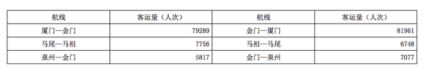

| 航线 | 客运量（人次） | 航线 | 客运量（人次） |
| --- | ---: | --- | ---: |
| 厦门—金门 | 79289 | 金门—厦门 | 81961 |
| 马尾—马祖 | 7756 | 马祖—马尾 | 6748 |
| 泉州—金门 | 5817 | 金门—泉州 | 7077 |

        2010年1至3月份，福建沿海地区与台湾地区海上客运直航船舶公司共运营3448航次，共运送旅客312119人次，分别比上年同期增加了11.98%、-4.58%。其中，厦门金门航线客运量272951人次，比上年同期减少了2.38%；马尾马祖航线客运量16077人次，比上年同期减少了38.45%；泉州金门航线客运量23091人次，比上年同期增加了12.59%。具体流向、流量情况如下：

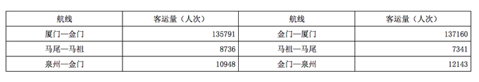

| 航线 | 客运量（人次） | 航线 | 客运量（人次） |
| --- | ---: | --- | ---: |
| 厦门—金门 | 135791 | 金门—厦门 | 137160 |
| 马尾—马祖 | 8736 | 马祖—马尾 | 7341 |
| 泉州—金门 | 10948 | 金门—泉州 | 12143 |

        “小三通”客运自2011年开通以来，共运载旅客5419061人次，其中厦门金门航线4825431人次，马尾马祖航线351228人次，泉州金门航线235918人次，湄洲金门航线1346人次，湄洲马祖航线491人次，马祖宁德航线321人次，厦门澎湖航线4056人次。

### 第 106 题

厦门金门航线2009年1至3月份的客运量人次是：

A. 266606

B. 276455

C. 279606

D. 286455

第 106 题 · 答案与解析

**参考答案（粉笔题库参考内容）**

C

**解析**

根据材料第二部分，2010年1—3月，厦门金门航线客运量人次为272951人次，比上年同期减少了2.38%，则2009年同期数据为272951/(1−2.38%) ≈ 272951×(1+2.38%)≈ 273000 + 273000×2% = 273000 + 5460 = 278460人次，C项最接近。

故正确答案为C。

**考点**：基期计算、综合资料

**来源**：2011年917联考《行测》题（河南/福建/甘肃/重庆/新疆兵团）第106题

### 第 107 题

2008年1至3月份，大陆船舶公司和台湾船舶公司的运营航次比例为：

A. 49：51

B. 45：55

C. 51：49

D. 55：45

第 107 题 · 答案与解析

**参考答案（粉笔题库参考内容）**

A

**解析**

根据材料第一部分可知，大陆运营航次为1190航次，台湾运营航次为1235航次，故大陆船舶公司和台湾船舶公司的运营航次比例为1190 : 1235 ≈ 1200 : 1250= 48:50，A项最接近。

故正确答案为A。

**考点**：比值计算、综合资料

**来源**：2011年917联考《行测》题（河南/福建/甘肃/重庆/新疆兵团）第107题

### 第 108 题

自2011年以来，“小三通”客运除厦门金门、马尾马祖和泉州金门航线外，其他航线占总运载旅客量的比重为：

A. 90.88%

B. 9.12%

C. 99.88%

D. 0.12%

第 108 题 · 答案与解析

**参考答案（粉笔题库参考内容）**

D

**解析**

根据材料最后一段，共运载旅客5419061人次，厦门金门航线4825431人次，马尾马祖航线351228人次，泉州金门航线235918人次，因此其他航线占总运载旅客量的比重为1 − (4825431+351228+235918)/5419061≈1-(483+35+24)/542=0，即其他航线占总运载旅客量的比重极小，接近0，与D项最接近。

故正确答案为D。

**考点**：现期比重、综合资料

**来源**：2011年917联考《行测》题（河南/福建/甘肃/重庆/新疆兵团）第108题

### 第 109 题

从以上资料可以推断出：

A. 2008年1-3月份，厦门金门、马尾马祖和泉州金门三航线中客运量流向逆差最高的是厦门金门航线

B. 2008年1-3月份，厦门金门、马尾马祖和泉州金门三航线中客运量流向逆差最高的是泉州金门航线

C. 2008至2010年，厦门金门、马尾马祖和泉州金门三航线中客运量同期增长最快的是马尾马祖航线

D. 2008至2010年，厦门金门、马尾马祖和泉州金门三航线中客运量同期增长最快的是厦门金门航线

第 109 题 · 答案与解析

**参考答案（粉笔题库参考内容）**

A

**解析**

2008年1-3月份，三航线客运量流向逆差分别为厦门金门81961−79289≈82000−80000=2000人次，马尾马祖6748-7756&lt;0，泉州金门7077 − 5817 ≈ 7000 − 5800 = 1200人次，显然客运量流向逆差最高为厦门金门航线，故A项正确，B项错误。2008—2010年，三航线客运量同期增速分别为厦门金门(135791+137160)/(79289+81961) - 1 ≈ 273/161 - 1，马尾马祖(8736+7341)/(7756+6748)−1≈161/145−1，泉州金门(10948+12143)/(5817+7077)−1=231/129−1。相当于比较273/161、161/145、231/129三个分数的大小，显然231/129的比值接近2，273/161、161/145的比值远小于2。则231/129数值最大，即泉州金门航线增速最快，故C、D两项错误。

故正确答案为A。

**考点**：综合分析、综合资料

**来源**：2011年917联考《行测》题（河南/福建/甘肃/重庆/新疆兵团）第109题

### 第 110 题

从以上资料可以推断出的是：

A. 2010年厦门金门航线客运量小于马尾马祖和泉州金门航线客运量之和

B. 2010年客运总量是2008年的4倍

C. 2010年1至3月份台湾船舶每航次运送旅客约为91人

D. 2008年1至3月份台湾船舶每航次运送旅客约为75人

第 110 题 · 答案与解析

**参考答案（粉笔题库参考内容）**

D

**解析**

材料只给出了2010年1—3月的数据，因此不能推断出关于2010全年航线客运量和客运总量的信息，故A、B两项错误。材料中并未提及2010年1—3月台湾船舶航次数据，因此不能推断出关于2010年1—3月台湾船舶每航次运送旅客人数的信息，故C项错误。2008年1—3月台湾船舶每次运送旅客为92631/1235 ≈ 926/12 ≈ 77人，故D项正确。

故正确答案为D。

**考点**：综合分析、综合资料

**来源**：2011年917联考《行测》题（河南/福建/甘肃/重庆/新疆兵团）第110题

## 材料 2

根据以下资料，完成各题。

2010年1～4月全国入境旅游部分市场客源情况统计表

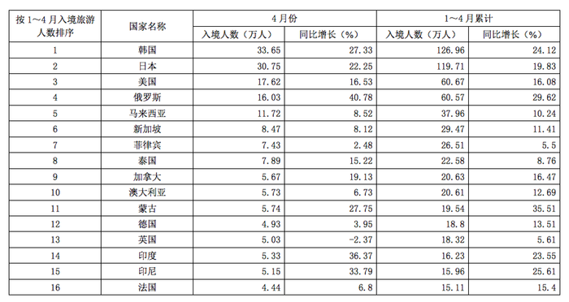

| 按 1～4 月入境旅游人数排序 | 国家名称 | 4月份 入境人数（万人） | 4月份 同比增长（%） | 1～4月累计 入境人数（万人） | 1～4月累计 同比增长（%） |
| ---: | --- | ---: | ---: | ---: | ---: |
| 1 | 韩国 | 33.65 | 27.33 | 126.96 | 24.12 |
| 2 | 日本 | 30.75 | 22.25 | 119.71 | 19.83 |
| 3 | 美国 | 17.62 | 16.53 | 60.67 | 16.08 |
| 4 | 俄罗斯 | 16.03 | 40.78 | 60.57 | 29.62 |
| 5 | 马来西亚 | 11.72 | 8.52 | 37.96 | 10.24 |
| 6 | 新加坡 | 8.47 | 8.12 | 29.47 | 11.41 |
| 7 | 菲律宾 | 7.43 | 2.48 | 26.51 | 5.5 |
| 8 | 泰国 | 7.89 | 15.22 | 22.58 | 8.76 |
| 9 | 加拿大 | 5.67 | 19.13 | 20.63 | 16.47 |
| 10 | 澳大利亚 | 5.73 | 6.73 | 20.61 | 12.69 |
| 11 | 蒙古 | 5.74 | 27.75 | 19.54 | 35.51 |
| 12 | 德国 | 4.93 | 3.95 | 18.8 | 13.51 |
| 13 | 英国 | 5.03 | −2.37 | 18.32 | 5.61 |
| 14 | 印度 | 5.33 | 36.37 | 16.23 | 23.55 |
| 15 | 印尼 | 5.15 | 33.79 | 15.96 | 25.61 |
| 16 | 法国 | 4.44 | 6.8 | 15.11 | 15.4 |

| 按 1～4 月入境旅游人数排序 | 国家名称 | 4 月份 入境人数（万人） | 4 月份 同比增长（%） | 1～4 月累计 入境人数（万人） | 1～4 月累计 同比增长（%） |
| ---: | --- | ---: | ---: | ---: | ---: |
| 1 | 韩国 | 33.65 | 27.33 | 126.96 | 24.12 |
| 2 | 日本 | 30.75 | 22.25 | 119.71 | 19.83 |
| 3 | 美国 | 17.62 | 16.53 | 60.67 | 16.08 |
| 4 | 俄罗斯 | 16.03 | 40.78 | 60.57 | 29.62 |
| 5 | 马来西亚 | 11.72 | 8.52 | 37.96 | 10.24 |
| 6 | 新加坡 | 8.47 | 8.12 | 29.47 | 11.41 |
| 7 | 菲律宾 | 7.43 | 2.48 | 26.51 | 5.5 |
| 8 | 泰国 | 7.89 | 15.22 | 22.58 | 8.76 |
| 9 | 加拿大 | 5.67 | 19.13 | 20.63 | 16.47 |
| 10 | 澳大利亚 | 5.73 | 6.73 | 20.61 | 12.69 |
| 11 | 蒙古 | 5.74 | 27.75 | 19.54 | 35.51 |
| 12 | 德国 | 4.93 | 3.95 | 18.8 | 13.51 |
| 13 | 英国 | 5.03 | −2.37 | 18.32 | 5.61 |
| 14 | 印度 | 5.33 | 36.37 | 16.23 | 23.55 |
| 15 | 印尼 | 5.15 | 33.79 | 15.96 | 25.61 |
| 16 | 法国 | 4.44 | 6.8 | 15.11 | 15.4 |

### 第 111 题

若按2010年1～3月入境旅游人数排序，以下各项错误的是：

A. 韩国>日本>美国

B. 俄罗斯>马来西亚>新加坡

C. 菲律宾>泰国>加拿大

D. 德国>英国>印度

第 111 题 · 答案与解析

**参考答案（粉笔题库参考内容）**

C

**解析**

1~3月入境人数 =1~4月累计入境人数−4月入境人数，则2010年1~3月前往各国入境旅游人数分别如下：

韩国：126.96 − 33.65 ≈ 93万人；日本：119.71 − 30.75 ≈ 89万人；美国：60.67-17.62≈43万人，韩国>日本>美国，A项正确；

俄罗斯：60.57 - 16.03 ≈ 45万人；马来西亚：37.96 - 11.72 ≈ 26万人；新加坡：29.47-8.47=21万人，俄罗斯>马来西亚>新加坡，B项正确；

菲律宾：26.51 - 7.43 ≈ 19万人；泰国：22.58-7.89=14.69万人；加拿大：20.63-5.67=14.96，菲律宾>加拿大>泰国，C项错误；

德国：18.8 - 4.93 ≈ 14万人；英国：18.32 − 5.03 ≈ 13万人；印度：16.23-5.33≈11万人，德国>英国>印度，D项正确。

本题为选非题，故正确答案为C。

**考点**：排序类、统计表

**来源**：2011年917联考《行测》题（河南/福建/甘肃/重庆/新疆兵团）第111题

### 第 112 题

2009年4月我国入境旅游的第三大客源市场是：

A. 美国

B. 日本

C. 俄罗斯

D. 马来西亚

第 112 题 · 答案与解析

**参考答案（粉笔题库参考内容）**

A

**解析**

比较2009年4月入境人数较多的几个国家：韩国33.65/(1+27.33%)万人，日本30.75/(1+22.25%)万人，美国17.62/(1 + 16.53%)万人，俄罗斯16.03/(1+40.78%)万人，马来西亚11.72/(1+8.52%)万人，韩国和日本明显是最多的两个，马来西亚最少，而17.62/(1 + 16.53%)＞17.62/(1+40.78%)＞16.03/(1+40.78%)，因此美国为我国第三大客源市场。

故正确答案为A。

**考点**：基期比较、统计表

**来源**：2011年917联考《行测》题（河南/福建/甘肃/重庆/新疆兵团）第112题

### 第 113 题

2009年1～3月，入境旅游的日本游客人数约为：

A. 105.86万人

B. 91.11万人

C. 88.96万人

D. 74.75万人

第 113 题 · 答案与解析

**参考答案（粉笔题库参考内容）**

D

**解析**

2009年1—3月，入境旅游的日本游客约有119.71/(1+19.83%)−30.75/(1+22.25%)≈120/1.2-30/1.2=75万人，D项最接近。

故正确答案为D。

**考点**：基期和差、统计表

**来源**：2011年917联考《行测》题（河南/福建/甘肃/重庆/新疆兵团）第113题

### 第 114 题

若保持同比增长率不变，预计哪一年4月入境旅游的法国游客人数将会超过英国？

A. 2011

B. 2012

C. 2013

D. 2014

第 114 题 · 答案与解析

**参考答案（粉笔题库参考内容）**

B

**解析**

若保持同比增长率不变，2010年后的第n年4月，入境旅游的英国游客人数是5.03 × (1 - 2.37%)^n 万人，法国游客人数是4.44×(1+6.80%)^n万人。当n＝1时，英国游客人数= 5.03 × (1 - 2.37%) ≈ 5.03 - 5 × 0.024 = 4.91万人；法国游客人数= 4.44 × (1 + 6.80%) ≈ 4.44 + 4.4 × 0.07 ≈ 4.74万人，同比增长约0.3万人，故下一年一定可以超过5万人，而英国已在2011年便低至5万人。故法国可在2012年超过英国。

故正确答案为B。

**考点**：现期计算、统计表

**来源**：2011年917联考《行测》题（河南/福建/甘肃/重庆/新疆兵团）第114题

### 第 115 题

能够从上述资料中推出的是：

A. 2010年4月，入境旅游的韩国游客人数首次超过30万人

B. 2010年4月，入境旅游的各国游客人数都有一定比率的增加

C. 2010年1～4月，我国入境旅游市场的主要收入来自亚洲

D. 2010年4月，表中各国入境旅游人数均大于其当年1～4月的月均入境旅游人数

第 115 题 · 答案与解析

**参考答案（粉笔题库参考内容）**

D

**解析**

A项：已知4月入境旅游韩国游客人数33.65万人，1-4月入境旅游韩国游客人数126.96万人，则1-3月入境旅游韩国游客人数=126.96-33.65=93.31>90万，则可以推断出1-3月至少有一个月份入境旅游韩国游客的人数超过30万人，错误；

B项：从表格第四列可知，2010年4月，英国入境旅游人数减少，错误；

C项：资料给出的只是我国入境旅游人数的分布情况，并不能代表旅游市场的收入分布，无法推出；

D项：将表格第3列各国4月份的游客人数乘以4，与表格第5列的数据进行比较，可确定2010年4月各国入境旅游人数均大于其当年1~4月的月均入境旅游人数，正确。

故正确答案为D。

**考点**：统计表、综合分析

**来源**：2011年917联考《行测》题（河南/福建/甘肃/重庆/新疆兵团）第115题

## 材料 3

根据以下资料，完成各题。

        2010年1~6月，全国电信业务收入总量累计完成14860.7亿元，比上年同期增长21.4%；电信主营业务收入累计完成4345.5亿元，比上年同期增长5.9%。其中，移动通信收入累计完成2979亿元，比上年同期增长11.2%，比重提升到68.55%，增加了3.24%；固定通信收入累计完成1366.5亿元，比重下降到31.45%。

        2010年1~6月，全国电话用户净增4920.4万户，总数达到11.1亿户，其中，固定电话用户减少876.7万户，降至3.05亿户；移动电话用户增加5797万户，总数突破8亿户，达到8.05亿户。

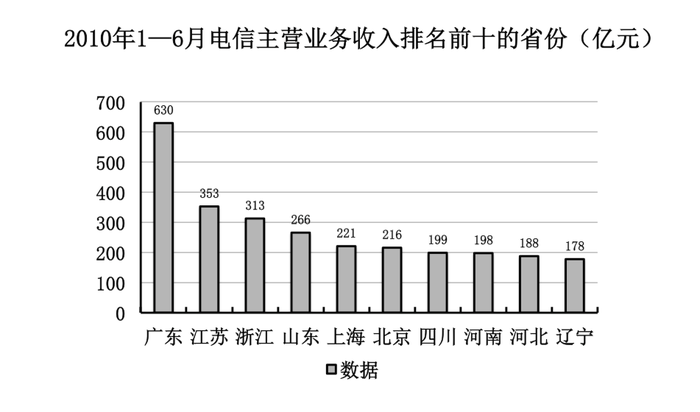

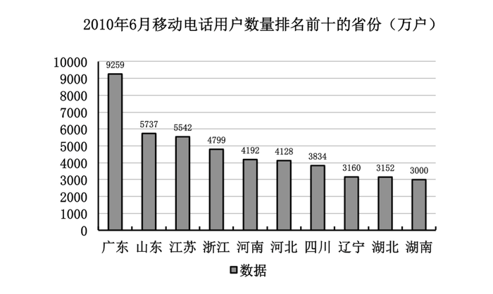

### 第 116 题

2010年1~6月，我国电信业务收入总量比上年同期增长了：

A. 2476.7亿元

B. 2619.6亿元

C. 2972.0亿元

D. 3180.2亿元

第 116 题 · 答案与解析

**参考答案（粉笔题库参考内容）**

B

**解析**

电信业务收入总量比上年同期增长了(14860.7 × 21.4%)/(1 + 21.4%)≈(14860.7×3/14)/(1+3/14)≈14860×3/17≈2600亿元，B项最接近。

故正确答案为B。

**考点**：增长量计算、综合资料

**来源**：2011年917联考《行测》题（河南/福建/甘肃/重庆/新疆兵团）第116题

### 第 117 题

截止2010年6月，我国的移动电话用户占全国电话用户的比重相比2009年底约：

A. 增加了2个百分点

B. 增加了8个百分点

C. 减少了2个百分点

D. 减少了8个百分点

第 117 题 · 答案与解析

**参考答案（粉笔题库参考内容）**

A

**解析**

移动电话用户占全国电话用户的比重，2010年为8.05/11.1≈8/11,2009年约为(8.05-0.58)/(11.1-0.49)=7.47/10.61≈7.5/10.5=5/7，8/11 − 5/7 = 1/77 ＞ 0，A项最接近。

故正确答案为A。

**考点**：两期比重、综合资料

**来源**：2011年917联考《行测》题（河南/福建/甘肃/重庆/新疆兵团）第117题

### 第 118 题

根据上面的图表资料，可以推出的是：

A. 2010年1~6月，山东省的户均电信主营业务收入小于江苏省和浙江省

B. 2010年1~6月，北京、上海的电信主营业务收入主要来自于固定通信

C. 2011年6月，广东省的固定电话用户数量将突破1亿

D. 按照全国移动电话用户2010年上半年的平均增速，到2011年1月，广东省的移动电话用户数量将突破1亿

第 118 题 · 答案与解析

**参考答案（粉笔题库参考内容）**

D

**解析**

材料中未给出各省的主营业务用户数量，无法求得户均主营业务收入，A项错误；材料中未给出北京、上海的主营业务收入构成，B项错误；无法求得各地区固定电话用户数量，且按照常识推断，固话用户逐年减少，C项错误；D项由材料给出2010年1至6月，移动电话用户增加5797万户，总数突破8亿户，达到8.05亿户，可得(1+r)^6=80500/(80500-5797)，若保该平均增速，2010年12月底广东省移动电话用户数量=9259×(1+r)^6=9259×80500/(80500−5797)≈ 9260 × 805/747 ≈ 9979万户，已接近1亿，则可以推出到2011年1月，广东省的移动电话用户数量将突破1亿。

故正确答案为D。

**考点**：综合分析、综合资料

**来源**：2011年917联考《行测》题（河南/福建/甘肃/重庆/新疆兵团）第118题

### 第 119 题

2010年1~6月，我国固定通信收入比上年同期减少约：

A. 3%

B. 11%

C. 4%

D. 31%

第 119 题 · 答案与解析

**参考答案（粉笔题库参考内容）**

C

**解析**

因为2010年1~6月移动通信收入比重增加3.24%，即固定通信收入比重减少3.24%，所以2009年固定通信收入的比重为31.45%＋3.24%＝34.69%，因此2009年1~6月份的固定通信收入为4345.5/(1+5.9%)×34.69%≈1423亿元，由材料可知2010年1~6月固定通信为1366.5亿元，因此固定通信收入的减少率约为(1423 − 1366)/1423 ≈ 4%。

故正确答案为C。

**考点**：一般增长率、综合资料

**来源**：2011年917联考《行测》题（河南/福建/甘肃/重庆/新疆兵团）第119题

### 第 120 题

根据上述资料判断，下列说法中正确的是：

A. 2010年1~6月，我国的移动电话用户首次达到8亿

B. 2010年1~6月，我国电信业务收入总量主要来自电信主营业务

C. 2010年6月，广东省移动电话用户数大于辽宁、湖北、湖南三省之和

D. 2010年1~6月，我国南方地区的电信主营业务收入普遍高于北方地区

第 120 题 · 答案与解析

**参考答案（粉笔题库参考内容）**

A

**解析**

A项正确，根据材料第二段可知2010年我国移动电话用户首次达到8亿；B项错误，2010年1~6月电信业务总收入为14860.7亿元，电信主营业务完成4345.5亿元，不是主要部分；C项错误，广东用户数量为9259万户，辽宁＋湖北＋湖南＝3160＋3152＋3000＝9312万户；D项错误，山东高于上海、四川。

故正确答案为A。

**考点**：综合分析、综合资料

**来源**：2011年917联考《行测》题（河南/福建/甘肃/重庆/新疆兵团）第120题

