# 2012年421联考《行测》题（山西/辽宁/黑龙江/福建/湖北/ 湖南/广西/海南/四川/重庆/ 云南/ 西藏/陕西/青海/宁夏/ 新疆兵团）

<!-- gwy:overview:start -->
> **福建 · 2012 · 行测 · 统考** ｜ 120 题 · 图片 88 处 · 答案随题折叠

| 题型模块 | 题量 | 题号 |
| --- | ---: | ---: |
| 常识判断 | 20 | 1–20 |
| 言语理解与表达 | 30 | 21–50 |
| 数量关系 | 15 | 51–65 |
| 判断推理 | 35 | 66–100 |
| 资料分析 | 20 | 101–120 |
| **合计** | **120** | |

导航：[题型与作答说明](#题型与作答说明) · [题目](#题目) · [材料 1](#材料-1)
<!-- gwy:overview:end -->

> 候选采集稿。参考答案及解析来自粉笔页面，不代表官方答案或真实高分答卷；来源使用许可与原卷对应关系仍需人工核实。

## 题型与作答说明

常识判断

（20题）

根据题目要求，在每个选项中选出一个正确答案。

言语理解与表达

（30题）

根据题目要求，在每个选项中选出一个正确答案。

数量关系

（15题）

在这部分试题中，每道题中呈现一段表述数字关系的文字，要求你迅速、准确地计算出答案。

判断推理

（35题）

本部分包括图形推理、定义判断、类比推理与逻辑判断四种类型的试题。

资料分析

（20题）

所给出的图、表、文字或综合性资料均有若干个问题要你回答。你应根据资料提供的信息进行分析、比较、计算和判断处理。

## 题目

### 第 1 题

2011年我国改革开放和社会主义现代化建设取得新的重大成就，其中包括：

A. 人均GDP超过3000美元

B. 外汇储备首次超过日本居世界第一

C. 城镇化率超过50%

D. 粮食总产量首次超过10万亿斤

第 1 题 · 答案与解析

**参考答案（粉笔题库参考内容）**

C

**解析**

A项错误，2008年中国的人均GDP已经达到3266.8美元，登上了3000美元的新台阶；B项错误，2006年2月底，我国已超过日本成为全球外汇储备最多的国家；C项正确，2012年中国政府工作报告第一部分“2011年工作回顾”中提到，“城镇化率超过50%，这是中国社会结构的一个历史性变化”；D项错误，2012年中国政府工作报告第一部分“2011年工作回顾”中提到，“粮食产量57121万吨，再创历史新高”，57121万吨等于1.14242万亿斤，并未达到“10万亿斤”。

故正确答案为C。

**考点**：中国地理

**来源**：2012年421联考《行测》题（山西/辽宁/黑龙江/福建/湖北/ 湖南/广西/海南/四川/重庆/ 云南/ 西藏/陕西/青海/宁夏/ 新疆兵团）第1题

### 第 2 题

关于我国“战国七雄”地理位置描述准确的是：

A. 齐国的纬度最高

B. 楚国的纬度最低

C. 燕国的经度最小

D. 秦国的经度最大

第 2 题 · 答案与解析

**参考答案（粉笔题库参考内容）**

B

**解析**

本题考查历史地理常识。A项错误，燕国的纬度最高；B项正确，楚国的纬度最低；C、D项错误，秦国的经度最小。

故正确答案为B。

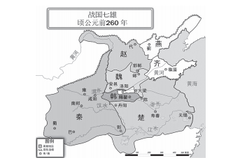

**考点**：中国历史

**来源**：2012年421联考《行测》题（山西/辽宁/黑龙江/福建/湖北/ 湖南/广西/海南/四川/重庆/ 云南/ 西藏/陕西/青海/宁夏/ 新疆兵团）第2题

### 第 3 题

杨柳是我国古代诗词里面较为常见的意象，往往蕴涵离别之情，下列名句中不是表达送别意象的是：

A. 羌笛何须怨杨柳，春风不度玉门关

B. 渭城朝雨浥轻尘，客舍青青柳色新

C. 今宵酒醒何处？杨柳岸，晓风残月

D. 庭院深深深几许?杨柳堆烟，帘幕无重数

第 3 题 · 答案与解析

**参考答案（粉笔题库参考内容）**

D

**解析**

本题考查人文历史。

A项正确，诗句出自王之涣《凉州词》，戍边的军士听到《杨柳枝》引发对故乡的思念，诗人劝慰大家“羌笛何须怨杨柳，春风不度玉门关”。

B项正确，诗句出自王维的《渭城曲》，是诗人在送别友人去边疆时写下的一首七言绝句。此诗描写的是一种最有普遍性的离别，有深挚的惜别之情。

C项正确，诗句出自柳永的《雨霖铃》，该诗是诗人离开汴京南下时与恋人依依惜别之作。

D项错误，诗句出自欧阳修的《蝶恋花》，描写闺中少妇的伤春之情。

本题为选非题，故正确答案为D

**考点**：文学常识

**来源**：2012年421联考《行测》题（山西/辽宁/黑龙江/福建/湖北/ 湖南/广西/海南/四川/重庆/ 云南/ 西藏/陕西/青海/宁夏/ 新疆兵团）第3题

### 第 4 题

中国古典戏剧作品塑造了王昭君、李香君、杜丽娘和崔莺莺等经典女性形象，下列作品与上述人物对应关系正确的是 （  ）。

A. 《西厢记》—《汉宫秋》—《桃花扇》—《牡丹亭》

B. 《西厢记》—《桃花扇》—《汉宫秋》—《牡丹亭》

C. 《汉宫秋》—《桃花扇》—《牡丹亭》—《西厢记》

D. 《汉宫秋》—《牡丹亭》—《桃花扇》—《西厢记》

第 4 题 · 答案与解析

**参考答案（粉笔题库参考内容）**

C

**解析**

本题考查文化常识。王昭君是马致远《汉宫秋》中的人物，李香君是孔尚任《桃花扇》中的人物，杜丽娘是汤显祖《牡丹亭》中的女主人公，而崔莺莺是王实甫《西厢记》中的人物。

故正确答案为C。

**考点**：文学常识

**来源**：2012年421联考《行测》题（山西/辽宁/黑龙江/福建/湖北/ 湖南/广西/海南/四川/重庆/ 云南/ 西藏/陕西/青海/宁夏/ 新疆兵团）第4题

### 第 5 题

下列影视剧情景设计符合历史常识的是：

A. 燕太子丹与荆轲分坐八仙桌两侧，秉烛夜谈，谋划赴咸阳刺杀秦王计划

B. 毛泽东与李宗仁幽默地说：德邻先生，你这次归国，是误上了贼船啊

C. 魏征劝谏李世民时，说道：陛下当先天下之忧而忧，后天下之乐而乐

D. 越王勾践兵败后给吴王夫差当奴仆，以红薯充饥，每晚则睡在柴垛上

第 5 题 · 答案与解析

**参考答案（粉笔题库参考内容）**

B

**解析**

本题考查历史常识。

A项错误，荆轲刺秦发生于战国时期，当时没有发明桌子，桌子的名称在五代时才诞生。

B项正确，李宗仁原为国民党代总统，后因和谈未果出走美国，1965年回到北京。李宗仁字德邻，称呼他人的字表示对他的尊重。

C项错误，选项发生在唐太宗时期，而“先天下之忧而忧”出自北宋范仲淹《岳阳楼记》，在唐代之后。

D项错误，勾践是春秋末期人物，而红薯在明朝万历十年才从吕宋（今菲律宾）引进中国。

故正确答案为B。

**考点**：中国历史

**来源**：2012年421联考《行测》题（山西/辽宁/黑龙江/福建/湖北/ 湖南/广西/海南/四川/重庆/ 云南/ 西藏/陕西/青海/宁夏/ 新疆兵团）第5题

### 第 6 题

下列选项中三国典故与哲学论断对应错误的是：

A. 士别三日，当刮目相看——用发展的眼光看问题

B. 草船借箭——人可以认识并利用规律

C. 张飞醉酒失徐州，借酒破张郃——矛盾是对立统一的

D. 望梅止渴——理性认识依赖于感性认识

第 6 题 · 答案与解析

**参考答案（粉笔题库参考内容）**

D

**解析**

本题考查哲学常识。

A项对应正确，“士别三日”出自《三国志》，意思是指人离开后不久。全句“士别三日，当刮目相看”表达别人已有进步，应当用发展的眼光看待别人的意思。

B项对应正确，草船借箭、庖丁解牛、预测彗星的回归、把卫星送入预定轨道等，这些都是利用对规律的认识，预见事物发展的趋势和方向，从而有效地指导实践活动，取得预期目的的典型事例。

C项对应正确，同样是饮酒，利用不当可致“战败弃城”，利用得当则可“战胜得利”，体现了事物之间或事物内部诸要素之间既对立又统一的关系，对立和统一是矛盾的两个根本属性。

D项对应错误，望梅止渴出自《世说新语·假谲》，“曹操行军途中，失去了有水源的道路，士兵们都很渴，于是他传令道：‘前边有一片梅子林，结了许多梅子，又酸又甜，可以解除我们的口渴。’士兵听后，嘴里都流出了口水。曹操利用这个机会把士兵们带领到前方有水源的地方”。所以“望梅止渴”体现的是意识的能动作用，而非选项中所说的理性认识依赖于感性认识。

本题为选非题，故正确答案为D。

**考点**：认识论

**来源**：2012年421联考《行测》题（山西/辽宁/黑龙江/福建/湖北/ 湖南/广西/海南/四川/重庆/ 云南/ 西藏/陕西/青海/宁夏/ 新疆兵团）第6题

### 第 7 题

中美关系是全球最重要的双边关系之一，中美建交前后曾发生过以下事件：

①邓小平访美 ②中美发布上海联合公报 ③尼克松总统访华 ④福特总统访华

按时间先后顺序排列正确的是：

A. ②③①④

B. ②①④③

C. ①②③④

D. ③②④①

第 7 题 · 答案与解析

**参考答案（粉笔题库参考内容）**

D

**解析**

本题考查毛中特。

1972年，尼克松访华，之后发表《中美联合公报》（上海）；1975年，福特访华；1979年，邓小平访美。

故正确答案为D。

**考点**：党的历史

**来源**：2012年421联考《行测》题（山西/辽宁/黑龙江/福建/湖北/ 湖南/广西/海南/四川/重庆/ 云南/ 西藏/陕西/青海/宁夏/ 新疆兵团）第7题

### 第 8 题

我国作为非成员国参加的政府间国际组织是：

A. 上合组织

B. 东盟十国

C. 金砖国家

D. G20

第 8 题 · 答案与解析

**参考答案（粉笔题库参考内容）**

B

**解析**

本题考查政治常识。

A项错误，中国是上合组织成员国。

B项正确，东盟十国是政府间国际组织，其成员国包括文莱、柬埔寨、印度尼西亚、老挝、马来西亚、缅甸、菲律宾、新加坡、泰国和越南。中国非东盟十国的成员国，而是与东盟（“10+1”）以领导人会议形式就重大问题进行协商。

C项错误，金砖国家（BRICS）最初指中国、俄罗斯、印度、巴西、南非五个成长前景看好的新兴市场国家，2008年-2009年，相关国家举行系列会谈和建立峰会机制，拓展为国际政治实体。中国是成员国，不是非成员国。因此错误。

D项错误，二十国集团（G20）由七国集团财长会议于1999年倡议成立，最初为财长和央行行长会议机制，2008年国际金融危机后，升格为领导人峰会。中国是在2008年加入的20国集团，是成员国，不是非成员国。因此错误。

故正确答案为B。

**考点**：国际经济及组织

**来源**：2012年421联考《行测》题（山西/辽宁/黑龙江/福建/湖北/ 湖南/广西/海南/四川/重庆/ 云南/ 西藏/陕西/青海/宁夏/ 新疆兵团）第8题

### 第 9 题

为提高社会管理科学化水平，全国各地积极出台加强和创新社会管理的措施，下列措施中不属于创新社会管理的是：

A. 组织社区志愿者开展邻里互动活动

B. 提高临床一线医护人员的待遇水平

C. 通过微博向群众提供政务服务资讯

D. 设奖鼓励市民投诉举报食品安全问题

第 9 题 · 答案与解析

**参考答案（粉笔题库参考内容）**

B

**解析**

本题考查政治常识。社会管理创新是指在现有社会管理条件下，运用现有的资源和经验，依据政治、经济和社会的发展态势，尤其是依据社会自身运行规律乃至社会管理的相关理念和规范，研究并运用新的社会管理理念、知识、技术、方法和机制等，对传统管理模式及相应的管理方式和方法进行改造、改进和改革，建构新的社会管理机制和制度，以实现社会管理新目标的活动或者这些活动的过程。社会管理创新既是活动，也是活动的过程，是以社会管理存在为前提的，其目的在于使社会能够形成更为良好的秩序，产生更为理想的政治、经济和社会效益。2004年6月党的十六届四中全会提出要“加强社会建设和管理，推进社会管理体制创新”，2007年党的十七大报告提出要“建立健全党委领导、政府负责、社会协同、公众参与的社会管理格局”。A、C、D三项都有“公众参与”；B项只涉及特定群体，不属于“社会管理创新”。

本题为选非题，故正确答案为B。

**来源**：2012年421联考《行测》题（山西/辽宁/黑龙江/福建/湖北/ 湖南/广西/海南/四川/重庆/ 云南/ 西藏/陕西/青海/宁夏/ 新疆兵团）第9题

### 第 10 题

下列论断属于邓小平同志在1992年“南方谈话”时提出的是：

A. 社会主义首先要发展生产力

B. 社会主义也可以搞市场经济

C. 中国要警惕“右”，但主要是防止“左”

D. 搞建设至少不比搞革命容易

第 10 题 · 答案与解析

**参考答案（粉笔题库参考内容）**

C

**解析**

本题考查政治常识。

A项错误，“社会主义首先要发展生产力”是邓小平在1980年提出的重要论断；

B项错误，“社会主义也可以搞市场经济”是邓小平于1979年11月26日在《社会主义也可以搞市场经济》一文中提出的重要论断；

C项正确，面对90年代初党内出现的一些问题，邓小平同志从中国的历史和现实出发，从改革开放和现代化建设的任务出发，在南巡途中提出了“中国要警惕‘右’，但主要是防止‘左’”；

D项错误，“搞建设不比搞革命容易”是邓小平在1957年提出来的论断。

故正确答案为C。

**来源**：2012年421联考《行测》题（山西/辽宁/黑龙江/福建/湖北/ 湖南/广西/海南/四川/重庆/ 云南/ 西藏/陕西/青海/宁夏/ 新疆兵团）第10题

### 第 11 题

某村民委员会下列做法符合法律规定的是：

A. 村委会规定村里的荒山不得以招标、拍卖等形式实行承包经营

B. 村民乙外出经商，村委会不同意乙在承包期内放弃承包权

C. 村民丙全家转为城市户口，村委会取消丙承包期内的承包权

D. 村委会规定凡是嫁往外地的本村妇女，承包地应一律归还村委会

第 11 题 · 答案与解析

**参考答案（粉笔题库参考内容）**

C

**解析**

本题考查法律常识。

A项错误，我国《农村土地承包法》第三条第二款规定，“不宜采取家庭承包方式的荒山、荒沟、荒丘、荒滩等农村土地，可以采取招标、拍卖、公开协商等方式承包”，所以村委会无权禁止家庭承包经营以外的其他方式的承包。

B项错误，《农村土地承包法》第二十九条规定，“承包期内，承包方可以自愿将承包地交回发包方”，所以乙有权在承包期内放弃承包权。

C项正确，《农村土地承包法》第二十六条规定，“承包期内，承包方全家迁入设区的市，转为非农业户口的，应当将承包的耕地和草地交回发包方。承包方不交回的，发包方可以收回承包的耕地和草地”。

本题为2012年题目，根据现行《农村土地承包法》第二十七条第一、三款规定：“承包期内，发包方不得收回承包地。承包期内，承包农户进城落户的，引导支持其按照自愿有偿原则依法在本集体经济组织内转让土地承包经营权或者将承包地交回发包方，也可以鼓励其流转土地经营权。”故C项错误，本题无正确答案。

D项错误，《农村土地承包法》第三十条规定，“承包期内，妇女结婚，在新居住地未取得承包地的，发包方不得收回其原承包地；妇女离婚或者丧偶，仍在原居住地生活或者不在原居住地生活但在新居住地未取得承包地的，发包方不得收回其原承包地”。

故正确答案为C。

**考点**：其他法律法规

**来源**：2012年421联考《行测》题（山西/辽宁/黑龙江/福建/湖北/ 湖南/广西/海南/四川/重庆/ 云南/ 西藏/陕西/青海/宁夏/ 新疆兵团）第11题

### 第 12 题

下列请求应依法予以支持的是：

A. 某男擅自按市价出售双方共有住房，其妻要求追回

B. 某女起诉请求离婚，要求分割其丈夫的工伤补助金

C. 按父母遗嘱某女继承全部家产，其兄要求平分家产

D. 某夫妻已育有一个健康男孩，现申请收养一名孤儿

第 12 题 · 答案与解析

**参考答案（粉笔题库参考内容）**

D

**解析**

《中华人民共和国民法典》三百一十一条规定：“无处分权人将不动产或者动产转让给受让人的，所有权人有权追回；除法律另有规定外，符合下列情形的，受让人取得该不动产或者动产的所有权：（一）受让人受让该不动产或者动产时是善意；（ 二）以合理的价格转让；（三）转让的不动产或者动产依照法律规定应当登记的已经登记，不需要登记的已经交付给受让人。受让人依据前款规定取得不动产或者动产的所有权的，原所有权人有权向无处分权人请求损害赔偿。”根据题目的表述从擅自出售和按市价两个关键词得出符合善意取得的特征，这就意味着其妻子丧失了所有权，但是可以向其丈夫追偿。A 项错误。

根据《中华人民共和国民法典》一千零六十三条规定：“下列财产为夫妻一方的个人财产：（一）一方的婚前财产；（二）一方因受到人身损害获得的赔偿或者补偿；（三）遗嘱或者赠与合同中确定只归一方的财产；（四）一方专用的生活用品；（五）其他应当归一方的财产。”由于离婚时财产的分配只涉及夫妻共同财产，工伤补助金是丈夫的个人财产，妻子无权要求分配。B项错误。

根据我国《中华人民共和国民法典》第一千一百二十三条规定：“继承开始后，按照法定继承办理；有遗嘱的，按照遗嘱继承或者遗赠办理；有遗赠扶养协议的，按照协议办理。”所以C项中应依照合法遗嘱进行继承，不支持平分家产的要求。

根据《中华人民共和国民法典》第一千一百条规定：“ 无子女的收养人可以收养两名子女；有子女的收养人只能收养一名子女。收养孤儿、残疾未成年人或者儿童福利机构抚养的查找不到生父母的未成年人，可以不受前款和本法第一千零九十八条第一项规定的限制。”D项这对夫妻虽然有一名健康的男孩，由于收养对象是孤儿，不受已有子女不能收养以及仅收养一名的限制。

故正确答案为D。

**考点**：民法典

**来源**：2012年421联考《行测》题（山西/辽宁/黑龙江/福建/湖北/ 湖南/广西/海南/四川/重庆/ 云南/ 西藏/陕西/青海/宁夏/ 新疆兵团）第12题

### 第 13 题

某小区召开业主大会，会上物业管理处马主任现场解答业主的提问，其中符合法律规定的是：

A. 未经业主委员会同意，顶楼业主不得私自封闭屋顶天台

B. 经物业管理处同意，业主可在自家临街外墙设置广告牌

C. 未经业主委员会同意，开发商无权出售架空层内的车库

D. 经工商行政管理部门许可，业主可将自家住宅改为商店

第 13 题 · 答案与解析

**参考答案（粉笔题库参考内容）**

A

**解析**

本题考查法律常识。

A项正确，根据《最高人民法院关于审理建筑物区分所有权纠纷案件具体应用法律若干问题的解释》第三条规定，屋顶天台属于该楼全体业主共有，改变共有部分的用途应当由业主共同决定，所以顶楼业主无权私自封闭屋顶天台；

B项错误，根据《最高人民法院关于审理建筑物区分所有权纠纷案件具体应用法律若干问题的解释》第三条规定，建筑物的外墙属于业主共有，利用共有部分从事经营性活动应当由业主共同决定；

C项错误，架空层是建筑用词，指建筑物中只有结构支撑，没有四周围护的建筑空间。架空层属于建筑区划的一部分。根据《中华人民共和国民法典》第二百七十五条第一款规定，“建筑区划内，规划用于停放汽车的车位、车库的归属，由当事人通过出售、附赠或者出租等方式约定”，开发商有权对这部分车位进行处理，无需经业主委员会同意；

D项错误，《中华人民共和国民法典》第二百七十九条规定，“业主不得违反法律、法规以及管理规约，将住宅改变为经营性用房。业主将住宅改变为经营性用房的，除遵守法律、法规以及管理规约外，应当经有利害关系的业主一致同意。”

故正确答案为A。

**考点**：民法典

**来源**：2012年421联考《行测》题（山西/辽宁/黑龙江/福建/湖北/ 湖南/广西/海南/四川/重庆/ 云南/ 西藏/陕西/青海/宁夏/ 新疆兵团）第13题

### 第 14 题

下列产品或劳务应计入当年GDP的是：

A. 某企业当年生产的库存品

B. 某人购买的一套二手房

C. 某人持有国债的利息收入

D. 某人在家从事家务劳动

第 14 题 · 答案与解析

**参考答案（粉笔题库参考内容）**

A

**解析**

本题考查经济常识。GDP是指一定时期内（一个季度或一年），一个国家或地区的经济中所生产出的全部最终产品和提供劳务的市场价值的总值。A项正确，符合“在一年内生产出的最终产品、服务”的要求；B项错误，“二手房”不是一年内生产的最终产品；C项错误，“国债的利息收入”不是生产出的产品；D项错误，“家务劳动”目的不是用于交换，不会产生市场价值。

故正确答案为A。

**考点**：微观经济

**来源**：2012年421联考《行测》题（山西/辽宁/黑龙江/福建/湖北/ 湖南/广西/海南/四川/重庆/ 云南/ 西藏/陕西/青海/宁夏/ 新疆兵团）第14题

### 第 15 题

如果美元贬值，因此可能产生的后果是：

A. 以美元计价的大宗商品价格上涨

B. 世界新兴经济体将增加美元储备

C. 我国产品在美国市场竞争力上升

D. 我国经销商将减少进口美国产品

第 15 题 · 答案与解析

**参考答案（粉笔题库参考内容）**

A

**解析**

本题考查经济常识。

A项正确，货币贬值并不会影响商品的价值量，因此以美元计价的商品在美元贬值时，为保持原来的价格水平，一定会提价。

B项错误，美元贬值，也就意味着美元持有者持有的货币总量将会缩水，在此情况下，新兴经济体不会增加美元储备。

C项错误，美元对人民币贬值，意味着中国商品的价格提高了，美国人用同样的钱可以买到的中国商品减少，会降低我国产品在美国市场的竞争力。

D项错误，美元贬值，我国经销商用同样多的人民币可以换得更多的美国产品，因此不会减少美国产品的进口。

故正确答案为A。

**考点**：国际经济及组织

**来源**：2012年421联考《行测》题（山西/辽宁/黑龙江/福建/湖北/ 湖南/广西/海南/四川/重庆/ 云南/ 西藏/陕西/青海/宁夏/ 新疆兵团）第15题

### 第 16 题

2011年12月中央经济工作会议提出“牢牢把握发展实体经济这一坚实基础”。下列产业中属于实体经济的是：①房地产业②仓储服务业③旅游产业④收藏业⑤电信产业

A. ③⑤

B. ②③⑤

C. ①②③⑤

D. ①②③④⑤

第 16 题 · 答案与解析

**参考答案（粉笔题库参考内容）**

C

**解析**

本题考查经济常识。

实体经济是指物质的、精神的产品和服务的生产、流通等经济活动。包括农业、工业、交通通信业、商业服务业、建筑业、房地产业等物质生产和服务部门，也包括教育、文化、知识、信息、艺术、体育等精神产品的生产和服务部门。实体经济始终是人类社会赖以生存和发展的基础。虚拟经济是相对实体经济而言的，是经济虚拟化（西方称之为“金融深化”）的必然产物。广义地讲，虚拟经济除了目前研究较为集中的金融业，还包括体育经济、博彩业、收藏业等。

故正确答案为C。

**考点**：宏观经济与调控政策

**来源**：2012年421联考《行测》题（山西/辽宁/黑龙江/福建/湖北/ 湖南/广西/海南/四川/重庆/ 云南/ 西藏/陕西/青海/宁夏/ 新疆兵团）第16题

### 第 17 题

关于我国兵役制度，下列表述错误的是：

A. 我国实行义务兵与志愿兵相结合、民兵与预备役相结合的兵役制度

B. 普通高等学校毕业生征集服现役的年龄可以放宽至二十四周岁

C. 义务兵服现役的期限为三年，士官服现役的期限一般不超过三十年

D. 士兵预备役的年龄为十八周岁至三十五周岁，根据需要可适当延长

第 17 题 · 答案与解析

**参考答案（粉笔题库参考内容）**

C

**解析**

A项正确，根据《兵役法》第二条的规定，中华人民共和国实行义务兵与志愿兵相结合、民兵与预备役相结合的兵役制度；

B项正确，根据《兵役法》第十二条的规定，每年十二月三十一日以前年满十八周岁的男性公民，应当被征集服现役。当年未被征集的，在二十二周岁以前仍可以被征集服现役，普通高等学校毕业生的征集年龄可以放宽至二十四周岁；

C项错误，根据《兵役法》第十九条的规定，义务兵服现役的期限为二年；

D项正确，根据《兵役法》第二十四条的规定，士兵预备役的年龄，为十八周岁至三十五周岁，根据需要可以适当延长。

本题为选非题，故正确答案为C。

注：《中华人民共和国兵役法》已于2021年修改，因此各项所涉规定修改如下：A项第二条修改为第三条：“中华人民共和国实行以志愿兵役为主体的志愿兵役与义务兵役相结合的兵役制度。”B项第十二条修改为第二十条第一款：“年满十八周岁的男性公民，应当被征集服现役；当年未被征集的，在二十二周岁以前仍可以被征集服现役。普通高等学校毕业生的征集年龄可以放宽至二十四周岁，研究生的征集年龄可以放宽至二十六周岁。”C项第十九条修改为第二十六条，D项二十四条修改为第三十二条第一款：“预备役士兵服预备役的最高年龄，依照其他有关法律规定执行。”

**考点**：其他法律法规

**来源**：2012年421联考《行测》题（山西/辽宁/黑龙江/福建/湖北/ 湖南/广西/海南/四川/重庆/ 云南/ 西藏/陕西/青海/宁夏/ 新疆兵团）第17题

### 第 18 题

为调动农民生产积极性，从2004年起，我国全面放开粮食收购市场，为保护粮食生产能力，同年，我国还配套出台的“三农”政策是：

A. 在全国范围内免征农业税

B. 在全国范围内实行粮食直补

C. 实施农业科技入户工程

D. 实施最严格的耕地保护制度

第 18 题 · 答案与解析

**参考答案（粉笔题库参考内容）**

B

**解析**

本题考查政治常识。A项错误，2006年起全国范围内免征农业税；B项正确，从2004年开始，国家全面放开粮食收购和销售市场，中央一号文件提出深化粮食流通体制改革，强调了要抓紧清理不利于粮食自由流通的有关政策法规，对种粮农民进行直接补贴；C项错误，农业部从2005年开始启动实施农业科技入户示范工程；D项错误，2003年党的十六届三中全会《决定》提出“实行最严格的耕地保护制度”。

故正确答案为B。

**考点**：宏观经济与调控政策

**来源**：2012年421联考《行测》题（山西/辽宁/黑龙江/福建/湖北/ 湖南/广西/海南/四川/重庆/ 云南/ 西藏/陕西/青海/宁夏/ 新疆兵团）第18题

### 第 19 题

古人归纳总结出许多观天象识天气的谚语。下列与天气变化无关的谚语是：

A. 东风是个精，不下也要阴

B. 天上鱼鳞云，地下雨淋淋

C. 朝霞不出门，晚霞行千里

D. 百日连阴雨，总有一日晴

第 19 题 · 答案与解析

**参考答案（粉笔题库参考内容）**

D

**解析**

本题考查科技常识。

A项是气候谚语，我国温带区域和它的北面（即约在30°N以北的地方）的雨水，主要是由于气旋带来的，气旋的行动，总是自西向东的，在它的前部，盛行着东北风、东风或东南风；气旋将到的时候，风向必定偏东，所以东风可以被看作气旋将来的预兆；而气旋是一种风暴，是温带区域下雨的主要因子，所以我们看到吹东风，可知是雨天的先兆。

B项是气候谚语，“鱼鳞云”是秋冬季强冷空气来时出现的一种天气现象。一般而言，冷空气来之前，云层较高，数量也不多。冷空气下来后，云层逐渐压低、加厚，人们会看见成片浓重的云，接着就会下雨了。

C项是气候谚语，霞是由于日出和日落前后，阳光通过厚厚的大气层，被大量的空气分子散射的结果。当空中的尘埃、水汽等杂质愈多时，其色彩愈显著。如果有云层，云块也会染上橙红艳丽的颜色。日出前后出现鲜红的朝霞，说明大气中的水汽已经很多，而且云层已经从西方开始侵入本地区，预示天气将要转雨。出现大红色金黄色的晚霞，表示在我们西边的上游地区天气已经转晴或云层已经裂开，阳光才能透过来造成晚霞，预示笼罩在本地上空的雨云即将东移，天气就要转晴。

D项不是气候谚语，“百日连阴雨，总有一日晴”说的是逆境只是暂时的，总会有峰回路转的那天，暗示不要失去信心。

本题为选非题，故正确答案为D。

**考点**：自然地理

**来源**：2012年421联考《行测》题（山西/辽宁/黑龙江/福建/湖北/ 湖南/广西/海南/四川/重庆/ 云南/ 西藏/陕西/青海/宁夏/ 新疆兵团）第19题

### 第 20 题

【争议题，无正确答案】下列关于二十四节气说法错误的是：

A. 雨水、谷雨反映降水现象

B. 立春、春分反映季节变化

C. 惊蛰、清明反映自然物候现象

D. 小满、芒种与农作物成熟和收成相关

第 20 题 · 答案与解析

**参考答案（粉笔题库参考内容）**

B

**解析**

本题考查人文常识。

A项正确，雨水、谷雨、白露、寒露、霜降、小雪、大雪等节气反映了降水现象。B项正确，从二十四节气的命名可以看出季节的划分，其中立春、立夏、立秋、立冬、春分、夏至、秋分、冬至8个节气是用来反映季节变化的。C项正确，惊蛰、清明反映的是自然物候现象，惊蛰指的是天开始打雷，冬眠动物复苏，预示春天回归；清明表明气候温暖，天气清和明朗。D项正确，小满、芒种则反映有关作物的成熟和收成情况。

本题为选非题，故正确答案为B。

**考点**：文化常识

**来源**：2012年421联考《行测》题（山西/辽宁/黑龙江/福建/湖北/ 湖南/广西/海南/四川/重庆/ 云南/ 西藏/陕西/青海/宁夏/ 新疆兵团）第20题

### 第 21 题

越来越多的年轻观众对京剧缺乏了解，不懂得欣赏京剧的美；还有一部分人对舶来品＿＿＿＿＿＿，认为都比国内的好，对于自己国家的传统艺术，却认为是老土的、过时的东西，而＿＿＿＿＿＿。

依次填入划横线部分最恰当的一项是：

A. 刮目相看 嗤之以鼻

B. 一见钟情 充耳不闻

C. 另眼相看 不屑一顾

D. 青眼有加 不足挂齿

第 21 题 · 答案与解析

**参考答案（粉笔题库参考内容）**

C

**解析**

第一空，根据“认为都比国内的好”以及“对于自己国家的传统艺术，却认为是老土的、过时的东西”可知，横线处应体现一部分人对“舶来品”特别的喜爱和看重之意。C项“另眼相看”指不用一般的眼光来看，比喻特殊对待，一般是指较好的对待；D项“青眼有加”形容对某人或某事格外青睐，均符合文意，保留。A项“刮目相看”指别人已有进步，不能再用老眼光去看他，强调对人或事物不同时期的看法发生变化；B项“一见钟情”指一见面就产生了爱情，侧重于产生了感情，无法体现“更加喜欢”，均不符合语境，排除。

第二空，根据“却认为是老土的、过时的东西”可知，横线处应体现对自己国家传统艺术的轻视、看不上之意。C项“不屑一顾”指认为不值得一看，形容极端轻视，符合文意，当选。D项“不足挂齿”表示不值得一提，多用于小事，没有体现轻视、看不上之意，与文意不符，排除。

故正确答案为C。

**考点**：对应关系-前后呼应、成语填空

**来源**：2012年421联考《行测》题（山西/辽宁/黑龙江/福建/湖北/ 湖南/广西/海南/四川/重庆/ 云南/ 西藏/陕西/青海/宁夏/ 新疆兵团）第21题

### 第 22 题

目前，不少企业在市场营销活动中因缺乏对顾客消费心理的研究，常常因方法不当或举止不妥失去成交机会，致使长时间的业务洽谈＿＿＿＿。因此，掌握顾客的消费心理，促成顾客的购买行为已经成为企业提高营销水平的＿＿＿＿。

依次填入划横线部分最恰当的一项是：

A. 毁于一旦 必由之路

B. 功败垂成 万全之策

C. 前功尽弃 长久之计

D. 功亏一篑 当务之急

第 22 题 · 答案与解析

**参考答案（粉笔题库参考内容）**

D

**解析**

本题考查成语填空。从第二空入手，材料首先阐述了“目前”市场营销中业务洽谈出现失败的情况，接着提出了建议。该建议是针对“目前”的情况，强调的是时效性，“当务之急”指当前任务中最急切要办的事，最符合语境。答案锁定D项。

再看第一空，结合文意，业务洽谈已经经历了很长时间，但最后没有成交，因此D项的“功亏一篑”符合语境。“功亏一篑”比喻做事情只差最后一点没能完成。其余选项语意程度过重或不精准，不符合题意。

故正确答案为D。

【成语积累】

毁于一旦：多指长期劳动的成果一下子被毁掉。

功败垂成：指事情在将要成功的时候遭到了失败（含惋惜意）。

前功尽弃：指以前的成绩全部废弃，也指以前的努力全部白费。

必由之路：指前往某处必定要经过的道路，多用于比喻。

万全之策：指极其周到的计谋、办法。

长久之计：指长远的打算。

**考点**：关联关系-因果关系、成语填空、词的辨析-程度轻重

**来源**：2012年421联考《行测》题（山西/辽宁/黑龙江/福建/湖北/ 湖南/广西/海南/四川/重庆/ 云南/ 西藏/陕西/青海/宁夏/ 新疆兵团）第22题

### 第 23 题

许多种类的蝴蝶鱼在尾部前上方，与头部眼睛相对称位置有一黑色斑点，宛如鱼眼，而它的眼睛则＿＿＿＿在头部的黑斑中。平时，蝴蝶鱼在海中总是倒退游动。掠食者常受尾部黑斑的＿＿＿＿，误把鱼尾作鱼头。当掠食者猛扑向它时，蝴蝶鱼正好顺势向前飞速逃走。

依次填入划横线部分最恰当的一项是：

A. 隐匿 引诱

B. 隐藏 迷惑

C. 深藏 诱惑

D. 藏匿 诱骗

第 23 题 · 答案与解析

**参考答案（粉笔题库参考内容）**

B

**解析**

本题考查近义实词不同侧重点的辨析和语境搭配。

从第二空入手，根据文意，掠食者误把蝴蝶鱼的鱼尾当作鱼头，这是因为蝴蝶鱼鱼尾的黑色斑点像鱼眼，使掠食者分不清头尾。因此，B项“迷惑”最符合语境，“迷惑”指辨不清是非，摸不着头脑；A项“引诱”指使用手段，使人认识模糊而做坏事；C项“诱惑”指引诱、迷惑，使用手段引诱人做坏事；D项“诱骗”指诱惑欺骗。答案锁定B项。

第一空代入验证，根据上下文，蝴蝶鱼的眼睛长在头部的黑斑上，不明显，使掠食者不易看见，B项的“隐藏”符合语境。“隐藏”指掩盖、掩饰；“隐匿”指隐藏，躲起来；“深藏”强调藏之深；“藏匿”指藏起来不让人知道。

故正确答案为B。

**考点**：实词填空、对应关系-前后呼应

**来源**：2012年421联考《行测》题（山西/辽宁/黑龙江/福建/湖北/ 湖南/广西/海南/四川/重庆/ 云南/ 西藏/陕西/青海/宁夏/ 新疆兵团）第23题

### 第 24 题

到中世纪时期，大多数地区的文明已根深蒂固，难以＿＿＿＿。唯独在西方，曾盛行一时的古典文明被连根拔起，为新文明的形成彻底扫清了道路，沿着崭新的道路自由发展。正是西方的这一独特性，使西方能发展经济力量，推动技术进步，产生向海外扩张、＿＿＿＿世界诸海路的社会动力。这一重大发展＿＿＿＿了中世纪历史的结束。

依次填入划横线部分最恰当的一项是：

A. 铲除 把持 宣判

B. 根除 控制 宣告

C. 清除 操纵 宣布

D. 清除 掌握 宣示

第 24 题 · 答案与解析

**参考答案（粉笔题库参考内容）**

B

**解析**

本题考查近义实词语境搭配。第一空，结合空格处的上下文，“根深蒂固”和“连根拔起”与B项的“根除”在语意程度和字面对应上最为恰当。“根除”指彻底消除；“铲除”指根除、彻底消灭；“清除”指扫除干净。B项相较其他选项更加地精准且生动形象，答案锁定B项。

第二空，根据语意，B项的“控制”符合语境。“控制”指掌握住不使任意活动或越出范围；“把持”指专揽、控制；“操纵”指控制、支配；“掌握”指控制、主持。

第三空，结合语境“中世纪历史的结束”可知“宣告”最合文意。“宣告”指宣布、告知，强调事情某一阶段的结束；“宣判”指宣告判决，用于法院判决；“宣布”指有了一定的结论后将其公之于众；“宣示”指公开表示。

故正确答案为B。

**考点**：实词填空、对应关系-前后呼应、词的辨析-词义侧重

**来源**：2012年421联考《行测》题（山西/辽宁/黑龙江/福建/湖北/ 湖南/广西/海南/四川/重庆/ 云南/ 西藏/陕西/青海/宁夏/ 新疆兵团）第24题

### 第 25 题

名校办分校是近年来冒出来的新生事物，这项举措受到各方意见的＿＿＿＿：“名校连锁”是否＿＿＿＿，是否与义务教育均衡发展＿＿＿＿。

依次填入划横线部分最恰当的一项是：

A. 质疑 有名无实 背道而驰

B. 质询 名实不符 不谋而合

C. 质疑 名存实亡 分道扬镳

D. 质询 名不副实 南辕北辙

第 25 题 · 答案与解析

**参考答案（粉笔题库参考内容）**

A

**解析**

本题考查成语和实词的混搭填空。第一空，“质疑”指提出疑问以求解答；“质询”指质疑询问，多用于国家行政活动。文中提及的是名校办分校这种举措和各方的态度，不涉及国家行政活动，因此“质疑”较符合语境。排除B、D两项。

第二空，名校办分校，各方质疑的是分校是否具有与本校相当的办学质量，A项的“有名无实”符合语意，“有名无实”指光有空名，实际上并不是那样。而如果用C项的“名存实亡”意思则是说实际上学校已经消亡，不合文意，排除C项。

第三空代入验证，文段的意思是，“义务教育均衡发展”是各方的希望，而在名校办分校时各方质疑这个举措和均衡发展的方向是否相符，因此A项的“背道而驰”符合文意，“背道而驰”比喻彼此的方向和目的完全相反。

故正确答案为A。

【成语积累】

名实不符：指名声和实际不相符，空有虚名。

名不副实：指名称或名声与实际不相符，空有虚名。

不谋而合：指事先没有商量过，意见或行动却完全一致。

分道扬镳：比喻目标不同，各走各的路或各干各的事。

南辕北辙：比喻行动和目的正好相反。

**考点**：对应关系-前后呼应、混搭填空、词的辨析-词义侧重

**来源**：2012年421联考《行测》题（山西/辽宁/黑龙江/福建/湖北/ 湖南/广西/海南/四川/重庆/ 云南/ 西藏/陕西/青海/宁夏/ 新疆兵团）第25题

### 第 26 题

城市的人居环境和城市发展要坚持发展和保护双赢，坚持当前发展和长远发展相结合；离开经济发展抓环境保护是＿＿＿＿，脱离环境保护搞经济发展是＿＿＿＿。

依次填入划横线部分最恰当的一项是：

A. 升山采珠 饮鸩止渴

B. 南辕北辙 从长计议

C. 刻舟求剑 杀鸡取卵

D. 缘木求鱼 涸泽而渔

第 26 题 · 答案与解析

**参考答案（粉笔题库参考内容）**

D

**解析**

本题考查成语填空。第一空，根据文段意思，要坚持发展和保护双赢，就要既发展经济又保护环境，且发展经济是社会发展更重要的目的，离开经济抓环保就搞错了方向，达不到目的，“刻舟求剑”比喻人的眼光未与客观世界的发展变化同步，不懂得根据实际情况处理问题。也比喻办事刻板，拘泥而不知变通，因此根据第一空可排除C项。“升山采珠”和“缘木求鱼”都是比喻办事的方向、方法错误，一定达不到目的；“南辕北辙”比喻行动和目的正好相反。符合文段含义。

第二空，根据文意，要坚持当前发展和长远发展相结合，那么离开环保发展经济，必然无法长远发展。“从长计议”与文段意思不符，故排除B项。对比“饮鸩止渴”与“涸泽而渔”可发现，“饮鸩止渴”比喻用错误的办法来解决眼前的困难而不顾严重后果；“涸泽而渔”比喻只图眼前利益，不顾长远利益。“饮鸩止渴”重点在于解决眼前的困难，原文并未提及困难之意，而是重点强调只顾眼前、忽视长远发展之意。因此D项的“涸泽而渔”更加符合文段所表达的意思。

故正确答案为D。

**考点**：对应关系-解释说明、成语填空

**来源**：2012年421联考《行测》题（山西/辽宁/黑龙江/福建/湖北/ 湖南/广西/海南/四川/重庆/ 云南/ 西藏/陕西/青海/宁夏/ 新疆兵团）第26题

### 第 27 题

最近三个月的二手房市场成交量已接近2008年下半年市场最低迷时期的水平。但是，此轮调控是我国政府主动为之，与2008年房地产市场因遭遇＿＿＿＿的国际金融危机而陷入低迷不同。当下的房价调整并不均衡，不同于2008年房价＿＿＿＿，无可遏制的逐波下行。

依次填入划横线部分最恰当的一项是：

A. 意想不到 日薄西山

B. 猝不及防 泥沙俱下

C. 出其不意 应声而下

D. 措手不及 江河日下

第 27 题 · 答案与解析

**参考答案（粉笔题库参考内容）**

B

**解析**

本题考查成语填空。第一空，根据文段的意思，是描述“金融危机”。A项“意想不到”指料想不到；B项“猝不及防”指事情突然发生，来不及防备。A、B两项符合语境。而“出其不意”指趁对方没有意料到就采取行动。“措手不及”指事出意外，一时无法对付。一般是指人对于一些突然发生的情况，没办法应对。不符合语境，故排除C、D两项。

第二空，结合文意，2008年的房地产市场不景气，不论原先处于何种地位的房价都同时降价，显现出低迷状态，因此用“泥沙俱下”形容此时的房价最恰当。“泥沙俱下”多比喻好坏不同的人或事物混杂在一起，复杂的成分一同显现出来。“日薄西山”比喻人已经衰老或事物衰败腐朽，临近死亡，不符合语境，排除A项。

故正确答案为B。

【成语积累】

应声而下：指一件事物的发生伴随另一件事物的发生。

江河日下：比喻情况一天天地坏下去。

**考点**：对应关系-前后呼应、成语填空

**来源**：2012年421联考《行测》题（山西/辽宁/黑龙江/福建/湖北/ 湖南/广西/海南/四川/重庆/ 云南/ 西藏/陕西/青海/宁夏/ 新疆兵团）第27题

### 第 28 题

文字可将一个人思考之所得传诸他人，于是不仅＿＿＿＿，而且可以利用他人的思考为出发点。文字发展成为传至远方与后世的书籍，书籍也就成了人类思考结果的库藏。读书者可以从此库藏中＿＿＿＿，手执一卷可以上对邃古的哲人，远对绝域的学者，而仿佛亲聆其以言词＿＿＿＿毕生思考的心得。

依次填入划横线部分最恰当的一项是：

A. 群策群力 任意索求 显露

B. 取长补短 无厌求取 诉谈

C. 传承文明 随心所欲 倾诉

D. 集思广益 予取予求 吐露

第 28 题 · 答案与解析

**参考答案（粉笔题库参考内容）**

D

**解析**

本题考查成语和实词的混搭填空。第一空，材料中强调的是个人的思考可传于他人，因此，“取长补短”不符合语境，没有“长”与“短”这方面的含义。“传承文明”也不可，因为文段一直在讲“思考”的话题，人的思考可以传与他人，而“传承文明”这一词义较宽泛，不合语境。故排除B、C两项。

第二空，文段的意思是，书籍是人类思考的库藏，读者可以在库藏中上对哲人、远对学者，聆听、求索知识。“予取予求”原指从我这里取，从我这里求，后指随心所欲，任意索取。

第三空，此空所在的句子说的是读者可以亲自聆听学者分享其毕生所得，且是搭配“以言词”即“说出”，D项的“吐露”符合语境，“吐露”指显露、说出实情或真心话。A项的“显露”指显出。

故正确答案为D。

【成语积累】

群策群力：指发挥集体的作用，大家一起来想办法、贡献力量。

取长补短：吸取别人的长处，来弥补自己的不足之处。

集思广益：指集中群众的智慧，广泛吸收有益的意见。

无厌求取：无休止地求取，贪得无厌地索要。

随心所欲：指随着自己的意思，想要干什么就干什么。

**考点**：对应关系-前后呼应、混搭填空

**来源**：2012年421联考《行测》题（山西/辽宁/黑龙江/福建/湖北/ 湖南/广西/海南/四川/重庆/ 云南/ 西藏/陕西/青海/宁夏/ 新疆兵团）第28题

### 第 29 题

史学研究如果离开了哲学的＿＿＿＿，不关注重大的历史事件和基本的理论问题，以繁琐考辨取代理论思维，以堆砌资料为＿＿＿＿，以叠床架屋为＿＿＿＿，拾芝麻以为玑珠，袭陈言而自诩多闻，见枯木以为树林，＿＿＿＿，见小遗大，就注定要湮没在史料的汪洋之中，堕落为服务故纸堆的陈腐工具。

依次填入划横线部分最恰当的一项是：

A. 指引 多 强 一孔见天

B. 引导 广 美 窥斑见豹

C. 指导 博 精 以偏概全

D. 指点 全 妙 以管窥天

第 29 题 · 答案与解析

**参考答案（粉笔题库参考内容）**

C

**解析**

本题考查成语和实词的混搭填空。

先看第四空，结合本空前一句“见枯木以为树林”，“枯木”是“偏”、“树林”是“全”，故此句话较形象地表现出了“偏”及“全”的含义，因此C项的“以偏概全”与语境最符合，“以偏概全”指用片面的观点看待整体问题。

第一空，根据文意，哲学帮助了史学研究关注重大的历史事件和基本的理论问题，即哲学需要在大方向和理论方法上帮助史学研究，显示出哲学的作用比较大。“指导”可以通过组词的方法来理解记忆，其包含了“指点”、“引导”的含义，词义更重，更符合语境。

第二空，文段中“以······为”的句式，后面的词都是比前面的词意思更好，“堆砌”的字面意思即强调资料“多”，因此“博”比“多”更符合语境的逻辑。

第三空，将C项的“精”代入句中，符合文意。

故正确答案为C。

【成语积累】

一孔见天：形容看问题的角度单一、范围狭小。

窥斑见豹：比喻从观察到的部分，可以推测事物全貌。

以管窥天：通过竹管子的孔看天，比喻见闻狭隘或看事片面。

**考点**：对应关系-前后呼应、混搭填空

**来源**：2012年421联考《行测》题（山西/辽宁/黑龙江/福建/湖北/ 湖南/广西/海南/四川/重庆/ 云南/ 西藏/陕西/青海/宁夏/ 新疆兵团）第29题

### 第 30 题

文化认同作为小到一个群体、大到一个民族向心力的有机“粘合剂”，是凝聚这个群体和民族伟大精神力量的＿＿＿＿。文化认同如果缺失，社会语境便趋于焦虑，人们的价值取向便会＿＿＿＿ 。因为，文化认同，相对于政治认同和社会认同，具有更深远的＿＿＿＿。

依次填入划横线部分最恰当的一项是：

A. 根基 迷失 内涵

B. 基础 失落 后盾

C. 基础 失落 意义

D. 根本 丢失 价值

第 30 题 · 答案与解析

**参考答案（粉笔题库参考内容）**

A

**解析**

本题考查近义实词不同侧重点的辨析和语境搭配。

先看第二空，需要搭配“人们的价值取向”，A项的“迷失”最符合语意。“迷失”指丢失了方向；“失落”一方面指遗失、丢失；另一方面指精神上的空虚或失去寄托，这两个方面的含义放在此处都不能与“人们的价值取向”搭配。相对于“迷失”来讲，“丢失”的表述略显苍白，故更加倾向于“迷失”，故排除B、C、D三项。答案锁定A项。

以第一空进行验证，根据文意，其强调的是文化对于凝聚群体和民族精神力量的重要作用，“根基”的词义程度最深，最符合语意。“根基”指根本、基础。

第三空，将A项的“内涵”代入句中，符合语意。

故正确答案为A。

**考点**：实词填空、对应关系-前后呼应、词的辨析-搭配对象

**来源**：2012年421联考《行测》题（山西/辽宁/黑龙江/福建/湖北/ 湖南/广西/海南/四川/重庆/ 云南/ 西藏/陕西/青海/宁夏/ 新疆兵团）第30题

### 第 31 题

“徒法不足以自行”，在目前公车管理还不甚规范的大环境下，单一的公车尾号限行政策值得＿＿＿＿，真要实行的话，要＿＿＿＿其负面作用。至少，要＿＿＿＿拿出措施防止公车因此而增加。

依次填入划横线部分最恰当的一项是：

A. 商讨 警惕 居安思危

B. 商量 防备 有备无患

C. 商议 提防 临阵磨枪

D. 商榷 谨防 未雨绸缪

第 31 题 · 答案与解析

**参考答案（粉笔题库参考内容）**

D

**解析**

本题考查成语和实词的混搭填空。从第三空入手，结合语境，由“拿出措施”可见要做的不是思想上的准备，而是实际的工作，所以排除A项的“居安思危”，“居安思危”指处在安定的环境而想到可能会出现的危难。文段的意思是防患未然，而不是已见成效，因此排除。B项的“有备无患”，“有备无患”指事先有准备，就可以避免祸患，文段并没有说已经避免了祸患。D项的“未雨绸缪”符合语意，“未雨绸缪”比喻事先做好准备工作。C项的“临阵磨枪”明显不符合语意。答案锁定D。

第一空，通读材料，其书面色彩较浓，因此D项的“商榷”符合语境。“商榷”“商议”“商讨”一般用于较正式的场合，“商量”口语色彩较浓。

第二空，“谨防”指小心谨慎地防备，其含义是“警惕”和“防备”的综合，词义程度比“提防”更重，因此最符合语境。

故正确答案为D。

**考点**：对应关系-前后呼应、混搭填空

**来源**：2012年421联考《行测》题（山西/辽宁/黑龙江/福建/湖北/ 湖南/广西/海南/四川/重庆/ 云南/ 西藏/陕西/青海/宁夏/ 新疆兵团）第31题

### 第 32 题

中国古代货币，是世界上起源最早的货币之一。它＿＿＿＿，对古代世界上国际经济交往，特别是亚洲各国货币的发展有着相当＿＿＿＿的影响。

依次填入划横线部分最恰当的一项是：

A. 亘古长青 久远

B. 源远流长 深远

C. 历史久远 重大

D. 历史悠久 深刻

第 32 题 · 答案与解析

**参考答案（粉笔题库参考内容）**

B

**解析**

本题考查成语和实词的混搭。

从第二空入手，根据材料可知，中国古代货币“起源最早”，又由第一空的备选词都是在强调“时间长”可知，此处强调的是中国古代货币影响力的“长”，因此“久远”和“深远”较符合语境，排除C、D两项。

第一空，B项的“源远流长”形容其历史悠久，符合语意。“亘古长青”指长久不衰。而中国古代货币现在已经不流通使用了，因此“亘古长青”不符合语意，排除A项。

故正确答案为B。

**考点**：对应关系-前后呼应、混搭填空

**来源**：2012年421联考《行测》题（山西/辽宁/黑龙江/福建/湖北/ 湖南/广西/海南/四川/重庆/ 云南/ 西藏/陕西/青海/宁夏/ 新疆兵团）第32题

### 第 33 题

当天下午，加尔各答的唐人街可谓＿＿＿＿，人们携老扶幼，喜气洋洋地来到当地著名的科学城礼堂观看＿＿＿＿的文艺演出。当《春节序曲》等全球华人＿＿＿＿的乐曲响彻整个表演大厅时，整个大厅变成了一片欢庆的海洋。

依次填入划横线部分最恰当的一项是：

A. 摩肩接踵 妙趣横生 口口相传

B. 万人空巷 异彩纷呈 耳熟能详

C. 倾巢而出 奇观异彩 耳闻则诵

D. 人头攒动 五彩缤纷 烂熟于心

第 33 题 · 答案与解析

**参考答案（粉笔题库参考内容）**

B

**解析**

本题考查成语填空。

第一空，根据材料语境，是在强调人比较多、比较热闹，而“倾巢而出”比喻敌人出动全部兵力进行侵扰，故排除C项。

第二空，此空形容的是“文艺演出”，因此用B项的“异彩纷呈”最为恰当，“异彩纷呈”比喻突出的成就或表现纷纷呈现；其他三项均搭配不当。

第三空，此处需搭配“乐曲”，且结合材料“大厅变成了一片欢庆的海洋”可知，出现的乐曲是人们所熟悉的，甚至能一起哼唱的，B项的“耳熟能详”符合语意。“耳熟能详”指听得多了，能够说得很清楚、很详细。

故正确答案为B。

【成语积累】

摩肩接踵：形容人多拥挤。

万人空巷：指家家户户的人都从巷里出来了，多用来形容庆祝、欢迎等盛况。

妙趣横生：形容洋溢着美妙的意趣，多指语言、文章或美术作品。

奇观异彩：指的是奇特的景观或表现。

五彩缤纷：指颜色繁多，非常好看。

口口相传：指不著文字，口头相传。

**考点**：对应关系-解释说明、成语填空、词的辨析-搭配对象

**来源**：2012年421联考《行测》题（山西/辽宁/黑龙江/福建/湖北/ 湖南/广西/海南/四川/重庆/ 云南/ 西藏/陕西/青海/宁夏/ 新疆兵团）第33题

### 第 34 题

中国女足很长一段时间陷于＿＿＿＿，国人对女足的关注似乎仅＿＿＿＿。2011年8月21日，中国女足最终获得大运会女足冠军，铿锵玫瑰再次＿＿＿＿在球场上，国人不禁回想起当年中国女足的辉煌。

依次填入划横线部分最恰当的一项是：

A. 低潮 弹指之间 怒放

B. 低回 转瞬之间 盛放

C. 低迷 昙花一现 绽放

D. 低落 电光火石 开放

第 34 题 · 答案与解析

**参考答案（粉笔题库参考内容）**

C

**解析**

本题考查成语和实词的混搭填空。

第一空，材料谈的是中国女足不受关注的状况，C项的“低迷”较符合语意。“低迷”指不景气，不振作，多形容形势、境况；“低潮”比喻事物停滞或缓慢发展阶段；“低回”指起伏回旋；“低落”指向下降，一般指情绪，可排除D项。

第二空，结合语意，“国人对女足的关注”对于女足来说是一件好事，是一种激励，因此“昙花一现”最符合语意，“昙花一现”比喻美好的事物或景象出现了一下，很快就消失，而其他三个成语都是单纯地指时间极短暂。

第三空，此处的语境为女足从低迷时期重回了巅峰状态，有花再次开放之意，因此用“绽放”最为恰当。“绽放”侧重于“绽”——形容花开时由花蕾花瓣紧闭到展开的样子；“怒放”“盛放”都强调开放之“盛”。

故正确答案为C。

【成语积累】

弹指之间：比喻时间极短暂。

转瞬之间：形容非常短暂的一瞬间。

电光火石：比喻事物瞬息即逝，现多形容事物像闪电和石火一样一瞬间就消逝。

**考点**：对应关系-前后呼应、混搭填空

**来源**：2012年421联考《行测》题（山西/辽宁/黑龙江/福建/湖北/ 湖南/广西/海南/四川/重庆/ 云南/ 西藏/陕西/青海/宁夏/ 新疆兵团）第34题

### 第 35 题

“不负众望”与“不孚众望”，仅一字之差，但其义＿＿＿＿，作为公益型国企的石油石化、电网、通信服务等，一定要心系国家利益和人民利益， 并把国家利益和人民利益放在首位，做到“＿＿＿＿”，切忌“＿＿＿＿”。

依次填入划横线部分最恰当的一项是：

A. 泾渭分明 不孚众望 不负众望

B. 大相径庭 不孚众望 不负众望

C. 迥然不同 不负众望 不孚众望

D. 天差地别 不负众望 不孚众望

第 35 题 · 答案与解析

**参考答案（粉笔题库参考内容）**

C

**解析**

本题考查成语填空。从第二、三空入手。“不孚众望”指不为众人所信服；“不负众望”指不辜负大家的期望。作为公益型国企，自然应该不辜负人们的期望，因此第二空应为“不负众望”，第三空应为“不孚众望”。答案锁定C、D两项。

第一空，根据原文语境，“不孚众望”和“不负众望”的含义很不相同，但没达到“天差地别”的程度。“天差地别”形容两种或多种事物之间的差距很大，就像天和地之间的距离一样。因此“迥然不同”更符合语境。“迥然不同”形容相差得远，很明显不一样。

故正确答案为C。

**考点**：成语填空、词的辨析-词义侧重

**来源**：2012年421联考《行测》题（山西/辽宁/黑龙江/福建/湖北/ 湖南/广西/海南/四川/重庆/ 云南/ 西藏/陕西/青海/宁夏/ 新疆兵团）第35题

### 第 36 题

现在电影创作对热门题材大肆重复利用，一个题材有市场，多方人马就一拥而上，这不是健康的电影生态。相比之下，对民族文化的挖掘却不多见，比如以传统节日端午节、中秋节等为背景的开发，以及对昆曲、黄梅戏等民族艺术元素的利用都很少。一旦用心去挖掘这些中华民族文化财富，呈现在创作者面前的就是一个精彩纷呈的艺术宝库，国产电影也将迎来一个百花齐放的春天。

对这段文字的主旨最准确的概括是：

A. 国产电影需努力摆脱不健康的生态

B. 国产电影将迎来一个百花齐放的春天

C. 国产电影不能陷入题材重复利用的误区

D. 国产电影应该深入挖掘民族文化的宝藏

第 36 题 · 答案与解析

**参考答案（粉笔题库参考内容）**

D

**解析**

文段首先指出重复利用题材的不健康电影生态以及很少对民族文化进行挖掘的现象。接着提出对策，即需要用心挖掘民族艺术元素，并指出意义效果。故文段重在强调对策，对应D项。

A项“不健康的生态”、C项“重复利用”均对应文段首句，非重点，排除；

B项“迎来一个百花齐放的春天”是对策带来的意义效果，非文段重点，排除。

故正确答案为D。

**考点**：关联词-对策

**来源**：2012年421联考《行测》题（山西/辽宁/黑龙江/福建/湖北/ 湖南/广西/海南/四川/重庆/ 云南/ 西藏/陕西/青海/宁夏/ 新疆兵团）第36题

### 第 37 题

面对当前复杂的国际国内形势，我国未来产业发展将逐步呈现出两大抓手，一是适应需求结构变化趋势，加快推进传统产业技术改造；二是科学判断未来市场需求变化和技术发展趋势，加快发展战略性新兴产业。而当前全球经济竞争格局正在发生深刻变革，科技发展正孕育着新的革命性突破，发展战略性新兴产业已成为世界主要国家抢占新一轮经济和科技发展制高点的重大战略。

作者接下来最有可能论述的是：

A. 我国应推动科技进步，增强自主发展能力

B. 我国应抢占新一轮经济和科技发展制高点

C. 我国应推进传统产业的技术改造

D. 我国应加快发展战略性新兴产业

第 37 题 · 答案与解析

**参考答案（粉笔题库参考内容）**

D

**解析**

材料首先阐述我国未来产业发展的策略，最后一句用“而”表示顺承，指出发展战略性新兴产业的重要性，强调的是“发展战略性新兴产业”，下文顺承文意，应围绕这一概念展开。结合选项，应该选择D项。A项材料并未提及，属于无中生有；B项没有抓住重点，文段强调的是如何“抢占新一轮经济和科技发展制高点”即“发展战略性新兴产业”，所以“发展战略性新兴产业”是关键；C项是前文已经论述过的内容。

故正确答案为D。

**考点**：接语选择题

**来源**：2012年421联考《行测》题（山西/辽宁/黑龙江/福建/湖北/ 湖南/广西/海南/四川/重庆/ 云南/ 西藏/陕西/青海/宁夏/ 新疆兵团）第37题

### 第 38 题

像昆虫叮咬能引起瘙痒一样，皮肤与植物的毒素接触也能引起瘙痒，对栎叶引起的瘙痒研究发现，当与植物的毒素接触后，皮肤细胞会释放出引起红肿和发痒的组胺，利用苯海拉明等抗组胺药物能治疗这类瘙痒，但还没有适合的药物来治疗特异反应性湿疹等引起的瘙痒，对于后者，最好的建议就是穿宽松的衣服，在任何情况下都不要用手抓痒。

下列说法与原文不符的是：

A. 苯海拉明不能治疗特异反应性湿疹

B. 抗组胺药物可以用于治疗皮肤瘙痒

C. 皮肤瘙痒症状相同但机理可能不同

D. 减少皮肤摩擦有助于抑制组胺活性

第 38 题 · 答案与解析

**参考答案（粉笔题库参考内容）**

D

**解析**

本题考查细节判断。材料中“穿宽松的衣服，在任何情况下都不要用手抓痒”即减少摩擦的建议是针对特异反应性湿疹等引起的瘙痒提出的，而不是针对发痒组胺引起的皮肤瘙痒，因此减少摩擦未必有助于抑制组胺活性，D项说法与原文不符。A项可由“但还没有适合的药物来治疗特异反应性湿疹等引起的瘙痒”得出；B项可由“皮肤细胞会释放出引起红肿和发痒的组胺，利用苯海拉明等抗组胺药物能治疗这类瘙痒”得出；C项正确，材料谈到苯海拉明等抗组胺药物能治疗皮肤红肿等皮肤瘙痒，但还没有适合的药物来治疗特异反应性湿疹等引起的瘙痒，由此可知皮肤瘙痒的机理可能不同。

本题为选非题，故正确答案为D。

**考点**：细节判断题

**来源**：2012年421联考《行测》题（山西/辽宁/黑龙江/福建/湖北/ 湖南/广西/海南/四川/重庆/ 云南/ 西藏/陕西/青海/宁夏/ 新疆兵团）第38题

### 第 39 题

在一个环境和经济都面临挑战的高度技术化的时代，提高我们的理解能力和辨析科学证据与科学观点的能力至关重要。而要想做到这一点，出路之一就是需要来自自然科学和人文社会科学不同领域的专业人士的鼎力合作。比如，对于像地球气候变化这类复杂的问题，需要科学家去挖掘并阐述其根本原因，但与此同时，人文科学与社会科学工作者也同样需要去评估气候变化之于人口与社会的影响，而新闻工作者则需要把这类信息完整地传递给社会大众，在他们的共同努力下，才能把科学的新发现及其与社会相关的联系向社会大众解释得更好更清楚。

这段文字意在强调：

A. 不同领域专家分工协作的方式

B. 不同领域专家分工协作的目的

C. 提高公众理解科学能力的途径

D. 提高大众理解科学能力的意义

第 39 题 · 答案与解析

**参考答案（粉笔题库参考内容）**

C

**解析**

本题考查中心理解。材料首句说到“提高我们的理解能力和辨析科学证据与科学观点的能力至关重要”，接下来指出，如果“想做到这一点，出路之一就是······”即给出了对策，之后又进一步举例来说明这一对策的具体情况，因此材料强调的是提高公众理解科学的方法、途径。因此，结合选项应该选择C。

A项只是举例子中具体描述的内容，不是重点；B项对应的是文段最后一句话，“才能把科学的新发现······”即目的，也属于例子当中的信息，没有抓住重点；D项错误，材料强调的是提高理解科学能力的方法、途径，而不是意义，并没有讲到意义。

故正确答案为C。

**考点**：关联词-对策

**来源**：2012年421联考《行测》题（山西/辽宁/黑龙江/福建/湖北/ 湖南/广西/海南/四川/重庆/ 云南/ 西藏/陕西/青海/宁夏/ 新疆兵团）第39题

### 第 40 题

许多人很崇尚言论自由，以为言论自由就可以解决思想自由的问题。实际上，言论表达的自由并不必然走向思想自由。假如我们观察网络媒体上的有些表达，就会发现它存在着一种极端化的趋势，严谨的人不一定参与表达和讨论，同时网络媒体上有许多非理性的谩骂和恶意攻击等。结果虽然言论自由了，但一个人的思想表达很容易遭到围攻，这不是思想自由，仅仅是言论自由而已。

这段文字意在强调：

A. 思想自由的前提并非言论自由

B. 言论自由将导致思想的极端化

C. 思想自由并不等于言论自由

D. 言论自由不必然导致思想自由

第 40 题 · 答案与解析

**参考答案（粉笔题库参考内容）**

D

**解析**

本题为中心理解题。材料首先提出一些人认为言论自由可以解决思想自由的问题，接着用“实际上”这一转折词引出重点——“言论表达的自由并不必然走向思想自由”，后文通过举例来论证此观点。结合选项，应该选择D项。

A 项错误，材料说的是言论自由不一定能带来思想自由，并未提及思想自由的前提；B项错误，文段中并没有提及此意，属于无中生有；C项错误，文段的意思是言论自由并不必然走向思想自由，并未谈及言论自由与思想自由是否等同。

故正确答案为D。

**考点**：关联词-转折

**来源**：2012年421联考《行测》题（山西/辽宁/黑龙江/福建/湖北/ 湖南/广西/海南/四川/重庆/ 云南/ 西藏/陕西/青海/宁夏/ 新疆兵团）第40题

### 第 41 题

国际金融经济危机与主权债务危机相继爆发，使西方标榜的资本主义制度优越性黯然失色，迫使国际社会反思其弊端。目前无论是欧洲推崇的高福利“莱茵模式”，还是美英推崇的完全自由“盎格鲁·撒克逊模式”，均因其固有的缺陷而陷入困境，过度放纵的西方经济社会制度导致的种种弊端暴露无遗，引发全球范围内反思。

这段文字意在说明：

A. 全球应反思西方发展模式的失败

B. 西方发展模式的弊端是过度放纵

C. 西方发展模式开始走下“神坛”

D. 西方两种主流发展模式都已过时

第 41 题 · 答案与解析

**参考答案（粉笔题库参考内容）**

C

**解析**

本题考查中心理解。材料首先阐述经济危机背景下西方发展模式没有发挥出优越性，迫使国际社会反思其弊端，后文“莱茵模式”还有“盎格鲁·撒克逊模式”都是举例对此观点进行详细阐述，因此材料主要说明的是西方发展模式开始暴露出弊端，不再像过去那样受到一味推崇，已经引发了全球反思。也就是说西方发展模式开始走下“神坛”。因此，结合选项应该选择C。

A项表述偏颇，“有弊端”“引起反思”并不代表“失败”，且从文段中看到“反思”已经在进行，而不是“应”进行反思；B项不是材料的观点，“过度放纵”是对“西方经济社会制度”的形容而非对发展模式弊端的描述；D项“过时”推断过度，且材料阐述的是西方发展模式，“西方两种主流发展模式”属于例子里面的信息。

故正确答案为C。

**考点**：分述句特征-举例子

**来源**：2012年421联考《行测》题（山西/辽宁/黑龙江/福建/湖北/ 湖南/广西/海南/四川/重庆/ 云南/ 西藏/陕西/青海/宁夏/ 新疆兵团）第41题

### 第 42 题

为避免养老金制度面临破产之灾，英国政府主要从四方面改革这项制度：一是增加养老保险缴费。从2011―2012财政年度开始，雇员和雇主的缴纳比例将各上升1%，合计为25.8%。二是推迟退休年龄。无论男女领取养老金的年龄都将进一步提高。三是对职业养老金加以改革，规定第二支柱自愿职业养老金将自2012年10月起成为强制性的职业养老金，要求所有年收入7475英镑以上、年龄在22岁到法定退休年龄之间、没有参加任何职业养老金计划的劳动者都将“自动加入”职业养老金计划。四是成立了由政府资助的低成本的国家职业储蓄信托，储蓄信托具有超低的0.3%年管理费率，届时第三支柱的私人养老金、个人寿险会更多地和第二支柱融合，统一使用国家职业储蓄信托平台，从而构成英国养老金的主体。

英国政府养老金制度改革措施的实质是：

A. 增加更多的养老金品种以供选择

B. 统一使用国家职业储蓄信托平台

C. 增强职业养老金制度的吸引力

D. 增加养老金收入并节约其开支

第 42 题 · 答案与解析

**参考答案（粉笔题库参考内容）**

D

**解析**

本题考查细节判断。政府养老金制度改革措施有四项：增加养老保险缴费；推迟退休年龄；对职业养老金加以改革；成立了由政府资助的低成本的国家职业储蓄信托。第一、三项措施增加了养老金的收入，第二、四项措施则减少了养老金的支出。因此其改革措施的实质是增加养老金收入并减少支出，解决养老金制度面临破产的问题。因此，结合选项应该选择D。

A项材料并未提及；B项只是第四项措施，不是实质；C项错误，举措增加养老金收入并减少支出，并不能增强该制度的吸引力。

故正确答案为D。

**考点**：细节判断题

**来源**：2012年421联考《行测》题（山西/辽宁/黑龙江/福建/湖北/ 湖南/广西/海南/四川/重庆/ 云南/ 西藏/陕西/青海/宁夏/ 新疆兵团）第42题

### 第 43 题

科学家一直认为大脑中的“语言中心”让我们有别于人类的血缘近亲——猴子。但是，近一项新研究发现，与人类语言能力有关的大脑区域所在位置与科学家此前认为的截然不同。这个控制语言能力的区域距离大脑中央更近，比此前认为的近了3厘米。这意味着，人类大脑与猴子大脑的相似度超出此前预计，我们可能需要重新审视猴子和人类语言的起源。

这段文字意在说明：

A. 猴子和人类语言起源的关系可能比想象得更密切

B. 人类大脑与猴子大脑的相似度远远超出我们的想象

C. 人类大脑中的“语言中心”位置可能与此前认为的不同

D. 大脑中的“语言中心”位置决定了人类和猴子的区别

第 43 题 · 答案与解析

**参考答案（粉笔题库参考内容）**

A

**解析**

本题为中心理解题。

材料先提出科学家们一直相信的传统观点，接着用“但是”强调了科学家的新发现，推翻了之前的观点。尾句通过“这意味着”引出结论，即“人类大脑与猴子大脑的相似度超出此前预计，我们可能需要重新审视猴子和人类语言的起源”，因此文段中心意在强调猴子和人类语言起源的关系比之前预计的要密切，结合选项，选择A项。

B项“远远超出”程度过重，且“人类大脑与猴子大脑的相似度”不是材料的论述重点；C项是文段具体解释说明部分的内容，没有抓住论述主体“猴子和人类语言的起源”；D项不是材料的重点。

故正确答案为A。

**考点**：关联词-因果

**来源**：2012年421联考《行测》题（山西/辽宁/黑龙江/福建/湖北/ 湖南/广西/海南/四川/重庆/ 云南/ 西藏/陕西/青海/宁夏/ 新疆兵团）第43题

### 第 44 题

团购行业确有“病入膏肓”之忧，从团购行业现实环境来看，短期内，资本日益枯竭，内生发展乏力，行业洗牌风暴日渐临近。在一个混乱的格局中，只有“死亡”案例不断上演，才能澄清市场，才能防止劣币驱逐良币，才能“吹尽黄沙始见金”。同时，笔者相信，“死者”的惨重教训，将能激发生者的求生欲望。但愿在“死亡”开始降临于团购行业时，同行的倒下，能触及有价值生存者的灵魂，推彼及已，心存悲悯，从而反躬自省，以求强身之道。对资本的鞭笞，团购行业从业者别指望公众会对你同情，好的产品、有价值的服务，才是与公众互动沟通的最好媒介。唯有创新灵魂不死，才能凤凰涅槃。

下列不符合作者对“团购”态度立场的是：

A. 充满期待

B. 善意忠告

C. 指责批评

D. 理性分析

第 44 题 · 答案与解析

**参考答案（粉笔题库参考内容）**

C

**解析**

本题考查态度理解。材料首先提出团购行业有“病入膏肓”之忧，接着希望优胜劣汰原则能促进该行业的竞争和发展，最后提出发展的建议和忠告，可见笔者的理性分析和善意忠告。“笔者相信”可见作者对团购的期待。但是，通观文段，只是对团购现状的客观描述，目的是提醒，不是指责批评。

本题为选非题，故正确答案为C。

**考点**：细节判断题

**来源**：2012年421联考《行测》题（山西/辽宁/黑龙江/福建/湖北/ 湖南/广西/海南/四川/重庆/ 云南/ 西藏/陕西/青海/宁夏/ 新疆兵团）第44题

### 第 45 题

五世纪初，日本出现被称为“假名”的借用汉字的标音文字。八世纪时，以汉字标记日本语音的用法已较固定，其标志是《万叶集》的编定，故称“万叶假名”。是为纯粹日语标音文字的基础。日本文字的最终创制是由吉备真备和弘法大师(空海)来完成的，他们俩人均曾长期留居中国唐朝，对汉字有很深的研究。前者根据标音汉字楷体偏旁造成日文“片假名”，后者采用汉字草体创造日文“平假名”。时至今天，已在世界占据重要地位的日本文字仍保留有一千多个简体汉字。

这段文字意在说明的是：

A. 日本文字产生的历史过程

B. 汉字在日本的影响和地位

C. 汉字对日本文字的影响

D. 日本文字与汉字的联系

第 45 题 · 答案与解析

**参考答案（粉笔题库参考内容）**

C

**解析**

本题考查中心理解。文段为并列的分述结构，首先讲述5世纪初汉字出现在日本文字中，其次说到8世纪用法已较固定，再论述日本文字的最终形成包含着很多汉字的因素，最后点出日本文字中的简体汉字数目之多。因此，材料强调的是汉字自出现在日本文字中后对日本文字的逐步影响。因此，结合选项应该选择C。

A项错误，材料主要论述的是汉字在日本文字形成过程中的影响，此项没有抓住“汉字”这一主体；B项表述不准确，材料阐述的是对日本文字的影响，而非日本；D项错误，文段主要突出强调的是汉字在日本文字形成过程中的重要作用和影响，并不是单单说二者有联系。

故正确答案为C。

**考点**：关联词-并列

**来源**：2012年421联考《行测》题（山西/辽宁/黑龙江/福建/湖北/ 湖南/广西/海南/四川/重庆/ 云南/ 西藏/陕西/青海/宁夏/ 新疆兵团）第45题

### 第 46 题

网络影评在传统影评集体失语的生态环境下迅速兴起并蓬勃发展，借助互联网这个载体，网络影评因突破时空界限而体现出开放、互动、便捷的特征，因回归到大众而使内容形式趋向多元，因摆脱了现实的身份制约和利益牵挂而得以真实表露和独立发声。相较于传统影评，网络影评的优势体现在篇幅、格式、风格和传播上具有更多的自由。

作者通过这段文字意在强调：

A. 网络影评兴起并蓬勃发展的趋势

B. 网络影评兴起并蓬勃发展的条件

C. 网络影评兴起并蓬勃发展的前景

D. 网络影评兴起并蓬勃发展的原因

第 46 题 · 答案与解析

**参考答案（粉笔题库参考内容）**

D

**解析**

本题考查中心理解。由材料首句“网络影评······兴起并蓬勃发展，······因······而······，因······而······，因······而······”以及后一句简单阐述网络影评的优势可知，材料重点阐述的是网络影评蓬勃发展的原因。因此，结合选项应该选择D。A、B、C三项均没有抓住材料的阐述重点。做类似题型时要注意行文方式与高频特征词。

故正确答案为D。

**来源**：2012年421联考《行测》题（山西/辽宁/黑龙江/福建/湖北/ 湖南/广西/海南/四川/重庆/ 云南/ 西藏/陕西/青海/宁夏/ 新疆兵团）第46题

### 第 47 题

新兴产业物联网的发展势如破竹，仅几年时间，物联网的产业规模就呈现出年30%以上的复合增长率。专利等知识产权为这个朝阳产业的迅速崛起提供了强有力的支撑。预测未来几年，全球物联网市场规模将出现快速增长，我国2015年物联网市场规模将达到7500亿元，市场前景将远远超过计算机、互联网、移动通信等市场。而从我国目前的专利申请情况来看，核心技术专利、通过《专利合作条约》途径提交的国际专利申请的数量都有明显不足。因此，业内专家指出，需要加速我国物联网产业的专利布局。

与这段文字意思不相符的一项是：

A. 我国物联网市场规模未来有可能超过计算机市场

B. 我国物联网产业作为朝阳产业发展规模快速增长

C. 我国物联网产业的发展需要自主知识产权的支撑

D. 我国物联网产业将发展成为未来我国的支柱产业

第 47 题 · 答案与解析

**参考答案（粉笔题库参考内容）**

D

**解析**

A项，根据“我国2015年物联网市场规模将达到7500亿元，市场前景将远远超过计算机、互联网、移动通信等市场”可知，表述正确，排除；

B项，根据“新兴产业物联网的发展势如破竹······专利等知识产权为这个朝阳产业的迅速崛起提供了强有力的支撑”可知，表述正确，排除；

C项，根据“专利等知识产权为这个朝阳产业的迅速崛起提供了强有力的支撑”可知，表述正确，排除；

D项，文段仅提到新兴产业物联网发展较快，其市场前景将远远超过计算机等市场，未提及该产业将成为未来我国的支柱产业，无中生有，当选。

本题为选非题，故正确答案为D。

**考点**：细节判断题

**来源**：2015年重庆市选调应届优秀大学毕业生到基层工作考试行政职业能力测验试卷（精选）第35题

### 第 48 题

由细颗粒物造成的灰霾天气对人体健康的危害甚至要比沙尘暴更大。粒径10微米以上的颗粒物，会被挡在人的鼻子外面；粒径在2.5微米至10微米之间的颗粒物，能够进入上呼吸道，但部分可通过痰液等排出体外，另外也会被鼻腔内部的绒毛阻挡，对人体健康危害相对较小；而粒径在2.5微米以下的细颗粒物吸入人体后会进入支气管，干扰肺部的气体交换，引发包括哮喘、支气管炎和心血管病等方面的疾病。这些颗粒还会进入血液，其中的有害气体、重金属等溶解在血液中，对人体健康的伤害更大。

这段文字意在说明：

A. 重金属等会溶解于血液中危及人体健康

B. 灰霾天气中的细颗粒物对人体健康伤害大

C. 不同粒径的颗粒物对人体健康的不同影响

D. 灾害天气中各种尺寸颗粒物的致病机理

第 48 题 · 答案与解析

**参考答案（粉笔题库参考内容）**

B

**解析**

本题考查中心理解，典型的观点+解释说明文段。材料首先提出细颗粒物造成的灰霾天气对人体健康的危害甚至要比沙尘暴更大，后文都是对这个观点的详细解释——危害大的原因在于细颗粒物能进入人体器官和血液，所以材料主要强调的是灰霾天气中细颗粒物的危害。因此，结合选项应该选择B。

A项“重金属”和D项“致病机理”不是材料论述重点；C项是材料中解释说明部分的内容，没有抓住论述重点。

故正确答案为B。

**考点**：分述句特征-多角度论述

**来源**：2012年421联考《行测》题（山西/辽宁/黑龙江/福建/湖北/ 湖南/广西/海南/四川/重庆/ 云南/ 西藏/陕西/青海/宁夏/ 新疆兵团）第48题

### 第 49 题

微博注册的方式很简单，浏览者只要登记个电子邮箱地址，设置好密码就可以成为微博用户了。写微博的要求不高：只需撰写只言片语，便可宣泄情感。所以，只要使用者会电脑打字或者发手机短信，便可以将自己的情感以简短快捷的形式发布出去。此外，微博的界面设置方式使得信息浏览也变得更加方便，而且一条微博的内容仅相当于两三条手机短信，花费不了多长时间。在这个信息过剩，人们的注意力被严重瓜分的时代，微博更符合人们快速阅读的需求。

与这段文字的意思不相符的一项是：

A. 微博使用门槛低、信息发布简便易行

B. 微博的内容更迎合现代人阅读的需求

C. 使用者可以借助微博宣泄自己的情感

D. 微博界面的设置便于使用者浏览信息

第 49 题 · 答案与解析

**参考答案（粉笔题库参考内容）**

B

**解析**

本题考查细节判断。材料首先阐述微博注册的方式简单、写微博的要求不高使得微博的门槛很低，接着说明微博的信息浏览方便、内容简短符合人们快速阅读的需求。而材料并未提及微博的内容是否迎合现代人阅读的需求。因此，结合选项应该选择B项。

A项可由“所以，只要使用者会电脑打字或者发手机短信，便可以将自己的情感以简短快捷的形式发布出去”得出；C项可由“写微博的要求不高：只需撰写只言片语，便可宣泄情感”得出；D项可由“微博的界面设置方式使得信息浏览也变得更加方便”得出。

本题为选非题，故正确答案为B。

**考点**：细节判断题

**来源**：2012年421联考《行测》题（山西/辽宁/黑龙江/福建/湖北/ 湖南/广西/海南/四川/重庆/ 云南/ 西藏/陕西/青海/宁夏/ 新疆兵团）第49题

### 第 50 题

海洋石油开发对海洋造成污染主要表现在：生活、生产以及自然过程中产生的废弃物、含油污水排入海洋；发生意外漏油、溢油、井喷等事故；其最大的危害是对海洋生物的影响。油膜和油块能粘住大量鱼卵和幼鱼，使鱼卵死亡、幼鱼畸形，还会使鱼虾类产生石油臭味，而成年鱼类、贝类长期生活在被污染的海水中，其体内蓄积了某些有害物质，当进入市场被人食用后则危害人类健康。防止海洋石油开发形成的污染要从加大技术革新和提高海洋石油开发工作者的环保意识抓起。这段文字未提及海洋石油开发的（　）。

A. 污染现状

B. 环保意识

C. 污染表现

D. 危害对象

第 50 题 · 答案与解析

**参考答案（粉笔题库参考内容）**

A

**解析**

A项：文段仅介绍了海洋石油开发的污染表现、危害及防治方向，并未提及当前的污染现状，该项未提及，当选；

B项：根据“提高海洋石油开发工作者的环保意识抓起”可知，文段提及了环保意识，排除；

C项：根据“海洋石油开发对海洋造成污染主要表现在：······”可知，文段提及了污染表现，排除；

D项：根据“还会使鱼虾类产生石油臭味，而成年鱼类、贝类长期生活在被污染的海水中，其体内蓄积了某些有害物质，当进入市场被人食用后则危害人类健康”可知，文段提及了危害对象，排除。

本题为选非题，故正确答案为A。

**考点**：细节判断题

**来源**：2012年421联考《行测》题（山西/辽宁/黑龙江/福建/湖北/ 湖南/广西/海南/四川/重庆/ 云南/ 西藏/陕西/青海/宁夏/ 新疆兵团）第50题

### 第 51 题

某小区物业征集业主意见，计划从100户业主中抽取20户进行调查。100户业主中有b户户主年龄超过60岁，a户户主年龄不满35岁，户主年龄在36岁到59岁的有25户。为了使意见更具代表性，物业采取分层抽样的方法，从b户中抽取了4户，则a的值可能是：

A. 55

B. 66

C. 44

D. 50

第 51 题 · 答案与解析

**参考答案（粉笔题库参考内容）**

A

**解析**

100户中抽取20户，可知抽取比例为5：1，根据题意可得，b：4=5：1，a+b=100-25，解得b=20，a=55。

故正确答案为A。

**考点**：和差倍比问题

**来源**：2012年421联考《行测》题（山西/辽宁/黑龙江/福建/湖北/ 湖南/广西/海南/四川/重庆/ 云南/ 西藏/陕西/青海/宁夏/ 新疆兵团）第51题

### 第 52 题

某公司要在长、宽、高分别为50米、40米、30米的长方体建筑的表面架设专用电路管道连接建筑物内最远两点，预设的最短管道长度介于：

A. 70—80米之间

B. 60—70米之间

C. 90—100米之间

D. 80—90米之间

第 52 题 · 答案与解析

**参考答案（粉笔题库参考内容）**

D

**解析**

根据题意，电路管道需要在长方体建筑表面铺设且连接建筑物最远两点，可将长方体相邻的三个面两两展开，展开后所得长方形对角线长度代表电路管道铺设长度，长方形有三种情况：

①长为30＋40＝70米、宽为50米，对角线长度=米；

②长为30＋50＝80米、宽为40米，对角线长度=米；

③长为40＋50＝90米、宽为30米，对角线长度=米。

比较可得√7400最小，且。

故正确答案为D。

**考点**：几何结论类-三角形相关、几何结论类-几何小题型

**来源**：2012年421联考《行测》题（山西/辽宁/黑龙江/福建/湖北/ 湖南/广西/海南/四川/重庆/ 云南/ 西藏/陕西/青海/宁夏/ 新疆兵团）第52题

### 第 53 题

12个啤酒空瓶可以免费换1瓶啤酒，现有101个啤酒空瓶，最多可以免费喝到的啤酒为：

A. 10瓶

B. 11瓶

C. 8瓶

D. 9瓶

第 53 题 · 答案与解析

**参考答案（粉笔题库参考内容）**

D

**解析**

根据题意可知，12个空瓶换1瓶酒，12空瓶=1空瓶+1酒，因此题意等价于11空瓶=1酒，而101÷11=9余2，即可换9瓶酒。

故正确答案为D。

相关知识点：m为现有空瓶数，n个空瓶子可兑换1瓶酒（饮料），则可喝到酒（饮料）数目为m/(n-1)的整数部分。

**来源**：2012年421联考《行测》题（山西/辽宁/黑龙江/福建/湖北/ 湖南/广西/海南/四川/重庆/ 云南/ 西藏/陕西/青海/宁夏/ 新疆兵团）第53题

### 第 54 题

某公司招聘员工，按规定每人至多可投考两个职位，结果共42人报名，甲、乙、丙三个职位报名人数分别是22人、16人、25人，其中同时报甲、乙职位的人数为8人，同时报甲、丙职位的人数为6人，那么同时报乙、丙职位的人数为：

A. 7人

B. 8人

C. 5人

D. 6人

第 54 题 · 答案与解析

**参考答案（粉笔题库参考内容）**

A

**解析**

题目已给出甲、乙、丙职位报名人数及同时报甲和乙、甲和丙职位人数，且没有人同时报3个职位，假设同时报乙、丙职位人数为x，根据三集合标准型容斥公式：总数=A+B+C—,代入数据得到42=22+16+25-8-6-x+0，可得x=7。

故正确答案为A。

**考点**：三集合

**来源**：2012年421联考《行测》题（山西/辽宁/黑龙江/福建/湖北/ 湖南/广西/海南/四川/重庆/ 云南/ 西藏/陕西/青海/宁夏/ 新疆兵团）第54题

### 第 55 题

四名运动员参加4×100米接力，他们100米速度分别为v_1、12、v_3、v_4，不考虑其他影响因素，他们跑400米全程的平均速度为：

A. 4/v1+4/v2+4/v3+4/v4

B. 4/(1/v1+1/v2+1/v3+1/v4)

C. 1/4(v₁+v₂+v₃+v₄)

D. 

第 55 题 · 答案与解析

**参考答案（粉笔题库参考内容）**

B

**解析**

根据行程问题基本公式，。

故正确答案为B。

**考点**：平均速度

**来源**：2012年421联考《行测》题（山西/辽宁/黑龙江/福建/湖北/ 湖南/广西/海南/四川/重庆/ 云南/ 西藏/陕西/青海/宁夏/ 新疆兵团）第55题

### 第 56 题

3颗气象卫星与地心距离相等，并可同时覆盖全球地表，现假设地球半径为R，则3颗卫星距地球最短距离为：

A. R

B. 2R

C. R/2

D. 2R/3

第 56 题 · 答案与解析

**参考答案（粉笔题库参考内容）**

A

**解析**

假设地球为球形，三颗气象卫星位于以地球为内切圆的等边三角形的三个顶点（如下图所示），根据直角三角形中30°角的性质关系，对边等于斜边的一半，则气象卫星距离地心的距离为2R，那么气象卫星距离地球的最近距离为2R-R=R。

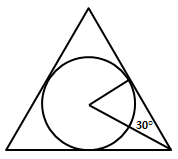

故正确答案为A。

**考点**：几何公式类-立体图形、几何结论类-三角形相关

**来源**：2012年421联考《行测》题（山西/辽宁/黑龙江/福建/湖北/ 湖南/广西/海南/四川/重庆/ 云南/ 西藏/陕西/青海/宁夏/ 新疆兵团）第56题

### 第 57 题

用直线切割一个有限平面，后一条直线与此前每条直线都要产生新的交点，第1条直线将平面分成2块，第2条直线将平面分成4块。第3条直线将平面分成7块，按此规律将平面分为22块需：

A. 7条直线

B. 8条直线

C. 9条直线

D. 6条直线

第 57 题 · 答案与解析

**参考答案（粉笔题库参考内容）**

D

**解析**

方法一：列表，如下表所示，n条直线最多有n(n-1)/2个交点。

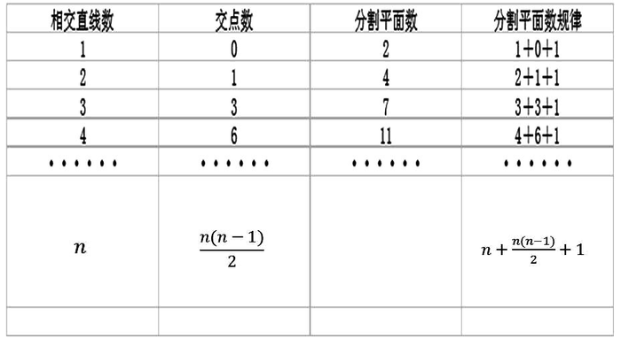

综上n条直线分平面的部分数最多为n＋n(n-1)/2＋1。则将平面分为22块代入可得：22＝n＋n(n-1)/2＋1，选项中只有当n＝6时，符合题目要求。

方法二：

1条直线时，有2个平面，写成（1,2）；

2条直线时，有4个平面，写成（2,4）（其中4=2+2）；

3条直线时，有7个平面，写成（3,7）（其中7=4+3）；

寻找规律，n条直线分成的平面数=（n-1）条直线已经分成的平面数+n，则得到n=4，写成（4,11）；n=5，写成（5,16）；n=6，写成（6,22）。

故正确答案为D。

**考点**：几何公式类-平面图形、几何其他题型

**来源**：2012年421联考《行测》题（山西/辽宁/黑龙江/福建/湖北/ 湖南/广西/海南/四川/重庆/ 云南/ 西藏/陕西/青海/宁夏/ 新疆兵团）第57题

### 第 58 题

某停车场按以下方法收费：每4小时收5元，不足4小时按5元收取，每晚超过零时加收5元，并且每天早上8点开始重新计时，某天下午15时小王将车停入停车场，取车时缴纳停车费65元，小王停车时间t的范围是：

A. 41 ＜ t ≤ 44小时

B. 44＜t≤48小时

C. 32＜t≤36小时

D. 37＜t≤41小时

第 58 题 · 答案与解析

**参考答案（粉笔题库参考内容）**

D

**解析**

第一天15点至第二天8点，时长为17小时，大于16小时，低于20小时，则费用；第二天8点至第三天8点，时长为24小时，总费用；两段时间的总费用=30+35=65元，总时长为41小时，因为不足4小时也按4小时计算，可知，即。

故正确答案为D。

**考点**：分段计算问题

**来源**：2012年421联考《行测》题（山西/辽宁/黑龙江/福建/湖北/ 湖南/广西/海南/四川/重庆/ 云南/ 西藏/陕西/青海/宁夏/ 新疆兵团）第58题

### 第 59 题

A、B两地直线距离40千米，汽车P与两地直线距离和等于60千米。则以下判断正确的是：

A. 如果A、B、P不在同一条直线上，汽车所在位置有3个，可位于A、B两地之间或A、B两地外侧

B. 如果A、B、P不在同一条直线上，汽车的位置有无穷多个

C. 如果A、B、P位于同一条直线上，汽车位于A、B两地之间或两地外侧

D. 如果A、B、P位于同一条直线上，汽车位于A、B两地外侧，且汽车到A的距离为20千米

第 59 题 · 答案与解析

**参考答案（粉笔题库参考内容）**

B

**解析**

AB距离为40千米，AP和BP距离之和为60千米，若A、B、P三点在同一直线上，则P点位于AB外侧10千米处；若A、B、P三点不在同一直线上，则转化为A、B点固定，AP+BP=60即可，有无数种选择。

拓展：事实上本题考查的是椭圆的定义，即动点到两定点的距离和为定值。本题中A、B两地即为定点，且定点间的距离为40千米，动点到两定点的距离和为60千米，所以本题中汽车的位置在一个椭圆上，若三点不在一条直线上，那么符合汽车P点的个数为无数个。

故正确答案为B。

**考点**：几何公式类-平面图形

**来源**：2012年421联考《行测》题（山西/辽宁/黑龙江/福建/湖北/ 湖南/广西/海南/四川/重庆/ 云南/ 西藏/陕西/青海/宁夏/ 新疆兵团）第59题

### 第 60 题

从3双完全相同的鞋中，随机抽取一双鞋的概率是：

A. 1/2

B. 3/5

C. 1/6

D. 1/3

第 60 题 · 答案与解析

**参考答案（粉笔题库参考内容）**

B

**解析**

方法一：抽取一只左侧、一只右侧鞋子的方法数：；任意抽取两只的方法数为，故抽到一双的概率为9/15=3/5。

方法二：先任意抽取一只鞋（左右皆可，假设为左鞋），要想配对成功，则需要在剩下的5只鞋中抽到右鞋，已知5只鞋中有3只右鞋，故抽到一双的概率为3/5。

故正确答案为B。

**考点**：给情况求概率

**来源**：2012年421联考《行测》题（山西/辽宁/黑龙江/福建/湖北/ 湖南/广西/海南/四川/重庆/ 云南/ 西藏/陕西/青海/宁夏/ 新疆兵团）第60题

### 第 61 题

某公司三名销售人员2011年的销售业绩如下：甲的销售额是乙和丙销售额的1.5倍，甲和乙的销售额是丙的销售额的5倍，已知乙的销售额是56万元，问甲的销售额是：

A. 140万元

B. 144万元

C. 98万元

D. 112万元

第 61 题 · 答案与解析

**参考答案（粉笔题库参考内容）**

B

**解析**

由题意，甲=1.5(乙+丙），甲+乙=5丙，将乙=56代入，可得甲=144，丙=40。

秒杀：数字特性——由甲的销售额是乙、丙之和的1.5倍，而1.5中含有因子3，因此甲的销售额能被3整除，仅B项符合。

故正确答案为B。

**考点**：和差倍比问题

**来源**：2012年421联考《行测》题（山西/辽宁/黑龙江/福建/湖北/ 湖南/广西/海南/四川/重庆/ 云南/ 西藏/陕西/青海/宁夏/ 新疆兵团）第61题

### 第 62 题

某网店以高于进价10%的定价销售T恤，在售出2/3后，以定价的8折将余下的T恤全部售出，该网店预计盈利为成本的：

A. 3.2%

B. 不赚也不亏

C. 1.6%

D. 2.7%

第 62 题 · 答案与解析

**参考答案（粉笔题库参考内容）**

D

**解析**

由于整个题目只出现百分数、比值，无具体数值，可采用赋值法，简化计算。赋值进价为10，T恤量为3件，则初始定价为11，售出2件，然后以的价格售出剩下的1件。总的售出额=，因此盈利占成本的。

故正确答案为D。

**考点**：经济利润问题

**来源**：2012年421联考《行测》题（山西/辽宁/黑龙江/福建/湖北/ 湖南/广西/海南/四川/重庆/ 云南/ 西藏/陕西/青海/宁夏/ 新疆兵团）第62题

### 第 63 题

小王周末组织朋友自助游，费用均摊，结账时，如果每人付450元，则多出100元；如果小王的朋友每人付430元，小王自己要多付60元才刚好，这次活动人均费用是：

A. 437.5元

B. 438.0元

C. 432.5元

D. 435.0元

第 63 题 · 答案与解析

**参考答案（粉笔题库参考内容）**

A

**解析**

假定人数为x，则可得450x-100=430x+60，解得x=8。因此每个人的均摊费用=。

故正确答案为A。

**考点**：和差倍比问题

**来源**：2012年421联考《行测》题（山西/辽宁/黑龙江/福建/湖北/ 湖南/广西/海南/四川/重庆/ 云南/ 西藏/陕西/青海/宁夏/ 新疆兵团）第63题

### 第 64 题

甲工人每小时可加工A零件3个或B零件6个，乙工人每小时可加工A零件2个或B零件7个。甲、乙两工人一天8小时共加工零件59个，甲、乙加工A零件分别用时为x小时、y小时，且x、y皆为整数，两名工人一天加工的零件总数相差：

A. 6个

B. 7个

C. 4个

D. 5个

第 64 题 · 答案与解析

**参考答案（粉笔题库参考内容）**

B

**解析**

由题意可知：

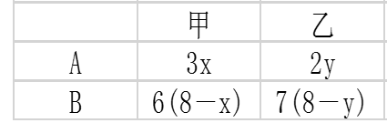

根据题意可知，3x+6(8-x)+2y+7(8-y)=59，进而得到3x+5y=45，由于45和3x都为3的倍数，则y为3的整数倍，若y=3，则x=10>8，不满足。若y=6，则x=5。也就是说甲的总数为3x+6(8-x)=48-3x=33，乙的总数为2y+7(8-y)=56-5y=26，即甲比乙多7个。

故正确答案为B.

**考点**：给具体单位型

**来源**：2012年421联考《行测》题（山西/辽宁/黑龙江/福建/湖北/ 湖南/广西/海南/四川/重庆/ 云南/ 西藏/陕西/青海/宁夏/ 新疆兵团）第64题

### 第 65 题

一项工程，甲一人做完需30天，甲、乙合作完成需18天，乙、丙合作完成需15天，甲、乙、丙三人共同完成该工程需：

A. 10天

B. 12天

C. 8天

D. 9天

第 65 题 · 答案与解析

**参考答案（粉笔题库参考内容）**

A

**解析**

赋值总工程量为90，则甲效率，乙、丙合作效率，于是甲、乙、丙效率之和=3+6=9，故三人合作该工程需要90/9=10天。

故正确答案为A。

**考点**：给完工时间型

**来源**：2012年421联考《行测》题（山西/辽宁/黑龙江/福建/湖北/ 湖南/广西/海南/四川/重庆/ 云南/ 西藏/陕西/青海/宁夏/ 新疆兵团）第65题

### 第 66 题

从所给四个选项中，选择最合适的一个填入问号处，使之呈现一定的规律性：

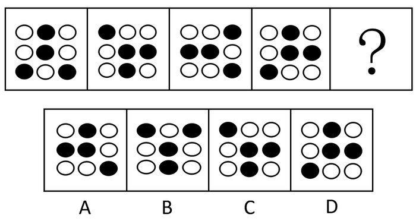

A. A

B. B

C. C

D. D

第 66 题 · 答案与解析

**参考答案（粉笔题库参考内容）**

B

**解析**

解法一：元素组成相同，考查位置规律。图形中正中间的小黑点一直保持不变，周围的小黑点围着正中间的小黑点逆时针旋转，而且每次旋转一格。依照这个规律，正确答案应该是在第四幅图的基础上，外圈的黑点绕着中间黑点逆时针方向移动一格。

解法二：观察发现，题干图形都是轴对称图形，且对称轴方向依次逆时针旋转45°，问号处应选择一个竖轴对称的图形，即B选项。

故正确答案为B。

**考点**：位置规律-平移、属性规律-对称性、黑白块类

**来源**：2012年421联考《行测》题（山西/辽宁/黑龙江/福建/湖北/ 湖南/广西/海南/四川/重庆/ 云南/ 西藏/陕西/青海/宁夏/ 新疆兵团）第66题

### 第 67 题

从所给四个选项中，选择最合适的一个填入问号处，使之呈现一定的规律性：

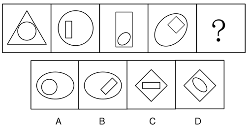

A. A

B. B

C. C

D. D

第 67 题 · 答案与解析

**参考答案（粉笔题库参考内容）**

D

**解析**

元素组成相似，元素相邻求同，注意观察相邻图形的关系。根据题目中已知图形情况，所有图形均由内外两个图形组成，且下一个图形的外图是上一个图形的内图变换而来。故问号处图形的外图一定为第四图中的内图正方形，所以只有C、D两项符合条件。同时，每个图形的内外两个图形均为曲线图形和直线图形交替。依此规律，C项内外均为直线图形，所以排除。

故正确答案为D。

**考点**：数量规律-复合

**来源**：2012年421联考《行测》题（山西/辽宁/黑龙江/福建/湖北/ 湖南/广西/海南/四川/重庆/ 云南/ 西藏/陕西/青海/宁夏/ 新疆兵团）第67题

### 第 68 题

从所给四个选项中，选择最合适的一个填入问号处，使之呈现一定的规律性：

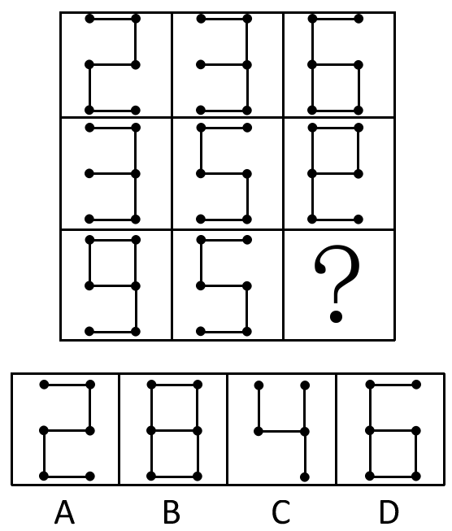

A. A

B. B

C. C

D. D

第 68 题 · 答案与解析

**参考答案（粉笔题库参考内容）**

A

**解析**

通过对已知图形的查看，组成每一行的三个图中的火柴棍总数为16根，依此规律，答案图形中的应该为16根减去最后一行前两个图形中所含的11根，即为5根。A项为5根，B项为7根，C项为4根，D项为6根。

故正确答案为A。

**考点**：数量规律-线

**来源**：2012年421联考《行测》题（山西/辽宁/黑龙江/福建/湖北/ 湖南/广西/海南/四川/重庆/ 云南/ 西藏/陕西/青海/宁夏/ 新疆兵团）第68题

### 第 69 题

从所给四个选项中，选择最合适的一个填入问号处，使之呈现一定的规律性：

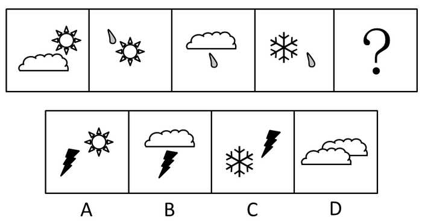

A. A

B. B

C. C

D. D

第 69 题 · 答案与解析

**参考答案（粉笔题库参考内容）**

C

**解析**

根据已知图形情况，每个图形都包含两个独立的部分，且下一个图形中必含有上一个图形的某个部分，即相邻图形间有相同元素。

故正确答案为C。

**考点**：数量规律-素

**来源**：2012年421联考《行测》题（山西/辽宁/黑龙江/福建/湖北/ 湖南/广西/海南/四川/重庆/ 云南/ 西藏/陕西/青海/宁夏/ 新疆兵团）第69题

### 第 70 题

左边给定的是纸盒的外表面，下面哪一项是由它折叠而成？

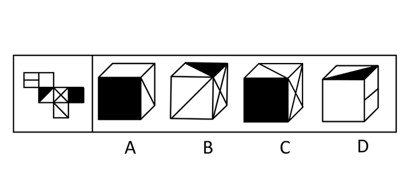

A. A

B. B

C. C

D. D

第 70 题 · 答案与解析

**参考答案（粉笔题库参考内容）**

D

**解析**

本题属于空间重构，将原图选项的面分别标上数字，如图：

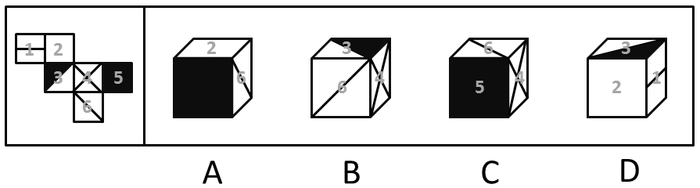

逐一分析选项:

A项中2面与6面相邻，原图中2面与6面分别在“Z”字形的两端，为对面关系，排除；

B项中3面、4面、6面的公共点与黑三角形相交，原图中三个面的公共点与黑色三角形不相交，排除；

C项中4面、5面、6面的公共点与6面上的那条对角线相交，原图中三个面的公共点与那条对角线不相交，排除；

D项中为1面，2面，3面两两相邻，且图形的位置与原图一致。

故正确答案为D。

**考点**：空间类-空间重构-六面体

**来源**：2012年421联考《行测》题（山西/辽宁/黑龙江/福建/湖北/ 湖南/广西/海南/四川/重庆/ 云南/ 西藏/陕西/青海/宁夏/ 新疆兵团）第70题

### 第 71 题

社会自组织就是指自发成立、自主发展、自行动作，具有一定规模的，以民间组织形式存在，逐步从无序走向有序的社会组织。

根据上述定义，下列选项不属于社会自组织的是：

A. 某市软件企业定期组织企业家联谊，进行业务交流

B. 一群学生通过QQ群认识，每周末一起参加敬老活动

C. 每周六晚上，某市政公园广场上都有年轻人在跳街舞

D. 一群年轻人建立动物收容所，收养各种被遗弃的宠物

第 71 题 · 答案与解析

**参考答案（粉笔题库参考内容）**

C

**解析**

第一步：找出定义关键词。

定义强调的关键词包括“自发成立”、“自行动作”和“以民间组织形式存在”。

第二步：逐一分析选项。

A项：软件企业家联谊属于自发成立，自行动作，符合定义，排除；

B项：QQ群是学生自发成立的，属于自行动作，是以民间组织形式存在，符合定义，排除；

C项：跳街舞是一个随机性活动，不能确定这群跳街舞的年轻人是不是同一群人，因此也就不符合“以组织存在”，因此不符合定义，当选；

D项：属于自发成立、自行动作和以民间组织形式存在，符合定义，排除。

本题为选非题，故正确答案为C。

**考点**：单定义-其他句式

**来源**：2012年421联考《行测》题（山西/辽宁/黑龙江/福建/湖北/ 湖南/广西/海南/四川/重庆/ 云南/ 西藏/陕西/青海/宁夏/ 新疆兵团）第71题

### 第 72 题

想象是指在原有经验的基础上创造新形象的思维活动。按照想象是否受意志控制，可分为随意想象和不随意想象。不随意想象的特点是把各种印象和信息离奇、突然、有时是无意义地组合在一起。随意想象是把各种印象和信息自觉控制、有目的、经过意志的努力呈现出需要的场景。根据上述定义，下列选项属于随意想象的是：

A. 小李昨天晚上睡觉时，梦到了儿时一起嬉戏的伙伴

B. 张三接到录取通知，想到自己实现了目标，很兴奋

C. 小王面对设计图，憧憬着公司新大楼竣工后的样子

D. 小陈的父亲看着照片回忆起当年上山下乡时的场景

第 72 题 · 答案与解析

**参考答案（粉笔题库参考内容）**

C

**解析**

第一步：判断考查定义。题目考查“随意想象”，所以仅需在题干中阅读“随意想象”。

第二步：抓住定义中的关键词。关键词包括“自觉控制”“有目的”和“经过意志的努力呈现出需要的场景”。

第三步：逐一判断选项。

A项中睡觉做梦不属于自觉控制，不符合定义；

B项并没有呈现需要的场景，只是情感活动，不符合定义；

C项属于自觉控制、有目的，而且是经过意志的努力呈现出竣工的场景，符合定义；

D项“回忆当年上山下乡时的场景”没有创造新形象的过程，因此不符合定义。

故正确答案为C。

**考点**：常规问法

**来源**：2012年421联考《行测》题（山西/辽宁/黑龙江/福建/湖北/ 湖南/广西/海南/四川/重庆/ 云南/ 西藏/陕西/青海/宁夏/ 新疆兵团）第72题

### 第 73 题

代币管理制就是用某种东西或标记来替代实物或权利，当期望行为出现时即给予一定数量的“标记”加以强化，期望行为坚持一段时间后再将“标记”按事前编制的激励系统转换成物质奖励。

根据上述定义，下列选项不属于代币管理制的是：

A. 幼儿园老师经常用小星星贴纸来鼓励表现好的孩子

B. 某企业按员工每月接受表扬的次数，确定当月奖金

C. 游戏规定优胜者可获得奖券，积累奖券可换取奖品

D. 顾客在商场购物获得积分，年底用积分兑换打折卡

第 73 题 · 答案与解析

**参考答案（粉笔题库参考内容）**

A

**解析**

第一步：抓住定义中的关键词。

代币管理制定义的关键词是“行为出现给予标记”和“转化成物质奖励”。

第二步：逐一判断选项。

A项满足“行为出现给予标记”，但不满足“转化成物质奖励”，不符合定义；B项每表扬一次即为“给予标记”，当月奖金即为“转化成物质奖励”，符合定义；C项获得奖券即为“给予标记”，换取奖品即为“转化成物质奖励”，符合定义；D项获得积分即为“给予标记”，兑换打折卡即为“转化成物质奖励”，符合定义。

本题为选非题，故正确答案为A。

**考点**：单定义-其他句式

**来源**：2012年421联考《行测》题（山西/辽宁/黑龙江/福建/湖北/ 湖南/广西/海南/四川/重庆/ 云南/ 西藏/陕西/青海/宁夏/ 新疆兵团）第73题

### 第 74 题

虚拟人力资源管理是指以合作关系为基础，充分利用现代信息网络技术，帮助企业获取、发展和筹划智力和劳力资本的一种人力资源管理办法，它可以满足企业管理虚拟化发展的要求，将大量的人力资源管理活动外部化或由员工实现自主管理，企业从而可以将主要精力放在核心人力资源管理方面，提高人力资源管理效率。

根据上述定义，下列选项不属于虚拟人力资源管理的是：

A. 某企业通过猎头公司物色到一位产品研发专家

B. 某集团将其全部广告交由同一家广告公司设计

C. 小李和同事都被公司派到某职业学校培训半年

D. 某公司委托劳动派遣公司负责分发员工的薪酬

第 74 题 · 答案与解析

**参考答案（粉笔题库参考内容）**

B

**解析**

第一步：找出定义关键词。

关键词为“人力资源管理”和“外部化”。

第二步：逐一分析选项。

A 项：企业将招聘外包给猎头公司，符合定义；

B 项：集团将广告交由广告公司，不属于“人力资源管理”范畴，不符合定义；

C 项：公司派员工到职业学校培训相当于把培训外包到职业学校，符合定义；

D 项：公司委托劳动派遣公司分发员工的薪酬，属于“人力资源管理”和“外部化”。

本题为选非题，故正确答案为B。

**考点**：方式目的

**来源**：2012年421联考《行测》题（山西/辽宁/黑龙江/福建/湖北/ 湖南/广西/海南/四川/重庆/ 云南/ 西藏/陕西/青海/宁夏/ 新疆兵团）第74题

### 第 75 题

相符行为是指个人的行为与他人的行为和意志相符合、一致或相似的现象。相符行为通常包括三种情况：第一，人们出于适应社会生活环境的需要而遵守共同的社会规范，产生相似行为，以便使社会生活能正常进行；第二，相似的文化背景和社会化过程促使人们产生相似的行为；第三，人际交往中双方心理的相互影响，也导致相符行为。

根据上述定义，下列选项不属于相符行为的是：

A. 某高校毕业生大多愿意到大型国有企业工作

B. 双胞胎失散多年，但见面时仍可以一眼认出

C. 两辆汽车在闹市区刮擦，路上行人驻足围观

D. 某设计院建筑师设计的作品都有相似的风格

第 75 题 · 答案与解析

**参考答案（粉笔题库参考内容）**

B

**解析**

第一步：抓住定义中的关键词。

相符行为的定义包含的关键词是“共同遵守的社会规范”、“相似文化背景和社会化过程”和“双方心理影响”。

第二步：逐一判断选项。

A项属于“相似文化背景和社会化过程”，符合定义；B项双胞胎一眼就能认出并不是受上面的情况影响导致，不符合定义；C项行人驻足围观符合“相似的社会化过程”导致发生的围绕现象，符合定义；D项设计院的设计师具有相似的文化背景，所以呈现相似的建筑风格，符合定义。

本题为选非题，故正确答案为B。

**考点**：单定义-其他句式

**来源**：2012年421联考《行测》题（山西/辽宁/黑龙江/福建/湖北/ 湖南/广西/海南/四川/重庆/ 云南/ 西藏/陕西/青海/宁夏/ 新疆兵团）第75题

### 第 76 题

水平一体化物流是指同一行业的多个企业，通过共同利用物流渠道，获得规模经济效益、提高物流效率。水平一体化物流须具备物流需求和物流供应的信息平台，要有大量企业参与并存在较多的商品量。

根据上述定义，下列选项属于水平一体化物流的是：

A. 某家具厂要求原材料供应商和产品销售商使用同一家物流公司

B. 某市屠宰企业将猪、牛肉混放入冷藏车并送往一百多家零售店

C. 电子城百家商店签订协议，指定其中一家承担电子城送货业务

D. 某百货公司设立物流中心，统筹安排全公司各类货物发送工作

第 76 题 · 答案与解析

**参考答案（粉笔题库参考内容）**

C

**解析**

第一步：抓住定义中的关键词。

水平一体化物流的定义包含的重点关键词是“同一行业的多个企业”、“共同利用物流渠道”和“提高物流效率”。

第二步：逐一判断选项。

A项：原材料供应商和产品销售商不属于“同一行业的多个企业”， 比如做家具的，原材料供应商可能是生产钉子的，但是销售商是卖家具的，两者不是同一个行业，不符合定义；

B项：屠宰企业也是单个企业行为，不属于“同一行业的多个企业”，不符合定义；

C项：百家商店属于“同一行业的多个企业”，指定其中一家承担送货业务属于“共同利用物流渠道”，能够提高物流效率，符合定义；

D项：设立物流中心仍属于单个企业行为，并不是“同一行业的多个企业”，不符合定义。

故正确答案为C。

**考点**：方式目的

**来源**：2016年重庆市选调优秀大学生到基层工作考试《行测》题第69题

### 第 77 题

网络暴力是行为主体的网络行为对当事人造成实质性伤害的网络失范现象。

根据上述定义，下列选项属于网络暴力的是：

A. 某非法传销团伙借助网络发展下线

B. 某足球俱乐部球迷建立网站，要求主教练下课

C. 某艺人喜欢在微博上爆料，提高自己微博的访问量

D. 某选秀选手隐私在网上被曝光后，宣布放弃晋级机会

第 77 题 · 答案与解析

**参考答案（粉笔题库参考内容）**

D

**解析**

第一步：抓住定义中的关键词。

网络暴力的定义包含的重点关键词是“网络行为”和“对当事人造成实质性伤害”。

第二步：逐一判断选项。

A项中传销团伙发展下线，严格来说不是“网络行为”且没有明确当事人受到伤害，不符合定义；B项中要求主教练下课，并没有造成“实质性伤害”，不符合定义；C项中没有受害当事人，不符合定义；D项有曝光选手隐私的“网络行为”，也有明确的当事人，且对当事人造成放弃晋级的伤害，符合定义。

故正确答案为D。

**考点**：原因结果

**来源**：2012年421联考《行测》题（山西/辽宁/黑龙江/福建/湖北/ 湖南/广西/海南/四川/重庆/ 云南/ 西藏/陕西/青海/宁夏/ 新疆兵团）第77题

### 第 78 题

行政代履行是指行政机关依法作出要求当事人履行排除妨碍、恢复原状等义务的行政决定，当事人逾期不履行，经催告仍不履行，其后果已经或者将危害交通安全、造成环境污染或者破坏自然资源的，行政机关可以代履行，或者委托没有利害关系的第三人代履行。

根据上述定义，下列选项符合行政代履行规定的是：

A. 某企业违规倾倒废渣造成水污染，因其不具备治理能力，当地环保局指定另一企业代为治理

B. 安监局要求矿山企业配发防尘口罩，经催告，对拒不执行的企业，由安监局代为购买、配发

C. 某工厂因噪声污染被环保局处以罚款，经催告，厂方拒不缴纳罚款，环保局遂申请法院强制执行

D. 某店设置的广告牌影响行车安全，城管部门催告该店限期拆除，逾期未果，城管部门遂代为拆除

第 78 题 · 答案与解析

**参考答案（粉笔题库参考内容）**

D

**解析**

第一步：抓住定义中的关键词。

行政代履行的定义包含的重点关键词是“行政决定”、“排除妨碍、恢复原状”和“逾期不履行”。

第二步：逐一判断选项。

A项中不存在当事人“逾期不履行”的情况，不符合定义；

B项中安监局要求矿山企业发口罩不属于“排除妨碍、恢复原状”的情况，不符合定义；

C项非常有干扰性，虽然处以罚款是“行政决定”，但罚款不属于“排除妨碍、恢复原状”的情况，不符合定义；

D项属于“排除妨碍、恢复原状”和“逾期不履行”情况，符合定义。

故正确答案为D。

**考点**：原因结果

**来源**：2012年421联考《行测》题（山西/辽宁/黑龙江/福建/湖北/ 湖南/广西/海南/四川/重庆/ 云南/ 西藏/陕西/青海/宁夏/ 新疆兵团）第78题

### 第 79 题

公民的基本权利可分为积极权利和消极权利。积极权利是指通过国家积极介入保障公民在社会经济生活领域的权利，是要求国家积极作为的权利。消极权利即自由权，是要求排除国家妨害、国家相应不作为的权利。

根据上述定义，下列选项属于积极权利范畴的是：

A. 董事长不得借助权力剥夺股东的股权

B. 国家为满足低收入者需要建设保障房

C. 盲、聋、哑人员应依法列入选民名单

D. 每一位公民都有不受非法逮捕的权利

第 79 题 · 答案与解析

**参考答案（粉笔题库参考内容）**

B

**解析**

第一步：判断考查的定义。题目考查的是“积极权利”。

第二步：抓住定义中的关键词。积极权利的定义包含的重点关键词是“国家”、“社会经济生活领域”和“作为”。

第三步：逐一判断选项。A项主体并非“国家”，不符合定义；B项主体国家，保障公民生活方面的权利，符合定义；C项中选举权属于政治领域，不属于“社会经济生活领域”，不符合定义；D项应该让国家不主动介入，是消极权利。

故正确答案为B。

**考点**：常规问法

**来源**：2012年421联考《行测》题（山西/辽宁/黑龙江/福建/湖北/ 湖南/广西/海南/四川/重庆/ 云南/ 西藏/陕西/青海/宁夏/ 新疆兵团）第79题

### 第 80 题

企业社会响应是指企业受社会伦理道德标准的引导满足社会某种普遍需要。

根据上述定义，下列选项不属于企业社会响应的是：

A. 某工厂发生污染事故，周边企业出资垫付事故赔偿金

B. 工程队在工地周围铺设防尘网，减少粉尘造成的污染

C. 某企业捐赠3亿股企业股票给慈善组织设立专项基金

D. 某公司按照《残疾人保障法》的规定安排残疾人就业

第 80 题 · 答案与解析

**参考答案（粉笔题库参考内容）**

D

**解析**

第一步：抓住定义中的关键词。

企业社会响应的定义包含的重点关键词是“道德”和“满足普遍需要”。

第二步：逐一判断选项。

A项：某工厂发生污染事故，周边企业没有硬性要求必须出资或赔偿，而他们这么做是出于道德因素来保护环境，符合定义；

B项：在工地周围设防尘网也是受道德引导，且能减轻周边的污染，符合定义；

C项：捐款也是出于道德目的，并满足社会需要，符合定义；

D项：按照《残疾人保障法》并不属于“受社会伦理道德标准的引导”，不符合定义。

本题为选非题，故正确答案为D。

**考点**：单定义-其他句式

**来源**：2012年421联考《行测》题（山西/辽宁/黑龙江/福建/湖北/ 湖南/广西/海南/四川/重庆/ 云南/ 西藏/陕西/青海/宁夏/ 新疆兵团）第80题

### 第 81 题

（  ） 对于 轿车 相当于 牡丹 对于 （  ）

A. 吉普 雪花

B. 卡车 菊花

C. 动车 梅花

D. 轮船 浪花

第 81 题 · 答案与解析

**参考答案（粉笔题库参考内容）**

B

**解析**

第一步：将选项逐一代入，判断词语之间的逻辑关系。A项吉普相对轿车是并列关系，雪花相对牡丹无关系；B项卡车相对轿车是并列关系，菊花相对牡丹是并列关系；C项动车相对轿车没有直接关系，梅花相对牡丹是并列关系；D项轮船对于轿车没有直接关系，浪花对于牡丹也无直接关系。

第二步：逻辑关系相同即为答案。B项同属并列关系。

故正确答案为B。

**考点**：逻辑关系-并列关系

**来源**：2012年421联考《行测》题（山西/辽宁/黑龙江/福建/湖北/ 湖南/广西/海南/四川/重庆/ 云南/ 西藏/陕西/青海/宁夏/ 新疆兵团）第81题

### 第 82 题

理想 对于 （  ） 相当于 （  ） 对于 钻研

A. 梦想 学习

B. 书籍 欲望

C. 志向 探索

D. 年龄 路程

第 82 题 · 答案与解析

**参考答案（粉笔题库参考内容）**

C

**解析**

逐一代入选项。

A项：理想和梦想是近义词，学习和钻研意思不同，前后逻辑关系不一致，排除；

B项：理想和书籍无直接关系，欲望和钻研也无直接关系，排除；

C项：理想和志向是近义词，探索和钻研是近义词，前后逻辑关系一致，当选；

D项：理想和年龄没有直接关系，路程和钻研也无直接关系，排除。

故正确答案为C。

**考点**：语义关系-近义关系

**来源**：2012年421联考《行测》题（山西/辽宁/黑龙江/福建/湖北/ 湖南/广西/海南/四川/重庆/ 云南/ 西藏/陕西/青海/宁夏/ 新疆兵团）第82题

### 第 83 题

（  ） 对于 动物 相当于 （  ） 对于 星座

A. 理智 幸运

B. 凶猛 星星

C. 可爱 神秘

D. 珍稀 温馨

第 83 题 · 答案与解析

**参考答案（粉笔题库参考内容）**

C

**解析**

第一步：将选项逐一代入，判断词语之间的逻辑关系。

A项，理智与动物、幸运与星座之间无逻辑对应关系，不能说理智的动物、幸运的星座，排除；

B项，凶猛是形容词，星星是名词，代入题干后，词性关系并不对应，排除；

C项，可爱与动物、神秘与星座之间为属性对应关系，可爱的动物，神秘的星座，搭配恰当，词性对应；

D项，有些动物是珍稀的，但星座并不是温馨的，不能形成对应，排除。

第二步：逻辑关系相同即为答案，代入题干后只有C项对应恰当，当选。

故正确答案为C。

**考点**：逻辑关系-对应关系

**来源**：2012年421联考《行测》题（山西/辽宁/黑龙江/福建/湖北/ 湖南/广西/海南/四川/重庆/ 云南/ 西藏/陕西/青海/宁夏/ 新疆兵团）第83题

### 第 84 题

满腹经纶 对于 （  ） 相当于 （  ） 对于 震撼

A. 才能 精彩绝伦

B. 才华 触目惊心

C. 才干 美轮美奂

D. 才学 绚丽多彩

第 84 题 · 答案与解析

**参考答案（粉笔题库参考内容）**

B

**解析**

逐一代入选项。

A项，“满腹经纶”比喻人很有学问，可用来形容很有“才华”，而“才能”偏重能力，精彩绝伦与震撼无明显逻辑关系，前后逻辑关系不一致，排除；

B项，“满腹经纶”比喻人很有学问，可用来形容很有“才华”；“触目惊心”指看见某种严重情况而内心震惊，可用来形容受到震撼，前后逻辑关系一致，当选；

C项，“满腹经纶”比喻人很有学问，可用来形容很有“才华”，而“才干”主要侧重办事能力，后两词无明显逻辑关系，前后逻辑关系不一致，排除；

D项，“满腹经纶”可以形容人有“才学”，属对应关系，但“绚丽多彩”不能修饰“震撼”，二者无明显逻辑关系，前后逻辑关系不一致，排除。

故正确答案为B。

**考点**：语义关系-比喻象征义

**来源**：2012年421联考《行测》题（山西/辽宁/黑龙江/福建/湖北/ 湖南/广西/海南/四川/重庆/ 云南/ 西藏/陕西/青海/宁夏/ 新疆兵团）第84题

### 第 85 题

葡萄酒：名酒：酒精

A. 火箭炮：火箭：战斗力

B. 敞篷车：跑车：发动机

C. 宇航员：人员：驾驶员

D. 玫瑰花：鲜花：牡丹花

第 85 题 · 答案与解析

**参考答案（粉笔题库参考内容）**

B

**解析**

第一步：判断题干关系。

葡萄酒属于酒的一个具体品类，名酒是横向的按知名度的分类，因为有的葡萄酒里也有名酒，有的名酒里也有葡萄酒，所以葡萄酒与名酒是交叉关系，酒精则是前两者共同包含，所以与前面两个是包容关系。

第二步：逐一判断选项关系。

A项火箭炮与火箭不属于交叉关系，排除；B项敞篷车与跑车属交叉关系，即有的敞篷车是跑车，有的跑车是敞篷车，且它们都包含发动机，故发动机与敞篷车和跑车形成包容关系，与题干关系相符；C项宇航员与人员是包容关系，并非交叉关系，排除；D项玫瑰花与鲜花是种属关系，但牡丹花与玫瑰花呈并列关系，排除。

故正确答案为B。

**考点**：逻辑关系-交叉关系

**来源**：2012年421联考《行测》题（山西/辽宁/黑龙江/福建/湖北/ 湖南/广西/海南/四川/重庆/ 云南/ 西藏/陕西/青海/宁夏/ 新疆兵团）第85题

### 第 86 题

社交：微博：即时性

A. 医院：消毒：安全性

B. 曲艺：评书：娱乐性

C. 司机：驾驶：可靠性

D. 新闻：评论：客观性

第 86 题 · 答案与解析

**参考答案（粉笔题库参考内容）**

B

**解析**

第一步：判断题干词语间逻辑关系。

微博是一种社交工具，二者是种属关系；微博具有即时性，二者是必然属性对应关系。

第二步：判断选项词语间逻辑关系。

A项：医院与消毒并不是种属关系，与题干逻辑关系不一致，排除；

B项：评书是曲艺的一种，二者是种属关系；评书具有娱乐性，二者是必然属性对应关系，与题干逻辑关系一致，当选；

C项：司机与驾驶并不是种属关系，与题干逻辑关系不一致，排除；

D项：新闻和评论均是信息传递的载体，二者是并列关系，评论不一定具有客观性，与题干逻辑关系不一致，排除。

故正确答案为B。

**考点**：逻辑关系-包容关系、逻辑关系-对应关系

**来源**：2012年421联考《行测》题（山西/辽宁/黑龙江/福建/湖北/ 湖南/广西/海南/四川/重庆/ 云南/ 西藏/陕西/青海/宁夏/ 新疆兵团）第86题

### 第 87 题

战士：坦克：武器装备

A. 记者：相机：镜头

B. 农民：镰刀：农具

C. 矿工：矿灯：照明

D. 商人：计算：资产

第 87 题 · 答案与解析

**参考答案（粉笔题库参考内容）**

B

**解析**

第一步：判断题干关系。

战士和坦克的关系是对应关系，战士是坦克的使用者。坦克和武器装备是包容关系，坦克是武器装备的一种。

第二步：逐一判断选项关系。

A项：记者和相机是对应关系，相机与镜头虽然也是包容关系，但镜头是相机的一部分，与题干顺序相反，排除；

B项：农民与镰刀是对应关系，镰刀与农具是包容关系，且镰刀是农具的一种，与题干关系相符；

C项：矿工与矿灯是对应关系，但矿灯与照明也是对应关系，排除；

D项：商人与计算没有直接关系，排除。

故正确答案为B。

**考点**：逻辑关系-包容关系、逻辑关系-对应关系

**来源**：2012年421联考《行测》题（山西/辽宁/黑龙江/福建/湖北/ 湖南/广西/海南/四川/重庆/ 云南/ 西藏/陕西/青海/宁夏/ 新疆兵团）第87题

### 第 88 题

后果：结果：成果

A. 信心：信念：信仰

B. 妄想：遐想：理想

C. 反动：反对：反思

D. 思维：思想：思绪

第 88 题 · 答案与解析

**参考答案（粉笔题库参考内容）**

B

**解析**

第一步：判断题干词语间的逻辑关系。

后果、结果和成果三者是近义词，且后果、结果和成果依次为贬义、中性和褒义。

第二步：判断选项词语间的逻辑关系。

A项：信心、信念、信仰三者是近义词，但三者均不包含贬义，与题干逻辑关系不一致，排除；

B项：妄想、遐想和理想是近义词，且依次为贬义、中性和褒义，与题干逻辑关系一致，当选；

C项：反对与反思不是近义词，与题干逻辑关系不一致，排除；

D项：思维、思想和思绪是近义词，但没有贬义、中性和褒义的区别，与题干逻辑关系不一致，排除。

故正确答案为B。

**考点**：语义-其他

**来源**：2012年421联考《行测》题（山西/辽宁/黑龙江/福建/湖北/ 湖南/广西/海南/四川/重庆/ 云南/ 西藏/陕西/青海/宁夏/ 新疆兵团）第88题

### 第 89 题

得陇望蜀：狼子野心

A. 沐猴而冠：狐假虎威

B. 指桑骂槐：趾高气扬

C. 坐井观天：鼠目寸光

D. 投桃报李：指雁为羹

第 89 题 · 答案与解析

**参考答案（粉笔题库参考内容）**

C

**解析**

第一步：判断题干关系。

“得陇望蜀”的字面意思是已经取得陇右，还想攻取西蜀，通俗来讲就是吃着碗里的，看着锅里的。“狼子野心”的字面意思是狼子即狼崽，野心即野兽的本性，有野心勃勃的意思。两个词表达的意思大致相同，所以题干是近义关系。

第二步：逐一判断选项关系。

A项：“沐猴而冠”比喻虚有其表，形同傀儡；“狐假虎威”是指狐狸假借老虎的威势，比喻依仗别人的权势来欺压人，两者意思不同没有直接关系，排除。

B项：“指桑骂槐”意思是指着桑树骂槐树，比喻表面上骂这个人，实际上是骂那个人；“趾高气扬”是指走路时脚抬得很高，神气十足，两者意思也不同，无直接关系，排除。

C项：“坐井观天”是指坐在井里看井水中倒映出的天，用来比喻和讽刺眼界狭窄或学识肤浅之人；“鼠目寸光”同样是形容目光短浅，没有远见，属于近义关系，符合题干的关系，当选。

D项：“投桃报李”意思是他送给我桃，我以李子给予回赠，表达报答之意；“指雁为羹”比喻用空想来安慰自己，有望梅止渴的意思，两者并无直接关系，排除。

故正确答案为C。

**考点**：语义关系-近义关系

**来源**：2012年421联考《行测》题（山西/辽宁/黑龙江/福建/湖北/ 湖南/广西/海南/四川/重庆/ 云南/ 西藏/陕西/青海/宁夏/ 新疆兵团）第89题

### 第 90 题

食物：食品

A. 拘泥：拘谨

B. 达到：到达

C. 发挥：发扬

D. 矿产：矿石

第 90 题 · 答案与解析

**参考答案（粉笔题库参考内容）**

D

**解析**

第一步：判断题干词语间逻辑关系。

食物泛指能吃的东西，食品指经过加工包装出来的食物，食品是食物的一种，二者为种属关系。

第二步：判断选项词语间逻辑关系。

A项：拘泥多指固执；拘谨（言语、行动）过分谨慎，二者不是种属关系，与题干逻辑关系不一致，排除；

B项：达到和到达不是种属关系，与题干逻辑关系不一致，排除；

C项：发挥和发扬是近义关系，与题干逻辑关系不一致，排除；

D项：矿石是矿产的一种，与题干逻辑关系一致，当选。

故正确答案为D。

注：本题很容易误将食物和食品判断成全同关系，这是导致错选为A项或C项的原因。

**考点**：逻辑关系-包容关系

**来源**：2012年421联考《行测》题（山西/辽宁/黑龙江/福建/湖北/ 湖南/广西/海南/四川/重庆/ 云南/ 西藏/陕西/青海/宁夏/ 新疆兵团）第90题

### 第 91 题

据英国《每日邮报》报道，日本富士摄影胶片公司将利用所掌握的胶片技术创新护肤产品，进军美容业，感光乳剂中的胶原蛋白可以防止胶片被氧化，与利用胶原蛋白保护皮肤免受紫外线伤害有着异曲同工之妙。一些忠实于富士品牌的消费者认为这对于爱美人士来说是一个好消息。

消费者得出上述结论隐含的假设是：

A. 含有胶原蛋白的护肤品在亚洲欧洲等地区广受消费者欢迎

B. 富士公司具备了生产含有胶原蛋白护肤品的巨大生产能力

C. 科学家们已经从富士公司的护肤产品中发现了抗氧化物

D. 护肤产品能利用富士公司生产胶卷使用的科研成果和工艺

第 91 题 · 答案与解析

**参考答案（粉笔题库参考内容）**

D

**解析**

第一步：找出论点和论据。

论点：一些忠实于富士品牌的消费者认为日本富士摄影胶片公司将利用所掌握的胶片技术创新护肤产品，进军美容业，对于爱美人士来说是一个好消息。

论据：感光乳剂中的胶原蛋白可以防止胶片被氧化，与利用胶原蛋白保护皮肤免受紫外线伤害有着异曲同工之妙。

第二步：判断加强方式。

论点强调富士公司利用胶片技术创新护肤产品，论据强调胶片技术的原理，论点和论据之间不存在明显因果关系，要加强论证，需在论点和论据间搭桥。

第三步：逐一判断选项。

A项只是讲述含胶原蛋白的护肤品受欢迎的现象，没有提及富士公司胶片技术，与结论无关；B项不是得出结论必须具备的前提假设，假如富士公司不具备生产能力，会有其他具备生产能力的厂家进行生产，关键前提仍在于胶片技术能够用于生产护肤品，B项为强干扰项；C项没有说明护肤产品与胶片技术的关系，属无关选项；D项符合题意，只有护肤产品能利用富士公司生产胶卷使用的科研成果和工艺，才能生产相关的消费品，才能使爱美人士受益。

故正确答案为D。

**考点**：必要条件

**来源**：2012年421联考《行测》题（山西/辽宁/黑龙江/福建/湖北/ 湖南/广西/海南/四川/重庆/ 云南/ 西藏/陕西/青海/宁夏/ 新疆兵团）第91题

### 第 92 题

某市以生产加工“工艺品”出口到欧盟国家著称。去年以来，受到欧洲债务危机影响，该市对欧盟工艺品出口锐减。鉴于市场的变化，作为该市最大的工艺品生产企业A公司，必须在以后两年的时间里提高5%的生产率，否则它就会破产。根据该市外经贸局的研究，A公司按照目前的生产状况和经管结构，如果能提高5%的生产率，就能增加10%的生产利润。

如果上述陈述为真，以下选项必然为真的是：

A. 如果A公司不能达到提高10%利润的目标，它就会破产

B. A公司的生产率两年内必须提高10%，否则它就会破产

C. 只要经济形势好转，A公司不提高生产率，也不会破产

D. A公司生产状况和经管结构两年不变，利润才能提高10%

第 92 题 · 答案与解析

**参考答案（粉笔题库参考内容）**

A

**解析**

第一步：翻译题干。

利用充分必要条件：①-生产率提高5%→破产；②生产率提高5%→生产利润增加10%。根据逆否规则，①等价于③“-破产→生产率提高5%”；将②、③两个推导关系连接起来，可推出④“-破产→生产利润增加10%”。

第二步：逐一翻译选项并判断正确选项。

利用逆否规则：A项正确，-生产利润增加10%→破产，是④的逆否命题，符合逆否规则，推导成立；B项错误，-破产→生产率提高10%，与①不相符，该选项混淆了生产率和生产利润的数据，为强干扰项；C项错误，翻译为：经济形势好转→—破产，题干没有提到经济形势好转对A公司破产的影响，无法进行推导；D项错误，生产状况和经管结构两年不变→生产利润增加10%，题干只提到保持生产状况和经管结构不变，如果生产率提高5%，生产利润会增加10%，无法直接推出生产状况和经管结构两年不变和生产利润之间的关系。

故正确答案为A。

**考点**：常规翻译

**来源**：2012年421联考《行测》题（山西/辽宁/黑龙江/福建/湖北/ 湖南/广西/海南/四川/重庆/ 云南/ 西藏/陕西/青海/宁夏/ 新疆兵团）第92题

### 第 93 题

近年来，我国城乡儿童学前教育事业发展取得了长足的进步，但是农村学前儿童“入园难”的问题仍然没有得到彻底的解决。解决儿童“入园难”的问题，不能够依靠大量使用校车来接送儿童，“合理布局，就近入园”才是确保儿童安全，解决入园难的根本。

如果以下各项为真，最能支持上述论证的是：

A. 国家财政每年对农村学前教育的投入占国民教育投入的比例不断加大

B. 按照国际安全标准采购的校车维护费用高，部分地区幼儿园无法承担

C. 每个乡镇应规划建设一所公办幼儿园，大村独立办园，小村联合办园

D. 国家招收幼儿教师免费培养定向分配，毕业后回到当地从事学前教育

第 93 题 · 答案与解析

**参考答案（粉笔题库参考内容）**

B

**解析**

第一步：分析题干，找到论点和论据。

论点：“合理布局，就近入园”才是确保儿童安全，解决入园难的根本。

论据：解决儿童“入园难”的问题，不能够依靠大量使用校车来接送儿童。

第二步：逐一分析选项。

A项：只说明国家越来越重视农村学前教育，没有涉及“入园难”的问题，排除；

B项：校车维护费用高，部分地区幼儿园无法承担，所以不能依靠大量使用校车接送儿童，采用“就近入园”可解决问题，可以加强，当选；

C项：规划建设幼儿园是合理布局的对策，不是对论点的论证，无关，排除；

D项：“幼儿教师的分配”跟确保儿童安全，解决“入园难”问题没有直接关系，无法支持论点，排除。

故正确答案为B。

**考点**：补充论据

**来源**：2012年421联考《行测》题（山西/辽宁/黑龙江/福建/湖北/ 湖南/广西/海南/四川/重庆/ 云南/ 西藏/陕西/青海/宁夏/ 新疆兵团）第93题

### 第 94 题

小王、小张、小李、小顾四位舍友预测某次考试的结果。

小王：我想这次大家都能过吧！

小张：怎么可能？你没看见我乌云密布吗？

小李：小顾肯定是没问题的。

小顾：拜托！要是我没问题，大家就都没问题。

成绩公布后，证明四人中只有一个人的说法是错误的。说法错误的是：

A. 小王

B. 小张

C. 小李

D. 小顾

第 94 题 · 答案与解析

**参考答案（粉笔题库参考内容）**

B

**解析**

第一步：找突破口。

小王认为大家都能过（即所有人都通过），小张认为自己不能过（即某个人没有通过），因此小张和小王的话必有一假（特别提示：所有是和某个不是不矛盾，二者存在同假的可能，所有是的矛盾命题只能是有的不是）。

第二步：看其他的话。

本题只有一句话为假，因此小李和小顾的话是真的。由小李和小顾的话可知，大家都能过。即小王的话为真，小张的话为假。

故正确答案为B。

**考点**：真假推理-其他

**来源**：2012年421联考《行测》题（山西/辽宁/黑龙江/福建/湖北/ 湖南/广西/海南/四川/重庆/ 云南/ 西藏/陕西/青海/宁夏/ 新疆兵团）第94题

### 第 95 题

有专家认为，全球经济正缓慢复苏，其主要证据是：美国的经济表现超出预期，在就业和住房方面都有不错的表现；欧洲央行启动了融资运作计划，用比较低的利率贷款，为更多的企业以及中小企业进行融资；全球整个大宗商品市场树立了足够的信心。因此，这都是非常好的迹象。

如果以下各项为真，最有可能成为上述论证前提的是：

A. 专家先前对美国经济表示不乐观

B. 欧洲央行原有利率较高，银根紧

C. 非欧美国家的经济状况保持稳定

D. 全球大宗商品交易缺乏信心支持

第 95 题 · 答案与解析

**参考答案（粉笔题库参考内容）**

C

**解析**

第一步：找出论点和论据。

论点：全球经济正缓慢复苏。论据：①美国的经济表现超出预期；②欧洲央行为更多企业及中小企业进行融资；③全球整个大宗商品市场树立了足够的信心。

第二步：判断加强方式。

论点强调全球经济，论据强调欧美经济及全球大宗商品市场，论点和论据的范围不同，需要加强论证。

第三步：逐一判断选项。

A、B、D三项分别只说明美国经济、欧洲经济和全球大宗商品交易的情况，没有涉及全球经济，无法支持题干的论证；C项，“非欧美国家的经济”是全球经济的组成部分，这补充了全球经济与欧美经济中缺少的非欧美地区，加强论证。

故正确答案为C。

**考点**：搭桥

**来源**：2012年421联考《行测》题（山西/辽宁/黑龙江/福建/湖北/ 湖南/广西/海南/四川/重庆/ 云南/ 西藏/陕西/青海/宁夏/ 新疆兵团）第95题

### 第 96 题

德国和瑞士的专家经过研究得出一个有趣的结论：餐具颜色能直接影响食欲，红色餐具可降低人们40%的食欲，在人们的传统观念中，红色是极具攻击性的色彩，用红色餐具盛放食物往往会让人难以下咽，因为在潜意识中人们会给自己发出不能吃红色餐具中食物的心理暗示，从而令食欲下降。

如果以下各项为真，最能质疑上述论断的是：

A. 快餐巨头常在大堂中使用大片鲜亮的红色图案，并没有影响快餐销量

B. 红色易使人产生紧张感，暴饮暴食是人在精神紧张时放松自己的一种方式

C. 试验表明，使用红色水杯者比使用蓝色水杯者平均饮水量要减少44%

D. 红色预示着不安和担忧，人们看到红色餐具会本能地担心食物有危险

第 96 题 · 答案与解析

**参考答案（粉笔题库参考内容）**

B

**解析**

第一步：找出论点和论据。

论点：餐具颜色能直接影响食欲，红色餐具可降低人们的食欲。

论据：在人们的传统观念中，红色是极具攻击性的色彩，用红色餐具盛放食物往往会让人难以下咽。

第二步：逐一分析选项。

A项说的是销量，与人的食欲无关，并且A项说的是大堂中大片的红色图案，而题干中说的是餐具是红色的，因此属于无关选项，排除；

B项红色会让人产生紧张感，从而导致人们为放松精神而暴饮暴食，直接否定了论点“红色餐具会降低人们的食欲”，当选；

C项提供的试验数据说明红色餐具有降低食欲的作用，加强论点，排除；

D项人们看到红色餐具担心食物有危险可能导致的结果是食欲降低，加强论点，排除。

故正确答案为B。

**考点**：削弱论点

**来源**：2012年421联考《行测》题（山西/辽宁/黑龙江/福建/湖北/ 湖南/广西/海南/四川/重庆/ 云南/ 西藏/陕西/青海/宁夏/ 新疆兵团）第96题

### 第 97 题

超级笔记本作为市场中一个非常有竞争力的新生力量，2011年销量只占移动计算机市场销量的20%，低于预期的30%。有供应商表示，超级笔记本之所以遭遇销售低迷很大程度上是因为欧洲市场对超级笔记本需求过小。调查显示，欧洲消费者普遍青睐15英寸及以上尺寸的笔记本电脑，有数据显示，目前欧洲售出的移动计算机中有40%~45%都是15英寸的机型，而超级本根本就没有这样的尺寸。

供应商得出上述结论的前提假设是：

A. 生产前厂家未考虑欧洲消费者的使用习惯

B. 超级本应该设计生产15英寸级别的产品

C. 欧洲消费者的消费习惯与其他地区相类似

D. 欧洲市场在全球笔记本市场中占较大比例

第 97 题 · 答案与解析

**参考答案（粉笔题库参考内容）**

D

**解析**

第一步：找出论点和论据。

论点：超级笔记本之所以遭遇销售低迷很大程度上是因为欧洲市场对超级笔记本需求过小。

论据：调查显示，欧洲消费者普遍青睐15英寸及以上尺寸的笔记本电脑，有数据显示，目前欧洲售出的移动计算机中有40%~45%都是15英寸的机型，而超级本根本就没有这样的尺寸。

论点论据都在说因为欧洲市场对超级笔记本需求过小，所以超级笔记本销售低迷，二者话题一致，问法为前提假设，加强考虑必要条件。

第二步：逐一分析选项。

A项和C项谈的是消费者的使用习惯和消费习惯，与销售量之间没有直接的关联，B项谈的是超级本的产品设计，同样跟销售量无关，A、B、C三项均属无关选项。D项，只有欧洲市场在全球笔记本市场中占较大比例，用欧洲市场的调查数据来说明全球市场的问题才具有说服力。

故正确答案为D。

**考点**：必要条件

**来源**：2012年421联考《行测》题（山西/辽宁/黑龙江/福建/湖北/ 湖南/广西/海南/四川/重庆/ 云南/ 西藏/陕西/青海/宁夏/ 新疆兵团）第97题

### 第 98 题

有经济学者不赞成政府对低收入人群的直接救助，主张政府对大企业家和富人采取优惠的财政和税收政策，认为大企业家和富人的投资与消费活动会促进经济发展，增加穷人的就业机会，将财富从社会上层传递到社会底层。

如果以下各项为真，最能削弱上述理论的观点是：

A. 政府对大企业家和富人采取优惠的财政和税收政策，导致因贫富差距拉大而引发不确定的社会矛盾

B. 打破收入分配方面的平均主义，鼓励一部分人先富起来，但具体实施这一政策存在不可预见的风险

C. 高收入者的消费需求达到饱和后，人的“自私性”将抑制投资需求，社会投资规模也不再继续增长

D. 政府的财政和税收政策应该优惠穷人，提高穷人购买力同样会增加有效消费需求促使经济持续发展

第 98 题 · 答案与解析

**参考答案（粉笔题库参考内容）**

C

**解析**

第一步：找出论点和论据。

论点：政府不该直接救助低收入人群，而应对大企业家和富人采取优惠的财政和税收政策。

论据：大企业家和富人的投资与消费活动会促进经济发展，增加穷人的就业机会。

本题中论据说大企业家和富人的投资和消费能促进经济发展，让穷人有了就业机会，正是因为有了这个原因，所以政府应对大企业家和富人采取优惠的财政和税收政策，不要对低收入人群直接救助。论据是论点成立的原因，所以论点和论据话题一致，要想削弱，优先考虑否定论点。

第二步：逐一判断选项。

A项：对大企业家和富人采取优惠政策后导致的不良社会后果，跟促进经济发展，还有救助低收入人群的论点无关，排除；

B项：分配方面的平均主义，跟论点和论据无关，排除；

C项：说明给了富人优惠的财政和税收政策后，他们不会促进社会投资、经济发展，所以不该给富人采取优惠的政策，直接削弱观点，当选；

D项：穷人提高购买力后也能促进经济发展，这并不影响富人能够促进经济发展，并且给富人优惠政策的论点，无关项，排除。

故正确答案为C。

**考点**：削弱论据

**来源**：2012年421联考《行测》题（山西/辽宁/黑龙江/福建/湖北/ 湖南/广西/海南/四川/重庆/ 云南/ 西藏/陕西/青海/宁夏/ 新疆兵团）第98题

### 第 99 题

部分英国医生宣称，他们开始对苹果iPad用户类似重复性劳损的病症进行治疗，这类被戏称为“i伤害”的病症，主要表现为用户的手和点击、触摸屏幕的手指出现各种各样的病痛。专家推测：大多数iPad用户左手拿着平板电脑以保持其稳定，右手食指点击屏幕发送邮件或生成文件。这使得他们有患上诸如重复性劳损、腕管综合症以及其他肌腱伤害的风险。

如果以下各项为真，最能支持上述专家推测的是：

A. 使用iPad的用户患上此类病症的概率比较高

B. 使用其他品牌平板电脑的用户出现了类似病症

C. 未普及iPad的地区此类病症出现的比率极少

D. 使用台式机的用户患上此类病症的概率比较低

第 99 题 · 答案与解析

**参考答案（粉笔题库参考内容）**

D

**解析**

第一步：找出论点和论据。

论点：这（使用平板电脑的姿势）使得他们有患上诸如重复性劳损、腕管综合症以及其他肌腱伤害的风险。

论据：部分英国医生开始对苹果iPad用户类似重复性劳损的病症进行治疗，这类被戏称为“i伤害”的病症，主要表现为用户的手和点击、触摸屏幕的手指出现各种各样的病痛。

论点和论据都在讨论“使用平板电脑的姿势”和“类似重复性劳损等病症”之间的关系，加强优先考虑补充论据。

第二步：逐一分析选项。

A项：选项说使用iPad的用户患上此类病症的概率比较高，这种表述确实有一种可能性，是“使用iPad”导致“患上此类病症”的，可能性加强，保留；

B项：选项说使用其他品牌平板电脑的用户出现了类似病症，本题论据虽然研究的是“iPad”，但论点其实重点是在讨论“使用平板电脑的姿势”，不单指“iPad”这一个品牌，而是指在使用平板电脑时的姿势会不会患病，所以B项是举例加强题干论点，保留；

C项和D项有点类似，都是在往“补充对照组削弱”这个角度出，这种情况下，谁补的对照组其他干扰因素最少，谁的力度更强，D项“使用台式机的用户”与题干“使用平板电脑的用户”，主要区别就在于使用电脑的姿势不同；而C项“未普及iPad的地区”，这个主体可能还有“经济水平”等其他变量，没有D项主体与题干主体的关系更近。

所以论据“使用平板电脑的用户，患此病概率高”，加上D项“使用台式机的用户，患此病概率低”，可以推出“使用平板电脑的姿势使得他们有患上此病”，D项力度也强于A项的可能性加强和B项的举其他品牌的例子。

故正确答案为D。

**考点**：加强-实验类、补充论据

**来源**：2012年421联考《行测》题（山西/辽宁/黑龙江/福建/湖北/ 湖南/广西/海南/四川/重庆/ 云南/ 西藏/陕西/青海/宁夏/ 新疆兵团）第99题

### 第 100 题

法国总统萨科奇正式宣布竞选连任，打出了“强盛法国”的竞选口号，承诺带领法国走出经济危机。巴黎街头萨科奇竞选广告上写着：“只有强盛的法国才能保护你的家庭。”

根据此竞选口号的推理方式，下列选项为真的是：

A. 虚弱的法国保护不了你的家庭

B. 强盛的法国可以保护你的家庭

C. 法国虚弱是因为没有保护家庭

D. 家庭得到保护，法国就能强盛

第 100 题 · 答案与解析

**参考答案（粉笔题库参考内容）**

A

**解析**

第一步：翻译题干。

利用充分必要条件：保护你的家庭→强盛的法国。

第二步：逐一翻译选项并判断正确选项。

利用逆否规则：A项正确，-强盛的法国→—保护你的家庭，是题干推导关系的逆否规则；B项错误，强盛的法国→保护你的家庭，“强盛的法国”属于肯后件，无法推出肯前件；C项错误，说的是法国虚弱和保护家庭的因果关系，而题干只说明法国强盛是保护家庭的必要条件，无法推出因果关系；D项错误，题干中强调的是法国保护家庭，而D项中的“家庭得到保护”得到谁的保护并不明确，因此跟法国保护家庭不是同一个概念，属于概念偷换。

故正确答案为A。

**考点**：常规翻译

**来源**：2012年421联考《行测》题（山西/辽宁/黑龙江/福建/湖北/ 湖南/广西/海南/四川/重庆/ 云南/ 西藏/陕西/青海/宁夏/ 新疆兵团）第100题

## 材料 1

某市证券行业主要经济数据

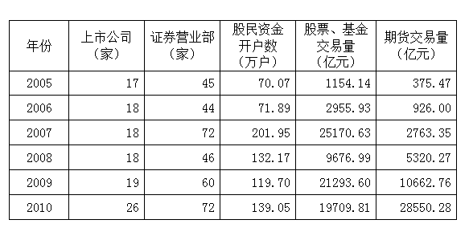

某市保险行业主要经济数据

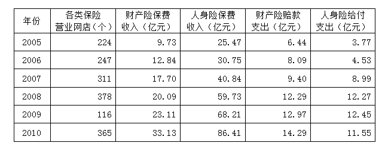

### 第 101 题

到2010年末，股民资金开户数比2005年末增长了大约：

A. 90%

B. 98%

C. 100%

D. 101%

第 101 题 · 答案与解析

**参考答案（粉笔题库参考内容）**

B

**解析**

根据题干“到2010年末，······比2005年末增长了”，结合选项为百分数，可判定本题为增长率计算问题。定位表1可得：2010年末和2005年末股民资金开户数分别为139.05万户和70.07万户。根据公式：增长率，故所求为，接近且略小于100%，B项符合。

故正确答案为B。

**考点**：一般增长率、统计表

**来源**：2012年421联考《行测》题（山西/辽宁/黑龙江/福建/湖北/ 湖南/广西/海南/四川/重庆/ 云南/ 西藏/陕西/青海/宁夏/ 新疆兵团）第101题

### 第 102 题

2005—2010年股票、基金交易量同比增长的年份共有几个？

A. 1个

B. 2个

C. 3个

D. 4个

第 102 题 · 答案与解析

**参考答案（粉笔题库参考内容）**

C

**解析**

定位表1可知2005-2010年每年股票、基金交易量。可以看出，同比增长的年份分别为2006年、2007年、2009年，共3个。

故正确答案为C。

**考点**：直接找数、统计表

**来源**：2012年421联考《行测》题（山西/辽宁/黑龙江/福建/湖北/ 湖南/广西/海南/四川/重庆/ 云南/ 西藏/陕西/青海/宁夏/ 新疆兵团）第102题

### 第 103 题

2005—2010年股票、基金交易的户均交易量最大的是哪个年份？

A. 2007

B. 2008

C. 2009

D. 2010

第 103 题 · 答案与解析

**参考答案（粉笔题库参考内容）**

C

**解析**

根据题干中“2005—2010年······户均交易量最大的是”，可判定本题为平均数比较问题。定位表1可知2005—2010年股票、基金交易的交易量。根据公式：户均交易量，故每年户均交易量分别为：

2007年：万元；

2008年：万元；

2009年：万元；

2010年：万元。可以看出2009年户均交易量最大。

故正确答案为C。

**考点**：现期平均数、统计表

**来源**：2012年421联考《行测》题（山西/辽宁/黑龙江/福建/湖北/ 湖南/广西/海南/四川/重庆/ 云南/ 西藏/陕西/青海/宁夏/ 新疆兵团）第103题

### 第 104 题

2005—2010年财产险每年赔款支出与保费收入之比大约在什么范围内？

A. 10%—25%

B. 20%—50%

C. 40%—70%

D. 60%—90%

第 104 题 · 答案与解析

**参考答案（粉笔题库参考内容）**

C

**解析**

根据题干“2005—2010年······与······之比”，可判定本题为比值计算问题。定位表2可知2005-2010年财产险每年赔款支出与保费收入。2005-2010年财产险每年赔款支出与保费收入之比分别为：、、、、、。2005-2010年财产险每年赔款支出与保费收入之比在C项范围内。

故正确答案为C。

**考点**：比值计算、统计表

**来源**：2012年421联考《行测》题（山西/辽宁/黑龙江/福建/湖北/ 湖南/广西/海南/四川/重庆/ 云南/ 西藏/陕西/青海/宁夏/ 新疆兵团）第104题

### 第 105 题

能够从上述资料中推出的是：

A. 每年获得的人身险保费收入约为财产险保费收入的2—3倍，因此获得人身险给付的人数比获得财产险赔款的人数更多

B. 2008年出现股票、基金交易量同比下降约为60%，而期货交易量同比增长约为90%

C. 2005—2010年，2010年的财产险保费收入和人身险保险费收入增长最快，2008年的财产险赔款支出最接近人身险给付支出

D. 2005—2010年，该市的证券营业部数量逐年增加，2010年末比2005年末增加了27家

第 105 题 · 答案与解析

**参考答案（粉笔题库参考内容）**

B

**解析**

A项：材料中并没有说明收入与人数相关，无法推出；

B项：定位表1可知2007年和2008年股票、基金交易量及期货交易量。根据公式：增长率，故股票、基金交易量同比增速为，即同比下降约60%；期货交易量同比增速为，即同比增长约90%，可以推出；

C项：定位表2可知2005-2010年每年财产保费收入、人身保险费收入、财产险赔款支出、人身险给付支出。2010年人身险保费收入增长率，2008年人身险保费收入增长率，2010年增速&lt;2008年增速，故2010年增速并非最快，无法推出；

D项：定位表1可知2008年证券营业部（46家）少于2007年（72家），并非逐年增加，无法推出。

故正确答案为B。

**考点**：统计表、综合分析

**来源**：2012年421联考《行测》题（山西/辽宁/黑龙江/福建/湖北/ 湖南/广西/海南/四川/重庆/ 云南/ 西藏/陕西/青海/宁夏/ 新疆兵团）第105题

## 材料 2

2011年某省接待过夜游客总量再次实现突破，达到3001.34万人次，同比增长16.0%。实现旅游收入324.04亿元，同比增长25.8%。12月份宾馆平均开房率为74.02%，同比增长0.06%；全年累计宾馆平均开房率为62.37%，同比增长2.0%。

该省2011年12月及全年接待过夜旅客人数

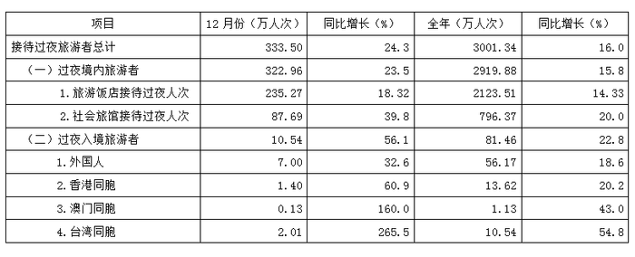

该省2011年12月及全年接待过夜游客的旅游收入情况

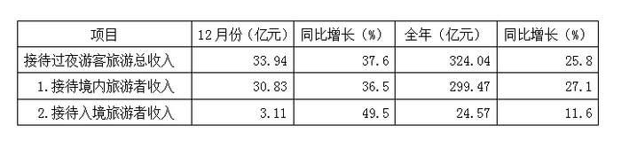

### 第 106 题

2010年该省接待过夜游客的旅游总收入约为：

A. 25亿元

B. 258亿元

C. 298亿元

D. 408亿元

第 106 题 · 答案与解析

**参考答案（粉笔题库参考内容）**

B

**解析**

根据题干问“2010年该省接待过夜游客的旅游总收入”与材料第一段2011年即该指标现期值和增速可得本题为基期计算问题。代入公式基期（2010年），与B项最接近。

故正确答案为B。

**考点**：基期计算、综合资料

**来源**：2012年421联考《行测》题（山西/辽宁/黑龙江/福建/湖北/ 湖南/广西/海南/四川/重庆/ 云南/ 西藏/陕西/青海/宁夏/ 新疆兵团）第106题

### 第 107 题

下列2011年1—11月该省旅游统计数据中，同比增长速度大于全年的是：

A. 接待过夜境内旅游者收入

B. 宾馆平均开房率

C. 旅游饭店接待过夜的境内游客人数

D. 接待过夜入境旅游者人数

第 107 题 · 答案与解析

**参考答案（粉笔题库参考内容）**

B

**解析**

根据混合增长率的概念，如果2011年1-11月增长速度大于全年，则2011年12月的增长速度应小于全年，结合选项观察，只有宾馆平均开房率的增长速度0.06%小于全年的增长速度2.0%。

故正确答案为B。

**考点**：混合增长率、综合资料

**来源**：2012年421联考《行测》题（山西/辽宁/黑龙江/福建/湖北/ 湖南/广西/海南/四川/重庆/ 云南/ 西藏/陕西/青海/宁夏/ 新疆兵团）第107题

### 第 108 题

2011年12月该省入境外国旅游者占全年入境外国旅游者的比重，较上年约增加：

A. 1.3%

B. 14.2%

C. 25.6%

D. 32.6%

第 108 题 · 答案与解析

**参考答案（粉笔题库参考内容）**

A

**解析**

根据题干“2011年12月······比重，较上年约增加”出现两个年份一个比重，判断本题为两期比重问题。根据第一张表可得过夜入境旅游者中外国人12月人次：A=7，a=32.6%；其全年人次：B=56.17，b=18.6%。代入两期比重差公式，与A项最接近。

故正确答案为A。

**考点**：两期比重、综合资料

**来源**：2012年421联考《行测》题（山西/辽宁/黑龙江/福建/湖北/ 湖南/广西/海南/四川/重庆/ 云南/ 西藏/陕西/青海/宁夏/ 新疆兵团）第108题

### 第 109 题

2011年12月该省接待过夜游客中，境外游客每人的平均消费约为境内游客的：

A. 1倍

B. 2倍

C. 3倍

D. 4倍

第 109 题 · 答案与解析

**参考答案（粉笔题库参考内容）**

C

**解析**

境外游客人均消费为3.11/10.54万元，境内游客人均消费为30.83/322.96万元，故可得。

故正确答案为C。

**考点**：现期倍数、综合资料

**来源**：2012年421联考《行测》题（山西/辽宁/黑龙江/福建/湖北/ 湖南/广西/海南/四川/重庆/ 云南/ 西藏/陕西/青海/宁夏/ 新疆兵团）第109题

### 第 110 题

能够从上述资料中推出的是：

A. 2011年该省旅游饭店接待过夜游客人次超过社会旅馆的3倍

B. 2010年12月该省过夜入境游客中台湾同胞人次多于香港同胞

C. 2011年12月台湾同胞到该省过夜旅游人次高于前11个月的平均值

D. 2011年到该省消费的游客中，境外游客消费增长速度高于境内游客

第 110 题 · 答案与解析

**参考答案（粉笔题库参考内容）**

C

**解析**

A项，2011年该省旅游饭店接待过夜游客人次只统计了境内人数，故无法计算倍数，错误；

B项，2010年12月份过夜入境旅客中台湾同胞人次为，香港同胞人次为，显然前者小于后者，错误；

C项，该说法等同于2011年12月份台湾同胞过夜人数明显超过全年总数的1/12，正确；

D项，2011年到该省消费的旅客中，境外游客消费增长速度低于境内游客，错误。

故正确答案为C。

**考点**：综合分析、综合资料

**来源**：2012年421联考《行测》题（山西/辽宁/黑龙江/福建/湖北/ 湖南/广西/海南/四川/重庆/ 云南/ 西藏/陕西/青海/宁夏/ 新疆兵团）第110题

## 材料 3

2011年我国全年货物进出口总额36421亿美元，比上年增长22.5%。其中，出口18986亿美元，增长20.3%；进口17435亿美元，增长24.9%。进出口差额(出口值与进口值差额的绝对值)1551亿美元，比上年减少265亿美元。

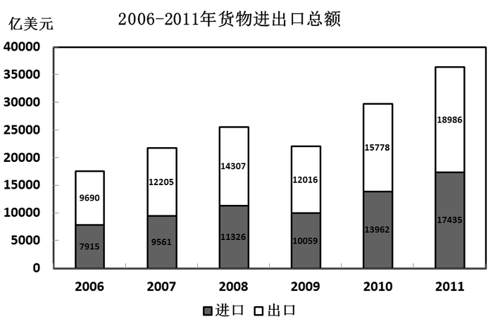

2011年对主要国家和地区进出口额及其增长速度

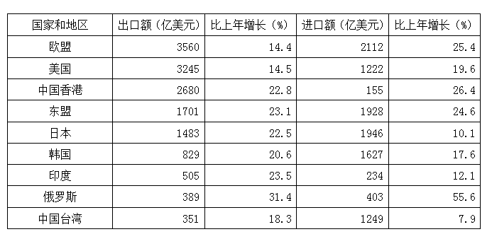

### 第 111 题

2010年我国全年货物进出口差额为多少亿美元？

A. 265

B. 1286

C. 1551

D. 1816

第 111 题 · 答案与解析

**参考答案（粉笔题库参考内容）**

D

**解析**

根据题干问“全年货物进出口差额”和柱状图数据2010年出口总额为15778亿美元，进口总额为13962亿美元，确定本题为简单加减计算问题，差额=(15778-13962)亿美元，观察选项，计算后两位即可满足要求，78-62=16，D项符合。

故正确答案为D。

**考点**：简单加减计算、综合资料

**来源**：2012年421联考《行测》题（山西/辽宁/黑龙江/福建/湖北/ 湖南/广西/海南/四川/重庆/ 云南/ 西藏/陕西/青海/宁夏/ 新疆兵团）第111题

### 第 112 题

2007—2011年我国全年货物出口额与上一年相比增长超过30%的年份有几个：

A. 1个

B. 2个

C. 3个

D. 4个

第 112 题 · 答案与解析

**参考答案（粉笔题库参考内容）**

A

**解析**

根据题干“与上一年相比增长率超过30%的年份”可得本题为一般增长率比较问题。根据柱形图可得2006-2011年货物出口额。代入增长率计算公式：

2007年：；2008年：；

2009年：；2010年：；

2011年：。

综上，超过30%的只有2010年。

故正确答案为A。

**考点**：一般增长率、综合资料

**来源**：2012年421联考《行测》题（山西/辽宁/黑龙江/福建/湖北/ 湖南/广西/海南/四川/重庆/ 云南/ 西藏/陕西/青海/宁夏/ 新疆兵团）第112题

### 第 113 题

下列最能体现2011年我国对欧盟出口额占全年出口额比重的图例是：

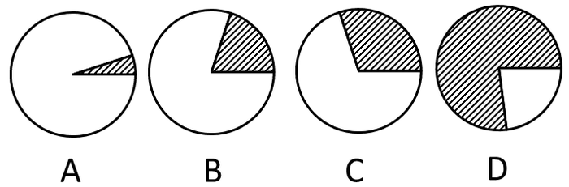

A. A

B. B

C. C

D. D

第 113 题 · 答案与解析

**参考答案（粉笔题库参考内容）**

B

**解析**

根据题干问“2011年比重为”可得本题为现期比重问题。根据材料表格部分可得2011年对欧盟出口额，根据材料文字部分可得2011年总出口额。故比重=，与B图最接近。

故正确答案为B。

**考点**：现期比重、综合资料

**来源**：2012年421联考《行测》题（山西/辽宁/黑龙江/福建/湖北/ 湖南/广西/海南/四川/重庆/ 云南/ 西藏/陕西/青海/宁夏/ 新疆兵团）第113题

### 第 114 题

表中所列举的国家和地区中，2011年我国货物进出口贸易差额最大的是：

A. 欧盟

B. 中国香港

C. 美国

D. 中国台湾

第 114 题 · 答案与解析

**参考答案（粉笔题库参考内容）**

B

**解析**

根据题干问“2011年差额最大的是”判断本题为简单加减计算问题，根据材料表格部分可得2011年我国对欧盟货物进出口贸易差额，对中国香港亿美元，对美国，对中国台湾，故可知对中国香港货物进出口贸易差额最大。

故正确答案为B。

**考点**：简单加减计算、综合资料

**来源**：2012年421联考《行测》题（山西/辽宁/黑龙江/福建/湖北/ 湖南/广西/海南/四川/重庆/ 云南/ 西藏/陕西/青海/宁夏/ 新疆兵团）第114题

### 第 115 题

能够从上述资料中推出的是：

A. 与上一年相比，2011年我国全年货物出口额占进出口总额的比重上升

B. 2006—2011年我国货物进出口总额逐年增加

C. 2011年我国对俄罗斯进口增长金额低于我国对韩国进口增长金额

D. 2011年大陆对中国台湾贸易总额与上一年相比增长18%

第 115 题 · 答案与解析

**参考答案（粉笔题库参考内容）**

C

**解析**

根据题干中“能够推出的是”可知此题为综合分析问题，可逐项分析选择出能够推出的一项。

A项：根据材料文字部分可得2011年全年货物出口额同比增速a=20.3%，进出口总额同比增速b=22.5%。根据两期比重比较公式可得a小于b，货物出口额占进出口总额的比重应下降，无法推出。

B项：根据柱形图可得2009年全年货物进出口总额相对于2008年减少，无法推出。

C项：根据材料表格部分可得2011年我国对俄罗斯进口增长金额亿美元；对韩国进口增长金额为亿美元＞133亿美元，能够推出。

D项：根据材料表格中台湾出口额和进口额及其增速可得，2011年大陆对中国台湾贸易总额的增长率（混合增长率）应该居中，但偏向基数较大的，故应更接近于进口额的增长率7.9%，无法推出。

故正确答案为C。

**考点**：综合分析、综合资料

**来源**：2012年421联考《行测》题（山西/辽宁/黑龙江/福建/湖北/ 湖南/广西/海南/四川/重庆/ 云南/ 西藏/陕西/青海/宁夏/ 新疆兵团）第115题

## 材料 4

2006年至2011年全年我国农村居民人均纯收入分别为3587元、4140元、4761元、5153元、5919元、6977元；城镇居民人均可支配收入分别为11759元、13786元、15781元、17175元、19109元、21810元。

        2006年至2011年全年我国粮食产量分别为49804万吨、50160万吨、52871万吨、53082万吨、54648万吨、57121万吨。

        与2010年相比，2011年全年粮食种植面积11057万公顷，增加70万公顷；棉花种植面积304万公顷，增加19万公顷，油料种植面积1379万公顷，减少10万公顷；糖料种植面积195万公顷，增加4万公顷；棉花产量660万吨，增产10.7%；油料产量3279万吨，增产1.5%；糖料产量12820万吨，增产4.3%；肉类总产量7957万吨，增长0.4%，其中，猪肉产量5053万吨，下降0.4%；养殖水产品产量4026万吨，增长5.2%；捕捞水产品产量1574万吨，增长1.9%。

        2011年末全国参加城镇基本医疗保险的人数47291万人，增加4028万人。其中，参加城镇职工基本医疗保险人数25226万人，参加城镇居民基本医疗保险22065万人。截至9月底，2646个县(市、区)开展了新型农村合作医疗工作，新型农村合作医疗参合率97.5%；新型农村合作医疗基金支出总额为1114亿元，受益8.4亿人次。

### 第 116 题

2011年我国城镇居民人均可支配收入比2008年大约增加了：

A. 18%

B. 38%

C. 58%

D. 85%

第 116 题 · 答案与解析

**参考答案（粉笔题库参考内容）**

B

**解析**

根据题干中“2011年······比2008年增加了”确定本题为增长相关题型，根据选项为百分数确定本题为一般增长率计算问题。根据材料第一段可得，我国城镇居民人均可支配收入增长了，与B项最接近。

故正确答案为B。

**考点**：一般增长率、文字资料

**来源**：2012年421联考《行测》题（山西/辽宁/黑龙江/福建/湖北/ 湖南/广西/海南/四川/重庆/ 云南/ 西藏/陕西/青海/宁夏/ 新疆兵团）第116题

### 第 117 题

2010年，我国水产品产量大约达到多少万吨？

A. 1500

B. 3800

C. 5000

D. 5300

第 117 题 · 答案与解析

**参考答案（粉笔题库参考内容）**

D

**解析**

根据题干中“2010年水产品产量”和材料第三段“2011年养殖水产品产量为4026万吨，增长5.2%；捕捞水产品产量为1574万吨，增长1.9%”，可得水产品产量应为两指标之和，故本题为基期和差问题。2010年我国水产品产量=万吨。

故正确答案为D。

**考点**：基期和差、文字资料

**来源**：2012年421联考《行测》题（山西/辽宁/黑龙江/福建/湖北/ 湖南/广西/海南/四川/重庆/ 云南/ 西藏/陕西/青海/宁夏/ 新疆兵团）第117题

### 第 118 题

2010—2011年，下列哪项年增长速度最快？

A. 农村居民人均纯收入

B. 粮食种植面积

C. 棉花产量

D. 粮食产量

第 118 题 · 答案与解析

**参考答案（粉笔题库参考内容）**

A

**解析**

根据题干中“哪项增长速度最快”可得本题为一般增长率比较问题。年增长速度分别如下：农村居民人均纯收入（材料第一段）；粮食种植面积（材料第三段）远小于1/6；棉花产量（材料第三段）；粮食产量（材料第二段）。

故正确答案为A。

**考点**：一般增长率、文字资料

**来源**：2012年421联考《行测》题（山西/辽宁/黑龙江/福建/湖北/ 湖南/广西/海南/四川/重庆/ 云南/ 西藏/陕西/青海/宁夏/ 新疆兵团）第118题

### 第 119 题

2010年，我国猪肉产量占肉类总产量的比重约为：

A. 43%

B. 53%

C. 64%

D. 84%

第 119 题 · 答案与解析

**参考答案（粉笔题库参考内容）**

C

**解析**

根据题干中“2010年······比重为”和材料数据为2011年，确定本题为基期比重问题。根据材料第三段可得猪肉：A=5053、a=-0.4%；肉类：B=7957、b=0.4%。代入基期比重公式：，与C项最接近。

故正确答案为C。

**考点**：基期比重、文字资料

**来源**：2012年421联考《行测》题（山西/辽宁/黑龙江/福建/湖北/ 湖南/广西/海南/四川/重庆/ 云南/ 西藏/陕西/青海/宁夏/ 新疆兵团）第119题

### 第 120 题

根据上述资料，下列说法错误的是：

A. 2011年末，我国参加城镇居民基本医疗保险人数约占参加城镇基本医疗保险人数的46.7%

B. 2011年棉花、油料、糖料的总种植面积比上年增加约13万公顷

C. 2011年前三个季度，开展了新型农村合作医疗工作的县(市、区)中，人均基金支出大约为130元

D. 2006年至2011年，我国城镇居民人均可支配收入增长比农村居民人均纯收入增长慢

第 120 题 · 答案与解析

**参考答案（粉笔题库参考内容）**

C

**解析**

A项正确，2011年末，我国参加城镇居民基本医疗保险人数为22065万人，占参加城镇基本医疗保险人数的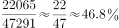，很接近46.7%；B项正确，2011年棉花种植面积增加19万公顷，油料种植面积减少10万公顷，糖料种植面积增加4万公顷，三者比上年增加了19–10+4=13万公顷；C项错误，材料给出的8.4亿的单位是人次，选项给的是人均，单位不统一，无法计算；D项正确，2006~2011年，我国城镇居民人均可支配收入增长了，农村居民人均纯收入增长了，前者小于后者。

本题为选非题，故正确答案为C。

**考点**：文字资料、综合分析

**来源**：2012年421联考《行测》题（山西/辽宁/黑龙江/福建/湖北/ 湖南/广西/海南/四川/重庆/ 云南/ 西藏/陕西/青海/宁夏/ 新疆兵团）第120题

