# 2012年915联考《行测》题（新疆/福建/重庆/河南）

<!-- gwy:overview:start -->
> **福建 · 2012 · 行测 · 统考** ｜ 120 题 · 图片 14 处 · 答案随题折叠

| 题型模块 | 题量 | 题号 |
| --- | ---: | ---: |
| 常识判断 | 20 | 1–20 |
| 言语理解与表达 | 40 | 21–60 |
| 数量关系 | 10 | 61–70 |
| 判断推理 | 35 | 71–105 |
| 资料分析 | 15 | 106–120 |
| **合计** | **120** | |

导航：[题型与作答说明](#题型与作答说明) · [题目](#题目) · [材料 1](#材料-1)
<!-- gwy:overview:end -->

> 候选采集稿。参考答案及解析来自粉笔页面，不代表官方答案或真实高分答卷；来源使用许可与原卷对应关系仍需人工核实。

## 题型与作答说明

常识判断

（20题）

根据题目要求，在四个选项中选出一个最恰当的答案。

言语理解与表达

（40题）

本部分包括表达与理解两方面的内容。请根据题目要求，在四个选项中选出一个最恰当的答案。

数量关系

（10题）

在这部分试题中，每道题呈现一段表述数字关系的文字，要求你迅速、准确的计算出答案。

判断推理

（35题）

本部分包括图形推理、定义判断、类比推理与逻辑判断四种类型的试题。

资料分析

（15题）

所给出的图、表、文字或综合性材料均有若干个问题要你回答。你应根据资料提供的信息进行分析、比较、计算和判断处理。

## 题目

### 第 1 题

建国以来曾出现过不少脍炙人口、传唱至今的经典歌曲：

①《歌唱祖国》                ②《我们走在大路上》

③《在希望的田野上》      ④《春天的故事》

上述歌曲按诞生时间排列正确的是：

A. ①②③④

B. ①②④③

C. ②①③④

D. ②①④③

第 1 题 · 答案与解析

**参考答案（粉笔题库参考内容）**

A

**解析**

①《歌唱祖国》由王莘作词、曲，创作于1950年，是著名的爱国歌曲；

②《我们走在大路上》是李劫夫于1962年作词谱曲的一首红色经典歌曲，鼓舞了社会主义建设的干劲；

③《在希望的田野上》由陈晓光作词，施光南作曲，是80年代流行于全国的优秀作品，反映了改革开放以来农村的深刻变化；

④《春天的故事》由蒋开儒和叶旭全作词，王佑贵作曲，董文华演唱，创作于1994年，描述了邓小平同志南方谈话的故事。

故正确答案为A。

**考点**：文化常识

**来源**：2012年915联考《行测》题（新疆/福建/重庆/河南）第1题

### 第 2 题

下列属于我国在2012年取得的重大科技成果的是：

A. 神舟八号与天宫一号在太空成功实现首次交会对接

B. “蛟龙”号成功下潜7062米，创我国载人深潜记录

C. 我国首个超深水钻井平台“海洋石油981”交付使用

D. 发射嫦娥二号探月卫星，采集月球表面的影像数据

第 2 题 · 答案与解析

**参考答案（粉笔题库参考内容）**

B

**解析**

A项错误，2011年11月3日凌晨1时36分，天宫一号目标飞行器与神舟八号飞船成功实现首次交会对接，中国在突破和掌握空间交会对接技术上迈出了重要一步。

B项正确，2012年6月27日，中国载人深潜器“蛟龙”号7000米级海试最大下潜深度达7062米，再创中国载人深潜纪录。

C项错误，2011年5月23日，中国首座3000米深水半潜式钻井平台“海洋石油981”交付使用。它是当今世界最先进的第六代超深水半潜式钻井装备，标志着中国油气资源的勘探开发正式向深海挺进。

D项错误，2010年10月1日18时59分57秒，嫦娥一号卫星的姐妹星嫦娥二号卫星在西昌卫星发射中心发射升空，并获得了圆满成功。

故正确答案为B。

【本题相关知识点】2012年5月9日，“海洋石油981”在南海海域正式开钻。这是中国石油公司首次独立进行深水油气的勘探，标志着中国海洋石油工业的深水战略迈出了实质性的步伐。

**考点**：中国地理

**来源**：2012年915联考《行测》题（新疆/福建/重庆/河南）第2题

### 第 3 题

下列表述错误的是：

A. 依据我国法律规定地级市不具备立法权

B. 海南省三沙市是我国总面积最大的地级市

C. 地级市与地区、自治州、盟属于同一行政层级

D. 地级市一般管辖区、县、旗、自治旗

第 3 题 · 答案与解析

**参考答案（粉笔题库参考内容）**

A

**解析**

原《立法法》第六十三条规定：“较大的市的人民代表大会及其常务委员会根据本市的具体情况和实际需要，在不同宪法、法律、行政法规和本省、自治区的地方性法规相抵触的前提下，可以制定地方性法规，报省、自治区的人民代表大会常务委员会批准后施行。”“本法所称较大的市是指省、自治区的人民政府所在地的市，经济特区所在地的市和经国务院批准的较大的市。”A项提到的地级市中，有部分城市属于符合该条所规定的较大的市，有立法权。

本题为选非题，故正确答案为A。

【本题相关知识点】（1）海南省三沙市是中国地理纬度位置最南端的城市，目前是中国最年轻的地级市，海域面积260多万平方千米，是中国陆地面积最小、总面积最大、人口最少的城市。

（2）2015年修正后的《立法法》对原第六十三条规定做了部分修改，具体内容见《立法法》第七十二条。

**考点**：宪法

**来源**：2012年915联考《行测》题（新疆/福建/重庆/河南）第3题

### 第 4 题

下列论述错误的是：

A. 产业“空心化”弱化物质生产的地位

B. 人口“老龄化”加重政府的财政负担

C. “城镇化”可以促进经济社会的发展

D. 经济“全球化”有助于化解金融风险

第 4 题 · 答案与解析

**参考答案（粉笔题库参考内容）**

D

**解析**

D项错误，经济“全球化”是指世界经济活动超越国界，通过对外贸易、资本流动等活动相互依存、相互联系而形成的全球范围的有机经济整体。全球经济链条日益紧密，能源价格大幅攀升、金融秩序严重失控、大国经济明显衰退诱发全球经济危机的可能性增大，且全球化会导致危机传播的速度和影响的深度空前增大，会加剧金融风险的危害。

本题为选非题，故正确答案为D。

【本题相关知识点】产业“空心化”是指以制造业为中心的物质生产和资本，大量地迅速地转移到国外，使物质生产在国民经济中的地位明显下降，造成国内物质生产与非物质生产之间的比例关系严重失衡。

**考点**：国际经济及组织

**来源**：2014年天津市公务员录用考试《行测》题第58题

### 第 5 题

下列表述不符合国家政策规定的是：

A. 农民工可以申请参加社区居民委员会选举

B. 农民工计划生育管理费由输出地政府承担

C. 农民工可以回原籍参加新农村合作医疗

D. 做出突出贡献的农民工可以优先准予落户

第 5 题 · 答案与解析

**参考答案（粉笔题库参考内容）**

B

**解析**

B项错误，根据《流动人口计划生育工作条例》第四条的规定：“流动人口计划生育工作由流动人口户籍所在地和现居住地的人民政府共同负责，以现居住地人民政府为主，户籍所在地人民政府予以配合。”所以，计划生育管理费应纳入现居住地，即由输入地的地方财政承担，输出地政府只是予以配合。

本题为选非题，故正确答案为B。

**考点**：其他法律法规

**来源**：2012年915联考《行测》题（新疆/福建/重庆/河南）第5题

### 第 6 题

下列表述错误的是：

A. 我国唐代经广州港进口阿拉伯药材

B. 我国宋代经宁波港进口日本的木材

C. 我国元代经登州港向大夏出口蜀布

D. 我国明代经泉州港向非洲出口瓷器

第 6 题 · 答案与解析

**参考答案（粉笔题库参考内容）**

C

**解析**

C项错误，大夏是张骞出使西域回来后首次提及的西域古国之一，位于亚洲中部，不临海，所以向其出口不需要经过海路。

本题为选非题，故正确答案为C。

**考点**：中国历史

**来源**：2012年915联考《行测》题（新疆/福建/重庆/河南）第6题

### 第 7 题

下列绘画作品取材于历史事件的是：

A. 《蒙娜丽莎》

B. 《但丁小舟》

C. 《苏格拉底之死》

D. 《俄狄浦斯和斯芬克斯》

第 7 题 · 答案与解析

**参考答案（粉笔题库参考内容）**

C

**解析**

A项错误，《蒙娜丽莎》是文艺复兴时期意大利画家列奥纳多·达芬奇所绘的丽莎·乔宫多的肖像画，现收藏于法国卢浮宫博物馆。

B项错误，《但丁小舟》是由法国著名画家欧仁·德拉克罗瓦于1822年创作的，取材于但丁名著《神曲》的故事，表现的是站在船中央的但丁被维吉尔引导乘着卡隆的渡船，穿过地狱湖的情景。

C项正确，《苏格拉底之死》是法国著名画家雅克·达维特在1787年创作的油画作品。这幅作品描绘了哲学家苏格拉底死时的情景，体现了革命者为信仰和真理而献身的精神。苏格拉底之死是真实的历史事件。

D项错误，《俄狄浦斯和斯芬克斯》是法国画家古斯塔夫·莫罗早期的代表作，取材于希腊神话故事。

故正确答案为C。

**考点**：文化常识

**来源**：2012年915联考《行测》题（新疆/福建/重庆/河南）第7题

### 第 8 题

下列电影与其历史背景对应错误的是：

A. 铁道游击队：抗日战争

B. 圣女贞德：英法百年战争

C. 高山下的花环：朝鲜战争

D. 战争与和平：1812年法俄战争

第 8 题 · 答案与解析

**参考答案（粉笔题库参考内容）**

C

**解析**

C项错误，《高山下的花环》是一部反映部队生活的电影作品，讲述一个普通边防连队在对越自卫还击作战的战前、战中和战后的生活进程。

本题为选非题，故正确答案为C。

**考点**：文化常识

**来源**：2012年915联考《行测》题（新疆/福建/重庆/河南）第8题

### 第 9 题

“天下虽安，忘战必危”是我国古代著名的军事思想，充满着朴素的辩证法智慧。下列体现的哲学思想与这句话相同的是：

A. “有心栽花花不开，无心插柳柳成荫”

B. “不谋全局者，不足以谋一域”

C. “旱则资舟，水则资车，以待乏也”

D. “富贵而恣势弄权，乃自取灭亡之道”

第 9 题 · 答案与解析

**参考答案（粉笔题库参考内容）**

C

**解析**

题干的“天下虽安，忘战必危”体现了矛盾双方在一定条件下会相互转化，安会转化为危，要增强预见性。C 项旱、舟之间，水、车之间也体现出矛盾的相互转化，在干旱的时候储备好船，雨水多的时候就会有用处。

故正确答案为C。

**考点**：唯物辩证法

**来源**：2012年915联考《行测》题（新疆/福建/重庆/河南）第9题

### 第 10 题

下列关于我国古代监察制度说法错误的是：

A. 秦朝设置了御史府作为中央最高监察机关

B. 监察制度的主要目的是防止官员侵害百姓

C. 监察体系相对独立，确保监察权独立运作

D. 监察权来源于皇权，代表君主个人的意志

第 10 题 · 答案与解析

**参考答案（粉笔题库参考内容）**

B

**解析**

A项正确，我国古代的监察制度是秦代开始形成的，秦代在中央设立了最高监察机构御史府，其长官是御史大夫；

B项错误，监察制度的主要目的是为国家利益和皇帝利益服务的，而不是为了防止官员侵害百姓；

C、D两项正确，监察制度以皇权为中心，确定了监察与行政（包括中央、地方，甚至是基层）的相对独立与分离，中央、地方的监察机构与政府机构的相对分离，监察官员与政府官员的分离，从而确保了监察权力的独立运作。

本题为选非题，故正确答案为B。

**考点**：中国历史

**来源**：2012年915联考《行测》题（新疆/福建/重庆/河南）第10题

### 第 11 题

下列说法错误的是：

A. 高浓度糖液破坏微生物的细胞结构，可延长食品保存期

B. 山梨酸钾是一种食品添加剂，可用于增加食品的风味

C. 茶多酚能够抑制自由基的活性，可以作为食品防腐剂

D. β-胡萝卜素可以作为食用性色素，可以用于食品调色

第 11 题 · 答案与解析

**参考答案（粉笔题库参考内容）**

B

**解析**

B项错误，山梨酸钾能有效地抑制霉菌、酵母菌和好氧性细菌的活性，还能防止肉毒杆菌、葡萄球菌、沙门氏菌等有害微生物的生长和繁殖，但对厌氧性芽孢菌与嗜酸乳杆菌等有益微生物几乎无效，其抑止发育的作用比杀菌作用更强，所以可以作为食品添加剂，达到有效地延长食品的保存时间，并保持原有食品的风味的作用，但不能增加食品的风味。

本题为选非题，故正确答案为B。

**考点**：生活常识

**来源**：2012年915联考《行测》题（新疆/福建/重庆/河南）第11题

### 第 12 题

古人出于礼貌和尊敬，对平辈或尊辈会称字。下列属于这种做法的是：

A. 称屈平为屈原

B. 称白居易为香山居士

C. 称汤显祖为汤临川

D. 称梁启超为饮冰室主人

第 12 题 · 答案与解析

**参考答案（粉笔题库参考内容）**

A

**解析**

A项正确，屈平是我国古代大诗人，字原，通常称为屈原；B项错误，香山居士是白居易的号；C项错误，汤显祖是中国明代戏曲家、文学家，江西临川人，他的戏剧作品《还魂记》（全名《牡丹亭还魂记》）、《紫钗记》、《南柯记》和《邯郸记》合称“临川四梦”，其中《牡丹亭》是他的代表作，但没有把汤显祖称为“汤临川”之说，C项本身说法错误；D项错误，“饮冰室主人”是梁启超的别名。

故正确答案为A。

**考点**：文化常识

**来源**：2012年915联考《行测》题（新疆/福建/重庆/河南）第12题

### 第 13 题

下列诗句未涉及秋天的是：

A. 相逢不用忙归去，明日黄花蝶也愁

B. 寒菊已枯分正色，春兰未秀借幽香

C. 山明水净夜来霜，数树深红出浅黄

D. 多少绿荷相倚恨，一时回首背西风

第 13 题 · 答案与解析

**参考答案（粉笔题库参考内容）**

B

**解析**

A项，“相逢不用忙归去，明日黄花蝶也愁”出自宋代苏轼《九日次韵王巩》，“黄花”是秋菊，涉及秋天；B项，“寒菊已枯分正色，春兰未秀借幽香”出自宋人陈棣的《腊梅三绝》，腊梅在冬季开放，未涉及秋天；C项，“山明水净夜来霜，数树深红出浅黄”出自唐代诗人刘禹锡的《秋词二首》，“数树深红”描写的是秋天的红叶，涉及秋天；D项，“多少绿荷相倚恨，一时回首背西风”出自唐代诗人杜牧《齐安郡中偶题二首》，“西风”即秋风，涉及秋天。

本题为选非题，故正确答案为B。

**考点**：文学常识

**来源**：2012年915联考《行测》题（新疆/福建/重庆/河南）第13题

### 第 14 题

下列做法符合我国法律规定的是：

A. 甲公司向法院起诉乙公司长期拖欠农民工工资

B. 丙某向法院起诉外来车辆非法占用本单位停车位

C. 某人向法院起诉邻居搭盖房屋、影响自家采光

D. 某报社下属编辑部向法院起诉丁某盗版侵权行为

第 14 题 · 答案与解析

**参考答案（粉笔题库参考内容）**

C

**解析**

原《民事诉讼法》第一百零八条（2012年修订并于2013年1月1日施行的《民事诉讼法》第一百一十九条）规定：“起诉必须符合下列条件：原告是与本案有直接利害关系的公民、法人和其他组织······”A、B、D三项错误，甲公司、丙某和某报社下属编辑部都不是被告行为的直接被侵害对象，不存在直接利益关系，不具备起诉资格；C项正确，某人因为邻居搭盖房屋、影响自己采光，某人及其邻居存在直接利害关系。

故正确答案为C。

**考点**：诉讼法

**来源**：2012年915联考《行测》题（新疆/福建/重庆/河南）第14题

### 第 15 题

关于突发公共卫生事件下列表述正确的是：

A. 突发公共卫生事件报告的时限为24～48小时

B. 出现跨省份群体性、不明流行疾病应发布黄色预警

C. 出现毒物外泄时，应封存所有可疑物品并留存样品

D. 确诊属于食物中毒引起呕吐的，应立即为病人止吐

第 15 题 · 答案与解析

**参考答案（粉笔题库参考内容）**

C

**解析**

A项错误，突发公共卫生事件报告的时限为1～2小时；B项错误，出现跨省份群体性、不明流行疾病应发布红色预警；C项正确，出现毒物外泄时，应封存所有可疑物品，交封存样品；D项错误，确诊属于食物中毒引起呕吐的，应立即为病人催吐。

故正确答案为C。

**来源**：2012年915联考《行测》题（新疆/福建/重庆/河南）第15题

### 第 16 题

下列说法正确的是：

A. 广谱抗生素是非处方药可自行购买

B. 广谱抗生素的效果优于窄谱抗生素

C. 使用广谱抗生素不容易产生抗药性

D. 致病菌未知应优先选择广谱抗生素

第 16 题 · 答案与解析

**参考答案（粉笔题库参考内容）**

D

**解析**

A项错误，抗生素是处方药，使用过量对机体不利，应该在医生指导下适量用药，不能自己随意用药。B项错误，广谱抗生素是指抗菌谱比较宽的药物，也就是能够抵抗大部分细菌的药物，与之相对的是窄谱抗生素，它指的是专门杀灭某一种或一类细菌的药物。广谱抗生素和窄谱抗生素各有用处，不存在优劣问题。C项错误，广谱抗生素是抗生素的一种，重复使用一种抗生素可能会使致病菌产生抗药性。D项正确，广谱抗生素主要是用在致病菌还未知，但需要杀菌的时候，如果致病菌已明确，就要用窄谱抗生素特异性地杀菌了。

故正确答案为D。

**考点**：生物常识

**来源**：2012年915联考《行测》题（新疆/福建/重庆/河南）第16题

### 第 17 题

下列关于能源分类表述错误的是：

A. 水能是一次能源，是可再生能源，属于清洁能源

B. 电能是一次能源，是可再生能源，属于清洁能源

C. 太阳能是一次能源，是可再生能源，属于清洁能源

D. 石油是一次能源，是不可再生能源，不是清洁能源

第 17 题 · 答案与解析

**参考答案（粉笔题库参考内容）**

B

**解析**

B项错误，一次能源是指自然界中以原有形式存在的、未经加工转换的能量资源，包括化石燃料、生物质能、水能、风能、太阳能等。电能主要来自其他形式能量的转换，是二次能源。

本题为选非题，故正确答案为B。

**考点**：物理常识

**来源**：2012年915联考《行测》题（新疆/福建/重庆/河南）第17题

### 第 18 题

下列表述正确的是：

A. 房顶被风掀翻是由于屋内的大气压力高于室外的大气压力

B. 用手动打气筒给轮胎打气，气筒内气压始终高于胎内气压

C. 高海拔地区气压低于平原地区是由于氧浓度变化造成的

D. 轮胎充气后，内胎气压升高、摩擦力增大，起到了缓冲作用

第 18 题 · 答案与解析

**参考答案（粉笔题库参考内容）**

A

**解析**

根据流体力学的伯努利原理，气流速度越小，压强就越大；反之速度越大，压强就越小。大风天气中大气流动速度增大，房顶外部压强变小，而房屋内部空气相对静止，压强与外部相比较大，压力将房顶顶翻，造成大风掀翻房顶的现象。

B项错误，当打不进去气的时候，气筒内气压和胎内气压是相等的。

C项错误，高海拔地区气压低是因为高处空气稀薄。

D项错误，内胎气压升高后，轮胎更鼓，与地面接触的面积减小，摩擦力降低。

故正确答案为A。

**考点**：物理常识

**来源**：2012年915联考《行测》题（新疆/福建/重庆/河南）第18题

### 第 19 题

下列可以缓解城市内涝的措施是：

A. 将水泥路面改为柏油路面

B. 铺设人行道时使用透水砖

C. 兴建人行天桥

D. 拓宽城市道路

第 19 题 · 答案与解析

**参考答案（粉笔题库参考内容）**

B

**解析**

铺设人行道时使用透水砖，下雨时雨水可以渗透到土壤里，可以缓解城市内涝。

故正确答案为B。

**考点**：生活常识

**来源**：2012年915联考《行测》题（新疆/福建/重庆/河南）第19题

### 第 20 题

物联网中物体通过信息传感设备，与互联网相连接，进行信息交换和通信。下列不具备信息传感功能的设备是：

A. 激光扫描器

B. 红外感应器

C. 普通数码相机

D. 射频标签

第 20 题 · 答案与解析

**参考答案（粉笔题库参考内容）**

C

**解析**

A选项，激光扫描器通过扫描二维码或者条形码，可以读取相关信息，具备信息传感功能；

B选项，红外感应器可以发射红外信号，控制电器或者其他设备的开关，因此具备信息传感功能；

C选项，普通数码相机拍摄的图像不能直接导出，需要将存储卡取出用电脑读取信息，不能直接传导信息，因此不具备信息传感功能；

D选项，射频标签又叫电子标签，通过近距离感应可以读取其中的信息，如小区门禁卡、地铁卡等，因此具备信息传感功能。

本题为选非题，故正确答案为C。

**考点**：其他

**来源**：2014年天津市公务员录用考试《行测》题第60题

### 第 21 题

为了满足不断被制造出来、被刺激起来的欲望，＿＿＿＿＿的商品就像阿里巴巴的山洞，成为＿＿＿＿＿购买欲的引擎。其实，拥有再多，也永远渴望货架上的下一个。

依次填入划横线部分最恰当的一项是：

A. 五花八门 触动

B. 琳琅满目 触发

C. 丰富多彩 触及

D. 形形色色 触碰

第 21 题 · 答案与解析

**参考答案（粉笔题库参考内容）**

B

**解析**

本题考查成语和实词的混搭填空。

第一空，形容商品多而且能刺激人们的购买欲望。“琳琅满目”多用来形容商品；“五花八门”比喻变化多端或者花样繁多；“丰富多彩”形容内容丰富，花色繁多；“形形色色”指各式各样，种类很多。后三个词都是多，但没有体现珍贵、好的意思，与商品搭配不如“琳琅满目”适合。

第二空，用“引擎”比喻人们的购买欲望，“触发”不仅有接触还有发动的意思，能和“引擎”相搭配的只有“触发”。

故正确答案为B。

**考点**：对应关系-前后呼应、混搭填空、词的辨析-搭配对象

**来源**：2012年915联考《行测》题（新疆/福建/重庆/河南）第21题

### 第 22 题

今年年初，国际互联网名称和编号分配公司宣布第三次顶级域名开放申请，在未开放个人注册之前，交易一个“.cn”域名不仅手续＿＿＿＿＿，而且需要个人＿＿＿＿＿寻找一个“单位”用于注册填写，或挂靠某个组织（比如域名注册商）完成注册。

依次填入划横线部分最恰当的一项是：

A. 繁琐 煞费苦心

B. 烦琐 费尽心机

C. 琐碎 挖空心思

D. 繁杂 绞尽脑汁

第 22 题 · 答案与解析

**参考答案（粉笔题库参考内容）**

A

**解析**

本题考查实词和成语辨析。

第一空，根据文段“需要个人······完成注册”可知，横线处要体现手续比较麻烦，繁琐之意，且和手续搭配，A、B两项“繁琐”同“烦琐”，意为繁杂琐碎，符合文意，且经常和“手续”进行搭配，故保留，C项的“琐碎”是指很小的、零乱的事，细小散碎，与文意不符，排除；D项“繁杂”意为多而杂乱，往往不和“手续”搭配，且没有A、B项语义丰富，故排除。

第二空，A项“煞费苦心”形容费尽心思，与文段语境相符，当选。B项“费尽心机”感情色彩偏消极，文段没有消极感情色彩，故排除。

故正确答案为A。

**考点**：混搭填空、词的辨析-感情色彩、词的辨析-搭配对象、词的辨析-词义侧重

**来源**：2012年915联考《行测》题（新疆/福建/重庆/河南）第22题

### 第 23 题

不少作家把人生比作登山，＿＿＿＿＿就是登上山顶略事休息徘徊的那一刹那。此前是“快乐地努力地向前走”，此后则“别有一般滋味”的“想回家”；此前是“路上有好多块绊脚石曾把自己磕碰得鼻青脸肿”，此后则“前面是下坡路，好走得多”。“下坡路”也罢，“想回家”也罢，都是一种＿＿＿＿＿的心态。一切都不过如此，没什么稀奇的，不值得大惊小怪，也不值得苦苦追求。

依次填入划横线部分最恰当的一项是：

A. 中年 过来人

B. 老年 过来人

C. 中年 成功者

D. 老年 成功者

第 23 题 · 答案与解析

**参考答案（粉笔题库参考内容）**

A

**解析**

本题考查实词辨析。文段将人生比作登山运用情境联想法，根据文段中的提示“此前”“此后”说明这是中间阶段，“此前是‘快乐地努力地向前走’”描述了青年时期激情昂扬的状态，“此后则‘别有一般滋味’”描述的是老年回味人生的状态，因此第一空应该填“中年”，排除B、D项。第二空，无法从题干中得到登山人是成功人士这一信息，只是强调走过这样的历程，拥有了人生的阅历，因此第二空应该填“过来人”更为合适，A项当选。

故正确答案为A。

**考点**：实词填空、对应关系-前后呼应

**来源**：2012年915联考《行测》题（新疆/福建/重庆/河南）第23题

### 第 24 题

总体上，当前国家统计内容以经济统计为主，且经济统计发展比较全面系统；相对来说人口社会统计受到重视可能稍微弱一些。实际上，对于国家统计机构来说，尤其是发达国家的统计机构，人口社会统计和经济统计应该是＿＿＿＿＿。

依次填入划横线部分最恰当的一项是：

A. 化整为零

B. 不分彼此

C. 并驾齐驱

D. 各有所长

第 24 题 · 答案与解析

**参考答案（粉笔题库参考内容）**

C

**解析**

根据转折关联词“实际上”可知，横线所填词语与“当前国家统计内容以经济统计为主，且经济统计发展比较全面系统；相对来说人口社会统计受到重视可能稍微弱一些”语义相反，需体现人口社会统计和经济统计应处于同等重要的地位之意。C项“并驾齐驱”比喻齐头并进，不分前后，能很好地体现两者同等重要，符合文意，当选。

A项“化整为零”指把一个整体分成许多零散部分，B项“不分彼此”形容关系密切，交情深厚，侧重于关系，D项“各有所长”强调各自的长处、优点，均未体现同等重要之意，排除。

故正确答案为C。

**考点**：关联关系-转折关系、对应关系-前后呼应、成语填空

**来源**：2012年915联考《行测》题（新疆/福建/重庆/河南）第24题

### 第 25 题

如今各地都面临着同样的问题：有的地方看不到自己的优势，＿＿＿＿＿，无法培育新的经济增长点；有的地方只盯着别人，＿＿＿＿＿，以致出现同质化恶性竞争。

依次填入划横线部分最恰当的一项是：

A. 目光短浅 如法炮制

B. 舍本逐末 亦步亦趋

C. 缘木求鱼 生搬硬套

D. 舍本求末 邯郸学步

第 25 题 · 答案与解析

**参考答案（粉笔题库参考内容）**

B

**解析**

本题考查成语辨析。

第一空，对应的是“看不到自己的优势”。A项“目光短浅”形容缺乏远见，与“看不到自己的优势”意思不符，排除；B项“舍本逐末”和D项“舍本求末”都是指不抓根本环节，追求次要的，这两个成语含义无明显区别。C项“缘木求鱼”比喻方法或方向不对，文段并没有强调方法方向，用在此处过于空泛，排除。

第二空，需要填入“只盯着别人，以致出现同质化恶性竞争”的同义词。D项“邯郸学步”比喻模仿别人不得法，反而把自己的本领忘掉了。题干说“只盯着别人”不是强调要模仿学习，而是缺乏自己的主张，排除。

故正确答案为B。

**考点**：对应关系-前后呼应、成语填空

**来源**：2012年915联考《行测》题（新疆/福建/重庆/河南）第25题

### 第 26 题

在快速疾走的信息时代，我们不缺速度，但泛着智慧之光的＿＿＿＿＿才具有长久魅力。文化不是流行，是＿＿＿＿＿是传承；大师不是过客，是恒星是路灯；名人不是符号，而是一个个鲜活的人。

依次填入划横线部分最恰当的一项是：

A. 远见 沉淀

B. 洞见 积淀

C. 卓见 积聚

D. 高见 积累

第 26 题 · 答案与解析

**参考答案（粉笔题库参考内容）**

B

**解析**

本题考查实词辨析。从第二空入手，“沉淀”和“积聚”形容文化都不合适，排除A、C两项。“积淀”指长期的积累和沉淀，且“文化积淀”是较为固定的搭配，较之于“积累”语意更丰富、程度更深；再看第一空，强调我们不应该只注重速度，还应更清楚更透彻地理解事物，B项“洞见”意为很清楚地见到，比“高见”置于此处更符合语境。

故正确答案为B。

**考点**：实词填空、词的辨析-搭配对象、词的辨析-程度轻重

**来源**：2012年915联考《行测》题（新疆/福建/重庆/河南）第26题

### 第 27 题

我们需要以开放包容的心态“美人之美”，善于发现和吸收外来文化的精华，不＿＿＿＿＿；需要以文化自觉的主体意识“各美其美”，坚守和弘扬优秀文化传统，不＿＿＿＿＿、盲目崇外。

依次填入划横线部分最恰当的一项是：

A. 目空一切 自暴自弃

B. 妄自尊大 妄自菲薄

C. 唯我独尊 自惭形秽

D. 自高自大 自轻自贱

第 27 题 · 答案与解析

**参考答案（粉笔题库参考内容）**

B

**解析**

本题考查成语辨析。本题分号和顿号均表并列。从第二空入手，与“坚守和弘扬优秀文化传统”相反的是不要盲目崇拜外国文化，不过分看轻自己，不自卑，与B项中的“妄自菲薄”意思接近。

A项“自暴自弃”是指瞧不起自己，甘于落后或堕落，文中并没提到“落后”和“先进”；D项“自轻自贱”是指自己看不起自己，多指降低身份，文中并没有提到降低身份；C项“自惭形秽”是说因不如别人而感到惭愧，文中也没有提到“不如”这样的比较。

再看第一空，与“发现和吸收外来文化精华”相反的应该是认为自己了不起，看不起对方，依据B项代入“妄自尊大”合适。

故正确答案为B。

**考点**：关联关系-并列关系、成语填空

**来源**：2012年915联考《行测》题（新疆/福建/重庆/河南）第27题

### 第 28 题

有时，疼痛能使人变得敏锐、清醒，唤起人道情怀，恢复本性良知。不疼者往往不知道疼者之疼，而疼者因己之疼而＿＿＿＿＿，易于体验并感知他人的苦楚，生出同情心，或许还会上升到对人类、对存在的＿＿＿＿＿之心。

依次填入划横线部分最恰当的一项是：

A. 感同身受 珍惜

B. 设身处地 崇敬

C. 由己及人 悲悯

D. 将心比心 敬畏

第 28 题 · 答案与解析

**参考答案（粉笔题库参考内容）**

C

**解析**

本题考查成语和实词混搭。

从第二空入手，文段表述的是疼痛能使人易于体验并感知他人的苦楚，生出同情心，或许还会上升到对人类、对存在的一种更广泛的同情，故需要填入有“同情” 语义的词语，“珍惜”“崇敬”“敬畏”都没有这层含义，排除A、B、D三项。

以第一空做验证，因己之疼推及体验并感知他人的苦楚，由自己到他人，C项“由己及人”代入其中，符合文意表述。

故正确答案为C。

**考点**：对应关系-前后呼应、混搭填空

**来源**：2012年915联考《行测》题（新疆/福建/重庆/河南）第28题

### 第 29 题

作为曾经的媒介大亨，报纸的影响力已经＿＿＿＿＿，互联网、手机的普及，让现代人获取信息的方式发生了＿＿＿＿＿的变化，报纸媒体的阅读群体日益萎缩。新媒体留给报纸的发展空间已经越来越小。

依次填入划横线部分最恰当的一项是：

A. 每况愈下 日异月殊

B. 今非昔比 翻天覆地

C. 烟消云散 惊天动地

D. 今不如昔 日新月异

第 29 题 · 答案与解析

**参考答案（粉笔题库参考内容）**

B

**解析**

第一空，根据前文“曾经的媒体大亨”可知，横线处所填成语强调“报纸的影响力”在不同的时间段形成鲜明对比。C项“烟消云散”比喻事物消失得干干净净，用在此处程度过重，且体现不出形成对比，排除。

第二空，横线处所填成语搭配“获取信息的方式”，强调方式变化巨大，B项“翻天覆地”指形容变化巨大而彻底，符合文意，当选。A项“日异月殊”指每天每月都有差异，形容变化大、快。D项“日新月异”指发展或进步迅速，不断出现新事物、新气象，文段并非强调“方式”每天都发生变化，而是强调和之前的方式相比变化大，故两项均可排除。

故正确答案为B。

**考点**：对应关系-前后呼应、成语填空、词的辨析-搭配对象

**来源**：2012年915联考《行测》题（新疆/福建/重庆/河南）第29题

### 第 30 题

道德楼宇的重建，除了靠制度地基，更要靠个体道德践履的“＿＿＿＿＿”。因为，道德构建，需要你我他的身体力行，在公德的修复链中没人能＿＿＿＿＿。

依次填入划横线部分最恰当的一项是：

A. 锦上添花 置身事外

B. 添砖加瓦 抽身其外

C. 大兴土木 独善其身

D. 聚沙成塔 明哲保身

第 30 题 · 答案与解析

**参考答案（粉笔题库参考内容）**

B

**解析**

本题考查成语辨析。本题突破口在第一空，文段将“道德”的重建比作“楼宇房屋”的建设，把“制度”比作“地基”。“添砖加瓦”跟语境非常契合。

“锦上添花”比喻好上加好，美上添美；“聚沙成塔”比喻积少成多，文中制度地基本身并没有“好”或者“少”的意思；“大兴土木”多指盖房子，文中只是借喻建筑，不是真的盖房子，因此可排除A、C、D三项。

第二空，“需要你我他身体力行”，也就是说每个人都要参与。“独善其身”比喻只顾自身而不管他人；“明哲保身”因怕连累自己而回避原则斗争的处世态度；这两个词与“身体力行”不是反义词。“置身事外”与“抽身其外”相比，都有不关心、不参与的意思，但“抽身其外”有主动、逃避的意思，更能与“你我他身体力行”相对照。

故正确答案为B。

**考点**：对应关系-前后呼应、对应关系-形象表达、成语填空

**来源**：2012年915联考《行测》题（新疆/福建/重庆/河南）第30题

### 第 31 题

欧元区永久性救助工具—欧洲稳定机制规定，救助资金只提供给欧元区成员国政府。当然，受援国政府可以＿＿＿＿＿，再用这笔钱救助本国银行，其后果是对银行业的救助资金最终仍会＿＿＿＿＿到政府头上，导致受援国主权债务增加。

依次填入划横线部分最恰当的一项是：

A. 顺水推舟 转嫁

B. 因地制宜 转移

C. 因势利导 转变

D. 就地取材 转换

第 31 题 · 答案与解析

**参考答案（粉笔题库参考内容）**

A

**解析**

本题可从第二空入手，搭配“资金”，表达最后债务责任还是会落到政府身上之意。A项“转嫁”指把自己应承受的负担、损失、罪名等加在别人身上，B项“转移”指改变位置，从一方移到另一方，均符合文意且搭配恰当，保留。C项“转变”指由一种情况变到另一种情况，D项“转换”指改变、改换，均与“资金”搭配不当，排除。

第一空，根据文意可知，政府拿到救助资金会转手去救助银行。A项“顺水推舟”比喻顺应趋势办事，符合政府先拿到资金，再顺势救助银行的行为，符合文意，当选。B项“因地制宜”指根据不同地区的具体情况规定适宜的办法，文中只是涉及使用资金，并非强调因地制宜的针对性，排除。

故正确答案为A。

**考点**：对应关系-前后呼应、混搭填空、词的辨析-搭配对象

**来源**：2012年915联考《行测》题（新疆/福建/重庆/河南）第31题

### 第 32 题

随着公益事业的发展，各种公益组织和项目＿＿＿＿＿，在运行中却暴露出一系列问题。爱心捐赠是否基于自愿？项目运作是否足够规范？信息披露是否透明专业？这些无不在＿＿＿＿＿着大大小小的公益慈善组织。

依次填入划横线部分最恰当的一项是：

A. 屡见不鲜 质问

B. 司空见惯 考验

C. 层出不穷 拷问

D. 不断涌现 质疑

第 32 题 · 答案与解析

**参考答案（粉笔题库参考内容）**

C

**解析**

本题考查成语与实词的辨析。

第一空，根据文段首句“随着公益事业的发展”可知，出现了各种公益组织和项目。A项“屡见不鲜”指经常看见，并不新奇；B项“司空见惯”形容经常看到的事物不足为奇。这两项说经常看见，与前提“随着公益事业发展”不符，排除A、B两项。

第二空，D项“质疑”是提出疑问请人解答，重点强调要求回答，文中暴露的一系列问题重点是问题本身，不合适，排除；只有C项“拷问”拷打审问程度最深，突出暴露一系列问题的严重性，当选。

故正确答案为C。

**考点**：对应关系-前后呼应、混搭填空

**来源**：2012年915联考《行测》题（新疆/福建/重庆/河南）第32题

### 第 33 题

如今，有越来越多的青年大学生毕业后选择奔赴西部基层，开展志愿服务，他们在志愿服务中找到了真正的价值感，＿＿＿＿＿了阅历、＿＿＿＿＿了意志、＿＿＿＿＿了才干，这是他们内心深处最深刻的体会。

依次填入划横线部分最恰当的一项是：

A. 增长 历练 成就

B. 扩大 锻炼 应用

C. 提高 增强 凸显

D. 丰富 磨练 增长

第 33 题 · 答案与解析

**参考答案（粉笔题库参考内容）**

D

**解析**

本题考查实词搭配。

第一空，阅历是一个人对所发生的事的经历及理解方式，只能是越来越丰富。

第二空，意志是决定达到某种目的而产生的心理状态，只能通过磨练。

第三空，才干是才华和能力，需要不断增长。“丰富阅历”“磨练意志”“增长才干”属于用语中的固定搭配。

故正确答案为D。

**考点**：实词填空、词的辨析-搭配对象

**来源**：2012年915联考《行测》题（新疆/福建/重庆/河南）第33题

### 第 34 题

有人分析过成功学的基本讲义和习惯用词，发现它们几乎就是人类世界已知的公理。不能否认，从这些廉价、方便、＿＿＿＿＿，但又貌似永远正确的道理中，我们似乎获得了营养甚至是前进的动力；但是如果一味地＿＿＿＿＿于所谓的“成功之道”，放弃了对生活的体验和思考，则有可能在追求“成功”的路上，与自己最初的想象＿＿＿＿＿。

依次填入划横线部分最恰当的一项是：

A. 唾手可得 沉迷 渐行渐远

B. 轻而易举 沉浸 南辕北辙

C. 手到擒来 沉湎 大相径庭

D. 一蹴而就 沉溺 相去甚远

第 34 题 · 答案与解析

**参考答案（粉笔题库参考内容）**

A

**解析**

本题考查成语和实词辨析。

第一空，应该填入与“廉价、方便”意思相近的词，“一蹴而就”比喻事情轻而易举，一下子就成功；“手到擒来”比喻做事有把握，不费力就做好了，都不能形容道理，先排除C、D两项；A项“唾手可得”强调的是“得到”，可用来形容某种东西，此处用“唾手可得”较合适，保留。

第二空，关键词“但”表明比获得动力更进一步，“一味地”表明持续吸收成功学。“沉迷”和“沉浸”意思相近，但沉迷多指负面的事物，此处更合适。

第三空，放弃体验和思考意味着梦想与现实的距离越来越大，“渐行渐远”指离本来确定的人生目标、方向、信仰等方面越来越远，侧重表达慢慢地越来越远，而“南辕北辙”强调的是差距、区别，排除B项。

故正确答案为A。

**考点**：关联关系-并列关系、混搭填空、词的辨析-搭配对象、词的辨析-程度轻重

**来源**：2012年915联考《行测》题（新疆/福建/重庆/河南）第34题

### 第 35 题

有幸在毕业典礼上致辞，既需＿＿＿＿＿学生，也该＿＿＿＿＿老师——长江后浪推前浪。“前浪”怎么办？“前浪”不该过早地停下脚步，还得尽量往前赶，在这个意义上，这毕业典礼，既属于＿＿＿＿＿的毕业生，也属于自强不息的指导老师。

依次填入划横线部分最恰当的一项是：

A. 鼓励 表扬 踌躇满志

B. 奖励 表彰 指点江山

C. 鞭策 告知 斗志昂扬

D. 激励 警醒 朝气蓬勃

第 35 题 · 答案与解析

**参考答案（粉笔题库参考内容）**

D

**解析**

本题考查成语与实词辨析，第二空为突破点，破折号后的内容提示了这个空所填词应与“不该过早地停下脚步，还得尽量往前赶”相照应，也应与后文的“自强不息”相照应，由此可排除A项的褒义词“表扬”、B项的褒义词“表彰”、C项的中性词“告知”；第一空和第三空中的“激励”和“朝气蓬勃”用来修饰学生是较为合适的。

此外，“告知”与“警醒”的区别在于，“告知”侧重使对方知道，而“警醒”强调使对方警觉、觉醒，与下文的“自强不息”的老师吻合。

故正确答案为D。

**考点**：对应关系-前后呼应、混搭填空

**来源**：2012年915联考《行测》题（新疆/福建/重庆/河南）第35题

### 第 36 题

移动互联网市场的发展让微消费模式＿＿＿＿＿。这种情况下，随时随地消费就成为可能，碎片化时间得以充分运用，这种由碎片化时间＿＿＿＿＿出的微消费市场＿＿＿＿＿着很大的商机。

依次填入划横线部分最恰当的一项是：

A. 蒸蒸日上 生产 隐藏

B. 如日中天 牵引 潜藏

C. 如虎添翼 衍生 蕴藏

D. 突飞猛进 产生 掩藏

第 36 题 · 答案与解析

**参考答案（粉笔题库参考内容）**

C

**解析**

本题考查成语与实词辨析。

第一空，“微消费模式”是一种消费模式。“突飞猛进”形容进步和发展特别迅速；“蒸蒸日上”多指生活和生意发展速度快，这两项都不能和模式搭配，排除A、D两项。“如日中天”比喻事物发展到十分兴盛的阶段；“如虎添翼”比喻强大的事物更加强大了，由文段意思可知，微消费模式要早于移动互联网出现，只是借助移动互联网更加强大，C项比较合适。

第二空，“牵引”是拉动的意思，微消费市场不是在碎片化时间下拉动出来的，故B项排除。

第三空代入验证，“蕴藏”是蕴含的意思，商机并不是躲藏起来的实体，更多要引申为含有的意思，由此验证C项为正确选项。

故正确答案为C。

**考点**：对应关系-前后呼应、混搭填空、词的辨析-搭配对象

**来源**：2012年915联考《行测》题（新疆/福建/重庆/河南）第36题

### 第 37 题

文化不是有钱人的游戏，以为就如只要有钱就能买到名牌包包一样，瞬间即可完成。文化也不是幻想者的梦想，以为就如魔术里的鸡变鸭一样，立刻＿＿＿＿＿。如今，谈论文化、投资文化成为时髦，很多人以为，在我们的经济得到长足发展之后，文化就能一下子＿＿＿＿＿；以为经济都可以在当年几近崩溃的边缘飞快地发展起来，以我国如此历史悠久的文化传统，文化的腾飞同样＿＿＿＿＿。

依次填入划横线部分最恰当的一项是：

A. 脱胎换骨 升堂入室 倚马可待

B. 面目全非 捷足先登 轻而易举

C. 超脱尘俗 繁荣昌盛 稳操胜算

D. 革故鼎新 登堂入室 信手拈来

第 37 题 · 答案与解析

**参考答案（粉笔题库参考内容）**

A

**解析**

第一空，根据前文“如魔术里的鸡变鸭一样”可知，所填成语表达自身变化很大的意思，A项“脱胎换骨”指彻底改变，填入文段语义合适；B项“面目全非”指形容改变的不成样子，含贬义，排除；C项“超脱尘俗”指超越常规的礼法习惯，不能表现出自身变化很大，排除；D项“革故鼎新”指除去旧的，建立新的，填入文段语义均不合适。

第二空，代入“升堂入室”验证，“升堂入室”比喻由浅入深，循序渐进，逐步达到很高的成就，填入文段形容文化语义合适。

故正确答案为A。

注：此题中“倚马可待”指倚在即将出发的战马前起草文件，可以等着完稿，比喻文章写得快，填入此处属于误用，但本题原文中使用的是“倚马可待”，根据优选原则，前两空填入文段比其他三项更加合适。

文段出处《文化，需要积淀和培育》

**考点**：对应关系-前后呼应、对应关系-形象表达、成语填空、词的辨析-感情色彩

**来源**：2012年915联考《行测》题（新疆/福建/重庆/河南）第37题

### 第 38 题

陈强塑造反派始于抗战时期的延安，他受导演王滨之邀出演歌剧《白毛女》中的地主黄世仁，演艺界的人都明白，反派人物很难成大业扬美名。可陈强＿＿＿＿＿。自从饰演黄世仁后，“坏蛋”形象就与他＿＿＿＿＿。他也演得＿＿＿＿＿。

依次填入划横线部分最恰当的一项是：

A. 坚持不懈 藕断丝连 驾轻就熟

B. 矢志不移 唇齿相依 心手相应

C. 乐此不疲 如影随形 得心应手

D. 始终如一 难分难解 游刃有余

第 38 题 · 答案与解析

**参考答案（粉笔题库参考内容）**

C

**解析**

本题考查成语辨析。

第一空，根据题意可知饰演黄世仁之后，陈强塑造了很多“坏蛋”形象。“乐此不疲”形容对某事特别爱好而沉浸其中，符合语境；“坚持不懈”形容做事持之以恒，侧重坚持，材料中没有“坚持”之意，不符合语境；“矢志不移”指立下志愿决不改变；“始终如一”指自始至终都是一个样子，均不符合语境。故该空应选C项的“乐此不疲”。

第二空，“藕断丝连”比喻表面上断了关系，实际上仍有牵连，多指男女情思，本文是形容演员和角色的关系，并不合适，排除A项；“唇齿相依”比喻双方关系密切，相互依存，角色是虚构的，无法依存，B项也排除。

第三空，C项“得心应手”形容功夫到家，做起来顺手；D项“游刃有余”比喻技术熟练，解决问题不费力。“得心应手”强调的是从内心到行为配合纯熟，“游刃有余”则强调经验丰富。题干说陈强塑造反派的历史长久，而饰演角色就是由内而外的配合过程，用“得心应手”更为合适。

故正确答案为C。

**考点**：对应关系-前后呼应、成语填空

**来源**：2012年915联考《行测》题（新疆/福建/重庆/河南）第38题

### 第 39 题

2012赛季国际泳联世界水球联赛男子总决赛在阿拉木图拉开战幕。首日在美国对哈萨克斯坦的比赛中，双方球队在第一节攻防转换节奏较快。开局阶段是以4比4战平，＿＿＿＿＿；美国队在第二节却＿＿＿＿＿。随即将分差扩大到8比5；虽然东道主哈萨克斯坦队力拼防守，但是在第三节仍旧＿＿＿＿＿。最终以11比8主场告负。

依次填入划横线部分最恰当的一项是：

A. 并肩前进 盛气凌人 不堪一击

B. 齐头并进 气势汹汹 望风披靡

C. 不分伯仲 势如破竹 回天无力

D. 不相上下 斗志昂扬 无计可施

第 39 题 · 答案与解析

**参考答案（粉笔题库参考内容）**

C

**解析**

本题考查成语辨析。

突破口在第二空，“盛气凌人”形容人气焰嚣张，目中无人，是个贬义词；“气势汹汹”形容态度、声势凶猛而嚣张。二者均为消极倾向的贬义词，与文段感情色彩不符，排除A、B两项。

第三空，由“虽然······但是······”可知，东道主拼尽全力仍然改变不了结果，C项“回天无力”用以形容无法挽回，契合语境。

故正确答案为C。

【成语积累】

“势如破竹”比喻作战或工作节节胜利，毫无阻碍。

“回天无力”形容事态的发展，已经到了无法挽回的地步。

“无计可施”指没有什么计谋可以施展，一点办法也没有。

**考点**：关联关系-转折关系、成语填空、词的辨析-感情色彩

**来源**：2012年915联考《行测》题（新疆/福建/重庆/河南）第39题

### 第 40 题

事实上，葡萄糖燃料电池的理念并不是＿＿＿＿＿。早在20世纪70年代，科学家就提出能以这种电池为心脏起搏器提供动力。但这一＿＿＿＿＿最终因为葡萄糖燃料电池所使用的酶不能长久发挥作用，以及锂离子电池能在单位面积内提供更强劲的能量而＿＿＿＿＿。

依次填入划横线部分最恰当的一项是：

A. 异想天开 倡议 延搁

B. 文过其实 创议 搁置

C. 夸夸其谈 建议 耽搁

D. 无稽之谈 提议 搁浅

第 40 题 · 答案与解析

**参考答案（粉笔题库参考内容）**

D

**解析**

本题考查实词与成语辨析。

第一空，综合“并不是”与“早在20世纪70年代”分析，这里要填的基本词意是“空想，不切实际，不能实现”。B项“文过其实”是形容文辞浮夸不切实际，与“理念”不搭配，排除；C项“夸夸其谈”是说话不切实际，多形容人，不能修饰“理念”，排除。

第二空，根据“科学家提出”可推断这里应该是研究方向、建议。A 项中的“倡议”侧重于倡导和号召，文段仅仅是科学家“提出”而已，并无倡导之意，排除。

第三空，D项代入验证，“搁浅”比喻事情遭到阻碍而中途停顿，与原文语境相符，当选。

故正确答案为D。

**考点**：对应关系-前后呼应、混搭填空、词的辨析-搭配对象

**来源**：2012年915联考《行测》题（新疆/福建/重庆/河南）第40题

### 第 41 题

①谣言止于智者，粉碎谣言靠的还是民众自身的审慎与理性。

②流通的信息不仅要多，更要有质量。

③一个信息自由流动的社会，会内生出强大的信息鉴别机制。

④信息够不够有说服力，不是权力可以命令的。

⑤消除谣言最好的方式并非杀鸡儆猴式的惩罚，而是保证提供充分信息。

⑥一万个流言也抵不上一个权威的信息，虚假信息反令民众茫然失措。

将以上六个句子重新排列，语序正确的是：

A. ③①②⑥⑤④

B. ⑤⑥②④③①

C. ①③⑤②⑥④

D. ⑥④①③②⑤

第 41 题 · 答案与解析

**参考答案（粉笔题库参考内容）**

B

**解析**

对比选项，确定首句。首句为①③⑤⑥四句，①句提出“谣言止于智者”的观点，③句论述信息自由流动社会会内生出鉴别机制，⑤句指出消除谣言的最好方式是保证提供充分信息，⑥句强调权威信息的重要性，均适合作首句，无法排除。

继续观察发现，⑤句强调“保证提供充分信息”，②句提到“流通的信息不仅要多，更要有质量”，根据行文逻辑，②句应为⑤句的话题顺承，体现信息从数量到质量的话题推进，排除A、D两项。

进一步观察发现，⑥句对比流言与权威信息带来的不同影响，说明虚假信息会让人陷入迷茫，①句点明粉碎谣言归根结底要依靠民众自身的审慎与理性，是应对虚假信息、破解谣言的有效对策。按照行文逻辑，应先阐述谣言问题，再提出破除谣言的对策，故①句需在⑥句之后。排除C项，B项当选。

故正确答案为B。

**考点**：确定尾句、确定顺序

**来源**：2012年915联考《行测》题（新疆/福建/重庆/河南）第41题

### 第 42 题

作为政府主导项目，公租房不仅凝聚了满足广大中低收入阶层居住权的供应预期，还承担了弱化住房市场投机性气氛、还原住房市场商品属性的政策导向预期。能否实现这两大预期，推动整个房地产市场向更理性健康的方向转变，公租房市场能否成为住房中最具有公平性、公共性的一部分，至关重要。

这段文字意在强调：

A. 公租房应满足广大中低收入阶层的住房需求

B. 公租房对房地产市场的发展起着重要作用

C. 公租房将弱化投机、还原住房市场的商品属性

D. 公租房市场的最基本属性就是公平性和公共性

第 42 题 · 答案与解析

**参考答案（粉笔题库参考内容）**

B

**解析**

本题考查中心理解。根据递进关联词“不仅······还······”连接的句意可知，公租房承担凝聚供应预期和还原政策导向预期的两大作用，再由文段后半句“推动整个······至关重要”可得出，文段强调公租房对房地产市场的发展起着重要的作用。

故正确答案为B。

**来源**：2012年915联考《行测》题（新疆/福建/重庆/河南）第42题

### 第 43 题

堵车会延长人们的预期出行时间，造成心理上的不满和体能上的疲乏，但在美国以及欧洲等发达国家，堵车已经连带产生了一系列“堵车经济”，比如汽车餐厅，车内方便食品。车内有声读物、车内免提电话、车载视频等。濒临垂危的广播业也因汽车业的发展和堵车现象的增加，得以在交通广播领域施展拳脚。

由上述文字可以得出：

A. 堵车可以催生新的经济增长点

B. 广播业因堵车而重新焕发生机

C. 发达国家的人们并不在意堵车

D. 堵车经济可以减轻行为疲乏

第 43 题 · 答案与解析

**参考答案（粉笔题库参考内容）**

A

**解析**

本题考查细节理解。转折关联词“但”之后为文段语意重点，即一些发达国家因堵车产生了一系列“堵车经济”，接着“比如”举例说明了“堵车经济”的各种表现。因此，文段主要围绕堵车和“堵车经济”论述。

根据主体一致原则可直接排除C项；B项是文中最后一句的同义转述，只是“堵车经济”的一个表现，排除；D项文中没有提到对行为疲乏的益处，排除。

故正确答案为A。

**考点**：细节判断题

**来源**：2012年915联考《行测》题（新疆/福建/重庆/河南）第43题

### 第 44 题

短短几天内，四大名著“假想微博体”爆红网络。如果以2006年“馒头血案”为原点，中国网民的“恶搞”之路也已经走过多年。最初仅仅为满足网民的无聊情绪，之后为满足人们对幽默的需求，现如今成功的“恶搞”案例越来越需要“内涵”了。这内涵一定是“写实主义”的，如果没有大笑之后的现实痛点，那也只是欠缺灵魂的娱乐项目，未必能引发公众的真正共鸣。

这段文字的主要观点是：

A. 我国“网络恶搞”经历了三个阶段发展

B. “假想微博体”使用了“写实主义”手法

C. 我国网民不再满足于单纯的“网络恶搞”

D. “假想微博体”走红源于它对现实的关注

第 44 题 · 答案与解析

**参考答案（粉笔题库参考内容）**

D

**解析**

文段开篇指出“假想微博体”蹿红网络这一现象，接着阐述“网络恶搞”从最初满足无聊情绪，到满足幽默需求，再到如今需要“内涵”，且强调这内涵是“写实主义”，没有现实痛点就难以引发公众共鸣。故文段重点讨论“假想微博体”走红是因为其具有关注现实痛点的“写实主义”内涵，对应D项。

A项，“经历三个阶段发展”只是对现象的描述，未点明“写实主义”内涵这一重点，排除；

B项，文段重点并非强调“假想微博体”使用“写实主义”手法，而是其因关注现实而走红，排除；

C项，“不再满足于单纯的‘网络恶搞’”表述不明确，没有指出如今对“写实主义”内涵的需求，排除。

故正确答案为D。

**考点**：关联词-因果

**来源**：2012年915联考《行测》题（新疆/福建/重庆/河南）第44题

### 第 45 题

阁下的口才纵使可以周旋于元老院的众位元老之中，为生存，眼下却只能屈尊当一名化妆品推销员；出众的将才也只能在棋盘上略略施展，或更糟，将漂流长江、壮行西域的雄心转化为麻将桌上的一碰一杠；大量的卡夫卡们龟缩在办公室里，成为丧失飞行能力的穴鸟；一张杂七杂八的晚报遮蔽了城市的黄昏，若干个电视频道抚慰着人心的不平；层出不穷的电脑软件帮助精力充沛的少男少女宣泄过剩的欲望，而浩渺无边的互联网甚至已使人丧失承认“生有涯而学无涯”的勇气。

这段文字的主要观点是：

A. 很多的人的才华被无情的现实埋没了

B. 我们的生活中隐藏着很多有潜力的人

C. 当今的时代背景下人们容易沦于平庸

D. 现代人由于诱惑过多，所以难以成才

第 45 题 · 答案与解析

**参考答案（粉笔题库参考内容）**

C

**解析**

文段通过四个“；”引出五个分句，即“口才好的人眼下却只能屈尊当一名化妆品推销员”“有出众的将才却转化为麻将桌上的一碰一杠”“有文采却成为丧失飞行能力的穴鸟”“电视频道抚慰着人心的不平”“互联网帮助人们宣泄过剩的欲望，失去······勇气”，故文段为并列结构，每个分句都强调人们变得平庸之意，对应C项。

A项，“才华”仅对应前三部分的内容，表述片面，排除；

B项，缺少“平庸”相关话题，偏离文段重点，排除；

D项，“诱惑”仅能对应最后一个分句的内容，表述片面，排除。

故正确答案为C。

**考点**：关联词-并列

**来源**：2012年915联考《行测》题（新疆/福建/重庆/河南）第45题

### 第 46 题

数字化阅读丰富了我们的文化生活，已经成为重要的阅读方式之一，也成为当下很多人尤其是年轻人学习知识和获取信息的重要途径。然而，与传统阅读方式相比，数字化阅读华丽的外表下面，却有一种触手可知的冰冷感。古人讲开卷有益，但当开卷变成了开机，当纸张变成了按键，当厚重的二十四史变成了电脑里一个小小的文档，我们又该如何寻找开卷阅读的乐趣呢？

作者对数字化阅读的态度是：

A. 肯定性

B. 否定性

C. 批判性

D. 怀疑性

第 46 题 · 答案与解析

**参考答案（粉笔题库参考内容）**

C

**解析**

本题考查立场判断。文中作者观点首先肯定数字化阅读的便捷性。“然而”作为转折关键词，后面的语句强调“然而”之后的内容。作者用反问语气分析了数字化阅读虽然外表华丽，但是有冰冷感，与传统阅读相比缺乏乐趣，由此可知作者对数字化阅读持批判性态度。

故正确答案为C。

**考点**：关联词-转折

**来源**：2012年915联考《行测》题（新疆/福建/重庆/河南）第46题

### 第 47 题

“早教”起源于德国，是让孩子在游戏和父母的交往过程中获得身体、情感、智力、人格、精神等多方面的协调发展与健康成长的互动式活动。简单的说就是一种亲子互动的方式，旨在促进孩子成长的活动。中国家庭的早教却是另一番样子，在一项针对“早教”的调查中发现，幼儿阶段的超前教育主要集中在识字、阅读、计算机和英语口语等。除了不少幼儿园在特色班里已有涉及，家长更多的是花时间带孩子参加业余培训班，在语文、英语和数学上下功夫。

这段文字意在说明：

A. 中国“早教”更注重知识学习

B. “早教”在中国已经偏离本源

C. 中国“早教”不利于孩子的成长

D. 中国“早教”与德国的相同点

第 47 题 · 答案与解析

**参考答案（粉笔题库参考内容）**

B

**解析**

本题考查中心理解。文段首句介绍了“早教”的起源以及最初的内容、形式和目的。转折词“却”点明“早教”在中国与德国不同。调查表明中国的“早教”成为幼儿的超前教育，与促进孩子成长的亲子互动相比，显然是偏离本源。因此，结合选项应该选择B项。A项陈述事实，但并不是作者对比得出的结论，排除；C项不利于孩子成长，原文没有论述，排除；D项错误，两国“早教”没有相同点，排除。

故正确答案为B。

**考点**：关联词-因果

**来源**：2012年915联考《行测》题（新疆/福建/重庆/河南）第47题

### 第 48 题

在所有形式的广告中，83%都只专注于吸引我们的视觉，实际上，听觉的效果也同样强大。不过现今广告商利用的听觉优势只是九牛一毛。回顾以往，广告只借助其歌曲和口号来吸引我们的耳朵，很大程度上忽略了日常生活中的声音——像煎牛排的滋滋声，婴儿的笑声和那些我们不由自主就被吸引的响声。把这类东西融入到一个广告中，或许我们会无法抗拒广告的魅力。这段文字要传达的主要意思是：（   ）。

A. 广告中注入日常生活的声音可能会更具有吸引力

B. 目前广告商只是利用视觉上的优势来做广告

C. 增加广告的魅力需要利用日常生活中的声音

D. 广告应该充分考虑人们的听觉和视觉上的感受

第 48 题 · 答案与解析

**参考答案（粉笔题库参考内容）**

A

**解析**

这是一道中心理解题。

文段第一句话用一个转折词“实际上”来强调广告中听觉效果的重要性。第二句话用“不过”引出重点，现在广告商不重视广告中听觉的优势。第三句话对第二句话的观点进行了进一步的补充说明。最后一句话提出对策，把日常生活中的声音融入到广告中就会增加广告的魅力。由此可知整个文段就是在告诉我们，增加日常生活中的声音可以增加广告的魅力。

A项是对文段中心思想的提炼，当选。

B项只是对第一句话的概括，不是文段谈论的重点所在，排除；

C项中的“需要”表述语气太过绝对，文中说“或许我们会无法抗拒广告的魅力”，不是绝对的语气，排除；

D项说视觉与听觉两者都很重要，而文段重点在谈听觉的重要性，排除。

故正确答案为A。

**考点**：关联词-对策、关联词-转折

**来源**：2012年915联考《行测》题（新疆/福建/重庆/河南）第48题

### 第 49 题

一个画家要明白宣告的宗旨是使得人们对于人生，对于自身，对于自己生活中所能起的作用感兴趣。而达到这一目的，最好的办法是通过艺术使人们相信人生是一场很有意思的游戏，人人都能参加，任何生活方式，哪怕再高雅，再拘谨，总是会有很多出路和通道。况且人生的乐趣也不归政治家或百万富翁所专有，而是公平分配的，只要我们为它留出一点时间、耐心和想象力，不要只泡在什么具体的目标或粗犷的野心中去。因此，真正的艺术和绘画在我们身边悄悄说出的那个重大的秘密是＿＿＿＿＿。

填入划横线部分最恰当的一句是：

A. 我们想要了解的事物，总是始于我们的好奇心

B. 千变万化的生活，决定我们的人生是否充实

C. 只要我们的生活充实，生活经验本身自有价值

D. 人生的意义完全在于给予，而不是在于主动索取

第 49 题 · 答案与解析

**参考答案（粉笔题库参考内容）**

C

**解析**

本题考查语句填空。文段论述艺术的宗旨是让人们产生兴趣，这种游戏人人平等，只要为它留出时间、耐心和想象力，此处的“它”指代“人生的乐趣”，而与“具体的目标和粗俗的野心”相反的是前述的“生活方式”，也就是日常生活本身。总而言之，“因此”之前的句子就是说画家通过艺术告诉我们要从生活中寻找人生的乐趣。因此，结合选项应该选择C项。据此判断A项，想要了解的事物和人生的乐趣不能同义替换；B项“决定”一词原文没有这个表述；D项给予和索取文中也没有提及。

故正确答案为C。

**考点**：横线在结尾

**来源**：2012年915联考《行测》题（新疆/福建/重庆/河南）第49题

### 第 50 题

全球最大的人力资源服务机构之一—美世（Mercer）公司近日发布的《2012全球生活成本调查》称，东京是全球生活成本最高的城市，中国香港名列第9位，中国内地的上海和北京分别名列第16和第17位；纽约是美国生活成本最高的城市，但排列在全球第33位。美世公布的“生活成本”，特指政府机构和跨国公司派驻海外人员在各个城市的生活成本。这与通常讲的居民生活成本不是一回事。混淆两种不同的“生活成本”，不仅无助于科学比较，而且容易导致情绪化倾向。

这段文字意在说明：

A. 上海、北京的生活成本未高过纽约

B. 混淆“生活成本”概念造成了曲解

C. 不同国家城市的生活成本不可比较

D. 我国大城市居民生活成本不是很高

第 50 题 · 答案与解析

**参考答案（粉笔题库参考内容）**

B

**解析**

本题考查中心理解。文段采用分—总结构，先引用美世公司的调查数据设置“疑问”，为何纽约排名靠后？接着论述该公司的“生活成本”数据来源并非普通居民的生活成本。最后得出结论，这种混淆无助于比较，还容易导致情绪化。B项中“造成曲解”和原文“情绪化”是同义转述。因此，结合选项应该选择B项。C、D两项在原文中并没有论据；A项不是文段对比的结论。

故正确答案为B。

**考点**：分述句特征-引入铺垫

**来源**：2012年915联考《行测》题（新疆/福建/重庆/河南）第50题

### 第 51 题

一个流浪汉喝着冰红茶，望着元宵节漫天绽放的烟花，笑容比烟花还要灿烂，此照片仅一天就被转发了超过了6万次，网友被如此简单的笑容感染，都叫他“微笑哥”。新年伊始，《爱上这身无分文的日子》、《一年不花钱：我的无货币主义生活》、《辞职、去旅行》……一大批教人如何“穷快活”的新书出现在读者的视野中。这类书置“钱是万能的，而没钱是万万不能的”的训诫于不顾，诠释没有钱，或者少花钱，也能谋得生存与快乐。

这段文字旨在说明：

A. 生活快乐不完全取决于金钱

B. 笑容在网络中具有感染力

C. “穷快活”成为时下热门题材

D. 生活的快乐难以用金钱购买

第 51 题 · 答案与解析

**参考答案（粉笔题库参考内容）**

C

**解析**

本题考查主旨概括，文段为分—总—分结构。文段开头介绍了背景——“微笑哥”被广大网友认识，并且出现了一批书籍，接着点出文段重点，也即本文段主题句：一大批教人如何“穷快活”的新书出现在读者的视野中。文段结尾对这一类书籍进一步解释说明。因此文段的主旨就是讨论“穷快活”。

A、B两项是分句意思复述，先排除；D项是所列举的“这类书”的观点，并非文段所要强调的重点。

故正确答案为C。

**考点**：分述句特征-其他

**来源**：2012年915联考《行测》题（新疆/福建/重庆/河南）第51题

### 第 52 题

在电报发明之前，人类比较有效的通信手段不外乎驿传、信鸽传递、烽火这么几种。古代驿马传信的最高速度为一昼夜300里，按今天的换算公式，可知速度为6.25公里/小时。优良的信鸽在正常的情况下，每天最多飞行800公里。烽火传递最快时一昼夜可达7000余里。可无奈它能传递的信息量实在太少。明朝时中国边防军发明了悬灯、举旗与放炮相结合的报警方法，已经算是相当先进的，可是它也不过能告诉人们敌人从哪边打来、敌人约莫有几百或者几千而已。

这段文字意在强调：

A. 电报发明以前人类有效的通信手段种类

B. 电报发明以前古老信息传递方式的不足

C. 电报发明以前世界上最先进的通信技术

D. 明朝时中国人就意识到信息量的重要性

第 52 题 · 答案与解析

**参考答案（粉笔题库参考内容）**

B

**解析**

本题考查中心理解。文段采用总——分结构，叙述了驿传、信鸽传递、烽火以及多种方法相结合报警四种方法，通过比较说明这些方法的共同点：速度慢，且传递的信息量有限，即电报发明以前古老信息传递方式的不足。因此，结合选项应该选择B项。A项错误，如果只介绍通信手段，就不会点出不足；C项说法没有根据；D项并非全文核心意思。

故正确答案为B。

**考点**：关联词-并列

**来源**：2012年915联考《行测》题（新疆/福建/重庆/河南）第52题

### 第 53 题

从科学史看，理论再伟大，也只有在特定的范围内才是正确的。标准模型虽然即将被证实，但其依然位于微观世界，无法解释宏观世界中的万有引力。《新科学家》撰文写道：“希格斯玻色子（也称为‘上帝粒子’）是标准模型的最后一块拼图，但是我们知道，这个模型之外，还有其他的粒子和力”。这意味着，尽管“上帝粒子”可能是验证标准模型的最后一块拼图，但它绝对不是人类认识宇宙真理的最后一块拼图。

与这段文字不相符的一项是（    ）。

A. “上帝粒子”一旦得到确认，标准模型可能就此得到证实

B. 即使“上帝粒子”得到确认，我们认识宇宙的任务仍未完成

C. 标准模型即使得到了证实，但它也绝不会是宇宙的最终真理

D. “上帝粒子”如果不存在，说明标准模型之外还有其他粒子

第 53 题 · 答案与解析

**参考答案（粉笔题库参考内容）**

D

**解析**

本题属于细节判断题。

A选项，对应“希格斯玻色子（也称为‘上帝粒子’）是标准模型的最后一块拼图”，表述正确；

B选项，对应“尽管‘上帝粒子’可能是验证标准模型最后一块拼图，但它绝对不是人类认识宇宙真理的最后一块拼图”，所以即使“上帝粒子”可能是验证标准模型最后一块拼图，但我们认识宇宙真理还没有完成，表述正确；

C选项，对应“尽管‘上帝粒子’可能是验证标准模型最后一块拼图，但它绝对不是人类认识宇宙真理的最后一块拼图”，所以即使“上帝粒子”可能是验证标准模型最后一块拼图，但我们认识宇宙真理还没有完成，所以，它不会是宇宙的最终真理。表述正确；

D选项，对应“希格斯玻色子希格斯玻色子（也称为‘上帝粒子’）是标准模型的最后一块拼图，但我们知道，这个模型之外，还有其他的粒子和力”，也就是说，即使上帝粒子存在，还是存在其他的粒子，所以做出的假设是错误的。

本题为选非题，故正确答案为D。

**考点**：细节判断题

**来源**：2012年915联考《行测》题（新疆/福建/重庆/河南）第53题

### 第 54 题

2010年，研究人员在富含砷的沉淀物中发现了一种怪异的生物体，这种被命名为“GFAJ-1”的细菌可以在富砷少磷的试验环境中茁壮生存。研究人员称，这种细菌已经将砷元素取代磷元素的位置，改写了自己的DNA。由此，有人认为生命法则已经被推翻。然而，最近的研究否定了这个结论，虽然这种细菌确实可以存活于2010年实验所描述的环境中，但是当磷元素的数量减少到比当时实验中的数量还要少时，“GFAJ-1”细菌就无法存活，此外，在“GFAJ-1”细菌的DNA中并没有发现砷元素的存在。可见这种喜砷生命的存在同样需要磷元素，只不过需求量极少而已。

文中的“生命法则”是指：

A. DNA是不可能被改写的

B. 生命依赖于特定环境

C. 磷是生命不可或缺的

D. 喜砷生命同样需要磷

第 54 题 · 答案与解析

**参考答案（粉笔题库参考内容）**

C

**解析**

本题考查词语指代。根据“生命法则”定位在文段第三句，“GFAJ-1”细菌不靠磷元素也能生存，有人认为生命法则被推翻。接着下文通过另一个试验推翻了这个观点，文末点明主旨，喜砷生命的生存同样需要磷元素，只是量的多少。可见磷元素对生命依然是必不可少的，这就是并没有被推翻的“生命法则”。因此，结合选项应该选择C项。A项在另一个证明“生命法则”没有被推翻的试验中并没有提到DNA，故排除；B项依赖特定环境表述不明确，排除；D项过于表面化，不符合“生命法则”这个名称的意思。

故正确答案为C。

**考点**：实词

**来源**：2012年915联考《行测》题（新疆/福建/重庆/河南）第54题

### 第 55 题

如果有人朝你开枪，最好的办法就是跳进泳池，只要半米多深的水，就能把子弹的速度降到非致命的程度。类似现象在宇宙中也会发生。对那些运动速度直逼光速的粒子，充斥在宇宙中的微波背景辐射就犹如一片稠密的海洋。一个粒子只要在其中穿行几亿光年，它的速度就会大幅度下降。

根据上述文字能够推出的是：

A. 稠密的海洋可以减缓粒子的穿行速度

B. 跳进泳池能够抵御子弹的致命袭击

C. 微波辐射能缓冲穿行其间粒子的速度

D. 在宇宙中穿行，粒子速度会大幅下降

第 55 题 · 答案与解析

**参考答案（粉笔题库参考内容）**

C

**解析**

本题考查细节判断。由文中最后两句话“对那些运动速度直逼光速的粒子，充斥在宇宙中的微波背景辐射就犹如一片稠密的海洋”、“一个粒子只要在其中穿行几亿光年，它的速度就会大幅度下降”，得知C项正确。

A项原文中认为“微波背景辐射就犹如一片稠密的海洋”可以减缓粒子的穿行速度，而不是稠密的海洋本身，排除；B项文中强调“只要半米多深的水，就能把子弹的速度降到非致命的程度”，而不是只要跳进泳池中就能抵御子弹的致命袭击，排除；D项错误，原文强调粒子“穿行几亿光年”，速度大幅下降。

故正确答案为C。

**考点**：细节判断题

**来源**：2012年915联考《行测》题（新疆/福建/重庆/河南）第55题

### 第 56 题

最新研究成果认为，最初太阳系中分布着大量的固态水，但是它们并未参与地球的形成，如今这些冰可以在彗星或碳质球粒陨石中找到。地球上的水是很久以后才到达地球的，而且不是由来自遥远的太阳系边缘的彗星带来的，而是来自更近的地方——火星和木星之间的小行星带。

与这段文字意思相符的一项是：

A. 地球在刚刚诞生的时候并没有水

B. 地球上的水来自碳质球粒陨石

C. 地球上的水来自太阳系边缘

D. 地球上的水与火星的成分相同

第 56 题 · 答案与解析

**参考答案（粉笔题库参考内容）**

A

**解析**

本题考查细节判断。题干说“固态水······并未参与地球的形成······地球上的水是很久以后才到达地球的”。因此，结合选项应该选择A项。B项错误，文中说地球上的水来自火星和木星之间的小行星带；C项与文段“不是由来自遥远的太阳系······”意思相反，排除；D项“水的成分”文段中没有提及，排除。

故正确答案为A。

**考点**：细节判断题

**来源**：2012年915联考《行测》题（新疆/福建/重庆/河南）第56题

### 第 57 题

在自然界中，组成强子的夸克之间趋向于强作用力的平衡，要想彻底地打破这种平衡，用目前的高能加速器还不足以实现；在原子中，运动中的电子总是尽可能处于能量最低状态；在生物运动中，生物体内的各种运动也具有平衡的趋向，维持代谢的平衡是生命能够存在下去的基本条件。在社会领域，生产关系有着适应生产力发展的必然趋势。

这段文字意在强调：

A. 任何事物、要素和运动形式都具有自身趋向平衡的本性

B. 任何事物都处在各种内部和外部相互平衡作用的系统中

C. 任何运动存在的不平衡都源于事物内部趋向平衡的运动

D. 任何事物或要素可以通过自身“调节”趋向一种新的平衡

第 57 题 · 答案与解析

**参考答案（粉笔题库参考内容）**

A

**解析**

文段首先指出自然界中事物的本性是趋向平衡的，随后提到在原子及生物运动中也具有平衡的趋向，最后说明社会领域的生产关系有适应生产力发展的趋势，即生产关系和生产力的发展也趋向平衡。提取共性可知，文段强调事物具有趋向平衡的本性，对应A 项。

B、C、D三项：B项“内部和外部相互平衡作用”、C项“运动存在的不平衡”和D项“自身‘调节’”均为无中生有，排除。

故正确答案为A。

**考点**：关联词-并列

**来源**：2012年915联考《行测》题（新疆/福建/重庆/河南）第57题

### 第 58 题

电蚊香分为电热片蚊香和电热液体蚊香两种，电热片蚊香以可吸性材料为载体，原理是将杀虫剂吸入纸片中，利用热气蒸发出除虫菊精，一般药效可维持6～8小时，缺点是刚使用时药效良好，可能有“超量”之虞，但4～5小时之后，药效变差。利用毛细管原理，持续加热使其释放杀虫剂物质的液体蚊香，正好可以弥补电热片蚊香的缺点，可以持续长时间使用，约60天左右，甚至可以定时释放，但按照规定，电热液蚊香加热器工作温度应该在100～110度之间，正负相差不能超过7度，否则，蚊香散发过快，药液瞬间浓度会变大。

与这段文字意思相符的是：

A. 电热片蚊香和电热液体蚊香驱蚊效果相同

B. 电热液体蚊香的驱蚊效果要好于电热片蚊香

C. 电热片蚊香和电热液体蚊香使用的载体不同

D. 电热液体蚊香对人的安全性更高于电热片蚊香

第 58 题 · 答案与解析

**参考答案（粉笔题库参考内容）**

C

**解析**

文段介绍了电热片蚊香和电热液体蚊香各自的优缺点，A项“驱蚊效果”在文段中并未提及，无中生有，排除；文段中并未涉及对于二者驱蚊效果和安全性的比较，排除B、D两项。C项与文段表述相符，电热片蚊香和电热液体蚊香两者驱蚊载体一个是可吸性材料，一个是液体。

故正确答案为C。

**考点**：细节判断题

**来源**：2012年915联考《行测》题（新疆/福建/重庆/河南）第58题

### 第 59 题

随着科技的发展，转基因技术正在从挑战自然和违背自然的方向转变到尊重自然和顺应自然的方向。与第一代转基因作物的设计思路截然不同，新一代转基因作物采用的是基因沉默技术，它标志着转基因技术里程碑式的突破。

作者接下来最有可能谈论的是：

A. 新一代转基因技术顺应自然规律

B. 比较两代转基因技术的作用原理

C. 适用于新一代转基因技术的作物

D. 生物技术进步对于自然界的贡献

第 59 题 · 答案与解析

**参考答案（粉笔题库参考内容）**

C

**解析**

此题为接语题。重点关注文段最后一句，以引出接下来要谈论的内容。最后一句提出“新一代转基因作物采用的是基因沉默技术”，所以引出内容应与此相关，并提出新的内容。结合选项，C项在新一代技术的基础上引出适用作物这一话题，符合题意；A项在文段中已经表述过，故排除；B项强调新旧技术的对比，偏离了原文的讨论重点；D项属于无关话题。

故正确答案为C。

**考点**：接语选择题

**来源**：2012年915联考《行测》题（新疆/福建/重庆/河南）第59题

### 第 60 题

极光是来自大气外的高能粒子与高层大气中的原子相互作用的结果，这种相互作用常发生在地球磁极周围区域。据现在所知，作为太阳风的一部分，高能粒子到达地球附近时，被地球磁场俘获，朝向磁极下落。它们与氧和氮的原子碰撞，击走电子使其成为激发态的离子，这些离子发射不同波长的辐射，产生红、绿或蓝等色的极光特征色彩。

根据这段文字，以下说法错误的是：

A. 太阳风在高层大气自放电产生极光

B. 地球磁场强度影响极光的发生频率

C. 激发态的离子可以发出不同的色彩

D. 上文中的“其”指的是氮和氧原子

第 60 题 · 答案与解析

**参考答案（粉笔题库参考内容）**

A

**解析**

本题考查细节判断。根据“极光是来自大气外的高能粒子与高层大气中的原子相互作用的结果，这种相互作用常发生在地球磁场极周围区域”，可判断B项与原文一致。根据“这些离子发射不同波长的辐射，产生红、绿或蓝等色的极光特征色彩”，可判断C项与原文一致。文段中的“其”为指示代词，根据“指代就近原则”，“其”指代内容为前文的“氧和氮的原子”，D项表述正确。A项是无中生有，太阳风中的高能粒子不能自放电，而是与其他原子发生碰撞，致使其成为离子，离子产生极光。

本题为选非题，故正确答案为A。

**考点**：细节判断题

**来源**：2012年915联考《行测》题（新疆/福建/重庆/河南）第60题

### 第 61 题

某厂生产一批商标，形状为等边三角形或等腰三角形。已知这批商标边长为2cm或4cm，那么这批商标的周长可能是：

A. 6cm 12cm

B. 6cm 8cm 12cm

C. 6cm 10cm 12cm

D. 6cm 8cm 10cm 12cm

第 61 题 · 答案与解析

**参考答案（粉笔题库参考内容）**

C

**解析**

三角形的两边之和必须大于第三边，因此三边可能有三种情况：(2，2，2)、(2，4，4)、(4，4，4)，周长分别为6cm、10cm、 12cm。

故正确答案为C。

**考点**：几何结论类-三角形相关

**来源**：2012年915联考《行测》题（新疆/福建/重庆/河南）第61题

### 第 62 题

某网店连续3次下调某款手机的零售价格，每次下调幅度分别为：2.7%、5.5%和4.6%。经过3次调价，该款手机零售价较下调前大约下降了：

A. 12.3%

B. 12.8%

C. 13.3%

D. 13.8%

第 62 题 · 答案与解析

**参考答案（粉笔题库参考内容）**

A

**解析**

连续调价三次以后价格为原价的(1–2.7%)×（1–5.5%）×（1–4.6%）＞（1–2.7%–5.5%–4.6%），因此下降的价格幅度小于2.7%+5.5%+4.6%=12.8%，观察选项只有A项满足。

故正确答案为A。

**考点**：经济利润问题

**来源**：2012年915联考《行测》题（新疆/福建/重庆/河南）第62题

### 第 63 题

甲某打电话时忘记了对方电话号码最后一位数字，但记得这个数字不是“0”。甲某尝试用其他数字代替最后一位数字，恰好第二次尝试成功的概率是：

A. 1/9

B. 1/8

C. 1/7

D. 2/9

第 63 题 · 答案与解析

**参考答案（粉笔题库参考内容）**

A

**解析**

最后一个数字不是0，则还有1-9九个数字可以选择。要求恰好第二次尝试成功，则第一次尝试失败，失败的概率为8/9；第二次更换数字成功，成功的概率为1/8，因此恰好第二次尝试成功的概率为8/9 × 1/8 = 1/9。

故正确答案为A。

**考点**：给情况求概率

**来源**：2012年915联考《行测》题（新疆/福建/重庆/河南）第63题

### 第 64 题

气象台测得在S岛正东方向80千米处，一台风中心正以20千米/小时的速度沿北偏西60度的方向匀速移动。若台风中心50千米范围内为影响区域，台风中心移动方向不变、强度不变，该台风对S岛的影响时间约持续：

A. 2小时

B. 3小时

C. 4小时

D. 5小时

第 64 题 · 答案与解析

**参考答案（粉笔题库参考内容）**

B

**解析**

如图所示，台风中心现在在A点，沿着AC方向运动，当台风中心与S岛之间距离小于或等于50千米时，S岛受到台风影响。由图可知，以S为圆心，以50千米为半径做圆，当台风中心在BC之间运动时，S岛会受到台风的影响。计算过程：SA=80，在△SAD中，∠SAD = 30°,求得SD = 80sin30° = 40。在△SDB中，SD=40，SB=50，由勾股定理得BD=30。因此BC=60。台风以20千米/小时的速度走完BC距离，需要3小时。

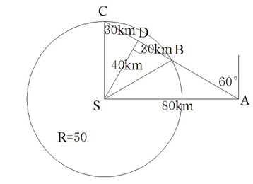

故正确答案为B。

**考点**：几何结论类-三角形相关、普通行程

**来源**：2012年915联考《行测》题（新疆/福建/重庆/河南）第64题

### 第 65 题

用红、黄两色鲜花组成的实心方阵（所有花盆大小完全相同），最外层是红花，从外往内每层按红花、黄花相间摆放。如果最外一圈的正方形有红花44盆，那么完成造型共需黄花：

A. 48盆

B. 60盆

C. 72盆

D. 84盆

第 65 题 · 答案与解析

**参考答案（粉笔题库参考内容）**

B

**解析**

根据“方阵的相邻两层差8”的结论可得，每层花的数量依次为：44、36、28、20、12、4，其中36、20、4为黄花，共计36+20+4=60盆。

故正确答案为B。

**来源**：2012年915联考《行测》题（新疆/福建/重庆/河南）第65题

### 第 66 题

某商场在进行“满百省”活动，满100省10，满200省30，满300省50。大于400的消费只能折算为等同于几个100、200、300的加和。已知一位顾客买某款衬衫1件支付了175元，那么买3件这样的衬衫最少需要：

A. 445元

B. 475元

C. 505元

D. 515元

第 66 题 · 答案与解析

**参考答案（粉笔题库参考内容）**

B

**解析**

买一件衬衫支付175元，符合“满百省”条件，因此衬衫原价可能为185元省10元或205元省30元。若原价为185元，则买3件衬衫需要185×3=555元。对比三种节省方案，节省程度分别为10%、15%、17%，因此同等情况下应优先选择满额大者，故购买555元衬衫应选择满200省30与满300省50，共计节省80元，因此需要支付475元。若原价为205元，则买3件衬衫需要205×3=615元，对比节省方案，必为两个满300省50元，仍需要515元。

故正确答案为B。

**考点**：分段计算问题、统筹规划问题

**来源**：2012年915联考《行测》题（新疆/福建/重庆/河南）第66题

### 第 67 题

玉米的正常市场价格为每公斤1.86元到2.18元，近期某地玉米的价格涨至每公斤2.68元。经测算，向市场每投放储备玉米100吨，每公斤玉米价格可下降0.05元。为稳定玉米价格，向该地投放储备玉米的数量不能超过：

A. 800吨

B. 1080吨

C. 1360吨

D. 1640吨

第 67 题 · 答案与解析

**参考答案（粉笔题库参考内容）**

D

**解析**

所求量为投放储备玉米的最大数量，应对应正常市场价格的最低价。此时价格差为2.68–1.86=0.82元，而每100吨可降0.05元，因此数量不能超过(0.82÷0.05)×100=1640吨。

故正确答案为D。

**考点**：和差倍比问题

**来源**：2012年915联考《行测》题（新疆/福建/重庆/河南）第67题

### 第 68 题

某洗车店洗车分外部清洁和内部清洁，两道工序时间均不少于30分钟，而且同一辆车两道工序不能同时进行，洗车间同一时间只能容下2辆车。现有9辆车需要清洗，汽车进出洗车间的时间可忽略不计，则洗完9辆车至少需要的时间为：

A. 330分钟

B. 300分钟

C. 270分钟

D. 250分钟

第 68 题 · 答案与解析

**参考答案（粉笔题库参考内容）**

C

**解析**

在前6辆车中，均安排其中两辆车同时依次进行外部清洁和内部清洁，耗时60×3=180分钟。最后3辆车记为A、B、C，首先安排为A、B两车进行外部清洁，完毕后对B、C两车内部清洁，然后在A车内部清洁的同时C车外部清洁，共计耗时90分钟。因此洗完9辆车至少需要270分钟。

故正确答案为C。

**考点**：周期问题-其他、统筹规划问题

**来源**：2012年915联考《行测》题（新疆/福建/重庆/河南）第68题

### 第 69 题

某街道常住人口与外来人口之比为1：2，已知该街道下辖的甲、乙、丙三个社区人口比为12：8：7。其中，甲社区常住人口与外来人口比为1：3，乙社区为3：5，则丙社区常住人口与外来人口比为：

A. 2：3

B. 1：2

C. 1：3

D. 3：4

第 69 题 · 答案与解析

**参考答案（粉笔题库参考内容）**

D

**解析**

根据题目中给出的比例，赋值某街道的总人数为27人，则常住人口与外来人口分别为9人、18人，甲、乙、丙三个社区的人口总数分别为12人、8人、7人。甲社区的常住人口与外来人口分别为3人、9人，乙社区的常住人口与外来人口分别为3人、5人，则丙社区的常住人口与外来人口分别为3人、4人，二者之比为3∶4。

故正确答案为D。

**考点**：和差倍比问题

**来源**：2012年915联考《行测》题（新疆/福建/重庆/河南）第69题

### 第 70 题

根据天气预报，未来4天中每天下雨的概率为0.6，则未来4天中仅有1天下雨的概率p为：

A. 0.03

B. 0.06

C. 0.13

D. 0.16

第 70 题 · 答案与解析

**参考答案（粉笔题库参考内容）**

C

**解析**

未来4天中仅有1天下雨，即其中的3天不下雨，另外1天下雨。故其概率为0.6×（1–0.6）×（1–0.6）×（1–0.6）×4=0.1536，符合范围的是C项。

故正确答案为C。

**考点**：给概率求概率

**来源**：2012年915联考《行测》题（新疆/福建/重庆/河南）第70题

### 第 71 题

从所给的四个选项中，选择最合适的一个填入问号处，使之呈现一定的规律性。

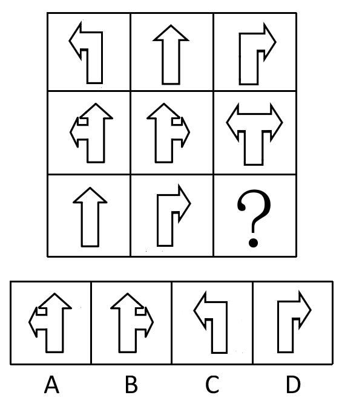

A. A

B. B

C. C

D. D

第 71 题 · 答案与解析

**参考答案（粉笔题库参考内容）**

C

**解析**

元素组成相似，按列叠加。观察发现，已知图形第一列前两个图形叠加后箭头指向部分去同存异得到第三个图形，第二列仍然满足此规律。那么第三列图形前两个叠加后箭头指向部分去同存异得到C项图形。

故正确答案为C。

**考点**：样式规律-加减同异

**来源**：2012年915联考《行测》题（新疆/福建/重庆/河南）第71题

### 第 72 题

请从所给的四个选项中，选择最合适的一个填在问号处，使之呈现一定的规律性：

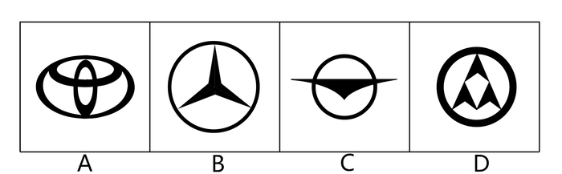

A. A

B. B

C. C

D. D

第 72 题 · 答案与解析

**参考答案（粉笔题库参考内容）**

D

**解析**

元素组成凌乱，考查数数。已知第一列各个图形封闭空间数分别是4、0、4；第二列各个图形封闭空间数分别是5、1、4；观察发现，按列来看，后两个图形封闭空间数之和是第一个图形封闭空间数。依此规律，第三列未知图形封闭空间数应为4。D项符合封闭空间数为4的要求。

故正确答案为D。

**考点**：数量规律-面

**来源**：2012年915联考《行测》题（新疆/福建/重庆/河南）第72题

### 第 73 题

请从所给的四个选项中，选择最合适的一个填在问号处，使之呈现一定的规律性：

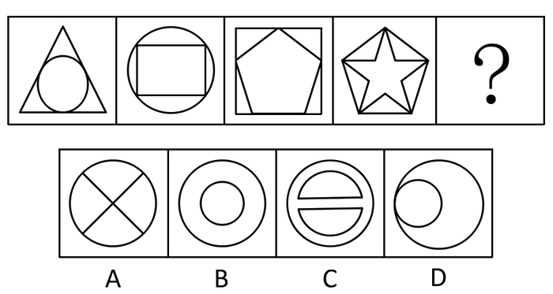

A. A

B. B

C. C

D. D

第 73 题 · 答案与解析

**参考答案（粉笔题库参考内容）**

D

**解析**

元素组成不同，且无明显属性规律，考虑数量规律。观察发现，题干图形出现了五角星、圆相切以及“田”字变形图，考虑笔画数。题干图形笔画数均为1，故？处应选择笔画数为1的图形，只有D项符合。

故正确答案为D。

**考点**：数量规律-线

**来源**：2012年915联考《行测》题（新疆/福建/重庆/河南）第73题

### 第 74 题

从所给的四个选项中，选择最合适的一项填入问号处，使之呈现一定的规律性。

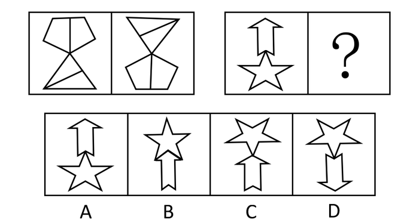

A. A

B. B

C. C

D. D

第 74 题 · 答案与解析

**参考答案（粉笔题库参考内容）**

D

**解析**

元素组成相同，考查位置规律。第一组图中，第一个图顺时针旋转180°得到第二个图；第二组图也应该符合这个规律：第一个图顺时针旋转180°得到D项中的图。

故正确答案为D。

**考点**：位置规律-旋转

**来源**：2012年915联考《行测》题（新疆/福建/重庆/河南）第74题

### 第 75 题

左边给定的是纸盒的外表面，右边哪一项能由它折叠而成？

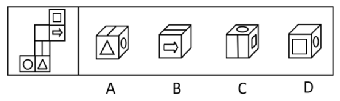

A. A

B. B

C. C

D. D

第 75 题 · 答案与解析

**参考答案（粉笔题库参考内容）**

D

**解析**

根据题干给出的图形可知，空白面和三角形面是相对面，有箭头的面和圆面是相对面，剩下的方格面和一条线所在的面是相对面。根据相邻关系及对面的情况可知：A项中三角形面与圆面所在位置错误；B项中有箭头的面和空白面的相邻面的位置错误；C项方格面和一条线所在的面不可能是相邻的。

故正确答案为D。

**考点**：空间类-空间重构-六面体

**来源**：2012年915联考《行测》题（新疆/福建/重庆/河南）第75题

### 第 76 题

社会感知计算是指通过人类生活空间日益部署的大规模、多种类传感设备，实时感知、识别社会个体的行为，分析挖掘群体社会交互特征和规律，辅助个体社会行为，支持社群的互动、沟通和协作。

根据上述定义，下列属于社会感知计算的是：

A. 某婚恋网站利用手机定位功能提供本地化约会服务

B. 某地气象台利用手机短信向市民发布台风预警信息

C. 某厂商借助计算机分析产品销售情况了解顾客偏好

D. 市民可以用发短信的方式向当地媒体提供新闻线索

第 76 题 · 答案与解析

**参考答案（粉笔题库参考内容）**

A

**解析**

第一步：抓住定义中的关键词。

社会感知计算强调“通过传感设备”、“感知、识别社会个体”、“支持社群的互动、沟通和协作”。

第二步：逐一判断选项。

A项，“利用手机定位功能”体现了“通过传感设备”“感知、识别社会个体”，而“提供本地化约会服务”体现了“支持社群的互动、沟通和协作”，符合定义，当选；

B项，“用手机短信向市民发布台风预警信息”没有体现“感知、识别社会个体”“支持社群的互动、沟通和协作”，不符合定义，排除；

C项和D项，均不符合“支持社群的互动、沟通和协作”，因为顾客之间没有互动、沟通和协作，只是顾客和厂商或媒体的互动、沟通和协作，不符合定义，排除。

故正确答案为A。

**考点**：方式目的

**来源**：2012年915联考《行测》题（新疆/福建/重庆/河南）第76题

### 第 77 题

峰终定律是指人记忆某项事物的体验取决于开始和结束时的感觉。

根据上述定义，下列选项没有运用到峰终定律的是：

A. 某运动员擅长后程发力赢得比赛

B. 宾馆大厅的迎宾员态度热情而友善

C. 超市在出口处免费发放环保购物袋

D. 银行将营业大厅设计的宽敞又明亮

第 77 题 · 答案与解析

**参考答案（粉笔题库参考内容）**

A

**解析**

第一步：抓住定义的关键词。

定义的关键句“记忆某项事物的体验取决于开始和结束时的感觉”，说明开始或结束的时候给人深刻印象。

第二步：逐一判断选项。

A选项中“擅长后程发力赢得比赛”不是取决于开始和结束时的感觉，而是整体对这位运动员进行认知然后得出的结论，不符合定义，当选；

B项“宾馆大厅迎宾员的态度热情而友善”体现了开始的时候给人深刻印象，使得人们对宾馆存有好的记忆，符合定义，排除；

C项“超市在出口处发放购物袋”体现了结束的时候给人深刻印象，使得人们对超市存有好的记忆，符合定义，排除；

D项“银行的营业大厅设计得宽敞又明亮”也体现了开始或结束的时候给人深刻印象，以便让人们对银行存有好的记忆，符合定义，排除。

B、C、D三项都运用了峰终定律。

本题为选非题，故正确答案为A。

**考点**：单定义-其他句式

**来源**：2012年915联考《行测》题（新疆/福建/重庆/河南）第77题

### 第 78 题

拇指规则是指人们在日常生活中体验和总结出来的规律，是一种适用于大多数情况的，简单的、经验性的但不甚准确的规律。

根据上述定义，下列选项没有运用到拇指规则的是：

A. 有经验的点钞员，一眼就能识别假钞

B. 老王教导新同事做工作最好都要有方案

C. 某果农合作社引种新品种获得了大丰收

D. 某电视台邀请知名评论员预测比赛结果

第 78 题 · 答案与解析

**参考答案（粉笔题库参考内容）**

C

**解析**

第一步：抓住定义中的关键词。

定义强调“人们在日常生活中体验和总结出来的规律”“简单的、经验性的但不甚准确的”。

第二步：逐一判断选项。

A项点钞员基于经验识别假钞、B项老王基于经验总结教导新员工，均符合定义“简单的、经验性的但不甚准确的”，属于“人们在日常生活中体验和总结出来的规律”，符合定义，排除；

C项“某果农合作社引种新品种获得了大丰收”并不是“人们在日常生活中体验和总结出来的规律”，不符合定义，当选；

D项“知名评论员预测比赛结果”符合“简单的、经验性的但不甚准确的”，属于“人们在日常生活中体验和总结出来的规律”，符合定义，排除。

本题为选非题，故正确答案为C。

**考点**：主客体

**来源**：2012年915联考《行测》题（新疆/福建/重庆/河南）第78题

### 第 79 题

一体化走廊管理指的是政府通过改善城市中若干条交通干道的基础设施、公共交通服务或公共交通管理方式，来提高所有出行者的出行速度、出行可靠性以及出行安全性。

根据上述定义，下列属于一体化走廊管理的是：

A. 某市加大对高峰期出租车拒载行为的处罚力度

B. 某市在市区交通主干道设置公共自行车租赁点

C. 某市出台政策鼓励民营资本承包公交主干线路

D. 某市在市区干道十字路口设置新型交通摄像头

第 79 题 · 答案与解析

**参考答案（粉笔题库参考内容）**

D

**解析**

第一步：找到定义关键词。

定义强调“改善城市中若干条交通干道”“提高出行速度、出行可靠性以及出行安全性”。

第二步：逐一分析选项。

A项：“加大对出租车拒载行为的处罚力度”虽然属于改善公共交通服务，但是其没有明确提出这是在主干道上，而且其最初的目的也不是为了保障出行者的速度、可靠性和安全性，不符合定义，排除；

B项：“在市区交通主干道设置公共自行车租赁点”只是让人们方便了，并未体现出提高人们的出行可靠性以及出行安全性，不符合定义，排除；

C项：“鼓励民营资本承包公交主干线路”并不能确定可以提高人们的出行速度、可靠性及安全性，不符合定义，排除；

D项：“设置新型交通摄像头”可以规范整个交通，保障道路的可靠性以及人们的安全，体现了“改善城市中若干条交通干道”以及“提高出行速度、出行可靠性以及出行安全性”，符合定义，当选。

故正确答案为D。

本题选择D项还有一个理由：题干定义出自2012年5月期刊《城市交通》的一篇文献，文中说明一体化走廊管理的非机动交通措施中并未包含“设置公共自行车租赁点”，但是在交通管理与安全措施方面体现了“增设监控摄像头”（如下截图），因此正确答案为D更为契合定义。

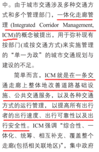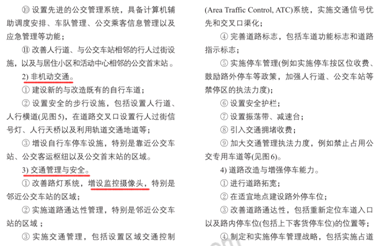

**考点**：方式目的

**来源**：2012年915联考《行测》题（新疆/福建/重庆/河南）第79题

### 第 80 题

奠基者效应是指某生物种群中的少数个体因地理隔绝或其他原因，在与原种群隔离的条件下繁衍生息。虽然后代群体不断扩大，但整个种群的遗传信息均来自最初迁移的少数个体。奠基者效应造成种群遗传多样性较低，对环境适应性较差，容易被自然淘汰。

根据上述定义，下列情形是由奠基者效应造成的是：

A. 斯里兰卡岛上咖啡树对咖啡锈病缺乏抵抗力而全部枯死

B. 某海岛的贝壳因色泽鲜艳而常被渔民采，如今濒临灭绝

C. 熊猫因种群数量减少而濒临灭绝，需要依靠人工繁衍生息

D. 为保留自身文化，阿米什人不与外人通婚导致遗传病频发

第 80 题 · 答案与解析

**参考答案（粉笔题库参考内容）**

D

**解析**

第一步：抓住定义中的关键词。

奠基者效应定义中的关键词有“少数个体与原种群隔离下繁衍生息”、“适应性差被淘汰”。

第二步：逐一判断选项。

A项“咖啡树对咖啡锈病缺乏抵抗力而全部枯死”不符合“少数个体与原种群隔离下繁衍生息”“适应性差被淘汰”；

B项“贝壳因色泽鲜艳而常被渔民采”，不符合“少数个体与原种群隔离下繁衍生息”“适应性差被淘汰”；

C项“熊猫因种群数量减少而濒临灭绝”不符合“适应性差被淘汰”；

D项“不与外人通婚导致遗传病频发”体现了“少数个体与原种群隔离下繁衍生息”，基因相似度高导致遗传病频发体现了“适应性差被淘汰”。

故正确答案为D。

**考点**：故事类

**来源**：2012年915联考《行测》题（新疆/福建/重庆/河南）第80题

### 第 81 题

盖亚假说认为地球生命体与非生命体形成了一个可相互作用的复杂系统。该假说又分为强盖亚假说和弱盖亚假说。其中弱盖亚假说认为地球上的各种生物有效地调节着大气的温度和化学构成。在生物体影响生物环境的同时，环境又反过来影响生物进化的过程。强盖亚假说更进一步认为地球是一个巨大的有机体，具有自我调节的能力。为了这个有机体的健康，甚至可以自行清除那些有害的因素。

根据上述定义，下列选项中属于弱盖亚假说的是：

A. 地球利用太阳能是一种星球尺度上的新陈代谢作用

B. 环保的重要性在于地球是唯一适合人类居住的星球

C. 大气层出现臭氧层空洞是因为人类过度活动造成的

D. 沙漠中引种耐热植物后，促进了当地旅游业的发展

第 81 题 · 答案与解析

**参考答案（粉笔题库参考内容）**

C

**解析**

第一步：抓住定义中的关键词。

弱盖亚假说强调“地球生物体影响生物环境，反过来生物环境又影响生物进化的过程”。

第二步：逐一判断选项。

A项“地球利用太阳能”不能体现生物与环境之间的关系，不符合定义；

B项环保的作用也没有体现地球生物体影响生物环境，不符合定义；

C项说明人类活动造成臭氧层空洞，而臭氧层空洞反过来影响人类，符合定义；

D项“沙漠中引种耐热植物促进了当地旅游业的发展”不能说明生物体和环境之间相互影响的关系，不符合定义。

故正确答案为C。

**考点**：常规问法

**来源**：2012年915联考《行测》题（新疆/福建/重庆/河南）第81题

### 第 82 题

垂直思维是以逻辑与数学为代表的传统思维模式，强调事物的确定性，从前提作出严谨推导；水平思维则注重创新，考虑事物多种选择的可能性，追求思维的丰富性。

根据上述定义，下列选项属于水平思维应用的是：

A. 金导电、银导电、铜导电，所以金属能导电

B. 凯库勒梦见蛇咬住自己的尾巴，推断出苯的结构

C. 法拉第认为电能产生磁场，那么磁场也能产生电

D. 根据相对原子质量，用元素周期表预测未知元素

第 82 题 · 答案与解析

**参考答案（粉笔题库参考内容）**

C

**解析**

第一步：抓住定义中的关键词。

水平思维强调“考虑事物多种选择的可能性”“追求思维的丰富性”。而垂直思维强调“以逻辑与数学为代表”“强调事物的确定性”。

第二步：逐一判断选项。

A项金属能导电的推断体现了以逻辑与数学为代表，强调事物的确定性，符合垂直思维定义，并非水平思维；

B项说的“梦见”并不是思考，当然也就没有创新，因此不符合水平思维定义；

C项法拉第从电生磁考虑到磁生电的可能性，符合考虑事物多种选择的可能性，体现了追求思维的丰富性；

D项根据相对原子质量说明前提假设严谨，用元素周期表预测未知元素体现了以逻辑与数学为代表的传统思维模式，符合垂直思维定义，并非水平思维。

故正确答案为C。

**考点**：常规问法

**来源**：2012年915联考《行测》题（新疆/福建/重庆/河南）第82题

### 第 83 题

商标平行进口是指在国际货物买卖中，某商标权或商标使用权已受一国法律保护，而进口商未经该国商标所有人或商标使用权人许可，从国外进口相同商标商品。

根据上述定义，下列选项属于商标平行进口的是：

A. 甲国生产商与乙国经营商签约销售一款新型发动机，但后者未经甲国生产商许可擅自将此产品销往丙国

B. 甲国某饮料生产商授权乙国企业在乙国境内使用其品牌生产、销售饮料，后者未经许可将此饮料倾销往丙国

C. 甲国某家电生产商授权乙国厂商使用其商标生产彩电，乙国经销商未经后者许可从甲国进口该品牌彩电

D. 甲国一汽车制造商允许乙国某服装厂在T恤上使用其商标，该服装厂又以高价将T恤返销到甲国的市场

第 83 题 · 答案与解析

**参考答案（粉笔题库参考内容）**

C

**解析**

第一步：抓住定义中的关键词。

定义强调“进口商没有获得商标所有人或商标使用权人许可，从国外进口相同商标商品”。

第二步：逐一判断选项。

A、B、D三项均属于对外出口的销售行为，不符合从国外进口相同商标商品；

C项“乙国经销商未经后者许可从甲国进口该品牌彩电”符合进口商未经该国商标所有人或商标使用权人许可，从国外进口相同商标商品。

故正确答案为C。

**考点**：单定义-其他句式

**来源**：2012年915联考《行测》题（新疆/福建/重庆/河南）第83题

### 第 84 题

税收中性原则是指国家征税应尽可能减少税收干扰或扭曲市场机制，不能超越市场而成为影响资源配置和经济决策的力量。

根据上述定义，下列选项运用到税收中性原则的是：

A. 出台政策要求企业多交税

B. 减免征收外资企业所得税

C. 税率不与收入水平相挂钩

D. 提高企业营业税的起征点

第 84 题 · 答案与解析

**参考答案（粉笔题库参考内容）**

C

**解析**

第一步：抓住定义中的关键词。

税收中性原则强调“尽可能减少税收干扰或扭曲市场机制”。

第二步：逐一判断选项。

A项“出台政策”、B项“减免征收外资企业所得税”以及D项“提高企业营业税的起征点”均体现了通过出台或制定法律法规或规章制度来影响市场，不符合“尽可能减少税收干扰或扭曲市场机制”；

C项“税率不与收入水平相挂钩”说明“减少税收干扰”，符合定义“尽可能减少税收干扰或扭曲市场机制”。

故正确答案为C。

**考点**：单定义-其他句式

**来源**：2012年915联考《行测》题（新疆/福建/重庆/河南）第84题

### 第 85 题

取脂定价策略是指生产商利用消费者的求新、求奇心理，抓住竞争对手尚未出现或竞争还不激烈的有利时机，将产品价格定的很高，以便在短时间内获取尽可能多的利润、尽快收回投资的一种定位策略。根据上述定义，下列行为属于取脂定价策略的是（    ）。

A. 某品牌服装折价处理过季服装，但以高价销售换季新品

B. 因原材料价格上涨，某汽车经销商要求订购者补交车款

C. 某商场在节日期间将商品原价标高，再以诱人折扣促销

D. 某星级酒店重新装修营业，将标准间提高了200元

第 85 题 · 答案与解析

**参考答案（粉笔题库参考内容）**

A

**解析**

第一步：判断题干中的关键词。

方式：利用消费者的求新、求奇心理，抓住竞争对于尚未出现或竞争还不激烈的有利时机，将产品价格定的很高。

第二步：逐一分析选项。

A项，某品牌高价销售换季新品，就是在利用消费者的求新、求奇心理，抓住换季新品竞争还不激烈的有利时机，符合题干；

B项，提高车款是因为原材料价格上涨，而非利用消费者的求新心理，抓住竞争时机，与题干不符；

C项，将商品原价标高后又打折促销，实际价格并不高，与题干不符；

D项，酒店标间涨价是因为重新装修，收回成本，而非利用消费者的求新、求奇心理，抓住竞争时机，与题干不符。

第三步：再次标注答案。

故正确答案为A。

**考点**：方式目的

**来源**：2012年915联考《行测》题（新疆/福建/重庆/河南）第85题

### 第 86 题

臭氧层：天气变暖

A. 偷猎：物种灭绝

B. 森林：水土流失

C. 干旱：土地沙化

D. 酸雨：水源污染

第 86 题 · 答案与解析

**参考答案（粉笔题库参考内容）**

B

**解析**

第一步：判断题干词语间逻辑关系。

题干词语间为因果关系，前者被破坏导致后者发生，臭氧层被破坏导致天气变暖。

第二步：逐一判断选项。

A、C、D三项均是前者直接导致后者；B项森林被破坏会导致水土流失，符合题干逻辑。

故正确答案为B。

**考点**：逻辑关系-对应关系

**来源**：2012年915联考《行测》题（新疆/福建/重庆/河南）第86题

### 第 87 题

细胞：病毒

A. 海选：面试

B. 甘蔗：蔗糖

C. 健康：感冒

D. 软件：病毒

第 87 题 · 答案与解析

**参考答案（粉笔题库参考内容）**

D

**解析**

第一步：判断题干词语间的逻辑关系。

题干词语之间为对应关系，后者寄居在前者中，且可以在前者中复制或传播。

第二步：判断选项词语间的逻辑关系。

A项是包容关系，面试属于海选的一种，与题干关系不符，排除；

B项蔗糖从甘蔗中提炼，但不能说寄居于甘蔗，且不能被复制或传播，与题干关系不符，排除；

C项感冒属于不健康的一种，与题干关系不符，排除；

D项（电脑）病毒寄居于软件中，可以在软件中复制或传播，符合题干逻辑，当选。

故正确答案为D。

**考点**：逻辑关系-对应关系

**来源**：2012年915联考《行测》题（新疆/福建/重庆/河南）第87题

### 第 88 题

金风送爽：橙黄桔绿

A. 春华秋实：冬日夏云

B. 山寒水冷：集萤映雪

C. 秋收冬藏：雪兆丰年

D. 满园春色：花红柳绿

第 88 题 · 答案与解析

**参考答案（粉笔题库参考内容）**

D

**解析**

第一步：判断题干词语间逻辑关系。

“金风送爽”和“橙黄桔绿”都形容的是秋天的景象，词义相近，二者是近义关系。

第二步：判断选项词语间逻辑关系。

A项：“春华秋实”比喻事物的因果关系，而“冬日夏云”比喻人态度温和可亲，使人愿意接近，二者不是近义关系，不符合题干逻辑，排除；

B项：“山寒水冷”形容冬天的景象，而“集萤映雪”形容家境贫穷，勤学苦读，二者不是近义关系，不符合题干逻辑，排除；

C项：“秋收冬藏”比喻事物的发生、发展过程，而“雪兆丰年”指冬天大雪是来年丰收的预兆，二者不是近义关系，不符合题干逻辑，排除；

D项：“满园春色”和“花红柳绿”均形容明媚的春天景象，二者是近义关系，符合题干逻辑，当选。

故正确答案为D。

**考点**：语义关系-近义关系

**来源**：2012年915联考《行测》题（新疆/福建/重庆/河南）第88题

### 第 89 题

竞争：共赢

A. 博弈：和棋

B. 买卖：互惠

C. 判决：和解

D. 球赛：平局

第 89 题 · 答案与解析

**参考答案（粉笔题库参考内容）**

B

**解析**

第一步：判断题干词语间的逻辑关系。

题干词语之间为对应关系，积极的竞争可以达到共赢，共赢对竞争双方都有益。

第二步：判断选项词语间的逻辑关系。

A项和棋是博弈的可能结果之一，但和棋不一定对博弈双方都有利，不符合题干逻辑；

B项有些买卖可以互惠，同时互惠对买卖双方也都有益，符合题干逻辑；

C项判决的结果可能是和解，但和解不一定对双方都有利，不符合题干逻辑；

D项球赛的结果可能是平局，但平局不一定对双方都有利，不符合题干逻辑。

故正确答案为B。

**考点**：逻辑关系-对应关系

**来源**：2012年915联考《行测》题（新疆/福建/重庆/河南）第89题

### 第 90 题

旗舰店：商店

A. 黄金水道：航线

B. 劳力士：钟表

C. 总统套房：标间

D. 金刚钻：瓷器

第 90 题 · 答案与解析

**参考答案（粉笔题库参考内容）**

A

**解析**

第一步：判断题干词语间第一重逻辑关系，并在选项中进行选择。

题干词语间为包容关系，且是包容关系中的种属关系，前者是后者的一种，旗舰店是一种特殊的商店。

A项：黄金水道是航线的一种，符合题干逻辑关系，保留；

B项：劳力士是钟表的一种，也符合题干逻辑关系，保留；

C项：总统套房与标间，不符合题干逻辑关系，排除；

D项：金刚钻与瓷器，也不符合题干逻辑关系，排除。

第二步：判断题干词语间第二重逻辑关系，看选项是否符合。

A、B两项都符合题干词语间第一重逻辑关系，此时我们就需要进行属性关系的比较，旗舰店和黄金水道都是一个集合概念，分别是对高端商店和高端航线的统称，而劳力士是一个品牌的标志，故A项更符合题干逻辑关系，当选。

故正确答案为A。

**考点**：逻辑关系-包容关系

**来源**：2012年915联考《行测》题（新疆/福建/重庆/河南）第90题

### 第 91 题

运动员：兴奋剂

A. 合同：毁约

B. 医生：误诊

C. 山寨：制服

D. 裁判：黑哨

第 91 题 · 答案与解析

**参考答案（粉笔题库参考内容）**

D

**解析**

第一步：判断题干词语间的逻辑关系。

题干中是对应关系，且是一一对应，前者禁止使用或产生后者行为。运动员禁止使用兴奋剂。

第二步：判断选项词语间的逻辑关系。

A项合同可以产生毁约行为，并且“毁约”是一个动词；B项医生可能会产生误诊；C项山寨和制服没有明显的逻辑关系；D项裁判禁止吹黑哨，符合题干逻辑。

故正确答案为D。

**考点**：逻辑关系-对应关系

**来源**：2012年915联考《行测》题（新疆/福建/重庆/河南）第91题

### 第 92 题

卫星：飞船：航天

A. 股票：债券：金融

B. 错层：复式：别墅

C. 预算：结算：决算

D. 移动：联通：电信

第 92 题 · 答案与解析

**参考答案（粉笔题库参考内容）**

A

**解析**

第一步：判断题干词语间逻辑关系。

卫星和飞船为并列关系，都应用于航天领域，与第三个词为对应关系。

第二步：判断选项词语间逻辑关系。

A项：股票和债券为并列关系，都应用于金融领域，与题干逻辑关系一致，当选；

B项：错层和复式为并列关系，都是别墅的结构，与题干逻辑关系不一致，排除；

C项：预算、结算和决算为先后顺序的对应关系，与题干逻辑关系不一致，排除；

D项：移动、联通和电信均为通信公司，三者为并列关系，与题干逻辑关系不一致，排除。

故正确答案为A。

**考点**：逻辑关系-对应关系、逻辑关系-并列关系

**来源**：2012年915联考《行测》题（新疆/福建/重庆/河南）第92题

### 第 93 题

军事卫星  对于  （   ）  相当于  （   ）  对于  沙漏

A. 狼烟；原子时钟

B. 天空；北京时间

C. 卫星；传统科技

D. 探索；光阴似箭

第 93 题 · 答案与解析

**参考答案（粉笔题库参考内容）**

A

**解析**

将选项逐一代入，判断各选项前后部分的逻辑关系。

A项代入前一组词为并列关系，狼烟是古代边防兵发现敌情在烽火台点燃烟火发送警示信号是一种军事工具，军事卫星在军事上用来侦察，也是军事工具，狼烟是古代的，军事卫星是现代的；后一组词也是并列关系，原子时钟和沙漏是两种计量时间的工具，沙漏是古代的，原子时钟是现代的，前后逻辑关系一致；

B项代入前一组不构成逻辑关系，后一组构成对应关系，北京时间用来描述时间，沙漏也可以显示时间，前后逻辑关系不一致；

C项代入前一组构成包容关系，后一组不构成逻辑关系，前后逻辑关系不一致；

D项代入前一组为对应关系，后一组为属性关系，前后逻辑关系不一致。

故正确答案为A。

**考点**：逻辑关系-并列关系

**来源**：2012年915联考《行测》题（新疆/福建/重庆/河南）第93题

### 第 94 题

（   ）  对于  原子  相当于  车轮  对于  （   ）

A. 夸克；气缸

B. 库仑；车速

C. 电子；汽车

D. 核能；火车

第 94 题 · 答案与解析

**参考答案（粉笔题库参考内容）**

C

**解析**

将选项逐一代入，判断各选项前后部分的逻辑关系。

A项代入前一组词为组成关系，后一组词不存在逻辑关系，前后逻辑关系不一致；

B项代入前一组为对应关系，原子所带的电的量的单位是库仑，后一组不构成逻辑关系，前后逻辑关系不一致；

C项前一组构成组成关系，后一组为组成关系，前后逻辑关系一致；

D项前一组为对应关系，后一组为组成关系，前后逻辑关系不一致。

故正确答案为C。

**考点**：逻辑关系-包容关系

**来源**：2012年915联考《行测》题（新疆/福建/重庆/河南）第94题

### 第 95 题

（   ）  对于  运动  相当于  手术  对于  （   ）

A. 学习；健康

B. 锻炼；急救

C. 足球；治疗

D. 懒惰；药物

第 95 题 · 答案与解析

**参考答案（粉笔题库参考内容）**

C

**解析**

将选项逐一代入，判断各选项前后部分的逻辑关系。

A项代入前一组词为并列关系，后一组词为对应关系，前后逻辑关系不一致；

B项代入前一组不构成逻辑关系，后一组构成对应关系，前后逻辑关系不一致；

C项中前一组构成种属关系，足球是一种运动方式，后一组为种属关系，手术是一种治疗手段，前后逻辑关系一致；

D项中前一组不构成逻辑关系，后一组为对应关系，前后逻辑关系不一致。

故正确答案为C。

**考点**：逻辑关系-包容关系

**来源**：2012年915联考《行测》题（新疆/福建/重庆/河南）第95题

### 第 96 题

今天的中国，改革依然是人心所向、大势所趋。在新的历史时期，在现有成就基础上，经济社会要持续保持又好又快发展，就需要以更大的勇气、魄力和力度来推进改革、深化改革，只有这样，才能在用好机遇、化解风险中奋力闯出“深水区”，开创中国现代化的新境界。

由此可以推出：

A. 不深化改革，就无法闯出改革的“深水区”

B. 深化改革，可以闯出改革的“深水区”

C. 无法闯出改革的“深水区”，是因为没有深化改革

D. 闯出改革的“深水区”，就能深化改革

第 96 题 · 答案与解析

**参考答案（粉笔题库参考内容）**

A

**解析**

第一步：翻译题干。利用充分条件和必要条件。

（1）经济社会持续保持又好又快发展→推进改革、深化改革。

（2）闯出改革的“深水区”→推进改革、深化改革。

第二步：逐一翻译题干并判断正确答案。

A项：-深化改革→-闯出改革的“深水区”，根据逆否规则，等价于（2），正确；

B项：没有明显逻辑关联词，无法翻译，错误；

C项：没有明显逻辑关联词，无法翻译，错误；

D项：闯出改革的“深水区”→深化改革，推导关系同（2），但不是闯出改革的“深水区”就能深化改革，而是闯出改革的“深水区”做到了深化改革，错误。

故正确答案为A。

**考点**：常规翻译

**来源**：2012年915联考《行测》题（新疆/福建/重庆/河南）第96题

### 第 97 题

伦敦奥运前夕，曾经准确预测过奥运会大国获得奖牌总数的科学家们认为，奖牌总数与其说是一个体育问题，不如说是一个经济问题。英国在2012年伦敦奥运会上赢得的奖牌总数将被打破纪录，美国和中国应该会在今年继续取得成功，但俄罗斯、澳大利亚和德国今年极有可能会感到失望。

由此可以推出：

A. 奖牌榜前三位国家依次为美、中、英

B. 只有国家经济繁荣了，体育就能强盛

C. 2013年澳大利亚经济景气指数将走低

D. 近年来中国经济发展形势好于俄罗斯

第 97 题 · 答案与解析

**参考答案（粉笔题库参考内容）**

D

**解析**

第一步：抓住每句话中的对象及其关系。

第一句话强调奖牌总数是一个经济问题，奖牌数的多少和经济发展形势有关。第二句话说明英国奖牌总数会增加，美国和中国仍然较多，但俄罗斯、澳大利亚和德国奖牌数可能会减少。

第二步：判断整体关系。

题干通过奖牌数来反映经济发展形势，说明奖牌数的多少和经济发展形势呈正相关。

第三步：逐一判断选项的作用。

A项，无法根据题干推出美、中、英三国的奖牌总数，因此无法得出三国的位次；

B项，题干强调奖牌数的多少和经济发展形势有关，并不能推出经济繁荣，体育就能强盛；

C项，因为“澳大利亚极有可能会感到失望”和“伦敦奥运前夕”的澳大利亚经济发展形势有关，无法推出2013年澳大利亚经济发展形势；

D项，根据题干“中国今年继续取得成功”和“俄罗斯可能会减少”，可以得出“近年来中国经济发展形势好于俄罗斯”的结论。

故正确答案为D。

**考点**：日常结论

**来源**：2012年915联考《行测》题（新疆/福建/重庆/河南）第97题

### 第 98 题

我国已经进入老龄化社会，老龄化不仅意味着人口老年负担系数不断提高，同时也意味着劳动投入的减少。面对我国老龄化这一不争的事实，延迟退休年龄可以大大减缓劳动力总量的不足。

如果以下各项均为真，最能削弱上述观点的是：

A. 中国适龄劳动力存量正处于高峰期，大约有1亿人口没有就业

B. 2010年我国60岁以上人口1.8亿，占全球60岁以上人口的24%

C. 按照我国目前的老龄化进度，到2050年我国仍有劳动人口7.1亿

D. 我国每年新增的1200万个就业岗位中，有超过30%来自退休人员

第 98 题 · 答案与解析

**参考答案（粉笔题库参考内容）**

A

**解析**

第一步：找出论点和论据。

论点：延迟退休年龄可以大大减缓劳动力总量的不足。

论据：老龄化不仅意味着人口老年负担系数不断提高，同时也意味着劳动投入的减少。

本题论点说的是延迟退休年龄能缓解劳动力总量不足，论据说的是老龄化意味着劳动投入的减少，二者话题紧密相关，可以理解为话题一致，削弱时优先考虑削弱论点。

第二步：逐一分析选项。

A项：该项指出我国目前适龄劳动力正处于高峰期且大约有1亿人口没有就业，说明当前劳动年龄人口供给充足，且存在大量未就业劳动力，并不存在“劳动力不足”这一情况，因此延迟退休无法缓解劳动力不足，削弱论点，可以削弱，当选；

B项：该项指出我国老年人口规模大，并未涉及劳动力是否短缺、延迟退休是否有效，无关项，无法削弱，排除；

C项：该项指出我国未来劳动力规模仍较大，但据此无法判断劳动力是否短缺，也无法判断延迟退休对劳动力总量的影响，不明确选项，无法削弱，排除；

D项：该项指出我国每年新增岗位中有超过30%来自退休人员，说明延迟退休有利于老人继续就业，缓解了劳动力总量的不足，加强项，无法削弱，排除。

故正确答案为A。

**考点**：削弱论据

**来源**：2012年915联考《行测》题（新疆/福建/重庆/河南）第98题

### 第 99 题

有人认为，高考是很重要的考试，一年只有一次，应该让迟到考生进场考试。

如果以下各项为真，最能削弱上述观点的是：

A. 不让迟到考生进场，有可能错失选拔优秀人才的机会

B. 高考是很重要的考试，但并不一定会决定考生的命运

C. 美国的高考——SAT考试，允许迟到的考生进场考试

D. 遵守考场规则与考试的重要性、每年举行的次数无关

第 99 题 · 答案与解析

**参考答案（粉笔题库参考内容）**

D

**解析**

第一步：找到论点和论据。

论点：高考应该让迟到考生进场考试。

论据：高考是很重要的考试，一年只有一次。

第二步：判断削弱方式。

论点与论据间不存在明显因果关系，需削弱论证。

第三步：逐一判断选项的作用。

A项，加强了论点；

B项，“高考并不一定会决定考生的命运”可以削弱论点，“并不一定”只是可能，削弱力度有限；

C项，美国高考和中国无关，不构成削弱；

D项，“考场规则与考试的重要性、每年举行的次数无关”说明论据和论点之间没有关系，起到了削弱作用。

故正确答案为D。

**考点**：拆桥

**来源**：2012年915联考《行测》题（新疆/福建/重庆/河南）第99题

### 第 100 题

研究发现，通过游戏,孩子把自身的焦虑和担忧等情绪表达出来，并在游戏过程中学会解决冲突，体会自己的情绪，探索与他人相处的方式，逐渐了解身边的这个世界。

如果以下选项为真，最能削弱上述论断的是：

A. 孩子们玩游戏的时候，一定要有家长在身边呵护

B. 孩子们并不喜欢与伙伴们一起分享玩具或零食

C. 经常玩游戏的儿童遇到陌生人时并不主动打招呼

D. 孩子们在游戏中受到挫折后往往倾向于逃避现实

第 100 题 · 答案与解析

**参考答案（粉笔题库参考内容）**

D

**解析**

第一步：找到论点和论据。

论点：孩子可以通过在游戏中学习，进一步了解身边的真实性世界。没有明显的论据。

第二步：判断削弱方式。

只有论点，需削弱论点。

第三步：逐一判断选项的作用。

A项，对于孩子们能不能了解真实世界没有关系，属于无关项；

B项，和玩游戏没有关系，属于无关项；

C项，儿童不对陌生人主动打招呼的行为属于正常行为，不属于不好的行为，属于无关项；

D项，孩子们“在游戏中受到挫折后往往倾向于逃避现实”，就无法把游戏中的经验带入现实之中，削弱了论点。

故正确答案为D。

**考点**：削弱论点

**来源**：2012年915联考《行测》题（新疆/福建/重庆/河南）第100题

### 第 101 题

奥斯卡·皮斯托瑞斯获得伦敦奥运会入场券前，国际田联禁止义肢者参加奥运会，理由是：豹式刀片式假肢强度大、密度小且弹力强，跑步时能将97%的能力反弹，因此穿戴者越跑越快，后程速度为正常人所不能及。

如果以下各项为真，最不能支持国际田联理由的是：

A. 创造公平竞争的机会是国际田联的职责

B. 现有体育法律未限制义肢者参加奥运会

C. 豹式刀片式假肢价格昂贵，常人无法承受

D. 豹式刀片式假肢并不能弥补身体的缺陷

第 101 题 · 答案与解析

**参考答案（粉笔题库参考内容）**

D

**解析**

第一步：找到论点和论据。

论点：国际田联禁止义肢者参加奥运会。

论据：豹式刀片式假肢强度大、密度小且弹力强，跑步时能将97%的能力反弹，因此穿戴者越跑越快，后程速度为正常人所不能及。

本题论点说的是禁止义肢者参加奥运会，论据说的是豹式刀片式假肢穿戴者越跑越快，后程速度为正常人所不能及，论据是论点的解释，二者话题一致，加强考虑补充论据。

第二步：逐一分析选项。

A项：指出国际田联应该创造公平竞争的机会，而豹式刀片式假肢穿戴者后程速度为正常人所不能及，为了创造公平竞争的机会，国际田联应该禁止义肢者参赛，补充论据，支持论点，排除；

B项：指出现有体育法律未限制，法律未限制与国际田联是否应该禁止义肢者可以参加奥运会无关，无法加强，保留；

C项：指出豹式刀片式假肢价格昂贵常人无法承受，价格问题与国际田联是否禁止义肢者参加奥运会无关，无法加强，保留；

D项：指出豹式刀片式假肢并不能弥补身体的缺陷，说明豹式刀片式假肢不能使穿戴者成为常人，也就不能达到正常人所不及的速度，削弱论据，保留。

比较B、C、D三项，D项削弱论据比无关选项更不支持论点，因此D项优于B、C两项。

故正确答案为D。

**考点**：加强选非题

**来源**：2012年915联考《行测》题（新疆/福建/重庆/河南）第101题

### 第 102 题

有研究表明，在使用试管婴儿技术治疗不孕不育前和治疗期间摄入炸薯条等富含饱和脂肪的食物将直接影响治疗的效果。

如果以下各项为真，最能支持上述观点的是：

A. 人群中饱和脂肪摄入量高者，不孕率高

B. 饱和脂肪摄入量影响卵母细胞的排卵数量

C. 饱和脂肪摄入量影响卵母细胞的受孕成功率

D. 炸薯条富含的饱和脂肪更容易被人吸收

第 102 题 · 答案与解析

**参考答案（粉笔题库参考内容）**

C

**解析**

第一步：找出论点和论据。

论点：在使用试管婴儿技术治疗不孕不育前和治疗期间摄入炸薯条等富含饱和脂肪的食物将直接影响治疗的效果。

论据：无。

本题只有论点，没有论据，加强优先考虑补充论据。

第二步：逐一分析选项。

A项：选项讨论的人群为“饱和脂肪摄入量高者”，与论点讨论的“使用试管婴儿技术治疗不孕不育的人”主体不一致，为无关项，无法加强，排除；

B项：“影响卵母细胞的排卵数量”并不能说明影响不孕不育治疗的效果，为不明确项，无法加强，排除；

C项：“影响卵母细胞的受孕成功率”说明会影响不孕不育治疗的效果，补充论据，可以加强，当选；

D项：“炸薯条富含的饱和脂肪更容易被人吸收”与“影响不孕不育治疗的效果”无关，为无关项，无法加强，排除。

故正确答案为C。

**考点**：补充论据

**来源**：2012年915联考《行测》题（新疆/福建/重庆/河南）第102题

### 第 103 题

弓形虫是猫身上的单细胞寄生虫。有研究表明，受弓形虫感染的老鼠，其大脑掌控恐惧的区域会处于瘫痪状态，暴露在猫前面时也不感到恐惧。

由此可以推出：

A. 弓形虫会损害老鼠的大脑

B. 弓形虫会使老鼠变得大胆

C. 猫将弓形虫用于诱捕老鼠

D. 猫与弓形虫形成共生关系

第 103 题 · 答案与解析

**参考答案（粉笔题库参考内容）**

A

**解析**

第一步：抓住每句话中的对象及其关系。

第一句说明弓形虫是猫身上的单细胞寄生虫。第二句说明研究表明受弓形虫感染的老鼠暴露在猫前面时也不感到恐惧。

第二步：逐一判断选项。

A项可以推出，“受弓形虫感染的老鼠，其大脑掌控恐惧的区域会处于瘫痪状态”说明弓形虫确实损害了老鼠的大脑；

B项中老鼠面对猫的时候不害怕不是说明老鼠大胆，而是因为老鼠得病了，因此排除；

C项不符合推断，第一句话强调弓形虫是猫身上的单细胞寄生虫，不能推出“猫将弓形虫用于诱捕老鼠”；

D项无法推出，第一句话强调弓形虫是猫身上的单细胞寄生虫，不能推出“猫与弓形虫形成共生关系”。

故正确答案为A。

【来源】《弓形虫可操控寄生老鼠大脑不怕猫》

**考点**：日常结论

**来源**：2012年915联考《行测》题（新疆/福建/重庆/河南）第103题

### 第 104 题

东西伯利亚北极大陆架富含甲烷，当地球处于寒冷期时，这个大陆架成为一个冻结的北极沿岸平原，不向外渗漏甲烷。随着地球温度升高和海平面上升，这个大陆架被海水淹没。在深水区，甲烷氧化成二氧化碳，而后钻出海面。在浅水区，大量甲烷没有足够时间氧化，直接逃逸进大气层，在更大程度上影响全球气温。

如果以下各项为真，最能质疑上述论断的是：

A. 东西伯利亚北极大陆架深水区甲烷的含量高于浅水区

B. 最新研究表明东西伯利亚地区开始进入新一轮寒冷期

C. 海水深度与甲烷氧化为二氧化碳之间不存在线性关系

D. 最新研究表明甲烷造成的温室效应并不比二氧化碳大

第 104 题 · 答案与解析

**参考答案（粉笔题库参考内容）**

D

**解析**

第一步：分析题干，找出论点和论据。

论点：甲烷直接逃逸进大气层，在更大程度上影响全球气温。

论据：无明显论据。

第三步：逐一分析选项。

A项：只能说明氧化成二氧化碳的甲烷比例大于没有足够氧化的甲烷，但不能解释甲烷和温室效应之间的关系，排除；

B项：东西伯利亚是否进入寒冷期同样不能解释甲烷与温室效应的关系，排除；

C项：和A项类似，甲烷氧化不氧化的问题无法解释甲烷与全球气温的关系，排除；

D项：论点强调氧化的甲烷逃入大气层后，对全球气温的影响更大；

D项说明甲烷造成的温室效应不比二氧化碳大，直接否定了论点。

故正确答案为D。

**考点**：削弱论点

**来源**：2012年915联考《行测》题（新疆/福建/重庆/河南）第104题

### 第 105 题

植物甾醇具有和胆固醇相似的化学结构，在人体小肠中能够抑制胆固醇的吸收，从而可以有效防治冠心病等疾病，是食品中天然存在的一种微活性成分。植物甾醇天然存在于水果、蔬菜、坚果及其他植物性食品中。

有些人因此推论：

（1）某人得冠心病是因为他不爱吃水果

（2）某人不得冠心病是因为他爱吃蔬菜

（3）吃啥补啥，只要多吃富含植物甾醇的食品就不得冠心病

（4）缺啥补啥，缺少植物甾醇就多吃水果、蔬菜等植物性食品

上述推论中错误的是：

A. （1）（2）

B. （3）（4）

C. （1）（2）（3）

D. （1）（2）（3）（4）

第 105 题 · 答案与解析

**参考答案（粉笔题库参考内容）**

C

**解析**

日常结论题，根据题干信息逐一分析。

（1）：根据题干可知吃含有植物甾醇的水果、蔬菜、坚果及其他植物性食品可以有效防治冠心病等疾病，无法推出得冠心病的原因，无法推出；

（2）：根据题干可知吃含有植物甾醇的水果、蔬菜、坚果及其他植物性食品可以有效防治冠心病等疾病，无法推出不得冠心病的原因，无法推出；

（3）：根据题干可知吃含有植物甾醇的水果、蔬菜、坚果及其他植物性食品可以有效防治冠心病等疾病，无法推出吃含有植物甾醇的食品就不得冠心病，无法推出；

（4）：根据题干最后一句可知，植物甾醇天然存在于水果、蔬菜、坚果及其他植物性食品中，因此，缺少植物甾醇可以多吃水果、蔬菜，可以推出。

上述推论中错误的有（1）（2）（3）。

故正确答案为C。

**考点**：日常结论

**来源**：2012年915联考《行测》题（新疆/福建/重庆/河南）第105题

## 材料 1

21世纪头10年，金砖国家整体经济平均增长率超过8%，远高于发达国家2.6%的平均增长率及4.1%的全球平均增长率，金砖国家在全球GDP中所占份额从2000年的17.0%提升到2010年的25.7%，且继续提升。

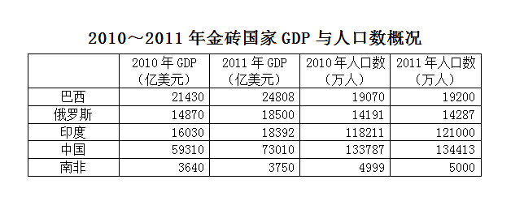

|  | 2010 年 GDP （亿美元） | 2011 年 GDP （亿美元） | 2010 年人口数 （万人） | 2011 年人口数 （万人） |
| --- | ---: | ---: | ---: | ---: |
| 巴西 | 21430 | 24808 | 19070 | 19200 |
| 俄罗斯 | 14870 | 18500 | 14191 | 14287 |
| 印度 | 16030 | 18392 | 118211 | 121000 |
| 中国 | 59310 | 73010 | 133787 | 134413 |
| 南非 | 3640 | 3750 | 4999 | 5000 |

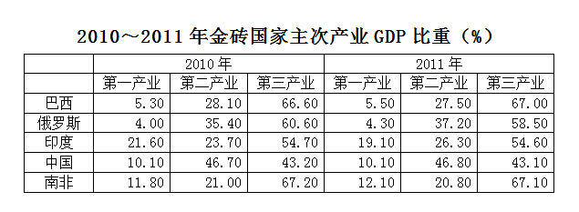

|  | 2010 年 第一产业 | 2010 年 第二产业 | 2010 年 第三产业 | 2011 年 第一产业 | 2011 年 第二产业 | 2011 年 第三产业 |
| --- | ---: | ---: | ---: | ---: | ---: | ---: |
| 巴西 | 5.30 | 28.10 | 66.60 | 5.50 | 27.50 | 67.00 |
| 俄罗斯 | 4.00 | 35.40 | 60.60 | 4.30 | 37.20 | 58.50 |
| 印度 | 21.60 | 23.70 | 54.70 | 19.10 | 26.30 | 54.60 |
| 中国 | 10.10 | 46.70 | 43.20 | 10.10 | 46.80 | 43.10 |
| 南非 | 11.80 | 21.00 | 67.20 | 12.10 | 20.80 | 67.10 |

### 第 106 题

2000～2010年金砖国家的GDP总量占全球份额提升了：

A. 8.7个百分点

B. 17个百分点

C. 25.7个百分点

D. 42.7个百分点

第 106 题 · 答案与解析

**参考答案（粉笔题库参考内容）**

A

**解析**

根据题干“2000～2010年······占······提升了”，结合选项均为百分点，可判定本题为两期比重问题。定位文字材料可得：金砖国家在全球GDP中所占份额从2000年的17.0%提升到2010年的25.7%。故2000～2010年金砖国家的GDP总量占全球份额提升了25.7%－17.0%＝8.7%。

故正确答案为A。

**考点**：两期比重、综合资料

**来源**：2012年915联考《行测》题（新疆/福建/重庆/河南）第106题

### 第 107 题

2010年全球GDP总量约为：

A. 30.5万亿美元

B. 44.86万亿美元

C. 53.88万亿美元

D. 67.8万亿美元

第 107 题 · 答案与解析

**参考答案（粉笔题库参考内容）**

B

**解析**

根据题干“2010年全球GDP总量”，且材料已知2010年金砖国家GDP及其占全球GDP比重，可判定本题为现期比重问题。定位表1，2010年金砖各国的GDP如下：巴西21430亿美元、俄罗斯14870亿美元、印度16030亿美元、中国59310亿美元、南非3640亿美元；定位文字材料可得：2010年金砖国家在全球GDP中所占份额为25.7%。

代入公式：总量 = 部分量/(部分量占总量的比重)，故2010年全球GDP总量= (21430+14870+16030+59310+3640)/25.7% ≈ (21400+15000+16000+59000+3600)/(1/4)= 115000×4 = 460000，即46万亿美元，与B项最接近。

故正确答案为B。

**考点**：现期比重、综合资料

**来源**：2012年915联考《行测》题（新疆/福建/重庆/河南）第107题

### 第 108 题

2010年金砖国家中人均GDP超过1万美元的有：

A. 1个

B. 2个

C. 3个

D. 4个

第 108 题 · 答案与解析

**参考答案（粉笔题库参考内容）**

B

**解析**

根据题干“2010年······人均GDP超过1万美元”，可判定本题为现期平均数问题。定位表1， 2010年金砖各国GDP和人口数如下：巴西21430亿美元，19070万人；俄罗斯14870亿美元，14191万人；印度16030亿美元，118211万人；中国59310亿美元，133787万人；南非3640亿美元，4999万人。人均GDP = GDP/人口数，则各国人均GDP分别为：

巴西=21430/19070 ＞ 1、俄罗斯 =14870/14191 ＞ 1、印度=16030/118211 ＜ 1、中国=59310/133787 ＜ 1、南非=3640/4999 ＜ 1，单位均为“万美元”，则超过1万美元的有2个国家。

故正确答案为B。

**考点**：现期平均数、综合资料

**来源**：2012年915联考《行测》题（新疆/福建/重庆/河南）第108题

### 第 109 题

2011年金砖国家中第三产业GDP规模最大的是：

A. 巴西

B. 俄罗斯

C. 南非

D. 中国

第 109 题 · 答案与解析

**参考答案（粉笔题库参考内容）**

D

**解析**

根据题干“2011年······第三产业GDP规模最大”，结合表格2011年金砖国家GDP及其第三产业占比，可判定本题为现期比重问题。定位表1，选项中各国2011年的GDP分别为：巴西24808亿美元、俄罗斯18500亿美元、南非3750亿美元、中国73010亿美元；定位表2，各国对应的第三产业GDP占比分别为67%、58.5%、67.1%、43.1%。故2011年各国第三产业GDP分别为：

巴西 = 24808 × 67% ＜ 25000 × 70% = 17500亿美元；

俄罗斯 = 18500 × 58.5% ＜ 20000 × 60% = 12000亿美元；

南非 = 3750×67.1% ＜ 4000×70% = 2800亿美元；

中国 = 73010 × 43.10% ＞ 70000 × 40% = 28000亿美元。

故中国第三产业GDP的规模最大。

故正确答案为D。

**考点**：现期比重、综合资料

**来源**：2012年915联考《行测》题（新疆/福建/重庆/河南）第109题

### 第 110 题

能够从上述资料推出的是：

A. 2011年世界人口增速最快的国家是印度

B. 2011年金砖国家GDP将占到全球50%

C. 2011年中国GDP超过金砖国家总量的50%

D. 金砖国家中第三产业占比最高，人均GDP也相应最高

第 110 题 · 答案与解析

**参考答案（粉笔题库参考内容）**

C

**解析**

A项：定位表1，材料中只给出了2010～2011年金砖国家的人口数，而非世界各国人口数，故无法推出世界人口增速最快的是印度，错误；

B项：定位文字材料：“金砖国家在全球GDP中所占份额从2000年的17%提升到2010年的25.7%，且继续提升”，并没有提到具体数值，错误；

C项：定位表1，2011年中国GDP为73010亿美元，除中国外的金砖国家GDP总量=24808+18500+18392+3750≈25000 + 19000 + 18000 + 4000 = 66000 ＜ 73010，则中国GDP超过金砖国家总量的50%，正确；

D项：定位表2，2011年金砖国家第三产业占比最高的是南非。人均GDP = GDP/人口数，根据表1数据，南非人均GDP = 3750/5000 ＜ 1，而巴西人均GDP=24808/19200＞1，单位都是“万美元”，故南非人均GDP小于巴西，并非最高，错误。

故正确答案为C。

**考点**：综合分析、综合资料

**来源**：2012年915联考《行测》题（新疆/福建/重庆/河南）第110题

## 材料 2

2012年我国夏粮生产获得了较好收成。全国夏粮总产量达到12995万吨，比2011年增加356万吨，增长2.8%。超过1997年12768万吨的历史最好水平，比10年前增长31.6%。2012年，河北、山西、江苏、安徽、山东、河南、湖北、四川、陕西、甘肃、新疆这11个主产省（区）增产夏粮364万吨，其中安徽增产80万吨、山东增产75万吨、河北增产63万吨、河南增产55万吨，在非主产省（市、区）中北京、辽宁、浙江、湖南、重庆、云南、宁夏有不同程度减产。

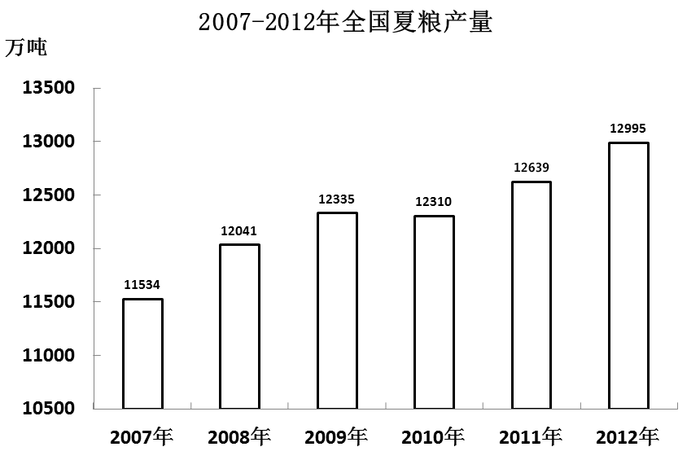

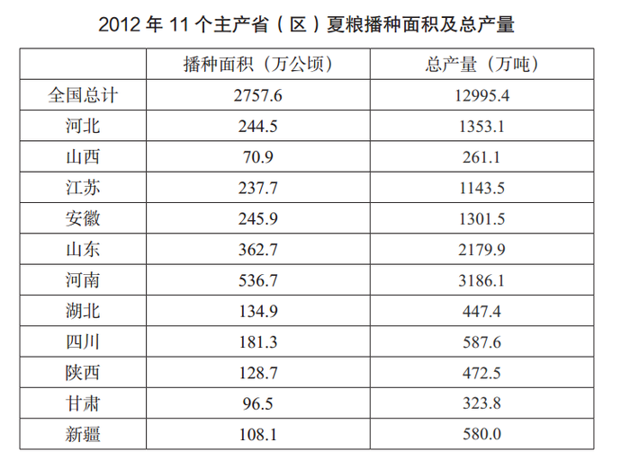

### 第 111 题

2002年全国夏粮产量约为：

A. 4107万吨

B. 9875万吨

C. 12768万吨

D. 17102万吨

第 111 题 · 答案与解析

**参考答案（粉笔题库参考内容）**

B

**解析**

根据题干“2002年全国夏粮产量”，结合材料数据为2012年，可判定本题为基期计算问题。定位文字材料可得：2012年全国夏粮总产量达到12995万吨，比10年前增长31.6%。根据公式：基期量 = 现期量/(1+增长率)，故2002年全国夏粮产量=12995/(1+31.6%)≈13000/1.32≈ 10000万吨，与B项最接近。

故正确答案为B。

**考点**：基期计算、综合资料

**来源**：2012年915联考《行测》题（新疆/福建/重庆/河南）第111题

### 第 112 题

河北、安徽、四川、新疆四个省（区）中，2012年夏粮每公顷产量高于全国平均水平的省份有几个：

A. 1

B. 2

C. 3

D. 4

第 112 题 · 答案与解析

**参考答案（粉笔题库参考内容）**

C

**解析**

根据题干“2012年夏粮每公顷产量高于全国平均水平的省份”，且材料时间为2012年，可判定本题为现期平均数问题。定位表2可得：2012年全国夏粮总产量12995.4万吨，播种面积2757.6万公顷；河北夏粮总产量1353.1万吨，播种面积244.5万公顷；安徽夏粮总产量1301.5万吨，播种面积245.9万公顷；四川夏粮总产量587.6万吨，播种面积181.3万公顷；新疆夏粮总产量580.0万吨，播种面积108.1万公顷。每公顷产量 = 总产量/播种面积，故2012年全国夏粮平均产量=12995.4/2757.6≈4^+；河北、安徽、四川、新疆的每公顷产量分别为：1353.1/244.5≈5+、1301.5/245.9≈5+、587.6/181.3≈3^+、580.0/108.1≈5+，其中超过全国平均产量的有河北、安徽、新疆，共三个。

故正确答案为C。

**考点**：现期平均数、综合资料

**来源**：2012年915联考《行测》题（新疆/福建/重庆/河南）第112题

### 第 113 题

2012年11个主产省（区）夏粮播种面积约占全国播种总面积的：

A. 52%

B. 67%

C. 71%

D. 85%

第 113 题 · 答案与解析

**参考答案（粉笔题库参考内容）**

D

**解析**

根据题干“2012年······占······”，且材料时间为2012年，可判定本题为现期比重问题。定位表2可得：2012年全国播种总面积为2757.6万公顷，11个主产省（区）夏粮播种面积分别为244.5万公顷、70.9万公顷、237.7万公顷、245.9万公顷、362.7万公顷、536.7万公顷、134.9万公顷、181.3万公顷、128.7万公顷、96.5万公顷、108.1万公顷。根据公式：比重 = 部分量/总量，故2012年11个主产省(区)夏粮播种面积占全国播种总面积的比重≈ (240+70+240+250+360+540+130+180+130+100+110)/2800 = 2350/2800 ≈ 84%，与D项最接近。

故正确答案为D。

**考点**：现期比重、综合资料

**来源**：2012年915联考《行测》题（新疆/福建/重庆/河南）第113题

### 第 114 题

假如2013年我国夏粮产量增长率创6年以来的新高，则2013年产量预计：

A. 在12995~13128万吨之间

B. 在13200万吨左右

C. 不高于13314万吨

D. 高于13456万吨

第 114 题 · 答案与解析

**参考答案（粉笔题库参考内容）**

D

**解析**

根据题干“2013年产量预计”，且材料时间为2012年，可判定本题为现期计算问题。定位表1，2007-2012年全国夏粮产量分别为11534万吨、12041万吨、12335万吨、12310万吨、12639万吨、12995万吨。增长率 = (现期 − 基期)/基期，则各年的增长率如下：

2008年：(12041-11534)/11534=507/11534；

2009年：(12335 − 12041)/12041 = 294/12041；

2010年：(12310 − 12335)/12335 = −25/12335；

2011年：(12639 - 12310)/12310 = 329/12310；

2012年：(12995-12639)/12639 = 356/12639。

比较可知，2008年的分子最大且分母最小，故五年来夏粮产量增长率最高的为2008年，其增长率 = 507/11534 ≈ 500/11500 ≈ 4.3%。2013年增长率创6年以来的新高，即高于4.3%。根据公式：现期量=基期量×(1+增长率)，故2013年产量 ＞ 12995 × (1 + 4.3%) ≈ 13000 × 1.04 = 13520万吨，只有D项符合。

故正确答案为D。

秒杀技：题干只说明增长率创新高，并没有具体说明增长率的值，因此所求结果是没有上限的，观察选项，只有D项满足条件。

**考点**：现期计算、综合资料

**来源**：2012年915联考《行测》题（新疆/福建/重庆/河南）第114题

### 第 115 题

根据上述资料，下列说法错误的是：

A. 2012年，11个主产省（区）夏粮增产量超过了全国增产总量

B. 2011年安徽夏粮产量为1221.5万吨

C. 与上一年相比，夏粮增长量最多的年份是2008年

D. 2012年夏粮产量比2008年大约增加了2.8%

第 115 题 · 答案与解析

**参考答案（粉笔题库参考内容）**

D

**解析**

A项：定位文字材料，2012年11个主产省（区）夏粮增产量为364万吨，全国增产总量为356万吨，前者比后者多，正确；

B项：定位文字材料，2012年安徽增产夏粮80万吨；定位表2，2012年安徽夏粮产量为1301.5万吨。基期量=现期量-增长量，则2011年安徽夏粮产量=

1301.5-80=1221.5万吨，正确；

C项：定位表1，2007-2012年全国夏粮产量分别为11534万吨、12041万吨、12335万吨、12310万吨、12639万吨、12995万吨。增长量=现期量-基期量，则2008-2012年夏粮增长量分别为12041-11534=507万吨、12335-12041=294万吨、12310-12335&lt;0、12639-12310=329万吨、12995-12639=356万吨，故2008年增长最多，正确；

D项：定位表1，2012年夏粮产量为12995万吨，2008年夏粮产量为12041万吨。增长率 = (现期量 - 基期量)/基期量，故2012年夏粮产量比2008年增长了(12995 − 12041)/12041 ≈ (13000 − 12000)/12000 = 1/12 ≈ 8.3%，错误。

本题为选非题，故正确答案为D。

**考点**：综合分析、综合资料

**来源**：2012年915联考《行测》题（新疆/福建/重庆/河南）第115题

## 材料 3

2011年我国网上购物保持高速发展态势，全年网购总额达到8090亿元，比2010年增长72.90%，占到了全国社会商品零售总额的4.46%；网购人数达到2.12亿，比2010年增长14.59%，占到2011年全部网民数的41.50%，比2010年提高了0.9个百分点。某调查机构选取4大区域中最具代表性的30个城市为目标调查地，调查数据显示，2011年这30个城市共有8626万个网购消费者，网购总额占到当年全国网购总额的44.67%。服装是网上购买人数和购买金额均最多的商品类别。2011年中国服装网购市场总额为全年网购总额的33.00%，年增长率高于总体网购市场增长率20.60个百分点。

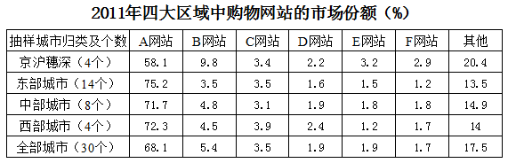

| 抽样城市归类及个数 | A网站 | B网站 | C网站 | D网站 | E网站 | F网站 | 其他 |
| --- | ---: | ---: | ---: | ---: | ---: | ---: | ---: |
| 京沪穗深（4个） | 58.1 | 9.8 | 3.4 | 2.2 | 3.2 | 2.9 | 20.4 |
| 东部城市（14个） | 75.2 | 3.5 | 3.5 | 1.6 | 1.5 | 1.2 | 13.5 |
| 中部城市（8个） | 71.7 | 4.8 | 3.1 | 1.9 | 1.8 | 1.8 | 14.9 |
| 西部城市（4个） | 72.3 | 4.5 | 3.9 | 2.4 | 1.2 | 1.7 | 14 |
| 全部城市（30个） | 68.1 | 5.4 | 3.5 | 1.9 | 1.9 | 1.7 | 17.5 |

### 第 116 题

2011年中国服装网购总额年增长率为：

A. 14.59%

B. 41.5%

C. 72.9%

D. 93.5%

第 116 题 · 答案与解析

**参考答案（粉笔题库参考内容）**

D

**解析**

根据题干“2011年中国服装网购总额年增长率为”，结合文字材料最后一句话，可判定本题为一般增长率问题。定位文字材料可得： 2011年总体网购市场增长率为72.9%，服装网购市场年增长率高于总体网购市场20.60个百分点。故2011年服装年增长率为72.9％＋20.6％＝93.5％。

故正确答案为D。

**考点**：一般增长率、综合资料

**来源**：2012年915联考《行测》题（新疆/福建/重庆/河南）第116题

### 第 117 题

2010年我国人均网购金额约为：

A. 2000元

B. 2500元

C. 3800元

D. 4200元

第 117 题 · 答案与解析

**参考答案（粉笔题库参考内容）**

B

**解析**

根据题干“2010年我国人均网购金额”，结合材料数据为2011年，可判定本题为基期平均数问题。定位文字材料第一段可得：2011年全年网购总额8090亿元，比2010年增长72.90%；网购人数2.12亿，比2010年增长14.59%。根据基期平均数公式：A/B×(1+b)/(1+a)，故2010年我国人均网购金额= 8090/2.12 × (1+14.59%)/(1+72.90%) ≈ 8000/2 × 1.1/1.7 = 8800/3.4 ≈ 2588元，与B项最接近。

故正确答案为B。

**考点**：基期平均数、综合资料

**来源**：2012年915联考《行测》题（新疆/福建/重庆/河南）第117题

### 第 118 题

2011年上述表格所列的购物网站中，在西部城市市场份额高于其在抽样市场平均份额的有：

A. 1个

B. 2个

C. 3个

D. 4个

第 118 题 · 答案与解析

**参考答案（粉笔题库参考内容）**

C

**解析**

定位表格后两行数据，西部城市市场份额高于抽样市场（全部城市）平均份额的有：A网站（72.3%>68.1%）、C网站（3.9%＞3.5%）、D网站（2.4%＞1.9%），共计3个。

故正确答案为C。

**考点**：直接找数、综合资料

**来源**：2012年915联考《行测》题（新疆/福建/重庆/河南）第118题

### 第 119 题

2011年上述表格所列的购物网站中，有2个以上区域市场化比其抽样市场平均份额高1个百分点的是：

A. A网站

B. B网站

C. C网站

D. D网站

第 119 题 · 答案与解析

**参考答案（粉笔题库参考内容）**

A

**解析**

定位表格材料可得： A网站的京沪穗深区域份额为58.1%、东部城市份额为75.2%、中部城市为71.7%、西部城市为72.3%，抽样城市平均份额为68.1%。故A网站有东部、中部、西部共3个区域比其抽样市场平均份额高1个百分点，符合条件。

故正确答案为A。

**考点**：直接找数、综合资料

**来源**：2012年915联考《行测》题（新疆/福建/重庆/河南）第119题

### 第 120 题

从上述资料不能推出的是：

A. 2011年全国网民人数

B. 2010年中国服装网购市场份额

C. 2011年四大区域以外网民的人均网购金额

D. 2010年A网站在30个目标城市中所占的市场份额

第 120 题 · 答案与解析

**参考答案（粉笔题库参考内容）**

D

**解析**

A项：定位文字材料第一段：2011年网购人数达到2.12亿，占到2011年全部网民数的41.50%。根据公式：总量 = 部分量/(部分量占总量的比重)，故2011年全国网民人数=2.12/41.5%，可以推出；

B项：定位文字材料第一段：2011年中国服装网购市场总额为全年网购总额的33.00%，年增长率高于总体网购市场增长率20.60个百分点；全年网购总额达到8090亿元，比2010年增长72.90%。根据公式：基期量 = 现期量/(1+增长率)，故2010年中国服装网购市场份额=(8090×33.00%)/(1+(72.90%+20.60%))=(8090×33.00%)/(1+93.5%)，可以推出；

C项：定位文字材料第一段：2011年我国全年网购总额达到8090亿元，网购人数达到2.12亿；4大区域中最具代表性的30个城市共有8626万个网购消费者，网购总额占到当年全国网购总额的44.67%。材料没有给出四大区域其他城市的网购人数和网购总额，故无法推出；

D项：定位表格材料：只给出了2011年四大区域中A网站的市场份额，没有2010年的数据，故无法推出。

故正确答案为C和D。

【备注】：本题选项不严谨，C项：材料中只给出4大区域最具代表性的30个城市网购人数和网购总额，其他城市是否有网购消费者并不明确，无法将30个城市的数据等同于区域总数。基于以上分析，粉笔认为本题C、D选项均无法推出，都应该是正确答案。

**考点**：综合分析、综合资料

**来源**：2012年915联考《行测》题（新疆/福建/重庆/河南）第120题

