# 2013年413联考《行测》题（辽宁/湖南/湖北/安徽/四川/福建/云南/黑龙江/江西/广西/贵州/海南/内蒙古/山西/重庆/宁夏/西藏）

<!-- gwy:overview:start -->
> **福建 · 2013 · 行测 · 统考** ｜ 154 题 · 图片 96 处 · 答案随题折叠

| 题型模块 | 题量 | 题号 |
| --- | ---: | ---: |
| 常识判断 | 25 | 1–25 |
| 言语理解与表达 | 50 | 26–75 |
| 数量关系 | 15 | 76–90 |
| 判断推理 | 44 | 91–134 |
| 资料分析 | 20 | 135–154 |
| **合计** | **154** | |

导航：[题型与作答说明](#题型与作答说明) · [题目](#题目) · [材料 1](#材料-1)
<!-- gwy:overview:end -->

> 候选采集稿。参考答案及解析来自粉笔页面，不代表官方答案或真实高分答卷；来源使用许可与原卷对应关系仍需人工核实。

## 题型与作答说明

常识判断

（25题）

根据题目要求，在每个选项中选出一个正确答案。

言语理解与表达

（50题）

根据题目要求，在每个选项中选出一个正确答案。

数量关系

（15题）

在这部分试题中，每道题中呈现一段表述数字关系的文字，要求你迅速、准确地计算出答案。

判断推理

（44题）

本部分包括图形推理、定义判断、类比推理与逻辑判断四种类型的试题。

资料分析

（20题）

所给出的图、表、文字或综合性资料均有若干个问题要你回答。你应根据资料提供的信息进行分析、比较、计算和判断处理。

## 题目

### 第 1 题

十八大报告提出“两个翻番”，到2020年实现国内生产总值（GDP）和城乡居民人均收入比2010年翻一番。下列关于“两个翻番”，表述错误的是：

A. 党的十八大首次对城乡居民收入增长提出了量化目标

B. 到2020年我国城乡居民每人收入预计都能够实现倍增

C. 城乡居民人均收入翻番是GDP翻番的出发点和落脚点

D. 到2020年我国GDP预计将超过2000年GDP的4倍

第 1 题 · 答案与解析

**参考答案（粉笔题库参考内容）**

B

**解析**

本题考查新思想。

B项表述错误，党的十八大报告首次提出，到2020年“实现国内生产总值和城乡居民人均收入比2010年翻一番”的目标，B项偷换概念，“城乡居民人均收入”并不等同于“城乡居民每人收入”。

本题为选非题，故正确答案为B。

**考点**：经济建设

**来源**：2013年413联考《行测》题（辽宁/湖南/湖北/安徽/四川/福建/云南/黑龙江/江西/广西/贵州/海南/内蒙古/山西/重庆/宁夏/西藏）第1题

### 第 2 题

与我国接壤的金砖国家有：

A. 1个

B. 2个

C. 3个

D. 4个

第 2 题 · 答案与解析

**参考答案（粉笔题库参考内容）**

B

**解析**

金砖国家一共有五个，除中国外，还有俄罗斯、印度、巴西、南非四个国家，其中与中国接壤的国家为俄罗斯和印度。

故正确答案为B。

**考点**：中国地理

**来源**：2013年413联考《行测》题（辽宁/湖南/湖北/安徽/四川/福建/云南/黑龙江/江西/广西/贵州/海南/内蒙古/山西/重庆/宁夏/西藏）第2题

### 第 3 题

经济增长通常是指在一个较长的时间跨度上，一个国家人均产出（或人均收入）水平的持续增加。拉动经济增长的三大主要因素不包括：

A. 投资

B. 消费

C. 信贷

D. 出口

第 3 题 · 答案与解析

**参考答案（粉笔题库参考内容）**

C

**解析**

经济学上常把投资、消费、出口比喻为拉动GDP增长的“三驾马车”，显然不包含信贷。

本题为选非题，故正确答案为C。

**考点**：宏观经济与调控政策

**来源**：2013年413联考《行测》题（辽宁/湖南/湖北/安徽/四川/福建/云南/黑龙江/江西/广西/贵州/海南/内蒙古/山西/重庆/宁夏/西藏）第3题

### 第 4 题

下列奖项与其表彰的对象，对应关系错误的是：

A. 菲尔兹奖——数学家

B. 普利策奖——记者

C. 南丁格尔奖——医生

D. 图灵奖——计算机科学家

第 4 题 · 答案与解析

**参考答案（粉笔题库参考内容）**

C

**解析**

C项错误，南丁格尔奖是红十字国际委员会表彰在护理事业中做出卓越贡献人员的最高荣誉奖。1991年，红十字国际委员会布达佩斯代表大会通过的弗罗伦斯·南丁格尔奖章规则第二条规定，奖章可颁发给男女护士和男女志愿护理工作人员在平时或战时做出如下突出成绩者：“具有非凡的勇气和献身精神，致力于救护伤病员、残疾人或战争灾害的受害者；如有望获得奖章的人在实际工作中牺牲，可以追授奖章。”由上可知，南丁格尔奖并非用来表彰医生。

本题为选非题，故正确答案为C。

**考点**：文化常识

**来源**：2013年413联考《行测》题（辽宁/湖南/湖北/安徽/四川/福建/云南/黑龙江/江西/广西/贵州/海南/内蒙古/山西/重庆/宁夏/西藏）第4题

### 第 5 题

地震是地球上的主要自然灾害之一。下列关于地震的说法，错误的是：

A. 地震活动在时间分布上具有一定的周期性

B. 环太平洋地震带是地球上地震最活跃的地区

C. 里氏地震规模每增强一级，释放的能量约增加10倍

D. 有记录以来最大的一次大地震是1960年的智利大地震，其震级为9.5级

第 5 题 · 答案与解析

**参考答案（粉笔题库参考内容）**

C

**解析**

C项表述错误，里氏地震规模每增强一级，释放的能量约增加30倍，并非10倍。

本题为选非题，故正确答案为C。

**考点**：其他

**来源**：2013年413联考《行测》题（辽宁/湖南/湖北/安徽/四川/福建/云南/黑龙江/江西/广西/贵州/海南/内蒙古/山西/重庆/宁夏/西藏）第5题

### 第 6 题

下列关于医学常识的说法，错误的是：

A. 临床上一般以红血球蛋白的浓度值作为诊断贫血的依据

B. 卡介苗是一种疫苗，一般在婴儿出生后接种，可以预防结核病

C. 游泳时应避免将水咽入口中，以免水通过鼻咽进入中耳引发中耳炎

D. 人体骨密度在达到高峰值后会逐渐下降，男性下降幅度较女性大

第 6 题 · 答案与解析

**参考答案（粉笔题库参考内容）**

D

**解析**

D项表述错误，年龄与性别是影响人骨矿含量的因素之一。婴儿至青春期骨矿物质含量随年龄增长而增加，且无明显性别差异。青春期之后，骨矿含量的增加男性较女性显著，30~40岁达到最高峰值。以后骨矿物质含量随年龄的增长逐渐下降，女性下降幅度较男性大，而并非男性下降幅度较女性大。

本题为选非题，故正确答案为D。

**考点**：生活常识

**来源**：2013年413联考《行测》题（辽宁/湖南/湖北/安徽/四川/福建/云南/黑龙江/江西/广西/贵州/海南/内蒙古/山西/重庆/宁夏/西藏）第6题

### 第 7 题

下列物品利用凸透镜透光原理的是：

A. 近视镜

B. 显微镜目镜

C. 汽车观后镜

D. 手电筒反光镜

第 7 题 · 答案与解析

**参考答案（粉笔题库参考内容）**

B

**解析**

A项错误，近视镜是利用了凹透镜原理；B项正确，显微镜目镜利用了凸透镜原理；C项错误，汽车观后镜利用了凸面镜发散的原理；D项错误，手电筒反光镜利用了凹面镜的原理。

故正确答案为B。

**考点**：物理常识

**来源**：2013年413联考《行测》题（辽宁/湖南/湖北/安徽/四川/福建/云南/黑龙江/江西/广西/贵州/海南/内蒙古/山西/重庆/宁夏/西藏）第7题

### 第 8 题

下列历史文化遗址位于我国最南边的是：

A. 半坡遗址

B. 周口店遗址

C. 河姆渡遗址

D. 大汶口遗址

第 8 题 · 答案与解析

**参考答案（粉笔题库参考内容）**

C

**解析**

半坡遗址位于陕西省西安市；周口店遗址位于北京市房山区；河姆渡遗址位于浙江省余姚市河姆渡镇；大汶口遗址位于山东泰安。四个地点中浙江省余姚市位置最靠南。

故正确答案为C。

**考点**：文化常识

**来源**：2013年413联考《行测》题（辽宁/湖南/湖北/安徽/四川/福建/云南/黑龙江/江西/广西/贵州/海南/内蒙古/山西/重庆/宁夏/西藏）第8题

### 第 9 题

关于《四库全书》，下列说法错误的是：

A. 编修于乾隆时期

B. 反映了清代图书的全貌

C. 在编纂过程中纪晓岚贡献突出

D. 分经、史、子、集四目

第 9 题 · 答案与解析

**参考答案（粉笔题库参考内容）**

B

**解析**

B项表述错误，《四库全书》是乾隆时期组织的一部规模巨大的丛书，分为经、史、子、集四部分；其中，纪昀、陆锡熊和孙士毅是《四库全书》的总纂官，纪晓岚的贡献突出，故A、C、D三项说法均正确。四库全书保存了中国历史大量文献，但其中不利于清朝统治的书籍被大批销毁、篡改，因此《四库全书》没有反映出清代图书的全貌。

本题为选非题，故正确答案为B。

**考点**：文学常识

**来源**：2013年413联考《行测》题（辽宁/湖南/湖北/安徽/四川/福建/云南/黑龙江/江西/广西/贵州/海南/内蒙古/山西/重庆/宁夏/西藏）第9题

### 第 10 题

关于京剧艺术，下列说法错误的是：

A. 《红灯记》和《智取威虎山》是现代京剧

B. 京剧表演的艺术手段主要有唱、念、做、打

C. 京剧的主要题材是才子佳人的故事

D. 京剧的脸谱一般用于净、丑两个角色

第 10 题 · 答案与解析

**参考答案（粉笔题库参考内容）**

C

**解析**

A项正确：京剧分为传统京剧和现代京剧。在内容上，传统京剧多表现历史题材，如《霸王别姬》《铡美案》等，多为帝王将相戏；而现代京剧多表现现实题材，如革命现代京剧《智取威虎山》《红灯记》《沙家浜》等。

B项正确：“唱、念、做、打”是戏曲表演中的四种艺术手段，也是戏曲表演的四种基本功。“唱”指唱功，“念”指具有音乐性的念白，二者相辅相成，构成歌舞化的戏曲表演艺术两大要素之一的“歌”；“做”指舞蹈化的形体动作，“打”指武打和翻跌的技艺，二者相互结合，构成歌舞化的戏曲表演艺术两大要素之一的“舞”。

C项错误：才子佳人的故事主要出现在越剧中。

D项正确：京剧脸谱艺术是中国传统戏曲的脸谱，是演员面部化妆的一种程式。一般应用于净、丑两个行当，其中各种人物大都有自己特定的谱式和色彩，借以突出人物的性格特征，具有“寓褒贬、别善恶”的艺术功能，使观众能目视外表，窥其心胸。

本题为选非题，故正确答案为C。

**考点**：文化常识

**来源**：2013年413联考《行测》题（辽宁/湖南/湖北/安徽/四川/福建/云南/黑龙江/江西/广西/贵州/海南/内蒙古/山西/重庆/宁夏/西藏）第10题

### 第 11 题

下列选项中，都与中国古代科举考试有关的一组词语是：

A. 蟾宫折桂、桂冠、连中三元

B. 问鼎中原、独占鳌头、蟾宫折桂

C. 连中三元、五子登科、名落孙山

D. 金榜题名、桂冠、独占鳌头

第 11 题 · 答案与解析

**参考答案（粉笔题库参考内容）**

C

**解析**

“连中三元”是指应试举子在三级科举考试中，连取三个第一名，这在封建社会是无上的荣宠；“五子登科”出自《宋史·窦仪传》，宋代窦禹钧的五个儿子仪、俨、侃、偁、僖相继及第，故称“五子登科”；“名落孙山”指考试或选拔没有录取。三个成语均与科举考试有关，C项正确。A、D两项错误，“桂冠”多作为光荣的称号，也比喻冠军，与科举考试无关；B项错误，“问鼎中原”是指称霸天下，与科举考试无关。

故正确答案为C。

**考点**：文学常识

**来源**：2013年413联考《行测》题（辽宁/湖南/湖北/安徽/四川/福建/云南/黑龙江/江西/广西/贵州/海南/内蒙古/山西/重庆/宁夏/西藏）第11题

### 第 12 题

《三国演义》开篇称“天下大势，分久必合，合久必分”。

但是这句话未必准确，因为：

A. 事物的发展需以条件为前提

B. 事物的本质不以时间为转移

C. 事物的质变是从量变开始的

D. 矛盾双方是可以相互转化的

第 12 题 · 答案与解析

**参考答案（粉笔题库参考内容）**

B

**解析**

此题为争议题。

    若破题的重点落在“分”与“合”上：事物是不断变化发展的，“分”与“合”就是发展变化的一种体现。而题干说“分久必合、合久必分”不正确，原因就是这种变化发展不是无条件的，绝对的，而是需要有一定的条件才能可以，符合A项的表述。

    若破题重点落在“久”上：题干表述为时间久了事物本质就会发生变化，由“合”到“分”，由“分”到“合”。如果这种说法不正确，则说明时间长短不是事物本质变化的因素，符合B项的表述。

    C无关选项，D的说法说明题干正确，故都不选，答案在AB之间。

    再回到题干，“分久必合、合久必分”，强调“久”字的意味更浓一些，侧重点在时间对事物本质的影响上，故粉笔题库倾向性答案为B。

故正确答案为B。

**考点**：唯物辩证法

**来源**：2013年413联考《行测》题（辽宁/湖南/湖北/安徽/四川/福建/云南/黑龙江/江西/广西/贵州/海南/内蒙古/山西/重庆/宁夏/西藏）第12题

### 第 13 题

某小区内业主共有的道路被物业公司划出停车位对外出租，其收益应该归＿＿＿＿＿＿所有。

A. 房地产开发商

B. 物业公司

C. 小区业主共有

D. 小区所在地居委会

第 13 题 · 答案与解析

**参考答案（粉笔题库参考内容）**

C

**解析**

本题考查法律常识。

根据我国《民法典》第二百七十五条规定：“建筑区划内，规划用于停放汽车的车位、车库的归属，由当事人通过出售、附赠或者出租等方式约定。占用业主共有的道路或者其他场地用于停放汽车的车位，属于业主共有。”因此小区内业主共有的道路被物业公司划出停车位对外出租，其收益应该归小区业主共有。

故正确答案为C。

**考点**：民法典

**来源**：2013年413联考《行测》题（辽宁/湖南/湖北/安徽/四川/福建/云南/黑龙江/江西/广西/贵州/海南/内蒙古/山西/重庆/宁夏/西藏）第13题

### 第 14 题

下列有关核能的表述，正确的是：

A. 氢弹爆炸发生轻核聚变，其威力比原子弹小

B. 核电站使用的燃料一般是铀等放射性重金属

C. 自然界只有在人为条件下才会发生热核反应

D. 核电站的能量转换过程是直接从核能到电能

第 14 题 · 答案与解析

**参考答案（粉笔题库参考内容）**

B

**解析**

A项错误，氢弹核聚变威力远大于原子弹的核裂变；B项正确，核电站使用的燃料一般是铀等放射性重金属；C项错误，热核反应的发生条件为高温高压，例如太阳表面就经常发生热核反应，并非只有在人为条件下才能发生；D项错误，核电站的能量转换过程为核能—内能—机械能—电能，并非一步到位。

故正确答案为B。

**考点**：科技理论与成就

**来源**：2013年413联考《行测》题（辽宁/湖南/湖北/安徽/四川/福建/云南/黑龙江/江西/广西/贵州/海南/内蒙古/山西/重庆/宁夏/西藏）第14题

### 第 15 题

下列行为侵犯到他人知识产权的是：

A. 甲模仿某知名作家的写作风格创作小说并以该作家名字公开发表

B. 甲因无法分辨真假销售某高仿皮具，但未给商标权利人造成损失

C. 甲开发“A之C”游戏并公开销售，但“AC”商标的权利人是乙

D. 甲申请注册“AC”琴行，“AC”二字与某知名电脑商标完全重合

第 15 题 · 答案与解析

**参考答案（粉笔题库参考内容）**

B

**解析**

A项为强干扰项，甲侵犯的是知名作家的姓名权，并不构成侵犯他人知识产权。

B项正确，《商标法》第六十四条第二款规定：“销售不知道是侵犯注册商标专用权的商品，能证明该商品是自己合法取得并说明提供者的，由工商行政管理部门责令停止销售，不承担赔偿责任。”本题中，无法分辨真假，且未给商标权利人造成损失，仅仅表明其不承担赔偿责任，但这并不意味着其不构成侵权，应当停止销售。

C项不选，“A之C”与“AC”商标区别明显，不构成侵权。

D项不选，甲申请注册“AC”琴行，仅仅是“申请注册”，并未实质侵犯某知名电脑商标持有人的权利。其次，商标注册也区分类别，琴行与电脑商标属于不同类别。因此不构成侵权。

故正确答案为B。

**考点**：劳动法和经济法

**来源**：2013年413联考《行测》题（辽宁/湖南/湖北/安徽/四川/福建/云南/黑龙江/江西/广西/贵州/海南/内蒙古/山西/重庆/宁夏/西藏）第15题

### 第 16 题

下列关于隐形飞机的原理，说法错误的是：

A. 外层涂料的颜色为天蓝色或银白色，以避免被雷达发现

B. 隐形飞机采用非金属材料或者雷达吸波材料，吸收而不是反射雷达波

C. 改进发动机的进气道和尾喷口等所有能产生镜面反射的表面，以减少对雷达波的反射

D. 除了发动机、电子设备等部件，其他飞机上的部件用透波材料来制作

第 16 题 · 答案与解析

**参考答案（粉笔题库参考内容）**

A

**解析**

A项错误，隐形飞机的原理主要是通过吸收雷达波，让雷达无法对其进行侦查。由于浅色几乎不吸收雷达波，深色更容易吸收雷达波，且黑色材料不易反光，因此，现阶段的隐形战机都是以深色为主。

本题为选非题，故正确答案为A。

**考点**：科技理论与成就

**来源**：2013年413联考《行测》题（辽宁/湖南/湖北/安徽/四川/福建/云南/黑龙江/江西/广西/贵州/海南/内蒙古/山西/重庆/宁夏/西藏）第16题

### 第 17 题

下列哪项没有运用热胀冷缩原理？

A. 医生用水银温度计给病人量体温

B. 架设天线时，两个电线杆之间的电线要略有下垂

C. 夏季自行车胎不能打太足的气

D. 古代人在冬天往岩石缝里灌水，水结冰膨胀后使岩石碎裂

第 17 题 · 答案与解析

**参考答案（粉笔题库参考内容）**

D

**解析**

D项错误，古代人采用冷冻法破碎岩石，是让水受冻结成冰，由于密度的变化导致体积膨胀使岩石开裂，并没有运用热胀冷缩的原理。

本题为选非题，故正确答案为D。

**考点**：物理常识

**来源**：2013年413联考《行测》题（辽宁/湖南/湖北/安徽/四川/福建/云南/黑龙江/江西/广西/贵州/海南/内蒙古/山西/重庆/宁夏/西藏）第17题

### 第 18 题

下列诗句描写菊花的是：

A. 纵被东风吹作雪，绝胜南陌碾成尘

B. 不要人夸好颜色，只留清气满乾坤

C. 疑是广寒宫里种，一秋三度送天香

D. 寂寞东篱湿露华，依前金靥照泥沙

第 18 题 · 答案与解析

**参考答案（粉笔题库参考内容）**

D

**解析**

本题考查人文历史。

A项错误，出自北宋文学家王安石的《北陂杏花》，描写的是杏花。

B项错误，出自元代诗人王冕的《墨梅》，描写的是梅花。

C项错误，出自宋朝王十朋的《桂花》，描写的是桂花。

D项正确，出自南宋诗人范成大的《重阳后菊花》。“东篱”出自陶渊明的“采菊东篱下”，后人常借以特指菊花栽种之地，因此描写的是菊花。

故正确答案为D。

**考点**：文学常识

**来源**：2013年413联考《行测》题（辽宁/湖南/湖北/安徽/四川/福建/云南/黑龙江/江西/广西/贵州/海南/内蒙古/山西/重庆/宁夏/西藏）第18题

### 第 19 题

“中华老字号”沿袭和传承中华民族优秀的文化传统，每个老字号都有特色的产品、技艺或服务。下列按经营服务范围对老字号进行归类正确的是：

A. 稻香村、女儿红

B. 小绍兴、王老吉

C. 瑞蚨祥、老凤祥

D. 片仔癀、福胶

第 19 题 · 答案与解析

**参考答案（粉笔题库参考内容）**

D

**解析**

A项错误，稻香村主要经营糕点类，而女儿红是酒类；B项错误，小绍兴属于餐饮业，而王老吉属于凉茶；C项错误，瑞蚨祥主要出售绸布，老凤祥属于珠宝银店；D项正确，片仔癀和福胶都属于医药类。

故正确答案为D。

**考点**：文化常识

**来源**：2013年413联考《行测》题（辽宁/湖南/湖北/安徽/四川/福建/云南/黑龙江/江西/广西/贵州/海南/内蒙古/山西/重庆/宁夏/西藏）第19题

### 第 20 题

中国是世界上稀土资源最丰富的国家，素有“稀土王国”之称。

下列关于稀土的表述，错误的是：

A. 稀土一般是以氧化物状态分离出来的，稀土的得名是因为很稀少

B. 美国是稀土的主要使用国，目前中国出口的稀土数量居全球之首

C. 我国是稀土资源储藏大国，也是稀土产品生产、应用和出口大国

D. 我国的稀土储量占世界稀土储量的百分比近年来因开发已经下降

第 20 题 · 答案与解析

**参考答案（粉笔题库参考内容）**

B

**解析**

据《中国的稀土状况与政策》白皮书，中国以23%的稀土资源承担了世界90%以上的市场供应。中国生产的稀土永磁材料、发光材料、储氢材料、抛光材料等均占世界产量的70%以上。日本是世界稀土主要消费国。

本题为选非题，故正确答案为B。

**考点**：中国地理

**来源**：2013年413联考《行测》题（辽宁/湖南/湖北/安徽/四川/福建/云南/黑龙江/江西/广西/贵州/海南/内蒙古/山西/重庆/宁夏/西藏）第20题

### 第 21 题

血浆包括各种矿物质、糖类、脂类、蛋白质、激素和维生素等。

在上述各种物质中，造成血液颜色为红色的是：

A. 激素

B. 蛋白质

C. 糖类

D. 维生素

第 21 题 · 答案与解析

**参考答案（粉笔题库参考内容）**

B

**解析**

血液呈红色是因为红细胞中含有的血红蛋白，血红蛋白是具有运输氧气能力的蛋白质。

故正确答案为B。

**考点**：生物常识

**来源**：2013年413联考《行测》题（辽宁/湖南/湖北/安徽/四川/福建/云南/黑龙江/江西/广西/贵州/海南/内蒙古/山西/重庆/宁夏/西藏）第21题

### 第 22 题

下列关于民事纠纷诉讼的说法，不符合法律规定的是：

A. 我国民事诉讼实行两审终审制

B. 二审案件由审判员组成的合议庭进行审理，合议庭成员为单数

C. 起诉时，必须以书面形式向人民法院提交起诉状

D. 简易程序只适用于基层人民法院及其派出法庭

第 22 题 · 答案与解析

**参考答案（粉笔题库参考内容）**

C

**解析**

A项，《民事诉讼法》第十条规定：“人民法院审理民事案件，依照法律规定实行合议、回避、公开审判和两审终审制度。”A项正确。

B项，《民事诉讼法》第四十条第一款规定：“人民法院审理第二审民事案件，由审判员组成合议庭。合议庭的成员人数，必须是单数。”B项正确。

C项，《民事诉讼法》第一百二十条规定：“起诉应当向人民法院递交起诉状，并按照被告人数提出副本。书写起诉状确有困难的，可以口头起诉，由人民法院记入笔录，并告知对方当事人。”由此可知，起诉时不是必须以书面形式，C项错误。

D项，《民事诉讼法》第一百五十七条规定：“基层人民法院和它派出的法庭审理事实清楚、权利义务关系明确、争议不大的简单的民事案件，适用本章规定。基层人民法院和它派出的法庭审理前款规定以外的民事案件，当事人双方也可以约定适用简易程序。”D项正确。

本题为选非题，故正确答案为C。

**考点**：诉讼法

**来源**：2013年413联考《行测》题（辽宁/湖南/湖北/安徽/四川/福建/云南/黑龙江/江西/广西/贵州/海南/内蒙古/山西/重庆/宁夏/西藏）第22题

### 第 23 题

下列语句与出处对应错误的是：

A. 不战而屈人之兵——《孙子兵法》

B. 知之为知之，不知为不知，是知也——《韩非子》

C. 天时不如地利，地利不如人和——《孟子》

D. 青出于蓝而胜于蓝——《荀子》

第 23 题 · 答案与解析

**参考答案（粉笔题库参考内容）**

B

**解析**

B项错误，“知之为知之，不知为不知，是知也”出自《论语·为政》。全句意思：知道就是知道，不知道就是不知道，这样才是真正的智慧。A、C、D项对应无误。

本题为选非题，故正确答案为B。

**考点**：文学常识

**来源**：2013年413联考《行测》题（辽宁/湖南/湖北/安徽/四川/福建/云南/黑龙江/江西/广西/贵州/海南/内蒙古/山西/重庆/宁夏/西藏）第23题

### 第 24 题

以下是一组古迹的图片，下列选项中国家排序与这组古迹对应关系正确的是：

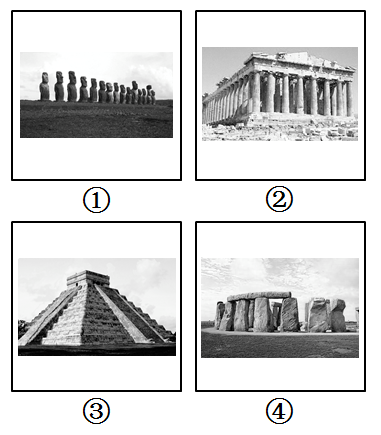

A. 墨西哥—英国—智利—希腊

B. 墨西哥—希腊—英国—智利

C. 智利—希腊—英国—墨西哥

D. 智利—希腊—墨西哥—英国

第 24 题 · 答案与解析

**参考答案（粉笔题库参考内容）**

D

**解析**

D项正确，四幅图中古迹依次为智利复活节岛上的石像、希腊的帕特农神庙、墨西哥的玛雅金字塔遗址、英国的巨石阵。

故正确答案为D。

**考点**：文化常识

**来源**：2013年413联考《行测》题（辽宁/湖南/湖北/安徽/四川/福建/云南/黑龙江/江西/广西/贵州/海南/内蒙古/山西/重庆/宁夏/西藏）第24题

### 第 25 题

当前下列国家中，国民用于购买食物费用占日常支出平均比重最高的是：

A. 美国

B. 智利

C. 希腊

D. 刚果

第 25 题 · 答案与解析

**参考答案（粉笔题库参考内容）**

D

**解析**

国民用于购买食物的费用占日常支出的比重即为恩格尔系数。恩格尔系数越大，代表生活水平越低，也就是国家越贫穷。四个国家中，刚果最贫穷，其恩格尔系数最高。

故正确答案为D。

**考点**：宏观经济与调控政策

**来源**：2013年413联考《行测》题（辽宁/湖南/湖北/安徽/四川/福建/云南/黑龙江/江西/广西/贵州/海南/内蒙古/山西/重庆/宁夏/西藏）第25题

### 第 26 题

对于一个经历过贫困童年的富翁来说，他的消费行为有时显得＿＿＿＿＿，对于大金额的支出，他会随随便便，甚至显得有些铺张浪费；对于小金额的支出，他则不得不与自己＿＿＿＿＿的吝啬性作斗争。

依次填入画横线部分最恰当的一项是：

A. 变幻莫测 积重难返

B. 出人意料 与生俱来

C. 反复无常 根深蒂固

D. 不可思议 始终如一

第 26 题 · 答案与解析

**参考答案（粉笔题库参考内容）**

C

**解析**

第一空，根据后文的解释可知，对经历过贫困童年的富翁来说，消费行为有两种情况：大金额支出随随便便，小金额支出过于吝啬，这已经是被人们了解的特点，A项“变幻莫测”指事物变化多端，难以预测，C项“反复无常”指常常变化，一会儿是这样，一会儿又是那样，变动不定，均符合文意，保留。B项“出人意料”意思是事物的好坏、情况的变化、数量的大小等出乎人们的意料，D项“不可思议”多指无法想象，难以理解，均强调想不到，感到非常意外，与文意不符，排除。

第二空，搭配“吝啬性”，C项“根深蒂固”比喻基础深厚，不容易动摇，可以搭配“吝啬性”，且与文段“经历过贫困童年”形成对应，当选。A项“积重难返”指长期形成的不良的风俗、习惯不易改变，与“吝啬性”搭配不当，排除。

故正确答案为C。

**考点**：对应关系-前后呼应、成语填空、词的辨析-搭配对象

**来源**：2013年413联考《行测》题（辽宁/湖南/湖北/安徽/四川/福建/云南/黑龙江/江西/广西/贵州/海南/内蒙古/山西/重庆/宁夏/西藏）第26题

### 第 27 题

文具行业以其覆盖面广、技术含量低、进入门槛极低、投资少见效快、市场需求大等因素吸引许多中小企业纷纷投资，但有些企业单纯为了扩大＿＿＿＿，采取降价策略，屡屡造成国际贸易＿＿＿＿，这些问题亟需引起有关部门重视并加以调控。

依次填入划横线部分最恰当的一项是：

A. 效益 纠纷

B. 规模 争端

C. 产量 矛盾

D. 出口 摩擦

第 27 题 · 答案与解析

**参考答案（粉笔题库参考内容）**

D

**解析**

第一空，与后文的“国际贸易”形成语义对应，只有“出口”能够体现出企业参与国际贸易活动，“效益”“规模”“产量”都不能与其形成对应，排除A、B、C三项。

第二空做验证，“贸易摩擦”为常见搭配，且符合文意。

故正确答案为D。

**考点**：实词填空、对应关系-前后呼应

**来源**：2013年413联考《行测》题（辽宁/湖南/湖北/安徽/四川/福建/云南/黑龙江/江西/广西/贵州/海南/内蒙古/山西/重庆/宁夏/西藏）第27题

### 第 28 题

拉丁美洲曾深受西方殖民主义之害，这形成了拉美人民在苦难中反思和抗争的传统，并铸就了＿＿＿＿＿的精神，正是这种精神气质使拉美电影在世界影坛＿＿＿＿＿。

依次填入划横线部分最恰当的一项是：

A. 百折不挠 独树一帜

B. 坚忍不拔 长盛不衰

C. 矢志不渝 别具一格

D. 奋发图强 独具匠心

第 28 题 · 答案与解析

**参考答案（粉笔题库参考内容）**

A

**解析**

第一空，文中提到拉丁美洲“深受西方殖民之害”“在苦难中反思和抗争的传统”，这体现了一种不屈服的精神，显然“百折不挠”最符合语境。百折不挠：比喻意志坚强，无论受到多少次挫折，毫不畏惧退缩，有不屈服之意。坚忍不拔：形容在艰苦困难的情况下意志坚定，毫不动摇，更侧重于坚定，缺少不屈服的意思。矢志不渝：表示永远不变心。奋发图强：振作精神，以求强盛。故A项最符合语境，排除B、C、D三项。

第二空做验证，“这种精神气质使拉美电影在世界影坛独树一帜”，意思通顺合理。独树一帜：比喻独特新奇，自成一家。用“长盛不衰”来形容拉美电影程度过重，也可排除B项。

故正确答案为A。

**考点**：对应关系-前后呼应、成语填空、词的辨析-程度轻重

**来源**：2013年413联考《行测》题（辽宁/湖南/湖北/安徽/四川/福建/云南/黑龙江/江西/广西/贵州/海南/内蒙古/山西/重庆/宁夏/西藏）第28题

### 第 29 题

“查清中国海，进军三大洋，登上南极洲”是曾经的海洋梦想“老三样”，这个梦想也只是在本世纪初才得以＿＿＿＿实现。但限于当时的能力，主要做的是海洋的表面文章，对于海面之下隐藏的深海神秘世界，则只是＿＿＿＿＿＿。

依次填入画横线部分最恰当的一项是：

A. 完整 浅尝辄止

B. 部分 走马观花

C. 彻底 浮光掠影

D. 具体 蜻蜓点水

第 29 题 · 答案与解析

**参考答案（粉笔题库参考内容）**

A

**解析**

第一空，所填词语与“实现”搭配，D项“具体”与“抽象”相对，不能与“实现”搭配，排除。

第二空，根据语境提示“限于当时的能力，主要做的是海洋的表面文章”可知，此处表示对于海洋的探索和研究不够深入，A项“浅尝辄止”表示略微尝试一下就停止，指学习、研究不下功夫深入钻研，符合语境，当选。B项“走马观花”指大略地观看一下，通常与“风景”“艺术品”搭配；C项“浮光掠影”指水面上浮起的光，一掠而过的影子，比喻观察不细致，印象不深刻，通常与“印象”搭配，这两个成语均不能形容对海洋的探索和研究，排除。

故正确答案为A。

**考点**：对应关系-解释说明、混搭填空、词的辨析-搭配对象

**来源**：2015年重庆市选调优秀大学生到基层工作考试《行测》题第23题

### 第 30 题

口感好、有营养、无污染……随着这些理念的＿＿＿＿＿，有机产品迅速发展。然而，一些问题也开始＿＿＿＿＿：有的生产或销售企业有机产品认证标志使用不规范；有的企业甚至以普通产品＿＿＿＿＿有机产品。

依次填入划横线部分最恰当的一项是：

A. 推行 突现 替换

B. 推进 凸现 代替

C. 推动 突显 冒充

D. 推广 凸显 假冒

第 30 题 · 答案与解析

**参考答案（粉笔题库参考内容）**

D

**解析**

从第一空入手，“理念”是一个抽象的概念，而“推进”和“推动”都对应具体的对象，如推进中美之间的合作、推动社会发展等，故排除B、C两项；

第二空：“突现”强调“突然”，有突发性。根据“随着……”可以知道，问题是在这些理念之后出现的，不具有突发性，排除A项。

再看第三个空，前面说到“使用不规范”，后面用到“甚至”，显然空白处的词，比“不规范”更严重，“假冒”更符合语境，“替换”程度太低，排除A项。

故正确答案为D。

**考点**：实词填空、对应关系-解释说明、词的辨析-搭配对象、词的辨析-词义侧重

**来源**：2013年413联考《行测》题（辽宁/湖南/湖北/安徽/四川/福建/云南/黑龙江/江西/广西/贵州/海南/内蒙古/山西/重庆/宁夏/西藏）第30题

### 第 31 题

人类和其他生物一样，都是自然界进化的结果，其他生物在享用大自然赋予的资源时，与人类拥有同样的＿＿＿＿＿。达尔文在《物种起源》一书的最后，写下了一段＿＿＿＿的话语：地球依照重力定理绕行太阳，从这么简单的起源，进化出无数最美丽、最奥妙的事物。这样的生命观，庄严、高贵而且壮阔。

依次填入划横线部分最恰当的一项是：

A. 待遇 深入浅出

B. 地位 奥妙无穷

C. 权利 发人深省

D. 优势 耐人寻味

第 31 题 · 答案与解析

**参考答案（粉笔题库参考内容）**

C

**解析**

由常识可知，生物的高低层次不同，对自然资源的利用程度必然也不同，人区别于动物，会使用工具，因此享有同样的“优势”是说不通的，排除D项。

再看第二空，文段表达的意思是达尔文在《物种起源》一书的最后一句话应是值得人思考的，结合上下文，“发人深省”更符合逻辑。发人深省是指启发人深刻思考，有所醒悟。“深入浅出”是指内容深刻，表达浅显。而达尔文最后说的这句话“地球依照重力定理绕行太阳······”并不浅显，排除A项；“奥妙无穷”是指奇妙之处极多，生命的起源固然奇妙，但是达尔文所说的话本身并不奇妙，因此排除B项。

故正确答案为C。

**考点**：对应关系-解释说明、混搭填空、词的辨析-搭配对象

**来源**：2013年413联考《行测》题（辽宁/湖南/湖北/安徽/四川/福建/云南/黑龙江/江西/广西/贵州/海南/内蒙古/山西/重庆/宁夏/西藏）第31题

### 第 32 题

欧盟《传统植物药注册程序指令》大限将至，中药出口欧洲遭遇严冬，人们不禁对中药＿＿＿＿产生了不小的怀疑。这其中确有中药自身种植、生产加工不统一的原因，致使药效和安全性能受到国际市场＿＿＿＿，但究其深层原因，则与国际中药市场暗藏的利益争夺不无关系。

依次填入划横线部分最恰当的一项是：

A. 标准化 排斥

B. 现代化 指责

C. 产业化 发难

D. 国际化 质疑

第 32 题 · 答案与解析

**参考答案（粉笔题库参考内容）**

D

**解析**

第一空，根据根据“中药出口欧洲遭遇严冬”可知，横线处体现中药在国际市场的发展遇到了阻碍，人们因此对中药在国际上的发展产生了怀疑。D“国际化”指使某事务、问题、标准等具有国际性质，符合文意，保留。A项“标准化”指统一的技术标准，B项“现代化”指使具有现代先进科学技术水平，D项“产业化”指依靠专业服务和质量管理，形成的系列化和品牌化的经营方式和组织形式，均与文意不符，排除。

第二空，代入验证。根据“人们不禁······产生了不小的怀疑”“这其中”可知，横线处体现国际市场对中药“药效和安全性能”的心存疑问的态度。D项“质疑”指提出疑问，符合文意，当选。

故正确答案为D。

【文段出处】《科技生活》：《中药标准之战》

**考点**：关联关系-因果关系、实词填空、对应关系-前后呼应、词的辨析-搭配对象

**来源**：2013年413联考《行测》题（辽宁/湖南/湖北/安徽/四川/福建/云南/黑龙江/江西/广西/贵州/海南/内蒙古/山西/重庆/宁夏/西藏）第32题

### 第 33 题

在多元化语境下，出现＿＿＿＿的情感价值取向实属正常现象，我们充分尊重个人的情感选择。但是，过度＿＿＿＿情感的极端自由、极端物欲，其实会给个人的幸福带来许多内伤。

依次填入划横线部分最恰当的一项是：

A. 林林总总 鼓吹

B. 琳琅满目 渲染

C. 纷繁芜杂 追逐

D. 标新立异 强调

第 33 题 · 答案与解析

**参考答案（粉笔题库参考内容）**

A

**解析**

直接从第一空就可得到答案：“多元化语境”只能对应“林林总总”。“琳琅满目”形容各种美好的事物很多（多指书籍或工艺品多），“纷繁芜杂”是形容文章或事情杂而多，“标新立异”多形容主张和见解，均不符合语境。

验证第二空，文段第二句说到“极端自由”“极端物欲”可见偏消极，“鼓吹”符合语境。

故正确答案为A。

**考点**：对应关系-前后呼应、混搭填空、词的辨析-感情色彩、词的辨析-搭配对象

**来源**：2013年413联考《行测》题（辽宁/湖南/湖北/安徽/四川/福建/云南/黑龙江/江西/广西/贵州/海南/内蒙古/山西/重庆/宁夏/西藏）第33题

### 第 34 题

及时纠偏，＿＿＿＿＿纠错，不仅体现一个社会的集体智慧，也是一个国家理性力量的表现。就像当初如能认识到人口问题的严重性，今天解决人口超负荷的难度就会低得多。因此，从及时纠错的现代理性角度看，适度容忍不同声音是相当必要的，多元价值的重要意义之一便是达到某种＿＿＿＿，以免在一个方向上走得太远而使纠错成本过大。

依次填入画横线部分最恰当的一项是：

A. 尽早 制衡

B. 彻底 均衡

C. 公开 均势

D. 坦诚 和谐

第 34 题 · 答案与解析

**参考答案（粉笔题库参考内容）**

A

**解析**

“纠偏”与“纠错”并列，因此第一空应选择“及时”的近义词，显然只有“尽早”符合语境。验证第二空，根据语境，“适度容忍不同的声音是相当必要的”“以免在一个方向上走得太远”，所以多元价值的含义就是不同价值间的制约与平衡，“制衡”也最贴近语境，排除B、C、D三项。

故正确答案为A。

**考点**：关联关系-并列关系、实词填空

**来源**：2013年413联考《行测》题（辽宁/湖南/湖北/安徽/四川/福建/云南/黑龙江/江西/广西/贵州/海南/内蒙古/山西/重庆/宁夏/西藏）第34题

### 第 35 题

在知识大爆炸的今天，不少人已习惯于浅阅读，这虽在所难免，其＿＿＿＿也是明显的。浅阅读虽能够收获一些印象式的谈资，但＿＿＿＿之中透露出的是浮躁心气，很难＿＿＿＿＿为提升阅读者主体素质的扎实“文化准备”。

依次填入画横线部分最恰当的一项是：

A. 代价 走马观花 转换

B. 影响 浅尝辄止 汲取

C. 弊端 浮光掠影 沉淀

D. 局限 言谈举止 锤炼

第 35 题 · 答案与解析

**参考答案（粉笔题库参考内容）**

C

**解析**

第一空，根据“这虽在所难免”可知，横线处与前文构成转折关系，横线处体现浅阅读虽然在所难免，但也存在问题。C项“弊端”指由于规章制度上的毛病或工作上的漏洞而发生的损害公益的事情，D项“局限”指限制在某个范围内，均符合文意，保留。A项“代价”泛指为达到某种目的所耗费的物质或精力，形容“浅阅读”程度过重，排除；B项“影响”指对别人的思想或行动起作用，程度过轻，排除；

第二空，根据“印象式的谈资”及“透露出的是浮躁心气”可知，横线处体现浅阅读是囫囵吞枣、不求甚解的阅读方式，没有深入之意。C项“浮光掠影”比喻印象不深，符合文意，保留。D项“言谈举止”指人的言语、举动、行为，不符合文意，排除。

第三空，代入验证。根据“提升阅读者主体素质的扎实‘文化准备’”可知，横线处需体现知识转化为“扎实‘文化准备’”的过程。C项“沉淀”指积累、凝聚，体现知识经过深度吸收后形成稳固素养的过程，符合文意，当选。

故正确答案为C。

**考点**：关联关系-转折关系、对应关系-前后呼应、混搭填空、词的辨析-搭配对象、词的辨析-程度轻重

**来源**：2013年413联考《行测》题（辽宁/湖南/湖北/安徽/四川/福建/云南/黑龙江/江西/广西/贵州/海南/内蒙古/山西/重庆/宁夏/西藏）第35题

### 第 36 题

负面新闻并不是永远都制造＿＿＿＿，从商业角度看，负面宣传在某种情况下可以＿＿＿＿＿销售，尤其在公司和产品不知名的情况下。曾有研究者发现，如果某些书籍的作者让读者感觉＿＿＿＿＿，书被评为劣作却能起到相反的效果——它们的销量增加了45%。

依次填入画横线部分最恰当的一项是：

A. 伤害 促进 亲切

B. 损失 带动 熟悉

C. 悲剧 刺激 陌生

D. 难题 提高 冷淡

第 36 题 · 答案与解析

**参考答案（粉笔题库参考内容）**

C

**解析**

本题可从第二空入手，横线处所填词语需与“销售”搭配，D项“提高”一般搭配“销量”，排除。

第三空，横线处所填词语与前文“在公司和产品不知名的情况下”相对应，C项“陌生”对应最恰当，符合文意，保留。A项“亲切”和B项“熟悉”明显与前文“不知名”相矛盾，排除。

第一空，代入验证，C项“悲剧”与“制造”搭配恰当，符合文意，当选。

故正确答案为C。

**考点**：实词填空、对应关系-前后呼应、词的辨析-搭配对象

**来源**：2013年413联考《行测》题（辽宁/湖南/湖北/安徽/四川/福建/云南/黑龙江/江西/广西/贵州/海南/内蒙古/山西/重庆/宁夏/西藏）第36题

### 第 37 题

优秀的企业需要什么样的员工？他们需要的不仅仅是＿＿＿＿的员工，更需要员工发挥其聪明才智。如果领导者不能充分信任员工、激励员工，很多员工并不会多走一步，主动承担责任，为企业做出额外的贡献。即使员工能对上司的吩咐一五一十地执行，不会消极怠工，但也绝不会主动＿＿＿＿。

依次填入划横线部分最恰当的一项是：

A. 朝气蓬勃 完成

B. 兢兢业业 工作

C. 脚踏实地 改进

D. 言听计从 创新

第 37 题 · 答案与解析

**参考答案（粉笔题库参考内容）**

D

**解析**

本题由第一空可直接得到答案。文段开篇说到“需要的不仅仅是……的员工”，“更需要员工……”，且最后一句话说到“即使员工能对上司的吩咐一五一十地执行……也绝不会主动……”，即“能对上司的吩咐一五一十地执行”的员工对应一个空白处所填员工的特点，与之对应的成语只有“言听计从”，排除A、B、C三项。兢兢业业：形容做事谨慎、勤恳。

验证第二空，填入“创新”与前面“额外的贡献”对应恰当。

故正确答案为D。

**考点**：对应关系-前后呼应、混搭填空

**来源**：2013年413联考《行测》题（辽宁/湖南/湖北/安徽/四川/福建/云南/黑龙江/江西/广西/贵州/海南/内蒙古/山西/重庆/宁夏/西藏）第37题

### 第 38 题

对于吸引人才，地方政府最应该做的，是营造一个适合人才流动、有利人才成长的环境与空间，而不是直接参与、甚至＿＿＿＿企业的人才录用过程。其实，自由、公平的竞争本身就是对人才最好的回报，足够的成长空间才是＿＿＿＿＿吸引人才、留住人才的沃土。

依次填入划横线部分最恰当的一项是：

A. 影响 有效

B. 干预 直接

C. 破坏 长期

D. 主导 长久

第 38 题 · 答案与解析

**参考答案（粉笔题库参考内容）**

D

**解析**

第一空，注意“甚至”这个词，说明第一空的词语应与“参与”含义相近，且程度更深。“破坏”用于形容地方政府程度太重，排除C项；“影响”即过问或参与，与“参与”一词在程度上相同，排除A项。

第二空，横线处所填词语与“吸引”和“留住”搭配，政府通过提供足够的成长空间，创造有利环境，能够对人才形成持久的吸引力，D项“长久”符合语境，当选；B项，能“直接”留住、吸引人才的原因更多是高薪资而非成长空间，排除。

故正确答案为D。

**考点**：关联关系-并列关系、实词填空、词的辨析-搭配对象、词的辨析-程度轻重

**来源**：2013年413联考《行测》题（辽宁/湖南/湖北/安徽/四川/福建/云南/黑龙江/江西/广西/贵州/海南/内蒙古/山西/重庆/宁夏/西藏）第38题

### 第 39 题

如果全球变暖导致海平面大幅上升，和其他国家一样，中国将要＿＿＿＿被海水淹没地区的人口，特别是长江下游河段，或者建造大坝保护地处低洼地区的沿海城市，这些都需要巨大的花费。中国和其他国家面临的挑战是限制二氧化碳的排放，从而＿＿＿＿＿全球变暖所导致的最坏结果的发生，这在未来20年里更加重要。

依次填入划横线部分最恰当的一项是：

A. 转移 阻止

B. 控制 避免

C. 延缓 减少

D. 安置 改变

第 39 题 · 答案与解析

**参考答案（粉笔题库参考内容）**

A

**解析**

第一空，观察语境，“被海水淹没地区的人口”应被“转移”和“安置”，“控制”和“延缓”明显不符合语境，排除B、C两项。

第二空，“阻止……发生”，搭配合理，如用“改变”一词，合理的搭配为“改变某种结果”“改变最坏的结果”，而不是“改变最坏结果的发生”，排除D项。

故正确答案为A。

**考点**：关联关系-因果关系、实词填空、对应关系-前后呼应、词的辨析-搭配对象

**来源**：2013年413联考《行测》题（辽宁/湖南/湖北/安徽/四川/福建/云南/黑龙江/江西/广西/贵州/海南/内蒙古/山西/重庆/宁夏/西藏）第39题

### 第 40 题

龙马负图、神龟载书，远古时代河图洛书的传说，数千年来被认为是中华传统文化的源头。河图出于河南洛阳市的孟津县，人们对它已是＿＿＿＿＿ ，而洛书出于何处，一直＿＿＿＿＿，没有定论。

依次填入划横线部分最恰当的一项是：

A. 无可厚非 莫衷一是

B. 了然于胸 疑窦重重

C. 如数家珍 扑朔迷离

D. 妇孺皆知 影影绰绰

第 40 题 · 答案与解析

**参考答案（粉笔题库参考内容）**

B

**解析**

第一空，根据文意，“河图出于河南洛阳市的孟津县”是人们都知道、都了解的事情，故横线成语表达了解、熟悉的意思，对应B项“了然于胸”。A项“无可厚非”是指没什么可过分责难的，表示虽有缺点，但是可以原谅，表意与语境不符，排除；C项“如数家珍”是指像数自己家里的珍宝一样，形容对列举的事物或叙述的故事十分熟悉，一般会伴随“谈起”“说起”这样的语境，放在此处用法有误，且程度过重，排除；D项“妇孺皆知”，可以表述为：“某件事妇孺皆知”，不能叫作“人们已经妇孺皆知”，“妇孺”与“人们”重复，排除。

第二空进行验证，B项“疑窦重重”指有很多让人怀疑之处，文中提到“没有定论”，表明“洛书出于何处”这件事情有很多说法，没有统一的结论，每种说法都不确定，“疑窦重重”符合语境，当选。

故正确答案为B。

【成语积累】

莫衷一是：意思是不知哪个是正确，形容很多人之间意见分歧，没有一致的看法。

了然于胸：心里非常明白。

如数家珍：像数自己家里的珍宝一样，形容对列举的事物或叙述的故事十分熟悉。

妇孺皆知：意思就是妇女和小孩都知道，指某件事物众所周知，流传得很广。

影影绰绰：中性成语，可形容人或物模糊，隐约，看不真切。

**考点**：对应关系-前后呼应、成语填空

**来源**：2013年413联考《行测》题（辽宁/湖南/湖北/安徽/四川/福建/云南/黑龙江/江西/广西/贵州/海南/内蒙古/山西/重庆/宁夏/西藏）第40题

### 第 41 题

当然，想象并不是凭空＿＿＿＿＿的。丰富的想象来源于知识的广博和平时对生活深入、细致的观察。观察就要用专业的角度去关注、＿＿＿＿＿周围的事物，有意识地汲取、思索、分析，看在眼里，记在心里。

依次填入划横线部分最恰当的一项是：

A. 杜撰 体验

B. 虚构 体味

C. 捏造 体会

D. 臆造 体察

第 41 题 · 答案与解析

**参考答案（粉笔题库参考内容）**

D

**解析**

第一空，“凭空捏造/臆造”都是比较常见的搭配，杜撰和虚构都含有“凭空编造”的概念，排除A、B两项。

第二空，根据文段，想象来源于对生活的“观察”，“观察就要用……”且空白处与“关注”一词构成并列关系，应意思相近，也应有“看”的意思。D项“体察”指体会和观察，具备“看”的意思；C项“体会”指体验领会，体现不出“看”的意思，故D项“体察”符合文意。

故正确答案为D。

**考点**：关联关系-并列关系、实词填空、词的辨析-搭配对象

**来源**：2013年413联考《行测》题（辽宁/湖南/湖北/安徽/四川/福建/云南/黑龙江/江西/广西/贵州/海南/内蒙古/山西/重庆/宁夏/西藏）第41题

### 第 42 题

从社会学的眼光看，重复博弈的结果之一可能是博弈双方由陌生人变为熟人，甚至成为＿＿＿＿，并发展出超越当下经济互动关系之外的其他社会关系，假如当前的经济互动关系只不过是发生在双方之间的多种社会交往之中的一种，其他社会交往就可能＿＿＿＿＿＿＿当事人在当下博弈中的策略选择。

依次填入划横线部分最恰当的一项是：

A. 伙伴 加快

B. 搭档 操纵

C. 朋友 影响

D. 同僚 改变

第 42 题 · 答案与解析

**参考答案（粉笔题库参考内容）**

C

**解析**

第一空，由前面的“甚至”可知，此处应填入一个比“熟人”程度更深的词语，“同僚”泛指在机关单位任职的同事，显然不符合语境，排除D。

第二空，文段的意思是，博弈双方如果变成熟人，那么他们之间的关系就可能在两人博弈的过程当中发生某种作用，“影响”最符合语境，“操纵”程度过重，“加快”过于绝对，有时当事人可能会延缓策略的选择，故不符合语境。

故正确答案为C。

**考点**：实词填空、对应关系-前后呼应、词的辨析-程度轻重

**来源**：2013年413联考《行测》题（辽宁/湖南/湖北/安徽/四川/福建/云南/黑龙江/江西/广西/贵州/海南/内蒙古/山西/重庆/宁夏/西藏）第42题

### 第 43 题

情报专家巴克斯特在给花草浇水时，脑子里突然出现了一个＿＿＿＿＿的念头，也许是经常与间谍、情报打交道的缘故，他竟＿＿＿＿＿＿地把测谎仪器的电极绑到一株天南星植物的叶片上，他惊奇地发现，测谎仪上显示出的曲线图形居然与人在激动时测到的曲线图形很相似。

依次填入划横线部分最恰当的一项是：

A. 古怪 异想天开

B. 奇特 心血来潮

C. 怪异 浮想联翩

D. 奇怪 突发奇想

第 43 题 · 答案与解析

**参考答案（粉笔题库参考内容）**

A

**解析**

先看第二空，浮想联翩：指许许多多的想象不断涌现出来。而文段是在描述这个人的一个行为，故搭配不当，排除C项。文段前面提到“脑子里突然出现了一个念头”，然后去做了一件事，“突发奇想”与前文的“突然出现一个念头”重复，故排除。心血来潮：指心里突然或偶然起了一个念头。同样与前文的“突然出现一个念头”重复，故排除B项。测谎仪器原本是给人用的，而巴克斯特却将之应用在植物的叶片上，这种行为是不符合常理、奇怪无法理解的。因此“异想天开”恰当。异想天开：指想法很不切实际，非常奇怪。

验证第一空，“古怪”填入符合语境。

故正确答案为A。

**考点**：对应关系-前后呼应、混搭填空、词的辨析-搭配对象

**来源**：2013年413联考《行测》题（辽宁/湖南/湖北/安徽/四川/福建/云南/黑龙江/江西/广西/贵州/海南/内蒙古/山西/重庆/宁夏/西藏）第43题

### 第 44 题

在美国，失业保险金的主要＿＿＿＿＿是雇主缴纳的失业保险税，只有少数几个州会向职工征收失业保险税，税率根据雇主裁员前享受失业保险待遇的雇员人数的多少而上下浮动，解雇率高，税率越高，这种计算方式可以有效＿＿＿＿＿雇主的解雇行为。

依次填入划横线部分最恰当的一项是：

A. 构成 避免

B. 类型 减少

C. 来源 控制

D. 保障 降低

第 44 题 · 答案与解析

**参考答案（粉笔题库参考内容）**

C

**解析**

第一空，后文提到了征收对象，故A项“构成”和C项“来源”更为恰当，排除B、D两项。

第二空，解雇行为是无法“避免”的，只能“控制”，C项“控制”指使处于自己的占有、管理或影响之下，当选。A项“避免”指防止，设法不使某一情况发生，排除。

故正确答案为C。

**考点**：实词填空、对应关系-前后呼应、词的辨析-搭配对象

**来源**：2013年413联考《行测》题（辽宁/湖南/湖北/安徽/四川/福建/云南/黑龙江/江西/广西/贵州/海南/内蒙古/山西/重庆/宁夏/西藏）第44题

### 第 45 题

意大利地处欧亚大陆和非洲大陆板块的挤压带上，因此境内活火山较多，频繁爆发的火山给意大利人带来了丰厚的＿＿＿＿＿–可作为优质胶凝材料的火山灰。这种＿＿＿＿＿的自然条件使古罗马人利用火山灰发明了自然混凝土。

依次填入划横线部分最恰当的一项是：

A. 收获 天造地设

B. 回报 应有尽有

C. 财富 举世无双

D. 馈赠 得天独厚

第 45 题 · 答案与解析

**参考答案（粉笔题库参考内容）**

D

**解析**

先看第一空，“播种”才能“收获”，“付出”才有“回报”，而文段并没有强调意大利人有付出，只是单纯的得到，排除A、B。

再看第二空，文段的意思是意大利有较好的自然条件，得天独厚意思恰当。举世无双：全世界找不到第二个，与语境不符，因为境内有活火山的国家不仅仅是意大利，这种情况并不是意大利独有的。排除C项。

故正确答案为D。

**考点**：对应关系-前后呼应、混搭填空、词的辨析-搭配对象

**来源**：2013年413联考《行测》题（辽宁/湖南/湖北/安徽/四川/福建/云南/黑龙江/江西/广西/贵州/海南/内蒙古/山西/重庆/宁夏/西藏）第45题

### 第 46 题

国际市场疲软给中国经济带来了不确定性，面对外汇资产缩水风险、出口贸易受到影响和输入性通胀压力上升等＿＿＿＿＿，中国需要＿＿＿＿＿＿考量应对，谋定而后动，制定短期和中长期的、货币和财政的、战略的和战术的、经济和政治的“中国政策” ＿＿＿＿＿。

依次填入划横线部分最恰当的一项是：

A. 困境 郑重 迫在眉睫

B. 考验 审慎 刻不容缓

C. 局面 仔细 急如星火

D. 局势 认真 十万火急

第 46 题 · 答案与解析

**参考答案（粉笔题库参考内容）**

B

**解析**

本题可先从第三空入手，“急如星火”和“十万火急”较口语化，不适用于文段语境所描述的事件及规范化的表达，排除C、D两项。

再看第二空，“郑重”指严肃、认真，侧重主观的态度，一般的搭配为“郑重宣布”“郑重宣誓”等，与空格后的“考量”不搭配，排除A项。

第一空代入验证，“面对考验”可以搭配。

故正确答案为B。

**考点**：混搭填空、词的辨析-感情色彩、词的辨析-搭配对象、词的辨析-词义侧重

**来源**：2013年413联考《行测》题（辽宁/湖南/湖北/安徽/四川/福建/云南/黑龙江/江西/广西/贵州/海南/内蒙古/山西/重庆/宁夏/西藏）第46题

### 第 47 题

想法或假说的产生，来源于研究者＿＿＿＿＿的思想，用来解释事物的成因，寻找或构造相关的＿＿＿＿，以便揭示所观察到的事实的真相，因而，假说完全有可能是＿＿＿＿＿的，知道这一点，养成产生想法时保留判断的习惯就非常重要。

依次填入划横线部分最恰当的一项是：

A. 自由 证据 错误

B. 主观 定律 歪曲

C. 特别 学说 荒谬

D. 独立 理论 虚假

第 47 题 · 答案与解析

**参考答案（粉笔题库参考内容）**

A

**解析**

第一空，根据“想法或假说的产生，来源于研究者······的思想”可知，横线处强调假说源于研究者自身的自主思考，并非被客观条件、既定结论所局限。A项“自由”指不受拘束、不受限制，符合假说产生时思想不受刻板束缚的特点，保留；B项“主观”指属于自我意识方面的，与客观相对，也可体现研究者自身思想，保留；D项“独立”指不依靠他人，侧重思想不依附他人，也可体现出研究者思想的“主观性”特点，保留。C项“特别”指与众不同、不普通，文段并未强调思想的特殊性，与文意不符，排除。

第二空，搭配“寻找或构造”且对应“用来解释事物的成因”“以便揭示所观察到的事实的真相”可知，假说产生的目的是解释成因、揭示真相，需要寻找支撑依据。A项“证据”指能够证明某事物真实性的有关事实或材料，符合“揭示真相”的文意，保留；B项“定律”是对客观规律的科学概括，具有确定性，与“构造”搭配不当，排除；D项“理论”指由实践概括出来的科学知识的有系统的结论，假说的目的是用依据解释事实，而非去构造成型理论，排除。

第三空，代入验证，根据“养成产生想法时保留判断的习惯就非常重要”可知，假说不一定正确，有可能不正确。A项“错误”指不正确、与客观实际不符合，符合文意，当选。

故正确答案为A。

【文段出处】《批判性思维与思维基本功》

**考点**：关联关系-因果关系、实词填空、对应关系-前后呼应、词的辨析-搭配对象

**来源**：2013年413联考《行测》题（辽宁/湖南/湖北/安徽/四川/福建/云南/黑龙江/江西/广西/贵州/海南/内蒙古/山西/重庆/宁夏/西藏）第47题

### 第 48 题

新闻媒介是沟通社会与政府的重要桥梁，在政务信息传输系统中具有＿＿＿＿＿的作用，但体制转型的压力，加之巨大利益的诱惑及制度缺失，给记者的职业操守带来巨大＿＿＿＿＿＿，各种虚假报道不时见诸报端，成为小道消息的渊源，因此我们必须不断完善新闻从业人员资格准入制度及新闻评估核实制度。

依次填入划横线部分最恰当的一项是：

A. 独一无二 冲击

B. 独树一帜 影响

C. 无与伦比 挫折

D. 无可厚非 挑战

第 48 题 · 答案与解析

**参考答案（粉笔题库参考内容）**

A

**解析**

第一空，根据前文“重要桥梁”可知，横线处词语有“重要”的含义，A项“独一无二”指没有相同的，没有可以比得上的，C项“无与伦比”指事物非常完美，没有东西能够与它相比，这两个词都可以用来形容重要作用，保留。B项“独树一帜”比喻自成一家，多用来形容风格独特，不能用来修饰“作用”，排除；D项“无可厚非”指不可过分指责，表示虽有缺点，但是可以原谅，不符合语境，排除。

第二空，根据“体制转型的压力，加之巨大利益的诱惑及制度缺失”可知，横线处词语应表示记者因外界压力和诱惑而被“影响”，A项“冲击”比喻干扰或打击使受到影响，搭配合理，符合语境，当选。C项“挫折”与“记者的职业操守”不能搭配，排除。

故正确答案为A。

**考点**：对应关系-前后呼应、混搭填空、词的辨析-搭配对象

**来源**：2013年413联考《行测》题（辽宁/湖南/湖北/安徽/四川/福建/云南/黑龙江/江西/广西/贵州/海南/内蒙古/山西/重庆/宁夏/西藏）第48题

### 第 49 题

前些年翻看先生的这本书时，尽管自己对民国话题有着欲说还休的浓厚兴味，对这本话语剪辑独出心裁的编排方式下潜藏的＿＿＿＿＿＿常常默契会心，但读完仍是感到＿＿＿＿＿。

依次填入划横线部分最恰当的一项是：

A. 至理名言 戛然而止

B. 妙言要道 耳目一新

C. 不经之谈 百读不厌

D. 微言大义 意犹未尽

第 49 题 · 答案与解析

**参考答案（粉笔题库参考内容）**

D

**解析**

第一空，根据“对这本话语剪辑独出心裁的编排方式下潜藏的”以及“常常默契会心”可知，横线处表达书中潜藏着深刻的道理。A项“至理名言”指最正确的道理，最精辟的言论，B项“妙言要道”指中肯的名言，深微的道理，D项“微言大义”指包含在精微语言里的深刻的道理，均符合文意，保留。C项“不经之谈”指荒诞无稽、没有根据的话，与文段感情色彩相悖，排除。

第二空，根据“读完仍是感到”可知，横线处说明书中内容值得回味之意。D项“意犹未尽”指还没有尽兴，能够体现出读完后仍觉得有很多值得回味的地方，符合文意，当选。A项“戛然而止”形容声音突然终止，常搭配“故事”“音乐”等，与“人”搭配不当，排除；B项“耳目一新”指听到的、看到的跟以前完全不同，使人感到新鲜，与文意不符，排除。

故正确答案为D。

**考点**：对应关系-前后呼应、成语填空、词的辨析-感情色彩、词的辨析-搭配对象

**来源**：2013年413联考《行测》题（辽宁/湖南/湖北/安徽/四川/福建/云南/黑龙江/江西/广西/贵州/海南/内蒙古/山西/重庆/宁夏/西藏）第49题

### 第 50 题

对城市建设焕然一新的追求，不仅会使城市记忆受到损坏甚至毁灭，也是对城市中人的生活情感的＿＿＿＿＿。城市中长期积淀形成的文化风格和人文环境，被当作了“过时”的东西予以＿＿＿＿＿＿或抛弃，城市记忆也因此没有了依托对象，公众的情感认同无法被唤起，在心灵上就会出现＿＿＿＿＿的不安状态。

依次填入划横线部分最恰当的一项是：

A. 轻视 改造 居无定所

B. 淡忘 分解 无依无靠

C. 漠然 整饬 孤苦伶仃

D. 亵渎 批判 举目无亲

第 50 题 · 答案与解析

**参考答案（粉笔题库参考内容）**

A

**解析**

第一空，用来形容对城市中人生活情感的态度，结合前文“不仅会使城市记忆受到损坏甚至毁灭”可知，这里表达的是一种不重视的态度。A项“轻视”指小看、不重视，B项“淡忘”指印象逐渐淡漠以至于忘记，均符合文意，保留。C项“漠然”指不关心、不在意的样子，通常形容词，置于此处用法不当，排除；D项“亵渎”指轻慢、不尊敬，程度过重，排除。

第二空，根据“或抛弃”可知横线与抛弃形成并列，A项“改造”有抛弃旧的，建造新的之意，保留。而B项“分解”是指将原物拆分，与“文化风格和人文环境”搭配不当，排除。

第三空，代入验证，A项“居无定所”指没有固定的居住地方，形容人在心灵上没有归属感，与前文“城市记忆没有了依托对象，公众的情感认同无法被唤起”相呼应，符合文意，当选。

故正确答案为A。

**考点**：关联关系-并列关系、混搭填空、词的辨析-搭配对象、词的辨析-程度轻重

**来源**：2013年413联考《行测》题（辽宁/湖南/湖北/安徽/四川/福建/云南/黑龙江/江西/广西/贵州/海南/内蒙古/山西/重庆/宁夏/西藏）第50题

### 第 51 题

有人说，传统小说是依赖经验的写作，而网络小说是依赖想象的写作。看来，这两种写作需要找到一个结合点，依赖经验的写作需要吸纳网络小说的想象，而依赖想象的写作则需要糅入传统小说中丰厚充实的经验。因此，当今的文学要从原创力日益萎缩的窘境中走出来，作家们增加生活经验的积累应该是一个非常关键的举措。但这还只是由经验通往原创力的第一步，接下来必须在体验上进行认真的修炼，使生活经验转化为心灵体验，使客观的经验世界转化为作家主观的心灵世界。

这段文字重点强调的是：

A. 如何转化经验吸纳想象

B. 怎样找到传统和网络小说的结合点

C. 作家应该如何不断地积累生活经验

D. 如何提高文学的原创力

第 51 题 · 答案与解析

**参考答案（粉笔题库参考内容）**

D

**解析**

文段开篇对比传统小说与网络小说的写作特点，指出二者需找到结合点，随后通过“因此”引出结论，即当今文学要从原创力日益萎缩的窘境中走出来，之后提出对策，即作家应注重生活经验的积累，并通过“但”补充强调，还需通过体验修炼将生活经验转化为心灵体验。故文段重点围绕如何解决文学原创力萎缩问题展开，对应D项。

A项“经验转化”、“吸纳想象”，B项“找到传统和网络小说的结合点”均对应“因此”之前的内容，非重点，且未提及文段主题词“原创力”，均排除；

C项“作家应该如何不断地积累生活经验”为解决问题的对策之一，表述片面，排除。

故正确答案为D。

【文段出处】人民日报《谈心灵体验与文学原创力》

**考点**：关联词-转折

**来源**：2013年413联考《行测》题（辽宁/湖南/湖北/安徽/四川/福建/云南/黑龙江/江西/广西/贵州/海南/内蒙古/山西/重庆/宁夏/西藏）第51题

### 第 52 题

历史学家的工作对象是史料，这些史料主要是各种文献、遗存，它们可以归为广义上的文本，而且最终它们都要以语言形式进入史家的研究。就此而论，历史学家永远无法真正直接接触到过去本身，而只能借助于各种历史文本对过去有所言说，因而，＿＿＿＿＿＿＿＿＿＿。

填入划横线部分最恰当的一项是：

A. 文本性就是历史学家的全部工作所无法脱离的樊篱

B. 无法接触完整的史料对历史学家来说是一种遗憾

C. 对史料本身的收集和考证就成了史学家客观性的保证

D. 重建和还原历史的本来面目就成了历史学的根本目的

第 52 题 · 答案与解析

**参考答案（粉笔题库参考内容）**

A

**解析**

横线位于文段结尾，需对前文内容进行总结概括。文段开篇说明历史学家的研究依托史料，而史料本质是语言形式的文本，接下来强调历史学家无法直接接触过去，只能借助历史文本开展研究。故文段重点强调文本贯穿了历史学家的工作过程，是历史学家无法脱离的资料，对应A项。

B项，文段重点强调文本是历史学家开展工作的必要依托，“无法接触完整的史料”偏离文段核心，且“遗憾”无中生有，排除；

C项，文段并未提及“史料本身的收集和考证”与“史学家客观性”的关联，排除；

D项，文段并未阐述“重建和还原历史的本来面目”是“历史学的根本目的”，无中生有，排除。

故正确答案为A。

**考点**：横线在结尾

**来源**：2013年413联考《行测》题（辽宁/湖南/湖北/安徽/四川/福建/云南/黑龙江/江西/广西/贵州/海南/内蒙古/山西/重庆/宁夏/西藏）第52题

### 第 53 题

公元1616年，莎士比亚与汤显祖同年逝世。二人可算作16、17世纪之交的伟大剧作家。二人都酷爱写剧本，不过写法却不大一样。比如《罗密欧与朱丽叶》故事临近结尾，一双恋人殉情身亡，惨烈的悲剧以双方家族的和解收尾。和解的意愿的确美妙，只可惜，莎翁用于和解的笔墨太过不经意，仿佛仅仅为了“和解”的概念草草应付收场。《牡丹亭》里的杜丽娘，因梦中的相遇而相思，而哀，而死，又因此而还生，而圆满。汤显祖将笔墨挥洒于爱而不耗损于恨，推敲于柔美而不沉醉于暴力，他笔下的爱，期待、给予、容纳、无嗔。

这段文字的主旨是：

A. 阐述莎士比亚和汤显祖的伟大之处

B. 分析《牡丹亭》独特的写作手法

C. 比较莎士比亚和汤显祖的艺术风格

D. 总结中外古典戏曲的共同点

第 53 题 · 答案与解析

**参考答案（粉笔题库参考内容）**

C

**解析**

文段结构为观点+解释说明（举例），前三句话是总述，点明了文段的主旨——莎士比亚和汤显祖是同时代的伟大剧作家，但是二人的剧本写法不一样。之后的内容是举例解释说明，以《罗密欧与朱丽叶》和《牡丹亭》为例，具体比较二者艺术风格的不同。C项完整地概括了文段的主旨，为正确答案。

A项是莎士比亚与汤显祖的共同之处，而文段重在说明两者的写法风格不同，排除；B项提《牡丹亭》为后文举例论证汤显祖写作手法部分，非重点，排除；D项，文段的主体是莎士比亚和汤显祖，“中外古典戏曲”扩大了主体范围，且“共同点”表述有误，文段主要说的是不同之处，排除。

故正确答案为C。

**考点**：关联词-转折、分述句特征-举例子、分述句特征-引入铺垫

**来源**：2013年413联考《行测》题（辽宁/湖南/湖北/安徽/四川/福建/云南/黑龙江/江西/广西/贵州/海南/内蒙古/山西/重庆/宁夏/西藏）第53题

### 第 54 题

目前，国内增值税的征税范围仅包括建筑业外的第二产业和第三产业中的商品批发零售以及加工、修理装配业，对第三产业的大部分行业则课征营业税。而营业税对服务业的营业额全额征税，不可避免地会产生重复征税，并会导致服务生产内部化，不利于服务业的专业化分工和服务外包的发展；又由于在出口时无法进行退税，导致服务含税出口，使得中国的服务出口在国际竞争中处于劣势，因此，＿＿＿＿＿＿＿＿。

填入划横线部分最合适的一项是：

A. 扩大增值税的征税范围被提上了日程

B. 取消营业税可减轻第三产业的负担

C. 增值税与营业税的分立对服务业的发展造成了不利影响

D. 调整增值税的征收范围有利于提高中国服务业的国际竞争力

第 54 题 · 答案与解析

**参考答案（粉笔题库参考内容）**

C

**解析**

首先，首句交代了增值税和营业税分别的征税范围这一客观情况，接着引出文段重点——对服务业征收营业税的弊端，不利于服务业的发展，使之处于劣势。由“因此”可知，空格处应为该段的总结句，文段重点强调的是对服务业的征税方式对其的影响，那么能准确概括文段的重点意思的选项，为C项。A项，没有提到“服务业”这一话题，没有抓住重点且“提上了”是一个完成时态，属于时态偷换；B项，同样没有提到“服务业”，且“取消营业税”说法过于绝对；D项，“提高中国服务业的国际竞争力”，“国际竞争力”这一概念仅是前文阐述给服务业带来的弊端的一个方面，是并列结构的一部分，较片面，排除。

故正确答案为C。

**考点**：横线在结尾

**来源**：2013年413联考《行测》题（辽宁/湖南/湖北/安徽/四川/福建/云南/黑龙江/江西/广西/贵州/海南/内蒙古/山西/重庆/宁夏/西藏）第54题

### 第 55 题

近几年中国的投资环境发生了根本性的变化，劳动力成本上升、劳动保护加强、土地成本上升、环保成本上升、能源资源使用成本上升、优惠政策取消，外资企业需要在更高的成本上与内资企业竞争，这是外资企业必须正视的事实和趋势。但要素和能源资源成本上升，伴随的是生产方式和经济结构的提升，意味着经济发展水平和人民生活水平的提高，也意味着市场规模的扩大。取消优惠政策，不是对外资实行歧视政策，而是为了实行国民待遇，是为了挤出低效率企业，给市场公平竞争的机会。

由这段文字可以推出：

A. 中国的投资环境在朝良性发展的方向转化

B. 生产成本的增加可以促使外资更加注重效率

C. 取消外资优惠政策是对国内外企业负责任的举措

D. 外资企业应抓住近年市场规模扩大的发展好时机

第 55 题 · 答案与解析

**参考答案（粉笔题库参考内容）**

A

**解析**

文段首句指出近年中国的投资环境发生了根本性变化，外资企业需要在更高成本上与内资企业竞争。之后通过转折指出，“要素和能源资源成本上升”、“优惠政策取消”同时也将带来“经济发展水平和人民生活水平的提高、市场规模的扩大”和“提升国民待遇，挤出低效率企业，给市场公平竞争的机会”。故文段意在说明中国的投资环境在朝良性方向发展，对应A项。

B项，文段中没有论述“生产成本增加”与“外资注重效率”的关系，无中生有，排除；

C项，取消外资优惠政策为投资环境变化的一部分，表述片面，排除；

D项，文段论述的重点是中国的投资环境，选项偏离文段重点，排除。

故正确答案为A。

**考点**：关联词-转折

**来源**：2013年413联考《行测》题（辽宁/湖南/湖北/安徽/四川/福建/云南/黑龙江/江西/广西/贵州/海南/内蒙古/山西/重庆/宁夏/西藏）第55题

### 第 56 题

解决城市交通可以尝试一种新机制：公交因为承担着为低收入者、环保人士等提供社会公益性服务的职能，由政府购买公交服务低价提供给公众；个体自行车出行或纳入到政府购买体系，或推行自行车优先措施；出租车因为价格的高低并不会影响需求者对出租车这种出行方式的选择，所以自然由开放的竞争市场来提供相应的服务；对小汽车的使用者可以征收道路使用费，使交通拥堵的外部性内化。这种机制的实施，还要求有配套措施，比如完善公交优先基础设施，鼓励拼车行为、恢复或建设自行车车道、制定针对绿色出行的政策法规，引导和鼓励绿色出行方式等。

对文中的“新机制”最恰当的概括是：

A. “主体——配套”机制

B. “多元——环保”机制

C. “保障——市场”机制

D. “公平——高效”机制

第 56 题 · 答案与解析

**参考答案（粉笔题库参考内容）**

C

**解析**

文段开篇引出“新机制”这一核心话题，冒号阐述说明新机制内涵，即对于承担社会公益职能的公交、关乎绿色出行的自行车，采用政府购买、政策优先的保障手段支持；对于出租车这类受价格影响小的出行方式，则由开放竞争的市场来提供服务；对小汽车使用者征收道路使用费，是通过市场调节的方式解决拥堵问题。最后说明实施该机制所需的配套措施。故“新机制”的核心内涵是针对不同出行方式，综合运用政府保障和市场调节来优化交通体系，对应C项。

A项“主体——配套”对应尾句“配套措施”，偏离“新机制”核心内涵，排除；

B项“环保”对应绿色出行，并非新机制的内涵，排除；

D项“公平——高效”均未在文中体现，无中生有，排除。

故正确答案为C。

**考点**：关联词-并列

**来源**：2013年413联考《行测》题（辽宁/湖南/湖北/安徽/四川/福建/云南/黑龙江/江西/广西/贵州/海南/内蒙古/山西/重庆/宁夏/西藏）第56题

### 第 57 题

我们说儒家是道德至上或者道德决定论的时候，是一种宏观上的总体定性和评价。所谓“子罕言利”或者“小人喻于利”，是着眼于人作为一种道德存在、超越存在的“应然”特质而立论，所拒斥和鄙夷的只是“不义而富且贵”。具体到关乎民生的问题，儒家并非不言利、否定利，而是主张让利于民，惠民富民；并非认为道德决定民生，而是认为民生决定道德。根据这段文字，以下说法正确的是（　  ）。

A. 儒家认为“利”在不同历史时期有不同的含义

B. 儒家的民生观不是空谈道德而是强调以民为本

C. 儒家认为道德与民生并不对立，而是相互促进

D. 在民生问题上，儒家倡导道德至上

第 57 题 · 答案与解析

**参考答案（粉笔题库参考内容）**

B

**解析**

文段首先指出在宏观上儒家被视为道德至上，接着指出在具体的民生问题上，儒家是主张让利于民，惠民富民，并非认为道德决定民生，而是民生决定道德，这体现了儒家的民生观注重实际利益和民众福祉，而非空谈道德，对应B项。

A项，文段中并没有提到不同时代，属于无中生有，与文意不符，排除；

C项，文段没有说明两者是相互促进的关系，与文意不符，排除；

D项，儒家认为民生决定道德，因而不主张道德至上，与文意不符，排除。

故正确答案为B。

【文段出处】中国社会科学报《从税赋讨论看先秦儒家的民生关怀》

**考点**：细节判断题

**来源**：2013年413联考《行测》题（辽宁/湖南/湖北/安徽/四川/福建/云南/黑龙江/江西/广西/贵州/海南/内蒙古/山西/重庆/宁夏/西藏）第57题

### 第 58 题

“真实”是指事实、真理，它可以用于客观事物：自然、社会、个人；它的反面是虚假，是不真。“真诚”也是“真”，但是是指主观意识领域里的真，它仅涉及人，而且是主体的个人，它强调的是向内反省，要求的是忠实于自己，是不欺己、不欺心，这就好像内心有一个法官在检查所有的意识和念头，看它们是真的发自内心，还是一些浮在表面的托辞和借口。彻底的真诚要求一个人能鉴别和杜绝一切有意无意哄骗自己的念头，在行为上就反映为：言其真心所欲言，行其真心所欲行。

这段文字意在说明：

A. “真实”与“真诚”的区别

B. “真诚”的本质含义及外部表现

C. “真诚”行为属于主观表现因而难以鉴别

D. 如何使“真实”与“真诚”实现内在统一

第 58 题 · 答案与解析

**参考答案（粉笔题库参考内容）**

B

**解析**

文段开篇介绍什么是“真实”，而后引出“真诚”的话题，接着通过转折词“但”强调“真诚”的含义，然后通过“法官”的比喻说明“真诚”的本质，尾句通过“真诚”的要求引出其行为上的表现。故文段谈论的核心话题为“真诚”，重点介绍其具体含义及行为表现，对应B项。

A项，文段介绍“真实”是为了引出“真诚”这一核心话题，文段重点并非“真实”与“真诚”的区别，排除；

C项，只提到了“真诚”的行为，即外在表现，表述片面，排除；

D项，“如何使‘真实’与‘真诚’实现内在统”文段并未提及，无中生有，排除。

故正确答案为B。

**考点**：主题词、关联词-转折

**来源**：2013年413联考《行测》题（辽宁/湖南/湖北/安徽/四川/福建/云南/黑龙江/江西/广西/贵州/海南/内蒙古/山西/重庆/宁夏/西藏）第58题

### 第 59 题

今后，技术的交叉与融合会越来越明显，新一轮科技和产业革命的方向不会仅仅依赖于一两类学科或某种单一技术，而是多学科、多技术领域的高度交叉和深度融合，技术融合趋势决定了战略性新兴产业不可能也不应该孤立地发展，而是既要有利于推动传统产业的创新，又要有利于未来新兴产业的崛起。而且，战略性新兴产业与其他产业之间，战略性新兴产业内部之间的融合也是大势所趋，这将使得行业间的界限越来越模糊，综合竞争力也越来越猛烈。

这段文字主要说的是：

A. 战略性新兴产业的发展需要顺应技术融合的新趋势

B. 未来行业的界限会变模糊但综合竞争力会增强

C. 提高综合竞争力将是未来产业发展的主要目标

D. 战略性新兴产业是促进新一轮科技和产业革命的主力军

第 59 题 · 答案与解析

**参考答案（粉笔题库参考内容）**

A

**解析**

文段开篇交代技术的交叉和融合越来越明显，接着指出新一轮科技和产业革命是多学科、多技术领域的高度交叉和深度融合，基于此引出战略性新兴产业不能孤立发展，要顺应技术融合趋势，最后进一步指出战略性新兴产业内外融合将模糊行业界限、增强综合竞争力。故文段的主题词为“战略性新兴产业”，强调战略性新兴产业也应该要进行融合，对应A项。

B、C两项均没有提到“战略性新兴产业”这一核心概念，排除。

D项“主力军”无中生有，排除。

故正确答案为A。

**考点**：主题词

**来源**：2013年413联考《行测》题（辽宁/湖南/湖北/安徽/四川/福建/云南/黑龙江/江西/广西/贵州/海南/内蒙古/山西/重庆/宁夏/西藏）第59题

### 第 60 题

现代农业的发展不能脱离生态安全和产品安全两个基本要求，因此，农业污染防治应作为现代农业发展的重要任务之一。不同于工业污染和城市污染，农业污染涉及面广而隐蔽性强，评估难度大，不适合建立惩罚型机制。同时，由于农民收入水平相对较低，不可能进行“污染收费”。所以，必须建立激励型经济补偿机制，从根本上提高农户防控污染的积极性。这种补偿机制实质上是对生态建设与保护所付出的成本（包括放弃发展机会的损失）进行补偿。

对这段文字的主旨概括最准确的是：

A. 农业污染防治是现代农业发展的重要任务

B. 治理农业污染与工业污染的方法有所不同

C. 转变农业发展模式是治理农业污染的前提

D. 现代农业污染防治应树立激励补偿型理念

第 60 题 · 答案与解析

**参考答案（粉笔题库参考内容）**

D

**解析**

文段开篇指出农业发展不能脱离生态安全和产品安全两个基本要求，所以要对农业污染进行防治，接下来分析了一些现实的具体情况，进而通过“所以”一词引出防治污染的具体方法，即有效对策“必须建立激励经济补偿机制”，尾句对这一做法进行解释说明。D项契合文段中心，当选。

A项，对应文段首句“因此”之后提出任务的表达，非重点，文段的重点在“所以”之后的对策，且“重要任务”表述不准确，原文说的是“重要任务之一”；B项，对应文段中“所以”之前解释说明的内容，非重点，排除；C项，“转变农业发展模式”在文段中并未提及，属于无中生有，排除。

故正确答案为D。

**考点**：关联词-对策

**来源**：2013年413联考《行测》题（辽宁/湖南/湖北/安徽/四川/福建/云南/黑龙江/江西/广西/贵州/海南/内蒙古/山西/重庆/宁夏/西藏）第60题

### 第 61 题

在市场经济条件下，企业要想达到自身获利的目的，必须首先生产或提供对他人有价值的东西。如果企业置他人利益不顾，采取欺骗的手段进行不正当的交换，不仅不被社会容忍，而且要受到法律惩罚。市场经济内在地要求企业遵循诚信、公平、负责等交换准则。这些交换准则，内含着维系和推动企业发展的道德力量。换言之，不具备道德力的企业、不对他人或社会负责任的企业，终究被淘汰出局。

这段文字意在说明：

A. 提升企业道德力，是市场经济健康发展的内在要求

B. 提升企业道德力，是为了增强企业责任感和使命感

C. 提升企业道德力，是现代企业持续发展的必要条件

D. 提升企业道德力，是企业避免受到法律惩罚的手段

第 61 题 · 答案与解析

**参考答案（粉笔题库参考内容）**

C

**解析**

文段开篇表明在市场经济条件下，企业要获利需生产对他人有价值的东西，接着指出企业采取欺骗手段的危害，然后介绍市场经济要求企业遵循诚信、公平、负责等交换准则，这些准则内含道德力量，最后通过“换言之”总结，强调不具备道德力的企业终将被淘汰。故文段重点讨论提升企业道德力对现代企业持续发展的必要性，对应C项。

A项，文段强调的是“提升企业道德力”和“企业发展”之间的关系，“市场经济”非重点，排除；

B项，文段强调提升企业道德力，是为了企业能持久地发展下去，并非为了增强“使命感”和“责任感”，排除；

D项，“法律”对应结论前内容，非重点，排除。

故正确答案为C。

【文段出处】论文《企业“道德力量”很重要》

**考点**：关联词-因果、关联词-对策

**来源**：2013年413联考《行测》题（辽宁/湖南/湖北/安徽/四川/福建/云南/黑龙江/江西/广西/贵州/海南/内蒙古/山西/重庆/宁夏/西藏）第61题

### 第 62 题

阅读危机与障碍在发达国家与欠发达国家均不同程度地存在着，并且呈现出比较一致的规律。一项关于“阅读危机”的调查报告表明，人们在逐渐远离书籍，而接近电视和电子媒体。还有一项题为“读还是不读”的研究报告指出：人们读书的时间越来越少了，而青少年是读书最少的人群。和过去的20年相比，家庭用于买书的费用减少了，阅读理解技能正在退化，阅读质量受阅读者的社会、文化、经济状况的影响越来越大。

对这段文字概括最准确的一段文字是：

A. 关于阅读现状的研究引起各界的关注

B. 全球范围内人们的阅读现状令人担忧

C. 青少年阅读能力和阅读兴趣普遍下降

D. 电视和电子媒体对读书构成较大威胁

第 62 题 · 答案与解析

**参考答案（粉笔题库参考内容）**

B

**解析**

文段为观点+解释说明的结构，开篇提出观点，即阅读危机与障碍在发达与欠发达国家都存在，接下来通过两个报告具体地进行阐述。B项为首句观点的同义替换，所以选B项。A项属于无中生有，文段没有提到“引起各界关注”，排除；C项和D项分别是对文段中的两个报告指出的现象进行了描述，不是重点，可排除。

故正确答案为B。

**考点**：分述句特征-多角度论述

**来源**：2013年413联考《行测》题（辽宁/湖南/湖北/安徽/四川/福建/云南/黑龙江/江西/广西/贵州/海南/内蒙古/山西/重庆/宁夏/西藏）第62题

### 第 63 题

隋唐时期的三彩陶器，标志着彩釉陶器的横空出世，同时也开启了中国陶器与西域的交流。襟怀宽广的大唐盛世，借鉴了中亚、南亚诸国的金银器造型及工艺，丰富了中国壶具的型制与装饰语言。长沙窑的盘口壶、广口壶，还有更具代表性的执壶等名声显赫的中国陶瓷，则通过陆上、海上两条途径实现了西至阿拉伯与欧洲、非洲，东到日本、朝鲜及东南亚诸国的商品与文化输出，并深刻影响了这些国家民众的生活方式。

这段文字主要介绍了：

A. 唐代文化艺术交流对其他国家产生影响

B. 陶瓷发展的历程闪现着文化交流的光辉

C. 唐代陶器吸收国外工艺并向全世界输出

D. 陶制壶具的输出影响当地居民生活方式

第 63 题 · 答案与解析

**参考答案（粉笔题库参考内容）**

B

**解析**

文段开篇介绍隋唐时期的陶器开启了中国陶器与西域的交流，随后提及在大唐盛世借鉴了其他国家的工艺，同时长沙陶瓷通过不同方式实现文化输出。故文段为并列结构，介绍了我国陶瓷在发展过程中与他国的文化交流。B项符合文意，当选。

A项，没有提及“陶器”，偏离文段重点，排除；

C项，未体现出“文化交流”这层含义，且“唐代”只是文段提及的一个朝代，范围缩小，“向全世界输出”表述过于绝对，文段只提到了部分地区和国家，排除；

D项，只体现了陶器输出带来的一个影响，表述片面，排除。

故正确答案为B。

【文段出处】《壶，优雅的历史弧度》

**考点**：关联词-并列

**来源**：2013年413联考《行测》题（辽宁/湖南/湖北/安徽/四川/福建/云南/黑龙江/江西/广西/贵州/海南/内蒙古/山西/重庆/宁夏/西藏）第63题

### 第 64 题

学术评价中，往往交织着主客观的各种复杂因素。由于学术评价常受到评价主体学术观点、情感倾向、价值观等因素的影响，所以人们倾向于依靠量化数据进行评价。事实上，这类数据所包含的评价意义是由点击者、下载者、引用者体现出的，过度倚重这类数据就是把量化数据的制作者当成了评价主体。

这段文字意在说明：

A. 以量化指标为标准的评价体系备受争议

B. 在进行学术评价时不能过多依赖量化数据

C. 正确的学术评价需要经历很长的历史过程

D. 经得住实践检验的学术评价才是可靠的

第 64 题 · 答案与解析

**参考答案（粉笔题库参考内容）**

B

**解析**

文段开篇指出学术评价交织着主客观的各种复杂因素，为了避免受到主观因素的影响，人们倾向于依靠量化数据进行评价。随后通过“事实上”引出转折，重点强调这些量化数据也不客观，过度倚重有失偏颇。故文段重点应为解决该问题的有效对策，对应B项。

A项，文段未提及“备受争议”且“评价体系”概念范围扩大，排除；

C项“正确的学术评价需要经历很长的历史过程”、D项“经得住实践检验的学术评价才是可靠的”文段均未提及，无中生有，排除。

故正确答案为B。

**考点**：关联词-对策、关联词-转折

**来源**：2013年413联考《行测》题（辽宁/湖南/湖北/安徽/四川/福建/云南/黑龙江/江西/广西/贵州/海南/内蒙古/山西/重庆/宁夏/西藏）第64题

### 第 65 题

审慎原则并不是不尊重科学，而是对科学应用的务实态度。科研成果的取得及其社会认可，往往代表着巨大的经济利益甚或科学家的终身成就，这就很难保证科学家不会放松科学原则要求而违规；科研成果的社会化往往与企业利益相连，企业逐利时难免会刻意隐瞒危害。由于科研的未知性因素和危险的发现难度及时间跨度过大，即使科学家和企业都秉承道德原则，也很难保证能发现科研成果的潜在危害。

这段文字意在强调：

A. 对科学成果的应用应当秉承谨慎态度

B. 科研成果应用的潜在危险无法被预测

C. 科学附带的经济效益腐化了科学精神

D. 道德原则是科学研究首要遵循的原则

第 65 题 · 答案与解析

**参考答案（粉笔题库参考内容）**

A

**解析**

首句表明审慎原则是对科学应用的务实态度，后文详细解释说明科研成果的一些情况，来论证为什么要“审慎”地对待。文段为“观点 + 解释说明”结构。A 项与观点表述意思一致，当选。

B 项是对文段最后一句话意思的表述，非重点，排除；C 项“经济效益”也是解释说明部分提到的内容，非重点，且文段表述的意思为科学家或企业为了经济效益腐化了科学精神，而不是经济效益本身腐化了科学精神，排除；D 项无中生有，文段并没有说道德原则是首要原则，排除。

故正确答案为 A。

**考点**：分述句特征-多角度论述

**来源**：2013年413联考《行测》题（辽宁/湖南/湖北/安徽/四川/福建/云南/黑龙江/江西/广西/贵州/海南/内蒙古/山西/重庆/宁夏/西藏）第65题

### 第 66 题

很早以前，科学家就发现有些人对于某些药物的反应和其他病人不同。例如，某种麻醉用肌肉松弛剂会导致特定的人无法呼吸。后来，科学家发现产生这种问题的原因在于这类人拥有特定的基因。这也就带来了一个大问题：研究人们之间的遗传差异是否可以促进医学发展出更高级的治疗手段，也就是说，根据个人的基因进行“量体裁药”？科学家已经辨认出一批与药物相互作用的基因，但是要真正实现，恐怕为时尚早。

根据这段文字，以下说法正确的是：

A. 基因学的研究成果已广泛应用于医学

B. 医学用药不当会导致人体遗传基因变异

C. 人体的基因差异可能会体现在药物反应上

D. 基因与药物能够互相作用的假设还无法证明

第 66 题 · 答案与解析

**参考答案（粉笔题库参考内容）**

C

**解析**

A项，根据“科学家已经辨认出了一批与药物相互作用的基因，但是要真正实现，恐怕为时尚早”可知，选项表述错误，排除；

B项，根据“科学家发现产生这种现象的原因在于这类人拥有特定的基因”可知，因果倒置，排除；

C项，根据“很早以前科学家就发现有些人对于某些药物的反应和其他病人不同”“科学家发现产生这种现象的原因在于这类人拥有特定的基因”可知，表述正确，当选；

D项，根据“科学家已经辨认出一批与药物相互作用的基因”可知，表述与文意相悖，排除。

故正确答案为C。

**考点**：细节判断题

**来源**：2013年413联考《行测》题（辽宁/湖南/湖北/安徽/四川/福建/云南/黑龙江/江西/广西/贵州/海南/内蒙古/山西/重庆/宁夏/西藏）第66题

### 第 67 题

①上海海纳百川、兼容并蓄的特征也开始初露端倪

②历史上的上海，处于传统江南文化的边缘地位

③来自各地的商帮，如浙江的宁波帮、绍兴帮，湖南的洞庭商帮，广东潮州帮，福建泉漳帮等活跃在上海

④从经济地理角度而言，上海距离素称“鱼米之乡”的苏杭尚有相当距离，在以农耕文明为主体的传统社会中自然不占突出位置

⑤在这样的历史条件下，作为政治、经济、文化三重边陲的上海，尚无法在以苏杭为代表的江南主流文化方面有什么建树

⑥虽然在文化上处于边缘地位，但由于优越的地理条件，上海在明清时期已经成为江南重要的商业市镇之一

将以上6个句子重新排列，语序正确的是：

A. ④②⑤⑥①③

B. ①⑤④③②⑥

C. ⑥③②④⑤①

D. ②④⑤⑥③①

第 67 题 · 答案与解析

**参考答案（粉笔题库参考内容）**

D

**解析**

本题考查语句的排序。首先观察首句，①句中的“也”表明该句不是首句，排除B项；②⑥两句，②提到上海处于边缘地位，⑥说虽然处于边缘地位，显然⑥应该在②之后，排除C项；再看②④两句，②有引入话题的特征，“历史上的上海……”，④是具体内容的展开介绍，故②应该在④前面，排除A项。验证D项，通顺合理。

故正确答案为D。

**考点**：确定顺序、确定首句-非首句特征

**来源**：2013年413联考《行测》题（辽宁/湖南/湖北/安徽/四川/福建/云南/黑龙江/江西/广西/贵州/海南/内蒙古/山西/重庆/宁夏/西藏）第67题

### 第 68 题

①第一本防水平装书还将拥有强大的防伪功能

②澳大利亚的银行现在已经使用该项技术来延长纸币的使用寿命，同时减少伪造的风险

③英国出版商今日透露，世界上第一本防水平装书有望明年夏天上架销售

④书的外面还有一层防撕毁的坚韧的聚合物涂层，整本书的架上寿命可以由此增加两倍

⑤据了解，防水平装书将采用先进的防水技术，外面包裹透明的蜡封，这样即便书潮湿了，字迹也不会模糊，书页也不会损毁

⑥这将是此技术首次应用于普通平装书，目前只有专业的潜水用书可以做到完全防水

将以上6个句子重新排序，语序正确的是：

A. ③⑤④⑥①②

B. ③①②⑤④⑥

C. ⑤①②④⑥③

D. ⑤④⑥②①③

第 68 题 · 答案与解析

**参考答案（粉笔题库参考内容）**

A

**解析**

首先观察首句，③说到英国今日透露，防水平装书有望上架销售，属于引入话题的特征，⑤说“据了解”，是对防水平装书具体情况的展开介绍，故③应该在⑤之前，排除C、D两项。接下来看①与⑤，⑤是在介绍这种书如何实现防水功能，是这种书的主要功能特点，而①是在介绍防水平装书的另外一个相对次要的功能，所以⑤应该放在①前面叙述，否则主次颠倒，排除B项。

故正确答案为A。

**考点**：确定顺序

**来源**：2013年413联考《行测》题（辽宁/湖南/湖北/安徽/四川/福建/云南/黑龙江/江西/广西/贵州/海南/内蒙古/山西/重庆/宁夏/西藏）第68题

### 第 69 题

人生不可能是尽善尽美的，我们也很难找到一朵花是完美无缺的。虽然人体总的来说是左右对称的，可是这种对称远远不是完全的。每个人左右手的粗细不一样，一只眼睛比另一只眼睛更大或更圆，两个耳垂的形状也不同。最明显的，就是每个人只有一个心脏，通常都在靠左的位置。

这段文字是一篇文章的开头，文章接下来最可能讲述的是：

A. 弥补不对称缺憾的诸多方式

B. 人生中的不完美也能转换为完美

C. 不对称也能产生和谐与平衡的美感

D. 人体之所以产生不对称现象的生理基础

第 69 题 · 答案与解析

**参考答案（粉笔题库参考内容）**

C

**解析**

文段开篇表明观点“人生不可能是尽善尽美的”，接下来列举了一些人体不完美即不对称的例子。故作者想表述的意思为认可和接受人生的不完美，接下来仍应围绕此话题展开论述。

A项，作者是认可和接受不完美的，因此是不需要弥补的，排除；

B项，文段第一句话表明“人生不可能是尽善尽美的”，所以是不能转换为完美的，排除；

C项，作者认同不完美、不对称，但这种不完美不代表是缺憾，所以不完美也可以是一种美，故说能产生和谐与平衡的美感是可以的，符合原文逻辑，当选；

D项，人体的“生理基础”属于后文举例说明部分，属于非重点，排除。

故正确答案为C。

【文段出处】光明日报《对称之美——“数学与人文”系列演讲之四》

**考点**：接语选择题

**来源**：2013年413联考《行测》题（辽宁/湖南/湖北/安徽/四川/福建/云南/黑龙江/江西/广西/贵州/海南/内蒙古/山西/重庆/宁夏/西藏）第69题

### 第 70 题

18世纪产业革命以后，能源的大量开发利用成为各国经济发展的主流，其开发程度的规模直接决定了一国经济的增长，特别是煤炭的大规模开发利用和大量廉价石油的供应改写了工业化国家的经济发展史。经济学研究的能源战略也主要是如何以不断增长的能源供给保证经济社会发展日益增长的需要，而任何提高能源消费水平的研究和开发都被认为是不合算和不经济的，这种能源战略对鼓励人们开发利用资源，保证工业化国家基础建设和工业的高速增长起了积极作用，但对开发能源不作限制，造成了能源资源的破坏和浪费，形成了到现在还无法根治的环境污染和公害。

根据这段文字，以下说法正确的是：

A. 能源战略的经济意义远远不能抵消其对环境造成的危害

B. 18世纪后的能源开发战略追求对能源的无限制开发和利用

C. 煤炭和石油的开发程度是一国经济发展的标志

D. 能源开发缺乏合理地规划使产业革命后的能源开发陷入无序

第 70 题 · 答案与解析

**参考答案（粉笔题库参考内容）**

A

**解析**

文段第一句话提到“能源的大量开发利用成为各国经济发展的主流，其开发程度的规模直接决定了一国经济的增长”，尾句讲到“造成了能源资源的破坏和浪费，形成了到现在还无法根治的环境污染和公害。”可知能源的开发与国家的经济相关，但同时带来了环境污染。A项表述正确。B项，文段第一句话说到“18世纪产业革命以后，能源的大量开发利用成为······”并没有说明“无限制”的开发利用，C项，文段第一句话说“能源开发程度的规模直接决定了一国经济的增长”“煤炭的大规模开发利用和大量廉价石油的供应改写了工业化国家的经济发展史”故C项表述错误；D项，文段没有提到能源开发陷入无序，属于无中生有。

故正确答案为A。

**考点**：细节判断题

**来源**：2013年413联考《行测》题（辽宁/湖南/湖北/安徽/四川/福建/云南/黑龙江/江西/广西/贵州/海南/内蒙古/山西/重庆/宁夏/西藏）第70题

### 第 71 题

数学方法是西方科学中极其重要和不可或缺的方法，严谨和精确是科学精神的重要组成部分，而严谨和精确在很大程度上是由数学方法带来的。科学要求各种概念尽可能被定量且能以一定的精确性加以检验。定律和定理的精确性体现在它的数学表达上，实验测定值与定律和定理的数学推定值二者符合或接近，是定律和定理得以成立的主要依据，也是定律和定理令人信服的主要原因。长期以来形成的观念是：一门学科如果不能“数学化”，就算不得精确学科，或被认为是不成熟的学科。

对这段文字的主旨概括最准确的是：

A. 数学的魅力在于严谨和精确

B. 数学表达使定律和定理更精准

C. 数学化是衡量科学成果的标准

D. 数学方法是使科学精准化的手段

第 71 题 · 答案与解析

**参考答案（粉笔题库参考内容）**

D

**解析**

文段为观点+解释说明结构，第一句为文段中心句，说明数学方法使科学严谨和精准，接下来用定律和定理进行详细展开解释说明，文段最后一句再次点明了中心。D项是对中心的同义替换。A项，文段主要说明数学使科学变得严谨和精确，而不是单纯说数学有这个特征；B项，定律和定理只是解释说明中提到的概念，不是重点；C项表述不准确，文段最后一句话提到，数学化可以用来衡量一门学科是否精确，而不是衡量科学成果。

故正确答案为D。

**考点**：分述句特征-其他

**来源**：2013年413联考《行测》题（辽宁/湖南/湖北/安徽/四川/福建/云南/黑龙江/江西/广西/贵州/海南/内蒙古/山西/重庆/宁夏/西藏）第71题

### 第 72 题

弗拉门戈舞是歌、舞和吉他音乐三位一体的艺术。一般认为它是从北印度出发的吉卜赛人，几经跋涉来到西班牙南部，带来的一种融合印度、阿拉伯、犹太、拜占庭及西班牙南部元素的乐舞。因为被居住在西班牙安达鲁西亚的吉卜赛人创立传承，所以被称为弗拉门戈舞。＿＿＿＿＿＿＿＿＿＿。就像提起桑巴，人们会想到巴西；提起踢踏舞，会想到爱尔兰；那么说到弗拉门戈舞，你一定就会想到西班牙。

填入划横线部分最合适的一项是：

A. 弗拉门戈舞已经成为西班牙的文化符号

B. 弗拉门戈舞代表了西班牙人的生活方式

C. 想了解弗拉门戈舞必须要了解它的发展历史

D. 弗拉门戈舞是西班牙舞坛最流行的舞种之一

第 72 题 · 答案与解析

**参考答案（粉笔题库参考内容）**

A

**解析**

文段最后一句是对划线处的具体解释说明，“提起桑巴，人们会想到巴西；提起踢踏舞，会想到爱尔兰；那么说到弗拉门戈舞，你一定就会想到西班牙”，可知弗拉门戈舞已经成为西班牙的某种代表。划线处的意思要体现弗拉门戈舞与西班牙之间的密切关系。四个选项中，A项的“文化符号”表述最为贴切，能反映出弗拉门戈舞与西班牙之间的紧密联系；B、D两项的表述均不能证明说到弗拉门戈舞，你一定就会想到西班牙；C项没有阐述弗拉门戈舞与西班牙之间的关系，与后文意思衔接不当。

故正确答案为A。

**考点**：横线在中间

**来源**：2013年413联考《行测》题（辽宁/湖南/湖北/安徽/四川/福建/云南/黑龙江/江西/广西/贵州/海南/内蒙古/山西/重庆/宁夏/西藏）第72题

### 第 73 题

水资源短缺一直是我国在人口增长、城市化和工业化过程中所面临的一个长期的、趋势性的问题，成为制约我国经济发展的一大瓶颈。专家认为，海水淡化是沿海及临海地区最经济、最实用、最灵活的水危机解决方案。随着技术的进步，海水淡化的成本将逐步降低，最终将达到与成本正逐步上升的城市自来水竞争的程度，从而得以大规模推广。

这段文字主要强调的是：

A. 海水淡化的必要性和可行性

B. 海水淡化的经济性和实用性

C. 制约中国经济发展的水危机

D. 解决沿海地区水危机的有效措施

第 73 题 · 答案与解析

**参考答案（粉笔题库参考内容）**

A

**解析**

文段第一句提出了我国水资源短缺的问题，随后提出了海水淡化这一解决方案，即对策，强调的是海水淡化可以解决水资源短缺，也就是指出了海水淡化的必要性；最后一句话介绍海水淡化的成本将逐渐降低，从而大规模推广，即强调了海水淡化的可行性。A项完整地概括了这两方面。B项，海水淡化经济性和实用性均为可行性的表现，但是必要性未曾体现，表述片面，排除；C、D两项，均未体现出“海水淡化”这一解决问题的对策，没有抓准重点，排除。

故正确答案为A。

**考点**：关联词-对策、关联词-并列

**来源**：2013年413联考《行测》题（辽宁/湖南/湖北/安徽/四川/福建/云南/黑龙江/江西/广西/贵州/海南/内蒙古/山西/重庆/宁夏/西藏）第73题

### 第 74 题

19世纪，爱默生和其他一些作家向读者传授一种称为“自助论”的理论。在这些人看来，一个有个性的人必须要有一颗充实的大脑。在这种思想的指导下，为了得到他人的尊重，有必要在闲暇时广泛涉猎文化史上的杰出著作。同时，也有必要熟悉哲学、神学和世界范围内的重大政治事件。这种风气在一个多世纪的时间里塑造了美国新闻业。在那几十年里，杂志致力于推广古典歌剧、高雅艺术和宗教神学，而不是电影或大众健康常识。

这段文字意在说明：

A. 广泛阅读可以充实我们的大脑

B. 主流媒体有引导大众品位的责任

C. 新闻媒体是主流文化观的集中体现

D. 自助论为美国新闻业的发展提供了方向

第 74 题 · 答案与解析

**参考答案（粉笔题库参考内容）**

D

**解析**

文段开篇讲到“自助论”并介绍了其具体内容，接下来说“这种风气在一个多世纪的时间里塑造了美国新闻业”，即本文主旨所在，最后一句是进一步展开解释说明。结合选项可知，D项“自助论为美国新闻业的发展提供了方向”是对文段主旨的准确概括。

A项中的“广泛阅读”“充实我们的大脑”是文段前两句话讨论的内容，不是重点；B项属于无中生有，文段并没有提及此意；C项缺少“自助论”这一主题词，排除。

故正确答案为D。

**考点**：主题词

**来源**：2013年413联考《行测》题（辽宁/湖南/湖北/安徽/四川/福建/云南/黑龙江/江西/广西/贵州/海南/内蒙古/山西/重庆/宁夏/西藏）第74题

### 第 75 题

传记，从本质上说，是人的生命活动的记载，是人类生命的一种特殊载体。人的生命活动，不仅表现出生存和发展的渴求，而且表现出自身潜能的开发、释放。这种自身潜能的开发、释放，就是一种力的创造。创造，包括多种形式，有政治家治国平天下的才能展现，有哲学家、思想家在精神领域的探索，有军事家运筹帷幄、驰骋疆场的战斗较量，有科学家的发明创造，有文学家、艺术家的才华展示，有改革家对生存环境的革新改造，等等。这是一幅幅壮丽的生命画卷，是活力向惰性的挑战。人类只有在这样的挑战中才能保持其生命的活力，并为活力的凝聚创造更好的条件。中国古典传记，正是这种生命活力的形象性展现。

这段文字主要说明了：

A. 传记是人类生命活动最为生动的记载

B. 中国古典传记从多角度展现了生命活力

C. 人类自身潜能的开发包括多种形式

D. 人类个体与整体创造性在传记中有不同的表现

第 75 题 · 答案与解析

**参考答案（粉笔题库参考内容）**

B

**解析**

文段开篇讲道，传记是对人生命活动的记载，接下来叙述了人生命活动的各种表现，并说出了这幅画卷其实是活力向惰性的挑战，且只有在这样的生命活动、挑战中人才能有活力，最后一句进行总结，为主旨句：“中国古典传记，正是这种生命活力的形象性展现”，故B项表述最为贴近。A、C、D三项，文段的重点是强调，在人的生命活动中是表现出有活力的，而传记正是展现出了这种活力，所以应突出强调“活力”这一概念，这三项均未提及，对重点概括得不准确。

故正确答案为B。

**来源**：2013年413联考《行测》题（辽宁/湖南/湖北/安徽/四川/福建/云南/黑龙江/江西/广西/贵州/海南/内蒙古/山西/重庆/宁夏/西藏）第75题

### 第 76 题

某商场开展购物优惠活动：一次购买300元及以下的商品九折优惠；一次购买300元以上的商品，其中300元九折优惠，超过的部分八折优惠。小王购物第一次付款144元，第二次又付款310元。如果他一次购买并付款，可以节省多少元？

A. 16

B. 22.4

C. 30.6

D. 48

第 76 题 · 答案与解析

**参考答案（粉笔题库参考内容）**

A

**解析**

第一次付款144元，可判断这部分商品原价小于300元，则原价元；第二次付款超过300元，可判断这部分商品原价肯定超过300元，所以这部分不论合并还是不合并，都是付款310元。只有第一次付款的部分由九折变为八折，所以节省160×（0.9-0.8）=16元。

故正确答案为A。

**考点**：分段计算问题

**来源**：2013年413联考《行测》题（辽宁/湖南/湖北/安徽/四川/福建/云南/黑龙江/江西/广西/贵州/海南/内蒙古/山西/重庆/宁夏/西藏）第76题

### 第 77 题

有100人参加运动会的三个项目，每人至少参加一项，其中未参加跳远的有50人，未参加跳高的有60人，未参加赛跑的有70人，问至少有多少人参加了不止一项活动：

A. 7

B. 10

C. 15

D. 20

第 77 题 · 答案与解析

**参考答案（粉笔题库参考内容）**

B

**解析**

由题意可知，参加跳远的有100-50=50人，参加跳高的有100-60=40人，参加赛跑的有100-70=30人,则总共有50+40+30=120人次参加活动。设参加一个活动的为x人，参加两个活动的为y人，参加三个活动的为z人。则有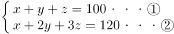，两式相减可得：y+2z=20，参加了不止一项活动的人数（y+z）最少，根据不定方程最值分析，z越大，z最大为10，当z=10时，y=0，则y+z=10人。至少有10人参加了不止一项活动。

故正确答案为B。

**考点**：三集合、非典型最值问题

**来源**：2013年413联考《行测》题（辽宁/湖南/湖北/安徽/四川/福建/云南/黑龙江/江西/广西/贵州/海南/内蒙古/山西/重庆/宁夏/西藏）第77题

### 第 78 题

某三年制普通初中连续六年在校生人数为x_1、x_2、x_3、x_4、x_5、x_6，假设该校所有学生都能顺利毕业，那么前三年的入学学生总数与后三年的入学学生总数之差为：

A. (x_1+x_2+x_3)-(x_4+x_5+x_6)

B. x_1-x_4

C. x_3-x_6

D. (x3−x1)−(x6−x4)

第 78 题 · 答案与解析

**参考答案（粉笔题库参考内容）**

C

**解析**

假设连续的六年分为2001、2002、2003、2004、2005、2006年，2001年入学的学生，2003年的时候是在校三年级学生；2002年入学的学生，2003年的时候是在校二年级学生，2003年入学的学生，2003年的时候是在校一年级的学生。则2003年在校生（即一、二、三年级学生）人数x_3等于2001—2003年入学学生人数。同理x_6等于2004—2006年入学学生人数。可得前三年与后三年入学学生人数之差为x_3-x_6。

故正确答案为C。

**考点**：和差倍比问题

**来源**：2013年413联考《行测》题（辽宁/湖南/湖北/安徽/四川/福建/云南/黑龙江/江西/广西/贵州/海南/内蒙古/山西/重庆/宁夏/西藏）第78题

### 第 79 题

A、B两桶中共装有108公斤水。从A中取出1/4的水倒入B，再从B中取出1/4的水倒入A，此时A、B两桶水重量刚好相等，那么B中原来有多少公斤水？

A. 42

B. 48

C. 50

D. 60

第 79 题 · 答案与解析

**参考答案（粉笔题库参考内容）**

D

**解析**

方法一：设原来B桶有x公斤水，A桶有(108-x)公斤水，可得，解得x=60公斤。

方法二：采用倒推顺推的方法。由于最后两桶的重量相同，那么A、B两桶中水的重量均为54公斤，即表示从B桶中取出1/4的水后，B桶的重量为54公斤，那么取之前，B桶的重量=公斤，此时A桶中水的重量=108-72=36公斤；同理从A桶中取出1/4的水后，A桶的重量为36公斤，那么原来A桶的重量=，则B桶中原来水的重量=108-48=60公斤。

故正确答案为D。

秒杀计：观察选项设置，B+D=108，可初步确定答案为48或60；而A桶显然不能是60，因为60的四分之一为15，第二次取水会出现小数，此时二者必然不相等，故可确定答案为D。

故正确答案为D。

**考点**：和差倍比问题

**来源**：2013年413联考《行测》题（辽宁/湖南/湖北/安徽/四川/福建/云南/黑龙江/江西/广西/贵州/海南/内蒙古/山西/重庆/宁夏/西藏）第79题

### 第 80 题

某次抽奖活动中在三个箱子中均放有红、黄、绿、蓝、紫、橙、白、黑8种颜色的球各一个。奖励规则如下：从三个箱子分别摸出一个球，摸出的3个球均为红球得一等奖，摸出的3个球至少有一个绿球得二等奖，摸出的3个球均为彩色球（黑、白除外）得三等奖，那么不中奖的概率是：

A. 0至25%之间

B. 25至50%之间

C. 50至75%之间

D. 75至100%之间

第 80 题 · 答案与解析

**参考答案（粉笔题库参考内容）**

B

**解析**

方法一：考虑中一等奖和三等奖的情况，则抽出的小球均为除黑白绿的球，8个球除了黑白绿还剩下5个球，故中一和三等奖的情况数=5^3=125种；考虑中二等奖情况数，至少有一个绿球的反面为所抽中的球没有1个是绿球，其情况数=；

则中一、二、三等奖总的情况数=125+169=294，总的情况数为8^3\=512种，则可得不中奖的概率=。

方法二：根据题意，可得若抽到的3个小球中无绿球且有黑白球则不中奖，分情况讨论：若3个球全是黑白球，概率；若3个球中2个是黑白球，1个球是其他球（即非黑白非绿），概率；若3个球中1个是黑白球，2个球是其他球（即非黑白非绿），概率；则不中奖的概率=。

故正确答案为B。

**考点**：给情况求概率

**来源**：2013年413联考《行测》题（辽宁/湖南/湖北/安徽/四川/福建/云南/黑龙江/江西/广西/贵州/海南/内蒙古/山西/重庆/宁夏/西藏）第80题

### 第 81 题

某单位今年一月份购买5包A4纸、6包B5纸，购买A4纸的钱比B5纸少5元；第一季度该单位共购买A4纸15包、B5纸12包，共花费510元。

那么每包B5纸的价格比A4纸便宜：

A. 1.5元

B. 2.0元

C. 2.5元

D. 3.0元

第 81 题 · 答案与解析

**参考答案（粉笔题库参考内容）**

C

**解析**

设A4纸和B5纸的价格分别为x元和y元。根据题意可得6y-5x=5元，15x+12y=510，解得x=20元，y=17.5元，那么B5纸的价格比A4纸便宜20-17.5=2.5元。

故正确答案为C。

**考点**：和差倍比问题

**来源**：2013年413联考《行测》题（辽宁/湖南/湖北/安徽/四川/福建/云南/黑龙江/江西/广西/贵州/海南/内蒙古/山西/重庆/宁夏/西藏）第81题

### 第 82 题

一个班有50名学生，他们的名字都是由2个字或3个字组成的。将他们平均分为两组之后，两组的学生名字字数之差为10。

此时两组学生中名字字数为2的学生数量之差为：

A. 5

B. 8

C. 10

D. 12

第 82 题 · 答案与解析

**参考答案（粉笔题库参考内容）**

C

**解析**

由于每组具体2个字的名字人数和3个字的名字人数无法确定，但题目所求的是固定的数值，故可以采用特值法，第一组25人每个人的名字都是2个字，第二组25人有15个人名字是2个字，另外的10个人名字是3个字，则第二组名字数字数的总数比第一组多10个字，满足题目要求，则此时两组学生中名字字数为2的学生数量之差=25-15=10人。

故正确答案为C。

**考点**：和差倍比问题

**来源**：2013年413联考《行测》题（辽宁/湖南/湖北/安徽/四川/福建/云南/黑龙江/江西/广西/贵州/海南/内蒙古/山西/重庆/宁夏/西藏）第82题

### 第 83 题

某种密码锁的界面是一组汉字键，只有不重复并且不遗漏地依次按下界面上的汉字才能打开，其中只有一种顺序是正确的。要使得每次对密码锁进行破解的成功率在万分之一以下，则密码锁的界面至少要设置多少个汉字键？

A. 5

B. 6

C. 7

D. 8

第 83 题 · 答案与解析

**参考答案（粉笔题库参考内容）**

D

**解析**

设有N个汉字键，汉字不重复，则情况总数为全排列A_N^N，一种顺序是正确的即表明符合条件数为1，则概率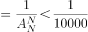，A_N^N＞10000，即N！＞10000，代入选项，当N≥8时满足，也就是说至少需要设置8个汉字键。

故正确答案为D。

**考点**：概率问题-其他

**来源**：2013年413联考《行测》题（辽宁/湖南/湖北/安徽/四川/福建/云南/黑龙江/江西/广西/贵州/海南/内蒙古/山西/重庆/宁夏/西藏）第83题

### 第 84 题

小张、小王二人同时从甲地出发，驾车匀速在甲乙两地之间往返行驶。小张的车速比小王快，两人出发后第一次和第二次相遇都在同一地点，那么小张的车速是小王的多少倍：

A. 1.5

B. 2

C. 2.5

D. 3

第 84 题 · 答案与解析

**参考答案（粉笔题库参考内容）**

B

**解析**

设甲、乙两地距离为S，根据“同端出发多次相遇”可知：第n次相遇共走2nS。

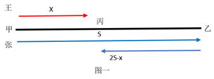

如图一所示，两人从甲地同时出发，在图中丙地第一次相遇，图中为小张所走路线，假设小王从甲地到第一次相遇点所走过的路程为x，则能够推断小张所走过的路程为图示中2S-x；

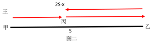

根据图二，则小王从最开始到第二次相遇地所走的总路程为2S-x，第二次相遇时，两人共走4S，小张所走过的路程为2(2S-x)。时间相同，速度之比等于路程之比。=2，即小张速度是小王的2倍。

故正确答案为B。

**考点**：相遇追及

**来源**：2013年413联考《行测》题（辽宁/湖南/湖北/安徽/四川/福建/云南/黑龙江/江西/广西/贵州/海南/内蒙古/山西/重庆/宁夏/西藏）第84题

### 第 85 题

连接正方体每个面的中心构成一个正八面体（如下图所示）。已知正方体的边长为6厘米，则正八面体的体积为多少立方厘米：

A. 18√2

B. 24√2

C. 36

D. 72

第 85 题 · 答案与解析

**参考答案（粉笔题库参考内容）**

C

**解析**

由图可知，正八面体由上下两个四棱锥拼接而成，拼接面（底面）是正方体中心的正方形，面积是正方体每一面的一半，则四棱锥底面积为平方厘米；每个四棱锥的高是正方体边长的一半，正方体边长为6厘米，则四棱锥的高=6/2=3厘米。根据公式：棱锥体积，则所求体积立方厘米。

故正确答案为C。

**考点**：几何公式类-立体图形

**来源**：2013年413联考《行测》题（辽宁/湖南/湖北/安徽/四川/福建/云南/黑龙江/江西/广西/贵州/海南/内蒙古/山西/重庆/宁夏/西藏）第85题

### 第 86 题

60名员工投票从甲、乙、丙三人中评选最佳员工，选举时每人只能投票选举一人，得票最多的人当选。开票中途累计，前30张选票中，甲得15票，乙得10票，丙得5票。在尚未统计的选票中，甲至少再得多少票就一定当选：

A. 15

B. 13

C. 10

D. 8

第 86 题 · 答案与解析

**参考答案（粉笔题库参考内容）**

B

**解析**

方法一：设甲还要得到x张，乙和甲票数最接近，考虑最糟糕的情况，剩余的30张票除了投给甲，其他全投给了乙，不投给丙，则应有15+x＞10+（30-x），x＞12.5，满足条件的最小值为13。

方法二：前30张票中，甲比乙多5票，则剩余30票中先补5票给乙使两者相等，还剩25张票，甲只要能获得其中的13张票就一定能当选。

故正确答案为B。

**考点**：最不利构造

**来源**：2013年413联考《行测》题（辽宁/湖南/湖北/安徽/四川/福建/云南/黑龙江/江西/广西/贵州/海南/内蒙古/山西/重庆/宁夏/西藏）第86题

### 第 87 题

早上7点两组农民开始在麦田里收割麦子，其中甲组20人，乙组15人。8点半，甲组分出10个人捆麦子；10点，甲组将本组所有已割的麦子捆好后，全部帮乙组捆麦子；如果乙组农民一直在割麦子，什么时候乙组所有已割麦子能够捆好（假设每个农民的工作效率相同）：

A. 10:45

B. 11:00

C. 11:15

D. 11:30

第 87 题 · 答案与解析

**参考答案（粉笔题库参考内容）**

B

**解析**

采用赋值思想，设每个农民割麦子的效率为1，由题意可得，甲组割麦子的总量为20×1.5＋10×1.5＝45，故每个农民捆麦子的效率为45÷1.5÷10＝3；设从10点之后经过n小时，乙组的麦子全部捆好。故乙组割麦子的总量为，捆麦子总量为20×3×n，两值应相等，即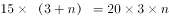，解得n＝1，即再过1小时就全部捆好了，此时为11:00。

故正确答案为B。

**考点**：给效率比例型

**来源**：2013年413联考《行测》题（辽宁/湖南/湖北/安徽/四川/福建/云南/黑龙江/江西/广西/贵州/海南/内蒙古/山西/重庆/宁夏/西藏）第87题

### 第 88 题

出租车队去机场接某会议的参与者，如果每车坐3名参与者，则需另外安排一辆大巴送走余下的50人，如每车坐4名参与者，则最后正好多出3辆空车。

则该车队有多少辆出租车？

A. 50

B. 55

C. 60

D. 62

第 88 题 · 答案与解析

**参考答案（粉笔题库参考内容）**

D

**解析**

设共有x辆车。由题意可得，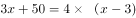，解得x＝62。

故正确答案为D。

**考点**：和差倍比问题

**来源**：2013年413联考《行测》题（辽宁/湖南/湖北/安徽/四川/福建/云南/黑龙江/江西/广西/贵州/海南/内蒙古/山西/重庆/宁夏/西藏）第88题

### 第 89 题

孙儿孙女的平均年龄是10岁，孙儿年龄的平方减去孙女年龄的平方所得的数值，正好是爷爷出生年份的后两位，爷爷生于上个世纪40年代。

则孙儿孙女的年龄差是多少岁：

A. 2

B. 4

C. 6

D. 8

第 89 题 · 答案与解析

**参考答案（粉笔题库参考内容）**

A

**解析**

假设孙儿的年龄为a，孙女的年龄为b，二人的平均年龄为10岁，则  a+b=20岁，由孙儿年龄的平方减去孙女年龄的平方为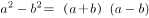\=20（a-b），

则20（a-b）即为爷爷出生年份的后两位，因为是40年代，40≤20（a-b）＜50 ，只有（a-b）=2符合条件。

故正确答案为A。

**考点**：年龄问题

**来源**：2013年413联考《行测》题（辽宁/湖南/湖北/安徽/四川/福建/云南/黑龙江/江西/广西/贵州/海南/内蒙古/山西/重庆/宁夏/西藏）第89题

### 第 90 题

某产品售价为67.1元，在采用新技术生产节约10%成本之后，售价不变，利润可比原来翻一番。则该产品最初的成本为多少元：

A. 51.2

B. 54.9

C. 61

D. 62.5

第 90 题 · 答案与解析

**参考答案（粉笔题库参考内容）**

C

**解析**

方法一：根据题意，假设该产品最初的成本为x元，则有，解得x＝61。

方法二：由题意可知，节约的10%成本与原利润相等，设成本为n元，则有67.1-n＝0.1n，解得n＝61。

故正确答案为C。

**考点**：经济利润问题

**来源**：2013年413联考《行测》题（辽宁/湖南/湖北/安徽/四川/福建/云南/黑龙江/江西/广西/贵州/海南/内蒙古/山西/重庆/宁夏/西藏）第90题

### 第 91 题

请从所给的四个选项中，选择最合适的一个填入问号处，使之呈现一定的规律性：

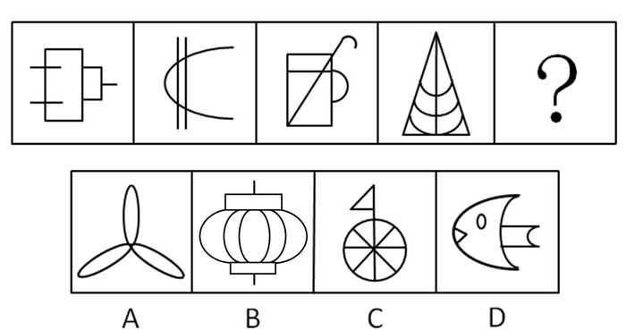

A. A

B. B

C. C

D. D

第 91 题 · 答案与解析

**参考答案（粉笔题库参考内容）**

D

**解析**

本题元素组成凌乱，考查数数。本题数曲线，已知每个图形包含的曲线数从左到右分别为0，1，2，3，依此规律，未知图形包含的曲线数应为4。A项图形包含的曲线数为3，排除；B项为6，排除；C项为1，排除；D项为4，当选。

故正确答案为D。

**考点**：数量规律-线

**来源**：2013年413联考《行测》题（辽宁/湖南/湖北/安徽/四川/福建/云南/黑龙江/江西/广西/贵州/海南/内蒙古/山西/重庆/宁夏/西藏）第91题

### 第 92 题

从所给的四个选项中，选择最合适的一个填入问号处，使之呈现一定的规律性：

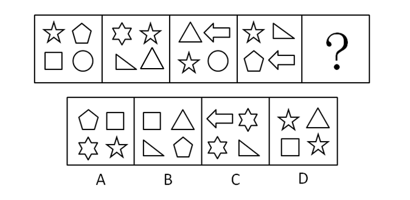

A. A

B. B

C. C

D. D

第 92 题 · 答案与解析

**参考答案（粉笔题库参考内容）**

A

**解析**

元素组成相似，且相同元素重复出现，优先考虑样式规律中的遍历。题干每幅图中均含有相同的元素五角星，据此排除B、C两项。继续观察发现，题干出现多个小元素，考虑元素种类和数量，每幅图形均包含四种元素，故问号处为含有四种元素的图形，只有A项符合。

故正确答案为A。

**考点**：数量规律-素、样式规律-遍历

**来源**：2013年413联考《行测》题（辽宁/湖南/湖北/安徽/四川/福建/云南/黑龙江/江西/广西/贵州/海南/内蒙古/山西/重庆/宁夏/西藏）第92题

### 第 93 题

从所给的四个选项中，选择最合适的一个填入问号处，使之呈现一定的规律性：

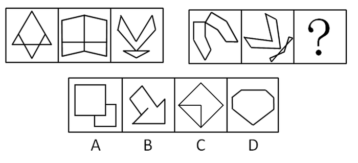

A. A

B. B

C. C

D. D

第 93 题 · 答案与解析

**参考答案（粉笔题库参考内容）**

A

**解析**

元素组成凌乱，考查属性。图形是规则的，且对称性明显，第一组图形中的每个图形均沿竖轴对称，第二组图形中的已知图形沿左斜线对称。A项图形沿左斜线对称；B项不是对称图形；C项沿右斜线对称；D项沿竖轴对称。

故正确答案为A。

**考点**：属性规律-对称性

**来源**：2013年413联考《行测》题（辽宁/湖南/湖北/安徽/四川/福建/云南/黑龙江/江西/广西/贵州/海南/内蒙古/山西/重庆/宁夏/西藏）第93题

### 第 94 题

从所给的四个选项中，选择最合适的一个填入问号处，使之呈现一定的规律性：

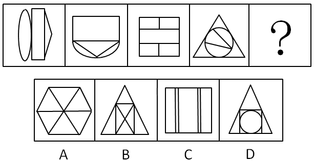

A. A

B. B

C. C

D. D

第 94 题 · 答案与解析

**参考答案（粉笔题库参考内容）**

B

**解析**

元素组成不同，且无明显属性规律，考虑数量规律。封闭面较多，优先考虑数面。面的数量分别为3、4、5、6、？，故？处图形应有7个面，只有B项符合。

故正确答案为B。

**考点**：数量规律-面

**来源**：2013年413联考《行测》题（辽宁/湖南/湖北/安徽/四川/福建/云南/黑龙江/江西/广西/贵州/海南/内蒙古/山西/重庆/宁夏/西藏）第94题

### 第 95 题

从所给的四个选项中，选择最合适的一个填入问号处，使之呈现一定的规律性：

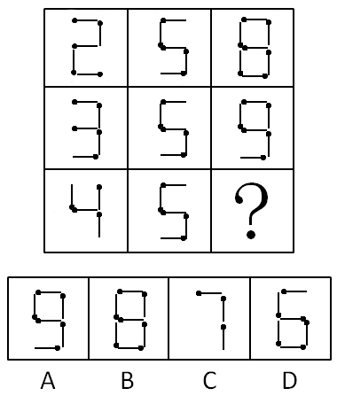

A. A

B. B

C. C

D. D

第 95 题 · 答案与解析

**参考答案（粉笔题库参考内容）**

A

**解析**

本题元素组成相似，考查元素，具体考查元素的简单叠加。九宫图中，以行为单位，第一行中，前两图简单叠加后形成第三图；第二行中的第三图，也可从前两图简单叠加形成。依此规律，第三行的前两图简单叠加后形成的图形应如A项图形所示。

故正确答案为A。

**考点**：样式规律-加减同异

**来源**：2013年413联考《行测》题（辽宁/湖南/湖北/安徽/四川/福建/云南/黑龙江/江西/广西/贵州/海南/内蒙古/山西/重庆/宁夏/西藏）第95题

### 第 96 题

从所给的四个选项中，选择最合适的一个填入问号处，使之呈现一定的规律性：

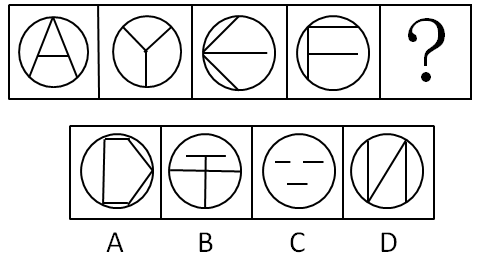

A. A

B. B

C. C

D. D

第 96 题 · 答案与解析

**参考答案（粉笔题库参考内容）**

B

**解析**

元素组成不同，且无明显属性规律，考虑数量规律。观察发现，题干图形均有圆形外框，内部均有3条直线，排除A项；继续观察发现，题干图形内部线条与外框有明显相交，考虑数框上交点。题干图形框上交点均为3，排除C、D两项。

故正确答案为B。

**考点**：数量规律-点

**来源**：2013年413联考《行测》题（辽宁/湖南/湖北/安徽/四川/福建/云南/黑龙江/江西/广西/贵州/海南/内蒙古/山西/重庆/宁夏/西藏）第96题

### 第 97 题

左边为立方体的外表面，右边哪个立方体可以由它折成？

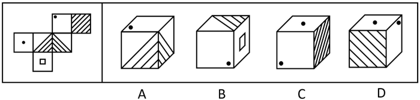

A. A

B. B

C. C

D. D

第 97 题 · 答案与解析

**参考答案（粉笔题库参考内容）**

A

**解析**

本题考查空间重构。将展开图的六个面标上号，如图：

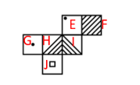

A项正确，分别是面E、面H、面I。

B项：展开图中面E和面J是相对面，根据相对面不相邻的原则，B项错误；

C、D两项中均可以以面E上与小黑点相邻的点为起点，在展开图和选项中同时沿着顺时针画边，在展开图中第二条边与面F相邻，而在选项中第三条边与面F相邻，故C、D两项错误。

**考点**：空间类-空间重构-六面体

**来源**：2013年413联考《行测》题（辽宁/湖南/湖北/安徽/四川/福建/云南/黑龙江/江西/广西/贵州/海南/内蒙古/山西/重庆/宁夏/西藏）第97题

### 第 98 题

左边给定的是纸盒外表面的展开图，右边哪一项能由它折叠而成？请把它找出来：

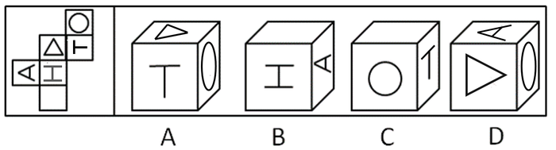

A. A

B. B

C. C

D. D

第 98 题 · 答案与解析

**参考答案（粉笔题库参考内容）**

A

**解析**

本题考查空间重构。A项可由左侧展开图折成。假设B项的顶面和正面的方位是对的，右侧面的“A”指向错误；假设C项的顶面和正面的方位是对的，右侧面的“T”指向错误；假设D项的正面和右侧面的方位是对的，顶面的“A”指向错误。

故正确答案为A。

**考点**：空间类-空间重构-六面体

**来源**：2013年413联考《行测》题（辽宁/湖南/湖北/安徽/四川/福建/云南/黑龙江/江西/广西/贵州/海南/内蒙古/山西/重庆/宁夏/西藏）第98题

### 第 99 题

心理契约是指个体与组织之间隐含的没有明文规定的双方各自的责任及对对方的期望。

根据上述定义，下列属于建立心理契约的措施是：

A. 为提高员工的积极性，每月业绩最好者能享受双薪

B. 为解决员工的后顾之忧，与优秀员工签订终身合同

C. 为吸引优秀人才，承诺为员工提供购房免息贷款

D. 结合企业的发展蓝图，为员工提供职业生涯设计

第 99 题 · 答案与解析

**参考答案（粉笔题库参考内容）**

D

**解析**

第一步：找到定义关键词，即隐含的，没有明文规定的。

第二步：逐一分析选项。D项通过为员工提供职业生涯设计，使员工和企业之间有更深入的了解，双方更明白各自的责任和对对方的期望，这个过程没有明文规定的任何内容，符合定义，当选。A项“享受双薪”、B项“签订终身合同”、C项“提供购房免息贷款”都不满足关键词“隐含的”“没有明文规定的”，均排除。

故正确答案为D。

**考点**：单定义-其他句式

**来源**：2013年413联考《行测》题（辽宁/湖南/湖北/安徽/四川/福建/云南/黑龙江/江西/广西/贵州/海南/内蒙古/山西/重庆/宁夏/西藏）第99题

### 第 100 题

自白任意性规则是指只有基于犯罪嫌疑人自由意志而作出的、承认有罪的真实陈述，才具有证据能力。

根据上述定义，下列符合自白任意性规则做法的是：

A. 为避免犯罪嫌疑人有可能作出虚假陈述，应中止询问

B. 犯罪嫌疑人的有罪陈述与收集到的证据材料一致

C. 犯罪嫌疑人主张自己无罪，可以不承担举证责任

D. 以从轻处罚为条件，换取犯罪嫌疑人的有罪答疑

第 100 题 · 答案与解析

**参考答案（粉笔题库参考内容）**

B

**解析**

第一步：找到定义关键词，即基于犯罪嫌疑人自由意志、承认有罪、真实陈述。

第二步：逐一验证选项关键词。B项中“有罪陈述与收集到的证据材料一致”，符合“承认有罪”和“真实陈述”两个关键词，但是“基于犯罪嫌疑人自由意志”没有提及，属于不明确选项，保留。A项中“中止询问”，已经没有陈述，不符合“真实陈述”关键词，错误，排除；C项中“主张自己无罪”不符合“承认有罪”关键词，错误，排除；D项中“换取犯罪嫌疑人的有罪答疑”不符合“基于犯罪嫌疑人自由意志”关键词，错误，排除。A、C、D均可排除。

故正确答案为B。

**考点**：单定义-其他句式

**来源**：2013年413联考《行测》题（辽宁/湖南/湖北/安徽/四川/福建/云南/黑龙江/江西/广西/贵州/海南/内蒙古/山西/重庆/宁夏/西藏）第100题

### 第 101 题

印记学习是指发生在动物生活的早期阶段、由直接印象形成的学习行为，印记学习行为虽发生在早期，但对晚期行为也具有一定的影响。

根据上述定义，下列不属于印记学习行为的是：

A. 绵羊走近并试图留在喂养过它的主人身边

B. 由人喂养大的斑马雀会向主人的手指求偶

C. 绵羊用舌舔小羊的方式来标记自己的后代

D. 刚出生的绿头鸭跟随着一个移动的物体走

第 101 题 · 答案与解析

**参考答案（粉笔题库参考内容）**

C

**解析**

第一步：找到定义关键词。即“发生在动物生活的早期阶段”、“由直接印象形成的”。第二步：逐一分析选项。C项绵羊用舌舔小羊的方式来标记自己的后代是发生在绵羊生了小羊之后，不满足关键词“发生在动物生活的早期阶段”，不属于印记学习行为，是本题答案。A项“走近喂养过它的主人身边”是由直接印象形成的，“试图留在主人身边”体现了早期阶段形成的行为对晚期行为的影响，符合定义；B项斑马雀由人喂养大，对主人存在直接印象，向主人的手指求偶体现的是早期阶段形成的行为对晚期行为的影响，符合定义；D项刚出生的绿头鸭跟随着移动的物体走，发生在绿头鸭的早期阶段，跟着移动的物体走是由直接印象形成的，满足关键词。

本题为选非题，故正确答案为C。

**考点**：大前提

**来源**：2013年413联考《行测》题（辽宁/湖南/湖北/安徽/四川/福建/云南/黑龙江/江西/广西/贵州/海南/内蒙古/山西/重庆/宁夏/西藏）第101题

### 第 102 题

蒸发冷却是指液体在蒸发气体的过程中会吸热，从而降低周围的温度起到冷却效果。蒸发冷却效应是指在目的或志趣相同的人们组成的社会团体中，团体的价值跟液体的整体温度类似，当价值较高的成员离开社团后，社团自身的平均价值会降低。

根据上述定义，下列属于蒸发冷却效应的是：

A. 某高校的街舞社团的团长毕业离开学校后，该社团便没有在街舞比赛中取得较好的名次

B. 某知名流行音乐演唱组合中的一个歌手因意外去世，大批歌迷认为这个歌手的离开导致该组合整体演唱水平大打折扣

C. 某教育机构的一些老师离开该机构创办的教育公司，使该机构在市场竞争中的形势变得更加严峻

D. 某社交网站的影评小组建立之初人数较少，影评质量较高，后来有大量人加入这个小组上传影评，使这里整体的影评质量有所下降

第 102 题 · 答案与解析

**参考答案（粉笔题库参考内容）**

A

**解析**

第一步：找出定义关键词。

“价值较高的成员离开”、“社团自身的平均价值降低”。

第二步：逐一分析选项。

A项：街舞社团的团长毕业后离校，符合“价值较高的成员离开”，社团在街舞比赛中没有取得较好的名次，符合“平均价值降低”，符合定义，当选；

B项：“一个歌手因意外去世”没有体现出“价值较高的成员离开”，且大批歌迷认为演唱水平大打折扣并非客观描述，并不一定代表该组合的“平均价值降低”，不符合定义，排除；

C项：该机构在市场上竞争形势更加严峻不等于“平均价值降低”，不符合定义，排除；

D项：大量人加入影评小组导致影评质量下降，不符合关键词“价值较高的成员离开”，不符合定义，排除。

故正确答案为A。

**考点**：常规问法

**来源**：2013年413联考《行测》题（辽宁/湖南/湖北/安徽/四川/福建/云南/黑龙江/江西/广西/贵州/海南/内蒙古/山西/重庆/宁夏/西藏）第102题

### 第 103 题

威客模式是指一些人通过互联网把自己的智慧、知识、能力、经验转换成实际收益，他们在互联网上通过解决科学、技术、工作、生活、学习中的问题从而让知识、智慧、经验、技能产生经济价值。

根据上述定义，下列属于威客模式的是：

A. 某IT技术人员用业余时间开了一个小公司，主要在网络上远程帮助他人修理电脑

B. 某大学毕业生在一个B2C网站上开了一家服装店，运用自己的人脉资源使网店很快就开始盈利

C. 某摄影师个人网站上的摄影作品吸引了大批网友浏览、转发，后来该摄影师依靠该网站上发布摄影器材广告带来了大量收入

D. 某高校学生建立的免费回答中小学生学习问题的公益网站受到了学生和家长的好评，当地一家教育机构出资赞助扩大这个网站的规模，以帮助更多的学生

第 103 题 · 答案与解析

**参考答案（粉笔题库参考内容）**

A

**解析**

第一步：找出定义关键词。

“通过互联网把自己的智慧、知识、能力、经验转换成实际收益”。

第二步：逐一分析选项。

A项：某IT技术人员开小公司，说明以营利为目的；主要在网络上远程帮助他人修理电脑，说明在互联网上利用自己的IT知识获取收益，符合“通过互联网把自己的智慧、知识、能力、经验转换成实际收益”，符合定义，当选；

B项：某大学毕业生开网络服装店盈利，只是在卖衣服，不符合“通过互联网把自己的智慧、知识、能力、经验转换成实际收益”，不符合定义，排除；

C项：摄影师通过在网站上发布摄影器材广告获取收入，只是在发布广告，不符合“通过互联网把自己的智慧、知识、能力、经验转换成实际收益”，不符合定义，排除；

D项：某高校学生建立的免费回答中小学生学习问题的公益网站，说明没有收益，不符合“通过互联网把自己的智慧、知识、能力、经验转换成实际收益”，不符合定义，排除。

故正确答案为A。

**考点**：方式目的

**来源**：2013年413联考《行测》题（辽宁/湖南/湖北/安徽/四川/福建/云南/黑龙江/江西/广西/贵州/海南/内蒙古/山西/重庆/宁夏/西藏）第103题

### 第 104 题

临终关怀是指为临终患者提供医疗、护理、心理、社会等多方位的关怀照顾，使每位患者的生命受到尊重，症状得到控制，生命质量得到提高。

根据上述定义，下列不属于临终关怀的是：

A. 老赵肝癌晚期，医生尽最大努力进行治疗，不惜一切代价延长其生命

B. 老王肾衰竭晚期希望回到故乡，他在接受疼痛处理后被同意出院

C. 老李白血病晚期，医生对他进行保守治疗，配合适当的绘画与音乐治疗

D. 老刘胃癌晚期，某大学组织志愿者陪他聊天

第 104 题 · 答案与解析

**参考答案（粉笔题库参考内容）**

A

**解析**

第一步：分析题干关键词，即“临终患者”、“医疗、护理、心理、社会等多方位的关怀照顾”、“尊重”、“控制”、“提高”。第二步：逐步分析选项关键词。A项，不惜一切代价延长生命，虽然体现了生命长度得到延长，但晚期癌症治疗是非常痛苦的，其所付出的代价使得生命质量并没有得到提高，不符合临终关怀的定义；B项，肾衰竭晚期符合临终患者，接受疼痛处理后被同意出院，满足了其回乡的心愿，体现了从医疗上、心理上多方位的关怀照顾，尊重了患者，使其最后阶段的生命质量得到了保证；C项，白血病晚期符合临终患者，保守治疗、配以绘画与音乐，体现出医疗、护理、心理等多方位关怀，尊重了生命、提高了质量；D项，胃癌晚期符合临终患者，大学组织志愿者陪他聊天，体现了心理、社会等多方位的关怀照顾，尊重了生命、提高了质量。

本题为选非题，故正确答案为A。

**考点**：方式目的

**来源**：2013年413联考《行测》题（辽宁/湖南/湖北/安徽/四川/福建/云南/黑龙江/江西/广西/贵州/海南/内蒙古/山西/重庆/宁夏/西藏）第104题

### 第 105 题

农产品补贴通常是指一国政府对本国的农产品生产商或者经营者提供资金或财政上的支持，包括现金补贴、价格补贴或其他政策优惠待遇，使其农产品在国际、国内市场上与未受补贴的同类产品相比获得竞争优势。

根据上述定义，下列属于农产品补贴的是：

A. 为了稳定农产品价格，某市政府对农贸市场经营者的摊位租金实行减免政策外，还规定若摊位租金低于限定额数，可以向经营者发放10%—40%不等的补贴

B. 某国政府为农民和水稻研究所牵线搭桥，使该国农民种植了新品种水稻。该品种水稻的质量和产量大幅度提升，使得该国水稻出口价格与国际市场上的水稻相差无几

C. 甲国市场上，政府以高于市场价格收购农民种植的玉米，再低价出售，以鼓励农民种植玉米。该国某企业利用玉米作为主要饲料培育肉鸡，再大量出口到乙国

D. 甲地主要是草原，由于过度放牧导致草场退化。该国政府根据该地区情况，发放牧民8—10年的补贴，请他们减少饲养的禽畜，这导致市场上的牛羊价格升高了

第 105 题 · 答案与解析

**参考答案（粉笔题库参考内容）**

C

**解析**

第一步：找出定义关键词。

“一国政府对本国的农产品生产商或者经营者提供资金或财政上的支持”、“使其农产品与未受补贴的同类产品相比获得竞争优势”。

第二步：逐一分析选项。

A项：市政府减免对农贸市场经营者的摊位租金，且对符合条件的摊位发放补贴，但并不清楚相关农产品是否获得了竞争优势，不符合“使其农产品与未受补贴的同类产品相比获得竞争优势”，不符合定义，排除；

B项：某国政府使该国农民种植了质量和产量更好的新品种水稻，但这不属于资金或财政上的支持，不符合“一国政府对本国的农产品生产商或者经营者提供资金或财政上的支持”，不符合定义，排除。

C项：甲国政府以高于市场价格收购农民种植的玉米，符合“一国政府对本国的农产品生产商或者经营者提供资金或财政上的支持”；某企业再用玉米作为主要饲料培养肉鸡，表明玉米相较于其他同样可以作为鸡饲料的农产品获得了竞争优势，符合“使其农产品与未受补贴的同类产品相比获得竞争优势”，符合定义，当选；

D项：该国政府给牧民发放补贴是为了减少饲养的禽畜，而非使禽畜在市场上获得更多竞争优势，不符合“使其农产品与未受补贴的同类产品相比获得竞争优势”，不符合定义，排除；

故正确答案为C。

**考点**：方式目的

**来源**：2013年413联考《行测》题（辽宁/湖南/湖北/安徽/四川/福建/云南/黑龙江/江西/广西/贵州/海南/内蒙古/山西/重庆/宁夏/西藏）第105题

### 第 106 题

调查显示，59.4%的公众感觉当前社会“逆淘汰”现象普遍，其中18.8%的人觉得“非常多”。所谓“逆淘汰”，即指坏的淘汰好的，劣质的淘汰优胜的，平庸的淘汰杰出的等现象。

根据上述定义，下列属于逆淘汰现象的是：

A. 某公司拥有领先的卫星通话技术，语音质量高，覆盖范围广，但该技术的维持费用高昂。后来该公司入不敷出，宣告破产

B. 市场上某些价格高昂的止咳药疗效实际不如价格低廉的常用药，而事实上常用药所占市场份额较小

C. 许多公司都有对工作发牢骚的人，结果，凡是公司中有对工作发牢骚的人，那家公司一定比没有这种人的公司要成功得多

D. 名牌大学毕业的甲和普通大学毕业的乙同时进入某国际知名公司，但甲始终未获提升，乙却逐渐得到了公司的认可

第 106 题 · 答案与解析

**参考答案（粉笔题库参考内容）**

B

**解析**

找到定义关键词：坏的淘汰好的，劣质的淘汰优胜的，平庸的淘汰杰出的。 A项，领先的卫星通话技术费用昂贵而没有获得市场优势，说明自身存在不足，不能说是“劣质的淘汰了优质的”，排除；B项，价格高的药占据了大部分市场，而疗效却不如常用药，属于典型的“平庸的淘汰杰出的”情况，当选；C项并没有优劣对比，排除；D项，名牌大学的学生不一定都好过普通大学的学生，因此，甲和乙到底谁更优秀无法得知，排除。

故正确答案为B。

**考点**：单定义-其他句式

**来源**：2013年413联考《行测》题（辽宁/湖南/湖北/安徽/四川/福建/云南/黑龙江/江西/广西/贵州/海南/内蒙古/山西/重庆/宁夏/西藏）第106题

### 第 107 题

逆向服务是在产品（服务）销售以后，企业向顾客提供实现产品（服务）使用价值的服务。

根据上述定义，下列不属于逆向服务的是：

A. 某电信运营商推出“存话费送手机”的优惠活动

B. 某空调生产商为客户提供终身免费上门维修服务

C. 某网店推出售后商品7天内可免费退换货服务

D. 某汽车4S店为客户提供二手车估价转让服务

第 107 题 · 答案与解析

**参考答案（粉笔题库参考内容）**

A

**解析**

第一步：找到定义关键词，即“在产品（服务）销售以后”。第二步：逐一分析选项。A项“存话费送手机”的优惠活动是在销售过程中实现的，不满足定义关键词“在产品（服务）销售以后”，是本题答案，当选。B项为客户提供终身免费上门维修服务；C项商品售出后客户在7天内可免费退、换货服务；D项为客户提供二手车估价、转让服务，这些服务都是在产品销售以后提供的服务，符合定义，排除。

本题为选非题，故正确答案为A。

**考点**：大前提

**来源**：2013年413联考《行测》题（辽宁/湖南/湖北/安徽/四川/福建/云南/黑龙江/江西/广西/贵州/海南/内蒙古/山西/重庆/宁夏/西藏）第107题

### 第 108 题

政策性亏损是指为保证国民经济的协调发展和人民生活的安定，企业在实现政府规定的社会公益服务目标，生产经营某种商品的过程中，由于国家限价等原因而产生的亏损。发生这类亏损，由财政部门审核后给予合理补偿。

根据上述定义，下列属于政策性亏损的是：

A. 2012年某粮食直补每亩增至120元，补贴资金将通过“省财政涉农补贴一本通”发放到种粮农民手中，以弥补农民增加的种粮成本

B. 国家出台提高小麦最低收购保护价政策，某粮油企业为开拓市场大量抢购小麦，又将大量面粉低于市场价销售，因此造成了亏损

C. 政府为实现农业现代化目标，加大了对农业生产改造的资金收入，某农机企业在这种形式下扩大生产规模导致了亏损，得到了退税补偿

D. 某县的粮食购销企业在经营政府规定的平价粮食过程中，因国家粮食保护价高但粮油成品销售价格低导致了亏损，财政部门给予定额补贴

第 108 题 · 答案与解析

**参考答案（粉笔题库参考内容）**

D

**解析**

第一步：找到定义关键词，即“企业······由于国家限价等原因而产生的亏损，由财政部门审核后给予合理补偿”。第二步：逐一分析选项。A项没有涉及企业，排除；B项某粮油企业的亏损是由于大量抢购小麦同时低价销售大量面粉造成的，C项某农机企业是由于扩大生产规划而导致的亏损，这两种情况都不是由于国家限价等原因产生的亏损，不符合定义，排除；D项某县的粮食购销企业面临的亏损是由于国家粮食保护价高但粮油成品销售价格低，满足定义的第一个关键词，“财政部门给予定额补贴”满足定义的第二个关键词，选项正确，当选。

故正确答案为D。

**考点**：原因结果

**来源**：2013年413联考《行测》题（辽宁/湖南/湖北/安徽/四川/福建/云南/黑龙江/江西/广西/贵州/海南/内蒙古/山西/重庆/宁夏/西藏）第108题

### 第 109 题

自我建构指个体通过行为表现表明自己符合在他人心目中的已经建立起来的社会身份和社会形象。

根据上述定义，下列属于自我建构的是：

A. 16岁的女孩欢欢经常模仿话剧演员的表演并像他们一样早起练功，她希望自己以后也成为话剧演员

B. 某公司创立之初就定下服务社会的企业使命，后来在偏远山区建立多所希望小学，树立了公司热心于社会公益事业的良好形象

C. 一些企业家经常穿着昂贵的西装，坐豪华轿车，有些人认为这是“炫富”，但他们认为如果不是这样，就不会得到同行的认可

D. 不同航空公司要求本公司的空中乘务员穿着不同的制服，他们认为员工形象会影响到公司在旅客心中的形象

第 109 题 · 答案与解析

**参考答案（粉笔题库参考内容）**

C

**解析**

第一步：找到定义关键词，即关键词（1）主体：个体；关键词（2）方式：行为；关键词（3）：符合在他人心目中的已经建立起来的社会身份或社会形象。第二步：逐一分析选项。A项说的是欢欢希望追求的职业，不存在“他人心目中的社会身份和社会形象”；B项公司不是个体；C项一些企业家认为要得到同行的认可，就得穿着昂贵的西装和坐豪华轿车，“穿昂贵的西装和坐豪华轿车”是同行所认为的企业家应有的形象，满足定义关键词，应选；D项航空公司是个集体而非个体，主体与定义不符合。A、B、D三项均不满足定义关键词，故排除。

故正确答案为C。

**考点**：方式目的

**来源**：2013年413联考《行测》题（辽宁/湖南/湖北/安徽/四川/福建/云南/黑龙江/江西/广西/贵州/海南/内蒙古/山西/重庆/宁夏/西藏）第109题

### 第 110 题

某些产品的精心设计使产品方便高效，能给客户带来舒适感，使用时不用阅读复杂的说明或是求助他人。而有些产品恰恰相反，它们的设计没有考虑用户的使用习惯和需要，因而使人们在使用过程中会遇到困难或者迷惑不解的情况，这类产品被人们称为诺曼产品。

根据上述定义，下列属于诺曼产品的是：

A. 某品牌木制大衣柜的底部滑轮质量较差，用户很难将门拉开

B. 某款网络游戏很难通关，很多玩家在网上求助怎样破解其中的关卡

C. 汽车收音机按钮和其他设备开关的形状、大小都一样，用户很难分辨哪个是收音机按钮

D. 某科技公司的精密实验设备附有300页的说明书，一般人觉得里面术语太多，很难读懂

第 110 题 · 答案与解析

**参考答案（粉笔题库参考内容）**

C

**解析**

第一步：找到定义关键词，即“设计没有考虑用户的使用习惯和需要”。第二步：逐一分析选项。A项用户难以把门拉开是由于滑轮质量差，非设计上的原因造成的；B项游戏难以通关是有些设置上的问题，并不是因为没有考虑到用户的使用习惯和需要；C项汽车收音机按钮在设计上与其他设备开关的形状、大小一样，没有考虑到用户可能会混淆按钮，给用户带来使用上的困难，满足定义关键词，应选；D项是说明书难读懂，非实验设备难以使用。A、B、D三项均不满足定义关键词，均排除。

故正确答案为C。

**考点**：原因结果

**来源**：2013年413联考《行测》题（辽宁/湖南/湖北/安徽/四川/福建/云南/黑龙江/江西/广西/贵州/海南/内蒙古/山西/重庆/宁夏/西藏）第110题

### 第 111 题

地理：自然地理：经济地理

A. 城市：居民区：商业区

B. 卫星：遥感：雷达

C. 糖果：水果糖：芝麻糖

D. 单位：千米：公里

第 111 题 · 答案与解析

**参考答案（粉笔题库参考内容）**

C

**解析**

第一步：判断题干词语间逻辑关系。题干三词构成双重逻辑，自然地理与经济地理为并列关系，且自然地理与经济地理分别与地理构成种属关系。与之逻辑关系相同的是C项，水果糖和芝麻糖为并列关系，两者分别与糖果构成种属关系。第二步：逐一判断其他选项。A项居民区和商业区构成并列关系，但居民区和商业区都是城市的一部分，两词分别与城市构成组成关系，而非题干的种属关系；B项遥感是一种探测技术，雷达是一种探测设备，两词非并列关系，与题干逻辑不同；D项千米和公里构成全同关系，与题干逻辑不同。

故正确答案为C。

**考点**：逻辑关系-包容关系、逻辑关系-并列关系

**来源**：2013年413联考《行测》题（辽宁/湖南/湖北/安徽/四川/福建/云南/黑龙江/江西/广西/贵州/海南/内蒙古/山西/重庆/宁夏/西藏）第111题

### 第 112 题

量尺：厘米

A. 时间：小时

B. 天平：千克

C. 电话：号码

D. 细胞：显微镜

第 112 题 · 答案与解析

**参考答案（粉笔题库参考内容）**

B

**解析**

第一步：判断题干词语间逻辑关系。题干两词构成对应关系，量尺是计量长度的工具，厘米是计量长度的单位。与之逻辑关系相同的是B项，天平是计量重量的工具，千克是计量重量的单位。第二步：逐一判断其他选项。A项中，小时是计量时间的单位，但时间本身不能作为一种计时工具，与题干逻辑不同；C项中的“电话”和D项中的“细胞”都不是计量工具，“号码”和“显微镜”也不是计量单位，与题干逻辑不同。

故正确答案为B。

**考点**：逻辑关系-对应关系

**来源**：2013年413联考《行测》题（辽宁/湖南/湖北/安徽/四川/福建/云南/黑龙江/江西/广西/贵州/海南/内蒙古/山西/重庆/宁夏/西藏）第112题

### 第 113 题

军队：命令

A. 乐队：指挥

B. 游客：向导

C. 志愿者：号召

D. 学生：教导

第 113 题 · 答案与解析

**参考答案（粉笔题库参考内容）**

A

**解析**

第一步：判断题干词语间逻辑关系。

题干两个词属于对应关系，军队服从命令，且军队是一个集合概念。

第二步：判断选项词语间逻辑关系。

A项，乐队服从指挥，且乐队是集合概念，符合题意。

B项，游客跟从向导，但游客可指群体，也可指个体，与题干不符。

C项，志愿者响应号召，但志愿者可指群体，也可指个体，与题干不符。

D项，学生接受教导，但学生可指群体，也可指个体，与题干不符。

故正确答案为A。

**考点**：逻辑关系-对应关系

**来源**：2013年413联考《行测》题（辽宁/湖南/湖北/安徽/四川/福建/云南/黑龙江/江西/广西/贵州/海南/内蒙古/山西/重庆/宁夏/西藏）第113题

### 第 114 题

文字：剧本：话剧

A. 水：水果：果汁

B. 叶子：植物：中药

C. 字母：键盘：文章

D. 音符：乐谱：歌曲

第 114 题 · 答案与解析

**参考答案（粉笔题库参考内容）**

D

**解析**

第一步：判断题干词语间逻辑关系。

剧本是由文字组成的，二者是组成关系；依据剧本排练话剧，二者是依据的对应关系。

第二步：判断选项词语间逻辑关系。

A项：水与水果不是组成关系，与题干逻辑关系不一致，排除；

B项：叶子与植物是组成关系，但植物和中药是交叉关系而不是依据，与题干逻辑关系不一致，排除；

C项：字母和键盘不是组成关系，与题干逻辑关系不一致，排除；

D项：乐谱是由音符组成的，二者是组成关系；依据乐谱排练歌曲，二者是依据的对应关系，与题干逻辑关系一致，当选。

故正确答案为D。

**考点**：逻辑关系-包容关系、逻辑关系-对应关系

**来源**：2013年413联考《行测》题（辽宁/湖南/湖北/安徽/四川/福建/云南/黑龙江/江西/广西/贵州/海南/内蒙古/山西/重庆/宁夏/西藏）第114题

### 第 115 题

平静：讲述

A. 欣喜：接受

B. 恼怒：言论

C. 悲哀：哀乐

D. 快乐：行为

第 115 题 · 答案与解析

**参考答案（粉笔题库参考内容）**

A

**解析**

第一步：判断题干词语间逻辑关系。

题干两词构成副词修饰动词的偏正关系，平静地讲述。与之逻辑关系相同的是A项，欣喜地接受。

第二步：判断选项词语间逻辑关系。

B项恼怒的言论、C项悲哀的哀乐、D项快乐的行为，都只能构成形容词修饰名词的偏正关系，与题干逻辑关系不一致，排除。

故正确答案为A。

**考点**：语法关系

**来源**：2013年413联考《行测》题（辽宁/湖南/湖北/安徽/四川/福建/云南/黑龙江/江西/广西/贵州/海南/内蒙古/山西/重庆/宁夏/西藏）第115题

### 第 116 题

软件：程序员：编写（    ）。

A. 木头：木匠：打制

B. 渔网：渔民：编织

C. 车票：乘客：购买

D. 麦克风：歌手：唱歌

第 116 题 · 答案与解析

**参考答案（粉笔题库参考内容）**

B

**解析**

第一步：判断题干词语间逻辑关系。

造句子：程序员编写软件，三者为主谓宾关系，且程序员是一种职业，软件是程序员的产物。

第二步：判断选项词语间逻辑关系。

A项：木匠打制出来的产物应该是木制品，而非木头，与题干逻辑关系不一致，排除；

B项：渔民编织渔网，三者为主谓宾关系，且渔民是一种职业，渔网是渔民的产物，与题干逻辑关系一致，当选；

C项：乘客购买车票，三者为主谓宾关系，但乘客不是一种职业，与题干逻辑关系不一致，排除；

D项：歌手用麦克风唱歌，麦克风不是歌手的产物，与题干逻辑关系不一致，排除。

故正确答案为B。

**考点**：语法关系

**来源**：2013年413联考《行测》题（辽宁/湖南/湖北/安徽/四川/福建/云南/黑龙江/江西/广西/贵州/海南/内蒙古/山西/重庆/宁夏/西藏）第116题

### 第 117 题

发动机：飞机：旅客

A. 琴键：钢琴：音乐

B. 电池：手电筒：灯光

C. 发条：钟表：时间

D. 杆秤：秤杆：重量

第 117 题 · 答案与解析

**参考答案（粉笔题库参考内容）**

C

**解析**

第一步：判断题干词语间逻辑关系。题干三词构成对应关系、组成关系及功能属性，飞机可用于运载旅客（对应），且发动机是飞机最核心的组成部件，飞机靠发动机提供动力（发动机的功能属性）。与之逻辑相同的是C项，钟表可用于计算时间，发条是钟表最核心的组成部件且发条为钟表提供动力。第二步：逐一判断其他选项。A项钢琴需要通过琴键来弹奏音乐，但钢琴不是靠琴键提供动力的，且琴键也不是钢琴最核心的组成部件；B项手电筒靠电池提供动力，手电筒可用于发出灯光，但是电池是可以拆卸的，并不是手电筒最核心的组成部件，它只是为手电筒提供能源的一种装备，与题干逻辑不同；D项秤杆是杆秤的一部分，与题干逻辑不同。

故正确答案为C。

**考点**：逻辑关系-包容关系、逻辑关系-对应关系

**来源**：2013年413联考《行测》题（辽宁/湖南/湖北/安徽/四川/福建/云南/黑龙江/江西/广西/贵州/海南/内蒙古/山西/重庆/宁夏/西藏）第117题

### 第 118 题

兴趣：索然无味（    ）。

A. 知识：不学无术

B. 误会：善解人意

C. 骨气：卑躬屈膝

D. 礼貌：盛气凌人

第 118 题 · 答案与解析

**参考答案（粉笔题库参考内容）**

C

**解析**

第一步：判断题干词语间逻辑关系。

题干两个词属于对应关系，索然无味用来形容没有兴趣。

第二步：判断选项词语间逻辑关系。

A项，不学无术用来形容既没有知识，也没有本领，与题干逻辑关系不一致，排除；

B项，善解人意是形容能够体贴人，并不是用来形容没有误会，与题干逻辑关系不一致，排除；

C项，卑躬屈膝用来形容没有骨气，与题干逻辑关系一致，当选；

D项，盛气凌人是形容傲慢的气势逼人，并不是用来形容没有礼貌，与题干逻辑关系不一致，排除。

故正确答案为C。

**考点**：逻辑关系-对应关系

**来源**：2013年413联考《行测》题（辽宁/湖南/湖北/安徽/四川/福建/云南/黑龙江/江西/广西/贵州/海南/内蒙古/山西/重庆/宁夏/西藏）第118题

### 第 119 题

（  ） 对于 家具 相当于 花岗岩 对于（  ）

A. 书桌 石膏

B. 家电 岩石

C. 木材 雕塑

D. 房间 石矿

第 119 题 · 答案与解析

**参考答案（粉笔题库参考内容）**

C

**解析**

逐一代入，分析选项。

A 项：“书桌”是“家具”的一种，二者为种属关系，“花岗岩”和“石膏”都可用作建筑材料，二者为并列关系，前后逻辑关系不一致，排除；

B 项：“家电”与“家具”是并列关系，“花岗岩”与“岩石”构成种属关系，前后逻辑关系不一致，排除；

C 项：“木材”与“家具”，“花岗岩”与“雕塑”这两对词语都构成原材料与成品的对应关系，“木材”是“家具”的一种制作材料，“花岗岩”是“雕塑”的一种制作材料，前后逻辑关系一致，当选；

D 项：“家具”放在“房间”里，二者是事物与其放置场所的对应关系，“花岗岩”是从“石矿”中采出来的，前后无法对应，排除。

故正确答案为C。

**考点**：逻辑关系-对应关系

**来源**：2013年413联考《行测》题（辽宁/湖南/湖北/安徽/四川/福建/云南/黑龙江/江西/广西/贵州/海南/内蒙古/山西/重庆/宁夏/西藏）第119题

### 第 120 题

（  ） 对于 湿地 相当于 稀土 对于 （  ）

A. 候鸟 工业

B. 生态 资源

C. 雨水 黄金

D. 沼泽 矿产

第 120 题 · 答案与解析

**参考答案（粉笔题库参考内容）**

D

**解析**

第一步：判断题干词语间逻辑关系。题干两对词语构成种属关系，沼泽属于湿地，稀土属于矿产，都是种属关系，D项正确。第二步：逐一判断其他选项。A项候鸟和湿地是事物与地点的对应关系，候鸟会在湿地栖息，稀土和工业是事物与其用途的对应关系，稀土可用作工业材料，二者关系不同；B项湿地和生态是组成关系，湿地是生态的一部分，稀土和资源是种属关系，稀土是一种矿产资源，二者关系不同；C项雨水和湿地之间没有必然的联系，稀土和黄金是并列关系，二者关系不同。

故正确答案为D。

**考点**：逻辑关系-包容关系

**来源**：2013年413联考《行测》题（辽宁/湖南/湖北/安徽/四川/福建/云南/黑龙江/江西/广西/贵州/海南/内蒙古/山西/重庆/宁夏/西藏）第120题

### 第 121 题

（  ） 对于 领航 相当于 规则 对于 （  ）

A. 航班 选手

B. 航标 犯规

C. 导航 比赛

D. 航线 裁判

第 121 题 · 答案与解析

**参考答案（粉笔题库参考内容）**

D

**解析**

第一步：判断题干词语间逻辑关系。

题干构成对应关系，领航要根据航线引导航行，裁判要根据规则作出判断，二者关系相同，D项正确。

第二步：逐一判断其他选项。

A项航班在飞行时要遵循领航的引导，选手在比赛时要遵循规则，两对词语都是对应关系，但是“选手”和“规则”的位置颠倒了；B项航标和领航都起引导作用，两词是并列关系，但规则和犯规不构成并列关系；C项导航和领航是并列关系，规则和比赛构成组成关系，规则是比赛的一部分。

故正确答案为D。

**考点**：逻辑关系-对应关系

**来源**：2013年413联考《行测》题（辽宁/湖南/湖北/安徽/四川/福建/云南/黑龙江/江西/广西/贵州/海南/内蒙古/山西/重庆/宁夏/西藏）第121题

### 第 122 题

邮局 对于 （  ） 相当于 （  ） 对于 网购

A. 快递：网店

B. 邮政：网银

C. 电子邮件：百货商场

D. 驿站：网站

第 122 题 · 答案与解析

**参考答案（粉笔题库参考内容）**

C

**解析**

逐一代入选项。

A项：在邮局寄快递，是地点和事物的对应，在网店网购，是地点和行为的对应，前后逻辑关系不一致，排除；

B项：邮局是邮政的一个必然组成部分，但网银不是网购的必然组成部分，前后逻辑关系不一致，排除；

C项：邮局是传统的寄信地点，电子邮件是新的信件形式，百货商场是传统的购物地点，网购是新的购物形式，前后逻辑关系一致，当选；

D项：网站是网购的前提条件，但邮局不是驿站的前提条件，驿站是古代传递文书和更换马匹的地方，和现代邮局有类似的功能，前后逻辑关系不一致，排除。

故正确答案为C。

**考点**：逻辑关系-对应关系

**来源**：2013年413联考《行测》题（辽宁/湖南/湖北/安徽/四川/福建/云南/黑龙江/江西/广西/贵州/海南/内蒙古/山西/重庆/宁夏/西藏）第122题

### 第 123 题

2亿年前，在恐龙统治地球之时，一小撮夜行性的远古爬行动物在不知不觉中找到了一条生存策略，并最终走向了大脑进化之路。科学家从与原始哺乳动物极其类似的远古爬行动物的头骨化石中得出结论，正是嗅觉的发展促进了远古爬行动物的大脑的进化。

以下哪项如果为真，最能支持上述结论？

A. 许多早期哺乳动物自然进化出了更小的身体，而它们的脑却未能按比例缩小

B. 研究人员分析了爬行动物犬齿龙类化石，与早期哺乳动物摩根兽亲缘关系很近，但摩根兽的大脑比犬齿龙要大一倍，其中处理嗅觉的区域明显增大

C. 早期夜行性哺乳动物进化出更大的脑是为了促进他们的听觉，因为视觉在夜晚并不能起到很大的作用

D. 研究表明，与现存哺乳动物关系最近的巨颅兽，其大脑容量和鼻腔所占空间都要比早期爬行动物大一些

第 123 题 · 答案与解析

**参考答案（粉笔题库参考内容）**

B

**解析**

第一步：分析题干，找到论点和论据。

论点：正是嗅觉的发展促进了远古爬行动物的大脑的进化。
论据：无明显论据。
第二步：逐一分析选项。
A项：讨论的是更小的身体与大脑比例之间的关系，跟嗅觉的发展是否促进大脑进化无关，属无关选项，排除；

B项：对比了亲缘关系很近的爬行动物犬齿龙和早期哺乳动物摩根兽的化石，发现摩根兽的大脑比犬齿龙大，且处理嗅觉的区域也明显增大，说明大脑的进化与嗅觉的发展有关，支持了论点，当选；

C项：讨论的是听觉与大脑进化的关系，跟嗅觉无关，属无关选项，排除；

D项：鼻腔所占空间大并不代表处理嗅觉的能力强，选项偷换了概念，无法支持论点，排除。

故正确答案为B。

**考点**：补充论据

**来源**：2013年413联考《行测》题（辽宁/湖南/湖北/安徽/四川/福建/云南/黑龙江/江西/广西/贵州/海南/内蒙古/山西/重庆/宁夏/西藏）第123题

### 第 124 题

我国生产婴幼儿配方奶粉的企业有130多家，而美国只有4家企业，但是美国吃配方奶粉的婴幼儿数量远高于我国。“设想一下，如果只有4家企业生产配方奶粉，企业会倍加珍惜自己的品牌价值，不断加强食品安全意识，任何可能的食品安全风险都是企业自身无法容忍的，发生三聚氰胺这样的问题是不可想象的”。

以下哪项如果为真，最能削弱上述观点？

A. 我国市场的婴幼儿奶粉的企业太多，品牌价值对于企业并不重要，所以这些企业敢在奶粉中添加三聚氰胺

B. 某国的婴幼儿配方奶粉生产商有90多家，它们之中大多数企业生产出的奶粉均未查出过三聚氰胺

C. 某公司是我国生产奶制品的著名企业，其品牌价值很高，但是在其生产出的奶制品中查出了三聚氰胺

D. 某企业是美国婴幼儿配方奶粉的著名生产商，在他们生产的某品牌配方奶粉中查出了三聚氰胺

第 124 题 · 答案与解析

**参考答案（粉笔题库参考内容）**

D

**解析**

本题为削弱题型。第一步：找到论点论据。论点：美国只有4家生产配方奶粉的企业。如果只有4家企业生产配方奶粉，企业会倍加珍惜自己的品牌价值，不断加强食品安全意识，任何可能的食品安全风险都是企业自身无法容忍的，发生三聚氰胺这样的问题是不可想象的。没有明显的论据。第二步：逐一分析选项。D项说的是美国某生产配方奶粉的企业是知名企业，但在其生产的某品牌奶粉中查出三聚氰胺，直接否定美国配方奶粉企业不可能发生三聚氰胺的论点。A项解释我国婴幼儿奶粉生产企业添加三聚氰胺的原因，属无关选项；B项与题干讨论的中国和美国没有关系，属无关选项；C项说的是我国奶制品企业，与题干讨论的婴幼儿配方奶粉企业不是完全相同的概念，属于概念偷换，无法削弱。

故正确答案为D。

**考点**：削弱论点

**来源**：2013年413联考《行测》题（辽宁/湖南/湖北/安徽/四川/福建/云南/黑龙江/江西/广西/贵州/海南/内蒙古/山西/重庆/宁夏/西藏）第124题

### 第 125 题

科学家们认为，梦是大脑中主管人体各种功能的各个中心点联合作用的结果。人在睡眠时其部分脑细胞仍然在活动着，这就是梦的基础。最近的研究成果证实，做梦不仅不会影响人的睡眠和健康，而且还是保护大脑健康所必需的生理活动之一。

以下哪项如果为真，最能支持上述结论？

A. 根据问卷分析，长期不做梦的人比经常做梦者所需的睡眠时间更长，在休息后有一半人仍会感到疲倦

B. 实验中研究人员在睡眠者出现做梦的脑电波时，就立即将其阻断，结果发现被试者的血压和体温明显增高

C. 研究中，梦境被打扰的被试者在醒来后显得焦虑不安，容易紧张，并出现记忆的短期障碍

D. 调查显示，能完整讲述梦境的被试者相比遗忘梦境者，在工作中更能快速集中注意力，从而工作效率更高

第 125 题 · 答案与解析

**参考答案（粉笔题库参考内容）**

C

**解析**

第一步：找到论点和论据。

论点：做梦不仅不会影响人的睡眠和健康，而且还是保护大脑健康所必需的生理活动之一。

论据：无。

本题没有论据，只有论点，优先考虑补充论据来加强。

第二步：逐一分析选项。

A项：指出长期不做梦的人比经常做梦的人所需睡眠时间更长，但并不知道睡眠时间长短和保护大脑健康之间的关系，且有一半人仍会感到疲倦，仍是不知道是否是影响了大脑健康，不明确选项，排除；

B项：在睡眠者出现做梦的脑电波时将其阻断，被试者血压和体温明显增高，与做梦是否会保护大脑健康无关，无关选项，排除；

C项：梦境被打扰的被试者在醒来后焦虑不安，容易紧张，并出现记忆的短期障碍，说明不让做梦后真的对大脑不好，从而体现了做梦是在保护大脑，补充论据，当选；

D项：指出能完整讲述梦境的被试者和遗忘梦境者的对比，与做梦是否影响睡眠质量、保护大脑健康没有关系，无关选项，排除。

故正确答案为C。

备注：下图为题目来源，画红线的部分是题干第一句话“梦是大脑中主管人体各种功能的各个中心点联合作用的结果”和C项梦境被截断的对应，考虑到C项主体与题目相关，而“焦虑不安，容易紧张，并出现记忆的短期障碍”是和健康对应的，因此本题粉笔更倾向于选C。

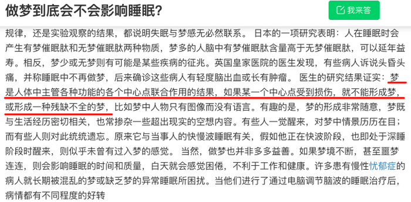

**考点**：加强-实验类、补充论据

**来源**：2013年413联考《行测》题（辽宁/湖南/湖北/安徽/四川/福建/云南/黑龙江/江西/广西/贵州/海南/内蒙古/山西/重庆/宁夏/西藏）第125题

### 第 126 题

研究人员在正常的海水和包含两倍二氧化碳浓度的海水中分别培育了某种鱼苗，鱼苗长大后被放入一个迷宫。每当遇到障碍物时，在正常海水中孵化的鱼都会选择正确的方向避开。然而那些在高二氧化碳浓度下孵化的鱼却会随机地选择向左转或向右转，这样，这种鱼遇到天敌时，生存机会减少。因此，研究人员认为在高二氧化碳环境中孵化的鱼，生存的能力将会减弱。

以下哪项如果为真，不能支持该项结论？

A. 人类燃烧化石燃料产生的二氧化碳大约有三分之一都被地球上的海洋吸收了，这使得海水逐渐酸化，会软化海洋生物的外壳和骨骼

B. 在二氧化碳含量高的海洋区域，氧气含量较低。氧气少使海洋生物呼吸困难，觅食、躲避掠食者以及繁衍后代也变得更加困难

C. 二氧化碳是很多海洋生物的重要营养物质，它们在日光照射下把叶子吸收的二氧化碳和根部输送来的水分转变为糖、淀粉以及氧气

D. 将小丑鱼幼鱼放在二氧化碳浓度较高的海水中饲养，并播放天敌发出的声音，结果这组小鱼听不到声音

第 126 题 · 答案与解析

**参考答案（粉笔题库参考内容）**

C

**解析**

本题为加强题型。第一步：找到论点论据。论点：在高二氧化碳环境中孵化的鱼，生存的能力将会减弱。论据：研究人员所进行的实验。第二步：逐一分析选项。C项说明的是二氧化碳将水分转变为糖、淀粉及氧气，说明高二氧化碳环境非但不会影响生存能力，反而有好处，削弱了论点。A项二氧化碳使海水酸化并造成海洋生物的外壳和骨骼软化，这说明二氧化碳浓度越高，海洋生物的外壳和骨骼被软化的程度会越高，其保护自己的能力就越弱，支持了论点；B项二氧化碳含量高的海洋区域氧气含量低，增加了海洋生物呼吸、觅食和繁衍后代的困难，海洋生物的生存能力也随之降低，支持了论点；D项在二氧化碳浓度高的海水中养大的小丑鱼听不到天敌发出的声音，说明小丑鱼会容易受天敌攻击，不利于生存，也是支持了论点。

本题为选非题，故正确答案为C。

**考点**：加强选非题

**来源**：2013年413联考《行测》题（辽宁/湖南/湖北/安徽/四川/福建/云南/黑龙江/江西/广西/贵州/海南/内蒙古/山西/重庆/宁夏/西藏）第126题

### 第 127 题

富裕起来的这一代中国父母，仍然处在家庭教育的“初级阶段”内，习惯于物质欲望的满足、用金钱砸下的“抢跑”来帮助孩子“赢在起跑线上”，用不肯放手来表达对孩子的爱、对教育的重视。快乐对于单纯的孩子而言，实在是很简单的事。有爱心的父母，没有那么多期望与要求，放下怀抱的焦虑感，没有那么多对社会、制度、他人的怨愤，单纯地和孩子在一起，为他们营造一个更安全的环境，一起度过快乐美好的一天。

由此可以推出：

A. 关心孩子会给孩子带来比金钱更多的快乐

B. 让孩子“赢在起跑线上”是一种错误的想法

C. 满足孩子的物质欲望也是爱孩子的一种方式

D. 孩子希望父母陪伴而不是把孩子们送进补习班

第 127 题 · 答案与解析

**参考答案（粉笔题库参考内容）**

D

**解析**

日常结论题，根据题干信息逐一分析选项。

A项：题干并没有将关心孩子和满足孩子物质欲望进行对比，从而说明哪种快乐更多，无中生有，排除；

B项：题干是说很多家长习惯于通过物质让孩子赢在起跑线上，并没有提到这是正确还是错误的想法，无中生有，排除；

C项：题干是说很多家长习惯于物质欲望的满足，强调的是家长的做法，而选项中说的是爱孩子的方式，强调的是家长“爱孩子”的结果，偷换概念，排除；

D项：题干上半段是在说父母“用金钱砸下的抢跑来让孩子赢在起跑线上”，下半段是在说孩子需要陪伴，能够看出来孩子希望得到的爱和父母现在所给的并不一致，可以推出，当选。

故正确答案为D。

注：通过核查原文，D项更符合，故粉笔倾向于将答案给到D项。

原文：

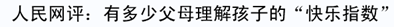

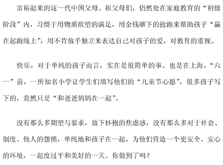

**考点**：日常结论

**来源**：2013年413联考《行测》题（辽宁/湖南/湖北/安徽/四川/福建/云南/黑龙江/江西/广西/贵州/海南/内蒙古/山西/重庆/宁夏/西藏）第127题

### 第 128 题

某单位每逢年底会针对全体员工进行评优，评优项有5个，分别是最佳敬业奖、最佳创意奖、最佳协作奖、最佳写作奖、年度明星奖。其中如果评选了年度明星奖则不能再评选最佳创意奖和最佳敬业奖；如果评选了协作奖，就不能再获得写作奖；如果评选了敬业奖，则不能再获得协作奖。每个人最多获得两个奖项。综合科一共3位员工，揽括了所有奖项，每个人都获奖，但是奖项各不相同。已知员工甲获得了明星奖，员工乙和员工丙二人之间有人获得了写作奖。

由此可知，下列推测一定正确的是：

A. 如果乙获得了写作奖，则其还获得了敬业奖

B. 如果乙获得了协作奖，则乙和丙各获得两个奖项

C. 如果乙获得了写作奖和创意奖，则甲一定只获得一个奖项

D. 如果丙获得了协作奖，则乙一定不能获得敬业奖

第 128 题 · 答案与解析

**参考答案（粉笔题库参考内容）**

B

**解析**

第一步：翻译题干。

① 明星奖→–创意奖且–敬业奖；

② 协作奖→–写作奖；

③ 敬业奖→–协作奖；

④ 每个人最多获得两个奖项；

⑤ 甲获得明星奖；

⑥ 乙和丙之间有人获得写作奖。

第二步：逐一分析选项。

A项：可翻译为，乙：写作奖→敬业奖。根据逆否规则，由条件②可推出“写作奖→–协作奖”，“–协作奖”是对条件③后件的肯定，肯后无法得出确定性结论，因此乙有可能获得敬业奖，也有可能没有敬业奖，故A项不一定正确，排除；

B项：乙获得协作奖，乙和丙各获得两个奖项。由条件②可知，乙如果获得协作奖，那乙就不能获得写作奖；由条件③的逆否规则可推出“协作奖→–敬业奖”，即乙获得协作奖，则不能获得敬业奖。又知乙和丙两人中有人获得写作奖，可知写作奖是丙获得的。由条件⑤甲获得明星奖，又由条件①可推出甲不能获得创意奖和敬业奖，所以创意奖和敬业奖分别由乙和丙获得，即乙和丙各获得两个奖项，B项一定正确，当选；

C项：如果乙获得写作奖和创意奖，又由条件⑤知甲获得明星奖，那么剩下协作奖和敬业奖两个奖项，由条件③可知，敬业奖和协作奖不能由同一个人获得，即丙不能同时获得敬业奖和协作奖，又因为甲已获得明星奖，不能再获得敬业奖，所以可推出丙获得敬业奖，甲获得协作奖。因此，如果乙获得写作奖和创意奖，那么丙只能获得敬业奖，甲获得明星奖和协作奖，C项错误，排除；

D项：如果丙获得协作奖，那么根据条件③的逆否命题，丙一定没有获得敬业奖，根据条件①⑤可知，甲没有获得敬业奖，根据题干信息，3人揽括了所有奖项，那么乙一定获得敬业奖，D项错误，排除。

故正确答案为B。

**考点**：常规翻译

**来源**：2013年413联考《行测》题（辽宁/湖南/湖北/安徽/四川/福建/云南/黑龙江/江西/广西/贵州/海南/内蒙古/山西/重庆/宁夏/西藏）第128题

### 第 129 题

树木枝干和许多植物的茎秆通常含有大量难以分解的木质素，因此利用它们来提炼生物燃料的效率要大打折扣。目前，人们发现了一种名为红球菌的细菌，它具有分解木头和其他植物中木质素的能力，因此，人们认为可以将红球菌广泛用于以往大都废弃的茎秆，从而大大提高生物燃料的利用率。

以下哪项如果为真，最能支持上述结论？

A. 红球菌能分泌一种酶，这种酶具有分解木质素的能力，但是其分泌能力呈现周期性变化

B. 一些真菌也具有分解木质素的能力，研究发现，这些真菌的生长需要特定的温度和湿度

C. 红球菌易于培养，目前对红球菌已完成基因测序，因此可以利用红球菌大规模地生产分解木质素的酶

D. 木质素是一种优质高分子材料，迄今为止，超过95%的木质素都是直接排入江河或浓缩后烧掉，很少有效利用

第 129 题 · 答案与解析

**参考答案（粉笔题库参考内容）**

C

**解析**

本题为加强题型。第一步：找到论点论据。论点：人们认为可以将红球菌广泛用于以往大都废弃的茎秆，从而大大提高生物燃料的利用率。论据：人们发现了一种名为红球菌的细菌，它具有分解木头和其他植物中木质素的能力。第二步：逐一分析选项。C项在论点和论据之间搭桥，论据强调红球菌具有分解木质素的能力，论点强调通过广泛运用红球菌来提高生物燃料的利用率，具有分解能力和能否被广泛利用之间没有必然的联系，需要在两者间搭桥，C项恰恰说明红球菌分解木质素的能力能够被广泛运用，加强了论证，是本题答案。A项红球菌分泌的能分解木质素的酶呈现周期性变化，这说明红球菌不稳定，不一定能被广泛运用，无法支持；B项说的是一些真菌，跟红球菌无关，属于无关选项；D项是对木质素的介绍，跟红球菌能分解木质素并提高生物燃料的利用率无关，同样属于无关选项。

故正确答案为C。

**考点**：搭桥

**来源**：2013年413联考《行测》题（辽宁/湖南/湖北/安徽/四川/福建/云南/黑龙江/江西/广西/贵州/海南/内蒙古/山西/重庆/宁夏/西藏）第129题

### 第 130 题

研究人员完成了两项记忆实验，实验一中参试者学习10组单词，实验二中参试者学习一系列手指信号。两实验中，只告诉一半参试者10小时后将接受测试，实际上所有参试者都将测试。只安排一部分参试者在学习和测试之间小睡。结果发现，睡觉组参试者比不睡觉参试者表现更好；事先被告知要进行测试的参试者，测试成绩也比较高，因此，研究人员认为，睡眠有助于大脑存储对将来有用的记忆信息。

如果以下各项为真，最能反驳该结论的一项是：

A. 实验一中参试者都是记忆力较好的，在某语言专业学习的年轻人

B. 有些被告知要进行测试的参试者，小睡时没有睡着，他们无意识地在大脑中复习所学过的内容

C. 安排小睡时间的参试者，均为年龄较小的少年，而众所周知，人在少年时期的记忆力比较好

D. 实验二中部分小睡的参试者以放松的心态参加考试，取得了较好的成绩

第 130 题 · 答案与解析

**参考答案（粉笔题库参考内容）**

C

**解析**

本题为削弱题型。第一步：找到论点论据。论点：睡眠有助于大脑储存对将来有用的记忆信息。论据：研究人员进行了两项记忆实验，结果发现，睡觉组参试者比不睡觉参试者表现更好；事先被告知要进行测试的参试者，测试成绩也比较高。第二步：逐一分析选项。C项中安排小睡的被试者都是记忆力较好的少年，这说明该组在睡眠后测试结果更好，有可能是因为被试者本身记忆力好，而不一定是睡眠起的作用，削弱了论点，是本题答案。A项只提到实验一中的参试者；B项只提到有些被告知要进行测试的参试者；D项只提到实验二中部分小睡的参试者，这些都只代表睡觉组参试者及事先被告知要进行测试的参试者中的一部分，不能完全说明两个参试者的整体情况，无法有力地反驳论点。

故正确答案为C。

**考点**：他因削弱、削弱-实验类

**来源**：2013年413联考《行测》题（辽宁/湖南/湖北/安徽/四川/福建/云南/黑龙江/江西/广西/贵州/海南/内蒙古/山西/重庆/宁夏/西藏）第130题

### 第 131 题

所有的战争和混乱都是在没有协商、无理可讲的时候发生的，讲理和协商都离不开语言，然而，并非有语言的地方就自动会有讲理，有语言的地方必须有自由才能有说理。

由此可以推出：

A. 所有的战争和混乱都是因为没有自由而发生的

B. 并非所有的战争和混乱都是在不可以协商和不可以讲理的时候发生的

C. 如果没有自由，不能讲理，就可能发生战争和混乱

D. 有语言和自由的地方就一定不会发生战争

第 131 题 · 答案与解析

**参考答案（粉笔题库参考内容）**

C

**解析**

第一步：翻译题干。

①战争 且 混乱→—协商 且 -讲理；

②讲理 且 协商→语言；

③说理→语言 且 自由。

第二步：逐一分析选项。

A项：根据①可知，战争 且 混乱→—协商 且 -讲理，但“-协商 且 -讲理”不能推出任何与“自由”有关的结论，无法判断存在“因果关系”，无法推出，排除；

B项：该项的表述等价于在“所有的战争和混乱都是在没有协商、无理可讲的时候发生的”前面加了一个“并非”，是条件①的矛盾，无法推出，排除；

C项：翻译为：-自由 且 -讲理→战争 且 混乱，“-自由”是对条件③的否后，根据德摩根和逆否，可以推出“-自由→—讲理”，“-讲理”是对条件①的一部分肯后，无法推出确定性结论，但可以推出可能性结论，即可能发生战争和混乱，可以推出，当选；

D项：翻译为：语言 且 自由→—战争；“语言 且 自由”是条件③的肯后，肯后无法推出确定性结论，无法推出，排除。

故正确答案为C。

**考点**：集合推理

**来源**：2013年413联考《行测》题（辽宁/湖南/湖北/安徽/四川/福建/云南/黑龙江/江西/广西/贵州/海南/内蒙古/山西/重庆/宁夏/西藏）第131题

### 第 132 题

科学家发现，儿童时期不接触细菌和病菌，是5岁以下人群糖尿病病例近年来急剧增加的主要原因之一。而那些生活在农村的孩子由于更早接触到带菌的物质，有更多机会与宠物相处，患过敏症、哮喘和湿疹等疾病的几率反而很低。所以，将细菌消灭得过于彻底的环境可能反而会给儿童的健康带来危害。

以下哪项如果为真，将有力地支持上述结论？

A. 刚出生的婴儿，其体表和体内是无菌的，但开始吃奶、喝水后，细菌便乘机进入体内

B. 人体皮肤上的细菌大多起保护作用，并为每个人制造出独特的体味

C. 大部分细菌是有益于身体健康的，人的健康长寿离不开正常的菌群

D. 很多有害细菌平时与人体相安无事，当人体免疫力下降时，细菌便开始侵害人体

第 132 题 · 答案与解析

**参考答案（粉笔题库参考内容）**

C

**解析**

本题为加强题型。第一步：找到论点论据。

论点：将细菌消灭得过于彻底的环境可能反而会给儿童的健康带来危害。

论据：儿童时期不接触细菌和病菌，是5岁以下人群糖尿病病例近年来急剧增加的主要原因之一。而那些生活在农村的孩子由于更早接触到带菌的物质，有更多机会与宠物相处，患过敏症、哮喘和湿疹等疾病的几率反而很低。

第二步：逐一分析选项。

A项说明婴儿会接触到细菌，但没有提到不接触细菌是否对儿童健康有害，无关排除；

B项只谈到皮肤上的细菌能够提供保护作用，属于举例加强，但后半句“独特的体味”与论点无关，保留；

C项人的健康长寿离不开正常的菌群，说明彻底消灭细菌不利于身体健康，属于解释原因加强，比B项力度更大，当选；

D项说明细菌的害处，削弱了论点，排除。

故正确答案为C。

**考点**：补充论据

**来源**：2013年413联考《行测》题（辽宁/湖南/湖北/安徽/四川/福建/云南/黑龙江/江西/广西/贵州/海南/内蒙古/山西/重庆/宁夏/西藏）第132题

### 第 133 题

传统观点认为，尽管用于制造贫铀弹所使用的贫铀放射性低，仍会导致人类染色体受损，从而引发肿瘤或癌症。但是，在最近的一项研究中，研究员对接触过贫铀弹的退伍老兵的血细胞进行研究，到目前为止，还没有检测到任何染色体断裂和重复，并没有发现任何由于接触贫铀弹而造成的负面健康影响。因此相关研究人员认为，放射性低的贫铀弹不会对人类的健康造成影响。

以下哪项如果为真，最能削弱研究人员的结论？

A. 某地居民向法院起诉，声称该国军队试验贫铀弹，已影响该地居民健康

B. 世界上很多国家的专家都在致力于解决贫铀弹的放射性问题

C. 有数据显示，这些退伍老兵的后代患有先天性缺陷的比率高于正常值

D. 没有接触过贫铀弹的人也会患有肿瘤或癌症

第 133 题 · 答案与解析

**参考答案（粉笔题库参考内容）**

C

**解析**

第一步：找出论点和论据。

论点：放射性低的贫铀弹不会对人类的健康造成影响。

论据：对接触过贫铀弹的退伍老兵的血细胞进行研究，到目前为止，还没有检测到任何染色体断裂和重复，并没有发现任何由于接触贫铀弹而造成的负面健康影响。

本题论点讨论的是放射性低的贫铀弹不会对人类的健康造成影响，论据说的是接触过贫铀弹的退伍老兵并未发现因接触贫铀弹而造成的负面健康影响，论点论据话题一致，削弱优先考虑否定论点。

第二步：逐一判断选项。

A项：该项说某地居民声称该地居民健康受贫铀弹试验影响，只是介绍了居民的说法，而贫铀弹试验是否真的对该地居民造成了影响，尚未有结论，不明确项，无法削弱，排除；

B项：该项说专家致力于解决贫铀弹的放射性问题，而论点讨论的是贫铀弹是否会影响人体健康，二者话题不一致，无关项，无法削弱，排除；

C项：该项说后代患有先天性缺陷的比率高于正常值，说明放射性贫铀弹对身体的影响通过遗传，造成后代的先天性缺陷，说明贫铀弹确实对人类健康造成了影响，削弱论点，可以削弱，当选；

D项：该项说没有接触过贫铀弹的人也会患肿瘤或癌症，讨论的对象是“没接触过贫铀弹的人”，而论点讨论的对象是“接触过贫铀弹的人”，二者讨论的主体不一致，无关项，无法削弱，排除。

故正确答案为C。

**考点**：削弱论点

**来源**：2013年413联考《行测》题（辽宁/湖南/湖北/安徽/四川/福建/云南/黑龙江/江西/广西/贵州/海南/内蒙古/山西/重庆/宁夏/西藏）第133题

### 第 134 题

传播媒介拥有不可抵抗的强大力量，它们所传递的信息在受传者身上就像子弹击中身体、药剂注入皮肤一样，受众完全处于被动的地位，消极地等待和接受媒介所灌输的各种思想、感情、知识，受众的性格差异对大众传媒提供的信息产生的反应可以忽略不计。

如果以下各项为真，最能削弱上述观点的是：

A. 人受到某种特定刺激就必然引起某种特定反应

B. 坚持读者需求导向并不能为受众创造最大利益

C. 社会对电视节目庸俗化倾向普遍存在担忧心理

D. 取消电影分级制度未影响其观众的数量和构成

第 134 题 · 答案与解析

**参考答案（粉笔题库参考内容）**

C

**解析**

本题为削弱题型。

第一步，分析题干，找到论点论据。

论点：传播媒介拥有不可抵抗的强大力量，受众完全处于被动的地位，消极地等待和接受媒介所灌输的各种思想、感情、知识，受众的性格差异对大众传媒提供的信息产生的反应可以忽略不计。

论据：无明显论据。

第二步：逐一分析选项。

A项：“必然引起某种特定反应”并不能说明受众是否接受。除此之外，题干中说“反应可以忽略不计”意味着反应很小，而A项只是说了必然会有反应，但是反应是大是小无从得知，因此，无法削弱；

B项：意思是说按读者需求来进行大众传播不能创造最大利益，与论点无关；

C项：“社会对电视节目庸俗化倾向普遍存在担忧心理”是一个反向的论据，说明受众不是完全被动地接受而是有了主动的反应；

D项：意思是说改变传播方向的制度不会影响观众数量和构成，与题干讨论的传媒所灌输的思想、感情、知识无关，无法削弱。

故正确答案为C。

**考点**：削弱论点

**来源**：2013年413联考《行测》题（辽宁/湖南/湖北/安徽/四川/福建/云南/黑龙江/江西/广西/贵州/海南/内蒙古/山西/重庆/宁夏/西藏）第134题

## 材料 1

2011年1~9月，全国造船完工5101万载重吨，同比增长18.3%，9月当月完工786万载重吨，环比增长67.2%，新承接船舶订单规模2902万载重吨，同比下降42.8%，手持船舶订单规模16886万载重吨，同比下降13.8%，比2010年底下降14.5%。

        1~9月，全国规模以上船舶工业企业1526家，完成工业总产值5734亿元，同比增长24.6%。1~8月，全国规模以上船舶工业企业实现主营业务收入4383亿元，同比增长27.1%。受成本上涨、低价船交付比例增大等因素影响，船舶工业利润增幅出现回落。1~8月，船舶企业实现利润总额328亿元，同比增长24.5%，增幅下降8.2个百分点。1~8月，船舶工业企业主营业务收入利润率7.5%，同比下降2.1%。主营业务收入和利润总额增幅分别低于全国工业平均水平4.6和3.7个百分点。

        1~9月，全国规模以上船舶工业企业完成出口交货值2394亿元，同比增长16%，增幅下降1.9个百分点。全国完工出口船舶规模4305万载重吨，占全国造船总量的84.4%；新承接出口船舶订单规模2162万载重吨，占新接订单的74.5%；手持出口船舶订单规模13863万载重吨，占全部手持订单的82.1%。

        9月当月，我国船舶行业仅承接船舶订单规模94万载重吨，是2009年6月以来月度成交的最低值。截至9月底，全国约有30%的船厂没有接到订单，部分企业明年上半年可能陷入开工任务不足的困境，一些小船厂已开始停产、转产。

### 第 135 题

2011年1~7月，全国造船完工总量为多少万载重吨？

A. 4315

B. 3845

C. 4312

D. 3855

第 135 题 · 答案与解析

**参考答案（粉笔题库参考内容）**

B

**解析**

根据题干“2011年1-7月······为多少万载重吨”，结合材料时间为2011年1-9月，可判定本题为基期计算问题。定位材料第一段可知，2011年1-9月，全国造船完工5101万载重吨，同比增长18.3%，9月当月完工786万载重吨，环比增长67.2%。根据公式：基期量，则（1-7月完工量）=（1-9月完工量）-9月完工量-8月完工量，则所求万载重吨，与B项最接近。

故正确答案为B。

**考点**：基期计算、文字资料

**来源**：2013年413联考《行测》题（辽宁/湖南/湖北/安徽/四川/福建/云南/黑龙江/江西/广西/贵州/海南/内蒙古/山西/重庆/宁夏/西藏）第135题

### 第 136 题

2011年1~9月，新承接出口船舶订单在全国造船完工总量中的比重约为：

A. 50.2%

B. 15.5%

C. 74.5%

D. 42.4%

第 136 题 · 答案与解析

**参考答案（粉笔题库参考内容）**

D

**解析**

根据题干“2011年1-9月······在······的比重约为”，结合材料时间为2011年1-9月，可判定本题为现期比重计算问题。定位材料第一、三段可得，2011年1-9月，全国造船完工5101万载重吨，新承接出口船舶订单2162万载重吨。根据公式：比重=部分/整体，则所求比重。

故正确答案为D。

**考点**：文字资料、现期比重

**来源**：2013年413联考《行测》题（辽宁/湖南/湖北/安徽/四川/福建/云南/黑龙江/江西/广西/贵州/海南/内蒙古/山西/重庆/宁夏/西藏）第136题

### 第 137 题

2011年1~9月，全国手持出口船舶订单约为新承接出口船舶订单的多少倍？

A. 4.78

B. 6.41

C. 3.22

D. 5.82

第 137 题 · 答案与解析

**参考答案（粉笔题库参考内容）**

B

**解析**

根据题干“2011年1-9月······多少倍”，结合材料时间为2011年1-9月，可判定本题为现期倍数问题。定位材料第三段可得，2011年1-9月新承接出口船舶订单规模2162万载重吨，手持出口船舶订单13863万载重吨。则手持出口船舶订单是新承接出口船舶单的倍，与B项最接近。

故正确答案为B。

**考点**：文字资料、现期倍数

**来源**：2013年413联考《行测》题（辽宁/湖南/湖北/安徽/四川/福建/云南/黑龙江/江西/广西/贵州/海南/内蒙古/山西/重庆/宁夏/西藏）第137题

### 第 138 题

2011年1~9月，全国规模以上船舶工业企业完成出口交货值占全国规模以上船舶企业工业总产值中的比重与2010年该比重相比，下降了约几个百分点？

A. 3

B. 4

C. 5

D. 6

第 138 题 · 答案与解析

**参考答案（粉笔题库参考内容）**

A

**解析**

根据题干“2011年1-9月······的比重与2010年该比重相比，下降了约几个百分点”，可判定本题为两期比重问题。定位材料第二、四段可得，2011年1-9月全国规模以上船舶工业企业完成工业总产值5734亿元（B），同比增长24.6%（b）；完成出口交货值2394亿元（A），同比增长16%（a）。根据公式：两期比重差。则所求，即下降了约3个百分点。

故正确答案为A。

**考点**：两期比重、文字资料

**来源**：2013年413联考《行测》题（辽宁/湖南/湖北/安徽/四川/福建/云南/黑龙江/江西/广西/贵州/海南/内蒙古/山西/重庆/宁夏/西藏）第138题

### 第 139 题

下列说法中正确的是：

A. 与手持船舶订单相比，2011年1~9月新承接船舶订单规模比去年同期下降更多

B. 2011年1~8月，全国规模以上船舶工业企业主营业务收入占船舶工业总产值的76.4%

C. 2009年1~8月，船舶企业实现利润总额约为199亿元

D. 2011年1~9月，我国船舶行业月平均承接船舶订单规模低于94万载重吨

第 139 题 · 答案与解析

**参考答案（粉笔题库参考内容）**

C

**解析**

A项：定位材料第一段可得，2011年1-9月，新承接船舶订单规模2902万载重吨，同比下降42.8%，手持船舶订单规模16886万载重吨，同比下降13.8%。根据公式：增长量，则新承接船舶订单规模同比下降万载重吨；手持船舶订单规模同比下降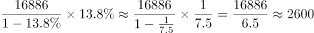万载重吨。手持船舶订单规模同比下降更多，错误。

B项：材料中仅给出2011年1-9月船舶工业总产值数据，并未给出1-8月有关数据，且无法求出，故无法推出，错误。

C项：C项：定位材料第二段可得，2011年1-8月，船舶企业实现利润总额328亿元，同比增长24.5%（r_1），增幅下降8.2个百分点，则2010年1-8月同比增长24.5%+8.2%=32.7%（7^2）。根据公式：，则2011年1-8月比2009年1-8月增长。根据公式：基期量，则2009年1-8月利润总额亿元，正确。

D项：定位材料第四段“（2011年）9月当月，我国船舶行业仅承接船舶订单规模94万载重吨，是2009年6月以来月度成交的最低值”，则2011年1-9月船舶行业承担船舶订单规模应高于94万载重吨，错误。

故正确答案为C。

**考点**：文字资料、综合分析

**来源**：2013年413联考《行测》题（辽宁/湖南/湖北/安徽/四川/福建/云南/黑龙江/江西/广西/贵州/海南/内蒙古/山西/重庆/宁夏/西藏）第139题

## 材料 2

根据所给图表资料回答问题。

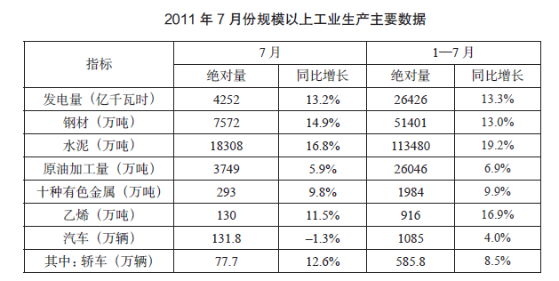

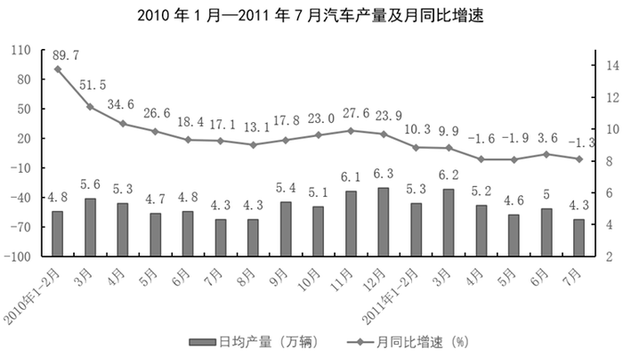

### 第 140 题

2011年7月产量低于上半年月均产量的是：

A. 电

B. 钢材

C. 水泥

D. 乙烯

第 140 题 · 答案与解析

**参考答案（粉笔题库参考内容）**

D

**解析**

根据题干“2011年7月产量低于上半年月均产量······”，结合材料给出2011年7月及1-7月有关数据，可判定本题为现期平均数问题。定位统计表可知2011年7月及1-7月的电、钢材、水泥、乙烯产量。根据题干要求，若满足：，化简后应满足：。验证如下：

电：；

钢材：；

水泥：；

乙烯：。

综上可知，满足要求的为D项。

故正确答案为D。

**考点**：现期平均数、综合资料

**来源**：2013年413联考《行测》题（辽宁/湖南/湖北/安徽/四川/福建/云南/黑龙江/江西/广西/贵州/海南/内蒙古/山西/重庆/宁夏/西藏）第140题

### 第 141 题

2011年7月轿车产量占汽车产量的比重与上年同期相比：

A. 上升了约7个百分点

B. 下降了约7个百分点

C. 上升了约14个百分点

D. 下降了约14个百分点

第 141 题 · 答案与解析

**参考答案（粉笔题库参考内容）**

A

**解析**

根据题干“······占······的比重与上年同期相比”，结合选项“上升/下降+百分点”，判定本题为两期比重问题。定位统计表可知，2011年7月汽车产量131.8万辆（B），同比增长-1.3%（b）；轿车产量77.7万辆（A），同比增长12.6%（a）。根据两期比重比较结论：部分增长率（a）＞整体增长率（b），比重上升，则12.6%＞-1.3%，故比重上升，排除B、D两项；根据公式：两期比重差，则所求比重差，即上升了不到13.9个百分点，排除C项。

故正确答案为A。

**考点**：两期比重、综合资料

**来源**：2013年413联考《行测》题（辽宁/湖南/湖北/安徽/四川/福建/云南/黑龙江/江西/广西/贵州/海南/内蒙古/山西/重庆/宁夏/西藏）第141题

### 第 142 题

2010年3~12月中，汽车单月产量超过150万辆的月份有多少个？

A. 4

B. 5

C. 6

D. 7

第 142 题 · 答案与解析

**参考答案（粉笔题库参考内容）**

C

**解析**

根据题干“2010年3-12月中，汽车单月产量······”，结合材料给出2010年3-12月有关数据，可判定本题为现期平均数问题。根据公式：平均数=总量/份数，若3-12月中满足单月产量超过150万辆，则大月（3月、5月、7月、8月、10月、12月，每月31天）单日产量应超过万辆；小月（4月、6月、9月、11月，每月30天）单日产量应超过150/30=5万辆。定位统计图可知，2010年3-12月中，满足要求的有3月、4月、9月、10月、11月、12月，共6个月份。

故正确答案为C。

**考点**：现期平均数、综合资料

**来源**：2013年413联考《行测》题（辽宁/湖南/湖北/安徽/四川/福建/云南/黑龙江/江西/广西/贵州/海南/内蒙古/山西/重庆/宁夏/西藏）第142题

### 第 143 题

下列选项中，汽车产量同比增速最低的是：

A. 2010年4月

B. 2010年5月

C. 2011年4月

D. 2011年5月

第 143 题 · 答案与解析

**参考答案（粉笔题库参考内容）**

D

**解析**

定位统计图可知，2010年4月汽车产量同比增速为34.6%，2010年5月为26.6%，2011年4月为-1.6%，2011年5月为-1.9%，可得2011年5月同比增速最低。

故正确答案为D。

**考点**：直接找数、综合资料

**来源**：2013年413联考《行测》题（辽宁/湖南/湖北/安徽/四川/福建/云南/黑龙江/江西/广西/贵州/海南/内蒙古/山西/重庆/宁夏/西藏）第143题

### 第 144 题

以下说法与资料相符的是：

A. 表中产品2011年7月产量同比增速均慢于上半年

B. 2011年7月，十种有色金属比上年同期增产9.8万吨

C. 2009年11月，汽车日均产量超过4万辆

D. 2010年汽车产量最低的季度是一季度

第 144 题 · 答案与解析

**参考答案（粉笔题库参考内容）**

C

**解析**

A项：定位统计表可知表中产品2011年7月及1-7月产量的同比增长率。因（1-7月）=7月+上半年，则1-7月同比增速可由7月与1-6月混合后得到。根据混合增长率“居中”原则，若想满足7月同比增速＜上半年同比增速，则应满足7月同比增速＜1-7月同比增速＜上半年同比增速。其中，钢材7月同比增速（14.9%）＞1-7月同比增速（13.0%），不符合，故错误。

B项：定位统计表可知，2011年7月十种有色金属产量293.0万吨，同比增长9.8%。根据公式：增长量，则所求增长量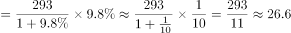万吨，非9.8万吨，错误；

C项：定位统计图可知，2010年11月汽车日均产量6.1万辆，月同比增速27.6%。根据公式：基期量，则2009年11月日均产量万辆，正确；

D项：通过观察统计图，将第一季度（1-2月、3月）总产量与日均产量较低的三季度（7月、8月、9月）总产量进行比较：第一季度总产量-第三季度总产量=4.8×（31+28）+5.6×31-（4.3×31+4.3×31+5.4×30）=4.8×59+5.6×31-8.6×31-5.4×30=4.8×59-8.5×30＞0，则一季度汽车产量大于三季度，并非最小，错误。

故正确答案为C。

**考点**：综合分析、综合资料

**来源**：2013年413联考《行测》题（辽宁/湖南/湖北/安徽/四川/福建/云南/黑龙江/江西/广西/贵州/海南/内蒙古/山西/重庆/宁夏/西藏）第144题

## 材料 3

根据所给图表、文字资料回答问题。

        2011年上半年，我国软件产业实现软件业务收入8065亿元，同比增长29.3%，增速比去年同期高0.2个百分点；实现利润103亿元，同比增长34.9%。其中，6月份完成软件业务收入1828亿元，同比增长32.9%，增速比5月份回升3.6个百分点。

        上半年，信息技术咨询服务、数据处理和营运服务实现收入761和1073亿元，同比增长36.5%和34.5%，分别高出全行业7.2和5.2个百分点；嵌入式系统软件实现收入1443亿元，同比增长33.8%，增速比去年同期高14.2个百分点。软件产品和信息系统集成服务发展较为稳定，分别实现收入2867和1673亿元，同比增长28.2%和23.9%。IC设计增长放缓，上半年实现收入248亿元，同比增长13.7%，低于去年同期20个百分点以上。

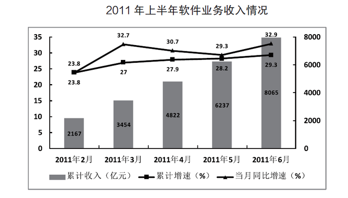

### 第 145 题

2011年6月份我国软件业务收入占上半年的总值比重约为：

A. 22.7%

B. 24.6%

C. 26.5%

D. 29.1%

第 145 题 · 答案与解析

**参考答案（粉笔题库参考内容）**

A

**解析**

根据题干“2011年6月份···占···的比重”，结合材料数据为2011年，判定本题为现期比重问题。定位文字材料第一段：“2011年上半年，我国软件产业实现软件业务收入8065亿元，其中，6月份完成软件业务收入1828亿元。”6月软件收入占上半年软件总收入的比重，与A选项最接近。

故正确答案为A。

**考点**：现期比重、综合资料

**来源**：2013年413联考《行测》题（辽宁/湖南/湖北/安徽/四川/福建/云南/黑龙江/江西/广西/贵州/海南/内蒙古/山西/重庆/宁夏/西藏）第145题

### 第 146 题

与2011年一季度相比，二季度软件业务收入增长了约：

A. 30.2%

B. 33.5%

C. 36.7%

D. 39.4%

第 146 题 · 答案与解析

**参考答案（粉笔题库参考内容）**

B

**解析**

根据题干“与······相比，······增长了”，结合选项都是百分数，判定本题为一般增长率问题。定位柱状图：累计到2011年3月软件收入为3454亿元；累计到2011年6月软件收入为8065亿元。故一季度收入=3454亿元，二季度收入=8065-3454=4611亿元。与一季度相比，二季度软件收入增长率，与B选项最接近。

故正确答案为B。

**考点**：一般增长率、综合资料

**来源**：2013年413联考《行测》题（辽宁/湖南/湖北/安徽/四川/福建/云南/黑龙江/江西/广西/贵州/海南/内蒙古/山西/重庆/宁夏/西藏）第146题

### 第 147 题

2011年上半年嵌入式系统软件收入同比增长了：

A. 307亿元

B. 365亿元

C. 424亿元

D. 488亿元

第 147 题 · 答案与解析

**参考答案（粉笔题库参考内容）**

B

**解析**

根据题干“···同比增长了”，结合选项有单位，判定本题为增长量计算问题。定位文字材料第二段：“嵌入式系统软件实现收入1443亿元，同比增长33.8%”。代入增长量公式：，与B选项最接近。

故正确答案为B。

**考点**：增长量计算、综合资料

**来源**：2013年413联考《行测》题（辽宁/湖南/湖北/安徽/四川/福建/云南/黑龙江/江西/广西/贵州/海南/内蒙古/山西/重庆/宁夏/西藏）第147题

### 第 148 题

2011年上半年收入占整个软件产业的比重高于上年同期水平的是：

A. 信息系统集成

B. 嵌入式系统软件

C. IC设计

D. 软件产品

第 148 题 · 答案与解析

**参考答案（粉笔题库参考内容）**

B

**解析**

根据题干“······占······的比重高于上年同期水平”，判定本题为两期比重比较问题。定位文字材料：“2011年上半年，我国软件产业实现软件业务收入8065亿元，同比增长29.3%；嵌入式系统软件同比增长33.8%；软件产品和信息系统集成同比增长28.2%和23.9%；IC设计同比增长13.7%。”根据两期比重公式可知，当a>b时，比重高于上年同期水平。只有嵌入式系统软件产业收入增长率a=33.8%>软件收入增长率b=29.3%。

故正确答案为B。

**考点**：两期比重、综合资料

**来源**：2013年413联考《行测》题（辽宁/湖南/湖北/安徽/四川/福建/云南/黑龙江/江西/广西/贵州/海南/内蒙古/山西/重庆/宁夏/西藏）第148题

### 第 149 题

以下说法与资料相符的是：

A. 2011年5月份我国软件产业实现软件业务收入同比增长28.2%

B. 2011年3月份我国软件产业实现软件业务收入高于4月份

C. 2011年上半年信息技术服务实现收入超过1800亿元

D. 2010年上半年IC设计实现收入同比增速为6.3%

第 149 题 · 答案与解析

**参考答案（粉笔题库参考内容）**

C

**解析**

A项：定位折线图：2011年5月份我国软件产业实现软件业务收入同比增长29.3%，非28.2%，错误；

B项：定位柱状图：2011年2月累计收入2167亿元，3月累计收入3454亿元，4月累计收入4822亿元。故；。3月收入﹤4月收入，错误；

C项：定位文字材料第二段：“信息技术咨询服务、数据处理和营运服务实现收入761和1073亿元”，故信息技术服务实现收入=761+1073=1834亿元>1800亿元，正确；

D项：定位材料第二段：“IC设计增长放缓，上半年实现收入248亿元，同比增长13.7%，低于去年同期20个百分点以上”。故2010年同比增速＞13.7%+20%=33.7%，非6.3%，错误。

故正确答案为C。

**考点**：综合分析、综合资料

**来源**：2013年413联考《行测》题（辽宁/湖南/湖北/安徽/四川/福建/云南/黑龙江/江西/广西/贵州/海南/内蒙古/山西/重庆/宁夏/西藏）第149题

## 材料 4

根据所给图表、文字资料回答问题。

        某市2010年全年实现农业增加值124.3亿元，比上年下降1.6%。粮食播种面积22.3万公顷，比上年减少0.3万公顷；粮食产量115.7万吨，比上年下降7.3%。

        全市农业观光园1303个，比上年增加9个；观光园总收入17.8亿元，比上年增长16.7%。民俗旅游实际经营户7979户，比上年减少726户；民俗旅游总收入7.3亿元，增长20.7%。种业收入14.6亿元，比上年增长13.5%。设施农业总面积18323公顷，比上年下降2.3%；实现收入40.7亿元，增长20.1%。

### 第 150 题

该市2009年全年实现农业增加值约：

A. 124亿元

B. 126亿元

C. 129亿元

D. 132亿元

第 150 题 · 答案与解析

**参考答案（粉笔题库参考内容）**

B

**解析**

根据题干“2009年······农业增加值约”，结合材料数据为2010年，判定本题为基期计算问题。定位文字材料第一段：“某市2010年全年实现农业增加值124.3亿元，比上年下降1.6%”。代入基期计算公式。即该市2009年全年实现农业增加值约126亿元。

补充:当|r|&lt;5%时,可采用化除为乘进行估算：；。

故正确答案为B。

**考点**：基期计算、综合资料

**来源**：2013年413联考《行测》题（辽宁/湖南/湖北/安徽/四川/福建/云南/黑龙江/江西/广西/贵州/海南/内蒙古/山西/重庆/宁夏/西藏）第150题

### 第 151 题

该市2010年粮食平均产量约为每公顷：

A. 4.6吨

B. 5.2吨

C. 5.8吨

D. 6.5吨

第 151 题 · 答案与解析

**参考答案（粉笔题库参考内容）**

B

**解析**

根据题干“2010年······平均······每公顷”，结合材料数据为2010年，判定本题为现期平均数问题。定位文字材料第一段：“粮食播种面积22.3万公顷，比上年减少0.3万公顷；粮食产量115.7万吨，比上年下降7.3%。”故2010年粮食平均产量每公顷为吨/公顷。

故正确答案为B。

**考点**：现期平均数、综合资料

**来源**：2013年413联考《行测》题（辽宁/湖南/湖北/安徽/四川/福建/云南/黑龙江/江西/广西/贵州/海南/内蒙古/山西/重庆/宁夏/西藏）第151题

### 第 152 题

该市主要农副产品与上年相比，产量变化绝对值最小的是：

A. 肉类

B. 禽蛋

C. 水产品

D. 牛奶

第 152 题 · 答案与解析

**参考答案（粉笔题库参考内容）**

B

**解析**

根据题干“与上年相比，······变化绝对值最小”，判定本题为增长量比较问题。定位表格材料：2010年肉类产量46.3万吨，增速-2%；2010年禽蛋产量15.1万吨，增速-1.7%；2010年水产品产量6.3万吨，增速9%；2010年牛奶产量64.1万吨，增速-4.9%。代入增长量公式：。

肉类增长量绝对值；

禽蛋增长量绝对值=；

水产品增长量绝对值=；

牛奶增长量绝对值。

禽蛋增长量绝对值最小。

故正确答案为B。

**考点**：增长量比较、综合资料

**来源**：2013年413联考《行测》题（辽宁/湖南/湖北/安徽/四川/福建/云南/黑龙江/江西/广西/贵州/海南/内蒙古/山西/重庆/宁夏/西藏）第152题

### 第 153 题

该市种业收入增长速度：

A. 高于观光园总收入增长速度

B. 高于设施农业收入增长速度

C. 低于民俗旅游总收入增长速度

D. 低于设施农业占地面积增长速度

第 153 题 · 答案与解析

**参考答案（粉笔题库参考内容）**

C

**解析**

定位文字材料第二段：该市种业收入的增长速度为13.5%；A项观光园总收入增长速度是16.7%，B项设施农业收入增长速度为20.1%，C项民俗旅游总收入增长速度为20.7%，D项设施农业占地面积增长速度为-2.3%。只有C项说法与数据相符。

故正确答案为C。

**考点**：直接找数、综合资料

**来源**：2013年413联考《行测》题（辽宁/湖南/湖北/安徽/四川/福建/云南/黑龙江/江西/广西/贵州/海南/内蒙古/山西/重庆/宁夏/西藏）第153题

### 第 154 题

以下说法与资料相符的是：

A. 2010年该市粮食产量不到蔬菜产量的三分之一

B. 2010年该市主要农副产品产量均有所下降

C. 2009年该市观光园数量为1312个

D. 2010年该市单位面积粮食产量比上年有所下降

第 154 题 · 答案与解析

**参考答案（粉笔题库参考内容）**

D

**解析**

A项：定位表格材料：粮食产量115.7万吨，蔬菜产量303万吨，蔬菜产量的三分之一为，115.7>101，故2010年该市粮食产量高于蔬菜产量的三分之一，错误；

B项：定位表格材料：水产品产量增速 = 9.0%>0，说明水产品产量上升，并非均有所下降，错误；

C项：定位文字材料第二段：“全市农业观光园1303个，比上年增加9个”，故2009 年该市观光园数量 = 1303–9 = 1294，非1312，错误；

D项：定位文字材料第一段：“粮食播种面积22.3万公顷，比上年减少0.3万公顷；粮食产量115.7万吨，比上年下降7.3%。”根据两期平均数比较原理，当a&lt;b时，平均产量比上年下降。a即为粮食产量增速-7.3%，b即为粮食面积增速。a&lt;b，故平均产量比上年下降，正确。

故正确答案为D。

**考点**：综合分析、综合资料

**来源**：2013年413联考《行测》题（辽宁/湖南/湖北/安徽/四川/福建/云南/黑龙江/江西/广西/贵州/海南/内蒙古/山西/重庆/宁夏/西藏）第154题

