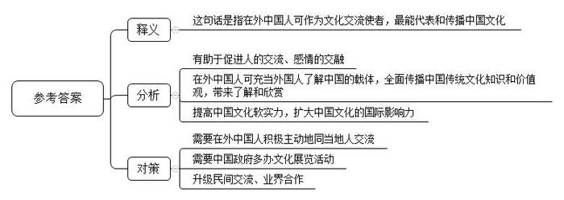
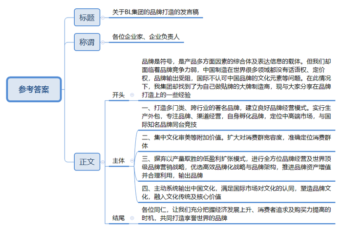
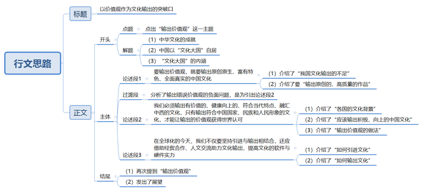

# 2014年公务员多省联考《申论》题（福建卷）

<!-- gwy:overview:start -->
> **福建 · 2014 · 申论 · 统考** ｜ 3 题 · 图片 3 处 · 答案随题折叠

导航：[题目](#题目) · [材料 1](#材料-1)
<!-- gwy:overview:end -->

> 候选采集稿。参考答案及解析来自粉笔页面，不代表官方答案或真实高分答卷；来源使用许可与原卷对应关系仍需人工核实。

## 给定材料

### 材料 1

大批赴美志愿者汉语教师在美国校园和社区内担当着文化使者的角色，来自四川的高中教师小琼就是其中之一。为期一年的赴美教学经历给她、她的美国学生乃至美国“街坊邻居”都留下珍贵记忆。

小琼在俄克拉荷马州一座小城执教，借住在一对老夫妇家中。小城只有一家沃尔玛超市。用男主人加里的话说，“全镇人几乎都相互认识”。这个四川姑娘每次出门都会被当地人认出来，很多人都会友善地同她打招呼。

文化交流归根结底是人的交流、感情的交融。小琼说，自己在2008年汶川大地震中不幸失去双亲，很长时间难以从悲伤中走出来，但这对美国老夫妇的悉心照顾、小镇居民的热情让她真切感受到人间真情。

和其他汉语教师一样，小琼也配备了介绍中国文化的“资源包”，内容从神话故事、历史名人到古典名著不一而足。不过，在和孩子们的接触中，她本身就是当地人了解中国的一个“资源包”。“你们也有手机么？”“家中有电视吗？”一个个问题背后是美国孩子对中国的不了解。当然，在打开“资源包”的同时也不可避免地引发价值观碰撞。“美国老师不加班、中国老师爱加班”“中国人爱储蓄”，甚至小琼想起万里之外家人时充盈的泪水，都让孩子们乃至大人们真切地感知着“中国人”的家庭观念，碰撞后带来的是了解和欣赏。

“我们觉得她是最好的‘中国制造’。”加里对记者幽默道，“如果你们国家要派出中国文化大使，选我们的琼准没错。”

当记者在世界各地问起：“提起中国文化，您会想到什么？”在赤道边春城内罗毕，中非关系专业在读研究生瑟库拉这样告诉记者：“孔子，我会想到他。我上过不少有关中国外交、非中关系的课，每次遇到理解不了的思想时，我们就开玩笑说‘这是孔子的思想’。每次辩论课上找论据时，我们最后总会找到‘孔子曰······’。西方也有很多先贤，但中国先贤似乎我只了解孔子。”

在内罗毕CBD地区一家大排档餐厅，28岁的顾客贝利对记者说：“我通过在内罗毕工作的中国人了解中国文化。我觉得要想让肯尼亚人了解中国文化，最重要的是生活在本地的中国人的态度，希望中国人能同当地人多交流。中国政府也应在非洲多办一些展览，比如饮食展览、传统服饰展览，这样我们才能了解更多中国文化。”

记者在采访过程中最深刻的体悟是：在融合流动的地球村里，每个人都是一国最生动的“文化名片”，你传达什么，对方就感受什么。提高中国文化软实力，扩大中国文化的国际影响力，看似工程浩大，却始于足下。建设社会主义文化强国，政府需要做的还有很多，而民间交流、业界合作也亟待进化升级。

### 材料 2

中国曾一度被称为“世界加工厂”，为“洋品牌”贴牌生产，即为大品牌做代工，几乎成了国内众多鞋、服企业的必经之路。而N市BL集团却在时尚产业相当发达的韩国、法国找到甘心为自己做贴牌的大牌制造商。“洋品牌”能为中国企业贴牌生产，这是中国企业品牌发展之路的一个重要的里程碑，标志着中国企业拉开了品牌输出的序幕。

据了解，BL集团是一家涉及多种门类、跨行业的集团公司。集团拥有“XX家纺”“XX西裤”等著名品牌。作为中国家用纺织品最大的生产基地，集团主导产品——“XX家纺”包括卧室、客厅、厨房、卫生间和小装饰5大系列，千余品种、上万种款式，产品远销欧美、日本、东南亚及中国港澳地区。自从去年在N市国际服装博览会上结识后，BL集团和S公司很快就签订了贴牌生产协议：S公司按照BL的设计要求，为后者设计、生产“XX”品牌的高档女鞋。S公司是韩国名列前三甲的皮鞋生产企业，也是一家只为韩国顶级皮鞋品牌代工的制造商。就是这样一家颇具实力的大牌企业，如今却为BL集团做起了贴牌加工。

品牌是一个符号，是产品多方面因素的综合体，是产品表达自身信息的载体。S公司向中国的BL集团送秋波，是他们认同该集团的品牌经营模式。当S公司了解到，BL集团自1992年就开始把大部分生产外包，一心从事品牌、渠道经营，至今已在国内市场成功打响10个自有原创品牌，年销售总额达到30亿元，这家向来只为顶端品牌代工的制造企业立刻对其刮目相看，还有一个更重要的因素是：S公司非常看好中国原创品牌的市场前景。作为BL集团旗下一个仅仅两岁多的年轻品牌，定位中高端的“XX”，在与国际知名品牌的同台竞技中，稳居销售榜上游。

BL集团用行动说明，目前，中国鞋业已经由注重使用价值，过渡到追求文化审美价值的不断提高。但我国许多鞋企做品牌更多的是采取模仿国外的方式，不是自身孵化。而品牌除了使用价值，更多的包含文化审美等附加价值，文化审美价值越集中，越能讨消费群喜欢；对消费群宽容度越大，品牌就越成功；每个品牌都应有自己的定位，自己的消费群，针对一个定位群表达的文化审美内容越多，品牌越成功。我国正处于经济发展的上升期，国内消费者对时尚的追求以及购买力都在逐年提高，这正是国内企业打响原创品牌的好机会。一旦在国内市场获得成功，离国际品牌的距离也就不远了。

专家指出，在产品同质化的今天，品牌竞争力包含了企业在资源、能力、技术、管理、营销、人力资源等方面的综合优势，是形成并实现企业可持续增长的动力源泉，是企业核心竞争力的外在表现。虽然中国仍然是世界上最大的商品制造供应基地，但品牌竞争力优势仍然比较弱小，中国企业不缺乏产量优势，也不缺乏品质优势，众多中国品牌已经解决了生存的问题，未来，中国商品价格的增值点将主要依靠品牌建设。从中国制造到中国创造再到中国品牌，中国品牌必须摒弃长期奉行的以产量取胜的低盈利扩张模式，转而进行全方位品牌经营和世界顶级品牌营销战略的努力。优选高效的品牌化战略与品牌架构，推进品牌资产的增值并且最大限度地合理利用现有的品牌资产。从品牌输入到品牌输出，使中国品牌无形资产扩大，国际市场地位大幅提升。

中国H集团董事长F日前坦言：世界各国都在探索支撑中国经济增长背后那只看不见的手——中国文化，这意味着中国进行文化输出并借机升级中国品牌的时代已经来临。

F认为，目前，中国制造在世界上很多领域都没有话语权。中国是世界上羊毛使用量最多的国家，但中国羊毛产业在国际羊毛领域没有话语权；中国是制造大国，产品遍布世界各个角落，但相当多中国制造产品却没有定价权。同时，国产品牌走出国门不是受阻就是消化不良。究其原因，关键在于中国品牌的文化元素没有得到国际上的认可。F强调，文化在品牌的国际化中扮演着重要的角色。因此，主动和系统地输出文化，能够消除经济全球化所带来的不利影响，而且能为企业国际化进程加速、助力。因此，对于中国企业来讲，在用功能满足国际市场的需求之前，先要满足对其文化的认同。

品牌文化具有长久的穿透力，你建立什么样的文化，这个品牌就有了这个文化基因的价值取向。有了文化的品牌才是有灵魂的品牌，才会有生动的生命，品牌文化决定了品牌的生死存亡。塑造品牌的根本是文化元素，就是说品牌所蕴涵的文化传统和企业核心价值取向，是决定一个品牌能否生存持久的关键。

### 材料 3

随着网络和电视制造业的发展，全球电视剧市场已经进入了“大航海时代”，随意按动鼠标就能看到世界另一端同样在看的剧集。观众可以坐在家中尽享顶级剧集的极致体验，“追剧”俨然成为都市白领的一种生活方式。

而作为2014年最为火爆的美剧代表，《纸牌屋》一经推出便极度受宠，引起全民热议，连美国总统奥巴马也是《纸牌屋》的忠实粉丝。有观众看完《纸牌屋》后表示对于美国政治产生了浓厚的兴趣，对权力与爱情更有了新的认识，甚至翻出以往讲述美国政治历史的书籍、影片观看，参与到这部剧的讨论中。

美国电影和电视节目的总出口额是143亿美元（2011年），畅销100多个国家。2012年在法国播出美剧多达数十部，其中30多部单集观众超过百万，《超感神探》还一举成为当年的电视剧收视冠军。在德国，美剧基本处于垄断地位，占据约90%以上的播出份额，韩国2011年也从美国引进了122部电视剧。

“美剧《纸牌屋》这类全球剧的热播趋势有目共睹，它们真正开创了电视剧‘24小时全球联播’的奇迹。”英国某传媒的中华区首席执行官梁先生如此评价。专家认为，电视文化产品的价值日益凸显，中国应从中借鉴经验，提升电视剧制作水平，同时加强文化产品对外输出能力。

《纸牌屋》的热播并不影响《来自星星的你》赚取过亿眼球。由于两部电视剧对受众有明显的划分，出现了同期上映却“平分天下”的局面。《来自星星的你》在韩国播出时，网络最高收视率达68.9%。

美剧、韩剧在全球热播并非偶然。“以受众为导向，创新电视剧制作、播出模式，直接对接市场，接受评判。全新的制作模式给了电视剧全新的生命。”S大学新闻传播学院唐教授认为，与中国电视剧传统意义上的播出模式不同，美剧大都按“季”播出，通常一星期只播一集，边拍边播。由于美国电视剧播放平台不多，每年能在季播期黄金时间段播出的不到2000集，因此竞争异常激烈。近年来韩剧也采取边拍边播的模式，《来自星星的你》每周播出两集，每次网上更新剧集都会引发下载热。

这种开放的模式可以使制作方充分感受到观众对剧集的关注程度，根据每周更新的收视率和观众的反映，及时调整创作方向。美剧《越狱》第一季播放时，收视率曾高达1800万人次；而《生活大爆炸》主人公谢尔顿的性格就是根据观众的反馈几经改变才定型的。

更值得关注的是，这些热播剧大多高水准、大投入，保证质量精良。季播和周播的模式本身就拉高了电视剧制作成本。而对制作团队、剧本、导演、演员、道具等精益求精的追求，使得热播剧拍摄成本很高。

对比艾美奖得主《广告狂人》《斯巴达克斯》等美剧每集200万美元左右的制作费用，《纸牌屋》近400万美元的单集平均成本大大超过了一般制作标准。2011年美剧《史前新纪元》，重金打造的首集拍摄费用就接近2000万美元，甚至超过众多电影的投资成本。

这些热播剧还有一个特点，就是不同于中国的“武侠剧”“清宫剧”“名著剧”，而是以现实为题材，用写实手法描述生活中的酸甜苦辣，与观众不疏远。除科幻剧外，美剧大多务求内容真实，有时涉及技术层面还要请顾问或相关专家亲自操刀。《生活大爆炸》剧组甚至拥有一个真正的“科学顾问”，专门负责剧本中关于科学部分的内容创作。

现实题材的电视剧制播能最充分地反映电视剧生产流程的市场化属性。《来自星星的你》尽管有科幻成分，但人物感情进展、尊老爱幼的优良传统贯穿其中，传递出韩国普世价值观。

唐教授说，美剧和韩剧都通过简单的日常生活与谈话交流传递价值取向，剧中对生活中可能遇到的情感问题、生活细节问题的揭示，让人觉得真实可信，贴近生活的文化输出才容易被外国观众认同。

在国产电视剧产量猛增的背景下，专家建议中国加强对产品质量把关，积极探索并生产出既承载中国文化价值观，又符合国际主流“文化经验”和“感觉结构”的电视产品。

### 材料 4

针对近日在中国内地掀起的一股追韩潮，政协委员G在2014年3月2日接受记者采访时称：“韩剧热潮，已经不仅是韩剧的问题了，这让我们的文化自尊受到伤害，文化自尊的伤害是由于文化自信的缺失。”

韩潮来袭，韩迷们自然是喜不胜收，来者不拒，多多益善，而如同G这样的文化人士则不免有些心存疑虑，担心韩流损害我们的文化自尊。一方是欢迎，一方是反对，究竟谁说得更有道理？有网站发起“我们该如何面对韩剧热潮”的讨论，引发了大量跟帖。有网民把跟帖中的核心观点摘录如下：

观众喜欢韩剧，当然有其理由。比如情感细腻，比如演员养眼，比如制作精良。相比国内电视剧而言，这些都是韩剧的优势所在。在这个文化多元开放的时代，其实不管是韩剧，还是好莱坞的电影，我们都有选择的自由。原因很简单，观众自然是什么好看什么。从某种程度上来说，观众所看中的更多是韩剧的娱乐功能而非文化入侵。有人认为，韩剧逻辑性较差，观看时无需动脑子，可以单纯的“感情发泄”。换而言之，观众在看韩剧的时候，绝不会去想韩国文化怎么就伤害了中国传统文化这样的宏大命题，在他们看来，只要故事精彩就足够了。

任何一种文化的体现都需要一定的载体。韩国的电视剧、美国好莱坞的电影，这些都是外来文化的表现形式，同时也是外来的“文化鲶鱼”。从某种意义上讲，我们的文化自尊受到伤害并非是从韩剧或者好莱坞电影开始。因为自西方人用坚船利炮打开清政府的大门开始，无论是洋务运动，还是新文化运动，我们的传统文化可以说一直在与西方文化的斗争中不断地延续和发展。不可否认，现在中国传统文化式微，有些好的传统，好的习惯，好的做法都被抛弃了，但中国文化或者说华夏文明依然在一脉相承。

不可否认，韩剧是韩国文化的一种体现，韩剧热无形之中会带来韩国文化的影响，对中国文化带来一定的伤害。但是这种影响究竟有多大，伤害程度究竟有多深？根本没有准确的实证数据。韩剧在大陆风行已经不是一天两天了，我们可以看到人们穿韩版的衣服，说一两句“欧巴”“思密达”，吃几次韩餐，可并没有见到有谁因为喜欢看韩剧就改一个韩国名字或者移民韩国。韩剧的影响当然是客观存在，但说伤害了我们的文化自尊则未免太高估韩国文化的影响。

看看韩剧，天不会塌下来，文化自尊也不一定会受到伤害。换个角度说，我们正视韩流的影响，可更该思考如何让中华文化走向世界。

### 材料 5

当前，中国在中外文化交流中存在着逆差，中国优秀文化走向世界和外国文化涌入中国，在数量质量上都难成比例。为了扭转这种逆差，有学者提出了中国文化输出问题。

这个问题的提出不是偶然的，而是中国对外开放发展到一定程度后的必然产物。

随着中国对外开放的水平进一步的提高，人们认识到中国当代建设不仅要“引进”，而是要“输出”。有学者认为：“在最初的挪用套用之后，必须有自己的创造性输出，否则这个民族就会丧失真正的精神生命力。”“中国当代文化需要进一步奠定自己的文化精神生长点，藉此从中西文化交流的逆差中走出来，真正开始自己的文化创造性，走向中西文化平等对话和文化输出。”

从1934年鲁迅提出拿来主义到当前我们提出文化输出，已经整整过去80年了，科学发展观要求我们对外开放要坚持“引进”和“输出”相结合。拓展发展空间，增强发展后劲，不仅是对经济建设提出的要求，而且也适合文化建设。这就是说，我们的文化建设要坚持“拿来主义”与“文化输出”相结合。

学者指出，中国当代文化建设从拿来主义到文化输出虽然是一个巨大转变，但是，我们的文化输出不能为输出而输出，而是应在人类文化发展史上占有一席之地，正如我们拿来的是人类所创造的一切优秀文化成果，我们的文化输出也必须输出的是中国当代文化中对人类健康向上发展的有价值的东西。我们的文化输出应以我们的原创作品为主，即能够代表中国的形象，代表中国人民的形象，代表中国民族文化的形象。过去，我们也有一些文化产品输出，我们也输出了不少优秀的文化产品。但是，不可否认，我们输出的有些文化产品却是迎合西方一些人的狭隘需要，贩卖的是一些中国文化的落后的、丑陋的东西。这种文化输出损害了中国的国家形象，损害了中国人民的形象，损害了中国民族文化的形象。这是我们必须坚决反对的。

因此，中国当代文化解决中外文化交流中存在的“逆差”现象，就必须在努力解决现存冲突的过程中大力创造有价值的文化产品。这样，中华民族才能在人类的健康向上的发展中做出自己应有的独特贡献。这种“有价值的文化产品”，首先就内含着中国人自己的价值观。因此，有学者套用法国前总统德斯坦的话说：“中国在能够输出价值观之前，是不会成为一个真正的大国的。”

鉴于有人提出从文化拿来主义走向文化输出主义的理念，有学者也发表了自己的意见：一、少提“主义”，一提主义往往会走向极端；二、在文化上还是要“拿来”与“输出”并举。文化上的平等交流应该是互通的，一手进一手出，不应该只进不出或只出不进。现在没有哪个国家愿意只做进口生意不做出口生意的，文化上也如此，否则根本不符合世贸协定。“拿来”拿的是我们没有的，而且是必须要的：“拿来”也不是全盘西化，囫囵吞枣，而是咀嚼消化，为我所用。“输出”也不是不分好歹地“倾销”，文化上的伪劣产品应该杜绝出口，以次充好必然败坏名声，后患无穷。即使是中国优秀的传统文化，尽管资源十分丰富，也需要经过现代的阐释，方能切合现时代世界的需要。最能体现中国当今文化软实力的，应该是经过中西会通又从现实需要出发，体现时代特点的原创性的文化观念、文化思想和文化产品。所以在输出什么、创造什么文化产品和怎样输出等方面，还需要作通盘的规划，并付之行动。

## 题目

### 第 1 题

**根据“给定资料**1**”，谈谈你对“我们觉得她是最好的‘中国制造’”这句话的理解。(20分)**

关联材料：材料 1

作答要求：

要求：全面、准确、简明。不超过200字。

第 1 题 · 答案与解析

**参考答案（粉笔题库参考内容）**

这句话是指在外中国人可作为文化交流使者，最能代表和传播中国文化。一、有助于促进人的交流、感情的交融。二、在外中国人可充当外国人了解中国的载体，全面传播中国传统文化知识和价值观，带来了解和欣赏。三、提高中国文化软实力，扩大中国文化的国际影响力。为此，需要在外中国人积极主动地同当地人交流；需要中国政府多办文化展览活动；同时升级民间交流、业界合作。

**解析**

**参考答案说明**：思路方面，本参考答案按照词句解释题“释义+分析相关要素+总结评价”的一般答题思路展开。内容方面，本参考答案先对“我们觉得她是最好的‘中国制造’”的含义进行了解释；“分析相关要素”部分从“情感交流”“传播文化，增进了解”“文化影响力”三个角度谈意义，最后进行了总结评价。词句表达方面，本参考答案加上了“为此”等连接词来承接上下文。

### 第 2 题

**假设你以BL集团发言人的身份参加一个企业家协会组织的关于“品牌战略”的论坛，请根据“给定资料**2**”写一篇发言稿，介绍一下BL集团在打造品牌方面所取得的经验。(30分)**

关联材料：材料 2

作答要求：

要求：

（1）内容具体、符合实际；

（2）条理清楚，有概括性；

（3）语言生动，对象明确；

（4）不超过500字。

第 2 题 · 答案与解析

**参考答案（粉笔题库参考内容）**

关于BL集团的品牌打造的发言稿

各位企业家、企业负责人：

品牌是符号，是产品多方面因素的综合体及表达信息的载体。但我们却面临着品牌竞争力弱，中国制造在世界很多领域都没有话语权、定价权，品牌输出受阻，国际不认可中国品牌的文化元素等问题。在此情况下，我集团却找到了为自己做贴牌的大牌制造商，现与大家分享在品牌打造上的一些经验：

一、打造多门类、跨行业的著名品牌，建立良好品牌经营模式。实行生产外包，专注品牌、渠道经营，自身孵化品牌，定位中高端市场，与国际知名品牌同台竞技。

二、集中文化审美等附加价值。扩大对消费群宽容度，准确定位消费群体。

三、摒弃以产量取胜的低盈利扩张模式，进行全方位品牌经营及世界顶级品牌营销战略，优选高效品牌化战略与品牌架构，推进品牌资产增值并合理利用，输出品牌。

四、主动系统输出中国文化，满足国际市场对文化的认同，塑造品牌文化，融入文化传统及核心价值。

各位同仁，让我们充分把握经济发展上升、消费者追求及购买力提高的时机，共同打造享誉世界的品牌！

**解析**

**参考答案说明：**（1）格式方面，本参考答案写到了“标题”“称谓”“正文”。（2）正文部分，一方面从内容来看，围绕着“BL集团品牌打造”这一主题，本参考答案的开头先写到了“品牌打造”的意义；主体部分从“打造著名品牌”“集中文化审美等附加价值”“摒弃低盈利模式”“输出中国文化”四个方面给出了品牌打造经验。另一方面，形式上，本参考答案做到了分段、分条撰写，整体上条理较为清晰。

### 第 3 题

**“给定资料**5**”划线部分写道：“中国在能够输出价值观之前，是不会成为一个真正的大国的”。请结合你对这句话的思考，自拟题目，写一篇文章。（50分）**

关联材料：材料 1、材料 2、材料 3、材料 4、材料 5

作答要求：

要求：

（1）自选角度，立意明确；

（2）联系实际，不拘泥于“给定资料”；

（3）思路清晰，语言流畅；

（4）总字数1000~1200字。

第 3 题 · 答案与解析

**参考答案（粉笔题库参考内容）**

**参考范文****一：**

**以价值观作为文化输出的突破口**

中华文化博大精深、源远流长，他囊括了数不尽的风流人物，读不完的经典流传，正是因为这些文化成就，让我们习惯于以“文化大国”自居。但是，一部分人似乎曲解了“大国”的含义，这里的“大”不只在于数量、规模，更在于文化的质量、品质，以及文化所承载的价值观的国际影响力。只有中国文化走出去，输出我们的价值观，传递中国原创、中国特色、真实全面、符合人民和民族形象的价值观，我们才算迈出了建成“文化大国”的第一步。

**要输出价值观，就要输出原创原生、富有特色、全面真实的中国文化。**长期以来，我国的影视文化作品，在数量上和质量上都远远不足，少有可以与《纸牌屋》、《来自星星的你》等作品比肩的作品。但是，“少有”不等于没有。近年来，如《琅琊榜》等一系列被网友称为“良心剧”的电视作品，在国外播出后也是效果极佳，收获了良好的口碑。我们要输出，就应该输出这样原创的、高质量的作品，如此，我们才能通过这样的文化产品，成功的将我们的价值观输出国门，打造出如美国好莱坞一样的文化品牌，在世界范围内刮起一股“中国风”。

然而，为了获得一些蝇头小利、一时之利，我们输出过许多迎合西方狭隘需要的、落后的、丑陋的东西；也输出过细枝末节的文化，留给世界片面、不真实的印象，这在一定程度上也损害了我们国家和民族的形象。

**因此，我们必须****输出有价值的、健康向上的、符合当代特点、融汇中西的文化，****只有****输出符合中国国家、民族和人民形象的文化，才能让输出的价值观获得世界认可**。各国的历史各有不同，文化多有差异，但对于“真善美”的基本判定标准，却并无本质区别。走上国际舞台的广灵剪纸赢得世界认可，正是因为“青红人”努力将中国的审美价值、传统文化、创新精神等融入其中；像小琼这样的“文化资源包”在国外能获得高度评价，正是因为她身上所反映出的包容、耐心、善良和无私奉献等优秀品格，是中国文化的印记。因此，中国文化要想实现更好、更快、更大范围的有效输出，必须让越来越多的有健康文化烙印的产品走出国门，走向世界。

**此外，****在****全球化的今天****，我们****不仅****要坚持引进与输出相结合，还应借助经贸合作、人文交流助力文化输出，提高文化的****软件与硬****件实力。**一方面，我们要拿来我们没有的、必要的、人类创造的一切优秀文化成果，且要咀嚼消化、为我所用，让文化相互交流、相互碰撞、取长补短、去粗取精；另一方面，借助国家间经济往来和人文交流，输出品质好、品牌响的文化产品，传播中国价值观、传递中国正能量，让文化发挥潜移默化、润物无声的功效。

世界各国的成功经验告诉我们，唯有输出能代表中国风格、中国气质、中国特色、中国精神的文化，向国外传递中华民族、华夏儿女的价值观，才能扩大中国文化的国际影响力，最终实现我们伟大的文化大国梦、文化强国梦！

**文章分析**

**以价值观作为文化输出的突破口**

【**标题的优点：**首先，范文的标题“以价值观作为文化输出的突破口”突出了“输出价值观”这一主题。其次，采用了“以……作为……”这一结构形式，标题简单明了，主题突出。】

（1）中华文化博大精深、源远流长，他囊括了数不尽的风流人物，读不完的经典流传，（2）正是因为这些文化成就，让我们习惯于以“文化大国”自居。（3）但是，一部分人似乎曲解了“大国”的含义，这里的“大”不只在于数量、规模，更在于文化的质量、品质，以及文化所承载的价值观的国际影响力。只有中国文化走出去，输出我们的价值观，传递中国原创、中国特色、真实全面、符合人民和民族形象的价值观，我们才算迈出了建成“文化大国”的第一步。

【**开头的优点：**★内容方面：范文的开头是紧扣“输出价值观”这一主题展开的。首先，开头即点出主题，做到了主题明确。其次，对“输出价值观”这一主题进行了分析阐述，指出了（1）“中华文化的成就”；（2）“中国以‘文化大国’自居”；（3）“‘文化大国’的内涵”。注意以上几个方面的阐述在逻辑上有先后顺序：先写“输出价值观”的背景，再写“输出价值观”的重要性。★文字表达方面：使用了“正是因为”“但是”“不只”“以及”等关联词，使语言表达有逻辑性。】

**要输出价值观，就要输出原创原生、富有特色、全面真实的中国文化。**长期以来，（1）我国的影视文化作品，在数量上和质量上都远远不足，少有可以与《纸牌屋》、《来自星星的你》等作品比肩的作品。但是，“少有”不等于没有。近年来，如《琅琊榜》等一系列被网友称为“良心剧”的电视作品，在国外播出后也是效果极佳，收获了良好的口碑。（2）我们要输出，就应该输出这样原创的、高质量的作品，如此，我们才能通过这样的文化产品，成功的将我们的价值观输出国门，打造出如美国好莱坞一样的文化品牌，在世界范围内刮起一股“中国风”。

【**论述段****1的优点：**★观点句：范文的观点句是紧扣“输出价值观”这一文章主题提出的。形式上，它在段首处直接写出，位置突出，容易发现。内容上，关键词突出，内容要点明确，可以明显看出它是从“输出的创造性”入手，指出了“如何‘输出价值观’”。★论述内容：（1）介绍了“我国文化输出的不足”；（2）介绍了要“输出原创的、高质量的作品”。注意：以上几个方面的内容都是紧扣“要输出价值观，就要输出原创原生、富有特色、全面真实的中国文化”这个观点句进行分析论述的，论述的针对性强，内容层次丰富。并且这几个方面的论述是有内在逻辑顺序的，先讲现状，再提出解决措施。最后，在论述方法和论据的选取上做到了以摆事实和讲道理结合，做到了丰富多样。】

然而，为了获得一些蝇头小利、一时之利，我们输出过许多迎合西方狭隘需要的、落后的、丑陋的东西；也输出过细枝末节的文化，留给世界片面、不真实的印象，这在一定程度上也损害了我们国家和民族的形象。

【**过渡段优点****：**过渡段分析了输出错误价值观的负面问题，此外，还要注意过渡段末尾的“损害了我们国家和民族的形象”是用来引起下文的过渡句。】

**因此，我们必须****输出有价值的、健康向上的、符合当代特点、融汇中西的文化，****只有****输出符合中国国家、民族和人民形象的文化，才能让输出的价值观获得世界认可**。（1）各国的历史各有不同，文化多有差异，但对于“真善美”的基本判定标准，却并无本质区别。（2）走上国际舞台的广灵剪纸赢得世界认可，正是因为“青红人”努力将中国的审美价值、传统文化、创新精神等融入其中；像小琼这样的“文化资源包”在国外能获得高度评价，正是因为她身上所反映出的包容、耐心、善良和无私奉献等优秀品格，是中国文化的印记。因此，（3）中国文化要想实现更好、更快、更大范围的有效输出，必须让越来越多的有健康文化烙印的产品走出国门，走向世界。

【**论述段****2的优点：**★观点句：范文的观点句是紧扣“输出价值观”这一文章主题提出的。形式上，它在段首处直接写出，位置突出，容易发现。内容上，关键词突出，内容要点明确，可以明显看出它是从“本质”入手，指出了“要输出符合国家、民族和人民形象的价值观”。★论述内容：（1）介绍了“各国的文化背景”；（2）介绍了“应该输出积极、向上的中国文化”；（3）介绍了“输出价值观的做法”。注意：以上几个方面的内容都是紧扣“我们必须输出有价值的、健康向上的、符合当代特点、融汇中西的文化，只有输出符合中国国家、民族和人民形象的文化，才能让输出的价值观获得世界认可”这个观点句进行分析论述的，论述的针对性强，内容层次丰富。并且这几个方面的论述是有内在逻辑顺序的，先讲背景，再讲我国现状，最后提出对策。最后，在论述方法和论据的选取上采用了讲道理、举例子、打比方，做到了丰富多样。】

**此外，****在****全球化的今天****，我们****不仅****要坚持引进与输出相结合，还应借助经贸合作、人文交流助力文化输出，提高文化的****软件与硬****件实力。**（1）一方面，我们要拿来我们没有的、必要的、人类创造的一切优秀文化成果，且要咀嚼消化、为我所用，让文化相互交流、相互碰撞、取长补短、去粗取精；（2）另一方面，借助国家间经济往来和人文交流，输出品质好、品牌响的文化产品，传播中国价值观、传递中国正能量，让文化发挥潜移默化、润物无声的功效。

【**论述段****3的优点：**★观点句：范文的观点句是紧扣“输出价值观”这一文章主题提出的。形式上，它在段首处直接写出，位置突出，容易发现。内容上，关键词突出，内容要点明确，可以明显看出它是从“引进和输出”入手，指出了“如何进行文化输出”。★论述内容：（1）介绍了“如何引进文化”；（2）介绍了“如何输出文化”。注意：以上几个方面的内容都是紧扣“在全球化的今天，我们不仅要坚持引进与输出相结合，还应借助经贸合作、人文交流助力文化输出，提高文化的软件与硬件实力”这个观点句进行分析论述的，论述的针对性强，内容层次丰富。并且这几个方面的论述是有内在逻辑顺序的，先讲引进文化，再讲输出文化。最后，在论述方法和论据的选取上以讲道理为主，论证透彻。】

【**论述段之间的关系：**★内容的内在逻辑：范文的论述段之间是依照“并列”逻辑展开的。论述段1先写了“要有创造性地输出价值观”，论述段2再写了“要输出符合国家形象的价值观”，论述段3最后写了“引进与输出相结合”。★段与段的外在衔接：论述段1、2、3之间通过逻辑连词“因此”“此外”进行连接，可以看出三个段落之间呈现明显的并列关系。】

世界各国的成功经验告诉我们，（1）唯有输出能代表中国风格、中国气质、中国特色、中国精神的文化，向国外传递中华民族、华夏儿女的价值观，（2）才能扩大中国文化的国际影响力，最终实现我们伟大的文化大国梦、文化强国梦！

【**结尾的优点：**范文的结尾回扣了“输出价值观”这一主题。（1）再次提到“输出价值观”；（2）发出了展望，阐述了深远意义。】

**参考范文****二****：**

**输出价值观才能筑起文化大国**

中华文化有着悠久的历史、深厚的积淀，还有数不清的文化结晶，这些文化成果让我们习惯于以文化大国自居。但我们真的是文化大国吗？这里的“大”不只在于数量，更在于质量，在于影响力。眼下，我们的文化环境中充斥着美风、韩流，走出国门的本土文化品牌、产品又有几何？这样的“文化逆差”也使得国外对中国的印象片面、认识肤浅、理解不足。只有中国文化走出去，输出我们的价值观，传递中国原创、中国特色、真实全面、符合人民和民族形象的价值观，我们才算迈出了建成“文化大国”的第一步。

**要输出价值观，就要输出原创原生、富有特色、全面真实的中国文化。**长期以来，我国的影视文化作品，在数量上和质量上都远远不足，少有可以与《纸牌屋》、《来自星星的你》等作品比肩的作品。但是，“少有”不等于没有。近年来，如《琅琊榜》等一系列被网友称为“良心剧”的电视作品，在国外播出后也是效果极佳，收获了良好的口碑。我们要输出，就应该输出这样原创的、高质量的作品，如此，我们才能通过这样的文化产品，成功的将我们的价值观输出国门，打造出如美国好莱坞一样的文化品牌，在世界范围内刮起一股“中国风”。

当然，**输出有价值的、健康向上的、符合当代特点、融汇中西的文化，输出符合中国国家、民族和人民形象的文化，才能让输出的价值观获得世界认可。**各国的历史各有不同，文化多有差异，但对于“真善美”的基本判定标准，却并无本质区别。走上国际舞台的广灵剪纸赢得世界认可，正是因为“青红人”努力将中国的审美价值、传统文化、创新精神等融入其中；像小琼这样的“文化人”在国外能获得高度评价，正是因为她身上所反映出的包容、耐心、善良和无私奉献等优秀品格，是中国文化的印记。因此，中国文化要想实现更好、更快、更大范围的有效输出，必须让越来越多的有健康文化烙印的产品走出国门，走向世界。

当然，我们确实也曾输出过许多迎合西方狭隘需要的、落后的、丑陋的东西；输出过细枝末节的文化，留给世界片面、不真实的印象，这在一定程度上也损害了我们国家和民族的形象。

因此，**在当今时代，我们既要坚持引进与输出相结合，还应借助经贸合作、人文交流助力文化输出，提高文化的软硬件实力。**一方面，我们要拿来我们没有的、必要的、人类创造的一切优秀文化成果，且要咀嚼消化、为我所用，让文化相互交流、相互碰撞、取长补短、去粗取精；另一方面，借助国家间经济往来和人文交流，输出品质好、品牌响的文化产品，传播中国价值观、传递中国正能量，让文化发挥潜移默化、润物无声的功效。

现实告诉我们，唯有我们输出能代表中国风格、中国气派、中国特色、中国精神的文化，向国外传递我们的价值观，才能扩大中国文化的国际影响力，实现我们的文化大国梦、文化强国梦！

**解析状态：unknown（来源未提供）**

