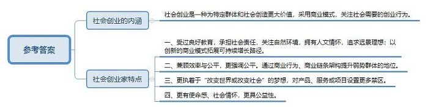
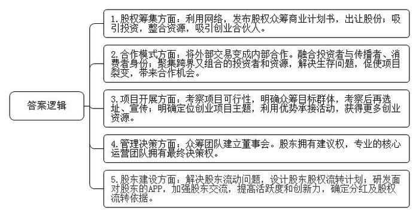

# 2016年公务员多省联考《申论》题（福建卷）

> 候选采集稿。参考答案及解析来自粉笔页面，不代表官方答案或真实高分答卷；来源使用许可与原卷对应关系仍需人工核实。

## 给定材料

### 材料 material-608640c864818ca2

在众多的创业者中还有这样一些与众不同的人，人们把他们的创业形式称为社会创业。

年轻女孩小丁，为了解决残疾人和行动迟缓的老年人穿脱衣裤不便的问题，研发生产出了可拆卸的特制衣裤，并在这些特制衣裤上增加了加热、中药、磁极、按摩等辅助功能，患者试用后，好评如潮，目前产品已经投入市场。他们还为此申请了专利，注册了有限责任公司。

行为心理学认为，人对任何付出都是希望能有所回报的。一直以来，我国公益项目对捐赠人的奖励多是精神奖励，捐赠人的心理难以得到很好的满足，影响公益事业的发展。小韩和小张创立了“路人甲”公众小额捐赠平台。他们希望把鼓励捐赠行为实体化物质化，能用商业的手段，解决这个社会问题。“路人甲的惠捐模式”在中国是首创，即用户在捐赠10元后即可兑换―张答谢券，凭着这张答谢券可享受众多合作商家的超值优惠和在线服务。这样―来受助者有尊严，捐赠人有答谢，商家得客户，捐赠人、商业机构和公益项目（或受助人）三者之间形成一个非常好的公益的价值闭环，互惠共赢，同时也挖掘了优质捐款用户背后的巨大价值。

人们把小丁、小韩、小张这样的创业者称为社会创业家。第二届芝华士“赢之有道”社会创业家大赛的评委们用自己独特的视角与丰富的经验表达了对这些人的理解。

著名经济学家A：我所理解的社会创业家是新一代企业家，他们通常受过良好的教育，承担社会责任，关注自然环境，拥有人文情怀，追求愿景理想，他们以创新的商业模式拓展可持续增长路径，在为企业和社会创造财富的同时，也回应社会挑战，贡献社会进步。作为评委，我关注参赛者的激情与智慧、理想与务实的平衡。

资深财经评论员B：社会资源的发展有两个终极目标，第一个是效率，第二个是公平。普通的创业者一般的商业诉求是解决效率问题，并且通过提高效率来获得商业上利润的诉求。但是人类社会追求的另外一个目标就是公平。有的时候效率和公平之间是有矛盾的，社会创业家就是兼顾效率和公平的这样一批创业者，他们和一般创业者最大的区别就是他们更多强调的是公平。对于整个社会资源分配当中的一些处于弱势的群体，通过商业的行为、商业的链条架构来提升他们的地位，我觉得这是社会创业家与一般创业者最大的不同。

技术创业投资基金合伙人C：首先，我不认为哪个企业家是和社会脱离关系的。他们不论是提供产品还是提供服务，哪种方式都或多或少对社会产生了影响或创造了价值。如果有的创业家所做的事情是完全公益的，那么我佩服他。但是在毫不盈利的前提下，我并不建议这样做。

风险投资人D：社会创业家创业的第一动机更多是想实现“改变世界或改变社会”的目的，跟“发明者”和“追梦者”类似，不是以传统利润模式导向而是出于更高一层的梦想和驱动创业。这些创业者会比一般创业者对自己的产品、服务或项目设的禁区更多，但也比一般创业者对自己的梦想有着更超乎一般的执着和理念。用自己的优势结合梦想找到一个更有颠覆性的产品和思路是很重要的。

甘客科技创始人E：社会创业者就是创业者中的NGO(非政府组织)。他们创业是源于为特定群体、社会创造更大的价值。因此，他们的责任感、使命感更强，更有社会情怀，而非简单地追求个人财富的积累。这是创业的新型价值体系，更具有社会公益意义。

### 材料 material-a060e9a69b8dfe7c

深圳的创业者乔峤想要做一款智能耳机，他发现，60%的人都会在跑步过程中听歌，并用手机APP记录运动数据。如果有产品能同时解决跑步人群运动数据记录和听歌的需求，又能通过音乐来实现运动激励，会有很好的市场前景。乔峤对记者说，他想针对每个人的身体特征，设计和提供有效的音乐服务产品，做到每一个硬件设备都是针对个人定制的。

可是，光有好点子还不行，初始创业的乔峤，面临既缺资金、又缺人才的尴尬，他尝试着用股权众筹的方式来实现自己的创业梦想。在众筹网上，他发布了自己的股权众筹商业计划书，以出让公司10%股份的方式，融资187万元，最低投资额1万元。最终，吸引了16名投资者参与。乔峤告诉记者，这些投资者为他引入了互联网、音乐、体育领域的强大资源，其中，几个最志同道合的投资人干脆直接加入了创业团队。

### 材料 material-5d7deef0e18d2a75

近年来，创业一词已经成为大众关注的热点，在众多创业团队里，90后群体以其高学历、年轻、接受新事物快而成为一股不可忽视的重要力量。前不久，某网站邀请了几位90后创业者，分享自己的创业心得。1992年出生的小尹已经开了三家公司。为了弄明白“为什么KTV的歌单十年不变”这个问题，小尹跑遍了N市所有的KTV。他发现，KTV的点歌系统更新周期较长，而且每一次更新，硬件和软件都要付钱，点歌系统的硬件公司缺少互联网思维，创新动力不足。也有人尝试做智能点歌，但所做系统，小尹说“不忍直视”。在小尹看来，社交、娱乐才是这个时代年轻人的刚需。KTV不再只是一个唱歌的场所，而是一个聚集了年轻人社交、娱乐、聚会等一切需求的地方。凭着这个想法，他创立了KTV团购APP“一起唱”，把整个N市的KTV硬件系统作了更新。现在，用“一起唱”的用户，只要提前列出歌单，并同步到APP，进入包房后摇一摇手机，歌单便自动导入了点歌盒子。除此之外，用这款软件还可约别人来唱歌，还可以把KTV现场旋律进行混音，然后传到云端，分享到社交网站，甚至可以在包房里和朋友一起看世界杯。小尹说，从物质转到服务、娱乐，是他们这一代人创业和上―代的不同，这类创业不需要太高成本，往往一个想法，一份风险投资就可以做起来。90后正在用一种更新、更年轻的方式去与这个世界相处。我们创业的可选空间变大了，无论家庭背景、所支付成本，还是教育程度。

这一观点得到了很多人的认同。与90后相比，80后们从父母那里得到的传承不多，且多有负担，除了养活自己，通常还需考虑如何让父母过得更好。而很多90后的父母有很强的经济能力和社会人脉，不但不需被养，还能帮到子女。90后没有后顾之忧，中国第一次出现了“可以干自己想干的事情”的一代人，这代人喷薄而出的创新力，会帮助中国进入一个极具创新力的年代。

也有分析人士认为，很多90后在创业心态上有了改变，他们不像做企业，更像做项目，对于成功的渴望不是很强烈，有时甚至只把这当作一种体验。

某互联网金融公司创始人、CEO小孙觉得，在传统社会，行业与社会规则已经形成，年轻人往往要学习社会中的既成经验，才能进入正轨。在这种系统里，年轻往往成为一种劣势。而在现代社会，互联网已经渗透到社会生活的各个部分，与互联网同生共长的年轻人成为互联网原住民，他们可以直接从互联网获取经验，寻找机遇，而对于年长者，年龄反而成了迁移转型的一种包袱。所以在传统部落中，年长者往往是部落中最有权威的人，而互联网社会中，则会涌现扎克伯格等一系列的创新者。现代社会不是经验的时代，而是技术与创新的时代。

## 题目

### 第 1 题

**给定资料**2**提到“社会创业”和“社会创业家”两个概念，请你根据给定资料指出：(1)“社会创业”的主要内涵;(2)“社会创业家”的主要特点。(20分)**

关联材料：材料 material-608640c864818ca2

作答要求：

要求：分析透彻，表达准确。字数不超过200字。

### 第 2 题

**请根据给定资料**4**—**6**，归纳总结创业者的主要成功经验。(30分)**

关联材料：材料 material-a060e9a69b8dfe7c

作答要求：

要求：内容准确全面，总结有深度、有条理。字数不超过300字。

### 第 3 题

**给定资料**3**中提到“为钱创业是肤浅的，应为梦想所驱动。”请你根据对这句话的理解，自选角度，自拟题目，写一篇文章。(50分)**

关联材料：材料 material-5d7deef0e18d2a75

作答要求：

要求：

（1）观点明确、认识深刻，

（2）内容充实、结构完整，

（3）逻辑清晰，语言流畅，

（4）字数1000-1200字。

## 答案与解析

第 1 题

**参考答案（粉笔题库参考内容）**

社会创业是一种为特定群体和社会创造更大价值，采用商业模式，关注社会需要的创业行为。

社会创业家特点：一、受过良好教育，承担社会责任，关注自然环境，拥有人文情怀，追求远景理想；以创新的商业模式拓展可持续增长路径。二、兼顾效率与公平，更强调公平。通过商业行为、商业链条架构提升弱势群体的地位。三、更执着于“改变世界或改变社会”的梦想，对产品、服务或项目设置更多禁区。四、更有使命感、社会情怀，更具公益性。

**解析**

**参考答案说明**：本参考答案宏观上分成“内涵”与“特点”两个要素。在“内涵”内部，用“一种……创业行为”的句式解释了“社会创业”。在“特点”内部，又从“良好教育”“兼顾效率与公平”“执着梦想”“有使命感”等不同的方面进行了分条撰写。各条要点之间在内容上相互并列，没有交叉。

**考点**：考点多要素组合类

**来源**：来源2016年公务员多省联考《申论》题（福建卷）

粉笔申论页面对本题只提供「解析视频」入口，该入口是会员推广位，页面无视频地址与文字解析。

第 2 题

**参考答案（粉笔题库参考内容）**

1.股权筹集方面：利用网络，发布股权众筹商业计划书，出让股份；吸引投资，整合资源，吸引创业合伙人。

2.合作模式方面：将外部交易变成内部合作。融合投资者与传播者、消费者身份；聚集跨界又组合的投资者和资源，解决生存问题，促使项目裂变，带来合作机会。

3.项目开展方面：考察项目可行性，明确众筹目标群体，考察后再选址、宣传；明确定位创业项目主题，利用优势承接活动，获得更多创业资源。

4.管理决策方面：众筹团队建立董事会。股东拥有建议权，专业的核心运营团队拥有最终决策权。

5.股东建设方面：解决股东流动问题，设计股东股权流转计划；研发面对股东的APP，加强股东交流，提高活跃度和创新力，确定分红及股权流转依据。

**解析**

**参考答案说明**：本参考答案从“股权筹集”“合作模式”“项目开展”“管理决策”“股东建设”这五方面进行了分条撰写。各条答案要点之间在内容上相互并列，没有交叉。

**考点**：考点经验启示类

**来源**：来源2016年公务员多省联考《申论》题（福建卷）

第 3 题

**参考答案（粉笔题库参考内容）**

**为创业插上梦想的翅膀**

这是一个新事物层出不穷，科技迅猛发展的时代，这是一个日新月异，全民创新的时代，这是一个令人激动，全社会都在创业创新大潮中的时代。身处创业浪潮之中，很多人都想做时代的弄潮儿、取得成功。可是，创业到底是为了什么？有人说是为了钱。这个看法是肤浅的，**创业应该为梦想所驱动**！这个梦想要与社会相连，解决用户需求，创造社会价值。唯有如此，创业才能被他人所认同，被市场所肯定，从而飞得更高，飞得更远，才能创成业、创好业、创大业。

创业是令人迷恋的新事物，受到了社会各界人士的青睐。目前整个中国的创业精神不断上升，各级政府也纷纷出台政策为创新创业站台、保驾护航，给创业提供了良好的环境，让所有人都有公平向上流动的机会。人们尤其是年轻人，应该抓住机遇、坚持梦想，积极投身于创业热潮之中，在创业中实现梦想。

**创业为梦想所驱动，有助于创造机会，实现创业者的自我价值。**很多时候，人们对金钱和名声的渴望，使创业的方向指向复制他人创意，抄袭他人产品，最终落得创业失败的下场；有的人面对创业困难，因为没有梦想的支撑，甚至在起跑线上就选择了放弃。新时代下，我们年轻人，接受新事物快、知识丰富、学习能力强，经济负担轻，充满创业活力。应让创业突破现实的羁绊，插上梦想的翅膀去创业实践，实现个人价值的同时推动我国经济发展。同时，也只有梦想，才能让创业者超越个人利益的狭隘，关注百姓生活，激发千百万人的创造力，让广大人民群众过上更美好的生活，更好的实现个人价值。

**为梦想而创业，还有助于满足社会需求，推动行业的发展进步。**曾经，我国传统行业存在产业结构单一，商业模式落后，难以满足人们多样化需求的问题。如今，通过创业，可以创新商业模式，更好的关注用户体验与需求，进而推动各行各业的发展，促进产业结构转型升级。与此同时，新时代的创业者还更加关注社会价值、承担社会责任，关心自然环境等。如社会中涌现出的社会创业家，他们以社会需求和创造社会价值为梦想，用超乎一般的执着和理念，塑造了一个个创业的奇迹。不仅为企业和社会创造了财富，更为促进社会公平贡献了力量。可见，创业者只有将个人的梦想与用户、人民、社会的梦想结合起来，才能汇聚成为一个伟大的梦想。

**创业没有梦想不行，只有梦想也不够，它还需要行动、落实****。**创业者首先要摆正心态，树立正确的创业观。要理性、长远的看待问题，注重创业过程，持之以恒；其次，要做好准备，学习市场、销售、法律政策等相关知识，积累创业经验，提升风险防范意识和自我保护能力；最后，还要真抓实干，合理选择创业项目、找准创业方法，可借鉴众筹的经验获得资金、人脉等方面的资源，降低创业难度，提高创业成功率。

今天，创业不再是个人的事业，而是国家社会共同推进的事业；创业的梦想，也不再是个人的梦想，而是千千万万人民的梦想，国家的梦想，世界的梦想，时代的梦想。让我们为创业插上梦想的翅膀，脚踏实地，把梦想变为现实！

**解析**

**文章分析**

**为创业插上梦想的翅膀**

【**标题的优点**：首先，范文的标题“为创业插上梦想的翅膀”突出了“创业应为梦想所驱动”这一主题。其次，语言表达简洁明了。】

（1）这是一个新事物层出不穷，科技迅猛发展的时代，这是一个日新月异，全民创新的时代，这是一个令人激动，全社会都在创业创新大潮中的时代。身处创业浪潮之中，很多人都想做时代的弄潮儿、取得成功。可是，创业到底是为了什么？有人说是为了钱。这个看法是肤浅的，**创业应该为梦想所驱动**！（2）这个梦想要与社会相连，解决用户需求，创造社会价值。唯有如此，（3）创业才能被他人所认同，被市场所肯定，从而飞得更高，飞得更远，才能创成业、创好业、创大业。

【**开头的优点：**★内容方面。范文的开头是紧扣题目给定的“为钱创业是肤浅的，应为梦想所驱动”这句话展开的。首先，开头点出主题，做到了主题明确。其次，对“创业应为梦想所驱动”这一主题进行了分析阐述，指出了（1）创业创新的时代背景。（2）为梦想创业的具体做法。（3）为梦想创业的意义。★文字表达方面：使用了长短句配合使用，使语言表达有节奏感。】

创业是令人迷恋的新事物，受到了社会各界人士的青睐。目前整个中国的创业精神不断上升，各级政府也纷纷出台政策为创新创业站台、保驾护航，给创业提供了良好的环境，让所有人都有公平向上流动的机会。人们尤其是年轻人，应该抓住机遇、坚持梦想，积极投身于创业热潮之中，在创业中实现梦想。

【**过渡段的优点：**范文过渡段分析了“创业应为梦想所驱动”的良好环境和意义等方面的内容，此外，还要注意过渡段末尾的“年轻人，应该抓住机遇、坚持梦想”是用来引起下文的过渡句。】

**创业为梦想所驱动，有助于创造机会，实现创业者的自我价值。**很多时候，（1）人们对金钱和名声的渴望，使创业的方向指向复制他人创意，抄袭他人产品，最终落得创业失败的下场；有的人面对创业困难，因为没有梦想的支撑，甚至在起跑线上就选择了放弃。（2）新时代下，我们年轻人，接受新事物快、知识丰富、学习能力强，经济负担轻，充满创业活力。（3）应让创业突破现实的羁绊，插上梦想的翅膀去创业实践，实现个人价值的同时推动我国经济发展。同时，也只有梦想，才能让创业者超越个人利益的狭隘，关注百姓生活，激发千百万人的创造力，让广大人民群众过上更美好的生活，更好的实现个人价值。

【**论述段****1的优点：**★观点句：范文的观点句是紧扣“创业应为梦想所驱动”这一文章主题提出的。形式上，它在段首处直接写出，位置突出，容易发现。内容上，关键词突出，内容要点明确，可以明显看出它是从“自我价值”入手，指出了“创业为梦想所驱动，有助于创造机会”。★论述内容：（1）介绍了创业过程中存在的问题；（2）介绍了年轻人创业的优势；（3）介绍了为梦想创业的意义。注意：以上几个方面的内容都是紧扣“创业为梦想所驱动，有助于创造机会，实现创业者的自我价值”这个观点句进行分析论述的，论述的针对性强，内容层次丰富。最后，在论述方法和论据的选取上做到了讲道理、举例子相结合，做到了丰富多样。】

**为梦想而创业，还有助于满足社会需求，推动行业的发展进步。**曾经，（1）我国传统行业存在产业结构单一，商业模式落后，难以满足人们多样化需求的问题。如今，（2）通过创业，可以创新商业模式，更好的关注用户体验与需求，进而推动各行各业的发展，促进产业结构转型升级。与此同时，（3）新时代的创业者还更加关注社会价值、承担社会责任，关心自然环境等。如社会中涌现出的社会创业家，他们以社会需求和创造社会价值为梦想，用超乎一般的执着和理念，塑造了一个个创业的奇迹。不仅为企业和社会创造了财富，更为促进社会公平贡献了力量。可见，创业者只有将个人的梦想与用户、人民、社会的梦想结合起来，才能汇聚成为一个伟大的梦想。

【**论述段****2的优点：**★观点句：范文的观点句是紧扣“创业应为梦想所驱动”这一文章主题提出的。形式上，它在段首处直接写出，位置突出，容易发现。内容上，关键词突出，内容要点明确，可以明显看出它是从“社会发展”入手，指出了“创业为梦想所驱动，还有助于满足社会需求，推动行业的发展进步”。★论述内容：（1）介绍了传统行业难以满足需求的问题；（2）介绍了创业可推动行业发展，产业结构转型；（3）介绍了创业可推动社会进步。注意：以上几个方面的内容都是紧扣“创业为梦想所驱动，还有助于满足社会需求，推动行业的发展进步”这个观点句进行分析论述的，论述的针对性强，内容层次丰富。最后，在论述方法和论据的选取上做到了讲道理、举例子相结合，做到了丰富多样。】

**创业没有梦想不行，只有梦想也不够，它还需要行动、落实。**（1）创业者首先要摆正心态，树立正确的创业观。要理性、长远的看待问题，注重创业过程，持之以恒；其次，（2）要做好准备，学习市场、销售、法律政策等相关知识，积累创业经验，提升风险防范意识和自我保护能力；最后，（3）还要真抓实干，合理选择创业项目、找准创业方法，可借鉴众筹的经验获得资金、人脉等方面的资源，降低创业难度，提高创业成功率。

【**论述段****3的优点：**★观点句：范文的观点句是紧扣“创业应为梦想所驱动”这一文章主题提出的。形式上，它在段首处直接写出，位置突出，容易发现。内容上，关键词突出，内容要点明确，可以明显看出它是从“对策”入手，指出了“创业只有梦想也不够，它还需要行动、落实”。★论述内容：（1）介绍了创业要摆正心态；（2）介绍了创业要做好准备；（3）介绍了创业要真抓实干。注意：以上几个方面的内容都是紧扣“创业没有梦想不行，只有梦想也不够，它还需要行动、落实”这个观点句进行分析论述的，论述的针对性强，内容层次丰富。最后，在论述方法和论据的选取上做到了讲道理、举例子相结合，做到了丰富多样。】

【**论述段之间的关系**：★内容的内在逻辑：范文的论述段之间有2层逻辑。第一层，整体上是从“意义”到“对策”的逻辑展开的。第二层，其中观点1和观点2又是从“意义”出发，论述段1先写了“创业为梦想所驱动，有助于创造机会，实现创业者的自我价值”，论述段2再写了“创业为梦想所驱动，还有助于满足社会需求，推动行业的发展进步”。★段与段的外在衔接：论述段3的段首处的过渡句“创业没有梦想不行，只有梦想也不够”，起到了承接论述段1、2，引出了论述段3的作用。】

今天，创业不再是个人的事业，而是国家社会共同推进的事业；（1）**创业的梦想**，也不再是个人的梦想，而是千千万万人民的梦想，国家的梦想，世界的梦想，时代的梦想。（2）让我们为创业插上梦想的翅膀，脚踏实地，把梦想变为现实！

【**结尾的优点**：范文的结尾回扣了“创业应为梦想所驱动”这一主题。（1）再次提到了“创业应为梦想所驱动”；（2）发出了号召希望。】

**考点**：考点文章写作题

**来源**：来源2016年公务员多省联考《申论》题（福建卷）

