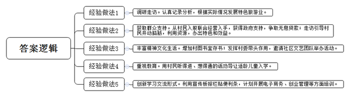
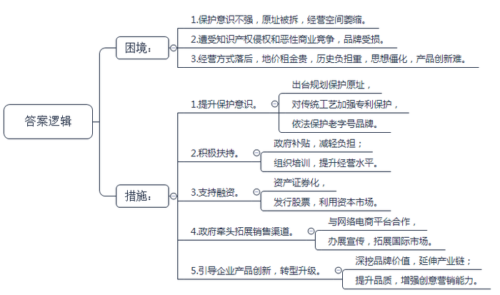
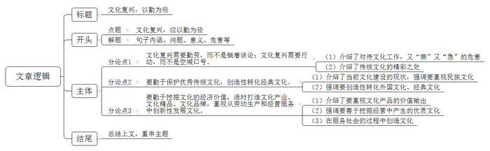

# 2017年公务员多省联考《申论》题（福建卷）

<!-- gwy:overview:start -->
> **福建 · 2017 · 申论 · 统考** ｜ 3 题 · 图片 3 处 · 答案随题折叠

导航：[题目](#题目) · [材料 1](#材料-1)
<!-- gwy:overview:end -->

> 候选采集稿。参考答案及解析来自粉笔页面，不代表官方答案或真实高分答卷；来源使用许可与原卷对应关系仍需人工核实。

## 给定材料

### 材料 1

在一线大城市长大的小姚拥有名牌大学文凭，却在毕业后回绝外企的高薪聘请，毅然回到父母的老家小兆村，成为一名村干部。这是梦开始的地方。小姚说，父母在城市立稳脚跟，时不时会带着他回来看看。风景秀丽，民风淳朴，这是他儿时对小兆村的印象。然而，当他来到村里任职的第一天就发现，乡村生活并不是他无忧无虑童年时代的山水诗画、田园牧歌：村里的青壮年几乎全部外出打工，留下的人多是老人和小孩，一片凋敝孤寂的景象；昔日远山含黛、秀水流长的美丽风光，在过度采伐中已经开始变得面容斑驳、身影依稀；村民们平时往来就是请客吃饭，娱乐消遣就是打牌……最让他痛心的是，受到种种不良风气和读书无用论的影响，全村适龄儿童入学率竟然不足60%！

必须行动起来，小姚在心里暗暗下了决心。面对小兆村的现状，他并没有一根筋地想着搞企业、拉帮扶，而是在半个月里，挨家挨户地走访了全村两遍，走访笔记写满整整三个工作记录本。在完成调研后，小姚有了初步的思路：发展决定状态。小兆村风景秀美、交通便利，距离县城也并不遥远，为什么不发展特色旅游业呢？然而他的第一个想法就遭到了村民的强烈抵制。“每天种地干活，养猪养鸡都来不及，谁有那闲工夫去办什么农家乐？”村民李大姐解释说，“当时姚书记劝我们的时候，我们也算了算账，办个农家乐，自己怎么也得投入好几十万，这要是赚不了钱，可咋办啊？”村民的担忧不是没有道理的，小姚就从几户有意向的村民入股联合经营入手，并且在县乡政府的支持下，争取到了无息贷款，解决了村民们的后顾之忧。村民们都是互相看着的呢，看到别人家办得好，日子过得红火，哪还会不乐意？在短短两年时间里，全村新开起的农家乐就十来家，为了避免全村农家乐同质化发展，甚至恶性竞争引起邻里冲突，小姚和同事们又逐门逐户地走访劝说引导：大家发展更要注意的是利用好自己的资源，办出特色，办出效益。比如你家有鱼塘，那么不妨突出垂钓的渔趣特色；比如你家有果园，能让游客体验采摘和吃放心水果的乐趣最好。反正就是要开动脑筋，利用好自己的资源。针对村民请吃赌博成风的情况，小姚也做过认真分析，还是因为乡村文化生活的匮乏。那么就借着“一村一个图书室”“全民健身”活动之风，丰富村民的精神生活，增加村图书室的存书，尤其是农业生产、农村生活、科普类，既有趣，又实用；发挥村委带头作用，邀请社区文艺团队办起联欢晚会，教跳广场舞、健身操，举行朗诵比赛……而面对大量适龄儿童辍学的问题，不是对着村民说一句“知识改变命运”就能解决的，必须要用他们听得进、想得通的话来说。

现在，小兆村的人均收入比三年前增加了60%，适龄儿童入学率到达了100%，在村图书室、文化站，村民学习交流热火朝天，甚至还创造了一种在宣传板报栏贴便利条进行学习交流的新形式……更让人欣喜的是，这几年村里发展越来越好，前前后后又有三十来个以前在城市里闯荡的青年人回家创业。现在，小姚又开始计划张罗电子商务、创业管理等方面培训的事儿……

守一方水土，创一片天地。小姚说，每个人心中都有一个山为傲骨、水作柔情的老家，那里岸芷汀兰、鸟语花香，可似乎遥不可及。但其实，老家并不是只能隔岸遥望的。只要我们以辛勤为舟楫，老家就可以到达。如果只是守望，那么可能我们真的会成为“最后的守望者”。他最喜欢的一首诗写道：我睡去，梦见生活就是享乐。我醒来，发现生活就是劳碌。我身体力行后领悟到，原来劳碌中充满快乐。

### 材料 2

对于经历了物质极度匮乏时期的人来说，不管是酯香浓郁的老酱油，还是质地厚重的雪花膏，各式各样的“中华老字号”都超越了本身功能性的意义，成为一个时代最温情的记忆。

新中国成立初期，我国大约拥有“中华老字号”16000家；1991年原国内贸易部的老牌企业全行业的认定中，有1600余家老牌企业被授牌；但到了2006年商务部重新认定时，第一批中华老字号的数量只剩434家。

由于以前保护意识不强，在城市市政建设中，部分老字号的原址被拆除，只能搬迁它地或仅能保留部分原址，经营空间不断萎缩。而对于老字号来说，这无疑是个大问题——老字号首先还得是那个老店啊！现在这年代不差好的商品、好的服务，经常光顾老店的顾客多是因为那份感情，在熟悉的地方逛一逛、坐一坐，要的是那份感觉。一旦搬迁，部分老字号就可能失去了原来空间中提供给自己生存发展必需的养分，从此一蹶不振。

同时，还有相当一部分的老字号因为遭受知识产权侵权和恶性商业竞争，逐渐退到了时代和市场的边缘，而经营良好的老字号更是深受其害。

“地价租金太贵，经营方式跟不上，还有不少其他历史包袱。我们是国企，启动改制之后老职工安置问题等等，都使得我们负担不起，无法迈开步子前进。要不就是我们真的太老了，老到思路打不开，脚步跟不上。我们不缺勤奋苦干，每天起早贪黑，两头见星星，可还是只能勉强保本。产品更新慢，老顾客留不住，年轻人不愿来。”一位老字号国企负责人无奈地表示，“我们也想过要改，可看到前段时间另外一个老字号就因为改制搞到管理权都没办法集中，没办法决策如何发展了，我们就怕了。这样改还不如老老实实守住自留地。”

随着保护老字号呼声的增多，各地政府也有所行动。在北京、上海、天津和江浙这些老字号聚集的地方，地方政府对老字号的补贴较多，也更加注重对传统老工艺的保护，还曾举办电子商务学习培训并组织老字号企业“走出去”，出境办展宣传。“老字号、老工艺是一个时代、一个国家的珍贵财富，不能因为我们的懈怠而消失。”一位工作人员说。

2017年1月，商务部、发改委等16个部门联合印发了《关于促进老字号改革创新发展的指导意见》，这对创新动力不足、业绩欠佳的部分老字号企业来说是一个重大利好。

在2016年，10余家老字号公司陆续登陆股市新三板。推进老字号核心优质资产证券化，支持符合条件的老字号上市首发股票或到全国中小企业股份转让系统挂牌，成为老字号利用多层次资本市场做大做强的契机。

“保护归保护，但关键还是要看自己。其实，老字号与普通企业一样，优胜劣汰。”一位企业家如是说。

扬州市某著名日化用品厂是最早在政府牵头下，与网络电商平台合作，发展官方旗舰店的老字号企业之一。面对自身电视传媒广告营销能力偏弱的实际，厂家充分利用电商平台巨大的客户流量，用细腻的文字、复古精致的网页装修，不仅唤起了老顾客对自己的记忆，也增加了年轻人对“祖母级”国货化妆品的了解和信任。简而不陋的包装，朴实温和的效果，亲民实惠的价格，带动了系列产品的热销，不仅使这家经历百年风雨的老字号重新焕发活力，更掀起了一股“国货热”。

而在某龙头饮料公司董事长看来，抓住机遇、求新求变将会带来更好的发展。是的，老字号不缺情怀，但不能一味消费情怀。在人们眼中，老字号是“品质”“怀旧”“工匠精神”等的代名词。在特定年代，老字号创造的商业辉煌，为发展工业、振兴经济、传承传统优秀文化、丰富人们物质精神生活、撑起民族复兴希望立下了汗马功劳。这些都是值得我们骄傲并永远铭记的。但再老的字号，也不是金字招牌，不能躺在历史的功劳簿上高枕无忧地睡大觉。身处这样一个“互联网+”时代，利用好它，你可以足不出户，不费周折地闻达于天下；脱离这个时代，哪怕就是皇帝的女儿也愁嫁。

## 题目

### 第 1 题

**“给定材料**1**”提到小兆村干部带领群众发展致富的事迹，请概括出有哪些经验做法值得借鉴。（20分）**

关联材料：材料 1

作答要求：

要求：全面、准确、简明，有条理。不超过200字。

第 1 题 · 答案与解析

**参考答案（粉笔题库参考内容）**

1.调研走访。认真记录分析，根据实际情况发展特色旅游业。

2.获取群众支持。从村民入股联合经营入手，获得政府支持，争取无息贷款；走访引导村民开动脑筋，利用资源，办出特色和效益。

3.丰富精神文化生活。增加村图书室存书；发挥村委带头作用，邀请社区文艺团队举办活动。

4.重视教育。用村民听得进、想得通的话劝导让适龄儿童入学。

5.创新学习交流形式。利用宣传板报栏贴便利条，计划开展电子商务、创业管理等方面培训。

**解析**

**参考答案说明：**本参考答案从“调研走访”“群众支持”“精神文化生活”“重视教育”“创新学习交流形式”五个方面进行了分条撰写。各条要点之间在内容上相互并列，没有交叉。

**考点**：经验启示类

**来源**：2017年公务员多省联考《申论》题（福建卷）

粉笔申论页面对本题只提供「解析视频」入口，该入口是会员推广位，页面无视频地址与文字解析。

### 第 2 题

**根据“给定材料**2**\-**4**”，分析部分老字号发展面临的困境，并从政府角度提出有效帮扶措施。（30分）**

关联材料：材料 2

作答要求：

要求：针对性强，措施合理、可行。不超过300字。

第 2 题 · 答案与解析

**参考答案（粉笔题库参考内容）**

困境：1.保护意识不强，原址被拆，经营空间萎缩。2.遭受知识产权侵权和恶性商业竞争，品牌受损。3.经营方式落后，地价租金贵，历史负担重，思想僵化，产品创新难。

措施：1.提升保护意识。出台规划保护原址，对传统工艺加强专利保护，依法保护老字号品牌。2.积极扶持。政府补贴，减轻负担；组织培训，提升经营水平。3.支持融资。资产证券化，发行股票，利用资本市场。4.政府牵头拓展销售渠道。与网络电商平台合作，办展宣传，拓展国际市场。5.引导企业产品创新，转型升级。深挖品牌价值，延伸产业链；提升品质，增强创意营销能力。

**解析**

**参考答案说明：**答案先分析了部分老字号发展面临的“困境”，接着从“提升保护意识”“积极扶持”“支持融资”“政府牵头拓展销售渠道”“引导企业产品创新，转型升级”五个不同的角度对措施进行了分条撰写。各条要点之间在内容上是并列的。

**考点**：提出对策类

**来源**：2017年公务员多省联考《申论》题（福建卷）

粉笔申论页面对本题只提供「解析视频」入口，该入口是会员推广位，页面无视频地址与文字解析。

### 第 3 题

**“给定材料**6**”中提到，“当《红楼梦》都被这个时代的读者评为最懒得看的小说时，我们还有什么理由躺着谈文化复兴？警钟需长鸣。”请根据你对这句话的理解，自选角度，自拟题目，写一篇文章。（50分）**

关联材料：材料 1

作答要求：

要求：

（1）结合给定材料，但不拘泥于给定资料，

（2）联系实际，观点明确，

（3）内容充实，结构完整，

（4）思路清晰，语言流畅；

（5）字数1000字左右。

第 3 题 · 答案与解析

**参考答案（粉笔题库参考内容）**

**文化复兴，以勤为径**

在如今的快餐时代，浮躁肤浅具有极强的传染性，许多人缺乏耐心，甚至懒得品味中国古典文学的杰作《红楼梦》。中华文化源远流长，它是华夏民族繁衍生息的精神血脉。当血脉即将断裂的警钟敲响时，我们应该牢记：文化复兴不能“懒”，而应以“勤”为径。

**文化复兴需要勤劳，而不是躺着谈论；文化复兴需要行动，而不是空喊口号。**对待文化工作，倘若又“懒”又“急”，那么必然产出粗制滥造的文化糟粕，造成产品过剩、资源浪费，导致群众的审美疲劳。相反，闲暇无事，如果能读一次《庄子》或许就知道了“相濡以沫，不如相忘于江湖”的QQ签名来自何处；工作之余，赏一回李白诗词或许就明白“功名富贵若长在，汉水亦应西北流”的道理。学习、传承、挖掘、创造文化不仅能领略经典之美，更是文化复兴的最好践行方式！

一方面，要**勤于坚守优秀传统文化，创造性转化经典文化。**优秀传统文化**积淀着中华民族的精神追求**，**代表着中华民族的精神标识**，**滋养着中华民族的精神沃土**。然而，近年经常出现电视剧基本靠宫斗来吸引眼球的现象，不仅不是保护传统文化，甚至是对经典文化的玩弄和扭曲。相比之下《中华诗词大会》《朗读者》这样的节目恰恰是善于钻研，勤于思考的成果，这样的节目将经典再现，就是对传统文化的保护。**仅仅保护传统文化还不够，更应该创造性转化外国文化、经典文化**。例如徐志摩先生将佛罗伦萨翻译为“翡冷翠”就是使国人对它更为倾情，这座欧洲小城似乎就带有中国文化之美，甚至是中国文化经典的展现。徐志摩先生的做法就是将优秀外来文化创造性地转化为中国文化经典，不仅做到了**传统和现代、国内与国外的无缝**对接，也**增强了中国人的文化自信和文化自强精神**。

另一方面，还要**勤于挖掘文化的经济价值，适时打造文化产业、文化精品、文化品牌，重视从劳动生产和经营服务中创新性发展文化。一是重视文化产品的价值输出**。例如，综艺节目不能因为急功近利，而粗制滥造，甚至照抄照搬，而要**思考其传递的价值观是否符合中国文化人文化审美，能否体现中国文化之美**。而相反翻译家们在译文的同时追求精细、精确、精美和精妙的翻译文化恰恰是对文化审美追求的精益求精。**二是要善于挖掘经营中产生的优质文化。**例如百年同仁堂在经营过程中形成了“修合无人见，存心有天知”的文化可以代代传承，也值得全社会学习。如果**中国的企业都能形成如此优秀的企业经营文化**，文化复兴岂不指日可待？**三是在服务社会的过程中创造文化。**正如同我党在为人民服务的过程中也形成了大量的与时俱进的文化，从“我们的文艺属于人民”到“坚决抵制腐朽文化”，从“社会主义核心价值观”到“中国梦”的提出，都是我党在为人民服务的过程中所积累、沉淀、创造的文化。

文化复兴，以勤为径。中华经典文化的复兴，需要我们乐于专研，勤于思考，敏于行动。唯有如此中华文化才会在这片希望的田野上焕发勃勃生机，结出累累硕果！

**解析**

**文章分析**

**文化复兴，以勤为径**

【**标题的优点：**首先，范文的标题“文化复兴，以勤为径”突出了“文化复兴”这一主题，并点明勤奋是文化复兴的必由之路，对主题理解准确到位。其次，形式上，对仗工整。】

（1）在如今的快餐时代，浮躁肤浅具有极强的传染性，许多人缺乏耐心，甚至懒得品味中国古典文学的杰作《红楼梦》。（2）中华文化源远流长，它是华夏民族繁衍生息的精神血脉。当血脉即将断裂的警钟敲响时，我们应该牢记：文化复兴不能“懒”，而应以“勤”为径。

【**开头的优点：**★内容方面。范文的开头是紧扣题目给定的“当《红楼梦》都被这个时代的读者评为最懒得看的小说时，我们还有什么理由躺着谈文化复兴？警钟需长鸣”这句话展开的。首先，开头点出主题，做到了主题明确。其次，对“文化复兴”这一主题进行了分析阐述，指出了（1）当前存在的问题。（2）中华文化的重要性。★文字表达方面：使用了“甚至”等关联词，使语言表达有逻辑性。】

**文化复兴需要勤劳，而不是躺着谈论；文化复兴需要行动，而不是空喊口号。**（1）对待文化工作，倘若又“懒”又“急”，那么必然产出粗制滥造的文化糟粕，造成产品过剩、资源浪费，导致群众的审美疲劳。（2）相反，闲暇无事，如果能读一次《庄子》或许就知道了“相濡以沫，不如相忘于江湖”的QQ签名来自何处；工作之余，赏一回李白诗词或许就明白“功名富贵若长在，汉水亦应西北流”的道理。学习、传承、挖掘、创造文化不仅能领略经典之美，更是文化复兴的最好践行方式！

【**论述段****1****的优点**：★观点句：范文的观点句是紧扣“文化复兴”这一文章主题提出的。形式上，它在段首处直接写出，位置突出，容易被发现；内容上，关键词突出，内容要点明确，可以明显看出它是从“为何要勤劳”的角度入手，指出要文化复兴。★论述内容：（1）介绍了对待文化工作，又“懒”又“急”的危害；（2）介绍了传统文化的精彩之处。注意：以上两个方面的内容都是紧扣观点句“文化复兴需要勤劳，而不是躺着谈论；文化复兴需要行动，而不是空喊口号”进行分析论述的，针对性强、内容层次丰富。】

一方面，要**勤于坚守优秀传统文化，创造性转化经典文化。**（1）优秀传统文化**积淀着中华民族的精神追求**，**代表着中华民族的精神标识**，**滋养着中华民族的精神沃土**。然而，近年经常出现电视剧基本靠宫斗来吸引眼球的现象，不仅不是保护传统文化，甚至是对经典文化的玩弄和扭曲。相比之下《中华诗词大会》《朗读者》这样的节目恰恰是善于钻研，勤于思考的成果，这样的节目将经典再现，就是对传统文化的保护。（2）**仅仅保护传统文化还不够，更应该创造性转化外国文化、经典文化**。例如徐志摩先生将佛罗伦萨翻译为“翡冷翠”就是使国人对它更为倾情，这座欧洲小城似乎就带有中国文化之美，甚至是中国文化经典的展现。徐志摩先生的做法就是将优秀外来文化创造性地转化为中国文化经典，不仅做到了传统和现代、国内与国外的无缝对接，也增强了中国人的文化自信和文化自强精神。

【**论述段****2****的优点**：★观点句：范文的观点句是紧扣“文化复兴”这一文章主题提出的。形式上，它在段首处直接写出，位置突出，容易被发现；内容上，关键词突出，内容要点明确，可以明显看出它是从“坚守文化”“转化文化”等角度入手，指出如何勤于文化复兴。★论述内容：（1）介绍了当前文化建设的现状，强调要重视民族文化；（2）强调要创造性转化外国文化、经典文化。注意：以上两个方面的内容都是紧扣观点句“要勤于坚守优秀传统文化，创造性转化经典文化”进行分析论述的，针对性强、内容层次丰富。】

另一方面，还要**勤于挖掘文化的经济价值，适时打造文化产业、文化精品、文化品牌，重视从劳动生产和经营服务中创新性发展文化。**（1）**一是重视文化产品的价值输出**。例如，综艺节目不能因为急功近利，而粗制滥造，甚至照抄照搬，而要**思考其传递的价值观是否符合中国文化人文化审美，能否体现中国文化之美**。而相反翻译家们在译文的同时追求精细、精确、精美和精妙的翻译文化恰恰是对文化审美追求的精益求精。（2）**二是要善于挖掘经营中产生的优质文化****。**例如百年同仁堂在经营过程中形成了“修合无人见，存心有天知”的文化可以代代传承，也值得全社会学习。如果中国的企业都能形成如此优秀的企业经营文化，文化复兴岂不指日可待？（3）**三是在服务社会的过程中创造文化****。**正如同我党在为人民服务的过程中也形成了大量的与时俱进的文化，从“我们的文艺属于人民”到“坚决抵制腐朽文化”，从“社会主义核心价值观”到“中国梦”的提出，都是我党在为人民服务的过程中所积累、沉淀、创造的文化。

【**论述段****3****的优点**：★观点句：范文的观点句是紧扣“文化复兴”这一文章主题提出的。形式上，它在段首处直接写出，位置突出，容易被发现；内容上，关键词突出，内容要点明确，可以明显看出它是从“重视价值输出”“挖掘经营中的优质文化”“在服务社会中创造文化”等角度入手，指出如何勤于文化复兴。★论述内容：（1）介绍了要重视文化产品的价值输出；（2）强调要善于挖掘经营中产生的优质文化；（3）在服务社会的过程中创造文化。注意：以上三个方面的内容都是紧扣观点句“勤于挖掘文化的经济价值，适时打造文化产业、文化精品、文化品牌，重视从劳动生产和经营服务中创新性发展文化”进行分析论述的，针对性强、内容层次丰富。】

【**论述段之间的关系**：★内在逻辑上：范文的论述段之间逐层深入。整体上按照“原因-对策”的逻辑展开，论述段1先说明为何文化复兴要勤奋，接下来论述段2、3论述如何通过勤奋推进文化复兴。论述段2和论述段3中，先说要“坚守优秀传统文化的同时转化经典文化”，再说要“挖掘文化的经济价值，推进文化创新性发展”。★外在衔接上：论述段2、3首句中，关联词“一方面……另一方面”的使用，让文章逻辑更加清晰。】

文化复兴，以勤为径。中华经典文化的复兴，需要我们乐于专研，勤于思考，敏于行动。唯有如此中华文化才会在这片希望的田野上焕发勃勃生机，结出累累硕果！

【**结尾的优点：**范文的结尾回扣了“文化复兴”这一主题。（1）再次强调勤奋是文化复兴的必由之路；（2）发出呼吁号召。】

**考点**：文章写作题

**来源**：2017年公务员多省联考《申论》题（福建卷）

粉笔申论页面对本题只提供「解析视频」入口，该入口是会员推广位，页面无视频地址与文字解析。

