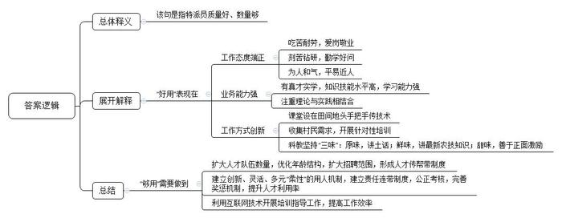

# 2018年公务员多省联考《申论》题（福建县级卷）

<!-- gwy:overview:start -->
> **福建 · 2018 · 申论 · 县级卷** ｜ 3 题 · 图片 3 处 · 答案随题折叠

导航：[题目](#题目) · [材料 1](#材料-1)
<!-- gwy:overview:end -->

> 候选采集稿。参考答案及解析来自粉笔页面，不代表官方答案或真实高分答卷；来源使用许可与原卷对应关系仍需人工核实。

## 给定材料

### 材料 1

早上，小李被闹钟如约地叫醒。还想多睡几分钟的她对闹钟说：十分钟后再叫我吧。于是，闹钟老老实实地又消停了十分钟。在梳洗完出门前，小李先用电子交通地图看看哪个路段堵，以免在开车路上虚耗时间。下班回家，实在是不想做饭，那就叫外卖吧，打开外卖APP，上百款美食，随意挑选。出门逛街，小李兜里也就带了几十块的零钱，因为现在所有的门店都支持移动支付，自己省事，还不用担心被偷。缴水电费，不用再像以前那样去营业厅排队了，手机一点就搞定。这样的生活，会不会少了点什么呢？小李并不这么想，她觉得这便利了我们，活跃了经济，丰富了世界，何乐而不为？

老张前不久到乡下参加老同学儿子的婚宴。婚宴是标准的乡宴，但老张是第一次看到人家厨师竟然带着一辆餐车来。车内的灶具、厨具一应俱全，车开到哪，一停就立即可以作业。非但如此，就连桌椅板凳、帐篷等也都是厨师自带。和其他来参加宴会的人们一样，老张也觉得这种方式很省事，可就是少了那么一点意思。在老张印象中，以前家里办红白事叫“过大事”。它们的的确确是个事儿——什么都自备，从桌椅板凳、被褥到锅碗瓢盆都要满村子借。事办完了，还要一家一家地还。远处的亲戚会早早地来，村上的人也会提前几天来帮忙。大家都是相互帮忙，相互麻烦，也就是因为这样，大家伙才有乡里乡亲的感觉。而现在，在事办完的当天，客人也基本走完，好像“过大事”也是个轻巧事儿了。

据一项权威的市场调查显示：现在人们更加偏向于购买操作简单、功能实用、外观简洁大方的产品——如果能额外有一点点其他优势，当然就更好了。一位著名的产品创意设计人说：“这最让人头疼了。我现在每设计一款产品，都会反复地问自己，这个地方的设计是必须的吗，或者说，不要它可不可以？”

欧洲有位著名的游吟诗人一生居无定所。他总是吃最粗糙的食物，穿最朴素的衣服。后来，政府鉴于他对文化艺术所作出的杰出贡献，奖励了他一栋住宅。但他拒绝了，理由是他不愿为房子之类的麻烦事耗费精力。他的足迹踏遍世界，为世界各地的壮丽景色、风土人情写下了绝美的赞叹。他死后，朋友们为他整理遗物时发现，诗人的行囊中只有一支笔和十卷堪称珍品的诗歌、随笔。

很多时候，简便快捷是我们所追崇的。抛开其他不说，我们的生活也是尽可能地在用减法，减去许多步骤，更直接、更快捷地达到目的。这也符合工业时代的特点——最大限度地缩短制造流程。但这个世界真的是在变得越来越简单吗？一部智能手机的基本应用功能就有上百个，你要是一开始不仔细琢磨，可能很快就会有一种被它“忽悠”的感觉；一款便利人们生活的APP也许是一个团队加班加点、绞尽脑汁的心血结晶，并且，开发出来也不算完事了，开发团队还得时时关注着用户的使用体验，哪里要是有漏洞了得立马补上；一款简洁实用的产品在上市之前甚至会经过上千次的微调打磨；一部数百字的微小说，每一句话都可能包含着作者的千思万绪、良苦用心……所以说，简单和繁琐，就是一对孪生兄弟。世界上并没有单纯的简单，也没有单纯的繁琐。更多时候，我们的“简单”和“繁琐”的总量并没有变，它们只是在不同的人群间流动，但就是这不停的流动，推动了社会的改变。

### 材料 2

在西部某城，大大小小、各种各样的面馆有数万家。由于市场竞争激烈，大部分面馆都采用多种经营：面条、酸辣粉、米粉、盖浇饭……一应俱全。然而，有一家面馆却独树一帜，它只卖小面。小面可以说是这座城市各类面食中最朴素的一种。它没有浇头，没有名贵佐料，只有面条、调料以及青菜叶。也正是由于不像牛肉面、炸酱面这些有浇头的面能用大肉大料添味儿，小面靠的完全是店家自己的手艺和食材品质。食客们说，这家只卖小面的面馆那些不可名状的绝活儿很多。别的店家也是食材新鲜，用料地道，可这家面馆的小面味道就是要高一层。“里面门道可多啦，要做好一碗小面，必须得有好几年的摸索。”这家颇具个性的面馆老板老叶说，“我只有笨办法，就是多做多摸索。比如说，我就发现，先放猪油后掺汤水和先加汤水后放猪油，做出来的小面味道就差很远。这些很难一口说清楚，只能慢慢摸索。我现在都还在边做边学呢。”

老叶介绍道，他家从爷爷辈开始，就是只做小面的。虽然现在老叶的店可以用“客似云来”四个字来形容，但当初老叶也是被现实狠狠地上了一课——店铺租金高，商业区改造导致食客流量减少……亲戚朋友也劝他转型或者改行。可他就是特别拧：我要是连小面都做不好，还能干什么？我要是把小面都做好了，那我还怕什么？那时的老叶，就凭着“只做小面”的信念，对抗着各种纷扰。每天吃一碗小面，对于食客来说，是一件稀松平常的小事；而对于老叶，每天却是要煮上千碗小面。小面虽小，要求却也不少，一碗小面必须包括当地特定的猪油、小磨香油、酱油、陈醋、榨菜、芽菜、油辣子和花椒面等等。而调味、煮面、熬汤这些事儿，每一件都是老叶亲力亲为。老叶没读过太多书，但有两句话却是一直记在心头：炮制虽繁必不敢减人工，品味虽贵必不敢减物料。所以，即使是在经营最困难的时候，老叶也坚持用最新鲜的原料，熬汤、制辣子油、拌料……一个步骤都不能少。卖不出去的，就全部倒掉。“我只做小面，要是我偷工减料，把自己小面这块招牌都做臭了，我还能怎么办？”也正是因为这一根筋的坚持，让老叶走到了现在，成为本地小面中的独一家。而在别的面馆开始做连锁、开分店时，老叶也没有眼红脑热，“要是开加盟连锁交给别人，做得不好，怎么办？我嘛，怕分心，还是踏实点好。”

“做好小面不简单，一辈子只做小面，一辈子都能把小面做好更不简单。”这是一位“骨灰级”食客对老叶的评价。面馆很小，老叶是集老板、伙计于一身。这个小小的面馆，是他一生的天与地。而面馆门前至今挂着一位老食客送给他的对联：油盐酱醋十年功，麻辣鲜香一碗面。

### 材料 3

G社区位于N市的城乡结合部，楼房密匝而杂乱。由于规划建设和后期管理的欠账太多，这里的部分公共区域已经被割裂成了小块的不规则空地。这些小空地面积狭小，大的也就十来平方，小的仅两三平方。“真是鸡肋”，这是部分G社区居民对这些空地的评价。的确，这些空地看着可惜，却又似乎没有什么地方能派上用场。由于长期缺乏管理，这些空地逐渐成为塑料袋、废纸等生活垃圾的堆放地。但有风起，纸片、塑料与异味齐飞，行人无不捂鼻低头匆匆跑过。

该社区的居民多在十公里以外的城区工作，每天一到上班时间，社区便成了“空心社区”。而到了周末，社区虽然多出了很多声响，但也跟上班时一样沉闷。公园离这十几公里，想要锻炼身体，只有“压马路”。住户间几乎没有交流，也找不到交流的方式和渠道。

后来，从事园林景观设计的住户老胡想到：为什么不可以把社区里的空地改造成绿地？他把意见告诉了社区居委会，社区居委会又把这个建议带到了街道办，并得到了街道办的大力支持。不久之后，街道办邀请城乡规划专家，与社区居委会工作人员、居民代表等组成了专项工作小组，并特批专项资金开始建设水泥森林的“小绿洲”。首先，工作小组综合了社区居民意见，形成了一个初步的建设方案，并在全社区范围内公示。在综合了公示期间收到的有效建议后，便开始了热火朝天的改造。空地改造利用很简单，清理废弃物，松土，种上碧草，再植上两棵果木、三五株月季……春天来了，空地变绿，草木含翠，过了一年，桃花盛开，空地成了名副其实的“口袋公园”。这些不规则的绿地，点缀着建筑汪洋，成为别有风味的景观。

改造利用工程不止于此，工作小组看到了居民在自助健身方面的强烈需求，就利用各小区居民楼一楼的空间，建起了微型健身房。器材不多，一部跑步机，一个乒乓球桌，几个沙包……让健身爱好者真正能够将健身进行到“家”。同时，工作小组积极与音响设备公司联系，将社区内部分废旧的电话亭改造成迷你KTV，让人们，尤其是声乐爱好者们能够一展歌喉。也许，人们健身时没有优美的姿态，唱歌时没有动人的歌喉。但就是这动一动，唱一唱，让很多居民觉得自己的生活更加舒展了。

最令人欣慰的是，在工作小组利用部分空地建起小型书吧时，居民们开始自发地捐赠书籍。阅读爱好者借着这个场所，可以交流读书感受，甚至更多。

也许，这些“花园”“KTV”“书吧”“健身房”只是城乡规划建设这一座参天大厦中小如盆景的微观环境治理，但就是对这些犄角旮旯、边缘地带的改造利用，体现了一种着眼于细微处的可贵精神与智慧。

### 材料 4

M市D区是H省实施科技特派员工程的试点地区，早在2004年就开始了相关试点工作。D区的农民是科技特派员工程的最早受益人。在他们心中，科技特派员就是要给田间地头开药方，把先进的科技种到地里头，长出金苗苗。

不久前，记者小菲就D区科技特派员的情况，对区科技局李局长进行了采访。在采访中，李局长感叹道：“我们还有很多工作可以做。”

“我们的科技特派员大部分是行业领域的专家、大学生，有的讲授得偏重于纯理论，对农民来说，太过于抽象，不接地气，不实用。这在实际操作中是得不到农民欢迎的。再者说，术业有专攻，本是种蔬菜的农民，要是派一个专攻苗木培养的工作人员给他，又能有多少用呢？”李局长认为，“农民需要和专业领域对口，有真才实学，能听懂田坎语言的科技特派员对接，而非流于形式的‘拉郎配’。”

D区目前共有440多个行政村，但科技特派员总共才82名。这令李局长担忧。“在这支队伍里，60来岁的根本不算老，最大的已经70多岁了。想想这些老人们还能在田坎上、果林里跑几年？而一个大学生想要成为一名科技特派员，起码要跟着老特派员学习两年。但是，有多少大学生愿意天天跟着进村下地？我们这些年过花甲的特派员又有多少精力来带这些‘徒弟’呢？”

D区村民老蒋也对小菲说道:“去年我养土鸡，上面给我安排了个科技特派员。结果每次来就是帮我喂喂鸡苗，陪着唠唠嗑。后来我怀疑有些鸡苗害了瘟病，找他帮忙看看，他却说没事，叫我放心。结果后来几百只鸡全部染上了鸡瘟，让我损失惨重。”对此，老蒋村里的村支书老周也表示无奈，“现在我们这儿对特派员的考核制度还不够完善。要是他们干好干坏都一个样，是很难有积极性的。如果能通过建立责任连带制度，并让特派员们以技术入股分红的话，他们和服务的农户就会‘同呼吸、共命运’，双方都可以受益匪浅。乡亲们也知道好的特派员不好找，可现在村里也都通了互联网，能不能像很多医院开通网上诊断那样，通过远程视频，让特派员们给村民的庄稼家禽把把脉，号号病？”

小菲还对全区82名科技特派员进行了问卷调查。调查发现：有近三分之二的科技特派员认为自己的知识结构趋于老化，需要更新丰富。而同时，80%的科技特派员表示因为工作的关系，自己根本没有时间去自行组织学习，但如果有相应的知识讲座、观摩交流会的话，他们会积极参加，有优质的网络学习资源也不愿错过。并且，这些特派员有不少同专业同领域的朋友、同学其实也有成为服务农村的科技特派员的意愿，但最后都因为工作忙、不在本地，不在政府指派培养范围内等原因而作罢。

2017年，在M市的一项评选活动中，D区的小童名列前茅，获评“全市十佳科技特派员”。一个年仅25岁的年轻人，为何能从平均年龄在50岁以上的特派员中脱颖而出呢？

李局长说：“小童所服务的S村地处偏僻，有一段路，车根本开不进去，下雨天时他坐摩托车进村，常弄得一身泥，特别狼狈。可是，他每个月去S村的次数和时间远远超过了考核要求。”同事们说：“他要是有什么没弄懂的问题，常常会睡不好觉，缠着老特派员们搞清楚。大学书本告诉了他‘是什么’‘为什么’，但他觉得还不够。自从来到我们这儿，他就开始研究这儿的土壤、天气、乡情民俗，他一个北方人竟然在短短几个月时间里学会了我们这儿的方言。”

老乡们说：“他态度好，说话和气，大家都喜欢和他说话。他说的话大家听得懂，句子不长，用的也是田坎语言，好懂实用。而且他手把手地传技术，把课堂设在田间地头，教给大家的东西都记得住。”村支书也对小童赞不绝口，“他讲的东西很接地气，富有土味儿。而且，他还会收集村民的需求，定期开展‘订单式’培训。这样的特派员难找。”

而小童却认为，自己能赢得大家的喜欢，在于自己会玩些“小花样”。“老乡们要的是技术，晦涩的理论不管你讲得再高深，起到的作用也是很少的；老乡们学技术，最终还是要落到‘做’上面去。科教本身有些乏味，必须要加点料才会有滋有味。我在做技术特派工作时，就坚持添加‘三味’：一是原味，坚持用原汁原味的田坎语言讲授，尽量讲短话，讲土话。二是鲜味，给乡亲们的一定是最新的农技知识，过时的、可能已经不适用的，坚决不讲；三是甜味，对乡亲们积极鼓励，尽量用积极的语言，谁都希望听好话啊，多给他们看看成功的案例，正面激励。如果你用的是本地语言，说的是农家事，讲的是致富经，他们不欢迎你都难啊。”

据悉，D区计划近期开展服务行动。围绕本地农业主导产业，建立一批“互联网+科技特派员”创新创业示范基地，对接国家、省里的“科技特派员管理服务平台”。为此，小菲感叹道：“这样的计划固然是美好的，但<u>用好科技特派员的前提是科技特派员好用、够用</u>啊。”

### 材料 5

爱因斯坦有一句名言：一件事情，如果你不能简单地说清楚，那就代表你没有完全地弄明白。最深奥的思想，往往是用最凝练的语言表达出来的。化繁为简固然是一种艺术，但藏繁于简、于简见繁又何尝不是一种智慧？一首绝句28个字，但你要是不去了解作者生平、创作背景、所用典故等等，你可能就无法品咂其中况味。生活中有太多看似容易，到最后却“摆了我们一道”的事情。它们就如同所有深邃的湖泊，往往都拥有平静的表面，而只有当你迫近、凝视、谛听后，你才会感受到它真实而可怕的深度——你可以迅速地看见，但你不太可能快捷地看透。所以，我们必须小心翼翼、谨慎地顺着它的纹理去探索。而我们认识这个世界，也总是从本身的简单驶向由此及彼、由内向外的复杂，最后再回归到简单本身的。世间所有的事物，只有你看尽它的轮廓表相，再阅透它的肌理、质地，甚至是每一个细胞后，你才能说你真正地了解了它。那个从表相进入到深邃中的逼仄、繁杂的过程，是我们认识这个世界的必经阶段。

我们追求简单朴素，但我们不能以此否认，甚至是拒绝繁复。毕竟，简有简的好，繁有繁的妙。那些恼人却必需的繁复是为我们生活增色添彩的生花妙笔，是对我们那些单纯目标和朴素心愿的有力成全。当然，为了繁复而故弄玄虚是庸人自扰。只有保持素心，详尽了解，深思熟虑，去芜存菁，从容应对，轻装上阵，最后才能满载而归。<u>只有处理好“简”与“繁”的关系，我们才不会在当前畏手畏脚，而对三年后的世界又计划得好高骛远，对十年后的未来却又鼠目寸光。</u>人生如画，惜墨或添笔，少少许应是朗清之月明星稀，多多许应是丰盛之花繁叶茂。

## 题目

### 第 1 题

**根据给定资料**2**，概括面馆老板老叶能够成功的原因。（20分）**

关联材料：材料 2

作答要求：

要求：全面、准确、简明，有条理，字数不超过200字。

第 1 题 · 答案与解析

**参考答案（粉笔题库参考内容）**

一、专注经营，独树一帜。1.经营品种专一，只做小面；2.长期坚持，面对经营困难和纷扰，坚定信念不转行，传承家业。

二、坚守底线，诚信经营。1.坚持选用新鲜、优质食材，保证食材品质；2.不偷工减料，保质保味道，维护招牌。

三、钻研摸索，形成独家手艺。1.持续优化制作流程和工艺；2.工序步骤严格执行，一丝不苟。

四、踏实肯干，保证品质。1.不急功近利，不盲目扩张，全身心投入；2.亲力亲为，吃苦耐劳。

**参考答案说明：**答案从“专注经营”“诚信经营”“钻研摸索”“踏实肯干”四个方面对老叶成功的“原因”进行了分条撰写，对每条要点提炼出了总括词并前置。各条要点之间内容上没有交叉。

**解析状态：unknown（来源未提供）**

### 第 2 题

**根据给定资料**4**，谈谈对划线部分“**<u><b>用好科技特派员的前提是科技特派员好用、够用</b></u>**”的理解。（30分）**

关联材料：材料 4

作答要求：

要求：理解准确，分析透彻，简明扼要，字数不超过300字。

第 2 题 · 答案与解析

**参考答案（粉笔题库参考内容）**

该句是指特派员质量好、数量够。

“好用”表现在：1.工作态度端正：吃苦耐劳，爱岗敬业；刻苦钻研，勤学好问；为人和气，平易近人。2.业务能力强：有真才实学，知识技能水平高，学习能力强；注重理论与实践相结合。3.工作方式创新。课堂设在田间地头手把手传技术；收集村民需求，开展针对性培训；科教坚持“三味”：原味，讲土话；鲜味，讲最新农技知识；甜味，善于正面激励。

“够用”需要做到：1.扩大人才队伍数量，优化年龄结构，扩大招聘范围，形成人才传帮带制度。2.建立创新、灵活、多元“柔性”的用人机制，建立责任连带制度，公正考核，完善奖惩机制，提升人才利用率。3.利用互联网技术开展培训指导工作，提高工作效率。

**参考答案说明：**宏观上，本答案按照词句解释题的一般答题思路“总体释义-展开解释-总结”展开。在内容上，本答案先概括了科技特派员“好用”“够用”的含义，再从“工作态度”“业务能力”“工作方式”三个方面对“好用”的表现进行了具体展开，最后从“人才”“制度”“培训”三个角度针对“如何够用”给出了对策。词句表达上，本答案的撰写利用了“表现在……”“需要做到……”等连接语，使得答案各要素在逻辑上联系更紧密。

**解析状态：unknown（来源未提供）**

### 第 3 题

**给定资料**5**中提到“**<u><b>只有处理好‘简’与‘繁’的关系，我们才不会在当前畏手畏脚，而对三年后的世界又计划得好高骛远，对十年后的未来却又鼠目寸光。</b></u>**”请你根据对这句话的理解，自拟题目，写一篇文章。（50分）**

关联材料：材料 1、材料 2、材料 3、材料 4、材料 5

作答要求：

要求：

（1）自选角度，立意明确；

（2）思路清晰，语言流畅；

（3）联系实际，不拘泥于“给定资料”；

（4）字数1000～1200字。

第 3 题 · 答案与解析

**参考答案（粉笔题库参考内容）**

参考范文一

**藏繁于简是一种智慧**

智能手机、共享汽车……科技产品填满我们的生活，让我们喜忧参半：喜的是，生活越来越简单、越来越便捷，忧的是少了人情味、少了生活的调味剂。如此看来，生活不应只有简单，也应该多些“繁琐”，多些必要的仪式。**“简”与“繁”之间****的****关系应该是藏繁于简、简繁得当、于简见繁，只有处理好两者之间的关系，我们才能从容应对，轻装上阵，最后才能满载而归，这才是真正的智慧和艺术。**

**“简”带来便利，提高效率，省时省力，改变生活方式。同时，“繁”能够丰富事物的内容，增加人与人之间的牵绊与情谊。**互联网时代的到来彻底改变了人类的生活：过去车马劳顿，现在一日万里；过去飞鸽传书、书信往来，现在只需连接WIFI、微信互动；过去物质与精神双重贫瘠，现在商品、书籍琳琅满目。简单是科技发展的恩赐，反过来又促进了时代进步。然而，书信往来虽然繁琐，却多了亲友间的牵挂和期待；传统婚礼繁琐的过程，让新婚夫妇更加珍惜婚姻，努力生活......如此种种，繁琐同样丰富了生命的内涵。

**不得不说，简单与繁琐你中有我、我中有你，相互依存、辩证共生。**简单通常代表纯粹和本质，是为人处世追求的目标，毕竟，谁不想拥有“庖丁解牛”般的自信、“大道至简”般的淡然？然而，简单的背后离不开繁琐的过程：看似简单的真理经历过无数曲折探索的过程；看似简单的味道得益于厨师无数次的尝试；看似简单的产品离不开科学家匠人般的执着。可以说，没有繁琐便成就不了简单，没有简单繁琐也就没了意义，我们既要做好减法，又要做好加法；既要删繁就简、化繁为简，又要藏繁于简。

**藏繁于简要把握事物发展规律，尊重从简单到复杂，再从复杂到简单的过程。**前途光明、道路曲折，没有任何事物的发展一蹴而就、一帆风顺，繁琐不是成功路上的拦路虎，而是一种磨炼。王国维先生的诗词三境界“独上高楼望尽天涯路”、“衣带渐宽终不悔，为伊消得人憔悴”、“众里寻他千百度，蓦然回首，那人却在灯火阑珊处”便经历了看山是山、看山不是山、看山又是山的过程。人生的发展、社会的发展、万事万物的发展其实都是遵循这一否定之否定、螺旋式上升的规律。

**藏繁于简还要学会不忘本心、保持初心、秉持素心，同时三思后行、从容应对、轻装上阵。**无欲则刚，在复杂的社会唯有保持简单才能抵御外界的诱惑、化解路途中的风险。就如同科学家淡泊名利，沿着科学的道路攻克一个个难关，攀登一座座高峰；就如中国共产党在风风雨雨中，不忘初心、砥砺前行，不断取得经济、文化、民生等方面的成就。当我们洞悉简单与繁琐的关系，就会多一份谨慎小心，多一份深思熟虑——路漫漫其修远兮，吾将上下而求索！

大千世界，是复杂的，还是简单的？仁者见仁、智者见智，而在我看来，简单与繁琐在一定意义上是相对的，简单累积到一定程度就趋于繁琐，繁琐沉淀到一定程度就变成简单，唯有藏繁于简、于简见繁方是我们追求的境界！人生如画，惜墨或添笔，少少许应是朗清之月明星稀，多多许应是丰盛之花繁叶茂。

**文章分析**

**藏繁于简是一种智慧**

〖**标题的优点：**首先，范文的标题“藏繁于简是一种智慧”突出了“简与繁”这一主题。其次，形式上，文字简洁明快。〗

智能手机、共享汽车……（1）<u>科技产品填满我们的生活</u>，（2）<u>让我们喜忧参半</u>：喜的是，生活越来越简单、越来越便捷，忧的是少了人情味、少了生活的调味剂。如此看来，（3）<u>生活不应只有简单</u>，<u>也应该多些</u><u>“繁琐”</u>，<u>多些必要的仪式</u>。（4）**“简”与“繁”之间****的****关系应该是**<u><b>藏繁于简、简繁得当、于简见繁</b></u>**，只有处理好两者之间的关系，我们才能从容应对，轻装上阵，最后才能满载而归，这才是真正的智慧和艺术。**

〖**开头的优点：****★****内容方面：**范文的开头是紧扣“简与繁”这一主题展开的**。首先，开头前三句话之内点出主题，做到了主题明确。其次，对“**简与繁**”这一主题进行了分析阐述：（****1****）先指出了“科技产品纷繁复杂，填满我们的生活”；（****2****）再指出了“科技产品复杂的积极影响与消极影响”；（****3****）接着指出了“生活中既要有‘简’，也要有‘繁’”；（****4****）最后指出了“‘简与繁’的具体关系”。**文字表达方面：长短句配合使用，使语言表达有节奏感。〗

**“简”带来便利，提高效率，省时省力，改变生活方式。同时，“繁”能够丰富事物的内容，增加人与人之间的牵绊与情谊。**（1<u>）互联网时代的到来彻底改变了人类的生活</u>：过去车马劳顿，现在一日万里；过去飞鸽传书、书信往来，现在只需连接WIFI、微信互动；过去物质与精神双重贫瘠，现在商品、书籍琳琅满目。<u>简单是科技发展的恩赐</u>，<u>反过来又促进了时代进步</u>。然而，（2）<u>书信往来虽然繁琐</u>，<u>却多了亲友间的牵挂和期待</u>；<u>传统婚礼繁琐的过程</u>，<u>让新婚夫妇更加珍惜婚姻</u>，<u>努力生活</u>......如此种种，<u>繁琐同样丰富了生命的内涵</u>。

〖**论述段****1****的优点：**★观点句：范文的观点句是紧扣“简与繁”这一文章主题提出的。形式上，它在段首处直接写出，位置突出，容易发现。内容上，关键词突出，内容要点明确，可以明显看出它是从“便利，提高效率，省时省力，改变生活方式、生产方式”等入手，指出了“简单的重要性”。★论述内容：（1）先介绍了“简”的意义；（2）再介绍了“繁”的意义。注意：以上两个方面的内容都是紧扣“‘简’带来便利，提高效率，省时省力，改变生活方式。同时，‘繁’能够丰富事物的内容，增加人与人之间的牵绊与情谊”这个观点句进行分析论述的，论述的针对性强，内容层次丰富。在论述方法上采用了例证、理证结合的方式进行展开的，做到了论述有力。〗

不得不说，**简单与繁琐你中有我、我中有你，相互依存、辩证共生。**（1）<u>简单通常代表纯粹和本质</u>，<u>是为人处世追求的目标</u>，毕竟，谁不想拥有“庖丁解牛”般的自信、“大道至简”般的淡然？然而，（2）<u>简单的背后离不开繁琐的过程</u>：看似简单的<u>真理</u>经历过无数<u>曲折探索的过程</u>；看似简单的<u>味道</u>得益于厨师<u>无数次的尝试</u>；看似简单的<u>产品</u>离不开<u>科学家匠人般的执着</u>。可以说，没有繁琐便成就不了简单，没有简单繁琐也就没了意义，我们既要做好减法，又要做好加法；既要删繁就简、化繁为简，又要藏繁于简。

〖**论述段****2****的优点：**★观点句：范文的观点句是紧扣“简与繁”这一文章主题提出的。形式上，它在段首处直接写出，位置突出，容易发现。内容上，关键词突出，内容要点明确，可以明显看出它指出了“‘简’与‘繁’的关系”。★论述内容：（1）先介绍了“简单远大目标的背后是复杂的过程”；（2）再介绍了“简单的背后离不开繁琐的过程”。注意：以上两个方面的内容都是紧扣“简单与繁琐你中有我、我中有你，相互依存、辩证共生”这个观点句进行分析论述的，论述的针对性强，内容层次丰富。在论述方法上采用了例证、理证结合的方式进行展开的，做到了论述有力。〗

**藏繁于简要把握事物发展规律，尊重从简单到复杂，再从复杂到简单的过程。**（1）<u>前途光明、道路曲折</u>，<u>没有任何事物的发展一蹴而就、一帆风顺</u>，<u>繁琐不是成功路上的拦路虎</u>，<u>而是一种磨炼</u>。王国维先生的诗词三境界“独上高楼望尽天涯路”、“衣带渐宽终不悔，为伊消得人憔悴”、“众里寻他千百度，蓦然回首，那人却在灯火阑珊处”便经历了看山是山、看山不是山、看山又是山的过程。（2）<u>人生的发展、社会的发展、万事万物的发展其实都是遵循这一否定之否定、螺旋式上升的规律</u>。

〖**论述段****3****的优点：**★观点句：范文的观点句是紧扣“简与繁”这一文章主题提出的。形式上，它在段首处直接写出，位置突出，容易发现。内容上，关键词突出，内容要点明确，可以明显看出它从“把握事物发展规律”的角度，指出了如何正确处理“简与繁”的关系。★论述内容：（1）先介绍了“繁琐是一种磨炼”；（2）再介绍了“人生、社会的发展要遵循螺旋式上升的规律”。注意：以上两个方面的内容都是紧扣“藏繁于简要把握事物发展规律，尊重从简单到复杂，再从复杂到简单的过程”这个观点句进行分析论述的，论述的针对性强，内容层次丰富。在论述方法上采用了例证、理证结合的方式进行展开的，做到了论述有力。〗

**藏繁于简还要学会不忘本心、保持初心、秉持素心，同时三思后行、从容应对、轻装上阵。**无欲则刚，（1）<u>在复杂的社会唯有保持简单才能抵御外界的诱惑、化解路途中的风险</u>。就如同科学家淡泊名利，沿着科学的道路攻克一个个难关，攀登一座座高峰；就如中国共产党在风风雨雨中，不忘初心、砥砺前行，不断取得经济、文化、民生等方面的成就。（2）<u>当我们洞悉简单与繁琐的关系</u>，<u>就会多一份谨慎小心</u>，<u>多一份深思熟虑</u>——路漫漫其修远兮，吾将上下而求索！

〖**论述段****4****的优点：**★观点句：范文的观点句是紧扣“简与繁”这一文章主题提出的。形式上，它在段首处直接写出，位置突出，容易发现。内容上，关键词突出，内容要点明确，可以明显看出它从“不忘初心”的角度，指出了如何正确处理“简与繁”的关系。★论述内容：（1）先介绍了“保持简单才能抵御诱惑、化解风险”；（2）再介绍了“面对‘简与繁’，应谨慎小心，深思熟虑”。注意：以上两个方面的内容都是紧扣“藏繁于简还要学会不忘本心、保持初心、秉持素心，同时三思后行、从容应对、轻装上阵”这个观点句进行分析论述的，论述的针对性强，内容层次丰富。在论述方法上采用了例证、理证结合的方式进行展开的，做到了论述有力。〗

大千世界，是复杂的，还是简单的？仁者见仁、智者见智，而在我看来，（1）<u>简单与繁琐在一定意义上是相对的</u>，简单累积到一定程度就趋于繁琐，繁琐沉淀到一定程度就变成简单，（2）<u>唯有藏繁于简、于简见繁方是我们追求的境界</u>！人生如画，惜墨或添笔，少少许应是朗清之月明星稀，多多许应是丰盛之花繁叶茂。

〖**结尾的优点**：范文的结尾回扣了“简与繁”这一主题。（1）提到了“简与繁”相互转化的关系；（2）阐述了“藏繁于简”的智慧。〗

参考范文二

**简繁之道**

简单与繁琐相互依存、辩证共生。简单代表便利，是我们在生活、工作、思维上追求的目标。但获得简单离不开曲折繁琐的探索过程，没有繁琐便成就不了简单。简单意味着效率；繁琐则给我们带来多样、丰富、深刻的经验；简繁得当，则能出效率、出成果。

正确处理简和繁的关系，是我们做好人生规划、工作发展应具备的智慧。我们的短期、中期和长期规划中，处理简和繁的辩证关系需要不同的智慧。

**对于当前规划，目标要少而简单，但须长期坚持。**设置太多目标会让我们无所适从；目标简单才能专心专注，才能忍耐过程的繁复辛苦。短期目标往往很多，很诱人，我们要做到抓住重点，由少到多，由简单到复杂，才不会畏首畏尾。一个人的成功，往往是从专注完成一个简单目标开始的。很多餐馆或企业经营也是先从简单的单品开始做起的。但一个再简单的目标，一件再简单的事情，过程往往也是繁复的，专注和坚持会迸发创造力。比如追求信息共享简单便捷的长期努力催生了互联网，带来了社交软件、移动支付等，节约了社交、购物、出行、吃饭等时间。这使我们有更多的机会从事创造，从而带来更多产品，活跃了经济。

对于我们的中期规划，简与繁的矛盾关系又当如何处理呢？

**中期计划要切合实际，反复思考，从而得出简单可行的过程和步骤。**在思想认知层面，要从简单到复杂，由浅入深地认识目标；实践层面，反复推敲实施步骤，要有可操作性**。**看似简单的计划，其实包含了对人员、资源、条件、环境等主客观因素的复杂考虑。我们只有理解了其繁琐的推导过程，才能做到对目标了然于胸。比如建造一个住房小区，至少要综合考虑市民的居住、休闲、锻炼等中长期需要。在实践层面，要以极为繁琐的流程反复推演、试用和修改得出简单可行的方法。比如政府工作规划要简单，老百姓才能看到摸得着的希望。

那对于以十年计的长远未来，什么当繁，什么当简呢？我认为目标应该是宏大繁重的，但路径应该从简单开始。

**对于长远目标，要详尽了解，深思熟虑，做出长远、整体规划**。个人发展或社会整体发展都应当如此。对于长远规划，我们不能鼠目寸光，满足于“拿来主义”，比如通过贴牌生产、山寨生产等赚快钱。若以十年计，目标往往是大而复杂，同时又是基础的。比如国家科技建设的基础研究，企业的产品研发，农业科技体系，医药开发等。这些任务往往艰巨而繁杂，但我们不能因此退怯。但就达成目标的路径而言，我们要学会分解目标，化繁为简，从简单的目标开始，从易到难，逐步攀登。比如关乎国运的信息科技长期规划，我们国家就是从比较容易的硬件生产和应用开发入手，再继续努力攻克操作系统、芯片设计开发、人工智能等难题的。

无论是简单的，还是繁杂的，人生的所有经历都会在记忆中埋藏，孕育成长的根芽。我们可以追求简单朴素，但不能因此拒绝繁复，要去深入了解，于简见繁 ，当繁勿简，才能从繁到简。

**解析状态：unknown（来源未提供）**

